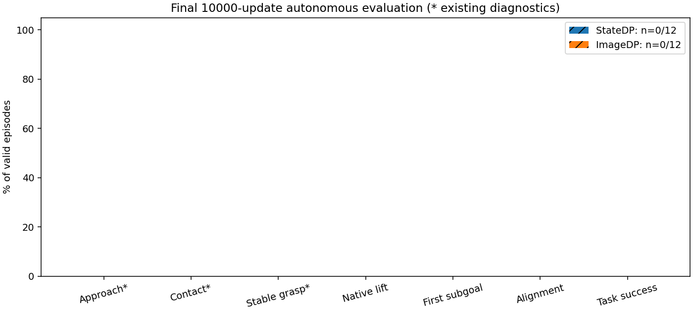

# EVALUATION_SUMMARY

| 模型 | 更新次数 | 成功次数/有效次数 | 成功率 | 软件故障 | 完成情况 |
|---|---:|---:|---:|---:|---|
| StateDP | 10000 | 0/0 | 未获得有效结果 | 1 | 0/12；待完成 12 |
| ImageDP | 10000 | 0/0 | 未获得有效结果 | 0 | 0/12；待完成 12 |

运行 `final_dp_20261104_01`；状态 **blocked**，阶段 `StateDP_00_attempt_1`。
每组预先固定 train4 + validation8，共24个模型episode；前各2次纳入这24条，不额外挑选。
最多 30 次启动（每个初态最多一次软件恢复，整个队列最多6次恢复）；不重试完整任务失败。
成功率分母只含校验通过的完整合法episode；软件故障、未执行项和有效结果覆盖率另列。

|模型|已启动尝试|未获得有效结果的已结束尝试|有效覆盖率|关闭异常但结果有效|
|---|---:|---:|---:|---:|
|StateDP|1|1|0/12|0|
|ImageDP|0|0|0/12|0|

## 阶段与失败类型

原环境没有接近/稳定抓取的离散成功标志，原生统计记为 N/A；下列前三项沿用此前已冻结的诊断，不能当作任务成功。
接近诊断：最近指尖距离≤0.08m；接触：对象过滤的法向力>0.1N；稳定抓取诊断沿用 `native_evaluation.stable_grasp`，阈值未改。
抬升来自原 `_lifted_object`，首子目标来自 `_successes>0`，alignment来自原 `_is_success`，完整成功来自 `termination_reasons.max_successes`。
各列为各自事件发生次数，不强制构造单调漏斗。

|模型|接近诊断|接触诊断|稳定抓取诊断|原生抬升|首子目标|alignment|完整成功|fall|dropped|timeout|其他|
|---|---:|---:|---:|---:|---:|---:|---:|---:|---:|---:|---:|
|StateDP|0|0|0|0|0|0|0|0|0|0|0|
|ImageDP|0|0|0|0|0|0|0|0|0|0|0|

## 配对、控制与故障

已有 0/12 对初态、环境合同与初始环境随机状态通过相等校验。
共享同一冻结初态、事件随机流种子、120/60Hz、H24/commit12、DDIM16/eta0/clipFalse与原控制器。
独立Kit每episode重新创建GRU；模型自主输出，专家只作为旧runner中的诊断shadow，未接管。
保存的可观察初态相等不代表完整PhysX内部状态可序列化。test40未使用。
启动SIGABRT、运行异常、关闭SIGSEGV/超时与SDK fast exit分别记录；fast exit0不等于正常SDK清理。
本次仅隔离Kit应用路径并复制原persistent配置，不修改共享SDK、驱动或其他项目。
依据：[NVIDIA Kit命令行](https://docs.omniverse.nvidia.com/kit/docs/carbonite/latest/docs/Kernel/CommandLineOptions.html)。

## 视频与逐次诊断

本地索引：`/home/CNS2025331827/docs/bc+rl_RSS/outputs/visuotactile/native_dp_v2/final_dp_20261104_01/VIDEOS.md`。每个有效模型episode均录制；MP4完整解码并与步数核对。
专家参考复用已成功且有真实视频的固定train初态982403，独立列出，不混入模型成功率。
[逐次结果与故障](research_docs/evidence/final_dp_20261104_01/summary.json)。

当前停止原因：Non-startup fault requires targeted repair: startup_or_runtime_software_missing
