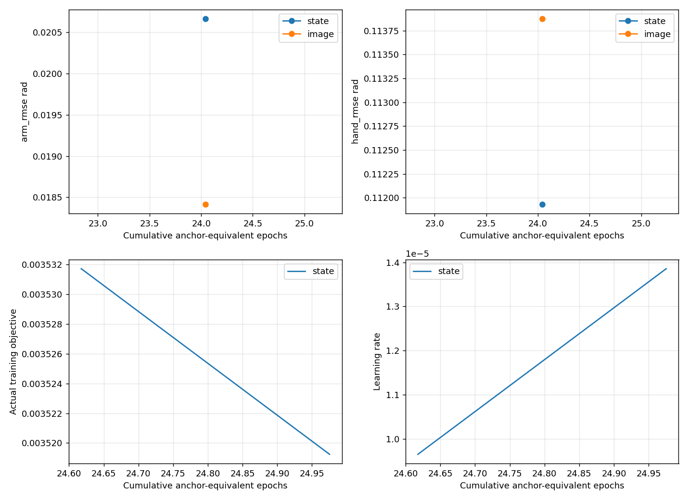

# H24 StateDP / ImageDP：多轨迹anchor续训

当前状态：**running**，阶段 `state_train_epoch_50`。本报告只记录已完成结果；后台任务启动不等于训练或闭环成功。

原正式 StateDP-10000 / ImageDP-10000 均0/12。新任务从这两个checkpoint的原始训练权重、EMA、AdamW moments/step及RNG续接，不从随机权重训练。原模型、标签、拆分和结果保留。

## 已核实的旧预算与新预算

|项目|旧H24最终训练|本轮续训|
|---|---|---|
|数据|train320 / validation40 / test40；832段|相同；不读test40|
|anchor全集|5547个，原生tick0,12,…|相同，H24标签不偏移|
|每次optimizer更新|2个最多96tick片段，平均13.3354 anchors|64条不同episode各1个anchor，microbatch4累积16次|
|时间相关性|同片段内anchor相邻，未来标签重叠|同batch不重复episode；跨batch仍可能相关，不宣称64个统计独立样本|
|旧10000更新累计|20000片段、133354 anchors；片段epoch24.03846，anchor epoch24.04074|新旧anchor抽样次数相加后除5547|
|GRU|当前权重完整起点前缀，原96tick TBPTT边界|完全保留，选中anchor前不零状态截窗|
|学习率|1e-4、warmup500、10000步cosine终点0|初值3e-6，200步升至3e-5，再按新增23918步总规划cosine至3e-6|
|EMA/optimizer|AdamW(.95,.999),wd1e-6；EMA power.75|moments/计数继续，EMA计数不重置；仅scheduler与采样算法换版本|
|固定核心|H24/执行12；29D绝对位置；Loss B+已校准几何/连续性项|架构、统计、损失权重和执行接口均不改|

|累计anchor等效epoch|新增optimizer updates|累计optimizer updates|
|---:|---:|---:|
|50|2250|12250|
|100|6584|16584|
|150|10918|20918|
|200|15251|25251|
|300|23918|33918|

旧抽样计数由20261102采样RNG逐次重放20000个片段，并与两旧checkpoint的完整order/cursor/RNG逐值验证。不是用均值估算。
新的episode deck每320次选择覆盖每轨迹一次，每轨迹自己的anchor deck耗尽后才重排；因此是episode均衡采样，长轨迹单个anchor的概率低于短轨迹，不是假装全局anchor均匀。
日志同时保存每个anchor/episode计数、唯一anchor覆盖、原片段被访问次数、前缀重算tick、梯度tick。`episode_selection_passes`只表示选择次数/320，不是完整轨迹训练epoch；单anchor窗口不计完整96tick片段遍历。
microbatch按整个64-anchor batch的有效目标数归一化base/FK/姿态/指尖，按有效邻接对数归一化temporal；尾段padding不能让短microbatch被过度加权。
3e-5峰值为旧峰值的30%，不随batch倍数线性放大；3e-6下限避免继承零LR。此数值是保守续训选择，效果由验证和闭环检验，不能由官方默认证明最优。

## 与官方Diffusion Policy的相关对照

|项目|官方公开实现|本项目决定|
|---|---|---|
|窗口batch|image YAML64；lowdim YAML256；DataLoader shuffle|先64跨episode anchor，不照搬256|
|序列|SequenceSampler枚举episode内窗口，边界复制填充|保留原native anchor、H24有效mask和完整因果GRU前缀|
|epoch/step|DataLoader遍历为epoch；scheduler按loader长度、epoch数、累积数计算|明确以5547 anchor抽样曝光计算累计epoch|
|优化|AdamW1e-4、warmup500、cosine、EMA power.75|保留optimizer/EMA，续训调度用更低峰值|
|归一化|具体dataset路径实现不同；不能假定自动train-only|继续原train320统计，不重算或掺validation|
|图像/state区别|官方图像ResNet编码、batch64；低维向量batch256；任务/预算不同|保持已有DINO和State表示，不替换结构|

官方主来源：[image配置](https://github.com/real-stanford/diffusion_policy/blob/5ba07ac6661db573af695b419a7947ecb704690f/diffusion_policy/config/train_diffusion_unet_image_workspace.yaml)、[lowdim配置](https://github.com/real-stanford/diffusion_policy/blob/5ba07ac6661db573af695b419a7947ecb704690f/diffusion_policy/config/train_diffusion_unet_lowdim_workspace.yaml)、[sampler](https://github.com/real-stanford/diffusion_policy/blob/5ba07ac6661db573af695b419a7947ecb704690f/diffusion_policy/common/sampler.py)、[训练循环](https://github.com/real-stanford/diffusion_policy/blob/5ba07ac6661db573af695b419a7947ecb704690f/diffusion_policy/workspace/train_diffusion_unet_image_workspace.py)。
官方累计epoch较大并不证明我们的150–300足够；数据量、任务、独立窗口定义与GRU计算量不同。

## 实测训练进度

|模型|累计updates|累计anchor epoch|最新LR|best验证Arm/Hand rad|阶段|
|---|---:|---:|---:|---|---|
|state|10081|24.975|1.385427135678392e-05|0.020662 / 0.111931|running|
|image|10000|24.041|未启动|0.018416 / 0.113876|pending|

原模型选择分数保留为best初值；只有完整validation40改善才替换best。每100新增更新保存可恢复last；阶段checkpoint独立保留。每1000新增更新及各里程碑固定seed验证。
全量validation40以及固定train16报告损失、逐关节误差、FK位置/姿态/指尖、前12tick方向幅值和连续性。train16是固定训练子集，不能冒称全train320均值。
达到150后，若最近两个完整验证间隔均不足0.5%改善则停止扩展；两次相对旧模型退化超过20%则选回best并停止，不删除更晚checkpoint。数值非有限时保留最后完整状态并阻塞，禁止无限重试。

## 闭环与Image严格配对

State先用固定validation ordinal4–7各一次，与原同初态结果比较；成功/首子目标出现或native lift计数提高时，再补完既定train4+validation8。小样本阶段进展不能声称显著成功率提升。
只有State出现上述实际进展，才进入Image阶段；否则保留State结果并明确标记Image等待State证据。Image先用旧10000模型进行两个独立启动，记录原始RGB-D、DINO、GRU、condition、DDIM输入/随机流和前12tick命令，严格配对通过后才续训。
原环境没有独立的“稳定抓持成功”离散判据，因此稳定抓持率标记N/A；接触、lift、首子目标、完整成功和失败原因按原定义单列，不能以接触力替代稳定抓取。

|模型|成功/有效|接触|lift|首子目标|软件缺失|当前证据|
|---|---:|---:|---:|---:|---:|---|
|state|0/0|0|0|0|0|尚未执行|
|image|0/0|0|0|0|0|尚未执行|

## 可靠性、路径与结论边界

运行根目录：`/home/CNS2025331827/docs/bc+rl_RSS/outputs/visuotactile/native_dp_v2/anchor_continue_20261104_01`；实际源码提交：`f189299494debf18dc75bd0b113d07a6ddbf1cdf`。新旧checkpoint路径/SHA与采样、指标见[机器报告](evidence/anchor_continue_20261104_01/summary.json)。
独立systemd单owner、连续资源监测、串行GPU worker；仅完整checkpoint边界可恢复，最多两次恢复。Kit最多28次启动（含最多两次恢复），连续同阶段故障停止；无需三次正常退出门控。原始结果、权重和视频只留本地。
视频索引：`/home/CNS2025331827/docs/bc+rl_RSS/outputs/visuotactile/native_dp_v2/anchor_continue_20261104_01/VIDEOS.md`。退出状态和任务结果分别记录，SDK fast exit不称正常完整析构。
**是否解决训练不足：尚须实测训练曲线与闭环共同回答。** 增加曝光并不自动证明充分收敛，离线误差下降也不等于抓取成功；不自动修改网络、动作表示或损失。
