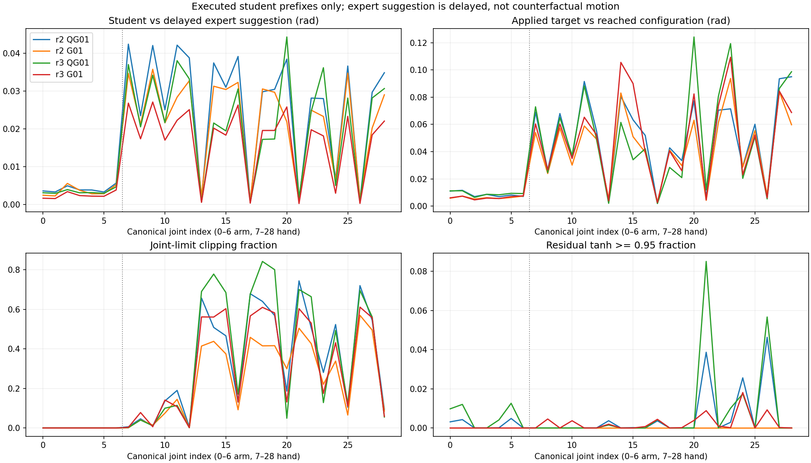
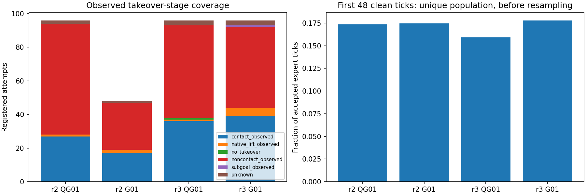
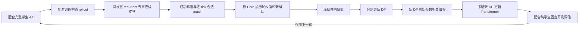

# Tight-Insertion：完整策略的成功筛选接管学习

**2026-11-12性能修订**：控制匹配run已实际启动，当前局部吞吐优化已测试、待安全边界接入；详情见 [DAGGER_PERFORMANCE](DAGGER_PERFORMANCE.md)。它保留下面的学习算法、标签与曝光，只允许第2轮两组DP计算并行，随后缓存/后端/评估顺序；不把局部1.228×/1.489×/1.935×写成整轮加速或任务成功。原run与旧审计快照均保留其时间范围。

本文区分三层证据：已经执行的历史协议、2026-11-12 控制/监督审计，以及新登记的公平 continuation。新算法实现、CPU验收、实际启动和闭环收益分别以机器凭据为准；尚未完成的实验不填成功率。当前结果入口为 [STATE_DP_RESULTS](STATE_DP_RESULTS.md)，动作及几何细节见 [CONTRACTS](CONTRACTS.md)。

## 1. 研究对象与完整学生

比较对象是两套完整部署策略，不是两个独立裸DP：

|组件|A / QG01|B / G01|共同条件|
|---|---|---|---|
|U-Net DP预测目标|专家执行后的真实配置 $q^+_t$|专家最终执行命令 $u^*_t$|29D canonical rad，H24/commit12，5Hz规划|
|前端观测|RGB-D、robot178|相同|冻结DINO；可训练投影、历史网络和U-Net继续学习|
|额外前端目标|既定手部软几何损失|无此损失|掌部FK监督按各自目标语义计算|
|Transformer|名义计划＋真实触觉/执行反馈→修正|相同结构|2层，d128，4头，FF256，756,581参数；60Hz更新|
|最终监督|组合后的 $u^*_t$|组合后的 $u^*_t$|共同命令normalizer，120Hz原生物理|

A的配置预测只是名义计划，必须经过已训练Transformer与最终执行适配器才能作为完整策略控制。后端缺失、加载失败或与前端SHA不配对时显式失败。历史采集的数值链审计没有发现静默裸DP回退；本次不把已有正确路径宣称为新修复。

设 $o_{\le t}$ 为真正经历过的因果观测，$h_t$ 为持续历史，$b_{t:t+23}=f_\theta(o_{\le t},h_t)$ 为当前名义计划，$c_t$ 为commit cursor。后端使用当前计划、过去反馈及触觉：

$$
\delta_t=r_\phi(b_{t:t+23},c_t,h_t,\mathrm{tactile}_{\le t}),\qquad
\bar u_t=b_{t+c_t}+\delta_t/s_u,\qquad
\hat u_t=\mathcal P(\bar u_t;p_t,\mathcal L).
$$

$s_u$ 为固定命令仿射的scale，$p_t$ 为当前动作之前真实执行器目标，$\mathcal L$ 为原关节限位。历史协议的 $\mathcal P$ 仅裁剪关节限位；新协议增加与专家相同的可达目标集合。各自前端保留不同的 $q/u$ normalizer；不能因为两者同为29维而互换。

## 2. 从真实学生状态连续接管

每条轨迹由登记的训练初态家族/seed开始，学生先自主执行完整策略。专家在每个真实观测上以recurrent shadow连续更新其隐藏态，其动作在学生前缀不控制环境。接管不会reset、回到理想姿态，或从另一条专家轨迹拼接状态。相同spec/seed只定义配对的可观测初态协议，不声称隐藏PhysX状态逐位一致。

接管时刻从预登记的有限控制tick集合分配，跨越早期接近、接触和较晚操作时间。计时覆盖不是语义阶段保证：历史第3轮A/B接管点分别有55/48个属于观测无接触，只有1/6个已有lift或子目标。应同时报告真实接管阶段，不能把八个时间点写成八种成功恢复机制。历史队列根据已完成轮的接管成功/阶段进展，有限地选择更早、更晚或较宽时间集合；新对照两组使用同一规则、同一当轮时间集合。

专家建议按原生规则裁剪到 $[-1,1]$，进入独立持续shadow队列。位置执行器保留原有一次delay索引抽样，专家使用此索引选取已保存建议；不额外抽样、也不破坏原native队列。随后进行native arm delta/hand affine/EMA/限位映射及已有Arm0.5、Hand1、Hand目标2rad/s处理。

队列有3槽，接管最初两tick仍可能含学生控制期间的专家建议。当前方案要求整个队列干净才监督，而不只检查本次抽中的槽。switch安排为 $12k-2$，第一个合法专家transition位于规划anchor $12k$。真实控制权、来源tick、delay index、queue clean、segment及命令都保留。

## 3. 什么是有效纠偏标签

令 $e_t$ 表示当前transition实际由专家控制，$d_t$ 表示延迟队列已清洁，$v_t$ 表示记录/时序完整。合法监督mask为 $m_t=e_t\land d_t\land v_t$。只有最终原生任务成功且通过记录准入的接管轨迹，才进入当前成功纠偏池。该成功筛选是episode级规则，不改变每tick实际来源。

|轨迹部分|历史输入|B和后端命令标签|A配置标签|
|---|---|---|---|
|学生前缀|完整保留|当前正式训练mask=0；shadow建议仅诊断|mask=0，学生q_after不能冒充专家q_reached|
|接管队列过渡|完整保留|mask=0|mask=0|
|干净专家实际执行后缀|完整保留|实际施加的最终命令 $u^*_t$|同transition积分后的真实 $q^+_t$|
|失败接管|完整保留诊断|未自动作为成功纠偏入池|未自动作为成功纠偏入池|

未来专家命令、未来实际配置、物体/接触安排不进入策略观测。几何所需后态上下文单独进入loss。未执行的专家建议不能提供反事实 $q^+$；现有delayed shadow建议也不能混称即时无延迟专家标签。若以后引入学生状态逐步标注，必须新建明确监督合同，重建recurrent历史并分别处理命令和实际配置标签；本次未凭空补这些标签。

DP监督窗口始于12的倍数，H24遇无效mask、控制段切换或尾部即截断；不能跨reset拼接。历史从episode起点持续推进，学生前缀也输入GRU；TBPTT detach与监督mask不清空运行历史。

## 4. 控制一致性审计与修复边界

历史 $u^*_t$ 已位于减速、delay和native映射之后。直接再把学生输出乘Arm0.5或再加delay，会改变训练目标与部署位置。因此“学生没有再次减速”本身不是重复处理bug。

实际差异在于：旧学生只受关节位置限位，仍可发出专家在相同 $p_t$ 下不可能产生的目标跃变。327条round2/3数值轨迹的标签/历史核对通过；学生前缀手部目标变化超过2rad/s的关节分量比例约11%–16%。该比例描述控制差异，不证明它是零成功的唯一原因。逐关节、接触阶段及真实运动对照见 [审计数值](evidence/control_consistency_20261112/summary.json) 和 [分阶段CSV](evidence/control_consistency_20261112/joint_stage_metrics.csv)。

新适配器以固定原生参数计算给定真实 $p_t$ 的可达集合：

$$
\mathcal R(p_t)=\{F(a,p_t):a\in[-1,1]^{29}\},\qquad
\mathcal P(\bar u;p_t,\mathcal L)=\operatorname{clip}(\bar u,\min\mathcal R(p_t),\max\mathcal R(p_t)).
$$

$F$ 是原生单关节单调映射和既有速度处理。通过两个端点即可得到各关节区间，无优化求解。在远离限位时，arm每tick上界为 $0.5\times0.1\times1.5/60=0.00125$ rad；hand还受原生EMA可达区间及 $2/60$ rad变化上限共同限制。这里限制目标变化，不改PD或真实关节速度。

同一纯torch函数在后端训练的最终命令loss、离线预测及实际部署中使用；参考量必须是robot178的58:87实际pre-action target，不能用DP重预测或过去名义计划。已合法的专家最终命令应在浮点容差内保持不变。新身份显式写入checkpoint配置，旧checkpoint保持旧数学行为。新适配器的CPU等价/梯度/真实标签读回检查与首批物理采集检查分别记录；不能仅靠CPU结果宣称物理轨迹完全等价或成功率改善。

新损失仍监督执行后的组合命令，而非把residual当完整动作。可达投影外的clip区间有零梯度；应报告实际饱和与有效梯度，不能假设加入投影必然改善学习。

CPU读回覆盖564条非test轨迹、169,853个合法专家tick：专家映射与日志最终命令最大差为0，投影改变专家标签的tick为0；端点FP32舍入最大约1.49e-8rad，固定1e-6rad容差只处理该数值边界。实际已训练A/B模型各用一个Core窗口和一个恢复初段窗口检查新组合loss，四个数据拟合梯度L2为0.001636、0.001742、0.015742、0.001816，均非零；投影生效的关节分量约46%–57%，不能隐去其零梯度区域。见[执行验收](evidence/control_consistency_20261112/execution_acceptance.json)及[真实模型梯度](evidence/control_consistency_20261112/execution_model_acceptance.json)。这些检查没有optimizer更新、GPU或新Kit启动。

历史来源可追溯到直接位置执行路径 `c7fcbb0e2d27e21fa5c818171014413d2b067d0a`、专家手部目标限速 `024cdaabf420b26565fb173ea2c917ddff7e98f2`，以及保留学生直接目标接口的DAgger专家桥 `01ce8d6ba785f73e8737f6598f4ceb4e13515b35`。受影响的是学生可提交目标范围与相关自主结果的控制条件解释，未发现这三个路径把合法专家标签改错。原数据、模型和负结果保留；新身份下双后端先适配，随后重新收集及更新两个模块，不把新结果追加进旧分母。




## 4.1 硬裁剪梯度快检与未采用的最小候选（2026-11-12）

[集中诊断结果](STATE_DP_RESULTS.md#tight-gradient-diagnostic)及[固定样本/权重/缓存身份](evidence/tight_gradient_20261112/manifest.json)使用第一轮新配套完整策略。A是q_reached＋既定几何前端，B是u_expert前端；两者后端仍监督u_expert。固定6条完整轨迹：2 Core训练，A/B采集来源各1条纠偏训练与1条隔离纠偏开发。总2,113历史tick/1,873合法专家监督tick，学生/切换前缀不监督但保留真实历史。test22未读取。

命令链显式拆成
\(\Delta=s\tanh(z),\quad u_{pre}=u_{DP}+\Delta/a,\quad u_{joint}=\mathrm{clip}_{limits}(u_{pre}),\quad u_{exec}=\mathcal P(u_{joint};p_t)\)。
这里\(a\)为命令normalizer的action_scale，\(s\)为既定残差幅度；\(u_{pre}\)是任何硬裁剪之前的绝对rad命令，\(z\)是后端logit，二者不能混淆。真实完整H24计划/cursor/mask、logit、修正、各级命令、专家目标、pre-action target、监督mask和权重均保存到本机诊断数值索引。最终执行函数、控制限速、延迟、normalizer和主干保持。

令 \(E(u)=\sum_t w_t[\tfrac12\operatorname{mean}_{arm}(a(u-u^*))^2+\tfrac12\operatorname{mean}_{hand}(a(u-u^*))^2]/\max(\sum_t w_t,1)\)，\(w_t=m_t\)且纠偏初48合法tick乘3。唯一候选为
\[
L=E(u_{exec})+\lambda_{pre}E(u_{pre})+10^{-4}R(\Delta),\qquad\lambda_{pre}=1.
\]
两项同mask/权重/尺度/Arm-Hand等权；R仍为原归一化残差等权平方惩罚。没有straight-through或修改物理可达集合。配置显式`loss_contract={"version":"exec_preclip_equal_arm_hand_v1","lambda_pre":1}`，checkpoint另记`residual_loss_version`并严格核对；缺失时保持原exec-only行为，历史checkpoint不被静默升级。

Arm1e-4rad/Hand1e-3rad误差容差下，误差存在但主拟合对u_pre局部梯度≤1e-10的坐标占错误坐标A83.04%/54.74%、B74.11%/51.91%。局部梯度去除样本权重/归一化，单位是归一化平方误差每rad；正则梯度另列。此处同时包含关节限位和可达clip，不能只看网络总梯度或历史学生投影率。专家标签被投影改变超过1e-6rad者为0；A有少量理论输出范围超界、B为0，并非共同的大面积tanh饱和问题。

固定每组每损失200更新、同初始化/AdamW/序列，4 train与2 dev严格分开。新候选虽恢复上述梯度且train裁剪前MSE下降85.49%/91.18%，但dev执行MSE较旧损失增加84.03%/82.92%，Core增加113.93%/60.70%，不通过预登记采用条件。因此**本轮不把该候选接入正式队列，不追加同类探针或调大输出头**。只证明裁剪前误差可学习，未证明闭环改善。

正式旧trainer的跨更新detached hidden是另一项已确认近似：实际一次更新后，沿用旧hidden与当前权重重放的下一32tick执行最大差A0.003186/B0.002198rad。固定权重批量/逐tick本身一致，标签、控制时序、双物理子步目标及缓存配对检查通过。新增独立`history_contract={"version":"current_weight_prefix_v1"}`和checkpoint `residual_history_version`支持每个有监督块前以当前参数从t0重算前缀，prefix no_grad，仅缓存不可变输入；`state_only`跳过不影响历史的Transformer读出，不加参数。真实4个160tick前缀13项状态逐位相等，局部提速约1.13–1.16倍。两臂探针均使用当前权重重放；**正式队列未切换该历史版本**，也未将旧合法轨迹/闭环结果判作无效。

尚无可靠的同状态专家/旧学生/新学生配对恢复闭环证据。现有导出不包含完整PhysX/contact/broadphase/传感延迟内部状态，前缀重放偏差未专项量化；没有把记录后缀施加到另一偏离轨迹冒充专家对照。旧损失200更新已改善训练恢复初段拟合及运动方向，但隔离dev变化很小，不能据此声称自主恢复已学会。现阶段继续现有容量，主要待查是损失尺度/短探针泛化与恢复阶段覆盖；这些是下一步假设，不是新增调参或训练授权预算。

<a id="execution-learning-repair"></a>
## 4.2 2026-11-13：执行等价主监督修复（独立候选，效果待验）

本次用户新授权覆盖4.1中已结束阶段的“不追加修复”限制，不能据此采用失败lambda1。
隔离树`bc+rl_RSS_execution_fix`从远端`36587a3`建立；IDE旧树`3e11d62`及其中未提交文档不动。
旧matched运行树HEAD为`8707757`，实际冻结源码仍`380a20b`，274文件SHA全部匹配。
`session.cwd`继承了更早palm_eval目录，第一次检查误用它得到41个不匹配；保留该本地检查，
随后依据活跃owner/worker `/proc/PID/cwd`定位perf树并重新核验0不匹配。
Git HEAD、运行源码与session历史字段因此明确分开。旧run原截止2026-11-13 11:22:40不变。

**执行映射。** 令环境/传感器状态为s，全部因果历史为h，
`(u_exec,h_next)=Psi(s,h,u)`。专家native raw经[-1,1]裁剪、持续shadow队列与既定随机索引，
再经Arm增量/Hand affine、EMA、关节限位，最后一次Arm progress .5/Hand1及Hand2rad/s目标cap。
这些产生的postprocessed绝对rad命令与学生最终命令进入同一位置执行器、相同两个120Hz物理子步。
标签已经delay/EMA/减速处理；新loss没有第二次delay、减速、PD或物理改变。
学生的H24计划先做joint-limit clamp（缓存/部署相同），后端
`delta=s*tanh(z)`，`x=u_pre=base+delta/action_scale`，再做joint clamp和可达映射。
后端无接触硬门控；A前端既定手部几何是可微软惩罚，不是执行投影，也不是本轮后端标签。

给定合法实际previous target p，Arm原生幅度1.5rad/s、dt=1/60、EMA=.1和progress=.5，
远离关节边界时可达增量是±.00125rad；靠近边界按native两次clamp与EMA精确重建。
Hand affine先映到joint范围、EMA=.1，再限制|目标-p|≤2/60rad。
`reachable_position_bounds`是逐坐标单调native映射的端点像。新候选显式检查finite、previous在joint内、
端点顺序和reachable⊆joint；只有≤1e-6rad端点舍入可与joint相交，真空/反向区间报错。
退化区间是合法固定坐标，FY恒零；异常区间、非法previous、超容差专家标签不静默修补。
理想嵌套box两个clamp因此可归约为一个clip，无非凸几何假设。

**三层边界。** (1)相同最终命令、实际pre-action target和下游控制状态使用同一物理接口；
已有双子步/实际issued与applied审计范围保留。(2)该可达box包含专家单步合法标签，有限tanh残差域
是否覆盖目标另算，不能仅由输出29D或raw范围证明。(3)固定专家shadow队列与延迟索引后，
选中非当前槽的动作受先前native建议约束；学生直接postprocessed输出并不等价于完整原生延迟策略。
此项时间能力不对称仍明确存在，不宣称完整历史可达集合相同，也不靠重复delay“修复”。
本轮选择已登记共同postprocessed接口进行条件监督，不改变队列、标签来源或已有实验解释。
后端head的z/delta/u_pre不写回GRU/history；私有previous_nominal来自固定前端，实际反馈是最终issued/applied。
固定同一网络内部状态、名义计划和真实输入历史时，执行等价命令不会因未裁剪x不同改变下一状态。
不同网络参数/hidden仅单步输出相同不构成长期等价；PhysX/contact/broadphase和传感延迟隐藏态仍未导出。

**候选目标与实际容差。** 保留执行`expert_reachable_postprocessed_v1`：当clip改变量≤1e-6rad时返回输入。
它在阈值处可向下跳变，并非标准单调clip。精确边界原像有单点加严格外侧射线；其闭包距离为零
不等于确实执行相同。新执行器没有被悄悄换成理想投影。独立loss版本`ideal_box_fy_roundoff_v1`
显式使用理想clip P0；真实u_exec与原标签的MSE一直独立记录。
监督y只有越界≤1e-6rad时允许数值规范化为ỹ=clip(y)，并记录最大改变量；超过即拒绝。
这不是对不可达错误标签的重新标注，原始y/数据不修改，学生prefix mask=0不参与合法性监督。
固定六轨迹实测y规范化最大1.49e-8rad，实际执行与理想P0最大9.99008e-7rad。

单坐标使用两倍Fenchel–Young投影损失，以匹配旧MSE在内部的系数：

\[
p=P_0(x),\quad F(x,\tilde y)=(p-\tilde y)^2+2(x-p)(p-\tilde y),
\qquad\partial_xF=2(p-\tilde y).
\]

等价于`(x-ỹ)^2-dist(x,box)^2`，但实际实现使用上述非负分段式，避免两大数相减。
这是实际可微标量的导数，没有straight-through或自定义伪梯度。
归约为`sum(w*[.5 meanArm(a²F)+.5 meanHand(a²F)])/sum(w)`，a是共同命令action_scale，
w为合法mask且纠偏初48tick权重3。它替换主拟合项，实际exec-MSE只作诊断/选模，
保留原`1e-4*(.5 meanArm(delta²)+.5 meanHand(delta²))`并单独记录。
正则仍偏好小残差，确实区分执行等价的x；不能把总loss非零判作FY主项错误。

理想执行等价时F=0；固定状态下真实执行相同的合法y亦落入所承认的等价/舍入情形。
F=0保证实际执行误差≤2e-6rad的明确上界，不声称与非单调v1在阈值处完全一致。
y为内部点时梯度在外侧为2(bound-y)，随着y接近边界连续趋零；恰为边界且在正确射线上时F=0。
与精确原像距离平方相比，不会在接近边界时保留与巨大x偏差成比例的梯度或在边界标签处跳变。
对无界x损失值仍可能随距离线性增长；这里保证纠错导数尺度，不宣称所有微小执行误差的F都相同。
一般原理参见[Fenchel–Young losses](https://jmlr.org/papers/volume21/19-021/19-021.pdf)，
此处性质由标量推导和实际Torch调用测试支持，不由文献推断机器人成功。

**执行可表达性与梯度。** 按P(U_model)重算，U_model=(base-radius,base+radius)，radius=scales/a。
分别检查有限logit开放域、仅tanh闭端点/浮点饱和、|tanh|≤.95的稳定表达区。
另实现包含joint逆像及v1容差“单点+严格射线”的实际映射分类，避免把非闭集合距离当作可执行性。
本批实际/理想分类计数相同：

|组/部位|合法坐标|旧raw-range超界|真实执行不可达|仅极限可达|有限但需> .95 tanh|稳定可表达|
|---|---:|---:|---:|---:|---:|---:|
|A Arm|13111|23|23|0|11|13077|
|A Hand|41206|473|467|0|47|40692|
|B Arm|13111|0|0|0|0|13111|
|B Hand|41206|0|0|0|0|41206|

A原473中6项实际上在执行边界稳定可达；不能沿用旧473解释幅度需求。其余A490项仍不可达，
FY不会拓展tanh域；本轮保留共同输出幅度和756581参数结构，先隔离损失效果，
不声称已解决这些坐标的可表达性，也不把其小比例当作全部零成功根因。
在超Arm1e-4/Hand1e-3rad错误坐标中，旧主项u_pre失效A2688/4562、B2831/4380，
新FY均0且方向错误0。logit是不同层：按实际加权梯度≤1e-10计，A Hand仍41个近零，
因此不宣称tanh/共享参数梯度处处非零。`previous.detach()`是固定历史条件监督，不是已证明的bug。

**失败lambda1的机制证据。** 重用相同真实Core及恢复块，当前权重prefix相同：
四个块中pre-MSE共享全参数梯度L2是旧主项约54–85倍（此前10–12倍仅指输出logit层）。
pre与旧梯度cos为-.143至.113，FY与旧为.788至.951，FY范数约为旧1.36–1.72倍。
匹配fresh AdamW单步中，pre使A Core和B恢复块实际MSE高于初始；FY与旧主项四块均下降。
这些块未触发全局norm1裁剪，正则参数范数约4.3e-6–1.18e-5，旧主项约6.95e-4–1.20e-3。
分别按Core/初48/后段、Arm/Hand、训练/dev记录正确执行分量所受logit压力、真实错误方向及三层梯度。
这能说明“强pre信号不等同正确执行信号”，不证明大样本泛化或闭环失败的完整因果链。
CPU单步使用独立内存模型，不落正式checkpoint，原lambda1的200更新结果不重跑/不采用。

**验证与有限接续。** 测试覆盖内部正确、正确外侧射线、错误边界、内部目标、近/正边界、
两级clamp、degenerate/非法区间、容差阈值两侧、tanh饱和、实际表达反例、checkpoint契约、
实际trainer loss调用及当前权重prefix。光滑FY可中心差分；v1跳变明确用分支值测试。
新loss缺字段仍为历史行为；执行/head不变，loss/history分别绑定checkpoint/restore/continuation。
历史复用已有`current_weight_prefix_v1`，prefix no_grad、当前32tick反传，不重新发明历史实现。
原固定六轨迹已有标签/时序/issued/applied/双物理子步审计复用，不能外推全库；teacher-forced和自主
状态分布、接触前/接触/抬升恢复覆盖仍是独立未解决因素。

新root `outputs/visuotactile/run/tight_execution_learning_20261113_01`，
开始2026-11-13 00:05:15、计算截止23:55:15、绝对截止2026-11-14 00:05:15（UTC+8），准备与等待计入。
先等待旧owner/worker及其终局报告退出；GPU不能与原正式双前端争抢，源代码推送亦等旧发布后安全合并。
同六轨迹、同起点/顺序/合法mask/normalizer/Arm-Hand归约/新AdamW、相同当前权重prefix，
旧loss与FY每组各200更新；不以pre-MSE选模。采用门槛两组共同为dev执行MSE比≤1.02、
Core≤1.05、初48 Hand方向下降≤1个百分点、tanh饱和率增加≤1个百分点。
这是开发用重复诊断集，不是独立泛化检验，也不是自动强制采用数学正确的loss。

通过后以旧run最新完整共同轮的前端/后端/全量合法快照和严格SHA配套缓存作正式起点，
独立登记该来源与第一轮probe起点的区别。两组继续全部Core及该快照的合法纠偏；不删后续未完成轮数据。
冻结DP，只做后端适配：根据实测prefix吞吐两倍保守估计与至少2h评估/I/O预留，
在6、3、1有效tick遍中按时间确定最大共同预算，训练前冻结，不根据dev结果追加。
先完成两组并核验真实曝光一致，再执行每组原登记10个完整DP+Transformer自主开发机会。
固定曝光endpoint，validation-best另留；test22隔离，不新增DAgger轮/采集，不把后端适配称为完整DAgger。
若短训不通过、资源/标签/软件门控失败或预算不足，保存实际结果退出，不递归追加probe或重置24h。

普通脚本`tools.tight_execution_learning`负责等待、阶段推进、有限停止及小报告发布；
只推origin/feature/tight-state-foundation，不force。原数据/初始化/当前/恢复权重和历史成败保留本机，
完整命令NPZ索引仍见上一诊断publication。新短训权重不可部署，正式重训checkpoint才可进开发验证。
数学验收、优化门槛和物理闭环三层分别报告，实际状态见STATE_DP_RESULTS页首与本轮机器JSON。

## 5. 聚合、两阶段更新与公平预算

原Core train166、全部合格旧纠偏和本轮新纠偏持续累积，按内容SHA去重；correction-dev在整episode采集计划中预登记并永久隔离。原validation30用于开发，test22不参与采集、训练、选模或本次评估。同轮A/B读同一不可变快照，采集率不同如实保留，拒绝或失败不补seed。

训练按Core/历史纠偏/本轮纠偏 $0.5/0.2/0.3$ 分层。前端在纠偏层内部约一半anchor来自首48个连续合法专家tick，其余仍覆盖完整后缀；后端对该初段最终命令loss加权3倍，按真实权重总和归一化。加权质量和重复抽样不是新增物理tick或新增恢复起点。历史第3轮A新纠偏层初段anchor实际占约50.18%，因此“恢复初段完全没被训练”不符合记录。

每轮先更新DP全部原可训练部分，DINO仍冻结；选定新前端后，用真实完整前缀刷新所有依赖它的H24计划/cursor/mask、可训练视觉读出、持续hidden与previous_nominal，再更新Transformer。真实issued/applied、q/qd、触觉和时间戳保持日志值。只复用图像、backbone、内容SHA均匹配的冻结DINO原始特征；DP相关缓存必须绑定新权重、数据、统计和mask身份。

新可比序列采用以下已登记设计，实际完成量另列：

|项目|新协议|
|---|---|
|前置适配phase0|两组各冻结已有前端，用相同旧池快照，将后端适配到共同Arm0.2/Hand0.9幅度与新执行器；6有效tick遍，训练完成才部署；不称作一个完整DAgger轮次|
|完整DAgger轮次|最多2轮，A/B每轮各48机会；配对家族、seed、接管规则与dev分区|
|前端训练预算|每组每轮6有效anchor等效遍；共同分层抽样与种子，完整batch取整差异明示|
|后端训练预算|每组每轮12有效专家监督tick等效遍；完整episode组取整差异明示|
|部署与选模|使用共同曝光endpoint配套；另留validation-best作诊断，不按闭环lift给一组多轮或回退另一组后继续比较|
|自主评估|每组每轮固定10个已登记开发机会；不根据中间表现扩缩，不补非法seed|
|有限墙钟|新continuation正式admission起至多24h，CPU准备、phase0、采集、缓存、训练、评估与等待均计入；旧run及其13:24截止不改|

两组初始已训练权重仍有历史曝光差异，无法通过新命名抹除。共同新协议和残差幅度消除了后续对应工程变量，但不构成从同一随机初始化出发的严格单变量研究；论文必须披露历史来源。A的几何开销与各自模型真实有效监督人口、实际消耗单独报告。若某组阶段失败或预算不足，保留部分证据，不单独让另一组进入更多轮后声称配对完成。

统一幅度有明确动机：B历史手部修正幅度仅0.1，第2轮恢复初段48tick中约33.47%的专家所需修正超出该界，第3轮约17.72%；A相应比例低于1.1%。这是表达范围不足的离线证据，不等于模型实际tanh饱和率，也不证明放大就能成功。phase0从各自已训练权重继续，双方均在共同范围上训练，不能只换B的buffer后直接部署。

时间估算依据历史第3轮：每组96次采集约2.13–2.22h、800 DP更新约1.27h、564条前端预测缓存约31min、12后端tick遍约28min。新每组每轮48次采集约1.1h、6 anchor遍随人口增长约2–2.4h、缓存35–45min、后端30–40min及10次评估约20min；phase0加两轮顺序安排预计20–24h，实际以吞吐与剩余预算为准。24h是本次明确有限上限；阶段超时、双组曝光不匹配或不足以完成下一对时停止并如实发布部分结果。



```text
Input: existing paired models for A/B; Core; qualified recovery pool; fixed budgets
Adapt both backends to the common execution contract and bounds on the same old snapshot
for k = 1,...,2 within the registered absolute deadline:
    for g in [A,B]:
        for each preregistered paired training start and takeover time:
            run complete student; advance expert shadow on every true observation
            switch control continuously; retain real command/queue provenance
            save all outcomes; admit only successful, valid expert suffixes
    freeze one shared snapshot; keep development episodes isolated
    if admitted_performance_revision and k >= 2:
        train both DPs in parallel for common anchor exposure, each with its own label semantics
        wait for both registered DP jobs to finish
    for g in [A,B]:
        if not parallel_frontends: train DP for common exposure using g's own labels
        freeze new endpoint DP; refresh every DP-dependent backend cache
        train backend for common valid-tick exposure against final expert commands
        save coupled endpoint; run 10 fixed pure-student development attempts
    continue only after both complete pipelines resolve; never reset the deadline
export all actual denominators, provenance, curves, failures and local artifact indices
```

## 6. 实验表与解释边界

可复现实验数据在 [逐轮表](evidence/control_consistency_20261112/experiments.csv)、[训练曝光](evidence/control_consistency_20261112/training_exposure.csv)、[独立恢复案例](evidence/control_consistency_20261112/recovery_cases.csv) 与 [自主逐例结果](evidence/control_consistency_20261112/autonomous_cases.csv)。采集机会、合法起点、真实接管、成功纠偏、初段有效tick/anchor、训练实际曝光和自主分母分别列出；未完成字段保持空值。

以下是控制审计生成时的旧run快照，不是当前matched run结果。该时刻历史round2 A/B各0/4自主完整成功；round3 A亦0/4，全601tick超时，无lift/子目标，B仍在训练。round3采集A/B各96机会、93合法、90条成功纠偏；180新纠偏聚合后池共368条（333train/35dev），加Core后训练499条。专家恢复率高并不表示学生能自主完成任务。

与经典逐状态标注DAgger相比，本方法让学生产生接管前状态，但训练监督集中于**成功恢复后的实际专家执行后缀**，不是对所有学生访问状态都采集训练标签。经典算法聚合学生诱导分布上的专家标签；其保证不能直接转用于当前成功筛选方案。[Ross等，AISTATS 2011](https://proceedings.mlr.press/v15/ross11a.html)。

因此应称为“带数据聚合的成功筛选专家接管恢复学习”。失败接管被排除会产生选择偏差，较晚恢复后缀可能稀释最初错误状态；早期前缀没有专家配置反事实标签，不能通过复制q_after解决。当前证据支持这些机制限制，以及学生实际目标越界差异；尚不支持“数据量不足是唯一失败原因”“触觉/几何带来因果收益”或“新执行器已改善自主成功”。离线命令MSE、目标FK和观测接触阶段都不等于实际任务成功或严格配对物理反事实。

## 7. 代码与恢复入口

控制映射：[position_control.py](../visuotactile/position_control.py)；采集/完整策略数值验收：[state_benchmark.py](../visuotactile/state_benchmark.py)；监督/mask与聚合：[narrow_data.py](../visuotactile/narrow_data.py)；训练及新执行器组合loss：[anchor_continue.py](../visuotactile/anchor_continue.py)；队列/共同曝光/后台接续：[tight_dagger.py](../tools/tight_dagger.py)；CPU数值与图表导出：[tight_diagnostics.py](../tools/tight_diagnostics.py)。

保持已有统一pipeline。新版本在隔离工作树准备；旧owner退出并完成发布后才部署。恢复使用既有 `dagger_resume --root <continuation_root>`，按持久阶段/SHA跳过完整工作，训练恢复保留optimizer/EMA/RNG；同run不重设截止。数据、权重、视频留本地，公开摘要、源版本、数值、图表和索引。实际服务、root、启动/停止/发布凭据以[交接](SESSION_HANDOFF.md)为准。

CPU复现命令如下，输出另写临时目录，不能覆盖运行准入已绑定SHA的凭据。第一个命令使用固定旧A-r03/B-r02自主记录；第二个命令按当时已存在的旧run报告导出，因此后续新增B-r03评估时需保留生成时间。

```bash
bash visuotactile/run_cpu.sh -m visuotactile.position_control \
  --execution-audit \
  --source outputs/visuotactile/run/tight_dagger_pool_20261111_01/round_03/QG01/dp/state_data \
  --rollout-root outputs/visuotactile/run/tight_dagger_pool_20261111_01/round_03/QG01/backend/QG01/evaluation \
  --rollout-root outputs/visuotactile/run/tight_dagger_pool_20261111_01/round_02/G01/backend/G01/evaluation \
  --model-root outputs/visuotactile/run/tight_dagger_pool_20261111_01/round_03/QG01/backend/QG01 \
  --model-root outputs/visuotactile/run/tight_dagger_pool_20261111_01/round_02/G01/backend/G01 \
  --output outputs/visuotactile/tmp/control_audit_reproduction

bash visuotactile/run_cpu.sh -m tools.tight_diagnostics control_audit_publish \
  --root outputs/visuotactile/run/tight_dagger_pool_20261111_01 \
  --output outputs/visuotactile/tmp/control_audit_reproduction/figures
```
