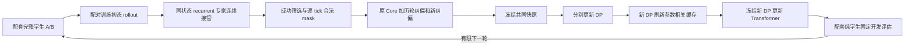

## 2026-11-14 当前重启：逐帧视觉与train30

本轮授权替代旧截止、旧初始化和只启动后返回要求；当前指令集中在根AGENTS.md。研究机CNS202533182702；远端feature/tight-state-foundation核验为506d185，旧主工作区3e11d62及其未提交文档未改。新隔离树continuous_vision_20261114。

确认旧视觉每12tick一次，后端重复旧visual。新独立version6/visual_stride1合同把每60Hz真实RGB-D送入训练、在线视觉GRU和后端缓存；DP仍5Hz。旧合同保留。q_reached为transition后的q(t+1)、间隔1/60秒，不是稳定姿态；u_expert是当步实际执行目标。新模型尚未训练，不宣称任务改善。

原Core有36训练family；一家族一条中位时长完整成功，再按实际初态标准化最远点选择30条，原validation独立family取6条，test22未打开。36条共12,460tick，原文件SHA和q_after/q_before时序逐条通过；统计只用train30，未加载旧学生权重。原始数据与专家保留。详见evidence/tight_fresh_20261114/selection.json；标准化混合坐标距离只用于选取与去重，不作物理精确重放声明。

实现当前处于接口验收/全帧缓存准备。初始完整A/B训练、后端、真实多环境吞吐及DAgger研究循环尚未完成，不能把准备记为科研成功。新本地root：outputs/visuotactile/run/tight_fresh_20261114_01。

---

以下为历史记录，当前状态以上文和机器收据为准。

## 2026-11-13 23:00 实际运行自查与写盘优化

本次只做8次有界诊断，零新训练；已有span-dose训练/40机会评估不中断。A仍是QG01：q_reached + 独有手部环境几何 + Transformer；B仍是G01：u_expert DP + Transformer。两组共有palm位姿拟合项，不能说B完全没有几何相关loss。历史初始化差异仍披露，本次每组各3次完整学生诊断；旧B版本与命令回放各1次独立，不合并为性能分母。

原B seed27150001的274步完整自主成功真实存在，checkpoint与trace哈希保持不变。但同seed/同可见初态/同权重两次新诊断分别349步跌落、601步超时；A两次均601步超时，旧B也超时。第一条新B从tick0计划就不同，实际命令最大差0.009797rad，物体到零基tick59才超过1e−6。原始普通评估没有保存该初始RGB-D，不能凭可见状态相等断言完整感知输入或隐藏模拟状态相等，更不能把差异归因于某个晚期纠偏动作。本次没有复现成功，不宣布稳定收益。

真实成功分支dagger_r01_000共503 tick：原H5、A/B DP记录与后端缓存均完整；学生0–59只提供真实历史，60–61为队列过渡，62–502共441合法专家tick可监督。DP实际anchor60监督62–83，后端32:64批次监督62、63；两组各460次旧计划移位检查通过，cursor=tick%12。历史metadata的anchor72不是当前sampler证据。该设计不会把错误学生前缀伪装为专家标签，但成功后缀本身也不能直接教会前缀；补前缀必须重新取得合法专家标签，A仍需要实际执行的q_reached，不能用学生q_after冒充。

对该分支完整503命令进行了真实物理回放：命令和控制器目标逐数组精确相同，可见初态相同；物体在零基tick79、关节tick81开始超过1e−6，最终未成功且命令序列耗尽，不能写成601步timeout。A/B再从该分支初态完全自主各运行1次，均601步超时。故记录完整、命令回放正确已经验证；精确物理复现、学生学会从此初态完成均未验证成功。专家纠偏是从真实状态持续观察，未重置任务时钟；这不保证学生仅凭可见观测已学会。

计时来自真实完整策略，601步约70–83秒（10.02秒模拟时间），历史队列约10–14分钟/10机会。因此串行20/40机会通常约24/48分钟，旧队列本来已在10例内复用Kit，并非每例重启。代表A旧写法81.58秒中：仿真/传感器42.93秒（含render21.84、physics step0.79、scene update3.47，三者不可再与42.93相加）、完整策略13.87、未执行专家shadow7.65、numeric写盘13.05、reset/装载等1.62，其余约2.46。Kit/环境初始化另计14.10秒；每例模型构建约1.2–1.3秒。独立CPU编码原503帧三视角视频6.26秒，读图1.81秒、全解码校验0.27秒；这不包括已计入env的必要相机render，普通评估只有每10例首例编码视频。

固定12:30–22:30十小时按实际收据去重：DP104.27分钟、Transformer76.84、cache82.27、评估214.02（180机会）、纠偏采集22.43、离线约7.28。实验区间并集507.11分钟；另外79.50分钟是未与上述实验重叠的Agent活跃区间，含代码分析/诊断/发布，不能全部叫编排浪费；13.39分钟无法分类。训练日志资源等待仅53.28秒，包含在训练墙钟内。没有历史Git独立计时，不编造推送耗时。DP每组514更新，为138.85万gradient tick重算593.17万prefix tick；两个后端缓存串行82.27分钟是明确成本。避免在无新前端时重建缓存、先诊断再追加40评估，比盲目加训练更有价值；当前权重历史不能直接换成过期缓存。

实际修改：numeric诊断HDF5缓存dataset句柄并32步批写，保持132字段、dtype、数组、chunk和压缩；结尾/普通异常flush，compact原始训练记录不变。23项定向测试通过。真实274步数据CPU配对4.80→0.42秒、逐数组一致。完整A601步81.58→70.88秒，写盘13.05→1.43秒（省11.62秒），墙钟少10.70秒/13.1%；物理轨迹非精确配对且有原评估并行，不能把全差异都归于writer。硬崩溃最多损失尚未flush的31行新numeric诊断，原始compact路径不变。普通自主评估也开始保存已有wall_profile，原先只在capture_dataset时保存。

本次基线探针四例结果均已持久化后，退出助手因缺少root result.json报错、Kit未退；已保留故障并仅清理该完成进程，修复有限诊断入口的结果/错误退出。它短暂影响新B测试，114.75秒明确排除加速证据。两探针GPU进程均已退出，无新后台服务、无训练重启。后续正常队列才应用新writer，不热改现有正式worker。原计算23:55:15、绝对次日00:05:15及test22隔离保持。

小证据：[runtime_review.json](evidence/tight_execution_learning_20261113/runtime_review.json)。全部原始轨迹、checkpoint与本次8次诊断留在本地outputs。

## 2026-11-13 22:12 单一共同曝光问题

可达跨度metric完整固定cohort四cell均0/9合法成功、另各1初态拒绝，无软件失败；十次是机会数不是合法任务分母。旧metric对照与span同为1314更新/193520监督tick。完整离线span相对reference的arm RMSE：A train/validation为0.000767/0.000798，reference为0.000811/0.000831；B为0.000731/0.000895，reference为0.000779/0.000950。hand未共同改善，闭环无第一子目标，不能把条件化修正当作已解决瓶颈。

`rear_span_dose_02`检验有限额外训练是否有用：原span1遍为冻结参考，各A/B从该endpoint共同fresh AdamW追加2遍，其他科学配置不改；当前权重prefix仍重放，不缓存过时学习态。历史与optimizer重启限制显式披露，不把总3遍vs1遍说成等曝光loss比较。新40机会预先冻结，对照不重训，四cell完整DP+Transformer，固定最终checkpoint；validation-best独立保护。先准备fairness再完成fairness，任何缺失/不等保留并标注。两遍依据实测吞吐与剩余绝对时间而选，不是新的机械最低门槛或递归预算。

## 2026-11-13 21:18 评估证据接续，不重训或重复机会

span候选A/B均已完成1314更新、193520合法监督tick、1.0遍，完整离线验证已完成。首次evaluation-only恢复遗漏offline/result.json，真实residual_evaluate在Kit启动前因组分母保护退出；不是训练失败或自主0成功。四cell的既有离线结果逐一绑定选定checkpoint SHA，并验证state_data与nominal实际同源，才可只读复用至新身份。不得伪造offline准入结果或绕过组分母保护。

`rear_span_metric_eval_recovery_02`原样续原40机会、四组固定模型/seed/顺序与22:50:03子截止；新训练和离线推理均0。已有任何trial启动标记、失败标记或部分轨迹都拒绝整队重放。两arm准备fairness通过；四个真实residual_evaluate入口已CPU加载实际checkpoint并通过normalizer/DINO/组分母检查，trial dispatcher以sentinel替代，明确不是仿真验收。原计算23:55:15、绝对次日00:05:15及test22隔离不变；完成后再据完整策略结果判断span metric，不增实验矩阵。

## 2026-11-13 20:53 可达比例FY：有界优化metric假设

完成重放四cell均0/10，population逐层完整1遍。对全部662训练episode/193520合法tick测量：令w=h−l、anchor=clip(base,l,h)、x=anchor+wz，原FY raw梯度为2(P(x)−y)/w × (action_scale·w)^2，再乘Arm/Hand均值系数。逐joint系数中位数跨1551.14倍，Arm整体中位数.00019710、Hand .00594924；不等于共享参数实际梯度贡献，更不证明失败因果。

新增opt-in `ideal_box_span_fy_roundoff_v1`用1/max(w,1e−6rad)^2替代action_scale²，仅换训练metric，不重拟合/替换冻结normalizer、delta buffers或执行器。2FY元素仍为(P(x)−y)²+2(x−P(x))(P(x)−y)，真实autograd、无STE；错误饱和区仍有方向梯度，已经等价到达端点的提案可零loss。零宽box的FY为零，floor防除零；标签只允许原1e−6rad端点舍入。真实executed-MSE仍原metric/原标签，不直接比较两类FY数值。

regularizer固定0，其余centered输出、current-weight prefix、128tick窗口、LR1e−4和优化参数不变。候选A/B各从同一contact起点，以与已完成population相同deck训练1遍；冻结旧population endpoint为参考，不重复已完成训练。预登记新seed27190000–09，四cell共40完整DP+Transformer机会，顺序reference-A/span-B/span-A/reference-B；无扩展或自动采用。不是DAgger，无DP更新/采集，cache精确复用。metric全局尺度也改变，Adam epsilon/clip可能中介效果；候选在先前开发结果后提出，不是未见结果的总体研究。A/B历史初始化差异和全部原截止保留。

## 2026-11-13 19:20 完整复验与后端重放分布实验

`ab_replication_completion_01`已完成：相同20个新开发机会，contact A0/20、B0/20，全部合法，无软件失败；lift分别3/8、首子目标均0。原A0/10、B1/10与B previous0/20独立保存，不能混分母或宣称B稳定领先。A事后补齐、历史初始化/曝光不同仍须披露。

下一独立`rear_replay_balance_01`不是新DAgger：冻结两组contact DP、对应完整commit12缓存与共同FY/可达中心化/128tick窗口/current-weight历史；只比较后端原50/20/30重放与按合法tick人口比例重放。实测旧后端current仅16条却12.879遍、history480条仅144条出现；这支持检验分布偏置，不证明零成功根因。真实记录与固定种子CPU预采样：原配比193690tick/319独立episode，history137/480、current12.930遍；人口比例193520tick/662独立episode，三个层均恰好1遍。预采样不算训练曝光，完成后必须核对真实账本。

每种采样中A/B均从各自同一contact后端tensor重新建AdamW、共同1有效tick遍、固定最终endpoint评估；validation-best另存，不据结果选有利checkpoint。每cell10新开发seed27170000–09、共40机会，规格/自然结束/native成功标准相同，无替换或扩展。两个采样arm实际整episode取整与更新数可能不同，必须披露；A/B各arm内要求相等，不能称全历史公平或纯等更新因果。前端本次0更新、无新数据、无缓存刷新必要，不称DAgger或解决了全部DP覆盖。

新增fairness显式`--frozen-frontend`：核验实际冻结SHA与后端初始化、准备合同不能冒充完成证据，DP新曝光报0而不复用旧514。28项CPU测试与真实prepare CLI通过，两arm准备审计通过；本节尚非启动证据。独立service最长到21:48:09，仍服从原23:55:15计算/次日00:05:15绝对截止。普通脚本只执行登记，下一判断交原真实Agent监督器。

## 2026-11-13 18:45 复验未重现成功，补齐当前完整策略A机会

B current/previous在20个相同全新开发seed上均0/20合法完整成功；这不是稳定改善证据，也不证明FY或接触恢复的单独因果。避免立刻再加训练矩阵；先按最新公平要求只补齐冻结contact A的同20规格/seed，复用B现有结果，B previous与原10例cohort均独立保存。

`tools.tight_ab_replication`只做普通固定编排和收据核验，不作研究推理。每批10例，拒绝不补、软件失败不当作任务失败；模型/计划/B结果hash固定，实际身份/seed/reset/自主属性及合法分母逐项复核；不完整或不匹配明确失败。原contact训练prepared/completed公平审计在启动前通过，完成后再审计。A/B保持原有标签差异和历史差异，A后补的时间顺序不伪称随机平衡。评估源码与B冻结版本一致，原执行器、commit12、FY非平坦梯度和数据完全不动。新注册根为`ab_replication_completion_01`，最多1h且不越原计算截止，无新训练和自动后续阶段。

## 2026-11-13 17:53 冻结复验已实际推进

独立`success_replication_01`owner PID2908611/start_ticks162322839，首个新seed完整学生已推进tick400；冻结73b2e97源码无漂移。24测试与真实启动分别记录，未新增训练。子截止19:45:35 UTC+8，原截止不变；结果待固定40机会完成后由真实Agent判读，不自动扩大。启动凭据见同目录`startup_acceptance.json`。

## 2026-11-13 17:48 接触恢复完成：B成功与独立复验

`adaptive_contact_recovery_01`正常完成，旧owner已退出；A/B完整DP+Transformer各10次合法自主开发分别0/10、1/10，lift2/3、首子目标0/1、软件失败0。B `palm_fresh_001`（seed27150001）原生tick274成功并终止，post-success动作0；结果/trace凭据SHA及前后端绑定核验通过，完整评估明确`expert_takeover=false`。这是一个真实开发成功，不是接管成功，也不足以证明稳定收益。

两组DP各514更新/765303监督target槽，wall3105.77/3150.55秒；新配套cache后的rear各1362更新/193581合法tick，训练wall327.44/324.39秒。一轮总耗时约4h19min包含采集、两个前端、全量cache、后端、离线与20个仿真；不能把elapsed都归因于loss反传。后端历史纠偏仅覆盖144/480条、当前16条全覆盖且重复，不能称完整逐episode遍历。沿用已完成CPU自查，不重复宽审计或为补phase盲增训练。

真实Agent选择冻结复验`success_replication_01`：仅B当前完整pair与紧邻tick-window完整pair，预登记20个全新开发seed27160000–27160019，同原domain直接采样、相同reset规格和seed；两批各10，顺序current/previous、previous/current。共40次固定机会，拒绝不补、软件失败不算0成功、不按结果扩展；A和全部模型/cache保持原样，无新训练/纠偏/自动采用。只复用原fixed10原生入口，比较整个contact周期，不能隔离数据、窗口、前端或后端因果，也非等训练预算或未触碰test。

隔离树基于已发布b431c3b，未修改活动监督器/旧源码。24项CPU测试及真实prepare CLI通过；此为启动前记录，GPU验收看本地launch/status/startup_acceptance。独立systemd cgroup最长2h，且受原计算11月13日23:55:15、绝对次日00:05:15 UTC+8约束；下一研究决策交现有真实Agent事件监督器。小证据见`evidence/tight_execution_learning_20261113/success_replication/`。

## 2026-11-13 控制步学习与复杂度自查（当前训练未中断）

结论：当前训练快照的全部193,520个合法控制步都能成为DP监督，包括原12步计划真正执行的前12个位置；没有phase1–11整体失效。**可以训练不等于本轮已经训练到**：下面按实际checkpoint计数，而不是按采样概率估算。当前没有发现需要再修改执行器或叠加mask的确定性问题。

### 每个控制步如何使用

在tick60规划一次，DP预测tick60–83的24步计划；实际先执行60–71，72再规划。每个tick的机器人状态和过去执行反馈都更新历史，但只有60、72等规划点的条件送入DP预测器。tick65的动作既可监督60那次计划的第6个位置，它的观测也会进入72之前的历史。Transformer在65直接使用当时反馈和60留下的计划，逐tick学习最终专家命令。因此“DP条件只在phase0产生”符合部署机制，不等于只训练phase0的动作，也不需要每步重规划。

A前端仍学习执行后q_reached和既定几何，B仍学习最终u_expert；两组Transformer都学习最终u_expert。当前后端没有接触硬门控，非接触和失触时也能修正；缓存中的gate仅用于接触分类统计。存在的tick、合法专家标签、剩余计划有效位置是不同含义，不能合并成一个mask。学生前缀和前两步过渡继续更新历史，但不冒充合法专家标签。当前权重前缀重放中更早的历史会detach；“读过历史”不等于每次都反向传播完整历史。

具体旧例：tick60接管，60/61是队列过渡，62才是首个合法标签。旧DP窗口要求anchor本身合法，直到72才取训练窗口，漏62–71；后端和历史没有漏这些步。已发布58ed6e1保留60这个真实规划点，只屏蔽60/61，把62–83放进该计划监督，不把未来62的观测塞回60的条件，也不在62重新规划。21条旧轨迹共补210个独立目标，不是整21条数据丢失。当前训练明确使用recovery_onset_commit12_v1；update300已实际用到其中150个，另外60个仍可抽样。原53项回归和6个真实EMA/batch检查复用，本次未重复启动网络实验。

### 分相位实际覆盖

快照时间：2026-11-13 14:14:52 UTC+8。A当前新DP update300；193,520个合法tick中实际见过126,296个，重复/重叠目标槽总数446,640，与checkpoint账本逐项相等。DP的H24相邻计划会重叠，这些是不同规划条件下的训练目标，不能当作新增数据。另列真正执行前12位置的独立覆盖，避免用计划尾部掩盖执行段遗漏。

后端列来自**上一轮已完成**的A/B各1191更新；它们使用相同样本顺序，phase计数相同，但数据快照与当前DP不同，不能直接比较分母或称新后端已训练。当前新B前端及新后端尚未在本快照完成。

|phase|当前DP合法tick（全部可监督）|实际H24独立目标|实际前12位置独立目标|上一轮后端独立目标/合法tick|
|---|---:|---:|---:|---:|
|0|16402|10686（65.15%）|8891|9498/14447|
|1|16354|10658（65.17%）|8871|9471/14405|
|2|16317|10635（65.18%）|8856|9450/14376|
|3|16269|10605（65.19%）|8833|9424/14334|
|4|16213|10573（65.21%）|8811|9394/14289|
|5|16164|10548（65.26%）|8792|9371/14250|
|6|16109|10515（65.27%）|8765|9341/14203|
|7|16048|10481（65.31%）|8737|9304/14146|
|8|15993|10447（65.32%）|8709|9272/14098|
|9|15942|10419（65.36%）|8689|9248/14055|
|10|15884|10382（65.36%）|8663|9216/14004|
|11|15825|10347（65.38%）|8636|9183/13952|

当前纠偏初48步已覆盖23,748/23,808（99.75%），剩余60正是上述尚未抽到的旧起始窗口。旧纠偏全后缀仅覆盖66,404/133,628；本轮16条新纠偏已覆盖4,500/4,500。Core全55,392步已覆盖。因此没有按phase造成的盲区，但旧数据后半段的独立覆盖不足是真实的。

上一轮后端一次“有效tick曝光”包含171,133次合法监督，仅有112,172个独立tick；Core166条全部见到，本轮76条全部见到，历史333条只见到118条、34,396/92,783tick。50/20/30是抽样质量配额，不是每条数据遍数，也不是Adam参数贡献。新一轮480条历史/16条当前纠偏继续用该配额时，按episode均衡的DP里单条新数据平均获得约45倍于单条历史数据的anchor抽样；这是明显的近期数据偏重，不能以增加总更新数掩盖。纠偏初段优先抽样和后端3倍权重还会改变梯度分布，均属已登记策略，不是漏mask。

**采集相位偏差仍存在**：当前496条训练纠偏中475条在phase10接管、合法起点phase0；21条旧数据phase0接管、合法起点phase2。后续轨迹虽覆盖所有phase，却没有证明在其余相位突然偏离时的恢复分布也充分覆盖。58/70/82等绝对时刻不同仍同为phase10。此项作为当前完整闭环结束后选择下一采样实验的依据；本次不改变正在运行的采集/训练协议，不自动添加轮次。

### 专家和缓存的真实证据

专家检查6条实际轨迹、3504个tick：专家网络读的是学生运行中的原生延迟观测（0–2步），映射参考真实上一执行目标；expert label、最终实际命令与q_reached逐项误差0。没有按示范时间索引查动作，也没有在接管时重置episode或子阶段计时。B有一条238接管、仍在总601步超时；原生完成子任务后本来会推进/重置子阶段计时，因此成功轨迹总长度可以超过601，不能把原生进度误判为接管续时。

已完成matched采集的真实接管恢复成功A42/47、B41/47，其中接触丢失后接管15/17、14/18；证明这些偏离状态下存在恢复能力，不证明任意状态可救回。当前contact-recovery新采集另为每组12机会、2初态拒绝、10实际接管均成功，两组总16条训练纠偏＋4条correction_dev；不并入旧统计，也不叫学生自主成功。

缓存复用既有2418个tick及实际suffix batch检查：从原tick0重放，计划只在全局12步边界生成；tick62的cursor仍为2，计划来自60，其后为3…11，到72回0。截取后缀没有把62当新0；base、剩余计划、上一步名义动作、时间和机器人历史都对应原序列。未发现用逐步新规划替换旧计划的错配。本次没有重新跑完整DDIM数值对照；专家后缀的历史属于teacher forcing，仍会与学生自主状态分布不同，不能称它们是同一条闭环。

### 哪些复杂度值得保留，哪些应简化

运行控制机制可以概括为“一条全局tick时钟＋每12步DP计划＋逐步后端”；这部分没有必要重写。完整真实前缀、三类不同mask、模型绑定缓存和当前权重历史重放各有明确理由。已集中到37行target_windows的首段窗口规则与76行固定监督tick梯度窗口，分别解决真实遗漏和小chunk归一化，不需要再加一层时间系统。

过度复杂主要在编排：tight_dagger约2132行、tight_finish约2508行、anchor_continue约1577行混合了当前训练、旧候选兼容和发布恢复。成熟BC/DP的一般原则是明确观测/目标时间、数据窗口独立、原子checkpoint和可解释采样；当前应统一独立覆盖/重复曝光的账本，把历史兼容移到明确旧入口，而不是删除合法性检查或缓存旧可训练隐状态。重大拆分安排在未来安全版本边界，不能为整理代码重启本次训练。

耗时也要分开：上一轮后端训练阶段（含验证/保存）A365.41秒/B358.82秒，真正训练循环331.38/325.59秒；20次完整学生仿真另约25分钟。当前DP还要逐anchor按当前权重重放历史，昂贵但不能直接用旧hidden state替代。当前已使用固定128合法tick梯度累积，减少反复prefix重放；更大改变属于训练语义变化，需要独立比较。本次没有借自查再增加训练量。

本轮只新增CPU审计入口tools/tight_control_phase_audit.py及文档/小统计，没有修改训练器、执行器、权重或数据；297份活动源码SHA均保持。实际审计脚本验证sampler次数=完整optimizer更新×64、目标槽次数=checkpoint监督计数、后端episode计数=完成凭据171133，均通过。test22未用，无新GPU/仿真/参数更新。当前正常实验继续，子截止19:09:53 UTC+8、原绝对11月14日00:05:15不变；最近完成的完整学生A/B仍各0/10，以上修复与覆盖验证不代表成功率已改善。

[逐phase证据](evidence/tight_execution_learning_20261113/system_selfcheck/phase_coverage.json) · [专家实测](evidence/tight_execution_learning_20261113/system_selfcheck/expert_takeover.json) · [本轮结论与边界](evidence/tight_execution_learning_20261113/system_selfcheck/findings.json)。本地全部审计现场在原run/system_selfcheck_01；早先update100证据保留，没有覆盖。

## 2026-11-13 13:13 接触恢复已真实启动

`adaptive_contact_recovery_01`独立systemd服务已active，owner PID2764734/start_ticks160645694，冻结源码c9f8e5e、SHA无漂移。A已完成2个登记机会：首个原生初态碰撞拒绝（不补样），第二个完整专家接管成功、已通过合法纠偏准入；这不是学生自主成功。后续两模块训练/新cache/完整自主开发尚未完成。44项测试与24个实际CLI采集配置解析通过，资源满足原6/14/60GiB余量。

独立子截止19:09:53 UTC+8，比原计算23:55:15更早；原绝对11月14日00:05:15不变，正常完成或故障后由既有真实Agent监督器再决策。现场、启动验收与最后状态位于原run同名目录；未改监督器和任何旧worker。后续下面的“仅准备”段落为启动前记录。

## 2026-11-13 13:12 完整tick-window结果与接触恢复新登记

`adaptive_tick_window_01`已完成：A/B各1191真实更新、171133合法监督tick；完整DP+Transformer开发各10次，成功均0，lift分别3/4、首子目标0/0、软件失败0。训练wall分别365.41/358.82秒，相比centered的566.30/559.26秒减少约36%；评估另计，不能称自主收益。选模分数相对各自update0为0.397905/0.596738。

20条真实自主trace首次contact为53–80tick、首次contact-loss为58–127tick；这是可见事件，不证明失败根因。继续重复后端曝光信息量低，故真实Agent登记`adaptive_contact_recovery_01`：用本次实际完整pair，每组12训练家族机会，在58/70/82tick接管，维持原全局commit12/清洁后缀相位。只收原生完整成功的真实专家后缀；2个预先指定机会/组保留correction_dev，不补seed。

新隔离树从已发布58ed6e1建立，下一前端显式`recovery_onset_commit12_v1`；共同快照上DP2 anchor等效遍→各新DP完整依赖缓存→centered/FY reg0/LR1e-4/current-weight prefix/fixed128tick rear1遍→各10完整开发。现有全池530条合法纠偏全部保留，比上一训练快照更多，数据/前后端/窗口均变化，不是单变量因果对照。两模块与新cache不可省略，原A=q_reached＋既定几何、B=u_expert、rear最终u_expert不变。

新阶段已经CPU准备、实际CLI解析和44项测试通过，但本条写入时尚未启动GPU；后续以本地`adaptive_contact_recovery_01/{launch,status,startup_acceptance,finished,failure}.json`为准。子预算最长6h且受原计算11月13日23:55:15、绝对次日00:05:15约束；独立systemd cgroup、无新监督器、无自动下一轮。原adaptive_recovery有意交接InterruptedError与更早CLI故障仍保留，不代表本次评估失败或研究终止。test22与无关任务不触碰。

## 2026-11-13 接管相位到真实batch：局部旧遗漏与隔离修复

核对当前 `adaptive_tick_window_01` 的冻结DP/cache、575条train（166 Core＋409纠偏），读取两个实际已训练DP checkpoint的1355更新采样计数，以及后端1191更新的episode计数。全量仅枚举既有训练numeric mask；各组3个原始HDF5样本通过实际EMA编码器和 `anchor_batch`、`residual_batch` 验证，未新增GPU/Kit/参数更新，test22未读。

|真实样本（episode尾名）|接管tick|首个合法tick|旧DP首监督anchor|Transformer首监督tick|修复后的DP窗口|
|---|---:|---:|---:|---:|---|
|旧G11 `dagger_r01_000`|60|62|72|62|原anchor60，仅offset2–23监督62–83|
|历史G01 `dagger_r02_G01_000`|58|60|60|60|保持anchor60|
|当前QG01/G01 `dagger_r01_*_000`|46|48|48|48|保持anchor48|

388/409条已经使用接管phase10、合法起点phase0，包括全部76条current纠偏。21条最早记录是接管phase0、合法起点phase2；各有10个合法tick永远不是旧DP序列target，共210个。实际已完成DP采样覆盖初12/24/48合法tick分别4698/4908、9606/9816、19422/19632；排除“恢复初段全部漏掉”。旧例tick62观测确实随完整0–72 prefix进入anchor72条件，已发出的tick62命令从tick63进入过去历史，但label62本身未被作为当前/未来条件。后端在原32tick块start32、offset30监督tick62；原cursor2保留。当前一轮1191更新/171133合法tick仅见到194/409条纠偏（历史118/333，当前76/76），初48独立覆盖9312/19632、重复抽样13968tick；“1有效遍”不等于逐episode完整遍历，未被抽到与窗口永久漏标须分开。

新增显式训练合同 `recovery_onset_commit12_v1`：仅给包含首个合法tick的原12步anchor增加窗口；前导非法位置mask0，之后只监督首个连续合法segment，遇洞/segment变化立即截断，不桥接更早计划/后续段。默认缺字段保留旧行为，新合同只能在新的前端continuation登记，禁止同run恢复时静默切换。`target_windows`、`anchor_sampling`补齐onset anchor、初段抽样分类、真实target/邻接/commit几何分母；`native_data`/`state_history`只传loss元数据，不改变编码器输入；`anchor_continue`与`tight_dagger.prepare_frontend`贯通配置、checkpoint和曝光预算。A仍q_reached＋原几何，B仍u_expert，后端命令标签不变。

实际batch修复新增21个anchor/462个序列target槽，其中210个是新覆盖的独立合法tick，252个与后续窗口重叠。初12/24/48覆盖恢复到4908/4908、9816/9816、19632/19632；真实EMA条件有限、目标逐tensor等于原HDF5合法值。53项定向CPU测试通过17.09秒，包括12种起点相位、洞/段边界、尾部、几何归一化/选点、非法槽零梯度、恢复拒绝与旧路径。实现尚未训练新权重，不能声称成功率改善；210tick只占当前全部纠偏合法tick0.182%，不足以单独解释此前0成功。

独立缓存抽查两组共2418tick：完整robot/time/mask与numeric相同，plan全部来自全局floor(t/12)*12、cursor=t%12、visual按12步持有、previous_nominal为严格前一tick；从tick62截取真实后端batch仍为cursor2，未重置相位。在线计划和缓存均每tickobserve，仅t%12==0 predict；没有发现用每步新计划替代旧计划。该证据是实际缓存张量/调用路径一致，不是重跑完整DDIM浮点同一性或物理回放证明。

当前正常训练/完整闭环未中断，292份冻结源码hash保持。新修复在隔离树准备，已交现有真实Agent监督器，下一次新的前端训练启用并刷新配套缓存；不热改当前rear/eval。相位只有0/10，绝对接管时刻多样不代表phase覆盖充分；不为补210tick立即扩大采集，后续是否有限增加相位由完整学生偏离证据决定。原计算23:55:15/绝对次日00:05:15截止不变。[真实batch与覆盖](evidence/tight_execution_learning_20261113/takeover_phase_review/batch_evidence.json) · [缓存](evidence/tight_execution_learning_20261113/takeover_phase_review/cache_evidence.json) · [验收](evidence/tight_execution_learning_20261113/takeover_phase_review/validation.json)。

## 2026-11-13 12:16 损失与效率复查：耗时归因及两处修复

本次沿真实`TargetResidual→compose_chain→objective_components→residual_train`复核，没有发现新的确定性反向梯度错误。FY的理想box梯度为2(P(x)−y)，错误裁剪区保持方向，合法端点等价提案不要求裁剪前数值相等；实际执行器的1e-6rad容差与理想box不是严格逐点等价。centered线性输出有有限逆解，但action_scale²、共享参数和32tick截断仍影响学习，不保证闭环成功。无当前/未来专家标签作为输入；合法mask、完整历史、source/cache配对及同轮optimizer/RNG恢复链核对合理。

最新centered两组各2349更新/171133监督tick，实际训练阶段A566.30秒、B559.26秒，合计18.76分钟；两组离线约1.22分钟，20次完整仿真约25分钟。资源等待各约1.5秒，梯度裁剪发生率均0。上一方案两组各7017更新，训练合计54.41分钟；原03:04 CLI故障到09:57恢复相隔6.879小时，不能解释为模型需要训练这么久，也不能说期间整张GPU空闲（旧matched任务仍在运行一部分时间）。真实Agent事件接续现已调用两次，原截止不变。

训练仍有实测效率与目标权重问题：实际一遍291014分配tick中214711有效，另重放2237985有效历史tick（约为单次历史遍历10.42倍）；这是保持当前权重历史的一项高成本选择，state_only已经跳过decoder，不能直接缓存旧隐状态。2349个更新的监督数为1–128，41个不超过8；per-chunk权重和归一化使50/20/30物理tick曝光不等于梯度贡献。恢复初48占物理tick8.16%，若全局统一加权为21.05%，实际每更新归一化的平均系数为11.41%；这些是loss系数而非Adam参数贡献。仅1个全初段chunk完全抵消3倍系数，不夸大为主因。下一科研决策优先考虑固定有效监督预算的累积与减少重复重放，同时显式登记优化时间尺度；不自动增加epoch、不把稀疏chunk问题说成既有合同实现错误。

已在隔离树修复：`native_data.residual_previous_targets`只给padding槽合法关节占位，防止补零触发执行边界错误；真实非法previous仍拒绝。`state_benchmark.residual_episode_metrics`在linear/linear-tail输出下把旧|delta|/scales归为历史幅度比例，不再误报tanh饱和。原trace和旧报告保留，不改变控制、loss或已有权重；当前冻结worker未热改。前者为可复现潜在批处理bug，当前已完成训练未触发，不能当作这次零成功的解释。

修复后28项定向测试通过（2.37秒）；另复核55项已有loss/history/training测试通过（8.58秒，两批有重叠，不相加）。独立只读Agent完成公式与最小反例交叉审查，其pytest因只读临时目录限制未完成；实际通过数来自主Agent。旧286/新290份冻结源码SHA全保持。无新增GPU/Kit实验。

最新完整策略结果A0/10、B0/10，lift3/5，均无第一子目标，软件失败0；离线改善未变为任务成功。真实Agent002已在分析该边界及本次发现，下一实验由它结合偏离证据决定。更新后的四例Core选择集不能代替完整30例离线结果，更不能代替闭环。证据见[训练与效率复查](evidence/tight_execution_learning_20261113/training_efficiency_review/findings.json)。

# Tight-Insertion：完整策略的成功筛选接管学习

## 2026-11-13 12:24：完成centered闭环后登记tick-window单项流程试验

centered已完整完成：A/B各2349更新、171133合法监督tick，完整学生各0/10；lift3/5，第一子目标均0，软件失败0。相对各自重新解释输出后的update0，选模分数A0.388、B0.608；不是相对旧输出的同功能初始化比较，离线收益不能冒充任务成功。CPU复查量化恢复初段物理tick占8.16%，若统一分母的加权份额为21.05%，旧逐更新归一化的平均系数份额只有11.41%；后两者不是Adam参数贡献份额。

独立`adaptive_tick_window_01`选择固定128合法监督tick的梯度窗口（32tick块不拆，达到阈值后更新；episode-group末尾不足128也按128分母flush）。每块原加权均值乘`sum(weights)/128`，故所有tick的FY分子使用同一分母，恢复初48tick权重3不被块内分母抵消；Adam/clipping仍非线性，不能宣称贡献严格3倍。原mask与真实历史全部保留；未更新参数的块间沿用detached当前权重状态，更新后下一监督块从t0精确重放，不缓存过期learned state。恢复仅在完整episode-group持久化，窗口不跨保存边界。

与centered比较保留原round01初始化/DP/cache、centered输出、FY reg0、LR1e-4、物理采样deck和1有效遍；优化器更新数与loss归一化一起改变，不是同更新数单因素因果比较。没有新采集、DP更新或自动DAgger。配套离线验证后各10完整DP+Transformer开发，再交给真实Agent；普通owner不判断方法。复用12:16独立复查的padding/诊断修订，不把修订说成已发现的失败原因。准备、CPU测试、实际启动与闭环结果分别记录；原计算23:55:15/绝对次日00:05:15不变。

**2026-11-12性能修订**：控制匹配run已实际启动，当前局部吞吐优化已测试、待安全边界接入；详情见 [DAGGER_PERFORMANCE](DAGGER_PERFORMANCE.md)。它保留下面的学习算法、标签与曝光，只允许第2轮两组DP计算并行，随后缓存/后端/评估顺序；不把局部1.228×/1.489×/1.935×写成整轮加速或任务成功。原run与旧审计快照均保留其时间范围。

本文区分三层证据：已经执行的历史协议、2026-11-12 控制/监督审计，以及新登记的公平 continuation。新算法实现、CPU验收、实际启动和闭环收益分别以机器凭据为准；尚未完成的实验不填成功率。当前结果入口为 [STATE_DP_RESULTS](STATE_DP_RESULTS.md)，动作及几何细节见 [CONTRACTS](CONTRACTS.md)。

## 1. 研究对象与完整学生

比较对象是两套完整部署策略，不是两个独立裸DP：

|组件|A / QG01|B / G01|共同条件|
|---|---|---|---|
|U-Net DP预测目标|专家执行后的真实配置 $q^+_t$|专家最终执行命令 $u^*_t$|29D canonical rad，H24/commit12，5Hz规划|
|前端观测|RGB-D、robot178|相同|冻结DINO；可训练投影、历史网络和U-Net继续学习|
|额外前端目标|既定手部软几何损失|无此损失|掌部FK监督按各自目标语义计算|
|Transformer|名义计划＋真实触觉/执行反馈→修正|相同结构|2层，d128，4头，FF256，756,581参数；60Hz更新|
|最终监督|组合后的 $u^*_t$|组合后的 $u^*_t$|共同命令normalizer，120Hz原生物理|

A的配置预测只是名义计划，必须经过已训练Transformer与最终执行适配器才能作为完整策略控制。后端缺失、加载失败或与前端SHA不配对时显式失败。历史采集的数值链审计没有发现静默裸DP回退；本次不把已有正确路径宣称为新修复。

设 $o_{\le t}$ 为真正经历过的因果观测，$h_t$ 为持续历史，$b_{t:t+23}=f_\theta(o_{\le t},h_t)$ 为当前名义计划，$c_t$ 为commit cursor。后端使用当前计划、过去反馈及触觉：

$$
\delta_t=r_\phi(b_{t:t+23},c_t,h_t,\mathrm{tactile}_{\le t}),\qquad
\bar u_t=b_{t+c_t}+\delta_t/s_u,\qquad
\hat u_t=\mathcal P(\bar u_t;p_t,\mathcal L).
$$

$s_u$ 为固定命令仿射的scale，$p_t$ 为当前动作之前真实执行器目标，$\mathcal L$ 为原关节限位。历史协议的 $\mathcal P$ 仅裁剪关节限位；新协议增加与专家相同的可达目标集合。各自前端保留不同的 $q/u$ normalizer；不能因为两者同为29维而互换。

## 2. 从真实学生状态连续接管

每条轨迹由登记的训练初态家族/seed开始，学生先自主执行完整策略。专家在每个真实观测上以recurrent shadow连续更新其隐藏态，其动作在学生前缀不控制环境。接管不会reset、回到理想姿态，或从另一条专家轨迹拼接状态。相同spec/seed只定义配对的可观测初态协议，不声称隐藏PhysX状态逐位一致。

接管时刻从预登记的有限控制tick集合分配，跨越早期接近、接触和较晚操作时间。计时覆盖不是语义阶段保证：历史第3轮A/B接管点分别有55/48个属于观测无接触，只有1/6个已有lift或子目标。应同时报告真实接管阶段，不能把八个时间点写成八种成功恢复机制。历史队列根据已完成轮的接管成功/阶段进展，有限地选择更早、更晚或较宽时间集合；新对照两组使用同一规则、同一当轮时间集合。

专家建议按原生规则裁剪到 $[-1,1]$，进入独立持续shadow队列。位置执行器保留原有一次delay索引抽样，专家使用此索引选取已保存建议；不额外抽样、也不破坏原native队列。随后进行native arm delta/hand affine/EMA/限位映射及已有Arm0.5、Hand1、Hand目标2rad/s处理。

队列有3槽，接管最初两tick仍可能含学生控制期间的专家建议。当前方案要求整个队列干净才监督，而不只检查本次抽中的槽。switch安排为 $12k-2$，第一个合法专家transition位于规划anchor $12k$。真实控制权、来源tick、delay index、queue clean、segment及命令都保留。

## 3. 什么是有效纠偏标签

令 $e_t$ 表示当前transition实际由专家控制，$d_t$ 表示延迟队列已清洁，$v_t$ 表示记录/时序完整。合法监督mask为 $m_t=e_t\land d_t\land v_t$。只有最终原生任务成功且通过记录准入的接管轨迹，才进入当前成功纠偏池。该成功筛选是episode级规则，不改变每tick实际来源。

|轨迹部分|历史输入|B和后端命令标签|A配置标签|
|---|---|---|---|
|学生前缀|完整保留|当前正式训练mask=0；shadow建议仅诊断|mask=0，学生q_after不能冒充专家q_reached|
|接管队列过渡|完整保留|mask=0|mask=0|
|干净专家实际执行后缀|完整保留|实际施加的最终命令 $u^*_t$|同transition积分后的真实 $q^+_t$|
|失败接管|完整保留诊断|未自动作为成功纠偏入池|未自动作为成功纠偏入池|

未来专家命令、未来实际配置、物体/接触安排不进入策略观测。几何所需后态上下文单独进入loss。未执行的专家建议不能提供反事实 $q^+$；现有delayed shadow建议也不能混称即时无延迟专家标签。若以后引入学生状态逐步标注，必须新建明确监督合同，重建recurrent历史并分别处理命令和实际配置标签；本次未凭空补这些标签。

DP监督窗口始于12的倍数，H24遇无效mask、控制段切换或尾部即截断；不能跨reset拼接。历史从episode起点持续推进，学生前缀也输入GRU；TBPTT detach与监督mask不清空运行历史。

## 4. 控制一致性审计与修复边界

历史 $u^*_t$ 已位于减速、delay和native映射之后。直接再把学生输出乘Arm0.5或再加delay，会改变训练目标与部署位置。因此“学生没有再次减速”本身不是重复处理bug。

实际差异在于：旧学生只受关节位置限位，仍可发出专家在相同 $p_t$ 下不可能产生的目标跃变。327条round2/3数值轨迹的标签/历史核对通过；学生前缀手部目标变化超过2rad/s的关节分量比例约11%–16%。该比例描述控制差异，不证明它是零成功的唯一原因。逐关节、接触阶段及真实运动对照见 [审计数值](evidence/control_consistency_20261112/summary.json) 和 [分阶段CSV](evidence/control_consistency_20261112/joint_stage_metrics.csv)。

新适配器以固定原生参数计算给定真实 $p_t$ 的可达集合：

$$
\mathcal R(p_t)=\{F(a,p_t):a\in[-1,1]^{29}\},\qquad
\mathcal P(\bar u;p_t,\mathcal L)=\operatorname{clip}(\bar u,\min\mathcal R(p_t),\max\mathcal R(p_t)).
$$

$F$ 是原生单关节单调映射和既有速度处理。通过两个端点即可得到各关节区间，无优化求解。在远离限位时，arm每tick上界为 $0.5\times0.1\times1.5/60=0.00125$ rad；hand还受原生EMA可达区间及 $2/60$ rad变化上限共同限制。这里限制目标变化，不改PD或真实关节速度。

同一纯torch函数在后端训练的最终命令loss、离线预测及实际部署中使用；参考量必须是robot178的58:87实际pre-action target，不能用DP重预测或过去名义计划。已合法的专家最终命令应在浮点容差内保持不变。新身份显式写入checkpoint配置，旧checkpoint保持旧数学行为。新适配器的CPU等价/梯度/真实标签读回检查与首批物理采集检查分别记录；不能仅靠CPU结果宣称物理轨迹完全等价或成功率改善。

新损失仍监督执行后的组合命令，而非把residual当完整动作。可达投影外的clip区间有零梯度；应报告实际饱和与有效梯度，不能假设加入投影必然改善学习。

CPU读回覆盖564条非test轨迹、169,853个合法专家tick：专家映射与日志最终命令最大差为0，投影改变专家标签的tick为0；端点FP32舍入最大约1.49e-8rad，固定1e-6rad容差只处理该数值边界。实际已训练A/B模型各用一个Core窗口和一个恢复初段窗口检查新组合loss，四个数据拟合梯度L2为0.001636、0.001742、0.015742、0.001816，均非零；投影生效的关节分量约46%–57%，不能隐去其零梯度区域。见[执行验收](evidence/control_consistency_20261112/execution_acceptance.json)及[真实模型梯度](evidence/control_consistency_20261112/execution_model_acceptance.json)。这些检查没有optimizer更新、GPU或新Kit启动。

历史来源可追溯到直接位置执行路径 `c7fcbb0e2d27e21fa5c818171014413d2b067d0a`、专家手部目标限速 `024cdaabf420b26565fb173ea2c917ddff7e98f2`，以及保留学生直接目标接口的DAgger专家桥 `01ce8d6ba785f73e8737f6598f4ceb4e13515b35`。受影响的是学生可提交目标范围与相关自主结果的控制条件解释，未发现这三个路径把合法专家标签改错。原数据、模型和负结果保留；新身份下双后端先适配，随后重新收集及更新两个模块，不把新结果追加进旧分母。


## 4.1 硬裁剪梯度快检与未采用的最小候选（2026-11-12）

[集中诊断结果](STATE_DP_RESULTS.md#tight-gradient-diagnostic)及[固定样本/权重/缓存身份](evidence/tight_gradient_20261112/manifest.json)使用第一轮新配套完整策略。A是q_reached＋既定几何前端，B是u_expert前端；两者后端仍监督u_expert。固定6条完整轨迹：2 Core训练，A/B采集来源各1条纠偏训练与1条隔离纠偏开发。总2,113历史tick/1,873合法专家监督tick，学生/切换前缀不监督但保留真实历史。test22未读取。

命令链显式拆成
\(\Delta=s\tanh(z),\quad u_{pre}=u_{DP}+\Delta/a,\quad u_{joint}=\mathrm{clip}_{limits}(u_{pre}),\quad u_{exec}=\mathcal P(u_{joint};p_t)\)。
这里\(a\)为命令normalizer的action_scale，\(s\)为既定残差幅度；\(u_{pre}\)是任何硬裁剪之前的绝对rad命令，\(z\)是后端logit，二者不能混淆。真实完整H24计划/cursor/mask、logit、修正、各级命令、专家目标、pre-action target、监督mask和权重均保存到本机诊断数值索引。最终执行函数、控制限速、延迟、normalizer和主干保持。

令 \(E(u)=\sum_t w_t[\tfrac12\operatorname{mean}_{arm}(a(u-u^*))^2+\tfrac12\operatorname{mean}_{hand}(a(u-u^*))^2]/\max(\sum_t w_t,1)\)，\(w_t=m_t\)且纠偏初48合法tick乘3。唯一候选为
\[
L=E(u_{exec})+\lambda_{pre}E(u_{pre})+10^{-4}R(\Delta),\qquad\lambda_{pre}=1.
\]
两项同mask/权重/尺度/Arm-Hand等权；R仍为原归一化残差等权平方惩罚。没有straight-through或修改物理可达集合。配置显式`loss_contract={"version":"exec_preclip_equal_arm_hand_v1","lambda_pre":1}`，checkpoint另记`residual_loss_version`并严格核对；缺失时保持原exec-only行为，历史checkpoint不被静默升级。

Arm1e-4rad/Hand1e-3rad误差容差下，误差存在但主拟合对u_pre局部梯度≤1e-10的坐标占错误坐标A83.04%/54.74%、B74.11%/51.91%。局部梯度去除样本权重/归一化，单位是归一化平方误差每rad；正则梯度另列。此处同时包含关节限位和可达clip，不能只看网络总梯度或历史学生投影率。专家标签被投影改变超过1e-6rad者为0；A有少量理论输出范围超界、B为0，并非共同的大面积tanh饱和问题。

固定每组每损失200更新、同初始化/AdamW/序列，4 train与2 dev严格分开。新候选虽恢复上述梯度且train裁剪前MSE下降85.49%/91.18%，但dev执行MSE较旧损失增加84.03%/82.92%，Core增加113.93%/60.70%，不通过预登记采用条件。因此**本轮不把该候选接入正式队列，不追加同类探针或调大输出头**。只证明裁剪前误差可学习，未证明闭环改善。

正式旧trainer的跨更新detached hidden是另一项已确认近似：实际一次更新后，沿用旧hidden与当前权重重放的下一32tick执行最大差A0.003186/B0.002198rad。固定权重批量/逐tick本身一致，标签、控制时序、双物理子步目标及缓存配对检查通过。新增独立`history_contract={"version":"current_weight_prefix_v1"}`和checkpoint `residual_history_version`支持每个有监督块前以当前参数从t0重算前缀，prefix no_grad，仅缓存不可变输入；`state_only`跳过不影响历史的Transformer读出，不加参数。真实4个160tick前缀13项状态逐位相等，局部提速约1.13–1.16倍。两臂探针均使用当前权重重放；**正式队列未切换该历史版本**，也未将旧合法轨迹/闭环结果判作无效。

尚无可靠的同状态专家/旧学生/新学生配对恢复闭环证据。现有导出不包含完整PhysX/contact/broadphase/传感延迟内部状态，前缀重放偏差未专项量化；没有把记录后缀施加到另一偏离轨迹冒充专家对照。旧损失200更新已改善训练恢复初段拟合及运动方向，但隔离dev变化很小，不能据此声称自主恢复已学会。现阶段继续现有容量，主要待查是损失尺度/短探针泛化与恢复阶段覆盖；这些是下一步假设，不是新增调参或训练授权预算。

<a id="execution-learning-repair"></a>
## 4.2 2026-11-13：执行等价主监督与输出域修复（自主有界实验）

**11:25真实Agent接续：单一中心化条件提案实验，尚无结果。** 已读独立监督的`initial_boundary.json`：旧`adaptive_recovery_01`两组均完成7017更新、各10次完整DP＋Transformer开发，A/B完整成功均0，native lift分别2/1，alignment均0，无软件失败。两组update0都优于训练endpoint；旧owner的InterruptedError来自评估结束后的有意交接，不是新故障。不重复已完成cohort，也不自动进入旧定向DAgger。

新身份`adaptive_centered_01`检验“将大绝对名义误差抵消到窄可达区间导致条件化不良”这一未证实假设。设理想既定可达区间`[l,h]`、`a=clip(u_nominal,l,h)`，新提案`u_pre=a+(h-l)*z`，再走完全相同joint clamp与实际执行器；输出身份`reachable_nominal_centered_linear_v1`。非退化区间中每个合法目标均有`z*=(u_expert-a)/(h-l)`且`|z*|<=1`；logit的真实导数为区间宽度，不是STE。FY仍提供错误饱和区的方向梯度；区间宽度0时没有可纠正自由度。直接构造u_pre，delta仅为与原nominal的差，不再通过大数相减恢复u_pre。DP仍作为前端计划/Transformer输入及投影锚点，A/B标签、几何、物理、速度与最终成功标准不变。

隔离`bc+rl_RSS_centered_01`，不改活动supervisor或旧冻结源码。从同一原round01完整pair初始化所有已有参数（不重置head），复用各自完整不可变cache；FY reg0、LR1e-4、AdamW/采样/当前权重prefix保持恢复实验设置。只改变提案参数化，先共同1有效tick遍，再离线和各10完整策略开发；这与旧3遍endpoint不是等曝光因果对照，旧1遍validation可作参考，但初始化输出已经改变。此阶段不采集、不更新前端，因此是后端参数化诊断而非新DAgger。若update0最优，训练endpoint仅诊断、不采用；已完成阶段后回交真实Agent，无自动追加。保留原计算23:55:15/绝对次日00:05:15，内部阶段至多2h，资源6GiB/14GiB/60GiB。旧`tanh_saturation`指标在新线性输出下只表示相对旧scales的幅度，不能再解释为tanh导数饱和。

本次用户新授权覆盖4.1中已结束阶段的“不追加修复”限制，不能据此采用失败lambda1。
隔离树`bc+rl_RSS_execution_fix`从远端`36587a3`建立；IDE旧树`3e11d62`及其中未提交文档不动。
旧matched运行树HEAD为`8707757`，实际冻结源码仍`380a20b`，274文件SHA全部匹配。
`session.cwd`继承了更早palm_eval目录，第一次检查误用它得到41个不匹配；保留该本地检查，
随后依据活跃owner/worker `/proc/PID/cwd`定位perf树并重新核验0不匹配。
Git HEAD、运行源码与session历史字段因此明确分开。旧run原截止2026-11-13 11:22:40不变。

**02:43追加授权与实际进展（覆盖本节末尾原排队/200硬终止安排）。** 原200更新旧/FY配对已完成，每臂5745合法监督tick；FY的A/B dev执行误差比为1.13893/1.18148，Core比1.02662/.96511，原门槛未过，没有改写历史或宣称成功。旧loss延长比较已各800更新、22954合法tick，随后运行同起点/顺序/mask/当前权重prefix/Fresh AdamW的FY+输出修订800更新。若未通过，既定下一假设为FY正则对归一化大尾部残差的冲突及步长过大：明确同时改reg=0、LR=1e-4并做1600更新，不能将效果单独归因于FY。

实际v1执行像（含1e-6 rad容差、joint clamp及外侧分支）与旧开放tanh域的距离下界占A当前归一化加权执行错误33.4600%，最大.02618 rad；460坐标超过Arm1e-4/Hand1e-3。A的Hand后段恢复/Core下界份额约58.89%/46.38%；482错误饱和坐标中390项tanh导数<.01。B下界0。此前490计数不是主判断：固定DP条件输出域是具体瓶颈，不推断整个架构能力。

最小新输出身份`reachable_tanh_linear_tail_v1`：c=atanh(.95)，z_c=clip(z,-c,c)，k=max((scales/action_scale)*(1-.95²), reachable_upper-reachable_lower)，delta=scales*tanh(z_c)+action_scale*k*(z-z_c)。中心区保留旧输出；尾部是真实线性导数，不是STE，没有扩大网络。提案范围扩展，最终joint clamp/共同可达执行器不变。旧权重须显式续训，缺字段仍旧行为；尾部占用不再等于梯度消失。所有有限合法目标在此条件提案域内可表达，但优化和闭环成效仍须实测。

接续脚本`tools.tight_execution_follow`与短训脚本分离：只等本地短训退出和冻结pair/cache；Git发布独立等旧终局发布，既有内存/磁盘储备始终生效。全量后端从最新**已完整共同轮**保护pair起步，不部署disposable短探针；按实测两倍保守耗时选择共同6/3/1有效tick遍，预留6h物理验证/纠偏。验证选中实际训练模型；若update0最优，保留该参照并显式诊断训练endpoint，不能称采用了退化模型。实际曝光不同或目标未达须披露，不冒充严格控制变量。

每组固定10完整DP+Transformer自主开发；若闭环仍失败，依据真实contact/lift丢失阶段选对齐接管点，在余下原预算内最多两轮、每轮12机会/组定向纠偏。完整学生采集，只有合法成功专家后缀入池；DP各2 anchor遍→刷新缓存→Transformer各2 tick遍→完整自主，各组标签和A几何保留。每轮保存实际曝光，test22不读。无合法监督或时间不够记录具体限制；失败候选及原模型均保留。最初门槛继续报告但不再机械结束修复，绝对截止仍11月14日00:05:15。

以下末尾原队列安排保留为历史登记，由以上追加授权覆盖。

**09:55实际故障与恢复。** 调整候选已各1600更新/45924有效tick，A dev/Core比.988568/.424799通过、B1.165445/.943496未过。旧后续全量在03:04因CLI遗漏`--job/--output`提前退出，实际0更新/0新闭环；已修复真实CLI并用实际parser测试。独立`adaptive_recovery_01`保留所有旧证据，固定原round01起点和配套cache，复用短训不重复。随剩余原预算选择共同6/3/1曝光，计算23:55:15、绝对次日00:05:15不延长。恢复失败与训练完成明确区分。

**10:30自主研究决策更新。** 用户明确旧200/800/1600和固定两轮只是参考。当前全量A的7017更新/512402tick使三项validation较初始化退化19.76/22.10/26.78%，B尚在训；不把短训门槛当泛化证据，也不据0成功自动DAgger。独立事件监督让当前完整评估结束，再调用真实Agent分析偏离及优化冲突。首个可信假设是FY对大overshoot额外加权与实际exec风险的共享参数折衷；也要区分输出条件化、样本权重及历史漂移。未做因果实测前不宣布具体根因。方法可自主调整，硬约束和原截止保持。

**执行映射。** 令环境/传感器状态为s，全部因果历史为h，
`(u_exec,h_next)=Psi(s,h,u)`。专家native raw经[-1,1]裁剪、持续shadow队列与既定随机索引，
再经Arm增量/Hand affine、EMA、关节限位，最后一次Arm progress .5/Hand1及Hand2rad/s目标cap。
这些产生的postprocessed绝对rad命令与学生最终命令进入同一位置执行器、相同两个120Hz物理子步。
标签已经delay/EMA/减速处理；新loss没有第二次delay、减速、PD或物理改变。
学生的H24计划先做joint-limit clamp（缓存/部署相同），后端
`delta=s*tanh(z)`，`x=u_pre=base+delta/action_scale`，再做joint clamp和可达映射。
后端无接触硬门控；A前端既定手部几何是可微软惩罚，不是执行投影，也不是本轮后端标签。

给定合法实际previous target p，Arm原生幅度1.5rad/s、dt=1/60、EMA=.1和progress=.5，
远离关节边界时可达增量是±.00125rad；靠近边界按native两次clamp与EMA精确重建。
Hand affine先映到joint范围、EMA=.1，再限制|目标-p|≤2/60rad。
`reachable_position_bounds`是逐坐标单调native映射的端点像。新候选显式检查finite、previous在joint内、
端点顺序和reachable⊆joint；只有≤1e-6rad端点舍入可与joint相交，真空/反向区间报错。
退化区间是合法固定坐标，FY恒零；异常区间、非法previous、超容差专家标签不静默修补。
理想嵌套box两个clamp因此可归约为一个clip，无非凸几何假设。

**三层边界。** (1)相同最终命令、实际pre-action target和下游控制状态使用同一物理接口；
已有双子步/实际issued与applied审计范围保留。(2)该可达box包含专家单步合法标签，有限tanh残差域
是否覆盖目标另算，不能仅由输出29D或raw范围证明。(3)固定专家shadow队列与延迟索引后，
选中非当前槽的动作受先前native建议约束；学生直接postprocessed输出并不等价于完整原生延迟策略。
此项时间能力不对称仍明确存在，不宣称完整历史可达集合相同，也不靠重复delay“修复”。
本轮选择已登记共同postprocessed接口进行条件监督，不改变队列、标签来源或已有实验解释。
后端head的z/delta/u_pre不写回GRU/history；私有previous_nominal来自固定前端，实际反馈是最终issued/applied。
固定同一网络内部状态、名义计划和真实输入历史时，执行等价命令不会因未裁剪x不同改变下一状态。
不同网络参数/hidden仅单步输出相同不构成长期等价；PhysX/contact/broadphase和传感延迟隐藏态仍未导出。

**候选目标与实际容差。** 保留执行`expert_reachable_postprocessed_v1`：当clip改变量≤1e-6rad时返回输入。
它在阈值处可向下跳变，并非标准单调clip。精确边界原像有单点加严格外侧射线；其闭包距离为零
不等于确实执行相同。新执行器没有被悄悄换成理想投影。独立loss版本`ideal_box_fy_roundoff_v1`
显式使用理想clip P0；真实u_exec与原标签的MSE一直独立记录。
监督y只有越界≤1e-6rad时允许数值规范化为ỹ=clip(y)，并记录最大改变量；超过即拒绝。
这不是对不可达错误标签的重新标注，原始y/数据不修改，学生prefix mask=0不参与合法性监督。
固定六轨迹实测y规范化最大1.49e-8rad，实际执行与理想P0最大9.99008e-7rad。

单坐标使用两倍Fenchel–Young投影损失，以匹配旧MSE在内部的系数：

\[
p=P_0(x),\quad F(x,\tilde y)=(p-\tilde y)^2+2(x-p)(p-\tilde y),
\qquad\partial_xF=2(p-\tilde y).
\]

等价于`(x-ỹ)^2-dist(x,box)^2`，但实际实现使用上述非负分段式，避免两大数相减。
这是实际可微标量的导数，没有straight-through或自定义伪梯度。
归约为`sum(w*[.5 meanArm(a²F)+.5 meanHand(a²F)])/sum(w)`，a是共同命令action_scale，
w为合法mask且纠偏初48tick权重3。它替换主拟合项，实际exec-MSE只作诊断/选模，
保留原`1e-4*(.5 meanArm(delta²)+.5 meanHand(delta²))`并单独记录。
正则仍偏好小残差，确实区分执行等价的x；不能把总loss非零判作FY主项错误。

理想执行等价时F=0；固定状态下真实执行相同的合法y亦落入所承认的等价/舍入情形。
F=0保证实际执行误差≤2e-6rad的明确上界，不声称与非单调v1在阈值处完全一致。
y为内部点时梯度在外侧为2(bound-y)，随着y接近边界连续趋零；恰为边界且在正确射线上时F=0。
与精确原像距离平方相比，不会在接近边界时保留与巨大x偏差成比例的梯度或在边界标签处跳变。
对无界x损失值仍可能随距离线性增长；这里保证纠错导数尺度，不宣称所有微小执行误差的F都相同。
一般原理参见[Fenchel–Young losses](https://jmlr.org/papers/volume21/19-021/19-021.pdf)，
此处性质由标量推导和实际Torch调用测试支持，不由文献推断机器人成功。

**执行可表达性与梯度。** 按P(U_model)重算，U_model=(base-radius,base+radius)，radius=scales/a。
分别检查有限logit开放域、仅tanh闭端点/浮点饱和、|tanh|≤.95的稳定表达区。
另实现包含joint逆像及v1容差“单点+严格射线”的实际映射分类，避免把非闭集合距离当作可执行性。
本批实际/理想分类计数相同：

|组/部位|合法坐标|旧raw-range超界|真实执行不可达|仅极限可达|有限但需> .95 tanh|稳定可表达|
|---|---:|---:|---:|---:|---:|---:|
|A Arm|13111|23|23|0|11|13077|
|A Hand|41206|473|467|0|47|40692|
|B Arm|13111|0|0|0|0|13111|
|B Hand|41206|0|0|0|0|41206|

A原473中6项实际上在执行边界稳定可达；不能沿用旧473解释幅度需求。其余A490项仍不可达，
FY不会拓展tanh域；本轮保留共同输出幅度和756581参数结构，先隔离损失效果，
不声称已解决这些坐标的可表达性，也不把其小比例当作全部零成功根因。
在超Arm1e-4/Hand1e-3rad错误坐标中，旧主项u_pre失效A2688/4562、B2831/4380，
新FY均0且方向错误0。logit是不同层：按实际加权梯度≤1e-10计，A Hand仍41个近零，
因此不宣称tanh/共享参数梯度处处非零。`previous.detach()`是固定历史条件监督，不是已证明的bug。

**失败lambda1的机制证据。** 重用相同真实Core及恢复块，当前权重prefix相同：
四个块中pre-MSE共享全参数梯度L2是旧主项约54–85倍（此前10–12倍仅指输出logit层）。
pre与旧梯度cos为-.143至.113，FY与旧为.788至.951，FY范数约为旧1.36–1.72倍。
匹配fresh AdamW单步中，pre使A Core和B恢复块实际MSE高于初始；FY与旧主项四块均下降。
这些块未触发全局norm1裁剪，正则参数范数约4.3e-6–1.18e-5，旧主项约6.95e-4–1.20e-3。
分别按Core/初48/后段、Arm/Hand、训练/dev记录正确执行分量所受logit压力、真实错误方向及三层梯度。
这能说明“强pre信号不等同正确执行信号”，不证明大样本泛化或闭环失败的完整因果链。
CPU单步使用独立内存模型，不落正式checkpoint，原lambda1的200更新结果不重跑/不采用。

**验证与有限接续。** 测试覆盖内部正确、正确外侧射线、错误边界、内部目标、近/正边界、
两级clamp、degenerate/非法区间、容差阈值两侧、tanh饱和、实际表达反例、checkpoint契约、
实际trainer loss调用及当前权重prefix。光滑FY可中心差分；v1跳变明确用分支值测试。
新loss缺字段仍为历史行为；执行/head不变，loss/history分别绑定checkpoint/restore/continuation。
历史复用已有`current_weight_prefix_v1`，prefix no_grad、当前32tick反传，不重新发明历史实现。
原固定六轨迹已有标签/时序/issued/applied/双物理子步审计复用，不能外推全库；teacher-forced和自主
状态分布、接触前/接触/抬升恢复覆盖仍是独立未解决因素。

新root `outputs/visuotactile/run/tight_execution_learning_20261113_01`，
开始2026-11-13 00:05:15、计算截止23:55:15、绝对截止2026-11-14 00:05:15（UTC+8），准备与等待计入。
先等待旧owner/worker及其终局报告退出；GPU不能与原正式双前端争抢，源代码推送亦等旧发布后安全合并。
同六轨迹、同起点/顺序/合法mask/normalizer/Arm-Hand归约/新AdamW、相同当前权重prefix，
旧loss与FY每组各200更新；不以pre-MSE选模。采用门槛两组共同为dev执行MSE比≤1.02、
Core≤1.05、初48 Hand方向下降≤1个百分点、tanh饱和率增加≤1个百分点。
这是开发用重复诊断集，不是独立泛化检验，也不是自动强制采用数学正确的loss。

通过后以旧run最新完整共同轮的前端/后端/全量合法快照和严格SHA配套缓存作正式起点，
独立登记该来源与第一轮probe起点的区别。两组继续全部Core及该快照的合法纠偏；不删后续未完成轮数据。
冻结DP，只做后端适配：根据实测prefix吞吐两倍保守估计与至少2h评估/I/O预留，
在6、3、1有效tick遍中按时间确定最大共同预算，训练前冻结，不根据dev结果追加。
先完成两组并核验真实曝光一致，再执行每组原登记10个完整DP+Transformer自主开发机会。
固定曝光endpoint，validation-best另留；test22隔离，不新增DAgger轮/采集，不把后端适配称为完整DAgger。
若短训不通过、资源/标签/软件门控失败或预算不足，保存实际结果退出，不递归追加probe或重置24h。

普通脚本`tools.tight_execution_learning`负责等待、阶段推进、有限停止及小报告发布；
只推origin/feature/tight-state-foundation，不force。原数据/初始化/当前/恢复权重和历史成败保留本机，
完整命令NPZ索引仍见上一诊断publication。新短训权重不可部署，正式重训checkpoint才可进开发验证。
数学验收、优化门槛和物理闭环三层分别报告，实际状态见STATE_DP_RESULTS页首与本轮机器JSON。

## 5. 聚合、两阶段更新与公平预算

原Core train166、全部合格旧纠偏和本轮新纠偏持续累积，按内容SHA去重；correction-dev在整episode采集计划中预登记并永久隔离。原validation30用于开发，test22不参与采集、训练、选模或本次评估。同轮A/B读同一不可变快照，采集率不同如实保留，拒绝或失败不补seed。

训练按Core/历史纠偏/本轮纠偏 $0.5/0.2/0.3$ 分层。前端在纠偏层内部约一半anchor来自首48个连续合法专家tick，其余仍覆盖完整后缀；后端对该初段最终命令loss加权3倍，按真实权重总和归一化。加权质量和重复抽样不是新增物理tick或新增恢复起点。历史第3轮A新纠偏层初段anchor实际占约50.18%，因此“恢复初段完全没被训练”不符合记录。

每轮先更新DP全部原可训练部分，DINO仍冻结；选定新前端后，用真实完整前缀刷新所有依赖它的H24计划/cursor/mask、可训练视觉读出、持续hidden与previous_nominal，再更新Transformer。真实issued/applied、q/qd、触觉和时间戳保持日志值。只复用图像、backbone、内容SHA均匹配的冻结DINO原始特征；DP相关缓存必须绑定新权重、数据、统计和mask身份。

新可比序列采用以下已登记设计，实际完成量另列：

|项目|新协议|
|---|---|
|前置适配phase0|两组各冻结已有前端，用相同旧池快照，将后端适配到共同Arm0.2/Hand0.9幅度与新执行器；6有效tick遍，训练完成才部署；不称作一个完整DAgger轮次|
|完整DAgger轮次|最多2轮，A/B每轮各48机会；配对家族、seed、接管规则与dev分区|
|前端训练预算|每组每轮6有效anchor等效遍；共同分层抽样与种子，完整batch取整差异明示|
|后端训练预算|每组每轮12有效专家监督tick等效遍；完整episode组取整差异明示|
|部署与选模|使用共同曝光endpoint配套；另留validation-best作诊断，不按闭环lift给一组多轮或回退另一组后继续比较|
|自主评估|每组每轮固定10个已登记开发机会；不根据中间表现扩缩，不补非法seed|
|有限墙钟|新continuation正式admission起至多24h，CPU准备、phase0、采集、缓存、训练、评估与等待均计入；旧run及其13:24截止不改|

两组初始已训练权重仍有历史曝光差异，无法通过新命名抹除。共同新协议和残差幅度消除了后续对应工程变量，但不构成从同一随机初始化出发的严格单变量研究；论文必须披露历史来源。A的几何开销与各自模型真实有效监督人口、实际消耗单独报告。若某组阶段失败或预算不足，保留部分证据，不单独让另一组进入更多轮后声称配对完成。

统一幅度有明确动机：B历史手部修正幅度仅0.1，第2轮恢复初段48tick中约33.47%的专家所需修正超出该界，第3轮约17.72%；A相应比例低于1.1%。这是表达范围不足的离线证据，不等于模型实际tanh饱和率，也不证明放大就能成功。phase0从各自已训练权重继续，双方均在共同范围上训练，不能只换B的buffer后直接部署。

时间估算依据历史第3轮：每组96次采集约2.13–2.22h、800 DP更新约1.27h、564条前端预测缓存约31min、12后端tick遍约28min。新每组每轮48次采集约1.1h、6 anchor遍随人口增长约2–2.4h、缓存35–45min、后端30–40min及10次评估约20min；phase0加两轮顺序安排预计20–24h，实际以吞吐与剩余预算为准。24h是本次明确有限上限；阶段超时、双组曝光不匹配或不足以完成下一对时停止并如实发布部分结果。



```text
Input: existing paired models for A/B; Core; qualified recovery pool; fixed budgets
Adapt both backends to the common execution contract and bounds on the same old snapshot
for k = 1,...,2 within the registered absolute deadline:
    for g in [A,B]:
        for each preregistered paired training start and takeover time:
            run complete student; advance expert shadow on every true observation
            switch control continuously; retain real command/queue provenance
            save all outcomes; admit only successful, valid expert suffixes
    freeze one shared snapshot; keep development episodes isolated
    if admitted_performance_revision and k >= 2:
        train both DPs in parallel for common anchor exposure, each with its own label semantics
        wait for both registered DP jobs to finish
    for g in [A,B]:
        if not parallel_frontends: train DP for common exposure using g's own labels
        freeze new endpoint DP; refresh every DP-dependent backend cache
        train backend for common valid-tick exposure against final expert commands
        save coupled endpoint; run 10 fixed pure-student development attempts
    continue only after both complete pipelines resolve; never reset the deadline
export all actual denominators, provenance, curves, failures and local artifact indices
```

## 6. 实验表与解释边界

可复现实验数据在 [逐轮表](evidence/control_consistency_20261112/experiments.csv)、[训练曝光](evidence/control_consistency_20261112/training_exposure.csv)、[独立恢复案例](evidence/control_consistency_20261112/recovery_cases.csv) 与 [自主逐例结果](evidence/control_consistency_20261112/autonomous_cases.csv)。采集机会、合法起点、真实接管、成功纠偏、初段有效tick/anchor、训练实际曝光和自主分母分别列出；未完成字段保持空值。

以下是控制审计生成时的旧run快照，不是当前matched run结果。该时刻历史round2 A/B各0/4自主完整成功；round3 A亦0/4，全601tick超时，无lift/子目标，B仍在训练。round3采集A/B各96机会、93合法、90条成功纠偏；180新纠偏聚合后池共368条（333train/35dev），加Core后训练499条。专家恢复率高并不表示学生能自主完成任务。

与经典逐状态标注DAgger相比，本方法让学生产生接管前状态，但训练监督集中于**成功恢复后的实际专家执行后缀**，不是对所有学生访问状态都采集训练标签。经典算法聚合学生诱导分布上的专家标签；其保证不能直接转用于当前成功筛选方案。[Ross等，AISTATS 2011](https://proceedings.mlr.press/v15/ross11a.html)。

因此应称为“带数据聚合的成功筛选专家接管恢复学习”。失败接管被排除会产生选择偏差，较晚恢复后缀可能稀释最初错误状态；早期前缀没有专家配置反事实标签，不能通过复制q_after解决。当前证据支持这些机制限制，以及学生实际目标越界差异；尚不支持“数据量不足是唯一失败原因”“触觉/几何带来因果收益”或“新执行器已改善自主成功”。离线命令MSE、目标FK和观测接触阶段都不等于实际任务成功或严格配对物理反事实。

## 7. 代码与恢复入口

控制映射：[position_control.py](../visuotactile/position_control.py)；采集/完整策略数值验收：[state_benchmark.py](../visuotactile/state_benchmark.py)；监督/mask与聚合：[narrow_data.py](../visuotactile/narrow_data.py)；训练及新执行器组合loss：[anchor_continue.py](../visuotactile/anchor_continue.py)；队列/共同曝光/后台接续：[tight_dagger.py](../tools/tight_dagger.py)；CPU数值与图表导出：[tight_diagnostics.py](../tools/tight_diagnostics.py)。

保持已有统一pipeline。新版本在隔离工作树准备；旧owner退出并完成发布后才部署。恢复使用既有 `dagger_resume --root <continuation_root>`，按持久阶段/SHA跳过完整工作，训练恢复保留optimizer/EMA/RNG；同run不重设截止。数据、权重、视频留本地，公开摘要、源版本、数值、图表和索引。实际服务、root、启动/停止/发布凭据以[交接](SESSION_HANDOFF.md)为准。

CPU复现命令如下，输出另写临时目录，不能覆盖运行准入已绑定SHA的凭据。第一个命令使用固定旧A-r03/B-r02自主记录；第二个命令按当时已存在的旧run报告导出，因此后续新增B-r03评估时需保留生成时间。

```bash
bash visuotactile/run_cpu.sh -m visuotactile.position_control \
  --execution-audit \
  --source outputs/visuotactile/run/tight_dagger_pool_20261111_01/round_03/QG01/dp/state_data \
  --rollout-root outputs/visuotactile/run/tight_dagger_pool_20261111_01/round_03/QG01/backend/QG01/evaluation \
  --rollout-root outputs/visuotactile/run/tight_dagger_pool_20261111_01/round_02/G01/backend/G01/evaluation \
  --model-root outputs/visuotactile/run/tight_dagger_pool_20261111_01/round_03/QG01/backend/QG01 \
  --model-root outputs/visuotactile/run/tight_dagger_pool_20261111_01/round_02/G01/backend/G01 \
  --output outputs/visuotactile/tmp/control_audit_reproduction

bash visuotactile/run_cpu.sh -m tools.tight_diagnostics control_audit_publish \
  --root outputs/visuotactile/run/tight_dagger_pool_20261111_01 \
  --output outputs/visuotactile/tmp/control_audit_reproduction/figures
```
