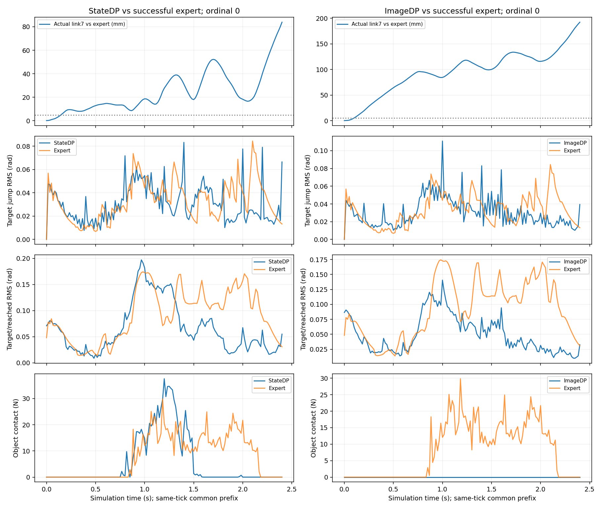
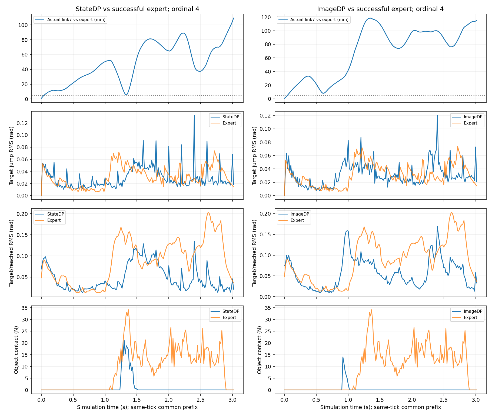

# StateDP / ImageDP 抓取失败归因诊断

**原正式结果保持 StateDP-10000 0/12、ImageDP-10000 0/12。没有新训练，也没有使用 test40。**

本轮 `grasp_diagnosis_20261104_01`；当前 `prepared`。24条原闭环和12条同初态成功在线专家均只读。

|检查|判定|实际证据与边界|
|---|---|---|
|专家29D处理后target经DP绝对位置接口独立回放|PASS（复用）|2/2完整成功，168/153ticks；提交目标/执行器误差0，14类记录逐字节一致；原生RL指令回放没有替代此项。|
|回放接口仍适用于当前模型|PASS|旧执行函数AST和环境/原控制核心SHA与当前一致；旧session初始commit过早，采用实际runtime amendment文件SHA对应c7fcbb0。|
|24条模型与12条在线专家初态配对|PASS|可观察初态、环境RNG和所有已导出字段相同；不声称PhysX隐藏状态完全相同。|
|标签、29D顺序/rad、动作索引、60/120Hz、反归一化|PASS|复用400数据审计；新完整轨迹标签第0项/时间误差0、逆变换最大1.20e-7rad、全部24条实际target到执行器误差0。|
|原部署输入严格数值一致性|FAIL（已保留）|归一化proprio反算q与训练原始q差3.58e-7rad；标准化后5.09e-5超过预登记2e-5。最终计划差≤2.87e-6rad，不能据此解释任务失败。|
|新可选精度修复后端到端一致性|PASS|只从已有当前target减tracking-error恢复编码器q；不读取物体/触觉/未来。两条完整专家轨迹、两最终EMA，阈值未放宽。|
|图像、DINO、深度、相机时钟|PASS（所测两条完整轨迹）|原始RGB逐字节可逆；全部28个anchor的DINO、depth、timestamp差0；不是只抽首尾帧。|
|GRU与条件/输出|PASS（修复后）|每tick实际Controller和完整训练encode对照；同一顺序DDIM随机流。不是用teacher forcing声明闭环成功。|
|边界跳变是唯一/最早根因|FAIL（证据不支持）|24/24在专家持续接触前已偏离；22/24在第一次重规划tick12之前已偏离。|

## 先偏离，再接触失败

使用既有阈值：link7末端5mm、arm0.01rad、hand0.05rad、object5mm/5°，连续3ticks；同控制tick公共前缀，不做时间伸缩。
State末端首次偏离ticks：`[9, 3, 10, 6, 3, 6, 7, 4, 4, 4, 2, 5]`；Image：`[6, 13, 6, 4, 3, 5, 8, 7, 6, 5, 12, 6]`。
全部在专家持续接触前；无法把这些初始偏差归因于接触后滑移或第一次重规划。
对照专家均完整成功，但原生lift标志与subgoal reset相关，不是强制单调阶段漏斗。

## 手指与专家同口径对比

以下是12条各自公共前缀指标的中位数，避免模型601tick超时尾段和较短成功专家混算。单位rad。

|模型|模型边界跳变|专家同tick边界|模型片段内跳变|专家片段内|模型跟踪RMS|专家跟踪RMS|
|---|---:|---:|---:|---:|---:|---:|
|StateDP|0.06515|0.03573|0.02924|0.03711|0.05546|0.10246|
|ImageDP|0.05790|0.03573|0.03091|0.03711|0.05868|0.10246|

边界跳变确实偏大，但成功专家的目标/实际手指差反而更大：它可能体现接触承载，不能等同于控制器故障。
模型raw target经真实joint limits裁剪，最大手指裁剪State 0.2341rad、Image 0.3666rad。
专家比较对象是已经经过native限位的target，其额外position-interface裁剪为0；这不代表专家上游native映射从未限位。
每次持续接触丢失前后±3tick的跳变、clipping、tracking及是否跨边界，和专家对应统计保存在analysis.json；同步出现仍不是因果证据。

## 有界、单因素实测

先只修复proprio浮点重构并复评旧checkpoint，再在同一修复版本上只加K4拼接。固定train ordinal0和validation ordinal4、两个模型；旧K0对照直接复用已完成结果。
K4只把旧计划尚未执行的[12:16]和新计划[0:4]按1/4、1/2、3/4、1融合；没有新延迟/限速、参数更新、expert takeover或控制器增益修改。
计划8条新episode、最多10次启动/2次软件恢复；两次连续同阶段故障停止；沿用本轮最初4小时截止，不重置。
原先4条K4计划在发现严格一致性FAIL后、任何新Kit启动之前扩展为4条精度修复对照+4条K4；两次变化分开比较。

|版本|模型|成功/有效|计划|接触|lift|首子目标|软件缺失|
|---|---|---:|---:|---:|---:|---:|---:|
|precision_only|StateDP|0/0|2|0|0|0|0|
|precision_only|ImageDP|0/0|2|0|0|0|0|
|precision_K4|StateDP|0/0|2|0|0|0|0|
|precision_K4|ImageDP|0/0|2|0|0|0|0|

K4必须与精度修复对照的前12tick command/target/joint/object/actor/contact逐值相同才接受单因素比较；无结果项不是任务失败。
## 归因可信程度与是否重训

- 高：当前绝对位置接口本身能复现完整专家任务；逐tick实际执行器target没有额外delay/EMA或单位/顺序错配。
- 高：早期目标/轨迹误差先于稳定接触和首次重规划；整体离线RMSE低不保证初始接近轨迹、抓取构型与动作幅值足够准确。
- 中：自主观测/过去动作历史偏离会继续累积误差；离线使用专家历史，与自主闭环分布不同。存在支持证据，尚未通过干预单独建立因果。
- 中：跨规划不连续与限位裁剪会改变手指请求，但不能从相关性断言它们主导失败；以K4实测判断收益。
- 低：proprio舍入是完整失败主因；量级微小，修复后的闭环是针对这一假设的检验。
当前不修改网络或损失，不启动重训。下一轮优先考察前12tick的动作增量/方向与专家差异，以及接近阶段小偏差后的恢复能力；先做有限诊断，再决定是否需要roll-in数据或改变监督。
不以这两个诊断初态挑选最终模型，不访问test40，也不宣称少量消融证明统计优势。

## 产物与完整性

[完整数值和每次故障](evidence/grasp_diagnosis_20261104_01/summary.json) · [24条逐例分析](evidence/grasp_diagnosis_20261104_01/analysis.json) · [原严格数值FAIL](evidence/grasp_diagnosis_20261104_01/parity.json) · [修复后数值](evidence/grasp_diagnosis_20261104_01/parity_precision.json)。
原始CSV、逐tick模型对照、视频和日志：`outputs/visuotactile/native_dp_v2/grasp_diagnosis_20261104_01`。原24条与所有旧checkpoint不改动；大文件不推送。
新数值审计早期两次脚本错误（旧source_commit标签、只读lease缺显式deadline）已定位并保留日志，均发生在仿真前；不计机器人任务失败。
新增4项定向CPU测试通过：单因素拼接/随机流、K0精确旁路、公共前缀/事件窗口、当前编码器字段；未重复旧batch或Epsilon测试。
