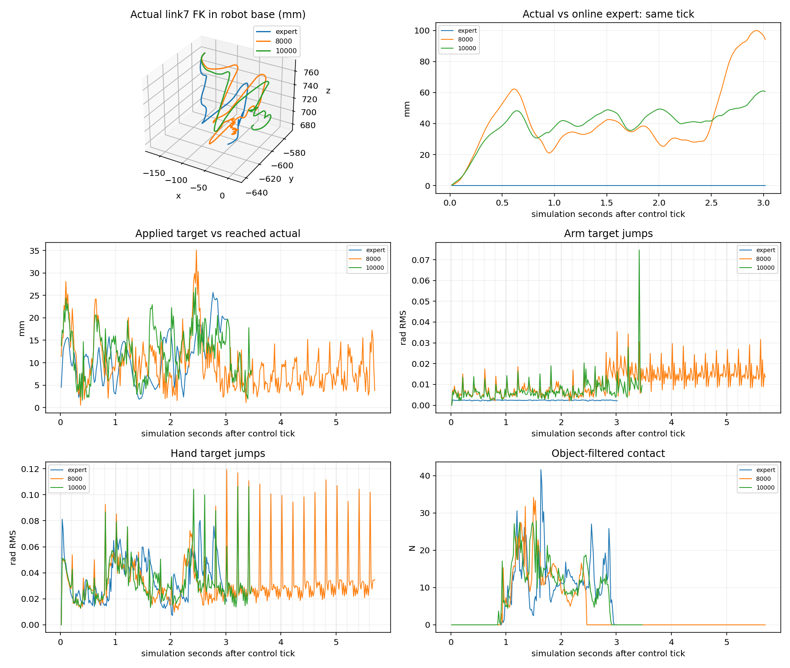
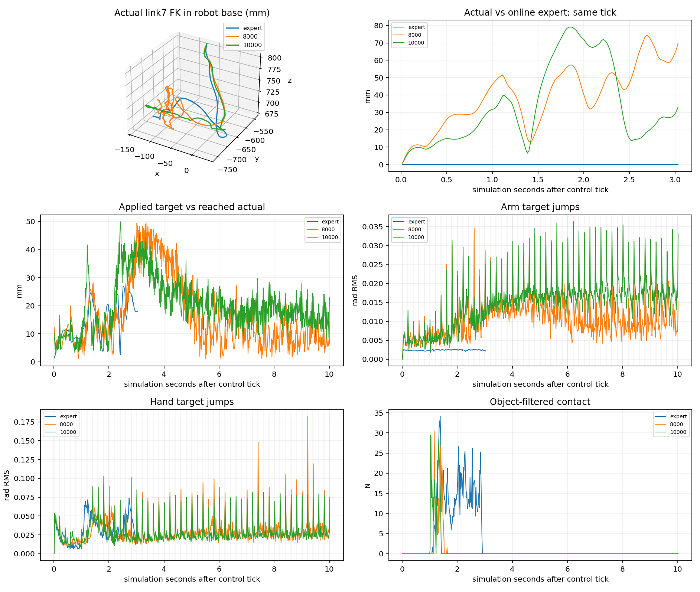
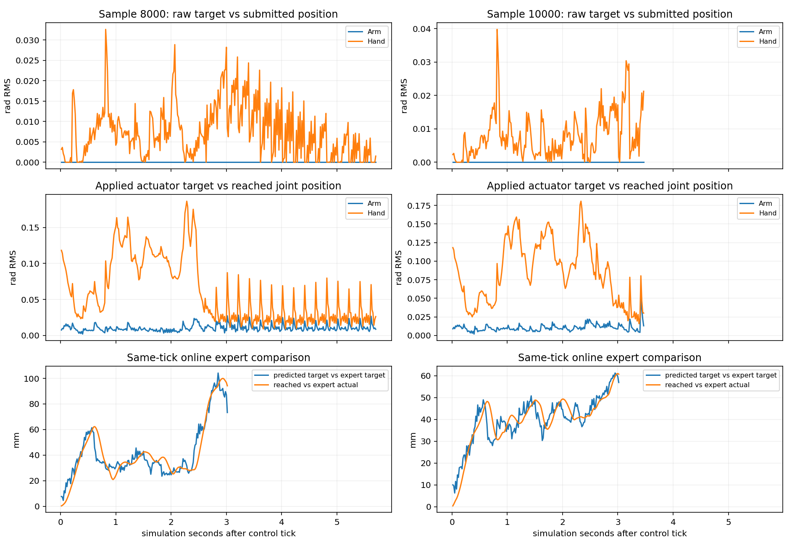
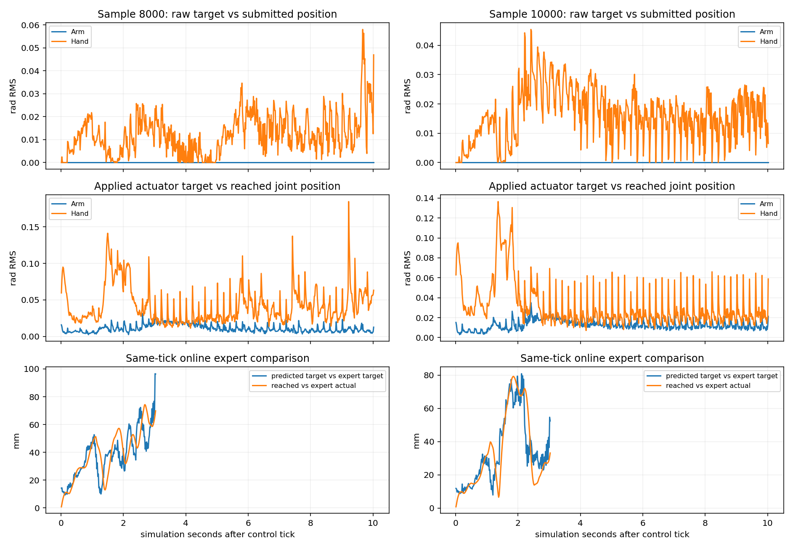

# H24 闭环失败诊断与视频

## 后台完成与最终完整性

本轮后台已退出，状态`software_missing`；8个attempt软件完成，软件缺失/故障记录1条（单列，不计任务失败）。
已核验录像组：T_train_10000_precontact, T_train_8000_precontact, V1, V2, V3, V4, V5, V6；8000真实原生成功录像：V1；指定六段缺失：无。
原始七个受保护checkpoint最终SHA全部匹配；无参数更新。原deadline/启动预算未重置。
本轮首动作前记录器错误及恢复保留，恢复源码`fe99624195d9f9fc9c8521c1617ccf473fe471f1`；详细结果与视频索引见H24_CLOSED_LOOP_DIAGNOSIS和evidence/h24_diagnosis_20261104/completion.json。

本轮只读已有权重，新增录像和有限专家前缀诊断；无训练、策略/物理/控制参数修改、test40选择。
运行目录：`/home/CNS2025331827/docs/bc+rl_RSS/outputs/visuotactile/native_dp_v2/h24_diagnosis_20261104_01`；源码冻结提交 `a57626cb22ef536bcad7b78f8068c80737ba5a69`。原训练比较和本轮录像分开计数。

## 录像交付与实际结果

8000训练初态成功录像已实际生成：V1

|录像|模型|初态/seed|实际结果|ticks|诊断MP4|
|---|---|---|---|---:|---|
|V1|8000|train/982403|success|342|`/home/CNS2025331827/docs/bc+rl_RSS/outputs/visuotactile/native_dp_v2/h24_diagnosis_20261104_01/videos/V1_diagnostic.mp4`|
|V2|10000|train/982403|fall|208|`/home/CNS2025331827/docs/bc+rl_RSS/outputs/visuotactile/native_dp_v2/h24_diagnosis_20261104_01/videos/V2_diagnostic.mp4`|
|V3|Expert|train/982403|success|181|`/home/CNS2025331827/docs/bc+rl_RSS/outputs/visuotactile/native_dp_v2/h24_diagnosis_20261104_01/videos/V3_diagnostic.mp4`|
|V4|8000|validation/984101|timeout|601|`/home/CNS2025331827/docs/bc+rl_RSS/outputs/visuotactile/native_dp_v2/h24_diagnosis_20261104_01/videos/V4_diagnostic.mp4`|
|V5|10000|validation/984101|timeout|601|`/home/CNS2025331827/docs/bc+rl_RSS/outputs/visuotactile/native_dp_v2/h24_diagnosis_20261104_01/videos/V5_diagnostic.mp4`|
|V6|Expert|validation/984101|success|182|`/home/CNS2025331827/docs/bc+rl_RSS/outputs/visuotactile/native_dp_v2/h24_diagnosis_20261104_01/videos/V6_diagnostic.mp4`|
|T_train_10000_precontact|10000|train/982403|fall|128|`/home/CNS2025331827/docs/bc+rl_RSS/outputs/visuotactile/native_dp_v2/h24_diagnosis_20261104_01/videos/T_train_10000_precontact_diagnostic.mp4`|
|T_train_8000_precontact|8000|train/982403|fall|162|`/home/CNS2025331827/docs/bc+rl_RSS/outputs/visuotactile/native_dp_v2/h24_diagnosis_20261104_01/videos/T_train_8000_precontact_diagnostic.mp4`|

缺失指定视频：无。每次尝试均保留，未按成功筛除失败。
每段clean/diagnostic视频均全帧解码并由ffprobe核验；精确时长、大小、SHA及初态/checkpoint在本地 `videos/manifest.json` 和公开summary。
三路既有448×252传感器拼成1280×720，CPU缩放；30fps取每两个60Hz控制tick的动作前图像。终止后reset帧不录入。
带注释版本标明最终结果；瞬时接触/追踪读数来自上一已完成tick。三视图布局：左上全局、右上侧面、左下腕部；文字只占右下空区。

## 8000成功与10000失败：历史证据

完整成功原记录342ticks，10000同可观测初态208ticks fall。初态可观测字段完全相同：True；环境随机流相同：True。
实际导出状态比较了724个字段；不一致字段见summary，不把未保存PhysX内部状态当作已一致。
分析前固定：末端5mm、Arm RMS0.01rad、Hand RMS0.05rad、物体5mm/5deg，连续3tick超阈值才报显著分歧。
第一次原始目标差异tick=0，第一次实际提交输入差异tick=0；
实际末端首次持续分歧tick=16，Arm=19，Hand=37，物体位置=51，物体姿态=52。tick从0开始。
首个请求目标Arm/Hand差异为0.004 / 0.024 rad RMS。
两个checkpoint在状态明显偏离前已产生不同目标，随后闭环状态和历史共同改变。首差是时间顺序证据，并不能单独排除隐藏物理状态或证明接触根因。



## 离线预测、控制输入与实际运动

H24直接提交post-delay绝对目标(rad)，沿原执行器及120/60Hz物理/控制执行；没有第二次原生命令delay/EMA。专家输入是dimensionless native command。
本轮直接记录DDIM最终归一化样本、反归一化raw plan、真实提交输入、transition实际应用target和两个物理子步执行器target。不存在的“学生native command”不通过逆映射伪造。
离线17.33mm是全val40专家历史下的接触前目标FK误差；约46mm是共同7个validation初态、专家接触前同tick的实际FK误差。
两者的预测目标/实际运动、历史、采样批次、数据子集和时间条件不同，不能相减得到控制误差。下表使用本次固定validation ID的原数据参照：

|checkpoint|离线目标Arm/Hand rad|离线目标FK mm|自主目标对原专家目标FK mm|自主实际对原专家实际FK mm|自主target对actual FK mm|
|---|---|---:|---:|---:|---:|
|8000|0.018/0.090|13.184|41.937|44.173|16.985|
|10000|0.016/0.085|12.228|42.009|43.084|22.217|

上表离线使用已有valid prefix12预测，不重跑推理；自主三列使用同原expert记录及公共tick长度。它们仍不是因果分解或可相减误差。
同tick比较没有时间伸缩；接触后进度不一致可能扩大误差。FK端点为原审计使用的iiwa14_link_7框架，不是接触点。

|历史运行|实际目标到达Arm/Hand rad|target/actual FK mm|最大裁剪 rad|执行器目标误差 rad|
|---|---|---:|---:|---:|
|historical_train_expert|0.008/0.108|12.252|缺失|0.000|
|historical_train_8000|0.011/0.073|10.895|0.116|0.000|
|historical_train_10000|0.012/0.094|13.576|0.141|0.000|
|historical_validation_expert|0.009/0.102|15.346|缺失|0.000|
|historical_validation_8000|0.012/0.049|20.563|0.233|0.000|
|historical_validation_10000|0.014/0.039|22.288|0.198|0.000|

分接触前/后跟踪误差、Arm/Hand重规划边界跳变和各事件tick见summary与10Hz CSV，图使用全60Hz数据。






实际记录的本体/几何历史与原专家同tick输入标准化差异：`{"V4": {"robot_standardized_rms": 0.9578247666358948, "robot_tick0_standardized_rms": 2.977956000904669e-06, "geometry_standardized_rms": 0.5609560012817383, "geometry_tick0_standardized_rms": 6.470094376709312e-05, "compared_ticks": 180, "reference": "original expert recording; same episode identity/tick", "interpretation": "Observed feature-history difference, not independent proof of a distribution-shift causal mechanism"}, "V5": {"robot_standardized_rms": 0.981630802154541, "robot_tick0_standardized_rms": 2.977956000904669e-06, "geometry_standardized_rms": 0.6092828512191772, "geometry_tick0_standardized_rms": 6.470094376709312e-05, "compared_ticks": 180, "reference": "original expert recording; same episode identity/tick", "interpretation": "Observed feature-history difference, not independent proof of a distribution-shift causal mechanism"}}`。初始差异也明确列出，不能将全部差异归因于后来学生控制。

## Expert prefix / Student takeover

接管前每tick都用实际专家前缀更新学生自己的GRU；过去位置历史接收原专家处理后的真实target，未复制专家RNN或瞬移物理状态。
切换点对齐原12tick规划边界，DDIM seed7091持续前进，不在切换时重置。专家shadow与学生前缀计划均标为未执行预测。
切换前逐字段对照该初态新录专家的command/target/q/qd/object/contact；超1e−6会在学生控制前停止。即使这些字段一致，也不声称全部PhysX内部状态相同。

|诊断|专家前缀ticks|前缀核验|原生结果|lift/subgoals|
|---|---:|---|---|---|
|T_train_10000_precontact|48|True|{'fall': True, 'max_successes': False, 'hand_far': False, 'dropped': False, 'timeout': False}|False/0|
|T_train_8000_precontact|48|True|{'fall': True, 'max_successes': False, 'hand_far': False, 'dropped': False, 'timeout': False}|False/0|

扩展判据实测：`{"probes": [{"name": "T_train_10000_precontact", "baseline_error_rad": 0.1622815877199173, "prefix_error_rad": 0.21337313950061798, "compared_ticks": 24, "stage_gain": false, "informative": false}, {"name": "T_train_8000_precontact", "baseline_error_rad": 0.120416559278965, "prefix_error_rad": 0.20611479878425598, "compared_ticks": 24, "stage_gain": false, "informative": false}], "expand": false, "rule": "Two train precontact probes first; require observable-prefix parity and a stage gain or >=20% lower target joint RMSE against the same online expert over first24 post-switch ticks before further train/lift or validation probes.", "causal_root_proven": false}`。未达到判据则不扩展，少量接管不能证明唯一因果根因。

## 接触后现象与证据限度

记录object-filtered normal force、五指位置/姿态、物体位姿速度、掌部相对位移、native lift/subgoal/alignment。
物体与掌部相对运动是可观测现象；没有逐接触点几何或可靠切向摩擦/滑移状态，不能仅凭录像称为摩擦不足、真实滑移或某个手指接触点错误。
已接触但无native lift支持接触后抓取/抬升进展不足；多指受力或stable_grasp代理均不等于原生任务成功。

## 原因排序与后续建议

1. 优先考虑自主状态/历史偏移与目标预测误差共同累积：首个预测已不同，teacher-forced误差没有约束整个自主闭环。支持/反对证据应结合上表与接管结果，未建立单一因果归因。
2. 目标变化和物理跟踪/接触构型：直接位置目标可跳变；target/actual差值是同tick真实量，但受惯性与碰撞影响，不能仅据此指认控制器代码错误。
3. 接触后抓取与抬升阶段：接触不能保证构型、承载或后续装配正确。力与轨迹支持阶段定位，缺少接触点和摩擦证据限制具体物理解释。
4. 隐藏模拟器状态仍是未排除因素；本轮独立Kit与可观测初态相同不构成精确历史4lane重放。
不建议仅凭离线误差下降继续无诊断加训或立即加FK/Temporal loss。本轮没有修改控制，后续是否修改目标连续性/数据分布，应先结合真实请求/执行器一致性及接管证据提出独立对照。

## 查看、取回与完整性

本地视频目录：`/home/CNS2025331827/docs/bc+rl_RSS/outputs/visuotactile/native_dp_v2/h24_diagnosis_20261104_01/videos`。在连接该主机的VS Code中打开同目录README和MP4；或在该主机运行：
```bash
python3 -m http.server 8765 --bind 127.0.0.1 --directory /home/CNS2025331827/docs/bc+rl_RSS/outputs/visuotactile/native_dp_v2/h24_diagnosis_20261104_01/videos
```
在VS Code Ports中转发8765，然后在本机浏览器打开 `http://127.0.0.1:8765/`。
命令仅按需运行；本轮没有自动开放网络服务。亦可在本机终端将已配置SSH主机别名替换为实际连接名：
```bash
scp -r <你的SSH主机别名>:/home/CNS2025331827/docs/bc+rl_RSS/outputs/visuotactile/native_dp_v2/h24_diagnosis_20261104_01/videos ./h24_diagnosis_videos
```
所有MP4、原始HDF5/轨迹、权重和大日志只留本机。公开清单含每段准确绝对路径、时长、字节数、SHA及核验结果。
owner在报告生成后重新只读校验全部7个受保护checkpoint和冻结源码，结果写入本地final_integrity.json；尚无该文件时不声称最终校验完成。
资源监测总结见summary.resource_summary；不把整卡利用率当作本进程独占量。
