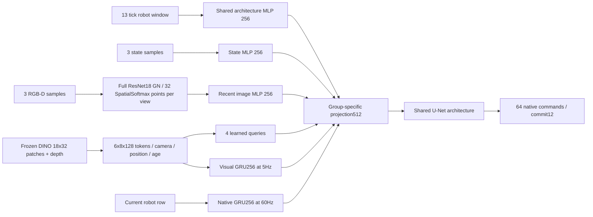

# 观察与历史架构：Native-command v1

所有shape以下以单episode表示，规划锚点数记A，训练每段96tick，最多A=8。
不同episode不共享hidden state；子目标、规划边界与反传截断均不等于episode reset。

| 张量 | shape | 来源与时间 |
| --- | --- | --- |
| robot | [178] | 动作前q/qd/target/error，严格t−1 issued/delayed及其年龄、有效位、episode时间 |
| common window | [13,180] | 截至当前tick的13行，另加行年龄及有效位；左侧缺失为0/mask |
| geometry | [85] | S专用：当前object/goal/hole/table/palm poses，object/goal velocities，五指pose与物体尺寸 |
| RGB | [3,3,252,448] | 固定high/side/wrist顺序，全视野，策略每12tick消费 |
| depth/valid | 各[3,1,252,448] | 米制与真实有效位，独立分支 |
| DINO cache | [3,384,18,32] | 固定revision冻结源，缓存FP16，不修改旧reference标签 |
| spatial tokens | [3,48,128] | RGB112＋depth16，pool6×8，二维位置＋camera identity |
| recent tokens | 最多[3,3,48,128] | 最近3次真实采样；附采样年龄和camera有效mask |
| query readout | [1,512] | 4×128 query跨近期空间token注意力 |
| native/visual memory | 各[1,256] | 分别60Hz/5Hz更新，FP32，有损摘要 |
| condition | [A,512] | 三组投影到相同扩散条件宽度 |
| command / valid | [A,64,29] / [A,64] | 同tick开始未来命令，尾部不足H64严格mask |

三条支路代表三个独立模型，不是将全部输入合并给I组。独立初始化、独立参数与优化器。
S/Official没有长期RNN。Official的标准ResNet18去掉分类池化层，保留完整四个残差stage；
feature-map上32个softmax关键点保留xy，并关联depth/valid与独立深度特征。
共享权重编码三个视角；camera顺序在融合向量中固定。无随机裁剪/新增强，也不宣称官方配置原样复现。

History的4query汇聚是有损压缩，GRU也是有损记忆，原始轨迹另存。
冻结DINO前端现通过`models/native_vision.py`固定计算batch：只将当前三视角重复为6图，
不引用下一个采样时刻。旧cache生成时TF32卷积随batch shape改变，本次显式固定旧6图算法；
transformer FP32、patch存储FP16，精度开关调用后恢复，原生/视觉GRU仍FP32。
原两帧batch来源patch复用；奇数尾帧的3图旧算法由独立native overlay替换，不改旧cache。
这只修复冻结前端的训练/部署数值一致性，图像尺寸、空间token、参数与输入权限不变。
视觉GRU仅在新采样时更新；保持旧图像的11个tick不会反复更新视觉GRU。
native GRU逐tick更新。所有近期token保留相机有效mask与采样年龄，不读未来图像或触觉。

`encode_segment`在每次优化时用当前权重重新运行episode起点至段起点，前缀无梯度；
随后仅对96tick段反传。四段独立反传累积后才更新权重，下一次重新预热。
不跨优化更新复用旧hidden state，不以随机窗口零状态代替真实历史。
无RNN组可从足够覆盖3视觉帧及13native行的因果窗口开始，以节省重算。

部署`NativeController`必须从真实episode step0开始，逐tick观察且每次执行后ack。
新episode清空，普通任务子目标不清空。实际执行历史包含物理接触影响，但没有直接触觉通道。
数据teacher forcing与学生执行分布存在差异；一致性Gate检验相同输入上的实现一致，不证明闭环泛化。

历史G00/G10曾使用3×5池化和原生GRU、absolute-reference adapter；旧B0/B1为H12。
本轮不能仅用新名字加载旧权重，历史失败率不能混入本轮分母。
