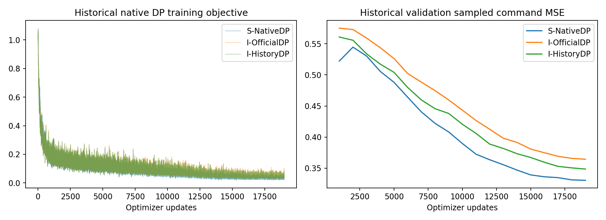

# Native DP V2 实验结果（2026-11-02，进行中）

## 旧V2已结束，新归因实验独立登记

`state_first_20261102_01`已完成28/28诊断并因旧G0停止：replay3/8，旧State train0/8、validation0/8，第二seed0/4。
新增optimizer0，原服务退出。旧三路正式各19000updates，正式闭环各0/20，train诊断各0/4。
旧V2整卡均值31.11%、最大完整60s44.60%、缺测0；旧三路最大60s60.54%，不能称整个历史资源合规。
本轮新授权修正G0-A/B/C并运行online expert/StateBC对照，详见[NATIVE_DP_ENVIRONMENT_LEARNING_REPAIR](NATIVE_DP_ENVIRONMENT_LEARNING_REPAIR.md)。
下方“尚未执行”是旧启动快照；新实验的结果必须从repair根的真实产物读取。

本轮原52条已完成：single expert6/8、four expert8/8、fresh replay2/2（15字段逐字节一致），
源world历史1/2；旧State fresh0/8，StateBC1000/ActorBC1000 fresh各0/8，StateBC saved train/val各0/4。
两BC各完成一次有界延长至4000updates，State训练arm/hand=.02365/.03965，验证=.98176/.71937；
不是任务成功。最终补充闭环/资源/视频/commit以主报告为准，未启动新StateDP、视觉或test。
fresh原生reset含single6/8、four3/8盒初始重叠；未删除或替换，不能把6/8称合法初态总体可靠率。

当前完成的是**400条真实数据复核、原生控制数值审计和新流水线代码测试**。
新闭环诊断尚不能写成功率；StateBC、新State训练、视觉重训及V2正式test均未执行。
本文件不是“已解决State任务”的声明；机器状态及每条实际result优先于静态快照。

## 已完成证据

| 项目 | 结果 | 解释 |
|---|---|---|
| 原始400 SHA256 |400/400，重读耗时约203.21s（含数值审计） |保留原数据，没有重采集 |
| 原生成功/retract |400/400 |读取真实末尾termination和任务字段，非仅manifest声明 |
| 原native函数控制回归 |400/400、81,894步，delayed/target最大误差均0 |实际未修改的action pipeline，记录delay index；不冒称物理重放 |
| 数值总步 |81,894 |train64,825 / validation8,670 / test8,399 |
| 数值cache对原HDF5 |command/target/robot/geometry/history最大差均0 |当前标签与严格过去历史未发现错位 |
| train-only normalizer复算 |6个buffer最大差均0 |robot/geometry均值标准差、action scale/offset |
| 精确重复 |初始可见特征重复0，整段command重复0 |不证明隐变量或共享采集RNG完全独立 |
| targeted tests |56 passed；结果及源码SHA见 evidence/native_dp_v2/verification.json |Gate阻断、真实窗条件一致、padding梯度、原生replay回归等 |
| 新GPU/optimizer |启动状态另见下方运行身份 |程序注册/等待不等于已发生试验 |

| 划分 | 条数 | 长度min/Q1/median/Q3/max | anchor数 | 有效H64目标 / padding |
|---|---:|---|---:|---:|
| train |320 |119/171/195.5/225.25/509 |5547 |301333 / 53675 |
| validation |40 |136/173.75/202.5/238.5/539 |739 |40687 / 6609 |
| test |40 |137/176/207/225.25/351 |720 |39249 / 6831 |

test这里只做原数据完整性/分布审计，不将test模型误差或success用于调参。
旧流水线三组test40已有启动标记，不能再称从未使用的测试集；新 `test_usage_ledger.json`在旧owner退出后登记实际使用标记。

## 旧结果与新结果分开

| 模型/实验 | 实际训练与身份 | 当前可报告闭环 |
|---|---|---|
| 旧S fit1/fit4 |400/500updates，独立小样本模型 |旧2条均fall，0/2；不能代替正式State |
| 旧三组fit诊断 |各fit1/fit4一条，共6 |0/6，有接触/稳定抓持诊断/lift但无最终success |
| 旧S formal |19000updates，best EMA/last在原run02 formal/attempt_1 |本轮固定train8/val8诊断待实际产物；旧正式评估另由旧run报告 |
| 新StateBC |代码实现，独立diagnostic合同，G0之后最多1000updates |未训练，未控制，不构造成功视频 |
| 新StateDP |原结构/原命令，随机anchor32，新optimizer身份 |受G0与BC诊断阻断；未执行 |
| 新视觉训练 |保留原ResNet18/DINO-GRU设计 |G4未通过，不启动 |
| V2正式test40 / test20×3 |只能冻结validation选模后 |未执行，分母不是60，不能写0/60 |

历史正式State validation arm/hand .6695/.4612为旧单seed测量。
新的3seed离线误差/闭环结果尚未生成，不能填造改进量或把训练不足当确定结论。

## 运行与审查身份

- 基线commit `3e11d62`；独立分支 `feature/native-dp-training-v2`。
- 工作目录 `/home/CNS2025331827/docs/bc+rl_RSS_native_v2`；原worktree代码不变。
- 数据审计目录 `outputs/visuotactile/native_dp_v2/audit_20261102`。
- 计划/注册的独立运行目录 `outputs/visuotactile/native_dp_v2/state_first_20261102_01`。
- `session.json`保存实际源码SHA、旧checkpoint路径/SHA/EMA内容hash、固定cohort与预算；
  `status.json`报告当前阶段，`gates/G*.json`分别报告验收，`blocked.json`记录阻塞，`owner_exit.json`记录退出。
- 查询：`bash visuotactile/run_cpu.sh -m visuotactile.native_v2_pipeline status --root outputs/visuotactile/native_dp_v2/state_first_20261102_01`。
- 新报告自动写 `report/summary.json`；旧训练曲线、诊断阶段成功、关键动作误差及GPU曲线仅由实际文件绘制。
- 视频路径在 `report/videos.txt`，原始数据、checkpoint、视频、cache不公开上传。

## 可复核边界和剩余工作

确认的修复是闭环Gate、State数值缓存、锁范围、checkpoint里程碑/选模与状态查询；
它们尚不能证明任务成功率改善。8条历史replay、旧State完整诊断、BC诊断和新训练是否可继续由真实Gate决定。
若G0失败，后台仍保留冻结旧模型诊断，但不会新增参数更新；原因分析见
`NATIVE_DP_TRAINING_FAILURE_ANALYSIS.md`，不重复扩大失败试验。

视觉History性能优化、4env一致性与新正式测试均在State验收之后；当前未把它们标为已经完成。
清理清单零删除，所有历史证据保留。后续人工分析应从每条result/trace开始，不能用本文件的进行中快照替代结果。

CPU条件编码实测：8条/150anchors/23segments，旧加载+编码0.44174s；新一次加载0.04372s、编码0.00385s，缓存2,683,800bytes。两CPU线程、未训练参数，仅测State观察条件路径；不代表GPU扩散或端到端训练加速。

## 一次启动核验（2026-11-02 02:44，UTC+8）

实际实现commit **9431b4286db09fdd1c54b76075ee61be8e1da496**，全部运行源码SHA与登记一致。
服务 `native-dp-v2-state-first-20261102-01.service` 为active/running，owner PID269512；
机器状态 **waiting_predecessor**。这是owner启动通过，**不是GPU/Kit/闭环通过**；新updates仍0。
脚本待旧owner/evaluator/monitor退出后自动开始，不需要对话轮询。

新session注册11月2日02:43:45，绝对终点11月3日02:43:45（UTC+8，包括全部等待），
GPU诊断最多4h；条件学习最多到首次GPU+20h，且不超过该绝对终点。
旧run02原deadline完全不变。

旧State模型71,300,509个参数；best/last均19000updates、91个完整数据遍历。
它们的文件SHA不同，但所有EMA tensor名称/字节hash相同：
`09a005306391bf02fa665feac9c7328c500aed69799bed9bcbdb693e48e6b511`。
不重复执行相同last，因此本轮首批为**28 starts**：8 replay + train8 + validation8 + 第二seed4。
确切路径/文件SHA与初态见 `evidence/native_dp_v2/startup.json` 和本机session/job。

G0数值部分通过、物理replay待测；G1新流水线学习验收待测；G2/G3闭环待测；G4/G5锁定。
没有新的完整任务成功率，不写0/28或0/60。没有StateBC/新DP/新视觉训练结果。
当前视觉小规模验收与正式test的自动执行尚未实现，不将预注册Gate函数当已完成实验；
只有State基础通过后才继续该受条件约束的工作。

曲线来自旧run02日志；validation为旧单seed采样MSE，不能作为V2改善曲线。
新成功率、阶段进展、动作误差、资源曲线和视频由后台实际产物生成于run/report。
原有220步专家成功参考视频被索引并重新完整解码；它不是本批学生成功或同初态配对。
