# 实际网络架构、训练验收与初态泛化核验

## 中文核心结论（两页以内）

**本轮已完成审计与12次预登记诊断，没有新训练。** 实际起点为功能分支HEAD
`3ce0c187c414a27992aaa7d01de6e09d7300408e`；G00-B/G10-B加载验证选出的epoch52 EMA，
Force/Masked加载各自epoch5。2026-10-31 17:27左右（Asia/Shanghai）仿真和监控正常退出。

1. **Transformer确实存在且参与训练，但不是“纯Transformer”。** 它是60Hz持续GRU761→128，
   加2层pre-LN、4头、宽128的Transformer；每次204个token，6个query输出6×29原生命令残差，
   10Hz刷新、60Hz逐项执行。当前base29D、剩余H64、视觉、本体、target/tracking和五指力/FK均有实际输入。
   只有padding mask，没有三角causal mask；因果性来自所有传感输入不晚于当前时刻。
   触觉不含显式力差分、速度或接触事件，与历史GRU触觉编码器不同，不能称完全复刻旧设计。
2. **有效更新已核实，五遍不足以宣称收敛。** 两组均320条×5遍、3,730次AdamW；全部51个参数张量的
   optimizer step均为3,730，828,189个参数全部属于optimizer，主要模块参数确实变化且探针梯度非零。
   每遍64,825个native tick、37,224个接触监督步。验证loss仍小幅下降，学习率却已接近0；
   没有验证反弹证据，也没有学习充分或任务学会的证据。冻结base与缓存hash一致，未进入残差optimizer。
3. **用了连续力，但尚无连续力收益。** 同权重、观测、计划、历史边界和gate下，Force连续力置零使当前
   query的arm/hand残差RMSE改变0.01654/0.00402；Masked完全不变。Force在选定validation4条的
   接触组合命令误差反而从0.69997/0.56619微降到0.69978/0.56613。网络有敏感性，当前结果更支持
   修正主要可由其他输入解释；不能从两个独立checkpoint的差异推导触觉因果收益。Masked仍使用真实力门控。
4. **曲线已直接嵌入。** 最关键是前12步命令误差、Transformer训练/验证与组合误差、固定权重力干预、
   近似训练初态偏离图。Loss B的test前12步arm/hand误差：G00为0.92122/0.50904，G10为0.93326/0.50172；
   比各自A好，但离线误差下降并未变成闭环成功。不同目标loss不按绝对大小排名。
5. **400条不是重复文件，也不是400种任务/物体。** 固定320/40/40，初态向量、命令序列及HDF5身份各400个唯一。
   全部同一L形插入任务、几何、三相机标定和DR配置；训练物体x/y约±10cm，z0.6038–0.6574m，
   初始关节与姿态随机。训练长度119–509步；专家命令约80.44%元素饱和。成功筛选数据不代表未筛选初态分布。
6. **学生在本轮“近似恢复训练初态”中均未成功；精确训练环境下是否学会仍未证实。**
   4条预选训练示范的T0原记录命令全部精确提交，但没有复现成功；记录命令用尽后结束，不能记成timeout。
   已保存机器人/物体/目标字段恢复误差均0，仍缺PhysX接触缓存、传感历史、其他并行环境及完整随机消耗状态。
   原生延迟命令在第3/1/2/1步开始不同，target及关节随之偏离。
   T1 G00-B/G10-B各0/4、均601步原生timeout，无lift/子目标，从第0步动作就偏离专家；并非只在接触后失败。
7. **目前证明的是有限离线拟合与实现一致性，未证明自主任务泛化。** 既有T2各0/3，二侧95%精确区间
   为[0,70.76%]，样本太少；不与T1或旧0/50混合。不把新seed称OOD，本轮没有T3或系统扰动鲁棒性证据。
8. **下一步优先顺序：重放/推理诊断 → 基础策略的控制相关拟合与视觉可辨识性 → 数据覆盖 → 残差。**
   首先补齐可重放状态和逐次采样噪声，分离图像/采样/历史造成的首步差异；再以同一命令指标检查小训练集
   的自主approach/lift。arm参考误差经1/0.025=40放大到native command，H64参考MSE不足以保证执行质量。
   本轮不自动追加epoch、20条新T2、G11或调参。

直接入口：[逐层CSV](evidence/network_layers.csv)、[所有参数与optimizer](evidence/network_audit_20261031/network_parameters.csv)、
[训练曲线索引](evidence/dp_loss_trt_20261031/README.md)、[机器可读架构审计](evidence/network_audit_20261031/network_audit.json)、
[初态诊断证据](evidence/network_audit_20261031/native_audit.json)。

## 1. 实际权重、采样和核验范围

| 实例 | checkpoint SHA256 | 验证选择/作用 | 参数（不重复计DINO） |
|---|---|---|---:|
| G00-B | `926b2628bb5f5c1eed4869ac257926dcdefdcc1533456553a51e9d0e035cdb92` | epoch52，累计43,264更新的EMA | 71,166,285 |
| G10-B | `ac8456d6b5a48d063583a7107f1ec8896aa8ed585c85e12762beb77027758f86` | 同上 | 71,242,445 |
| Force | `114106cd3b0f42e59a12b8c3c5c62e4e4f971a0695e0a01b235f2ae6e8055053` | epoch5，3,730更新，raw | 828,189 |
| Masked | `95be645fcb4580ac89e6639420a1713afe84023d727f07ddc704288c9d4b9b5f` | 同上，独立参数 | 828,189 |
| 历史GRU B | `0ce3ce5c7df77abfb79c557528b2869cbef38321ad9d1d6047046d73036ada8b` | 旧epoch5，7,875更新 | 1,344,597；训练489,125 |
| 冻结DINO | `b938bf1bc15cd2ec0feacfe3a1bb553fe8ea9ca46a7e1d8d00217f29aef60cd9` | 三路共享一次权重 | 22,056,576；训练0 |

G00/G10含DINO总数分别93,222,861/93,299,021；添加Force再加828,189，不能乘三份DINO。
本轮真实样本为预选train `r931005_1793209376_e00_p000029`。
实际RGB三视角进入DINO；DP真实缓存13个连续tick（第12步condition）进入encoder、一次带标签
diffusion forward/backward和完整16步DDIM；残差真实96tick forward/backward；历史GRU真实RGB-D两帧
加13tick缓存递推，重算视觉与旧缓存最大差4.76837e−7。

`network_layers.csv`有594行leaf/MultiheadAttention记录，包含输入/输出shape、dtype、requires_grad、
调用数、直接参数数和新探针gradient L2；`network_parameters.csv`有743行named parameter，
捕获root query和MHA函数式参数。所有leaf都列出，**未调用项不捏造shape**：DINO eval的drop-path/head
不执行；Embedding直接读取`.weight`，MHA的out_proj由函数读取，hook不会触发，参数表和公式补充这些关系。
本次hook为CPU FP32（DINO输出缓存FP16），DP原部署BF16、残差原部署FP32；新梯度探针不是历史梯度日志。
DP表的optimizer来自last raw参数，forward权重来自best EMA，不声称二者张量值相同。

## 2. 输入来源、时钟与信息边界

| 数据 | 维度/单位 | 实际来源与时间 | 使用者 |
|---|---|---|---|
| 三路RGB-D | 3×(3+1)×252×448；RGB[0,1]、depth m、独立valid | 原生相机，`camera_time_s<=obs/time_s`；只在tick%12=0抽取新DINO帧 | G00/G10；残差只读冻结视觉384 |
| q/qd | 29+29；rad、rad/s | 编码器`obs/proprio`，q由关节上下限逆归一化；每60Hz observation | 双方 |
| 实际历史 | 29 issued+29 delayed+2 age+1 valid=61；command无量纲、age s | 上一`env.step`真实ack；时间严格早于当前obs，首步零且invalid | 双方，训练是专家teacher forcing |
| target/tracking | 29+29；rad | 当前`actuator_target_rad`及target−q；均动作前 | 残差及reference→command适配器 |
| base当前命令 | 29；无量纲[-1,1] | 当前观测下按计划cursor与当前target换算 | 独立Linear输入残差 |
| remaining plan | 最多64×29；绝对rad | 上次5Hz由自身DP生成，右侧padding；不是未来真实状态 | 残差 |
| 五指world/local力 | 每物理样本5×(3+3)；N | 每60Hz观测含两个实际120Hz样本及`contact_time_s` | G10与Force；Masked置零 |
| 五指FK | 每指xyz3m、rotation3×3无量纲 | 编码器与固定URDF链得到base坐标，随120Hz采样 | 残差；G10没有这一分支 |
| 门控 | valid且max指端力范数>0.1N | 当前观测聚合力，独立于Transformer连续力token | Force/Masked都保留 |
| 物体/孔/目标位姿、reward/成功 | 诊断/标签 | 原生sim diagnostics | 不进入学生网络 |

传感器slot顺序index/middle/ring/thumb/pinky；动作canonical顺序arm7、thumb5、index4、middle4、ring4、pinky5。
world/local两份力是同一聚合传感观测的坐标表达，不是六个独立力分量来源；无taxel、压力图、切向摩擦或滑移真值。
两采样的同步时间仅验证仿真，不代表异步硬件对齐已验证。名义的G00无显式力输入，G10有；
新G01/G11按用户授权`past_actual_mixed_commands_v1`反馈过去混合执行，因此名义可间接受残差/触觉影响。
旧B0无混合输入约束不被改写。

## 3. G00/G10逐层结构


[SVG](evidence/network_audit_20261031/architecture_dp.svg)。图中From逐项列出所有父节点；箭头只画相邻连接以免交叉遮挡。

### 3.1 视觉与历史

DINOv2 `vits14`源码固定`7764ea0f912e53c92e82eb78a2a1631e92725fc8`，输入不resize/crop。
RGB/255后ImageNet mean=(.485,.456,.406)、std=(.229,.224,.225)。Conv14/stride14得到18×32=576个384D
patch，加CLS与插值位置编码。12层pre-LN块，每层QKV384→1152、6头×64、输出投影384；
FFN384→1536 GELU→384，两次残差及LayerScale；最终LN384，弃CLS，返回[3,384,18,32]。
骨干冻结/eval。训练仅下游投影、GRU、condition及denoiser。

RGB投影Conv1×1 384→32、GN4、SiLU；depth先在14×14窗内做有效像素加权平均，depth/2m及coverage
组成2×18×32，再Conv3×3 2→16/pad1、GN4、SiLU。concat48→adaptive pool3×5→720，
Linear720→128/LN128/SiLU，每路128；invalid路置零，三路concat384，保持到下一次新帧。

| GRU | input→hidden/层数 | 展开与输入归一化 | 状态语义 |
|---|---|---|---|
| visual_history | 390→128/1 | 11帧：视觉384+三路age+valid；约2s | 每窗口packed重算，只吃有效历史 |
| proprio_history | 59→64/1 | 121ticks：训练集mean/std归一化q/qd58+age | 每窗口重算 |
| action_history | 61→64/1 | 121ticks：实际历史，command不再缩放 | 每窗口重算；invalid前缀排除 |
| G10 tactile_history | 32→64/1 | 242物理样本：五指world/local30经signed log1p+age+valid | 每窗口重算；无FK、力差分 |
| G00 native_memory | 509→128/1 | 每tick held384+age/valid6+q/qd58+action61 | 全episode持续，TBPTT仅detach |
| G10 native_memory | 573→128/1 | 上述509+当前2×32触觉 | 同上 |

所有GRU默认单向、bias=True、无dropout。encoder只在真实episode边界清零，不在重规划或子目标计数归零时清零。
近期视觉128、本体64、动作64、持续memory128（G10再加touch64）concat384/448，
Linear→512/LN512/SiLU成为diffusion condition。窗口函数、hold、mask、gather和detach属于手工补充的动态控制流。

### 3.2 H64 diffusion U-Net

实际checkpoint的prediction_type=`sample`（x0），不是类默认epsilon。100个cosine噪声级，推理DDIM16、eta0、
clip_sample=False；最后用训练保存的`target_scale/offset`逆变换成绝对reference rad，输出[B,64,29]。
时间t经sinusoidal128→Linear512/Mish→Linear128，与condition512拼成FiLM640。

| 级别 | 通道与时间长度 | 运算 |
|---|---|---|
| Down0 | 29→256，64 | 两个ResBlock，Conv3 stride2降到32，保存skip256×64 |
| Down1 | 256→512，32 | 两个ResBlock，降到16，保存skip512×32 |
| Down2 | 512→1024，16 | 两个ResBlock，末尾Identity，保存skip1024×16 |
| Middle | 1024→1024，16 | 两个ResBlock |
| Up0 | concat1024+1024→512，16→32 | 两个ResBlock，ConvTranspose4 stride2 |
| Up1 | concat512+512→256，32→64 | 两个ResBlock，ConvTranspose4 stride2 |
| Final | 256→256→29，64 | Conv5/GN8/Mish，Conv1；transpose回[B,64,29] |

每个ResBlock：Conv5/pad2→GN8→Mish；condition经Mish/Linear得到2×out_channel，
`scale*feature+bias`（不是额外`1+scale`）；再Conv5/GN8/Mish；加identity或Conv1投影的skip。
官方实现最早256×64的down skip没有被两个up块使用，这是实际源码行为。
vendored DP pin为`5ba07ac6661db573af695b419a7947ecb704690f`，MIT来源见
[PROVENANCE](../visuotactile/models/vendor/PROVENANCE.md)。

| DP模块 | G00参数 | G10参数 |
|---|---:|---:|
| RGB/depth/spatial | 12,384 /336 /92,544 | 相同 |
| visual/proprio/action history | 199,680 /24,000 /24,384 | 相同 |
| tactile_history | 0 | 18,816 |
| native_memory | 245,376 | 269,952 |
| condition | 198,144 | 230,912 |
| denoiser | 70,369,437 | 相同 |

## 4. Transformer逐层结构与当前动作作用点


[SVG](evidence/network_audit_20261031/architecture_transformer.svg)。Force/Masked结构和参数数完全相同；
Masked在token及native memory的输入前将6个力通道置零，仍保留FK/age/valid及真实外部门控。

motion177=归一化q/qd58 + target29线性缩放到关节范围 + 原始tracking29rad + action61。
每指touch20=world3+local3+FK位置3+完整rotation9+age1+valid1；只有力做signed log1p。
当前两样本×五指=200，和motion177、held vision384拼761，进入GRU761→128/1层，每60Hz更新。
训练按完整episode的96tick块携带state，块尾detach，遇无接触块仍forward但不optimizer step。

| token | 数量×维度 | 投影/位置 |
|---|---|---|
| 输出query | 6×128 | 独立learned query，加type0；没有单独输出时间Embedding |
| 当前base command | 1×128 | Linear29→128，加type1 |
| motion | 1×128 | Linear177→128/LN/SiLU，加type2 |
| visual | 1×128 | Linear384→128，加type3 |
| native memory | 1×128 | GRU输出，加type4 |
| 剩余plan | 64×128 | normalized29→Linear128，加Linear(relative index/60s)及type5；右侧invalid |
| recent tactile | 130×128 | 13ticks×2×5，Linear20→128/LN/SiLU，加finger5×128与type6 |
| 合计 | **204×128** | 7×128模态Embedding；触觉时间是输入age，非独立sinusoidal位置表 |

两层独立的TransformerEncoder，norm_first=True：

```
normalized = LayerNorm128(tokens)
Q,K,V = split(Linear128_to_384(normalized))   # each 4 heads × 32
attention = softmax(Q K^T / sqrt(32) + key_padding_mask) V
after_attention = tokens + Linear128(concat_heads(attention))
output = after_attention + Linear512_to_128(GELU(Linear128_to_512(LayerNorm128(after_attention))))
```

代码块是数学伪码；实际dropout均0、LayerNorm eps1e−5、bias=True。**没有三角mask**；所有token允许相互注意，
仅invalid plan/tactile key被屏蔽。过去窗口≤当前、GRU单向、未来plan是已生成自己的预测、query不含未来标签，
所以可对query双向attention而不读未来真值。输出选前6个query，LN128→Linear29，无pooling、tanh或幅度上限。
训练label为expert−base∈[-2,2]；预测raw delta可超范围，执行才clip。最后head初始全零，现已非零。

| 参数组 | 数量 |
|---|---:|
| queries/current_action/plan | 768 /3,840 /3,840 |
| motion/visual/touch | 23,040 /49,280 /2,944 |
| finger_id/token_type/plan_time | 640 /896 /256 |
| native_memory/Transformer/output | 342,144 /396,544 /3,997 |
| 合计 | **828,189** |

### 4.1 动作公式：单位与原生控制保持不变

令当前计划cursor=`tick%12`，`reference=H64[cursor]`（rad）；base每native tick使用**当前target**重新转换。
arm7的`base=clip((reference−target_before)/(1.5×1/60),−1,1)`；hand22的
`base=clip(2(reference−lower)/(upper−lower)−1,−1,1)`。reference不是新的PD target直接写入。

残差在tick%6=0预测6个delta，当前取`delta[tick%6]`，29维顺序与base完全相同。
`gate=contact_valid && max_finger ||force_world||>0.1 N`；
`submitted=where(gate,clip(base+delta,−1,1),base)`，均为无量纲native command。
无接触精确等于**本次当前base**；有接触delta确实施加到对应维度。既有6条残差部署trace验证bypass，
本轮同权重干预也逐条断言inactive处torch.equal。由于过去混合历史进入base，不意味着整条轨迹等于base-alone。

原生延迟队列从最近命令中随机选择（上限3，首步填满当前命令），canonical→Lab mapping保持；设delayed为选中命令：

```
arm_raw = clamp(target_before_arm + 1.5*(1/60)*delayed_arm, lower, upper)
target_after_arm = clamp(0.1*arm_raw + 0.9*target_before_arm, lower, upper)
hand_raw = lower + 0.5*(delayed_hand+1)*(upper-lower)
target_after_hand = clamp(0.1*hand_raw + 0.9*target_before_hand, lower, upper)
```

target单位rad，原PD执行120Hz物理/60Hz控制；没有改变decimation、action scale、gains或DR。
本轮8条学生全601步的保存plan/当前target→submitted重算误差最大1.78814e−7，未发现cursor/适配器错位。

### 4.2 训练图与部署图

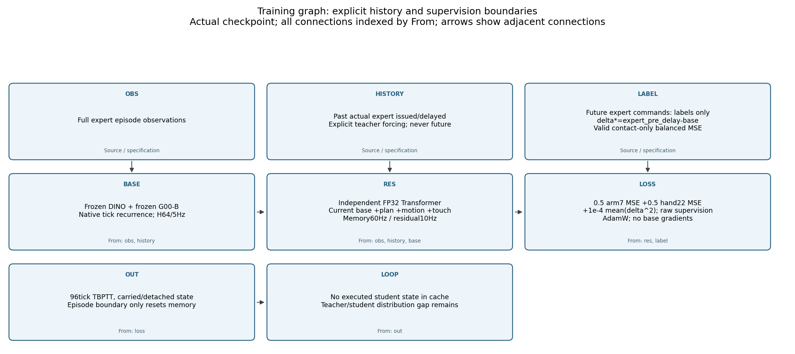

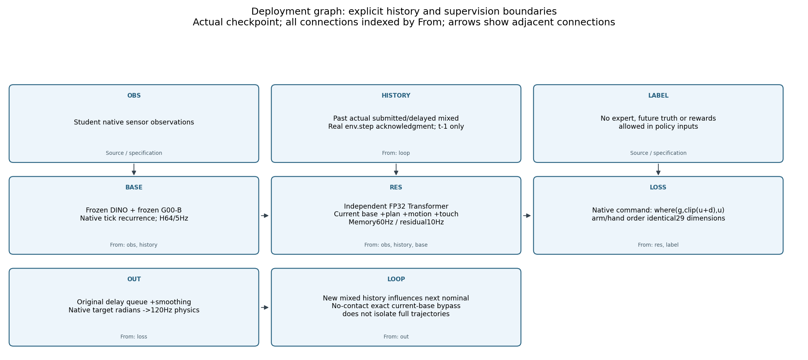

[训练SVG](evidence/network_audit_20261031/architecture_training.svg) / [部署SVG](evidence/network_audit_20261031/architecture_deployment.svg)。
训练缓存用专家观察、专家过去实际issued/delayed history，以及冻结G00在这些条件下因果生成的plan/base。
未来专家命令仅生成残差监督；损失为接触valid处0.5 arm7均方+0.5 hand22均方+1e−4平均delta²。
部署没有专家观察或未来target；环境真实混合命令ack同时更新名义与残差历史，学生状态分布由自己执行产生。

## 5. 历史GRU＋MLP参照

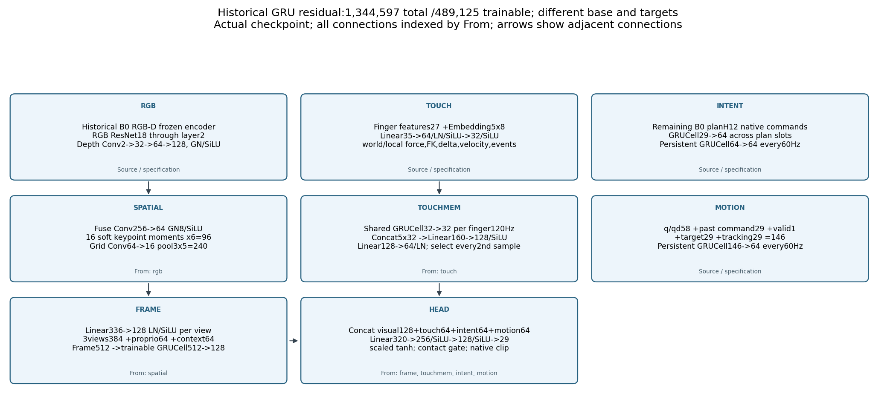

[SVG](evidence/network_audit_20261031/architecture_historical_gru.svg)。它用旧B0 H12 command计划、不同训练目标与冻结视觉，
不是同一base下的Transformer消融。独立副本共1,344,597参数；visual1,102,000中仅GRUCell512→128可训练，
冻结855,472；其他tactile39,880、intent18,240、intent_memory24,960、motion40,704、policy118,813均训练。

视觉RGB ResNet18到layer2（Conv7 stride2/GN/ReLU/maxpool；两basic block64，两个128且首个stride2；
每block两Conv3/GN，投影skip在通道变化处），depth2→32用Conv5/stride2/pad2/GN4/SiLU，
再32→64→128用Conv3/stride2/pad1、GN4/GN8、SiLU；
concat256→Conv1 64/GN8/SiLU；16个soft keypoint各6个moment=96，grid Conv1 64→16/pool3×5=240，
concat336→Linear128/LN/SiLU。三视图384+本体64+context64=512→GRUCell512→128。
精确stride、padding、GN group及各leaf尺寸见CSV，不能把旧RGB分支计成完整ResNet18分类器。
旧RGB先做`2*RGB−1`，depth同样m/2+valid；16个keypoint的6维为xy均值2、xy方差2、加权depth1、confidence1。
本体Linear58→64/SiLU；context94=task Embedding1×16、goal9+valid1、previous nominal29+valid1、
plan GRUCell29→32、三路camera age3+valid3，Linear94→64/SiLU。本checkpoint的own_plan/previous nominal均masked，
goal pose缺省masked，task只为外部tight_insertion；plan cell虽前向被计算，masked输出不进入有效context。

旧触觉每指27维包括world/local力6、位置3、rotation6、速度3、local力变化3、力幅1、contact/onset/release3、dt1、
pair_valid1；另加finger embedding8。Linear35→64/LN/SiLU→Linear32/SiLU，GRUCell32→32每指120Hz，
concat160→Linear128/SiLU→Linear64/LN，每60Hz取第二个样本；跨块保存上一物理样本用于差分。
plan GRUCell29→64沿有效plan槽展开，intent_memory GRUCell64→64持续60Hz；
motion146=q/qd58+previous29+valid1+target29+tracking29→GRUCell64；四分支128+64+64+64=320，
Linear320→256/SiLU→128/SiLU→29；执行用逐关节scale×tanh，再门控和clip。所有cell单层、episode重置。

## 6. 有效训练验收

best/last模型逐张量一致；last `next_epoch=5,next_episode=0,updates=3730`。
Force/Masked各一个AdamW组51张量，lr初始3e−4、betas(.9,.999)、wd1e−4；末lr5.4659461e−11。
没有scheduler对象或伪造scheduler step：每个有效更新前按stateless cosine函数赋值，共3,730次、warmup50。
DP各180/184张量一个组，betas(.95,.999)、wd1e−6、末lr2.7431949e−12；完整成员见参数CSV。

| 每组每遍训练覆盖 | 实测 |
|---|---:|
| 唯一episode / native tick | 320 /64,825 |
| 接触有效监督 /全部native tick | 37,224 /64,825 =57.42% |
| 96tick块 / 有接触更新块 | 832 /746 |
| 10Hz anchor | 10,943 |
| Transformer padded token /非padding token | 2,232,372 /2,132,796 |
| 五遍native tick / padded token | 324,125 /11,161,860 |

以上为训练遍历，不含epoch0与每epoch的固定train16/val40评估；六个输出覆盖原tick标签，尾部无效位置不算监督。
不是把重叠13tick触觉窗口当作新增独立样本；接触gate也不代表有效物体抓握。

| 模块 | Force参数变化L2 | Masked变化L2 | Force/Masked新探针梯度L2 |
|---|---:|---:|---:|
| 当前动作Linear | 3.16496 | 3.17872 | .093779 /.086048 |
| motion | 3.64816 | 3.44696 | .314925 /.304801 |
| touch | .850108 | .705822 | .013412 /.013297 |
| native GRU | 8.89351 | 9.95538 | .001270 /.003339 |
| Transformer | 9.17981 | 9.27020 | .277198 /.261386 |
| 输出头 | .693430 | .717915 | .765682 /.801121 |

初始参数用记录的seed20261103及未改模型源码重建，normalizer buffers不算参数变化；不是原训练前checkpoint。
所有模块组有变化（完整表见JSON），但Masked屏蔽力所对应权重变化可能含AdamW decay，不能以“变化”认定使用了力。
新探针固定权重有backward、无optimizer.step；历史仅保存global pre-clip梯度（末轮均值Force1.038/Masked1.021，
峰值6.024/5.913），没有历史逐模块梯度曲线。

Force实际train loss从epoch1 .478113降到epoch5 .363273；Masked .476376→.360815。
val raw loss epoch4→5为Force .445787→.442401、Masked .442689→.439428；仍在改善但幅度减小。
val组合选择MSE末值.417057/.413968，两组都选epoch5；没有val反弹，不能据此排除后续过拟合，
也不能把学习率归零导致的平缓当作收敛。base仅离线缓存、无梯度图；其best SHA匹配缓存与部署加载。
旧artifact审计的test/deployment checkpoint一致证据保留；本轮T1再次实读G00/G10 best hash。

| 原阶段 | wall s | 软件lease work s | wait s | pacing s |
|---|---:|---:|---:|---:|
| Force正式5遍（含评估） | 45.183 | 30.014 | 5.162 | 1.117 |
| Masked正式5遍（含评估） | 76.417 | 34.009 | 23.322 | 8.957 |

来源为原report、worker3341900/3349060及[原资源审计](evidence/dp_loss_trt_20261031.json)。
work是软件块经过时间，**不是CUDA kernel时间**；数据读取/CPU转换/保存耗时没有独立记录，不能将差额分配成这些类别。
所有原worker的工作/等待在JSON `worker_accounting`；并发等待重叠，不求和冒充wall。

## 7. 同权重连续力干预

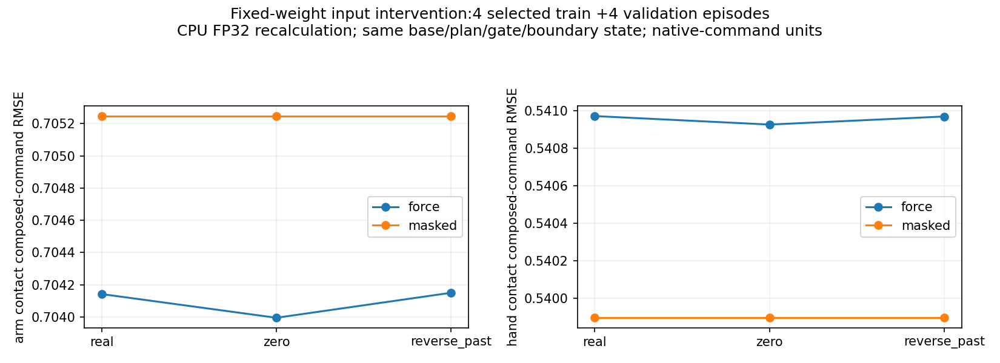

4条预选train+固定validation前4条，合计1,180接触输出步，其中当前query接触anchor194。
每96tick边界固定真实输入产生的incoming memory；在当前块及历史窗口内置零力，或倒转当前两个样本、
倒转已发生且有效的26个历史采样的力值。FK、时间戳、valid、base、plan、gate、参数都固定；不使用未来力。
真实memory携带到下一块，故这是**块内/窗口内干预**，不是全episode反事实memory轨迹或新的闭环rollout。

| 同一个Force权重，validation4 | real | zero | reverse_past |
|---|---:|---:|---:|
| 接触组合arm RMSE | .699975 | .699782 | .699979 |
| 接触组合hand RMSE | .566187 | .566128 | .566184 |

当前29D query置零改变量RMSE：arm.016538、hand.004018；五指thumb.003770、index.004377、middle.004128、
ring.003286、pinky.004386。reverse_past arm/hand.001033/.000311。全6输出arm/hand置零变化.014238/.003319。
Masked上述变化精确0。所有输入干预的train/validation分表、五指组合误差、current query和全6输出
均在`network_audit.json`，不把pooled8条称正式test。

Force/Masked独立训练的差异可能来自权重/优化轨迹；同权重干预直接证明力影响了输出，却没看到误差收益。
只能说在这些样本及干预范围内连续力作用较小，不能量化“其他输入贡献百分比”或宣称所有触觉均无用。

## 8. 可直接阅读的训练与执行曲线

全部PNG名称、对应CSV、checkpoint/更新量/split及一句结论见
[完整嵌图索引](evidence/dp_loss_trt_20261031/README.md)。原逐epoch曲线和本轮固定权重CPU重算点明确分开。
CSV有实际train320、固定train16和val40；未保存的旧40遍train/finger历史不补造。

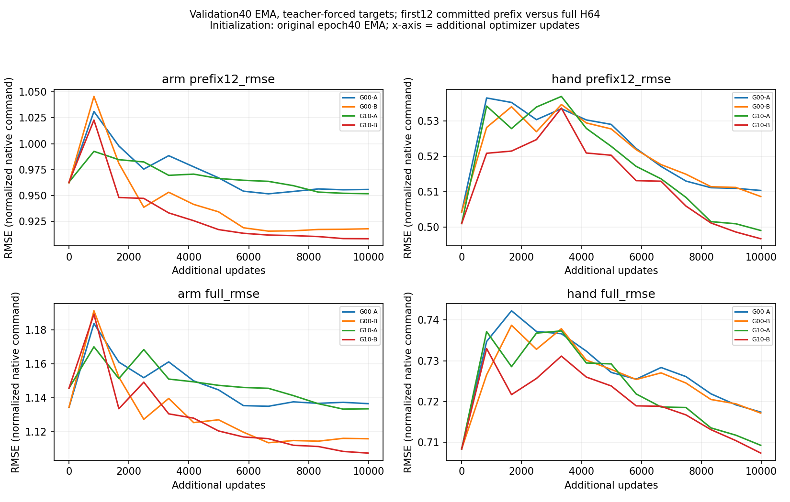

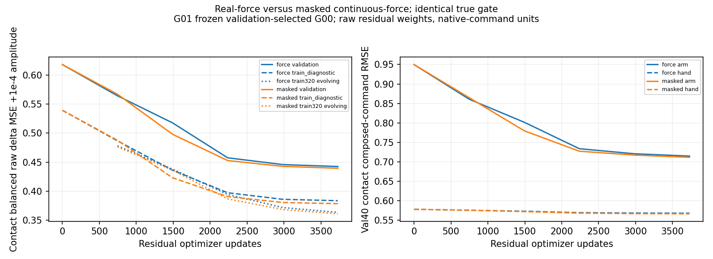

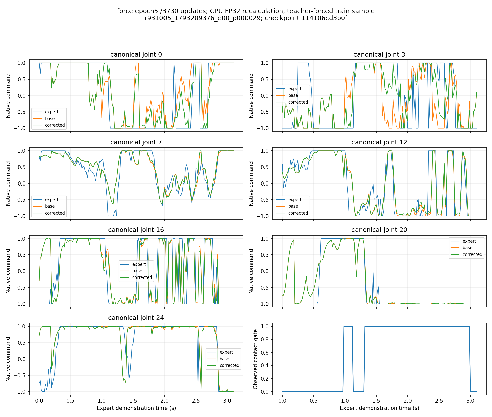

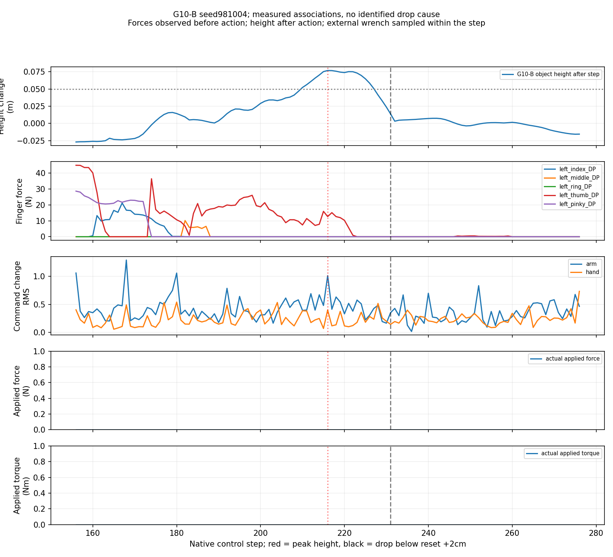

最后两图分别是离线teacher forcing重算和既有G10-B自主轨迹，不能相互替代；后者短暂抬高后回落，
无native lift/子目标，外力为0，时序关联不能确定唯一掉落原因。

## 9. T0/T1：真实训练记录的近似初态诊断

选择在学生结果出现前完成：train内标准化q/qd/object/hole/table初态+长度/contact比例，
先中心再farthest-point4；quaternion按坐标距离参与选择，不称SO(3)距离。选中后没有替换或重试。
源ID公共前缀`r931005_1793209376_`；下表step从0开始。

| 源训练示范 | T0长度 /结束 | T0首次delayed/target偏离 | G00-B接触步 | G10-B接触步 |
|---|---|---:|---:|---:|
| e00_p000029 | 187 /记录用尽 | 3 /3 | 23 | 19 |
| e00_p000184 | 188 /记录用尽 | 1 /1 | 4 | 1 |
| e00_p000146 | 175 /记录用尽 | 2 /2 | 2 | 13 |
| e03_p000151 | 455 /记录用尽 | 1 /1 | 209 | 426 |

T0四条submitted与原记录最大差0；首步q_after差5.6e−9至3.3e−8rad，之后首先出现原生delay选择差异，
有效delayed差异与target差异同一步，q超过1mrad也是3/1/2/1步。
单环境恢复CPU RNG无法重现原4环境持续运行的随机消耗顺序；没有逐步强制delay/RNG/target以制造成功。
T0峰值高度分别+.00988/.08201/−.00204/.09370m，无原生lift/子目标，均命令耗尽而非终止，按删失重放报告。

T1各0/4，8条均601步native timeout、无lift/子目标，最大高度均−.002044m；
第0步command最大差G00为1.8745/2/2/1.3358，G10为2/1.6189/2/.8719；q_after立刻差.00736–.01287rad。
源初态已保存字段全部恢复误差0；初始RGB平均绝对差约.95–2.49/255，有效depth平均差约.19–6.37µm。
这证明视觉不是逐位相同，并不证明视觉差是失败主因。采样噪声与源缓存也不是受控相同配对，不能强行归因。

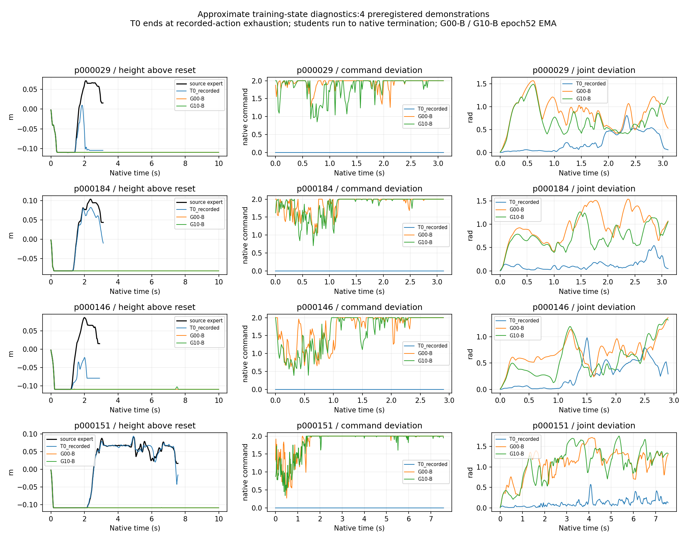

原始HDF5保存机器人/物体状态、actuator target、逐步delay选择/实际命令、CPU RNG和DR概率/配置；
没有PhysX solver/contact warm-start、完整传感历史、其他并行env状态/随机消耗、专家obs-delay队列。
初始action queue由native reset清零和首次填充规则重建；不宣称恢复任意中途队列。

新本地`*_trace.npz`保存每tick q/qd、command、delayed/index、target、力/gate、物体/子目标与实际wrench；
`*_inputs.h5`保存每12tick模型实际RGB-D/标定/时间、本体/触觉、H64 plan和condition。
源初态快照由分析脚本**事后从原HDF5提取**，实际恢复字段证据在trial及第一trace/input行。
采样seed=20261031+示范序号（从0）、CUDA Generator每次replan一次randn[1,64,29]、DDIM eta0，
但本轮没有逐次保存Gaussian张量/Generator state，也没有保存每tick完整G10物理触觉输入历史；
因此可核查执行、不能声称完整网络输入与随机数逐位回放。该缺口必须在下一版记录器中补齐。

**T0没有通过，所以“精确训练条件下学生已经/没有学会任务”仍无法从本轮定论。**
已直接证明的是恢复这些observable字段的替代条件下学生没完成任务，并且首动作错误先于接触阶段；
不能跳到“只是泛化差”。下一次应先取得同一新初始化下的在线专家成功及完整状态/噪声记录，
再比较学生；这是一项后续实验建议，本轮不追加。

## 10. 400条数据覆盖与可观察性

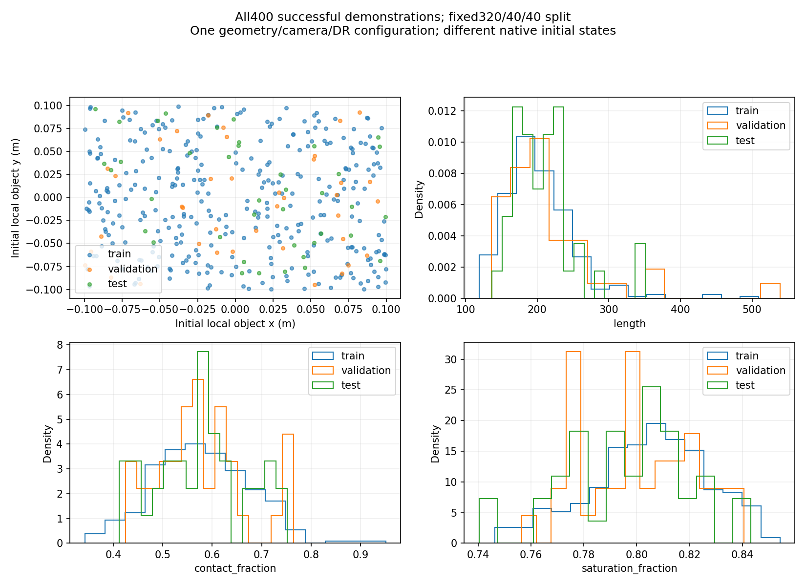

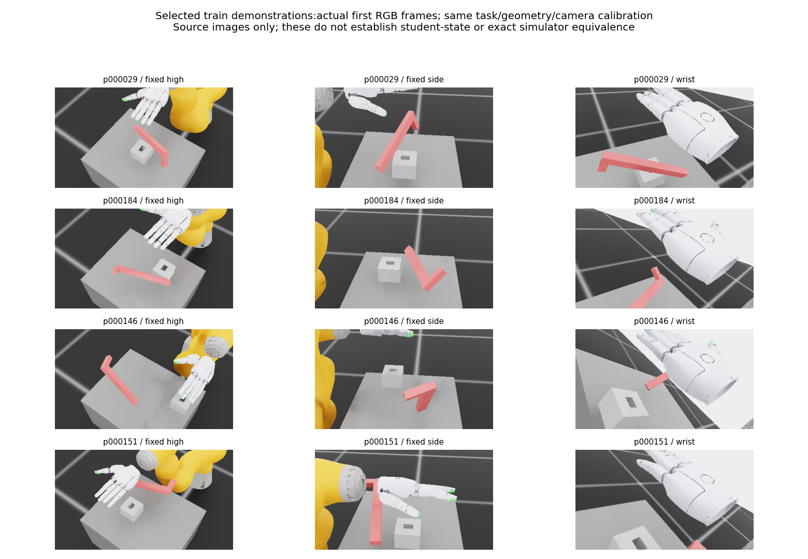

这张缩略拼图是用户允许的少量训练帧对照，不上传原始全序列。

| split | 条数/控制步 | 长度min–max/mean | object x范围m | object y范围m | object z范围m |
|---|---|---|---|---|---|
| train | 320 /64,825 | 119–509 /202.58 | −.09953–.09958 | −.09960–.09874 | .60381–.65740 |
| val | 40 /8,670 | 136–539 /216.75 | −.09970–.09425 | −.09461–.09236 | .61141–.65373 |
| test | 40 /8,399 | 137–351 /209.98 | −.09273–.09941 | −.08222–.09594 | .60291–.65305 |

机器人q/qd逐维范围、物体quat、hole/table pose及命令逐维mean/std/饱和分布均在
[dataset_distribution.json](evidence/network_audit_20261031/dataset_distribution.json)，逐条统计在
[dataset_episodes.csv](evidence/network_audit_20261031/dataset_episodes.csv)。quat分量范围不等同欧拉角覆盖。
400个初态向量、完整command hash、HDF5 hash均唯一；最近train标准化初态RMS最小train/val/test为
.9002/.9520/.9197，32归一化进度采样command RMSE最近值.5393/.4834/.5482，没有重复证据，
但这些描述符不能证明语义多样性充分，也不是全轨迹距离。split沿用初态/episode划分，没有随机拆帧泄漏。

单一`lpeg_matchedmass`与hole_tol0p5mm；URDF两box尺寸分别.25×.03×.02m、.02×.08×.02m，
第二box中心(.115,.025,0)m；这是源码几何尺寸，不是由RGB推断出的尺寸。配置object_scale固定[6.25,.75,.5]，
所有scale/friction随机乘子[1,1]，不构成新几何分布；相机固定version4 wrist_bracket_close标定，
腕部随真实关节运动，不能把它当独立相机外参随机化。
reset object position noise±.1m(x/y)/±.02m(z)，table z=.38±.01m，初始arm/hand随机插值.1、qd区间±.5rad/s。
obs/action delay原生保留；随机force_scale20、torque2，概率.001–.1且仅lift后作用；这是mass加权随机冲量公式系数，
不能直接当每次20N。实际120Hz非零force采样524、torque480，逐条peak/曝光见CSV。

| 每条平均持续步数（÷60为秒） | train | val | test |
|---|---:|---:|---:|
| aggregate contact | 116.325 | 126.475 | 121.200 |
| native lifted flag | 28.056 | 37.700 | 35.825 |
| 首子目标达到后 | 43.581 | 50.075 | 43.175 |

接触、lift、retract、子目标标记可重叠；没有可靠“抓持对象身份”，不捏造grasp时长。
“首子目标达到后”不是精确insert接触阶段分割；原native flags及retract时长如实给出。
专家命令元素饱和率各split均值80.44%/80.04%/79.64%，表内std为每episode/每joint分布，
不是把不同长度episode等权统计冒充全tick总体方差。

原专家读取带噪/延迟的特权物体/目标几何；学生三路RGB-D看到手、桌面、物体与孔，但接触时手会遮挡，
毫米级孔隙不因有448×252 RGB-D就已被可靠估计。DINO18×32再池化3×5可能丢失精细几何信息，这是待测假设；
没有受验证的视觉pose estimator或精度评估，不能宣称信息充足或将sim真值接入名义来弥补。

## 11. T2、T3与近期研究定位

T2复用既有合法seed981001/981002/981004。当前G00-B/G10-B各0/3，都是601步timeout，零子目标/native lift；
G10-B seed981004短暂+7.6863cm随后掉落。逐条初态本地`*_initial.npz`、trace、hash/接触/失败阶段在
`native_audit.json:id_existing_trials`及原审计。每模型二侧Clopper–Pearson95%上界`1−.025^(1/3)=.707598`。
T1是选择过的近似训练初态，T2是新合法初态且只有3条，不合并；旧B0/B1正式0/50亦不混计。
本轮优先12条T0/T1定位，没有扩成20条；因此没有可靠成功率或OOD结论。

以下是**未运行、需新版本协议与有效性验收**的T3定义，不修改本轮只读环境，不自动启动：

| OOD轴 | 预定义条件 | 与训练的差异及有效性检查 |
|---|---|---|
| position | 局部object x∈[−.16,−.12]或[.12,.16]m，y仍训练范围；固定seed982101–982120 | 超出训练/reset ±.1m；先检查box不穿透、机器人可达、专家可完成 |
| pose | 冻结训练姿态集合，SO(3)测地最近距离>20°且不违反原任务放置条件，固定候选序列 | 当前原生旋转分布宽，可能无可行候选；若无，则报告无法构造此轴，不能把随机新quat叫OOD |
| camera/appearance | high相机x偏±.05m、绕目标yaw±15°，分别单因素；灯强×.5/×1.5，固定两种新table材质 | 新calibration/schema，真值外参只供既有合法投影；先验证三路可见、depth有效与专家回归 |
| contact perturbation | world ±x/±y 2N持续12 physics steps(0.1s)，首次contact前固定tick60或首次valid contact之后触发；未触发分开删失 | 与训练随机且仅lift后wrench不同；每physics step实测composer曝光，避免请求力当实际力 |
| geometry/scale | 新资产版本：peg和孔共同尺度.9或1.1并保持可插入配合；新几何单独组 | 训练scale乘子固定1；明确惯性/碰撞资产版本、合法初态和专家可行性，不与原任务混池 |

各轴先预登记、训练集不改、不用test调参，报告合法拒绝/软件错误/任务失败/曝光不足。
当前只实现离线拟合、少量近似训练态诊断与3条ID失败记录，没有完成上述OOD或系统扰动实验。

| 研究与原文 | 示范/验证/闭环规模 | 对本项目可借鉴的边界 |
|---|---|---|
| [VISTA，2026原文](https://arxiv.org/html/2610.03333v1) §4/A.7/A.8 | 仿真8任务50demo主表、100demo扩展；当前A.7写8:2按val diffusion loss选模、40独立rollout。实机100demo/任务、8:2、10独立trial | 10D绝对eef与GelSight，不是29D灵巧手；验证与最终rollout分离。2026-10-31复核原文，不沿用早先未经确认的6次validation rollout说法 |
| [iDP3，IROS2025](https://arxiv.org/html/2410.10803v2) §IV | 小样本实验1/2段demo、每段20轮；每方法3×1000action-step长episode约130次尝试。泛化实验每任务10demo×10rollout；总2253 | 区分长episode与单次尝试；实测新视角/物体/场景。验证划分在本次查阅处未明确，记未知 |
| [Equivariant DP，IJRR2026扩展版](https://journals.sagepub.com/doi/10.1177/02783649261424445) | 进阶实机任务20–159demo、20次测试；Bagel烤箱训练3姿态→8未见旋转 | 明确留出姿态；关节限位不可达失败单列。与CoRL2024会议版区分 |
| [RDP，RSS2025](https://arxiv.org/html/2503.02881v1) §V/附录 | Peeling60/Wiping80/Lifting50demo；每条件10trial，正常/接触前/接触后扰动分组 | 手工对齐相似初态不是逐位配对；部分score非二元success。快输出24Hz、慢plan动作采样12FPS而重规划1–2Hz，不能直接套用本项目120/60Hz |

这里只比较数据和验证协议，不跨硬件、动作空间、任务难度比较成功率倍数，也未复现作者任务或加载作者策略权重。

## 12. 资源、复现与公开范围

新run `outputs/visuotactile/run/network_audit_20261031_01`，预登记4×3=12启动，无替换/重试/参数更新。
监控覆盖GPU启动到退出997.50s，998样本、missing0；整卡均值30.3900%、最大完整60秒38.1214%，
峰值显存14,612MiB（卡总24,084MiB，最少空闲9,472MiB）、最低RAM26.9552GiB；两项均值无越50%。
新会话结果不撤销旧阶段资源违规，whole-card包括其他进程，不是本进程硬配额。
owner/worker/monitor退出已查`/proc`；native与sim wrapper逐文件hash与无diff检查通过。
新native worker软件work725.025s、wait105.129s、pacing137.360s；work不是GPU独占时间。
结束审核磁盘空闲82.45GB，监测未记录连续磁盘最小值，不能把结束快照当全程最低值。
13项定向测试通过；真实400条分析、6实例forward/参数审计、12条产物分析完成。
[交付核验](evidence/network_audit_20261031/verification.json)记录32张PNG解码、5张SVG解析、CSV总数和文档链接检查。

CPU复现命令（新native cohort不得自动重跑）：

```bash
bash visuotactile/run_cpu.sh -m visuotactile.audit_distribution --source outputs/visuotactile/run/dp_loss_trt_20261031_01 --output research_docs/evidence/network_audit_20261031
bash visuotactile/run_cpu.sh -m visuotactile.audit_network --source outputs/visuotactile/run/dp_loss_trt_20261031_01 --output research_docs/evidence/network_audit_20261031
bash visuotactile/run_cpu.sh -m visuotactile.audit_training_initials --root outputs/visuotactile/run/network_audit_20261031_01 --output research_docs/evidence/network_audit_20261031
bash visuotactile/run_cpu.sh -m visuotactile.plot_network_audit --output research_docs/evidence/network_audit_20261031 --curve-source outputs/visuotactile/run/dp_loss_trt_20261031_01
```

公开仅脚本、报告、逐层表、统计CSV/JSON、SVG/PNG及少量授权缩略拼图；原始HDF5/NPZ、checkpoint、视频、
大日志和私有配置留本地。新审计、曲线与原数据哈希指向实物，不能把可执行脚本存在等同实测通过。

## 本轮授权与预登记（2026-10-31）

用户要求从真实checkpoint和运行产物核查G00/G10、Force/Masked Transformer及历史GRU残差，
生成逐层CSV、训练/部署SVG和PNG、直接嵌图的曲线索引、400条数据分布及训练初态闭环诊断。
开始HEAD为`3ce0c187c414a27992aaa7d01de6e09d7300408e`，功能分支工作树干净；旧GPU流程已结束。
本轮不进行optimizer更新、不重训，不改native控制、物理、reset、DR、判据或sim wrapper。

### 执行顺序与边界

1. CPU检查真实配置、checkpoint/optimizer、400条metadata和初态字段，固定4条训练示范，选择规则不依赖学生结果。
2. 实际checkpoint和真实样本forward hooks，覆盖所有leaf模块；不支持的函数运算和动态控制流单列补图。
3. 同输入/计划/历史/gate下对真实力、置零和时间置乱作干预；不同checkpoint的训练消融与同权重输入干预分开。
4. CPU整理已有CSV曲线；缺失历史不补造，新固定权重计算单列为重算评价点。
5. 新独立run内最多4条示范×(T0记录命令重放/G00-B/G10-B)=12次原生启动；恢复字段不足时明确标近似初始化。
   不以同seed宣称相同状态，不替换失败初态、不重复启动；T2先使用既有3个合法seed并给置信区间，20条扩展不强制。
6. 完成结果和两页以内中文核心结论、图表、CHANGELOG，审查后推送origin当前功能分支。

以下预登记文字保留为执行前记录；实际完成情况见上文。所有新GPU工作使用统一lease和独立监控；新计算窗口上限3小时，包含等待，不换run ID延长。
目标35–40%、整卡会话及完整60秒均值<=50%，VRAM/RAM至少4/10GiB、磁盘12GB。
架构/数据CPU分析可继续，但窗口结束不新增GPU工作。当前还没有新forward或闭环结论。

### 初态可重现性预检

原HDF5保存每步机器人/物体/目标/桌面/孔状态、controller target、实际命令及delay选择、
CPU torch RNG（推理前/step前/预处理后）、DR概率/质量和配置；是否足以恢复必须结合native reset实现核验。
PhysX内部状态、接触求解器warm-start、完整传感器/队列状态不能因有姿态快照就假定已保存。
T0尚未运行，T1尚未运行；本轮不能先行归结为泛化差。
