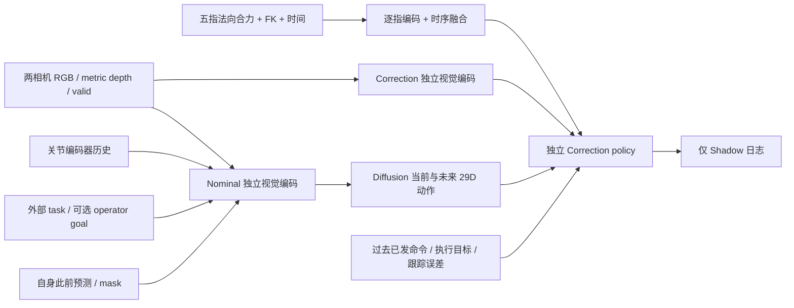
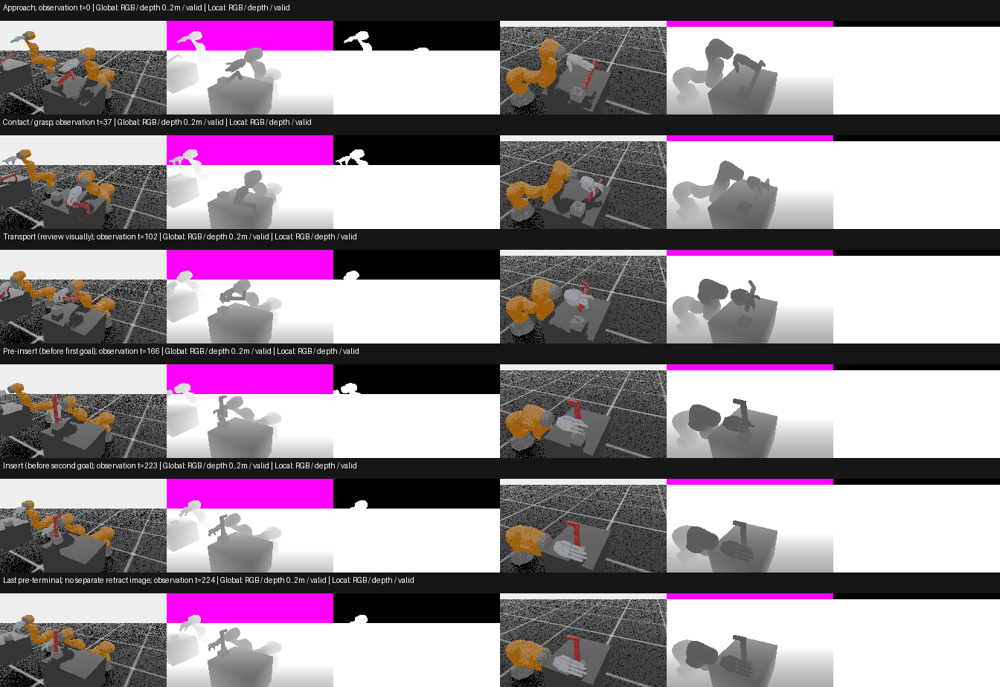

# Perception v2 — 多视角与五指力观测

> **2026-10-28 最新纠正：** v4近高位三视角已完成seed17/920101两条真实验收（220/214步），与各自v3参考128个非图像字段逐位相同；143字段无损转换和三路模型接口检查通过，零训练。此前“零v4成功/资源保护已完整”的文字为当时快照：上一提交的容量统计仅单root、v4仍有两处版本漏判，本轮已修正。实际背景批次看最新SESSION_HANDOFF/status；不要把下面历史状态当实时。源码通俗说明见[PROJECT_GUIDE_ZH.md](PROJECT_GUIDE_ZH.md)。

## Current entry

The active research profile is three calibrated RGB-D views at 448×252:
`fixed_high`, `fixed_side`, and the dynamic `wrist_rgbd` mounted under the
actual `iiwa14_link_7` rigid prim. Existing version-3 episodes use the
original `wrist_bracket` high camera; version-4 `wrist_bracket_close` is a
separate candidate that moves only that high camera. The older dual-view
224×126 descriptions below are historical evidence, not the current batch
contract.

本轮只建设感知和可训练网络接口，不进行参数更新、BC/Correction/RL 训练或策略成功率优化。旧 1,000-step checkpoint 的低成功率既不是新架构证据，也不参与新模型初始化。以下设计是可替换的工程基线。

## 已查阅的公开实现（2026-10-27）

阅读过的原始文件下载到本地 `outputs/visuotactile/perception_refs/`，不作为项目依赖或公开再分发内容。除已有 diffusion U-Net 外，本轮没有复制第三方源文件；ResNet 使用已安装 torchvision 0.22.0 的公共接口。

| 来源与固定版本 | 实际查看的实现 / 适用性 |
| --- | --- |
| [Stanford Diffusion Policy](https://github.com/real-stanford/diffusion_policy/tree/5ba07ac6661db573af695b419a7947ecb704690f)（RSS 2023/IJRR 2024），MIT | `model/vision/multi_image_obs_encoder.py` 按相机 key 排序，支持共享或独立 RGB backbone、GroupNorm、拼接低维输入；不是 RGB-D 编码器。采用固定身份顺序和共享视觉权重的思路，不复制其依赖链。 |
| [LeRobot Diffusion](https://github.com/huggingface/lerobot/tree/dd5313e305ff7aaa5b6c7b4769d1b26650ce250b)，Apache-2.0 | `src/lerobot/policies/diffusion/modeling_diffusion.py` 的 `DiffusionRgbEncoder`、`SpatialSoftmax` 和多相机条件；ResNet 特征图 + 空间 softmax。源码明确警告不能把预训练 BatchNorm 直接替成 GroupNorm 并声称保留权重语义。采用空间位置特征，不引入整个 LeRobot。 |
| [OpenViTac](https://github.com/FVL-Repo/OpenViTac/tree/5220aaf6a68dec5d2a6d284a76cffe337ef234c9)（2026） | `encoder/network.py` 是 ResNet 重建编码器；`policy/openpi/abs_joint/insert_usb_vision_policy.py` 明确分 base/wrist/tactile 图像，mask 缺失视图。不能把这一客户端当作已公开完整 OpenVTLA 时序训练实现。环境 README 要求 Sim 4.5/Lab 2.1.1 与修改版 TacEx/UIPC，和本机 5.1/2.3.2 不同；根目录未发现统一 LICENSE，子目录有不同许可。只参考设计，不复制/安装。 |
| [3DTacDex](https://github.com/tianhaowuhz/3dtacdex/tree/a4a367514ee25c4ad43eb2400cac0141bcb85331)（ICRA 2025；[论文](https://arxiv.org/abs/2409.17549)），MIT | 实读 `real_world/data_preprocess/tactile_processer.py`、`fk/tactile.py`、`robomimic/models/gnn/gat.py`、`pretraining/models/edcoder.py`。用 FK 得到触点空间结构并转换传感器力坐标，图网络/预训练依赖密集触点。本项目只有五个刚体合力，不能伪造 taxel 图或套用其局部力重建损失。采用指身份、FK 空间信息、明确坐标转换。 |

OpenViTac 的全局 + 腕部视角提供局部接触上下文，DP/LeRobot 支持多图像条件；这些实现并不证明某个安装角度适合 KUKA+Sharpa。这里先选两个固定外部视角，避免移动安装、手腕外参和新碰撞体的额外复杂性。腕部和纯俯视相机仍是可比较的后续方案。

## 相机与实际选型

所有安装位置相对各自 env origin；ROS optical +Z 前、+X 右、+Y 下。`set_world_poses_from_view` 生成实际四元数，不手写猜测欧拉角。两个相机共享一次观察时刻的渲染，逐环境记录实际 K、位置和 ROS wxyz 姿态；`camera_ids` 顺序不可交换。

| ID | eye / look-at（m，env frame） | 选择依据 |
| --- | --- | --- |
| `global_oblique` | (.6,−.8,1.1) / (0,.15,.65) | 保留原研究斜视安装；可见桌面、机器人和整体任务空间。 |
| `local_opposite` | (−.7,−.35,1.15) / (0,−.03,.68) | 从相反横向观察五指与物体/孔座。前两个实测候选在随机孔位下有裁切，第三个覆盖更稳定。 |

历史双视角基线使用 **224×126** 和 focal length 24；它不是当前三视角
采集分辨率。当前 `wrist_bracket`/`wrist_bracket_close` 使用三路
448×252，固定相机 focal length 40、腕部 focal length 24；实际 fx=fy
仍由运行时记录。相机本身不增加碰撞。v1 仍为单相机 160×90，必须显式
选 `--perception-version 1`。修改分辨率只在独立 collector 的 v2 配置中，
不改原资产/任务默认参数。

v2 的 RGB 在 [0,1]；深度是 **distance_to_image_plane 的米值**，不是 ray range。无效深度置 0 并单独记录 `depth_valid`。不再把原窗口归一化深度误当米值。模型只在自己的 depth 分支除以固定 2 m；原学生 depth/noise 代码未改。

实际图与数值见下方验证记录及 RUNBOOK。外部视图不能看穿封闭抓持；小孔内部、接触斑、真实压力和滑移仍不可直接观测。并行环境的相邻台面可能出现在全局视图背景，张量/外参/episode 索引不会因此混用；正式训练应评估背景遮挡或视觉隔离，不通过更改物理间距掩盖问题。

## 网络与信息边界

当前持续历史更新见 [HISTORY_AND_TRACE.md](HISTORY_AND_TRACE.md)；下方相机/空间结构未换模型，历史合约由独立memory2扩展。

- RGB：torchvision ResNet18 到 layer2、stride 8、GroupNorm，**无预训练权重**。Depth+valid：独立 2 通道卷积分支。空间分支输出 16 个未赋予语义的 soft spatial moments（不是已学习物体/手指关键点） 的 xy、方差、加权有效深度与置信度，以及 3×5 空间网格。每视图 128D，按身份拼接；没有把 RGB 预训练 conv 直接改为四通道。
- 历史：memory2每60Hz观察更新持续128D GRU；视觉/关节/目标/自身旧预测每步处理，重新规划不清空状态。旧memory1为4帧stride3、0.15s窗口。固定维度记忆有跨episode内全历史的因果通路，但不能无损保存或保证有效记住全部内容。
- Nominal 自身上下文：上一 native tick 的**自己生成**命令，以及旧计划从当前时刻向后的剩余预测，带 mask。在本次重新推理前构造；不读取本次专家动作、当前新预测或 correction 命令。纯专家数据没有模型预测时全部 mask=false，不用专家动作补齐。
- 目标：当前明确取得 operator 选择的 `tight_insertion` task ID。可选外部 JSON `operator_command` 的机器人基座系 xyz + 两列旋转矩阵，9D+valid。默认 pose 缺失且 mask=false；不从物体/孔座真值、成功计数或隐藏阶段填值。目标估计器、动态多目标命令和阶段完成判断仍未解决。
- Correction 使用自己的视觉/历史权重（不共享 nominal 特征），逐指触觉特征、运动/执行状态，以及 detach 的当前/未来 nominal chunk。输出29D完整候选只存日志；没有学习损失、优化或控制权限。

## 五指力与合法运动信息

顺序固定 index/middle/ring/thumb/pinky，实际刚体为 `left_*_DP`。聚合的是各整个末节的 **normal force**，可包含对桌子/物体/其他手指的接触；不能区分接触对。没有触点分辨率、切向合力、扭矩、压力或可靠滑移观测。

`kinematics.py` 从原 URDF 的关节链（包含固定关节）和编码器关节位置计算末节 link 原点及 `R_base_link`。原固定基座 world 方向为单位旋转，故 `F_base=F_world`、`F_link=R_base_linkᵀ F_world`。不使用 simulator `body_pose` 输入；仿真刚体姿态只在 diagnostics 中校验 FK。既不把质心当 link 原点，也不把末节原点称为接触点。当前实现对非单位基座朝向显式拒绝。

每个 120 Hz 物理更新后，保留对应编码器 FK；与 ContactSensor 最近两帧一起构成60Hz packet。memory2每次消化两个新物理样本，跨控制步保留五指状态与上一物理样本；旧memory1窗口为12个control interval→24样本。每指编码 world/local 力、base position/rotation6、base系位置差/实际dt（m/s）、局部力差（N，不是N/s；局部轴转动也影响此差）、接触建立/消失、实际dt/pair-valid和身份embedding；各指独立 GRU、固定顺序融合为64D。接触阈值 .1 N 是未校准的工程特征阈值。特征可训练但未训练；没有虚构预训练目标。

Correction 额外使用原控制器可记录的当前 actuator target 和 `target−encoder`（各29D），允许分析跟踪误差/预加载；这些字段从不进入 Nominal。trace2已通过原action helper的只读hook记录实际延迟抽样/index/source-step；trace1仍缺失，不能反推伪造。

## 频率、边界和兼容性

- 保持120Hz physics、60Hz原生控制、60Hz三相机观察和120Hz力/FK。网络重规划每6个native ticks，预测12个native动作；并未更改动作幅度/decimation。
- 所有时间是模拟时钟，非墙钟。相机时间是渲染后可取得图像的观察时刻，后端 frame 单独存储。当前未实现不同相机频率、丢帧重采样、学生延迟/augmentation；这些设置仍拒绝运行，不能声称已经模拟实机异步延迟。
- memory2使用EpisodeSequenceDataset/CorrectionSequenceDataset完整前缀顺序读取与持久状态；旧EpisodeDataset和OnlineHistory窗口保留同一索引/掩码规则；每env独立，只有真正episode reset清空，subgoal不清空。reset后的接触区间无效；最后一帧终止图仍不可得，后续episode图片不会冒充terminal。
- schema1 与 schema2 显式区分；旧checkpoint缺失版本按v1解释，旧权重不加载到v2。兼容检查包含view身份、分辨率、实际相机标定、depth语义、关节顺序、任务词表、FK URDF hash及原控制/物理时序。
- `CorrectionEpisodeDataset` 单独返回 inputs 与 expert supervision；默认拒绝没有因果 nominal 预测的数据。未训练旁路预测必须显式 `allow_untrained_probe=True` 才可用于工程检查，不代表正式训练集。

## 先前 perception2 / memory1 实际验证与视野解释

以下数字保留原感知里程碑的真实结果；当前memory2的225步回放、23项测试、约99.5ms完整旁路见HISTORY_AND_TRACE。没有用旧结果冒充新时序结构训练效果。

图中每组三列依次 RGB、固定0–2m灰度深度、有效掩码。左组全局、右组局部；不是网络生成图。来源为final01/env000_ep000000的真实观察t=0、37、102、166、223、224。公共图是经审计的少量研究展示图，不包含整段训练数据。汇总与标定见 [evidence/perception_v2.json](evidence/perception_v2.json)。

| 阶段/采样时刻 | 实际观察及边界 |
| --- | --- |
| 接近 t0 | 全局可见整体机械臂和工作台，局部从另一侧观察手背/手指与桌面的高度关系；尚无有效接触区间。 |
| 建立接触 t37 | 局部补充夹指间隔与红色物体另一侧轮廓；两视角仍有手掌遮挡，首次非零力不等于稳定抓持。 |
| 搬运中段 t102 | 全局显示搬向孔座的整体路径，局部更容易分辨手指排列、物体竖直部分和台面；没有直接估计6D物体姿态。 |
| 对准 t166 | 按原任务首个pre-insert目标的前一帧选取；局部从对侧补充夹持与孔座附近结构。task阶段只作为离线标注。 |
| 插入末段 t223 | 全局与局部的遮挡面不同；可见物体外部相对孔座变化，但孔内接触、接触斑和压力不可见。 |
| 最后可得 t224 | 该episode在下一次物理step中同一步达到final和retract判据并reset。**没有独立返回的retract阶段图，也没有terminal图**，不能把下一episode图片标作撤手。原判据未改。 |

两相机光轴接近正交（精确值见证据JSON），互补的是外部表面与遮挡方向；这不证明全任务几何可观测。最终长episode中，全局有效深度约68.6–69.3%，局部约93.7–94.1%；选取的五个非初始帧中两相机均有5个末节原点落在画面内。原点投影是构图检查，**不是指尖接触区可见率**。默认performance/off-antialiasing的RGB有明显背景斑点；本轮未擅自调渲染/物理参数，正式数据质量仍需评估。

完成的检查：

- 最终2env×240ticks，480条专家transition，网络只旁路，0次参数更新；完整/尾段/reset均记录，场景健康断言始终开启。
- 五指力world↔link转换与模长检查通过；FK最大位置误差6.60e−7m、旋转矩阵元素误差9.82e−7。最终样本ring无非零接触，第一候选的真实轨迹中ring峰值13.73N；五传感器已发现真实刚体且均有非零信号证据，不能推断任意接触几何都被覆盖。
- 相机/力/FK时钟、前一执行目标/命令、前一nominal动作与剩余旧plan的因果关系检查通过；两个Dataset与在线CorrectionContext的完整输入在所选边界/内部时刻逐项精确一致。
- Nominal输出(1,12,29)，Correction候选(1,29)。真实样本RGB、depth、触觉、motion、intent、denoiser各分支非零有限梯度；仅反向传播图检查，没有optimizer或权重更新。两网络保存恢复精确一致。
- 15项CPU单元测试通过，旧schema1+真实1000step checkpoint前向通过，v1/v2混用拒绝，未训练checkpoint不能执行。
- 原渲染环境32步15字段逐位一致；原专家在camera03与final01的480条动作/目标/奖励/关节/物体/孔座/成功/终止字段逐位一致，说明旁路没有改变这些被测轨迹。
- 最终完整旁路中位206.94ms/步，Correction约199.16ms（两核、两env）。尚不支持实时10/60Hz；频率只是模拟时钟调度，未更改原控制幅度。后续应测encoder缓存/批处理和适当推理频率，不据此更改物理decimation。

未完成：目标视觉估计/阶段命令、充分数据上的表示学习、腕部视角对照、相机异步/延迟/噪声校准、精细接触可观测性、可靠滑移特征、Correction训练目标与训练、实机和实时期限。普通BC仍不等于去除示范预加载。

## 当前新增三视角布局（2026-10-28）

旧双路默认和历史测试保留。新增rig3的两固定＋link7腕部方案、实取官方/Stanford/DROID参考、动态位姿修复、全过程可见性/颗粒/资源实测，详见 [CAMERA_VALIDATION.md](CAMERA_VALIDATION.md)。推荐采集配置448×252/quality/AA Off，腕部local pos(.12,.16,.07)、朝向固定局部(0,-.14,.24)，不读取物体真值来追踪。光心避开已测mesh包围体不等于实体硬件可安装。

实际新三路图像/深度/mask进入相同可替换编码器，显式views3；16步真实因果回放的三路视觉梯度、触觉/运动/意图梯度非零且有限，0更新/Shadow不执行。168步整段Dataset记忆一致性通过。未训练出视觉能力，不把空间特征当语义关键点。旧双checkpoint拒绝；生产纯专家记录不伪造Nominal计划，后续训练选择仍待解决。
