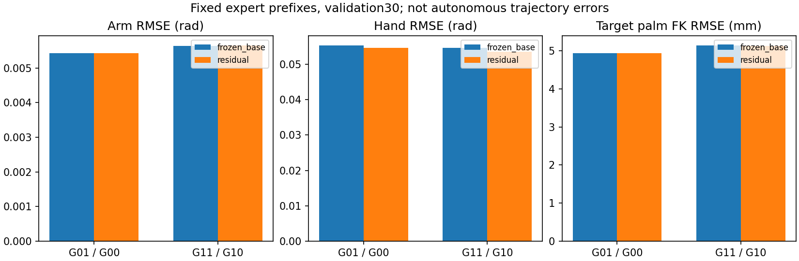
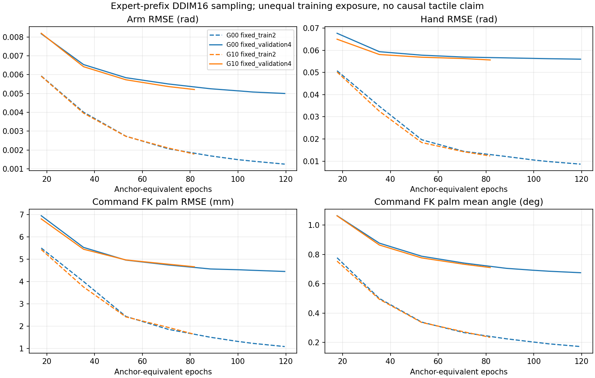
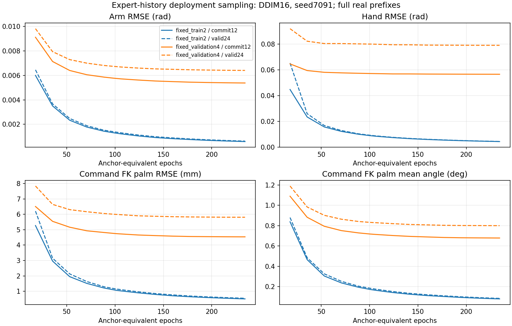

# 当前任务：匹配Transformer与实际配置名义策略

本轮实现和定向验收进行中，正式训练是否已启动/完成以[当前结果](STATE_DP_RESULTS.md)及本机tight_transformer_20261110_01/status.json为准。
[新旧差异与完整合同](CONTRACTS.md) · [实删398文件/823.8MiB](CLEANUP_AUDIT.md) · [Transformer及标签CPU证据](evidence/tight_refactor_20261110/transformer.json) · [已有成功摘要](evidence/tight_refactor_20261110/existing_success.json)。

重新匹配G00/G10基础与G01/G11 Transformer；Q00/Q01采用真实after配置前端和命令执行修正。几何需live cooked准入，内力缺完整校准时明确BLOCKED。未产生本轮新成功率，旧结果保持如下。

# Tight-Insertion 当前研究结果

**G01/G11已完成：原生完整成功分别0/10、1/10；G11成功视频已保留。**
两组各98,610次残差更新、200个接触tick等效遍历，约68分钟并行训练；总队列1小时46分16秒，12:01正常退出。
固定validation4选模，最终train8/validation30诊断，test22未用；小规模开发结果不等于稳定提升或触觉因果结论。
G00/G10基础完整冻结，DINOv2-S/14、H24/commit12/5Hz与原控制60Hz/物理120Hz保持，数据218 Core仍166/30/22。

[当前结果、成功视频位置与限制](STATE_DP_RESULTS.md) · [机器结果与视频SHA](evidence/tight_residual_20261110/summary.json) · [20例闭环](evidence/tight_residual_20261110/closed_loop.csv) · [当前合同](CONTRACTS.md)



[G01曲线](evidence/tight_residual_20261110/G01/training_curves.png) · [G11曲线](evidence/tight_residual_20261110/G11/training_curves.png) · [分阶段原始指标](evidence/tight_residual_20261110/stage_metrics.csv) · [触觉敏感性](evidence/tight_residual_20261110/force_sensitivity.csv)

成功视频本地：`outputs/visuotactile/run/tight_residual_20261110_01/G11/evaluation/palm_fresh_000/rollout.mp4`，279帧/60fps。
本次公开源码、MD、图表、CSV/JSON及压缩数值指标；checkpoint、专家源轨迹、缓存和4段视频仍留本地，无新清理。
后台已停止，不自动续训、补录或扩评估。正式窗口与包含验收间隙的资源汇总分别报告；退出前4条PhysX错误尚未专项审计影响。

以下保留G00/G10和StateDP的既有结果。

**G00/G10各完成10例合法开发闭环，完整成功均为0/10，两段视频已验收。**
训练分别10132/6929更新、119.541/81.753 anchor等效epoch，按墙钟预算停止；曝光不同，不能据此作触觉因果收益结论。
各38条train8/validation30完整离线诊断已完成，test22未使用。G00=三视角RGB-D+合法robot178，G10另加观测触觉；
共用冻结DINOv2-S/14和公共随机初始化，没有Actor141/Geometry85或残差。

全部20例结果于2026-11-10 01:51落盘后，退出检查发生完成凭据接口错误；机器状态保留FAILED，所有自有进程已退出。
原首次控制前漏传q/qd的失败与修复接续独立保留。测量完成不等于程序正常收尾，本次发布不改写原状态或重跑实验。

[当前合同](CONTRACTS.md) · [完整结果、误差解释与视频位置](STATE_DP_RESULTS.md) · [机器指标与错误](evidence/tight_vision_20261110/summary.json) · [数据身份](evidence/tight_vision_20261110/dataset_index.csv)



[G00 loss](evidence/tight_vision_20261110/G00/loss_curves.png) · [G10 loss](evidence/tight_vision_20261110/G10/loss_curves.png) · [G00阶段误差](evidence/tight_vision_20261110/G00/stage_errors.png) · [G10阶段误差](evidence/tight_vision_20261110/G10/stage_errors.png)

代码、MD、13张图、CSV/JSON及压缩逐tick指标提供于当前origin feature分支；checkpoint、RGB-D源轨迹和MP4保留本地。
本地视频在`outputs/visuotactile/run/tight_vision_20261109_01/evaluation_resume_01/{G00,G10}/evaluation/palm_fresh_000/rollout.mp4`。
IDE中的`demos/tight_failures_20261108_01/README.md`属于旧Core8500观看队列。

仅从既有指标重新导出/绘图（CPU，不加载policy/Kit）：

```bash
bash visuotactile/run_cpu.sh -m tools.tight_diagnostics publish \
  --root outputs/visuotactile/run/tight_vision_20261109_01 \
  --evaluation outputs/visuotactile/run/tight_vision_20261109_01/evaluation_resume_01 \
  --output research_docs/evidence/tight_vision_20261110
```

本轮无新增数据：218 Core保持166/30/22，Aux15未加入。不自动增训、扩评估或启动G01/G11。
下文保留先前掌部StateDP的独立结果和发布资料。

已完成的StateDP训练和评估：**19,865更新 / 234.374 anchor等效epoch；新初态完整成功0/10，3个视频已验收**。
不自动继续训练或追加评估。数据为218 Core（166/30/22），Aux15未加入。

[当前合同](CONTRACTS.md) · [结果、误差图与解释](STATE_DP_RESULTS.md) · [清理清单与恢复](CLEANUP_AUDIT.md) · [配置](../configs/tight_state.json)



[训练/验证loss](evidence/tight_palm_20261109/loss_curves.png) · [分阶段误差与hold基线](evidence/tight_palm_20261109/stage_errors.png) · [运动/近静止误差](evidence/tight_palm_20261109/motion_errors.png)

模型复用已有robot/geometry直达condition与持续GRU，仅新增掌部目标FK位置/旋转训练损失。
固定专家历史validation30的Arm RMSE为0.005645rad、Hand 0.056618rad、掌部4.9823mm；离线改善未转化成完整任务成功。
训练中的固定train2/validation4曲线与最终train8/validation30诊断分别报告；同tick自主动作不与不同进度专家标签硬配对。
该StateDP阶段保持29D绝对target_after_rad、H24/commit12、5Hz规划/60Hz控制/120Hz物理，未训练视觉/触觉，不声称完整视觉DP3复现。

源码、MD、CSV/JSON和6张图公开在当前origin feature分支；完整checkpoint、源轨迹和视频仍在本地。
[机器结果](evidence/tight_palm_20261109/summary.json)、[10例闭环](evidence/tight_palm_20261109/closed_loop.csv)、[数据身份索引](evidence/tight_palm_20261109/dataset_index.csv)、[全部文件SHA](evidence/tight_palm_20261109/artifacts.json)。

本地训练run：`outputs/visuotactile/run/tight_palm_20261108_01`。
本地新模型视频：`outputs/visuotactile/demos/tight_palm_eval_20261109_01/remaining_01/README.md`。
IDE中的 `demos/tight_failures_20261108_01/README.md` 是旧Core8500观看队列，不能当作新模型结果。

本地仅重新导出指标/绘图（CPU，不启动训练或Kit）：

```bash
bash visuotactile/run_cpu.sh -m tools.tight_diagnostics publish \
  --root outputs/visuotactile/run/tight_palm_20261108_01 \
  --evaluation outputs/visuotactile/demos/tight_palm_eval_20261109_01/remaining_01 \
  --output research_docs/evidence/tight_palm_20261109
```

上一轮 `tight_state_20261107_01` 已清理一个重复cache、无损归档13个日志，释放289.15MiB。
当前208条继承轨迹仍引用该目录，旧best/统计、Aux、原速参照和全部成功/失败分母保留，未整体删除旧实验。
旧Core8500的27例闭环与本轮10例保持独立；历史原400/275、专家和资产未动。
训练最高完整60秒整卡均值72.127%超过50%约束，不能宣称全程资源合规；本轮10例评估最高35.456%。
