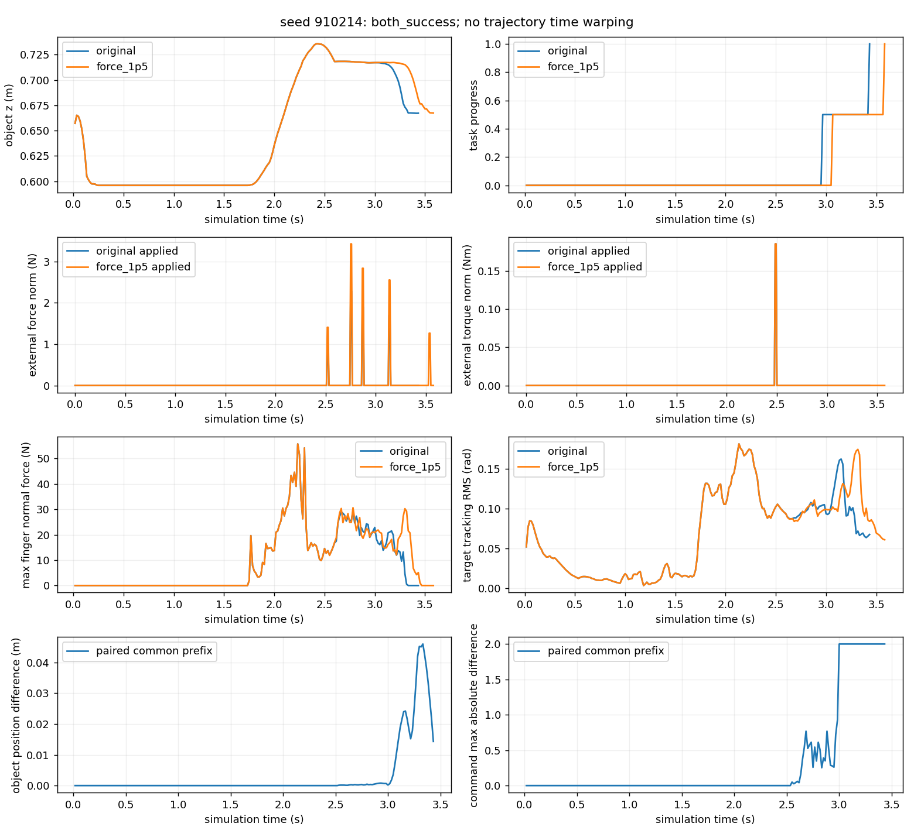
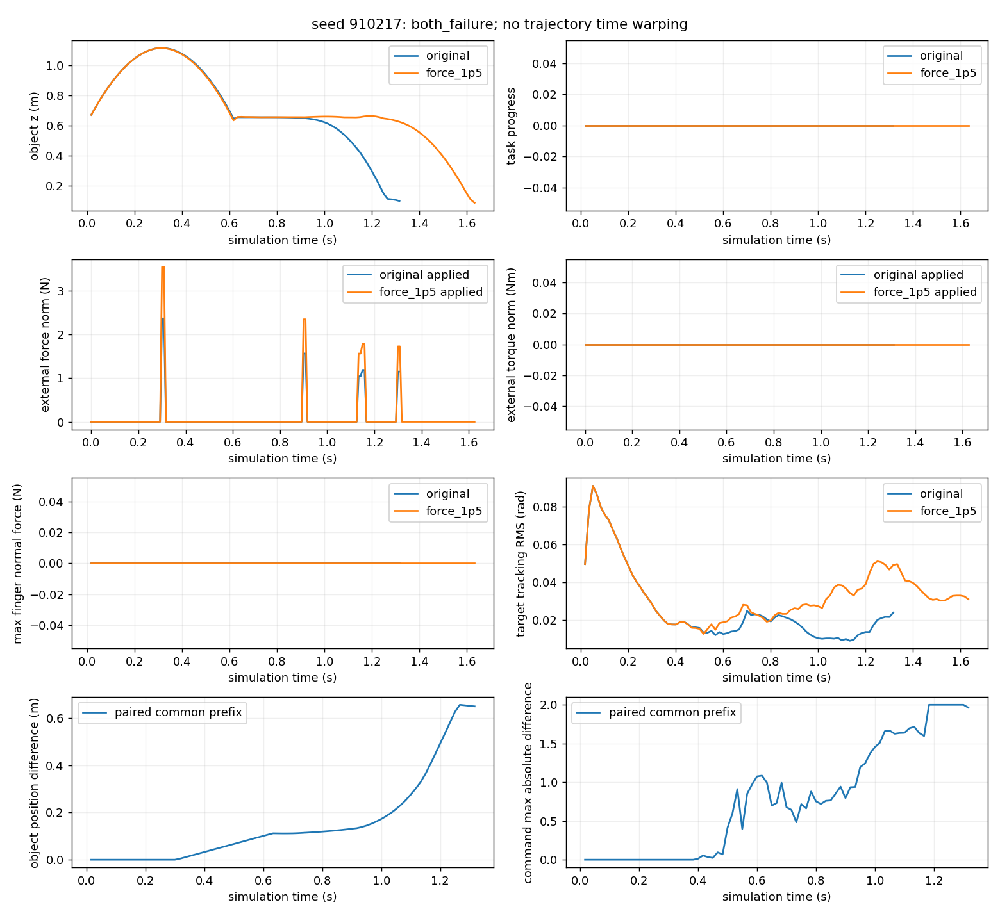

# 原论文专家的配对扰动实验（2026-10-28）

本轮只测试已发布的 tight_insertion RL expert。没有训练 RL、Nominal 或 Correction，没有执行 Correction，也不检验我们提出的模仿学习方法的收益。原始数据、checkpoint 和日志只保存在本机 `outputs/visuotactile/rl_experiment_20261028/`。

## 用户要求与这次工程选择

用户明确要求真实采集成功、失败、预算未完成轨迹；先3对验收，再20对新种子pilot；保留原生资产、物理、任务流程和控制；original保留已有DR，force_1p5只改变外力尺度；保留完整逐步数据，并报告真实施力、配对条件及统计不确定性。用户允许有依据地调整实验，但不允许按结果换种子或混合改过条件的样本。

工程选择：独立进程、单环境、reset后第一条episode、SAPG group0、deterministic推理；每对交替运行条件顺序。验收种子910101–910103，pilot种子910201–910220，全部在 `cohort_v3/*/plan.json` 中先于采集写入。每条最多2400个原生控制步、480s进程墙钟；不改原生timeout。新进程仍使用nice19、CPU22/23、两线程，CPU物理必须渲染。启动前检查至少6GiB可用RAM、15GiB磁盘；RTX双相机仍会使用GPU，不能承诺零竞争。

## 实际专家与配置

- 代码参考点 `6fc04a8cc883495d398ddae2563f62525527cd66`，开发分支 `feature/paired-expert-trials`。采集时存在本轮未提交源码；每条metadata有commit、branch、working tree和逐源文件SHA256，不能只用base commit代替工作区身份。
- checkpoint `pretrained_assembly/tight_insertion/model.pth`，217700467 bytes，SHA256 `7e61015dad660430ab07bab4f715c90c6f76b84cc358da6be81319a6aee09990`。
- `_load_env_cfg` → `_configure_agent(... deterministic=True ...)` → `register_rlgames_env` → rl_games `Runner/create_player` → `_load_checkpoint_weights` → `player.set_weights/reset`。group0的embedding为50.0，不是组间插值。`player.get_action(... is_deterministic=True)`使用均值，但其内部仍可能生成被丢弃的随机采样；记录实际torch RNG，不把deterministic误解为不消耗RNG。
- 本采集路径不调用evaluation脚本的`_apply_env_overrides`，没有沿用其中关闭DR或改评估容差的行为。完整resolved config在每条metadata/HDF5中。
- 安装环境：项目 `.venv_isaacsim` overlay，Isaac Lab本机2.3.2 fork、Isaac Sim5.1、torch2.7.0+cu128；RTX4090D约24GiB。共享依赖没有升级。
- 120Hz物理，decimation2，60Hz原生专家动作、控制处理、双相机采集；120Hz五指接触/FK/实际外力提交；本轮没有Nominal重规划或Correction调用。墙钟运行速度另外统计，不是实时控制认证。
- 原动作：arm的目标积分和平滑仍用原生dt，hand仍为绝对限位映射和平滑；没有统一乘六/除六。实际delay slot、source step和target均保存并逐行复算。

## 成功、终止与预算

`PreciseAssemblyEnv._get_dones`在rewards/reset前执行，阶段成功会把`episode_length_buf`清零，不能把600步阶段timeout误当整episode一定600步。tight_insertion配置使用两个目标及retract；全任务成功要求全部目标且`retract_succeeded`。原生`max_successes`终止标志还兼容random-goal任务，但本轮配置random_goal_fraction=0。

原生原因分别保存`fall/max_successes/hand_far/dropped/timeout`。自然timeout是机器人任务失败，外部2400步预算结束为censored，软件/启动/数据审计异常单列。writer在真实done之前记录末状态/接触；自动reset后的图像不属于旧episode，终止图像是明确缺失的零占位及false mask。

## 外力：配置请求与本机实际执行必须分开

原实现`play/utils/action_utils.py::apply_wrench_dr`每控制步独立抽force/torque fire，概率在reset时按log-uniform从[0.001,0.1]采样；生成`randn(3) × _object_mass × force_scale`，torque类似。默认force_scale20，增强30；torque_scale2不变。force_scale是按质量缩放的加速度量纲参数，不能标成20N。物体记录质量为0.0578kg，实际向量范数仍由随机样本决定。

默认decay=0；未触发时清零。使用上一奖励步的latched `_lifted_object`，且只在非retract阶段启用。lift判据为`0.05 + object_z_local - _object_init_z > 0.15`（达到后保持）；并非接触力阈值。记录两个门控和概率，不为记录额外抽随机数。原生Bernoulli fire局部变量未直接保存；实际非零暴露、门控和RNG可审计，不把“无非零力”自动解释成“没有lift”。

**本机安装实现的额外限制：**旧API `set_external_force_and_torque(is_global=True)`在本机Lab里进入`permanent_wrench_composer`，转换并缓存body-frame向量；`RigidObject.write_data_to_sim`向PhysX提交这些local buffers，`is_global=False`。`WrenchComposer.set_forces_and_torques`的姿态缓存只在`_link_poses_updated`为false时更新，reset会清标志；本机`RigidObject.update`没有每步清除此永久composer标志。因此不能把原生请求的世界向量直接称为整个区间实际施加的世界向量。

这次**没有修补共享Lab或改变其施力行为**。新增只读observer在每次对象`write_data_to_sim`之前复制真正被消费的永久/瞬时composer和，并用同一时刻root quaternion换算世界系。每控制步恰好2条记录，不额外set力、抽RNG或推进物理；这得到PhysX提交值，不是力传感器测量。requested与applied均保留。

独立seed17诊断中，实际有7个非零控制步（14个物理子步），峰值3.2243N，累计范数积分0.27110N·s；请求与实际世界向量最大差5.60690N，范数一致。新增observer前后220步object/joint/target/command/force/torque完全相等。这个差异限制与论文原运行栈的等价性，不能在本轮偷偷改掉它后混入同一统计。

## 采集/分析调用关系

`run_rl_trials`先写两个阶段的不可覆盖计划 → 为每条trial写status → 调用现有`collect` → `InstrumentedAssemblyEnv`只读记录 → `EpisodeWriter`逐步HDF5追加/flush → `load_trial`审计 → 配对初始/配置核查 → 阶段`analyze`生成JSON、Markdown及静态图。

- 子进程返回码直接保存，不能用后续`tail`命令的退出码冒充仿真退出码。日志与trial目录分开，避免提前创建输出目录触发collector拒绝覆盖。
- 进程异常/数据异常/配对异常停止后续阶段，保留已有行、日志和尚未启动的计划。wall timeout只终止自己创建的child，不触碰后台任务。
- 纯专家轨迹要求expert_computed=true，selected_source=1；Nominal/Correction computed及executed均false，plan mask=false，不要求伪造Nominal计划。
- HDF5 committed length为实际步数权威；旧中间采集器result曾把budget写成steps，旧数据不改写，新分析按HDF5读实际长度。
- 统计包括计划/启动/完成/成功/失败/删失/运行错误/审计错误；错误不能记作机器人失败。报告完成样本Wilson95%区间和计划总体成功率可识别上下界；0暴露样本保留分母。
- 配对先比较真正**动作前**初始q/qd、物体/goal/hole/table、controller target、质量/概率、checkpoint/group/初始RNG及配置差异。只允许force_scale变化；不能把第一步执行后的状态当初始条件。
- 不拉伸轨迹；使用共同控制步前缀，位置用米、旋转用quaternion角差、关节用rad。报告命令/目标差、首次偏离、tracking RMS、五指力分位数/接触占比、实际力/矩峰值与积分。接近配对baseline不等于已证明接触稳定恢复。

## 验证证据与已知限制

- 初始26项单元测试通过（23项原测试＋3项扰动RNG/门控/单位/删失分母测试）；没有optimizer。
- 本轮原rendered vs instrumented：独立进程32步，initial13项/trace15项均逐位相同，包含RNG、奖励、PhysX poses。增加substep observer后，再用同seed17的220步完整专家轨迹比较，6类动作/状态/扰动逐位相同。
- 真实记录审计逐行检查native target公式、delay provenance、时钟、所有RGB-D分块有限性与掩码、FK对应local-force转换、边界及未执行分支。并不是只检查tensor shape。
- 8步真实短记录导出PKL后112个数组及metadata精确相同；HDF5 4,633,931bytes，PKL 17,241,384bytes。保持全部HDF5，不批量导出体积更大的PKL。
- 本轮不评估训练出的触觉/视觉能力；聚合法向力峰值不是压力、滑移或夹持不足的因果证据。终止图像、player裁剪前均值仍缺失。原生控制、资产、RL算法及任务源码本轮未修改。

测得的完整cohort结果、错误清单及图的位置在本文件后续结果段和`evidence/rl_expert_trials.json`中记录；旧尝试不会被覆盖或混入pilot。

### 启动错误与同seed恢复规则

pilot第5对original第一次启动返回-6（SIGABRT），在创建HDF5之前中断。日志同时有文件watch `errno28` 和`libomniclient`/native crash stack；磁盘/inode仍充足，不能把它归因于磁盘满，也没有足够证据锁定崩溃根因。保存首次stop/status/log，增加显式`--resume-startup-errors`：仅对**尚无HDF5**的SIGABRT同seed允许一次新attempt，已有效完成的机器人成功/失败episode一律复用，不按结果重跑。重试通过后继续原预声明列表，初次软件错误仍计数。这个规则是本轮工程恢复选择，不改变实验处理或任务成功定义。

### 图像与可读性复查

实际查看验收pair01（fall）和pair02（success）动作前t0/中段/末可得帧双视图拼图：机器人、桌面和孔座位置正常，全局/对侧视角能补充手/桌面关系；RTX图像有明显采样噪点，未更改渲染设置来改善展示。图不能证明微小接触/滑移。末图标注pre-action，不冒充终止瞬间。拼图保存在验收analysis目录；不额外仿真以获取展示帧。

新增v3完整38步episode的139字段PKL往返与metadata全部精确；约20.33MB HDF5对82.44MB PKL。成功episode的258步实际canonical关节量重新通过URDF FK计算，position/rotation矩阵与记录值最大差为0；顺序Dataset全258行读取，自身plan mask为false，专家过去命令单独有效。没有运行学习或拟合。

## 最终实测结果

主实验`cohort_v3`验收6条＋pilot40条，共46条、7932控制步，全部自然结束；成功34条、失败12条、预算删失0条、数据审计错误0条。pilot两次启动SIGABRT（original seed910205、force_1p5 seed910219）均在无HDF5时发生，同seed新attempt一次重试通过，两个错误仍保留。计划episode分母不因启动重试增加。

| 阶段/条件 | 计划/启动/完成 | 成功 | 失败 | 删失 | 软件错误attempt | 成功率 | Wilson 95% |
| --- | --- | ---: | ---: | ---: | ---: | ---: | --- |
| 验收 original | 3/3/3 | 2 | 1 | 0 | 0 | 66.7% | 20.8%–93.9% |
| 验收 force_1p5 | 3/3/3 | 2 | 1 | 0 | 0 | 66.7% | 20.8%–93.9% |
| pilot original | 20/20/20 | 15 | 5 | 0 | 1 | 75.0% | 53.1%–88.8% |
| pilot force_1p5 | 20/20/20 | 15 | 5 | 0 | 1 | 75.0% | 53.1%–88.8% |

验收配对：双方成功2、仅original成功0、仅增强成功0、双方失败1。pilot：双方成功15、仅original成功0、仅增强成功0、双方失败5；无配对缺失/初始检查失败。不存在“original成功、增强失败”的代表案例。CI为小样本描述区间，不是等价性检验，也不消除仿真系统误差；本次无删失，成功率可识别范围与点估计相同，采样不确定性仍很大。

所有pilot失败均为原生`fall`，发生在第一个目标尚未完成时；4对失败没有任何五指接触，第910218对失败有最大2.773N短暂接触。不能把这些统一称为滑移、夹持力不足或卡孔。没有观测到自然timeout、hand_far、dropped；自然timeout分类只做单元测试，本轮真实8步smoke验证了外部预算censored。

### 实际扰动暴露

验收三对eligible-force步数分别35、0、53，但实际力与力矩均零。先前“六条均未lift”的解释不成立；真实门控数据已明确纠正。独立seed17诊断有非零实际物理提交，证明原机制能触发，因此无需改变门控/概率或挑选验收种子便可继续预定pilot。

pilot每条件4/20条有非零外力，16/20零暴露仍保留总体分母。实际曝光只在seed910204、910206、910214、910217：

| 指标 | original | force_1p5 |
| --- | ---: | ---: |
| 非零外力控制步 / 物理子步 | 13 / 26 | 14 / 28 |
| 总施力时长 | 0.21667s | 0.23333s |
| 实际非零力范数 min / median / p95 / max | 0.9391 / 1.4382 / 2.3448 / 2.3642N | 1.2665 / 2.0276 / 3.5055 / 3.5464N |
| 实际范数积分总和 | 0.33673N·s | 0.52620N·s |
| 施力前/后有五指接触的控制步 | 4 / 4 | 4 / 4 |
| 实际非零torque范数 median / p95 / max | 0.17962 / 0.24853 / 0.26102Nm | 同左 |
| 总torque范数积分 | 0.05357Nm·s | 同左 |

只有seed910214有施力与手指接触重合：原4步、增强4步，增强额外第5次发生在无指接触时。force_scale确实1.5倍，但整episode积分不一定1.5倍，因为轨迹长度/门控可改变实际曝光窗口。本次torque配置和共同前缀请求序列不变；一般情况下世界系实际torque也可能因对象方向不同而变化，必须读实际记录。

### 初始匹配与轨迹差异

20对动作前q/qd、物体/目标/孔座/桌子、target、质量/概率、base/palm/初始高度均匹配（记录字段最大差0）。calibration/limits/checkpoint/group/初始RNG一致，配置唯一差异为force_scale。当前采集/控制source hashes匹配，所有共同前缀的记录torch RNG和delay序列相同。此检查不证明未记录的完整PhysX内部状态相等，也不保证任意政策比较中相同seed始终有同一随机事件。

16个无外力配对的记录状态/命令相同。四个有外力配对在首次力差之前的object/joint/target/command也全部相同。共同前缀位置峰值差分别为13.22cm（910204，两侧fall）、0.0915cm（910206，两侧成功）、4.60cm（910214，两侧成功）、65.62cm（910217，两侧fall）。没有按episode长度拉伸时间轴。

- **接触中的双方成功案例910214：** 第151个控制步开始力及运动偏离；206步→215步，即3.433s→3.583s。共同前缀object最大平移差0.04597m、旋转差0.15540rad；tracking RMS为0.08417→0.08609rad；前缀末位置差1.43cm，不能说已经回到同一轨迹。两侧最终满足原生全目标＋retract。动作某维最大差2.0对应原[-1,1]两端，这可能反映任务进程时间偏移，不单独当作控制失稳。
- **最大差异失败案例910217：** 79步→98步，两侧均`fall`且五指力全零；共同79步内最大平移差0.65623m、旋转差2.82042rad，前缀末仍相差0.64964m。这里没有抓持接触证据，不能归因于抓持滑移。真实双视图在同一控制步可见物体飞离/下降轨迹不同。
- **晚期受力成功案例910206：** 两侧264步完成，仅第260步受一次力，当时五指接触为零；物体最大差0.915mm，joint/target/command仍完全一致。它不能替代接触中抗扰动样本。

五指统计按index/middle/ring/thumb/pinky顺序。pilot每指峰值两条件分别均为[34.54,34.47,39.21,65.95,89.62]N；original接触占比约[36.96%,18.93%,3.11%,47.30%,25.10%]，增强约[36.68%,18.78%,3.09%,46.97%,25.17%]。这些是全sample时长加权的聚合法向力，分位数详见JSON，不能解释成压力图或因果夹持收益。episode tracking RMS中位为0.08356→0.08452rad；成功episode时长中位3.433→3.583s，但没有充分样本支持总体性能差异结论。

### 验证、错误库存与数据位置

- 最终27项测试通过，requests既有warning保留；0次参数更新。32步原渲染回归initial13/trace15字段逐位相等；新增substep observer后220步**128个共同非图像字段**逐位相同（包含RNG/奖励/接触/命令/状态），图像另做本轮可见性及全部数值审计。
- 最终46条逐步审计通过，所有原始双视图图像/米制depth及valid分块检查；完整时间、delay/target公式、local force、实际施力旋转、终止/reset隔离、纯expert分支检查通过。成功episode258步FK从实际canonical q复算误差0；pilot最大FK真值位置误差约6.28e−7m。
- 真实38步v3 PKL的139数组及metadata精确相等。小样本外部预算8步按censored保留。没有特意改变任务或timeout来制造自然timeout样本。
- 主数据：`outputs/visuotactile/rl_experiment_20261028/cohort_v3/{acceptance,pilot}/pair*/trajectories.h5`，pilot约3.55GiB；`hdf5_manifest.json`记录全部46条大小/hash/步数。每trial metadata、status、launcher日志和新attempt分开保留。
- 最终完整报告/20对图：`cohort_v3/pilot/analysis_final/{report.json,report.md,pair_*.png}`；验收同样在`acceptance/analysis_final/`。`representative_pre_action_rgb.png`为pilot真实图像复核，未公开上传原RGB-D。公共数值摘要为[evidence/rl_expert_trials.json](evidence/rl_expert_trials.json)。运行命令见[RUNBOOK.md](RUNBOOK.md)。
- 不计入主46条的早期记录：8步smoke1条censored；旧acceptance2共6条完整（4成功2fall），重复同seed因此不能合并；seed17诊断2条成功（v2/v3 observer比较）。即本轮所有专家记录合计55条已启动、54自然完成（40成功14失败）、1短程censored；另有2次32步非专家常量动作回归，不是示范。
- 早期启动器曾预创建输出目录，6次`FileExistsError`均未启动仿真；gate_seed17第一次Kit启动SIGABRT1次；pilot启动SIGABRT2次。合计9个没有episode的launch错误均留档，与机器人失败分开。旧分析曾因缺gate字段KeyError失败1次，修复后新目录重分析，未改写旧文件。

### 下一步建议与边界

**先解决扰动解释/有效曝光设计，不建议直接再加一档尺度。**本机永久wrench composer的方向语义需要独立验证与对照；保留本轮原行为及完整基线，不能改共享Lab后把结果混为同一实验。80%pilot episode无外力，只有1对在手指接触时受力，单独增大force_scale不会提高触发覆盖。下一阶段应预先定义目标接触阶段的曝光方案、frame契约和资源边界，再做独立cohort；不靠筛成功或挑seed补样本。本轮没有修改概率/门控，也没有执行此建议。

当前证据只支持：原论文专家在本机该插入配置下，两条件各15/20成功，四对实际受外力的轨迹出现了不同程度偏离；未观测到成败不一致对。它不证明抗扰动等价，不证明触觉Correction、长期记忆或BC方法有效，也未解决示范动作预加载。

## 2026-10-28 后续审计更正与新批次（保留旧统计历史）

后续[INSERTION_DATASET.md](INSERTION_DATASET.md)使用实际URDF box与动作前pose做OBB检测，发现旧pilot40条中20条存在初始正几何重叠，包括10条原成功和全部10条原失败；旧acceptance6条中2条重叠。旧30/40统计是原生任务标记，不是经过初始化合法性筛选的质量结论，不能当作合法起点下75%成功率或新规模预算依据。没有改写/删除旧原始数据；`outputs/visuotactile/insertion_dataset_20261028/old_initial_geometry_audit.json`保存逐条新诊断，检测不涵盖手mesh/contact margin。

新批次world_hold只在研究wrapper修正每physics提交的世界请求表达，默认legacy回归16数组精确，原分布/门控不变。新批次独立记录不与旧force倍率实验混算。本轮扫描因2个非法起点及1个启动SIGSEGV止于13成功变体/1独立起点；零外力曝光，不能补充动态鲁棒结论。
