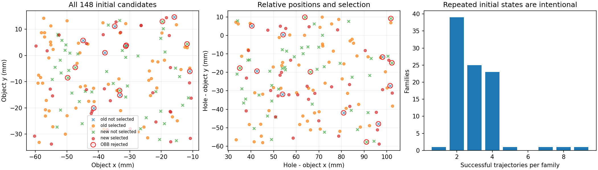
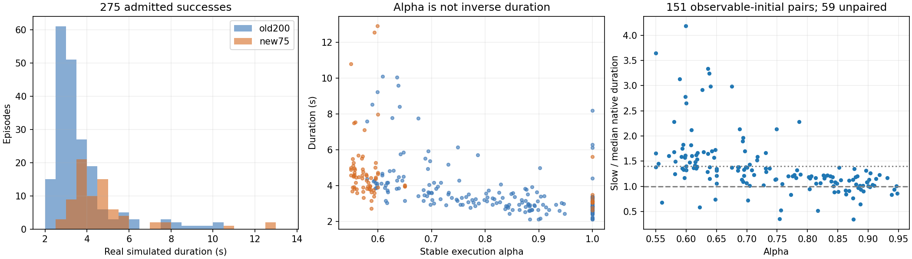

# 冻结专家与窄分布StateDP数据

<!-- DATASET_TRUST_START -->
## 2026-11-06：275条数据可信度审计（已完成，等待用户决定下一阶段）

本轮终点为数据/代码准入建议，不继续学生闭环诊断、不优化参数、不扩采。原400、现275、所有正式模型/manifest及失败原件只读。独立 `dataset_trust_20261106_01` 在准备时固定3小时总截止（含CPU审核和资源等待），最多60次轨迹、8GiB新增、60GiB磁盘保留，共享GPU目标35%、6GiB VRAM/12GiB RAM；不重置任何旧预算。

**静态实测：275/275 SHA及大小匹配，64,663控制tick逐条读取；每个RGB-D像素、触觉及数值合同均检查。State-valid275，三视角RGB-D-valid75，wrist-valid275，触觉记录-valid275。** “触觉有效”只指有限数值、真实子步、时钟和有效位，不是硬件标定或稳定抓取证明。旧200固定相机的空白和legacy全true有效位保留，没有改标记或补图。静态复核不等于物理精确重放通过。

证据：[逐轨迹CSV](evidence/dataset_trust/episodes.csv)、[92家族CSV](evidence/dataset_trust/families.csv)、[全量统计](evidence/dataset_trust/static_summary.json)、[全部配置取值](evidence/dataset_trust/configurations.json)、[覆盖及筛选](evidence/dataset_trust/coverage.json)。原始文件路径、SHA和逐条审查收据在本地root；公开统计不含图像/触觉数组或权重。

### 实际随机化与覆盖

配置采样器为 `direct_configuration`：物体XY相对中心各±25mm，孔−物体XY各±35mm并与原孔座边界求交；随机方向轴、角度 `20°×U^(1/3)`，是绕选定中心姿态的20°球；桌面原点z均匀[.376,.384]m，物体高度在桌面原点以上[.244,.256]m。孔座yaw=0，桌面XY/yaw固定；机器人关节按原生限位插值系数.03随机，29关节初速度均匀±.15rad/s，不是“关节角±.03rad”。配置仍保留reset_position_noise=.1/.1/.02m，但fixed_start_pose分支直接给定物体位姿，这些旧噪声不应被写成实际本批采样范围。源400中按初态密度选出的中心有历史条件化，不代表任意装配姿态。

以下均为92个真实家族每家族一次的**实测**，不是配置边界；坐标为单lane环境坐标。所有29个关节、速度、四元数、桌面和物体速度的逐项值/分位数见CSV、[全部初态分位数](evidence/dataset_trust/initial_distribution.csv)及coverage JSON。

|变量|最小|p10|中位|p90|最大|
|---|---:|---:|---:|---:|---:|
|物体x / mm|-60.335|-57.170|-38.554|-16.560|-10.555|
|物体y / mm|-33.806|-28.273|-10.457|11.131|14.516|
|物体z / mm|620.809|623.623|629.914|636.349|639.651|
|孔座x / mm|-24.872|-5.497|26.201|57.082|87.096|
|孔座y / mm|-91.182|-67.127|-35.307|-2.142|8.633|
|孔座z / mm|526.011|526.536|530.218|533.225|533.962|
|孔−物体x / mm|33.272|39.743|65.954|95.749|102.453|
|孔−物体y / mm|-58.868|-51.106|-27.977|4.436|9.969|
|孔−物体z / mm|-105.979|-105.415|-100.150|-95.140|-94.156|
|桌面原点z / mm|376.011|376.536|380.218|383.225|383.962|
|物体相对中心旋转 / °|5.152|8.314|15.781|19.090|19.950|

实测初始物体线/角速度为0；关节速度保留非零随机化。全部275份initial_export物理属性另外逐项读取：robot/object/hole/table的质量、惯性、COM、材质及关节刚度/阻尼各只有一个实际取值版本，未暗中改变动力学。物体质量0.0578kg；指尖摩擦1.5、其余相关材质.5；缩放倍率1。目标位置观测偏差实际落在[-1.9922,1.9734]mm，yaw偏差0。力/矩触发概率按[.001,.1]对数均匀抽样，实际范围分别[.001022,.098665]/[.001067,.099529]；scale20/2，仅lift后触发。保留观测delay、物体状态delay、物体位置高斯噪声std=.01m、随机轴旋转角均匀[-5°,5°]及关节速度高斯观测噪声std=.1。**action_delay_max=3使用randint排他上界，实际记录索引为0/1/2；历史“0–3tick”文字不准确，本轮只纠正文档。** 普通reset继承的delta_goal/target_volume不是本批精确装配目标分布：preInsertAndFinal、random_goal_fraction=0使用固定相对插入目标。高斯噪声无有限硬取值范围；未独立保存每种噪声抽样时不能用配置std充当实测上下限。[物理/DR收据](evidence/dataset_trust/physics_dr.json)区分可观察记录和未保存内部状态。

旧候选68→60准入，8次为保守碰撞包围盒拒绝；新增80→74准入，再按几何max-min选择32家族（相对旧train覆盖），预分24/4/4。拒绝是保守OBB潜在碰撞，不等于已测得真实网格穿透。原生reset/资产未改；筛选改变统计分布。联合4D（物体XY和相对XY）2/3/4等分网格分别占16/16、56/81、78/256格；这是离散覆盖诊断，不能叫“覆盖30.5%连续任务空间”。旋转5°以内中心球本批无样本；高维姿态/关节/速度/扰动的组合仍稀疏，单变量接近边界不等于联合边界充分覆盖。

新增75条实际涉及35家族：32个新家族的63条，加3个旧家族各4条、共12条校准/参考重跑；所以总家族数为60+32=92，而不是95。92家族无相同初态指纹、无符合既有近重复门限的跨家族对；275条中183条是同家族的额外速度/重复实跑，不能当作275个独立初态。家族轨迹数为1×1、2×39、3×25、4×23、5×1、7×1、8×1、9×1，权重不均。独立RGB整段解码hash重复0；这不意味着隐藏初态完全独立。68/12/12家族对应207/34/34轨迹，同家族不跨split，旧8个test家族仍保留在test。训练统计从207条重算与保存值逐位相等；validation/test没有进入统计拟合。



### 减速究竟实现了什么

65条alpha=1，来自62家族；210条alpha<1，30家族没有原速参考。旧慢速alpha实际.58–.947782（中位.757987），新慢速.55–.65（中位.572578），逐条alpha在CSV中。每条alpha恒定，专家每60Hz tick读真实反馈；记录的处理后target严格等于 `previous_actual_target + alpha×(native_candidate−previous_actual_target)`，alpha=1直接native旁路。时钟、状态连续性和两物理子步target一致；没有插值传感器、改时间戳或在成功后补等待。目标与到达位置存在真实跟踪误差，标签始终target_after_rad。

|来源/alpha|条数|真实时长中位s|范围s|
|---|---:|---:|---:|
|旧200原速|55|2.833|2.117–8.200|
|旧200 ≤.65|38|4.292|3.050–10.083|
|旧200 (.65,1)|107|3.200|2.133–7.767|
|新75原速|10|3.100|2.633–5.617|
|新75 ≤.65|65|4.467|2.733–12.900|

整体均值3.919s、中位3.433s、p05/p25/p75/p95=2.450/2.933/4.300/7.548s，范围2.117–12.900s；**只有21/275=7.64%处于5–7s。** 151条慢速有同家族原速，采用全部原速样本时长的中位作参照，逐一配对比值另保留；59条无原速参照。配对时长比中位1.231、p05–p95=.731–2.851，127/151更长，46/151≥1.4倍，24条没有变长。可观测初态、实际首tick的环境独立Torch随机流及已保存物理/DR参数同家族一致，但缺PhysX内部状态，不能称严格因果物理配对。

从真实关节位移而非命令求60Hz有限差分速度，151配对的Arm/Hand/palm速度p95比值中位分别.732/.777/.734，物体.836；palm/物体路径长度比中位.950/.980。146/151配对的Arm和Hand速度p95同时下降，其中123条同时具有更长时长。这支持**确有实际减速**，不仅是延长尾部等待；却不支持“多数示范达到5–7秒”或“更稳定”的强结论。成功过滤、轨迹路径和接触变化会影响这些汇总。[配对来源](evidence/dataset_trust/pairs.json)与[实际运动统计](evidence/dataset_trust/motion.json)保留无配对及阈值定义。



### 成功率、失败与选择偏差

|记录范围|成功/已执行尝试|其他分类|解释|
|---|---:|---|---|
|旧200正式收集|200/201=99.50%|1次专家timeout|60已准入家族、重复速度，不是原分布独立成功率|
|追加75正式收集|75/76=98.68%|1次真实fall|包含校准后冻结清单；不补跑失败来抬分|
|合计|275/277=99.28%|2物理失败，0新增Kit启动缺失|State成功275；其中200成功但三视角传感器不合格|
|早期速度研究|68/73合法完成|88启动=73合法+14初态拒绝+1软件缺失|混合native/identity/A/B、不同分布，禁止合并进275分母|
|隔离的narrow-v1|3/3实际执行成功|另3次pre-action查询拒绝，共6尝试|相同可观测几何出现查询矛盾，全部隔离；不是3次已确认非法初态|

早期宽域筛选使用原400成功数据选择15个初态；另360次reset中13落在所设范围、4被碰撞筛掉、9新增，得到24个早期家族。早期family准入23/24可由22份独立preflight合法记录，加e01_p000144已有native合法记录及e03_p000177已有native拒绝记录逐项还原；不是24份独立preflight文件。后续e01_p000144相同几何却被查询拒绝，证明该查询准入并不可靠，不将此类拒绝提升为真实碰撞结论。[复用来源账本](evidence/dataset_trust/preflight_availability.json)。360行reset_draws实际为347不在范围、9准入、4范围内拒绝；日志仅保存seed/inside/legal，没有347条完整位姿，不能补造其分布。它不等于360次完整任务；后来的直接窄域92家族另算。实际attempt/result逐条账本与SHA见[正式尝试](evidence/dataset_trust/attempts.json)、[历史账本](evidence/dataset_trust/historical_attempt_ledger.json)，不能只引用summary。原始非法/软件失败/任务失败均未删除。

两条失败的标签推进、两子步提交、q连续性误差均为0：`family_012_mid_a`（alpha=.757275）在tick73接触、130lift、160首子目标，此后未完成全部插入目标，761tick超时（子目标重置阶段计数，不能把761当改过timeout）；`repair_family_53_v1`原速在tick40接触、81fall，未lift/未子目标，物体最低z=.0667m。后者相对x=.100903m处于92家族的96.74百分位、靠近窄域上边界，但未越界；机器人保守OBB最小分离间隙28.30mm，物体/孔/桌静态无重叠，尚无证据证明边界是因果根因。force只在lift触发，该81tick记录实测施加力/矩均为0，不能归咎于外力。全部81帧重新逐像素检查三视角通过。原失败曾因末帧出视野被错误归为视觉软件停机，原错误保留、后续账本已改正为任务失败，不计入成功数据。[失败证据](evidence/dataset_trust/failures.json)。

**总体分布成功率仍未确证。** 99.28%只描述筛选后家族/速度清单；初态筛选、原400成功来源、几何覆盖选择、家族重复和只收成功轨迹均造成条件化。也初态14/148拒绝与277条速度试跑的统计单位不同，也不能直接把14加进277当作无筛选成功率。不能把这批相关样本当277次IID计算置信区间后外推整个连续窄域。

### 物理复现：固定方案与边界

先全量静态通过再登记[56次清单](evidence/dataset_trust/replay_plan.json)：旧/新×train/validation/test×速度15层各取不同家族，按中心/远点覆盖固定选择；15组native RL、15逐tick target、15 H24/commit12 target，加9组原alpha慢速RL以及2条已知失败源的专家重跑。两失败不混进成功来源分母。最多60次，不为提高成功率追加/替换；不是IID成功率测试，也没覆盖全部92家族。

native RL每tick闭环；source-slow RL保留来源alpha；两种target回放为开环，回放完整来源长度，原生终止则立即停，序列耗尽记censored，不加保持、不执行H24末尾预测padding。都使用同一窄初态规范、已冻结world_hold记录包装和原生物理/控制频率。这里“native”指冻结RL的原生动作处理，不声称移除既有world_hold包装后复刻作者所有默认环境。

新复现统一FP32和正确相机；旧200未保存完整运行算术快照，不能称其算术条件逐位重现。逐条记录实际初态误差、资产内容/物理配置、环境随机流、requested/actuator target误差、实际状态偏差、完整终止与视频。缺失PhysX接触/solver/broadphase状态始终公开；相同seed、已保存状态相等也不是隐藏状态完全重建。

**实测已完成：主队列56/56，追加一致性检查4/4，共60次轨迹，6个Kit进程，全部正常退出；没有新增训练或正式示范。**

|主队列模式|来源|完整成功|原生任务失败|来源序列耗尽未完成|
|---|---|---:|---:|---:|
|原速闭环RL|15个成功来源家族|15/15|0|不适用|
|来源alpha慢速闭环RL|其中9个慢速来源|8/9|1 fall|不适用|
|逐tick处理后target回放|15个成功来源|6/15|0|9 censored|
|H24/commit12 target回放|相同15个来源|4/15|0|11 censored|
|历史超时来源的慢速RL重跑|family_012_mid_a，单列|1/1，238tick|0|不适用|
|历史掉落来源的原速RL重跑|repair_family_53_v1，单列|0/1|1 fall，81tick|不适用|

这些是分层/条件化的验收样本，不是学生成功率或整个窄分布成功率。20项censored中12项已有一个原生子目标，8项尚无子目标；不能把原生lift代理当稳定抓持或强行把序列耗尽改成timeout。慢速RL新增失败为repair_family_33_v0，399tick自然fall；原始成功示范仍有效，不因重跑失败删除。

全部60次的指定初始关节/速度、物体/孔/桌、palm/finger误差为0、配置一致；主56次导出的质量/惯性/材质/PD/根状态也与来源逐项相等。30次主队列回放的请求和两物理子步target与源标签最大误差均0；所有H24预测块逐项匹配来源目标，未执行末尾padding。实际物理轨迹却不保证与历史相同。源与新运行的部分已保存缓存（reward_buf、keypoints/fingertip距离、上次success/reset标志、episode/命令计数、旧相机缓存）不同，另外缺失PhysX内部接触/solver/broadphase状态；**不仅仅是“seed相同”，也不能声称所有已保存环境状态已恢复。** 缓存差异是否导致某次失败没有单独因果验证。

主队列有4个来源的tick/H24结局不同，尽管相同tick的target完全相同。完成后按旧/新各取字典序首个不一致来源（family_019_native、repair_family_26_v0），在**原60次上限、原截止不变**的条件下追加4次，每次单独新建Kit，不改缓存/物理/控制、不修改原56分母。结果两来源两模式全部成功，且同来源两模式的18个数值trace字段全部逐位相等，已保存初始env tensors也相等。该检查支持当前H24分块实现与逐tick执行在这些条件下等价；不能把主队列6/15与4/15差异直接归因于H24。

fresh两对相对其历史来源的最大真实关节偏差仍分别为.026706/.062082rad。因此它们证明**在测试过的新Kit条件下成功复现任务和模式间轨迹一致**，不证明历史完整物理轨迹逐位重建，也不能外推另外所有家族/不一致来源。此处已到60次上限，未继续尝试补齐或提高分数。

[主队列结果](evidence/dataset_trust/physical_results.json)、[汇总](evidence/dataset_trust/physical_summary.json)、[实际状态/RNG/源对照](evidence/dataset_trust/physical_details.json)、[fresh检查计划](evidence/dataset_trust/fresh_pair_plan.json)、[fresh逐字段一致性](evidence/dataset_trust/fresh_pair_details.json)。13段视频全部完整60fps解码，本地索引为 `outputs/visuotactile/run/dataset_trust_20261106_01/README.md`；[视频SHA及结局索引](evidence/dataset_trust/videos.json)。这些是新仿真视频，不回填旧200空白图像。

### 数据准入与是否扩充

结合全量静态与上述有限物理验收，275条可准入**当前窄域StateDP专家目标模仿**，不能标为275条合格三视角数据或5–7s慢速数据集。三视角只准入75，触觉275仅数值/时序层面。网络/执行合同及训练源码追溯见[State代码审计](STATE_DP_RESULTS.md#dataset-trust-code-audit)。

目前没有证据支持为凑300/400自动扩采。优先缺口是59条慢速没有原速参照、少量家族权重过高、5–7s比例低、旋转中心/联合边缘覆盖薄及只有75条完整RGB-D；若用户下一阶段选择补充，应在同一或更窄分布预登记这些条件，保留失败，增加有效家族/速度组合，而非同家族机械重复。任何新增用于训练决策的测试家族不得回流train。

**最终准入建议：当前数据与明确冻结的代码已具备下一次随机初始化StateDP训练的技术条件；没有发现必须先修复标签/执行器目标映射才能训练的硬性阻塞。但本轮并未建立“再原样重训会改善成功率”的证据，是否重训由用户决定，本轮不启动。** 不能把既有失败直接归因于样本数；也不启动ImageDP、nominal或触觉训练。现有split不改，曾被研究查看的测试/诊断数据需保留曝光记录；未来正式最终验证须预登记独立初态，不能靠反复看旧小样本选模。

### 预算、保护与可复核边界

准备20:40:54，固定截止23:40:54（2026-11-06 Asia/Shanghai），未重置；实际60/60轨迹、0优化更新、0学生rollout、0正式扩采。全部275文件在结束时再次SHA匹配，原400文件仍在，16项保护哈希（含比较模型/manifest/统计）通过。所有GPU worker/owner/monitor退出，新增本地审计产物约0.355GiB，远低于8GiB。

有记录区间整卡时间加权均值30.973%、最大完整60s均值42.008%，最少空闲VRAM11.707GiB/RAM25.738GiB，保留阈值满足。**两阶段间CPU审查/登记期间有231.662s遥测断点**，当时原GPU worker已退出；断点原样记录，不能宣称从CPU静态准备开始到最终文档的整段连续遥测，也不是每进程GPU归因或硬配额。未操作无关任务。[最终保护、资源与退出收据](evidence/dataset_trust/final_audit.json)。

新只读审计工具曾修复4处读取/汇总问题（子步时钟维度、h5py切片、NumPy整数JSON、旧400 manifest路径schema），失败收据保留；未改源数据或baseline。第一次等待后处理的工具返回143但已写完整输出，随后独立CPU重算正常0退出，结果可复核，不计为专家物理失败。早期88启动中的唯一软件缺失实际为capture_A060_00的KeyError(transition/observation_after/available)，不是Kit崩溃；该缺失不作任务失败或成功。

复核入口：`tools.dataset_trust_audit static` 全量读取；`tools.dataset_trust_review source/attempts/coverage/details/physics/physical/finalize` 生成只读收据；`tools.dataset_trust_report` 发布现有轻量统计/图表。物理运行源码分别冻结在4ddb554/f6d36a8；结束后的工具补充仅使统计复算可执行，不回写运行源码快照。不要自动调用已完成run/fresh-run或建立新训练/采集root。
<!-- DATASET_TRUST_END -->

## 以下为已完成实验历史，不构成当前执行授权


<!-- STATE_MECHANISM_START -->
## 2026-11-06：StateDP基础能力、采样与动作块诊断

实测 `complete` / `complete`；独立root `state_mechanism_20261106_01`，固定4h含等待，最多15次Kit轨迹启动、1条训练示范的独立随机模型≤4000更新/90min。正式数据/权重保持，A/B/C不改变H24/12/29D/损失/历史/物理。
只读审查275条/64,663tick：全体均值3.919s、中位3.433s、p10–p90 2.640–5.517s，范围2.117–12.900s。新增75均值4.676s、中位4.4s；尚不符合多数5–7s的设计预期，没有补等待或改时间戳。State-valid275、Multi-view-valid75、旧固定视角无效200；触觉数值有限及有效标记通过，不等于硬件校准。所有成功标签只在末transition出现，275条原始数值与缓存完全相等，q_after[t]=q_before[t+1]。

极小集离线拟合通过但对应初态仍未成功；精准目标回放接口检查已通过，优先研究执行后状态偏离teacher-forced训练轨迹这一机制。下一轮只做有限闭环分布偏移定位；本轮不自动DAgger或改方法。噪声/块跳变的因果归属仍受小样本限制。

实际A/B/C、采样曝光及最新状态见[StateDP统一结果](STATE_DP_RESULTS.md)和[机器统计](evidence/state_mechanism.json)。
<!-- STATE_MECHANISM_END -->

<!-- NARROW_REPAIR_START -->
## 2026-11-06：视觉与GPU历史修复、单次慢速数据对照

实测状态 `complete` / `complete`；独立run `narrow_repair_20261106_01`，10h固定总窗，旧run预算和失败保持。代码和排队不代表训练完成。
白屏已定位：direct fresh入口遗漏固定相机配置，两路停在默认相同位姿，RGB恒定/有效深度0；同初态配置前后物理读数完全相同，配置后三视角有真实内容。首条199帧专家成功，起/中/尾画面目视通过，全帧RGB-D、时钟、固定位姿和mask检查通过；单lane持久Kit，不声明多lane已验证。
GPU差异来自未统一的CuDNN TF32：旧默认condition最大2.52545e-4；关闭TF32后最大1.07288e-6、前12目标1.13249e-6rad、FK0.000229mm。原2e-5门限未放宽；完整序列/逐tick/训练prefix/reset均检查，无优化更新。

12:35首次生产停止：第50条原速专家真实掉落，末帧物体离开侧视野；81帧RGB-D和数值合同通过。成功示范的目标可见性检查错误地先于任务失败分类，导致少记1次尝试/掉落。复核49条成功文件哈希后，保留原错误和计数快照，补记为50次/49成功/1任务失败，失败轨迹不入训练。修复仅分离自然任务失败与传感器错误，成功数据门槛不变；8项CPU测试通过。本次复核后的接续入口只运行原冻结清单剩余26条，不重跑已执行条目或门控，不重置计数、17:12采集/21:12总截止；独立阶段reviewed_collection_completion仍只允许一次新训练。实际接续进度以上方机器状态和当前计数为准。

已完成一次扩充：75条新成功、32个新家族，合计275条State-valid；独立随机模型完成5000更新，因validation_plateau_or_overfit结束，validation选第4500步。最终完整成功：state200_fp32: train0/4，unseen0/10有效、2次初态拒绝；state_expanded_fp32: train0/4，unseen0/10有效、2次初态拒绝。这轮有限对照已结束，不自动再训练/扩采或启动Image/触觉训练。

实际扩采/训练/评估结果见[StateDP统一记录](STATE_DP_RESULTS.md)和[机器统计](evidence/narrow_repair.json)，不把准备写成成功。
<!-- NARROW_REPAIR_END -->

## 2026-11-06 观看检查发现固定相机空白

对200条正式新示范逐条只读检查首帧：fixed_high/fixed_side各200/200均为RGB(238,238,238)常量，腕部200/200非恒定；另对manifest首尾两条的首/中/尾共6帧复核，同样如此。新State200观看复跑中也出现两固定视角空白、腕部可见。此次只验证RGB抽样，未做全部帧/深度或原因定位，不能把既有存储/数值合同通过当作三视角视觉有效。原始文件保持不变，现有StateDP不读取RGB，原闭环分母不改；进入ImageDP前必须解决相机有效性。见[只读证据](evidence/narrow_camera_review.json)。


## 2026-11-06 09:29 UTC+8 实测：后续已停止

有效新数据仍为200条/201尝试。后续于02:13在GPU历史编码一致性审核失败后停止，新增采集0、追加更新0；没有进入扩采或新模型对照。原400及200条全部保留。完整原闭环、CPU复核和原因边界见[统一State结果](STATE_DP_RESULTS.md)。下方为历史实施/启动记录。


## 2026-11-06 更新

原直接窄域v2已达到200条完整成功（201次尝试，1次真实任务失败）、60家族44/8/8、43,621个控制步、17,972,841,587bytes，DATA_READY通过并已进入正式StateDP训练。下文7/7、DATA_READY=false是历史启动证据。

用户新授权一次条件化扩充，须等原闭环完成、训练曲线支持平台/泛化差距且数据/执行审核通过，才由独立root执行。新32家族目标、24/4/4预分割、最多96次真实速度轨迹，总量260–296；不改变窄域范围、不插值旧传感器、不将旧test家族加入train。原200和原400均保留。是否实际启动、增加数量和效果以新root机器状态和[State结果](STATE_DP_RESULTS.md)为准。

## 历史启动快照：直接窄域v2（该任务现已完成）

最新用户授权已扩展到新数据验收后的自动随机StateDP训练和有界闭环。新root为`outputs/visuotactile/run/narrow_state_20261105_02`，当前生产服务`narrow-state-data-20261105-02-production.service`（第一阶段服务已在完整边界退出）；准备commit与实际运行commit分别记录在session.json及launch_revision.json，所有运行Python源码另存完整SHA清单。该段历史启动核验为7/7、DATA_READY=false、正式更新0；最终已完成200条和5735更新，不能据此恢复旧owner。

实际60/68候选准入（88.24%，8个保守机器人网格包围盒拒绝，均非任务失败），split44/8/8；4条pilot共1075控制步、436,376,287bytes，199/157原速与455/264慢速全部成功，154字段hash验收、两物理子步target误差0、同家族初态8组误差0。一个慢速初态旧query仍错误命中1项，新几何准入一致通过。实测时长比2.2864/1.6815，中位1.9840。

GPU一次性随机模型前后向/AdamW/EMA/保存恢复通过，正式0更新；在线/完整前缀条件误差9.53674e-7、尾部7个有效target、未来干预不影响过去。首次GPU smoke在优化前因deadline未显式传入的TypeError退出，证据保留；修复后唯一补充检查成功。46项CPU回归通过。

首worker实测含启动/家族门控29.74条/小时，4episode墙钟分别39.48/134.08/86.98/186.40s，受共享负载影响，不能保证200条。生产前在完整边界暂停并将原16h内的阶段额度改为采集6h/训练最多9h/末1h评估；首次开始21:57:39与绝对截止2026-11-06 13:57:39 UTC+8均不变。最低150及覆盖门槛不降低，临近采集截止预留20min完成当前episode和数据审核。

首worker整卡均值43.69%、最大完整60s52.64%、缺测0、最低可用RAM25.66GiB；执行的是shared_recent_v1而非旧50%硬门限，不称整卡始终≤50%。暂停修订和独立smoke另记监测窗口。[轻量机器证据](evidence/narrow_v2_startup.json)。

### 初始化矛盾与修复范围

本机Isaac Lab2.3.2、Omni PhysX107.3.26。冷启动重复reset一致；完成真实rollout后恢复e01_p000144，q/qd、物体/桌/孔及全部机器人link位姿一致，overlap从0变为11个手部命中。flush_changes、update_articulations_kinematic、USD输出和同姿态root重写都未消除误报，不能把它们写成有效修复。

检查原始CollisionAPI对应的34个碰撞网格（包括Xform下的实际Mesh、fixed-joint合并及局部变换），用实时link pose变换其保守包围盒，额外膨胀1mm后仍至少相隔108.62mm。故该case的overlap命中与实际几何不符。新增`live_collision_mesh_bounds_v1`以这些包围盒和原object/table/hole box SAT作保守准入；有相交可能即拒绝。旧query继续保存为诊断，不再作为v2准入。没有改SDK、模型、实际碰撞几何或物理积分；这不宣称恢复旧四lane隐藏状态。

依据为本机安装源码及对应版本[PhysX Python API](https://docs.omniverse.nvidia.com/kit/docs/omni_physics/107.3/extensions/runtime/source/omni.physx/docs/api/python.html)。官方flush说明用于处理缓冲变更，并不承诺修复本例；本机forward实际更新kinematics/fabric。SDK内部具体pruner缺陷未作二进制定位，不把缓存实现假设冒称已修复SDK。真正修复的是研究准入对不可靠查询的依赖。

有界诊断保留3次前动作软件错误（布尔差值、Path序列化、Xform碰撞父节点未处理）及4条自然成功native轨迹；冷/重复reset与全部字段原始证据在narrow_reset_query_20261105_02–07，均已退出，不并入新数据或学生成功分母。新gate的live采集验收以下一段机器状态为准。

### 新分布、数量和阶段

直接采样全新60家族目标，最多80候选、至少50准入；不复用旧恢复初态，也不宽分布反复拒绝。沿既存密集中心：object XY±25mm，hole−object XY±35mm（与原孔范围直接求交），旋转球20°，table z[.376,.384]m，物体高于table原点[.244,.256]m；native arm/hand reset lerp .03、初速±.15rad/s。所有随机类别保留变化；摩擦原为固定，本轮不加随机化。实际范围与拒绝率由initial_coverage.json给出。

先冻结初态与split（预计44/8/8），同家族所有速度同split；两train原速/.58真实校准，唯一允许将慢端上调至.65。生产alpha每episode稳定，原速加连续中/慢区间，约220个预注册尝试，目标200/最低150条成功且覆盖门槛通过。alpha不是时间倒数，实际时长比另报。保留完整三路RGB-D、触觉、控制目标和真实运动；成功校准数据按同一合同计入，失败和部分文件单列。旧隔离3条始终不进入新manifest。

普通owner自动转移：family→速度采集→数据/hash/时序/历史/split/train统计验收→一次性GPU前后向/恢复→新随机StateDP→train4及预注册unseen12闭环。H24/commit12及网络/loss不变。新固定16h含等待，采集6h，训练最多9h、保留最后1h闭环；75GiB产物上限、60GiB磁盘余量、6GiB VRAM/12GiB RAM准入、shared_recent_v1目标40%。每阶段最多2次审查后启动，无自动retry。没有重置旧4h预算。

```bash
R=outputs/visuotactile/run/narrow_state_20261105_02
bash visuotactile/run_cpu.sh -m tools.narrow_collection status --root "$R"
bash visuotactile/run_cpu.sh -m tools.narrow_collection stop --root "$R"
# 仅在审查阻断原因后使用；不清除预算或已有attempt
bash visuotactile/run_cpu.sh -m tools.narrow_collection resume --root "$R"
```

日志在R/workers/<stage>/attempt_*/worker.log；status/heartbeat/manifest记录真实进度；DATA_READY.json仅在完整验收后生成。训练R/training/{progress.json,training.jsonl,validation.jsonl,curves.png,last.pt,best.pt}，最终R/evaluation/result.json。短监督通过后由普通程序继续，不靠LLM长轮询。

### 旧 v1 阻断事实（永久保留）

narrow_state_20261105_01已退出、quarantined=true，原4h截止22:11:24及两次启动均不延长。15旧+9补充家族，360宽分布reset仅9通过；6次尝试中3次pre-action query拒绝（不能称真实穿透或任务失败）、3次完整成功（171/210原速、366ticks alpha.58，时长比1.743）。154字段hash、目标/两子步一致，仍因当时准入不可靠而隔离；无生产放行、无DATA_READY、正式0更新。一次性CPU smoke通过，不计正式训练。旧监测均值14.18%、最大完整60s19.56%，202.11s停机缺测保留。

本轮已核对原删除ledger的文件身份、SHA、同UID打开句柄与已分类session daemon，删除完成的一次性CPU/GPU checkpoint共2份，实际释放2306101248bytes。原400及metadata、冻结专家、依赖缓存、未知引用和所有物理失败证据保留；未重复计入旧126.673GiB清理。

## 历史冻结专家实验（以下方案已结束，不是当前启动指令）


本轮是独立的专家执行研究。原State150随机评估已按用户新指令在完整rollout边界提前暂停：143有效/原计划200，历史2/100、新初态0/43，32动作前碰撞拒绝；源码、checkpoint、随机清单、全部结果和恢复位置保留；[原评估报告](https://github.com/mao455/bcrl_visualTactile/blob/feature/native-dp-training-v2/research_docs/STATE_DP_RESULTS.md)仍在原feature分支逐次更新。新工作在唯一独立工作树`bc+rl_RSS_expert_speed`和分支`feature/expert-slow-execution`，复用现有环境/数据，不按尝试复制源码。

## 配置审核

|核查|实证|结论|
|---|---|---|
|任务与机器人|官方`ff2fc62`的tight_insertion→Lpeg_matchedmass.tol0p5mm；KUKA iiwa14+Sharpa，7+22关节；原生任务/机器人URDF字节一致|PASS，同发布任务|
|RL checkpoint|217700467 bytes，SHA256 `7e61015dad660430ab07bab4f715c90c6f76b84cc358da6be81319a6aee09990`，与官方Hugging Face assembly文件LFS SHA相同|PASS，非Play-only|
|推理|实测actor配置LSTM1024+MLP1024/1024/512/512，checkpoint RMS，140观测+组标识50；确定性输出截断[-1,1]|PASS；专家是LSTM，StateDP才是GRU|
|动作时序|物理120Hz、推理60Hz；原生0–3tick delay一次；Arm增量与Hand绝对映射后各EMA0.1及限位|PASS，原生目标Arm上限1.5×0.1=0.15rad/s；不是实际速度硬上限|
|几何与间隙|主杆250×30×20mm、侧杆20×80×20mm，质量57.8g；孔21×31mm，对应插入截面20×30mm|PASS，与官方资产相同；**单边0.5mm、总差1mm**|
|SDF/尺度|此任务物体2个box、孔5个box，无SDF标记；6.25/0.75/0.5是尺寸观测编码，不是放大25倍的碰撞几何|PASS；不能套用其他任务的SDF说法|
|执行器与碰撞|原生PD/限位未改；配置及smoke运行期实际值存机器审核。指尖摩擦1.5、其余主要材质0.5，保留原生PhysX参数|PASS，本轮不调增益/摩擦/质量|
|fork差异|相对官方基点原生文件仅action_utils增加只读trace和显式可选delay重放；普通路径100tick目标、队列和RNG逐值一致|PASS，普通控制数学一致|
|额外研究层|CPU物理、摄像头/接触记录、明确world_hold外力帧封装、采集四lane和本轮单lane不同|已披露，不声称与裸官方SDK逐位等价|
|成功与计时|两子目标顺序累计各10合格tick、最终7.5mm与指尖平均距离>0.1m；首次动作前计时，成功tick立即停止|保持发布原生定义；物理时间不包含Kit启动/墙钟等待|

官方基点`ff2fc62873f6c6cd93164123c8358e9ce2d65c9b`；审核最新upstream `621459224dd3618456de273871e507e380d4dedb`仅作对照，**没有升级到新upstream**。最新版增加其他机器人/任务和配置项，不能把“官方当前main”当作历史实验源码。原生数学对照与资产SHA见[机器审核](evidence/slow_expert/configuration_audit.json)。

来源：[官方任务与权重入口](https://github.com/kushal2000/play2perfect/tree/ff2fc62873f6c6cd93164123c8358e9ce2d65c9b)、[官方权重](https://huggingface.co/Kushal20/play2perfect-checkpoints/tree/main/tight_insertion)、[L-peg资产](https://github.com/kushal2000/play2perfect/blob/ff2fc62873f6c6cd93164123c8358e9ce2d65c9b/assets/urdf/peg_in_hole/lpeg_matchedmass/lpeg_matchedmass.urdf)。

## 3.4秒与论文真机6–11秒

原400条成功的3.412s均值/3.267s中位是仿真物理时间，并且**以成功为条件**。复用已完成的400条逐tick审核，不重新跑400专家。它不是整个初态分布的无条件完成时间，也不能证明官方通常应当3–4秒完成。

论文Table1是成功真机试验的全任务时间，涵盖接近、抓取、搬运、装配；10/2/0.5mm分别6.8/9.4/11.1s。论文按孔与插入件截面**尺寸之差**定义间隙，因此当前资产的1mm总差不能冒充论文0.5mm条件。论文120/60Hz与本地一致，真机物体跟踪30Hz；论文文字判据与发布状态机细节也有差异。本轮始终按发布原生成功计数。[论文及附录](https://arxiv.org/html/2606.26428v1)

另外，官方交互/离线eval默认关闭动作/观测延迟、外力等DR，本地原采集配置保留。正式A/B都保持本地采集配置，避免一边减速一边偷偷关闭DR。[官方交互入口](https://github.com/kushal2000/play2perfect/blob/ff2fc62873f6c6cd93164123c8358e9ce2d65c9b/evaluation/eval_isaacsim.py)、[离线入口](https://github.com/kushal2000/play2perfect/blob/ff2fc62873f6c6cd93164123c8358e9ce2d65c9b/evaluation/eval_offline.py)

真机完整PD、安全限速、设备等待和计时排除项未公开，不能断言时间差由某一种滤波或初始化耗时造成。官方部署只提供策略推理核心，不含完整硬件驱动。原URDF注释还提到质量调整的历史，不能从当前资产相同推断checkpoint训练时所有硬件参数已确认。[官方部署说明](https://github.com/kushal2000/play2perfect/blob/621459224dd3618456de273871e507e380d4dedb/docs/deployment.md)

## 已实现的有限实验

保持120/60Hz、原生delay/EMA/限位、奖励/终止与RL权重。Arm/Hand参数独立，第一轮共同取1.0/0.8/0.67/0.5；没有新EMA状态。实验A在一次原生动作处理后，按`已执行目标 + 系数×(本tick原生候选目标−已执行目标)`推进，写回真正将执行的目标，专家下一tick观察真实反馈。Arm有效目标上限降为0.15×系数rad/s；Hand是目标推进比例，**不承诺实际关节速度按比例下降**。系数1直接旁路所有算术，必须完整物理对照通过。

实验B使用原400中真实post-delay/EMA的`target_after_rad`，以初始`target_before_rad`作为q(0)，新第k步请求q(k/s)，s=1/1.25/1.5/2。通过既有29D位置接口执行，不再添加delay/EMA；保留原接口的随机流占位抽样。序列用尽后保持最后目标，直到原生成功/失败/超时，单列保持tick；不把序列用尽当成功，不插值状态/视频。新随机扩展时先生成同初态原专家成功参考，再物理回放；没有成功参考的样本单列缺失，不能让分母偷偷变小。

2026-11-05用户调整优先级：原State随机评估改为提前停止的探索性结果，不再作为200条必须完成的依赖。新研究首轮只用已冻结10初态中低/中/高时长代表（原索引0、5、9），先原专家3条和系数1严格等价1条；至少2/3原生成功才继续。候选A080/A067/A050各最多3条，B100未拉伸回放至少2/3成功才检查B125/B150/B200；A都缺乏成功时才检查原生首子目标后的C067。每候选连续2次失败且无首子目标即停，保存真实分母，不把小样本筛选当可靠性证明。

扩展候选须3条有效、至少2成功、成功中位4–8s、双方成功配对时长比至少1.2。先优先成功时长中位落在5–7s的合格候选，再按成功数及接近6s选最多1组；只给有希望者补齐10个原生基线/候选配对。正式可靠性门槛仍为原生基线≥8/10、慢速≥8/10、成功中位5–7s、配对时长比1.4–2.2；累计3次失败导致8/10不可达则停止。选一组到20个新随机初态，至少17/20且原生≥16/20才进入6条真实采集；出现4次失败立即停止无望扩展。这是自适应探索，不作为无偏固定样本成功率估计；所有实际尝试和软件/非法初态独立列出。

当前已完成的3初态配对：native3/3（2.317/3.067/3.767s）、A0803/3（3.133/3.567/4.367s）、A0673/3（3.383/4.250/5.567s）、A0503/3（9.000/11.633/9.400s）。系数1额外验收成功，18个控制/物理字段逐值相同。旧400目标的B100仅1/3成功：一条首子目标后掉落、一条601tick超时；因此不继续拉伸B125/B150/B200，不把未执行组合叫失败。历史PhysX隐藏状态缺失仍是开环基线的限制，不将该结果归因为时间插值数学错误。

A067和A050都3/3成功，但中位分别低于5s、高于7s，故基于已有数据新增唯一A060（Arm/Hand均0.60）3例区间筛选；这是明确的数据驱动候选，不冒称预注册确认性检验。A060实测2/3成功（成功6.400、6.083s，失败为首子目标后掉落），符合目标时间带，但可靠性尚未确认。仅优先扩展成功时间中位已落在5–7s的一个合格候选；A0673/3更快的对照保留，不以3比2的小样本差异宣布成功率显著优劣。正式10例仍须≥8次成功，20例仍须≥17次成功，未放宽。版本在当前B100 rollout完整提交后通过空目录边界暂停切换，所有原始结果/异常/预算保留，恢复不重复任何已提交样本。

[配对运动统计](evidence/slow_expert/paired_motion_screen.json)：A067相对native的每条轨迹p95再做配对比值，中位Arm实际速度0.658、Hand速度0.705、Hand加速度0.656、Hand跟踪误差0.840，接触力p95比值0.989。速度确实下降，但接触峰值没有同步明显下降；这是完整轨迹汇总，受停留时长影响，不能据此宣布接触稳定性的因果根因。

全新扩展仍以20条合法初态为目标，预先固定最多40个seed，仅动作前非法初态可用后续seed补足；合法原生任务失败必须保留并继续同初态候选对照，不按任务结果换seed。40名单仍不足时如实报告缺额。此处利用旧32/75非法初态的实证避免再次把非法初始化耗尽当作慢速任务失败；此前尚未执行任何扩展样本。

原生600tick是**每个子目标阶段**的计数上限，完成子目标后计数重置；故A050的11.633s完整成功没有扩展原生预算。首次完整成功仍立即停止。

原生阶段600tick预算保留（实际边界为601）；没有启用延时预算诊断。沿用155次硬启动上限，但不要求耗尽组合。**24小时执行预算从依赖释放后的首次执行阶段开始**，此前等待约3.5小时不扣执行预算；execution_budget.json首次写入后恢复不重置。用户此次授权替代旧“等待也计入24h”的约束。旧预算、冻结源码和切换证据保留在maintenance/priority_change_20261105。软件故障仍保留，有限处理，不掩盖为任务失败。

旧owner没有边界暂停钩子，本次仅预留下一次attempt的空目录，利用既有排他mkdir在启动下一个worker之前停止调度；当前worker自然完成、结果验收提交、监控正常退出。原始FileExistsError控制边界记录归档，pause_receipt.json明确是用户要求的paused而非软件实验失败。完整校验checkpoint、已提交结果/种子SHA、进程/显存/锁和打开的写文件；原源码不变。恢复须显式要求，移除记录的空屏障后从random_fresh_075继续，不重复已提交样本。

耗时审核（179次已结束启动含smoke）：墙钟平均102.28s（其中143条正式有效rollout平均117.91s、32条非法初始化平均33.90s）；App启动含准入/节流13.85s，场景与专家准备含等待8.53s；DP推理146条均值7.75s；退出回收1.60s。资源日志176条覆盖的准入均值0.59s、节流均值29.76s，最长节流374.63s；组件存在重叠，不能直接相加。旧日志无法拆分物理/渲染、RL shadow和视频编码，新worker用只读主机计时分别记录这些项，不新增物理步、同步或随机抽样。原整卡均值28.62%，最大完整60s均值62.89%，遥测缺失0；不是全程≤50%，且包含其他用户任务。本次不通过降低动力学精度或变更控制频率提速，暂不采用未经验证的Kit复用。

21项队列回归通过，覆盖显式暂停后接续、原证据漂移拒绝、预算不重复开始、两次无进展失败早停，以及成功却未实际减速不扩大。慢速物理结果仍以下方实时区为准。

恢复审查发现并修复了初筛计数范围错误：累计7条native导致固定3条门槛误判，新增物理试验为0；并非真实基线失败。原始错误gate/退出保留在maintenance/resume_screen_scope。恢复只用初筛identity计算筛选门槛，正式可靠性仍使用全部10/20条；已提交23条全部复用。

## 数据与训练门槛

只有随机20通过才录制6条真正重新执行的RGB-D、本体、模型均值（player裁剪前）、原始RL指令、未减速候选目标、实际执行目标、物体/目标、接触、时间和delay历史；使用原CompactEpisodeStream无损存储并逐字段SHA重建验收。成功与失败文件均保留证据，只有原生成功进入独立`slow_expert_pilot_v1`清单。监督仍为实际issued `target_after_rad`，绝不替换成到达关节位置。

这6条是数据合同验收样本，**不会自动被称为完整训练集**。其后的State离线/live输入配对、独立train/validation覆盖、原数据混合微调需依据真实采集结果继续审核；现有训练器与150checkpoint采样状态绑定，不能将新数据集静默塞进原续训。当前无慢速数据、无微调更新、无Image启动。只有慢速物理可靠性与新数据合同实测通过才进入后续扩展/小规模微调，不提前声明改善。

## 当前结论与后续决定

### 视觉—触觉修正的最小后续方案（条件性建议，未启动）

不再以完成旧State200为前置条件。慢速可靠性通过后，6条真实传感器小样本先审核连续时序、执行目标/真实状态、delay和past-only历史；除无损源字段SHA外，仍须逐tick核对训练/在线特征，特别是Image三视角RGB量化、depth validity、DINO固定revision/批规则与历史。此前strict live Image配对问题不能跳过。

合同通过后，建议先建立16训练+4验证的独立初态小集，混入原train320，State从150权重开始至多200更新的微调探针，保持H24/12/29D。新数据使用显式的新优化器/采样版本，不悄悄替换旧续训状态；此预算只验收可学性。Image先合同再小预算拟合，视觉nominal不读取触觉或特权几何。

随后优先做冻结视觉nominal、已训练触觉修正、同结构屏蔽触觉修正的三组对照。残差标签由因果nominal预测与真实专家执行目标产生，专家历史明确标记teacher forcing，部署只读过去真实提交/执行反馈；未训练修正不得控制机器人。第一轮6个固定合法新初态、三组共18条诊断，分别看完整成功、抓持/子目标和连续性；不启动几百次旧baseline评估。只有触觉与屏蔽对照出现可复核差异才扩大。本段是待数据实测支持的最小建议，不是已完成训练或自动启动授权记录。

任务/权重与官方发布基点一致；当前3.4秒与真机时长不是同一条件。哪种慢速方法可靠、手指/末端/物体实际速度如何变化，均待配对物理结果。软件已记录各tick原候选/执行/到达状态，原生事件、接触和运动统计，成功率分母包含全部有效失败；软件故障独立记录。若没有5–7秒且可靠成功的配置，将停在诊断，不强行生成数据或重训。

33项相关CPU回归通过：原生动作链100tick与官方基点逐值/RNG一致、1.0精确旁路、Arm/Hand独立缩放、一次调用和真实target反馈、时间插值起点/终点、未改位置接口/成功审核/现有抽样入口。CPU通过不等于真实物理成功；本轮未取得Kit结果前不作成功声明。

新增验收器也已只读复核一条保留的真实专家记录：成功/终止145tick一致，新增物体/末端运动指标可正确提取。这是新统计代码的兼容性验证，未重复启动Kit，也不算本轮新baseline样本。

每个新专家worker在推理前后校验模型全部参数/缓冲指纹，确认没有优化更新。`run/resume`复用已提交stage；`release`对本研究拒绝，不能误放行旧训练。

最新受监督现场快照（2026-11-05T16:12:40.411388+08:00）：服务已实际运行到`pilot_native_09`，已启动26次、已验收25条；正式扩展选择`A060`。旧State保持paused。[机器快照](evidence/slow_expert/live_status.json)与[各执行版本范围](evidence/slow_expert/runtime_revisions.json)保留真实PID、预算、资源与source SHA。下方生成区是最近一次完整rollout落盘时的统计，不以发出启动命令代替运行验收。

<!-- SLOW_EXPERT_RESULTS_START -->
## 实测进度

状态：`blocked`，阶段`capture_A060_00`；已尝试88/155。软件缺失1，验收失败0，非法初态14。

|阶段|配置|原生成功/有效|95% Wilson区间|成功均值/中位(s)|fall/timeout|
|---|---|---:|---|---|---|
|pilot|native|10/10|72.2%–100.0%|3.308/3.233|0/0|
|pilot|identity|1/1|20.7%–100.0%|2.317/2.317|0/0|
|pilot|A080|3/3|43.9%–100.0%|3.689/3.567|0/0|
|pilot|A067|3/3|43.9%–100.0%|4.400/4.250|0/0|
|pilot|A050|3/3|43.9%–100.0%|10.011/9.400|0/0|
|pilot|B100|1/3|6.1%–79.2%|3.350/3.350|1/1|
|pilot|A060|9/10|59.6%–98.2%|5.567/5.717|1/0|
|expansion|native|20/20|83.9%–100.0%|3.487/3.367|0/0|
|expansion|A060|18/20|69.9%–97.2%|5.053/5.067|1/1|


- [pilot_native_00：成功，139ticks](/home/CNS2025331827/docs/bc+rl_RSS/outputs/visuotactile/native_dp_v2/expert_speed_20261105_01/stages/pilot_native_00/attempt_1/output/r931005_1793209376_e02_p000132/rollout.mp4)
- [pilot_identity_00：成功，139ticks](/home/CNS2025331827/docs/bc+rl_RSS/outputs/visuotactile/native_dp_v2/expert_speed_20261105_01/stages/pilot_identity_00/attempt_1/output/r931005_1793209376_e02_p000132/rollout.mp4)
- [pilot_native_01：成功，184ticks](/home/CNS2025331827/docs/bc+rl_RSS/outputs/visuotactile/native_dp_v2/expert_speed_20261105_01/stages/pilot_native_01/attempt_1/output/r931005_1793209376_e00_p000063/rollout.mp4)
- [pilot_A080_00：成功，188ticks](/home/CNS2025331827/docs/bc+rl_RSS/outputs/visuotactile/native_dp_v2/expert_speed_20261105_01/stages/pilot_A080_00/attempt_1/output/r931005_1793209376_e02_p000132/rollout.mp4)
- [pilot_A080_01：成功，214ticks](/home/CNS2025331827/docs/bc+rl_RSS/outputs/visuotactile/native_dp_v2/expert_speed_20261105_01/stages/pilot_A080_01/attempt_1/output/r931005_1793209376_e00_p000063/rollout.mp4)
- [pilot_A067_00：成功，203ticks](/home/CNS2025331827/docs/bc+rl_RSS/outputs/visuotactile/native_dp_v2/expert_speed_20261105_01/stages/pilot_A067_00/attempt_1/output/r931005_1793209376_e02_p000132/rollout.mp4)
- [pilot_A067_01：成功，255ticks](/home/CNS2025331827/docs/bc+rl_RSS/outputs/visuotactile/native_dp_v2/expert_speed_20261105_01/stages/pilot_A067_01/attempt_1/output/r931005_1793209376_e00_p000063/rollout.mp4)
- [pilot_A050_00：成功，540ticks](/home/CNS2025331827/docs/bc+rl_RSS/outputs/visuotactile/native_dp_v2/expert_speed_20261105_01/stages/pilot_A050_00/attempt_1/output/r931005_1793209376_e02_p000132/rollout.mp4)
- [pilot_A050_01：成功，698ticks](/home/CNS2025331827/docs/bc+rl_RSS/outputs/visuotactile/native_dp_v2/expert_speed_20261105_01/stages/pilot_A050_01/attempt_1/output/r931005_1793209376_e00_p000063/rollout.mp4)
- [pilot_B100_00：失败，243ticks](/home/CNS2025331827/docs/bc+rl_RSS/outputs/visuotactile/native_dp_v2/expert_speed_20261105_01/stages/pilot_B100_00/attempt_1/output/r931005_1793209376_e02_p000132/rollout.mp4)
- [pilot_B100_01：成功，201ticks](/home/CNS2025331827/docs/bc+rl_RSS/outputs/visuotactile/native_dp_v2/expert_speed_20261105_01/stages/pilot_B100_01/attempt_1/output/r931005_1793209376_e00_p000063/rollout.mp4)
- [pilot_B100_02：失败，601ticks](/home/CNS2025331827/docs/bc+rl_RSS/outputs/visuotactile/native_dp_v2/expert_speed_20261105_01/stages/pilot_B100_02/attempt_1/output/r931005_1793209376_e00_p000040/rollout.mp4)
- [pilot_A060_00：失败，384ticks](/home/CNS2025331827/docs/bc+rl_RSS/outputs/visuotactile/native_dp_v2/expert_speed_20261105_01/stages/pilot_A060_00/attempt_1/output/r931005_1793209376_e02_p000132/rollout.mp4)
- [pilot_A060_01：成功，384ticks](/home/CNS2025331827/docs/bc+rl_RSS/outputs/visuotactile/native_dp_v2/expert_speed_20261105_01/stages/pilot_A060_01/attempt_1/output/r931005_1793209376_e00_p000063/rollout.mp4)
- [pilot_A060_02：成功，365ticks](/home/CNS2025331827/docs/bc+rl_RSS/outputs/visuotactile/native_dp_v2/expert_speed_20261105_01/stages/pilot_A060_02/attempt_1/output/r931005_1793209376_e00_p000040/rollout.mp4)
- [expansion_A060_25：失败，899ticks](/home/CNS2025331827/docs/bc+rl_RSS/outputs/visuotactile/native_dp_v2/expert_speed_20261105_01/stages/expansion_A060_25/attempt_1/output/fresh_23020026/rollout.mp4)
- [expansion_A060_33：失败，768ticks](/home/CNS2025331827/docs/bc+rl_RSS/outputs/visuotactile/native_dp_v2/expert_speed_20261105_01/stages/expansion_A060_33/attempt_1/output/fresh_23020034/rollout.mp4)

旧State评估按用户要求提前暂停：有效143/原计划200，未完成57；属于探索性提前停止，原checkpoint与恢复位置保留，资源回收后独立接续本研究。

本地原始记录：`/home/CNS2025331827/docs/bc+rl_RSS/outputs/visuotactile/native_dp_v2/expert_speed_20261105_01`。首次成功与正式终止、阶段时刻、运动统计及视频见[机器结果](evidence/slow_expert/results.json)。
成功耗时仅对成功样本统计，不能忽略失败或据此声称固定倍率。无训练更新；Image未启动。
<!-- SLOW_EXPERT_RESULTS_END -->
