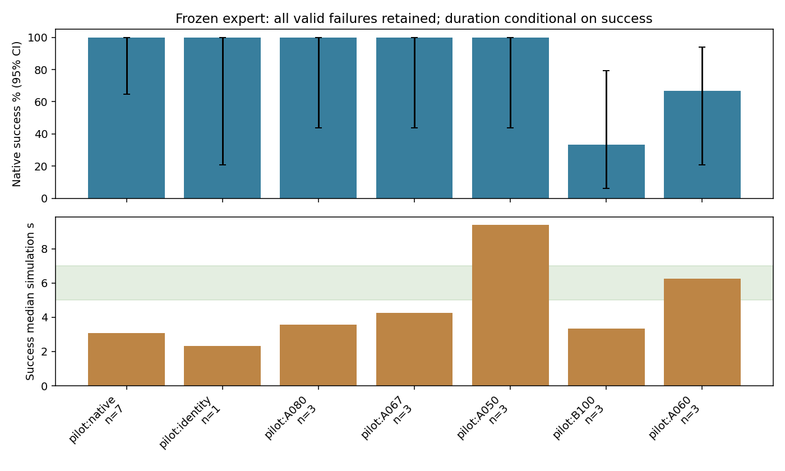

# 冻结Play2Perfect专家：慢速执行与真实示范

本轮是独立的专家执行研究。原State150随机评估已按用户新指令在完整rollout边界提前暂停：143有效/原计划200，历史2/100、新初态0/43，32动作前碰撞拒绝；源码、checkpoint、随机清单、全部结果和恢复位置保留；[原评估报告](https://github.com/mao455/bcrl_visualTactile/blob/feature/native-dp-training-v2/research_docs/STATE_DP_RESULTS.md)仍在原feature分支逐次更新。新工作在唯一独立工作树`bc+rl_RSS_expert_speed`和分支`feature/expert-slow-execution`，复用现有环境/数据，不按尝试复制源码。

## 配置审核

|核查|实证|结论|
|---|---|---|
|任务与机器人|官方`ff2fc62`的tight_insertion→Lpeg_matchedmass.tol0p5mm；KUKA iiwa14+Sharpa，7+22关节；原生任务/机器人URDF字节一致|PASS，同发布任务|
|RL checkpoint|217700467 bytes，SHA256 `7e61015dad660430ab07bab4f715c90c6f76b84cc358da6be81319a6aee09990`，与官方Hugging Face assembly文件LFS SHA相同|PASS，非Play-only|
|推理|实测actor配置LSTM1024+MLP1024/1024/512/512，checkpoint RMS，140观测+组标识50；确定性输出截断[-1,1]|PASS；专家是LSTM，StateDP才是GRU|
|动作时序|物理120Hz、推理60Hz；原生0–3tick delay一次；Arm增量与Hand绝对映射后各EMA0.1及限位|PASS，原生目标Arm上限1.5×0.1=0.15rad/s；不是实际速度硬上限|
|几何与间隙|主杆250×30×20mm、侧杆20×80×20mm，质量57.8g；孔21×31mm，对应插入截面20×30mm|PASS，与官方资产相同；**单边0.5mm、总差1mm**|
|SDF/尺度|此任务物体2个box、孔5个box，无SDF标记；6.25/0.75/0.5是尺寸观测编码，不是放大25倍的碰撞几何|PASS；不能套用其他任务的SDF说法|
|执行器与碰撞|原生PD/限位未改；配置及smoke运行期实际值存机器审核。指尖摩擦1.5、其余主要材质0.5，保留原生PhysX参数|PASS，本轮不调增益/摩擦/质量|
|fork差异|相对官方基点原生文件仅action_utils增加只读trace和显式可选delay重放；普通路径100tick目标、队列和RNG逐值一致|PASS，普通控制数学一致|
|额外研究层|CPU物理、摄像头/接触记录、明确world_hold外力帧封装、采集四lane和本轮单lane不同|已披露，不声称与裸官方SDK逐位等价|
|成功与计时|两子目标顺序累计各10合格tick、最终7.5mm与指尖平均距离>0.1m；首次动作前计时，成功tick立即停止|保持发布原生定义；物理时间不包含Kit启动/墙钟等待|

官方基点`ff2fc62873f6c6cd93164123c8358e9ce2d65c9b`；审核最新upstream `621459224dd3618456de273871e507e380d4dedb`仅作对照，**没有升级到新upstream**。最新版增加其他机器人/任务和配置项，不能把“官方当前main”当作历史实验源码。原生数学对照与资产SHA见[机器审核](evidence/slow_expert/configuration_audit.json)。

来源：[官方任务与权重入口](https://github.com/kushal2000/play2perfect/tree/ff2fc62873f6c6cd93164123c8358e9ce2d65c9b)、[官方权重](https://huggingface.co/Kushal20/play2perfect-checkpoints/tree/main/tight_insertion)、[L-peg资产](https://github.com/kushal2000/play2perfect/blob/ff2fc62873f6c6cd93164123c8358e9ce2d65c9b/assets/urdf/peg_in_hole/lpeg_matchedmass/lpeg_matchedmass.urdf)。

## 3.4秒与论文真机6–11秒

原400条成功的3.412s均值/3.267s中位是仿真物理时间，并且**以成功为条件**。复用已完成的400条逐tick审核，不重新跑400专家。它不是整个初态分布的无条件完成时间，也不能证明官方通常应当3–4秒完成。

论文Table1是成功真机试验的全任务时间，涵盖接近、抓取、搬运、装配；10/2/0.5mm分别6.8/9.4/11.1s。论文按孔与插入件截面**尺寸之差**定义间隙，因此当前资产的1mm总差不能冒充论文0.5mm条件。论文120/60Hz与本地一致，真机物体跟踪30Hz；论文文字判据与发布状态机细节也有差异。本轮始终按发布原生成功计数。[论文及附录](https://arxiv.org/html/2606.26428v1)

另外，官方交互/离线eval默认关闭动作/观测延迟、外力等DR，本地原采集配置保留。正式A/B都保持本地采集配置，避免一边减速一边偷偷关闭DR。[官方交互入口](https://github.com/kushal2000/play2perfect/blob/ff2fc62873f6c6cd93164123c8358e9ce2d65c9b/evaluation/eval_isaacsim.py)、[离线入口](https://github.com/kushal2000/play2perfect/blob/ff2fc62873f6c6cd93164123c8358e9ce2d65c9b/evaluation/eval_offline.py)

真机完整PD、安全限速、设备等待和计时排除项未公开，不能断言时间差由某一种滤波或初始化耗时造成。官方部署只提供策略推理核心，不含完整硬件驱动。原URDF注释还提到质量调整的历史，不能从当前资产相同推断checkpoint训练时所有硬件参数已确认。[官方部署说明](https://github.com/kushal2000/play2perfect/blob/621459224dd3618456de273871e507e380d4dedb/docs/deployment.md)

## 已实现的有限实验

保持120/60Hz、原生delay/EMA/限位、奖励/终止与RL权重。Arm/Hand参数独立，第一轮共同取1.0/0.8/0.67/0.5；没有新EMA状态。实验A在一次原生动作处理后，按`已执行目标 + 系数×(本tick原生候选目标−已执行目标)`推进，写回真正将执行的目标，专家下一tick观察真实反馈。Arm有效目标上限降为0.15×系数rad/s；Hand是目标推进比例，**不承诺实际关节速度按比例下降**。系数1直接旁路所有算术，必须完整物理对照通过。

实验B使用原400中真实post-delay/EMA的`target_after_rad`，以初始`target_before_rad`作为q(0)，新第k步请求q(k/s)，s=1/1.25/1.5/2。通过既有29D位置接口执行，不再添加delay/EMA；保留原接口的随机流占位抽样。序列用尽后保持最后目标，直到原生成功/失败/超时，单列保持tick；不把序列用尽当成功，不插值状态/视频。新随机扩展时先生成同初态原专家成功参考，再物理回放；没有成功参考的样本单列缺失，不能让分母偷偷变小。

2026-11-05用户调整优先级：原State随机评估改为提前停止的探索性结果，不再作为200条必须完成的依赖。新研究首轮只用已冻结10初态中低/中/高时长代表（原索引0、5、9），先原专家3条和系数1严格等价1条；至少2/3原生成功才继续。候选A080/A067/A050各最多3条，B100未拉伸回放至少2/3成功才检查B125/B150/B200；A都缺乏成功时才检查原生首子目标后的C067。每候选连续2次失败且无首子目标即停，保存真实分母，不把小样本筛选当可靠性证明。

扩展候选须3条有效、至少2成功、成功中位4–8s、双方成功配对时长比至少1.2。按成功数再接近6s选最多1组；只给有希望者补齐10个原生基线/候选配对。正式可靠性门槛仍为原生基线≥8/10、慢速≥8/10、成功中位5–7s、配对时长比1.4–2.2；累计3次失败导致8/10不可达则停止。选一组到20个新随机初态，至少17/20且原生≥16/20才进入6条真实采集；出现4次失败立即停止无望扩展。这是自适应探索，不作为无偏固定样本成功率估计；所有实际尝试和软件/非法初态独立列出。

当前已完成的3初态配对：native3/3（2.317/3.067/3.767s）、A0803/3（3.133/3.567/4.367s）、A0673/3（3.383/4.250/5.567s）、A0503/3（9.000/11.633/9.400s）。系数1额外验收成功，18个控制/物理字段逐值相同。旧400目标的B100仅1/3成功：一条首子目标后掉落、一条601tick超时；因此不继续拉伸B125/B150/B200，不把未执行组合叫失败。历史PhysX隐藏状态缺失仍是开环基线的限制，不将该结果归因为时间插值数学错误。

A067和A050都3/3成功，但中位分别低于5s、高于7s，故基于已有数据新增唯一A060（Arm/Hand均0.60）3例区间筛选；这是明确的数据驱动候选，不冒称预注册确认性检验。仅优先扩展最接近6s的一个候选。版本在当前B100 rollout完整提交后通过空目录边界暂停切换，所有原始结果/异常/预算保留，恢复不重复任何已提交样本。

[配对运动统计](evidence/slow_expert/paired_motion_screen.json)：A067相对native的每条轨迹p95再做配对比值，中位Arm实际速度0.658、Hand速度0.705、Hand加速度0.656、Hand跟踪误差0.840，接触力p95比值0.989。速度确实下降，但接触峰值没有同步明显下降；这是完整轨迹汇总，受停留时长影响，不能据此宣布接触稳定性的因果根因。

全新扩展仍以20条合法初态为目标，预先固定最多40个seed，仅动作前非法初态可用后续seed补足；合法原生任务失败必须保留并继续同初态候选对照，不按任务结果换seed。40名单仍不足时如实报告缺额。此处利用旧32/75非法初态的实证避免再次把非法初始化耗尽当作慢速任务失败；此前尚未执行任何扩展样本。

原生600tick是**每个子目标阶段**的计数上限，完成子目标后计数重置；故A050的11.633s完整成功没有扩展原生预算。首次完整成功仍立即停止。

原生阶段600tick预算保留（实际边界为601）；没有启用延时预算诊断。沿用155次硬启动上限，但不要求耗尽组合。**24小时执行预算从依赖释放后的首次执行阶段开始**，此前等待约3.5小时不扣执行预算；execution_budget.json首次写入后恢复不重置。用户此次授权替代旧“等待也计入24h”的约束。旧预算、冻结源码和切换证据保留在maintenance/priority_change_20261105。软件故障仍保留，有限处理，不掩盖为任务失败。

旧owner没有边界暂停钩子，本次仅预留下一次attempt的空目录，利用既有排他mkdir在启动下一个worker之前停止调度；当前worker自然完成、结果验收提交、监控正常退出。原始FileExistsError控制边界记录归档，pause_receipt.json明确是用户要求的paused而非软件实验失败。完整校验checkpoint、已提交结果/种子SHA、进程/显存/锁和打开的写文件；原源码不变。恢复须显式要求，移除记录的空屏障后从random_fresh_075继续，不重复已提交样本。

耗时审核（179次已结束启动含smoke）：墙钟平均102.28s；App启动含准入/节流13.85s，场景与专家准备含等待8.53s；DP推理146条均值7.75s；退出回收1.60s。资源日志176条覆盖的准入均值0.59s、节流均值29.76s，最长节流374.63s；组件存在重叠，不能直接相加。旧日志无法拆分物理/渲染、RL shadow和视频编码，新worker用只读主机计时分别记录这些项，不新增物理步、同步或随机抽样。原整卡均值28.62%，最大完整60s均值62.89%，遥测缺失0；不是全程≤50%，且包含其他用户任务。本次不通过降低动力学精度或变更控制频率提速，暂不采用未经验证的Kit复用。

18项队列回归通过，覆盖显式暂停后接续、原证据漂移拒绝、预算不重复开始、两次无进展失败早停，以及成功却未实际减速不扩大。慢速物理结果仍以下方实时区为准。

## 数据与训练门槛

只有随机20通过才录制6条真正重新执行的RGB-D、本体、模型均值（player裁剪前）、原始RL指令、未减速候选目标、实际执行目标、物体/目标、接触、时间和delay历史；使用原CompactEpisodeStream无损存储并逐字段SHA重建验收。成功与失败文件均保留证据，只有原生成功进入独立`slow_expert_pilot_v1`清单。监督仍为实际issued `target_after_rad`，绝不替换成到达关节位置。

这6条是数据合同验收样本，**不会自动被称为完整训练集**。其后的State离线/live输入配对、独立train/validation覆盖、原数据混合微调需依据真实采集结果继续审核；现有训练器与150checkpoint采样状态绑定，不能将新数据集静默塞进原续训。当前无慢速数据、无微调更新、无Image启动。只有慢速物理可靠性与新数据合同实测通过才进入后续扩展/小规模微调，不提前声明改善。

## 当前结论与后续决定

### 视觉—触觉修正的最小后续方案（条件性建议，未启动）

不再以完成旧State200为前置条件。慢速可靠性通过后，6条真实传感器小样本先审核连续时序、执行目标/真实状态、delay和past-only历史；除无损源字段SHA外，仍须逐tick核对训练/在线特征，特别是Image三视角RGB量化、depth validity、DINO固定revision/批规则与历史。此前strict live Image配对问题不能跳过。

合同通过后，建议先建立16训练+4验证的独立初态小集，混入原train320，State从150权重开始至多200更新的微调探针，保持H24/12/29D。新数据使用显式的新优化器/采样版本，不悄悄替换旧续训状态；此预算只验收可学性。Image先合同再小预算拟合，视觉nominal不读取触觉或特权几何。

随后优先做冻结视觉nominal、已训练触觉修正、同结构屏蔽触觉修正的三组对照。残差标签由因果nominal预测与真实专家执行目标产生，专家历史明确标记teacher forcing，部署只读过去真实提交/执行反馈；未训练修正不得控制机器人。第一轮6个固定合法新初态、三组共18条诊断，分别看完整成功、抓持/子目标和连续性；不启动几百次旧baseline评估。只有触觉与屏蔽对照出现可复核差异才扩大。本段是待数据实测支持的最小建议，不是已完成训练或自动启动授权记录。

任务/权重与官方发布基点一致；当前3.4秒与真机时长不是同一条件。哪种慢速方法可靠、手指/末端/物体实际速度如何变化，均待配对物理结果。软件已记录各tick原候选/执行/到达状态，原生事件、接触和运动统计，成功率分母包含全部有效失败；软件故障独立记录。若没有5–7秒且可靠成功的配置，将停在诊断，不强行生成数据或重训。

33项相关CPU回归通过：原生动作链100tick与官方基点逐值/RNG一致、1.0精确旁路、Arm/Hand独立缩放、一次调用和真实target反馈、时间插值起点/终点、未改位置接口/成功审核/现有抽样入口。CPU通过不等于真实物理成功；本轮未取得Kit结果前不作成功声明。

新增验收器也已只读复核一条保留的真实专家记录：成功/终止145tick一致，新增物体/末端运动指标可正确提取。这是新统计代码的兼容性验证，未重复启动Kit，也不算本轮新baseline样本。

每个新专家worker在推理前后校验模型全部参数/缓冲指纹，确认没有优化更新。`run/resume`复用已提交stage；`release`对本研究拒绝，不能误放行旧训练。

<!-- SLOW_EXPERT_RESULTS_START -->
## 实测进度

状态：`blocked`，阶段`pilot_native_06`；已尝试23/155。软件缺失0，验收失败0，非法初态0。

|阶段|配置|原生成功/有效|95% Wilson区间|成功均值/中位(s)|fall/timeout|
|---|---|---:|---|---|---|
|pilot|native|7/7|64.6%–100.0%|3.002/3.067|0/0|
|pilot|identity|1/1|20.7%–100.0%|2.317/2.317|0/0|
|pilot|A080|3/3|43.9%–100.0%|3.689/3.567|0/0|
|pilot|A067|3/3|43.9%–100.0%|4.400/4.250|0/0|
|pilot|A050|3/3|43.9%–100.0%|10.011/9.400|0/0|
|pilot|B100|1/3|6.1%–79.2%|3.350/3.350|1/1|
|pilot|A060|2/3|20.8%–93.9%|6.242/6.242|1/0|

- [pilot_native_00：成功，139ticks](/home/CNS2025331827/docs/bc+rl_RSS/outputs/visuotactile/native_dp_v2/expert_speed_20261105_01/stages/pilot_native_00/attempt_1/output/r931005_1793209376_e02_p000132/rollout.mp4)
- [pilot_identity_00：成功，139ticks](/home/CNS2025331827/docs/bc+rl_RSS/outputs/visuotactile/native_dp_v2/expert_speed_20261105_01/stages/pilot_identity_00/attempt_1/output/r931005_1793209376_e02_p000132/rollout.mp4)
- [pilot_native_01：成功，184ticks](/home/CNS2025331827/docs/bc+rl_RSS/outputs/visuotactile/native_dp_v2/expert_speed_20261105_01/stages/pilot_native_01/attempt_1/output/r931005_1793209376_e00_p000063/rollout.mp4)
- [pilot_A080_00：成功，188ticks](/home/CNS2025331827/docs/bc+rl_RSS/outputs/visuotactile/native_dp_v2/expert_speed_20261105_01/stages/pilot_A080_00/attempt_1/output/r931005_1793209376_e02_p000132/rollout.mp4)
- [pilot_A080_01：成功，214ticks](/home/CNS2025331827/docs/bc+rl_RSS/outputs/visuotactile/native_dp_v2/expert_speed_20261105_01/stages/pilot_A080_01/attempt_1/output/r931005_1793209376_e00_p000063/rollout.mp4)
- [pilot_A067_00：成功，203ticks](/home/CNS2025331827/docs/bc+rl_RSS/outputs/visuotactile/native_dp_v2/expert_speed_20261105_01/stages/pilot_A067_00/attempt_1/output/r931005_1793209376_e02_p000132/rollout.mp4)
- [pilot_A067_01：成功，255ticks](/home/CNS2025331827/docs/bc+rl_RSS/outputs/visuotactile/native_dp_v2/expert_speed_20261105_01/stages/pilot_A067_01/attempt_1/output/r931005_1793209376_e00_p000063/rollout.mp4)
- [pilot_A050_00：成功，540ticks](/home/CNS2025331827/docs/bc+rl_RSS/outputs/visuotactile/native_dp_v2/expert_speed_20261105_01/stages/pilot_A050_00/attempt_1/output/r931005_1793209376_e02_p000132/rollout.mp4)
- [pilot_A050_01：成功，698ticks](/home/CNS2025331827/docs/bc+rl_RSS/outputs/visuotactile/native_dp_v2/expert_speed_20261105_01/stages/pilot_A050_01/attempt_1/output/r931005_1793209376_e00_p000063/rollout.mp4)
- [pilot_B100_00：失败，243ticks](/home/CNS2025331827/docs/bc+rl_RSS/outputs/visuotactile/native_dp_v2/expert_speed_20261105_01/stages/pilot_B100_00/attempt_1/output/r931005_1793209376_e02_p000132/rollout.mp4)
- [pilot_B100_01：成功，201ticks](/home/CNS2025331827/docs/bc+rl_RSS/outputs/visuotactile/native_dp_v2/expert_speed_20261105_01/stages/pilot_B100_01/attempt_1/output/r931005_1793209376_e00_p000063/rollout.mp4)
- [pilot_B100_02：失败，601ticks](/home/CNS2025331827/docs/bc+rl_RSS/outputs/visuotactile/native_dp_v2/expert_speed_20261105_01/stages/pilot_B100_02/attempt_1/output/r931005_1793209376_e00_p000040/rollout.mp4)
- [pilot_A060_00：失败，384ticks](/home/CNS2025331827/docs/bc+rl_RSS/outputs/visuotactile/native_dp_v2/expert_speed_20261105_01/stages/pilot_A060_00/attempt_1/output/r931005_1793209376_e02_p000132/rollout.mp4)
- [pilot_A060_01：成功，384ticks](/home/CNS2025331827/docs/bc+rl_RSS/outputs/visuotactile/native_dp_v2/expert_speed_20261105_01/stages/pilot_A060_01/attempt_1/output/r931005_1793209376_e00_p000063/rollout.mp4)
- [pilot_A060_02：成功，365ticks](/home/CNS2025331827/docs/bc+rl_RSS/outputs/visuotactile/native_dp_v2/expert_speed_20261105_01/stages/pilot_A060_02/attempt_1/output/r931005_1793209376_e00_p000040/rollout.mp4)

旧State评估按用户要求提前暂停：有效143/原计划200，未完成57；属于探索性提前停止，原checkpoint与恢复位置保留，资源回收后独立接续本研究。

本地原始记录：`/home/CNS2025331827/docs/bc+rl_RSS/outputs/visuotactile/native_dp_v2/expert_speed_20261105_01`。首次成功与正式终止、阶段时刻、运动统计及视频见[机器结果](evidence/slow_expert/results.json)。
成功耗时仅对成功样本统计，不能忽略失败或据此声称固定倍率。无训练更新；Image未启动。
<!-- SLOW_EXPERT_RESULTS_END -->

