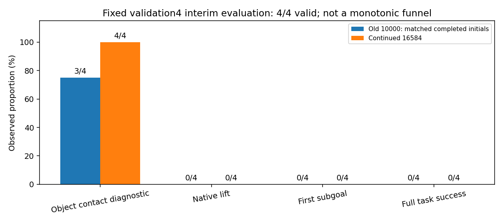
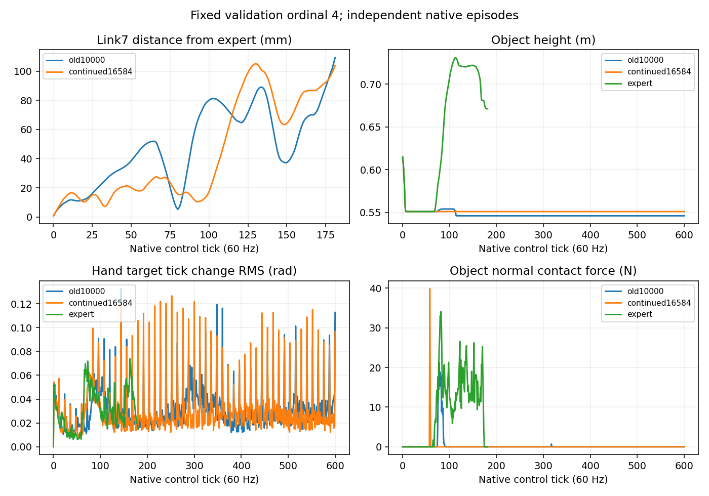

# StateDP 续训至100 anchor等效epoch：新增闭环实测

|模型|累计更新|成功/有效|成功率|软件缺失|完成情况|
|---|---:|---:|---:|---:|---|
|StateDP 原模型（固定同4初态）|10000|0/4|0.0%|原记录复用|4/4|
|StateDP 续训|16584|0/4|0.0%|0|4/4；completed|
|ImageDP|10000|原正式0/12|0%|本次未新增尝试|尚未续训，本次未重复评估|

本次计划4个初态，最多5次启动；已启动4次，软件缺失0，结果验收失败0，尚缺有效结果0个初态。
原正式两组0/12保持不变；新增validation4是阶段诊断，不并入原正式分母，不使用test40。

|模型|接触诊断|原生抬升|首子目标|完整成功|fall|dropped|timeout|
|---|---:|---:|---:|---:|---:|---:|---:|
|旧10000（本次已完成的同初态）|3/4|0/4|0/4|0/4|0/4|0/4|4/4|
|新16584|4/4|0/4|0/4|0/4|0/4|0/4|4/4|

原环境没有原生“稳定抓持成功”离散判据，保持N/A；接触使用已有0.1N诊断，不冒充稳定抓持。接近代理亦不作为成功判据。阶段事件不是强制单调漏斗。

|初态seed|新终止|旧/新首次末端偏离tick|专家持续接触tick|新边界手指跳变rad|视频|
|---|---|---|---:|---:|---|
|984101|{'fall': False, 'max_successes': False, 'hand_far': False, 'dropped': False, 'timeout': True}|3 / 3|68|0.093494|[本地视频](/home/CNS2025331827/docs/bc+rl_RSS/outputs/visuotactile/native_dp_v2/anchor_interim_20261105_01/stages/state_interim_04/attempt_1/output/r931005_1793209376_e00_p000055/rollout.mp4)|
|984102|{'fall': False, 'max_successes': False, 'hand_far': False, 'dropped': False, 'timeout': True}|6 / 5|43|0.111174|[本地视频](/home/CNS2025331827/docs/bc+rl_RSS/outputs/visuotactile/native_dp_v2/anchor_interim_20261105_01/stages/state_interim_05/attempt_1/output/r931005_1793209376_e00_p000057/rollout.mp4)|
|984103|{'fall': False, 'max_successes': False, 'hand_far': False, 'dropped': False, 'timeout': True}|7 / 7|46|0.076908|[本地视频](/home/CNS2025331827/docs/bc+rl_RSS/outputs/visuotactile/native_dp_v2/anchor_interim_20261105_01/stages/state_interim_06/attempt_1/output/r931005_1793209376_e00_p000067/rollout.mp4)|
|984104|{'fall': False, 'max_successes': False, 'hand_far': False, 'dropped': False, 'timeout': True}|4 / 5|65|0.077921|[本地视频](/home/CNS2025331827/docs/bc+rl_RSS/outputs/visuotactile/native_dp_v2/anchor_interim_20261105_01/stages/state_interim_07/attempt_1/output/r931005_1793209376_e00_p000121/rollout.mp4)|

首次偏离沿用5mm连续3个native tick定义；与同初态成功专家按控制tick对齐，不做时间伸缩。末端曲线仅比较公共前缀。
小样本的任务结果与离线误差分开判断；未完成四条前不宣布性能提升或退化。所有视频完整解码，模型自主输出，未加入拼接/平滑/专家接管。
源码提交：`f9ed9d6b065960b4d0ef6c7e212ced05d8693778`。checkpoint/SHA、初态一致性、执行器验收和原始结果见[机器报告](evidence/anchor_interim_20261105_01/summary.json)。
运行目录：`/home/CNS2025331827/docs/bc+rl_RSS/outputs/visuotactile/native_dp_v2/anchor_interim_20261105_01`。SDK退出码与任务结果分开；fast exit不称正常完整关闭。训练owner在评估释放资源后恢复；原72小时截止不延长。
