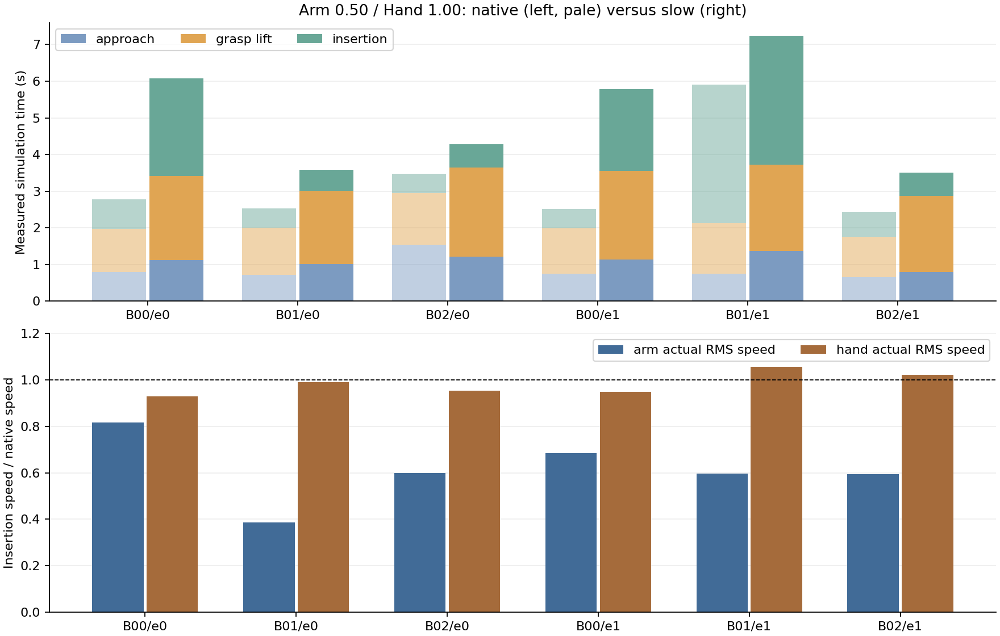

# Tight-Insertion 当前结果：A观察到一个成功改善配对；B仍不准生产

本轮从干净HEAD `362c6308a6519b57309487583ec401c5acd6f4a7`继续，工作树`/home/CNS2025331827/docs/bc+rl_RSS_narrow_followup`、分支`feature/tight-state-foundation`。A实际运行代码为`991db6a1c02af140ef12fb1f3a35f159c7ba2193`，启动时干净、结束241份冻结源码/配置未变。运行后仅完善B只读分析器的实际外力字段和结果文档，未改学生或执行代码。

A的24次登记尝试已经全部结束；B完成既有证据分析，没有新增采样、没有验证出可靠统一慢速方案。两项结果独立：**A的真实学生成功不授予B正式慢速数据资格。** [机器证据](evidence/tight_state_20261107.json)中的`tasks_ab_20261107`分开保存两项结果，原历史证据值保持。

## 任务A：原275条混合速度State基线受控复评

使用原275条State-valid数据训练的保留best4500 EMA，明确属于**原始混合速度数据**。旧200条空白固定相机没有用于视觉模型或补图。数据版本SHA `84cb9bb87ab8329949f526141d2ef715aef52bc78d5df162c8b809e877992b1a`；checkpoint SHA `8799b939a5819d4251ec897ac0d652fc32d73a5868e16ed05878bd372cda773c`。数据/统计SHA、train/validation IDs、H24/commit12和EMA严格加载兼容；原模型、Loss B及辅助权重、target_after_rad、5/60/120Hz、DDIM16、overlap0不变。

两组使用同一份EMA，只在独立评估配置中显式选择旧`legacy_packet_inverse_v1`或修复后的`canonical_joint_state_v1`；没有修改源checkpoint、没有新optimizer更新，也没有随机重训。A与正式慢速门槛分开，仅作为State baseline诊断；未来数据不同必须另做matched-data公平对照。

|输入入口|训练家族成功/合法闭环|未见初态成功/合法闭环|未见初态总尝试/拒绝|软件故障|
|---|---:|---:|---:|---:|
|旧反算输入|0/4|0/7|8/1|0|
|canonical修复输入|0/4|1/7|8/1|0|

每组12次尝试、11次合法闭环；合计24次，22次合法、2次同一初态的动作前拒绝。无重试、无补seed、无扩队列。训练取原train split字典序前4家族；8个未见初态seed在启动前登记。A新初态沿用原275实际采样范围（物体XY±25mm、相对孔位XY±35mm、20°、joint lerp.03、qd±.15），与B收窄域区分；原生DR不变。最终test不选模型，不加入旧正式评价分母。

|配对|初态seed / post-reset事件seed|旧输入结果|canonical结果|
|---|---|---|---|
|train_family_000|25110000 / 29181001|timeout，601 tick，子目标0|timeout，601 tick，子目标0|
|train_family_001|25110001 / 29181002|timeout，752 tick，子目标1|timeout，755 tick，子目标1|
|train_family_003|25110003 / 29181003|timeout，601 tick，子目标0|timeout，601 tick，子目标0|
|train_family_004|25110004 / 29181004|fall，265 tick，子目标1|timeout，601 tick，子目标0|
|unseen_00|29171001 / 29181005|timeout，601 tick，子目标0|timeout，601 tick，子目标0|
|unseen_01|29171002 / 29181006|动作前初态拒绝|动作前初态拒绝|
|unseen_02|29171003 / 29181007|timeout，601 tick，子目标0|timeout，601 tick，子目标0|
|unseen_03|29171004 / 29181008|fall，384 tick，子目标0|fall，233 tick，子目标0|
|unseen_04|29171005 / 29181009|timeout，601 tick，子目标0|timeout，601 tick，子目标0|
|unseen_05|29171006 / 29181010|timeout，601 tick，子目标0|成功，178 tick，子目标2|
|unseen_06|29171007 / 29181011|timeout，601 tick，子目标0|timeout，601 tick，子目标0|
|unseen_07|29171008 / 29181012|fall，163 tick，子目标0|timeout，601 tick，子目标0|

12/12对初始可观测字段逐值相同；11个合法配对的首帧Actor和初始事件随机流相同；DDIM seed7091相同，按pair交替两组执行顺序。没有保存并恢复完整PhysX内部状态，因此不宣称严格物理反事实配对。11个首帧的关节反算误差为1.19e−7–3.54e−7rad，normalized robot最大差1.48e−5–6.33e−5；实际首个完整动作计划差1.06e−6–5.25e−6rad，首个提交目标差4.14e−7–1.64e−6rad。物理轨迹随后分化，这说明小输入差异能影响行为，但不保证方向一致。

**成功案例已核对原生终止。** unseen_05（初态29171006、事件29181010）的canonical在tick125/164达到两个子目标，tick178满足完整原生max_successes终止；post_success_actions=0，实际两物理子步目标误差0。旧输入同配对601tick timeout、零子目标。完整numeric/trace/plans/initial_export/事件RNG/metadata、固定源checkpoint和代码SHA均保留在`baseline_03/baseline_evaluation/unseen_05_canonical`；没有只凭网络输出或离线指标报成功。

本次观察到1个成功改善配对、0个反向成功配对；训练家族仍0/4，未见初态合法7例也只有1例成功。结论是**存在实际正向案例，尚未证明稳定的总体成功率改善**。其他配对的阶段表现有升有降，例如family_004旧输入到第一子目标后fall，canonical零子目标timeout；不能将舍入修复宣称为旧模型失败的统一原因。

### 已有训练曝光与收敛状态

保留模型历史训练使用207 train /34 validation /34 test episodes，4245个train anchors。best4500已采样232875 anchors（54.859等效epoch）；最后5000更新累计258750（60.954等效epoch），原目标6438更新未到达，依据原validation_plateau_or_overfit规则停止。没有声称已经按新正式慢速协议完成训练。

validation选择MSE在3500/4000/4500/5000更新分别为.00417682/.00416906/.00416545/.00417081；同期完整validation loss由.014055升至.015122，而train8 loss由.001670降至.000923。说明后期训练拟合继续改善但验证出现平台/过拟合迹象，不是全局收敛证明。checkpoint含model、EMA、optimizer、EMA step、schedule/noise/Torch/CUDA RNG、anchor sampler、计数、配置和split IDs，先前完整恢复验收仍有效；本轮仅做兼容加载、输入对照，不重复恢复审计。[保留训练曲线](../outputs/visuotactile/run/narrow_repair_20261106_01/expanded_training/curves.png)。

## 任务B：已完成只读阶段分析，正式生产仍不准入

账本核对为旧21次capture=15慢速+6原速，新增12次=6慢速+6原速，共33条、21对慢速/参考比较；不是27条慢速。本轮B新增物理尝试0，旧成功/失败及准入标签均未改。旧15条为6条个体合格、6条成功但时长不合格、3条真实任务失败；新增6条完整成功，其中2条个体合格。原6条和新2条合格开发证据保留，未混成正式集。完整初态、family、event seed、原生DR概率/实际两子步外力、native子目标时刻及终止均在本地slow_phase_analysis.json，公开轻量[逐阶段CSV](evidence/tight_slow_phase_comparison_20261107.csv)保留速度和幅度数值。

下面A/G/I分别为接近无物体接触、抓取/抬升运输、插入及原生结束（native alignment+第二子目标阶段+若存在的ordered completion/retract）的累计秒数。沿用既有互斥诊断代理，允许阶段反复进入，不将>0.1N接触或>3cm位移称为稳定抓握；详细CSV另列native alignment和second insertion。每行三段之和等于真实完整时长。

|慢速记录|Arm/Hand|原速A/G/I秒|慢速A/G/I秒|完整比值|原生终止|
|---|---|---|---|---:|---|
|development_00_a055|0.550/0.550|0.500/1.400/0.900|1.850/1.733/3.050|2.369|成功|
|development_01_a055|0.550/0.550|1.067/1.233/0.783|1.217/2.033/3.533|2.200|成功|
|development_02_a055|0.550/0.550|0.883/1.417/0.650|1.833/1.450/0.667|1.339|成功|
|development_00_a050|0.500/0.500|0.500/1.400/0.900|1.933/1.767/8.233|4.262|成功|
|development_01_a050|0.500/0.500|1.067/1.233/0.783|1.333/2.550/3.033|2.243|成功|
|development_02_a050|0.500/0.500|0.883/1.417/0.650|1.833/1.750/1.700|1.791|成功|
|development_00_a045|0.450/0.450|0.500/1.400/0.900|2.117/1.850/4.533|3.036|成功|
|development_01_a045|0.450/0.450|1.067/1.233/0.783|1.483/2.717/0.667|1.578|成功|
|development_02_a045|0.450/0.450|0.883/1.417/0.650|1.800/1.950/10.033|4.672|最终插入timeout|
|development_refined_00_a055|0.550/0.550|0.967/1.383/0.550|1.050/2.333/0.617|1.379|成功|
|development_refined_01_a055|0.550/0.550|0.767/1.367/0.533|1.867/2.700/0.900|2.050|成功|
|development_refined_02_a055|0.550/0.550|1.300/1.100/0.517|0.933/2.867/9.633|4.606|成功|
|development_refined_00_a0525|0.525/0.525|0.967/1.383/0.550|1.100/2.500/10.033|4.701|最终插入timeout|
|development_refined_01_a0525|0.525/0.525|0.767/1.367/0.533|1.050/2.250/0.600|1.463|成功|
|development_refined_02_a0525|0.525/0.525|1.300/1.100/0.517|0.950/2.733/10.033|4.703|最终插入timeout|
|fixed_f0_e0_slow|0.500/1.000|0.800/1.167/0.817|1.117/2.300/2.667|2.186|成功|
|fixed_f1_e0_slow|0.500/1.000|0.717/1.283/0.533|1.017/2.000/0.567|1.414|成功|
|fixed_f2_e0_slow|0.500/1.000|1.533/1.417/0.533|1.217/2.433/0.633|1.230|成功|
|fixed_f0_e1_slow|0.500/1.000|0.750/1.233/0.533|1.133/2.417/2.233|2.298|成功|
|fixed_f1_e1_slow|0.500/1.000|0.750/1.383/3.767|1.367/2.350/3.517|1.226|成功|
|fixed_f2_e1_slow|0.500/1.000|0.650/1.100/0.683|0.800/2.067/0.633|1.438|成功|

**B00与B01/B02差异。** B00两例总时长达2.186/2.298倍，其中插入耗时3.265/4.188倍；Arm实际插入速度0.818/0.685倍，但运动路径长度变成2.237/2.555倍；Hand速度0.930/0.949倍，路径2.789/3.646倍。它们没有靠等待凑时长，仍按既有个体门槛合格；但主要是接触过程更长、运动更多，不是整条原路径按统一时钟慢放，不能据此预期其他家族也2倍。

B01/B02四例插入耗时只有1.062、1.188、0.934、0.927倍；Arm速度已降为0.387、0.599、0.596、0.593倍，而Hand仍是0.989、0.954、1.056、1.022倍。Arm路径同时缩短到0.660、0.672、0.519、0.632倍，抵消速度下降的耗时效果。抓取/抬升总耗时增加，但不足以让完整任务达到1.5倍。B02/e0接近耗时还从1.533缩至1.217秒。因此总时长不由任一alpha单独决定。

**DR不是同seed就同暴露。** 三家族reset抽取的force概率分别.093112/.003279/.013032、torque概率.073566/.064359/.009281，配对保持一致。B00/e1原速实际12个force/10个torque物理子步非零，B01/e1原速4个torque子步、B02/e1原速2个force子步；新6条慢速均为0。原生lift/task门控和路径改变导致此差异，没有关闭DR。没有证明外力是时长变化的唯一原因；不把这些配对说成严格相同扰动轨迹。

**固定参数的结构性限制。** 当前`progress_target`对原生处理后的目标做`previous+alpha*(native-previous)`。原生Arm是速度累加（speed_scale1.5、moving_average.1）；Hand是绝对位置加EMA（.1），Hand alpha相当于改变有效EMA响应，稳定目标仍相同。Arm0.5并不让专家只前进半个任务时间；专家仍每60Hz读变化后的真实状态，重新输出动作，接触路径、阶段触发和DR暴露都可能改变。Hand1更不会保证插入手部速度下降。真实记录的目标公式误差最大6.56e-8rad，说明机制按配置执行，失败不是参数没有读进去。

降低Hand到旧.55/.525确实让插入Hand速度降到约.56–.70倍，但B00从1.379倍变为最终插入timeout，B02从4.606倍长成功变为timeout，B01反而从2.050降为1.463倍；没有单调、跨家族稳定的参数趋势。现有证据不支持再追加一组盲目的固定alpha测试；也没有证明所有可能固定参数数学上均不可能。当前不存在已验证的简单统一可靠方案，不能开始正式慢速全模态生产。

**最小采集侧修改提案，未实施。** 修改位置仅为`SpeedLimitedDiagnosticEnv._pre_physics_step`内的目标进度处理：将Hand的固定比例平滑改为显式、因果的逐关节目标速度上限，`q_next=q_previous+clip(q_native-q_previous, -v_limit/60, v_limit/60)`；Arm先保留既有0.5，所有开发/正式家族共用一组上限。上限由已有开发原速运动统计预先选定，不按正式家族调参。专家继续60Hz读真实状态、原生delay/EMA处理顺序、PD/物理/任务成功/timeout不变；不插值历史示范，不复制帧、不延后成功或靠停留计时。这个改动直接约束Hand目标每秒变化量，但仍不能承诺任务总时长，须用真实运动/完整成功/逐条1.5–3和原可靠性规则重新验证。它是值得考虑的有界采集原型，不是已验证方案；本轮没有擅自实现或生产。
## 未变工程证据、运行与保护

已接受的168项工程测试、275/64663tick数值链路、完整510tick GPU FP32历史一致性、microbatch4+3/EMA/完整恢复、240tick实际执行器目标与模态验收继续有效；源码未变的这些实现没有重做审计。本轮受影响入口回归24项通过，运行后只读分析器重算33条/21对的阶段和实际DR指标与原分析结果逐值一致。22次合法学生闭环提交及两子步目标检查全部通过。

旧“目标重复减速”诊断子类问题没有证实影响旧State200/275正式执行；在线关节反算舍入涉及HistoryController的旧State10000/20918/200/275及相应诊断。A现在给出同权重显式修复对照的实际结果，不将其外推为所有历史失败的原因。没有改原网络、损失、频率、专家、PD、物理、DR或成功定义。

A实际运行2026-11-07 13:55:23–14:18:04（UTC+8），约22m41s；worker返回0，owner完成finally后退出，所有自有worker/monitor均已退出，systemd journal无本轮143/OOM/Kit失败。整卡时加权均值22.7752%、最大完整60秒28.1784%、缺测0；最小可用RAM24.962GiB，整卡峰值4220MiB，service journal记峰值内存约4.1G。此前143根因仍未知，旧监控缺口没有被本轮覆盖为“从未发生”。

本轮新增训练更新0、checkpoint0、专家物理采样0、删除0文件/0bytes。沿用必要best4500完整状态并保留本轮成功案例和全部失败/拒绝分母；此前22.7412GiB清理不重复计数。原400、现275数据、专家与资产保持，只读manifest/数据/统计/checkpoint指纹复核未变；IDE原目录既存改动未覆盖。B正式新慢速集仍0条，未冻结其manifest/统计/cache，未进行对应新模型训练。

A有限复评已经完成，B现有机制分析已经完成；**正式慢速生产和采集侧新机制验证尚未完成**。当前不应继续按固定alpha机制批量生产正式慢速全模态数据，最小改动仅作为明确提案保留。
