## 2026-11-14 第四轮完整结果与恢复初段权重对照

冻结16b7bae的第四轮于13:24:44（Asia/Shanghai）完成。原30+历史41+新12共83训练轨迹，仍30训练family；固定6验证不变，test22未读。A/B前端各10遍830更新、466140合法目标槽，均选第10遍；两组89条当前DP计划/可训练视觉缓存全部刷新。后端各15遍2440更新、355515合法监督tick；原30/历史41/新12实际曝光155970/155310/44235tick，全部83条各15次。A验证选第13遍、B选第15遍，不能将最后训练曝光当作两模型都使用最后权重。最终验证手指目标RMSE A0.0137064/B0.0152937rad（上一轮0.0147791/0.0167416），手臂0.00066612/0.00068035rad；保持上一实际目标基线手指0.0194149。

原4开发机会/组全部自然601tick timeout，A/B仍各0/4插入、0原生对准/子目标。沉降参考的既有12tick稳定窗诊断A1/4、B2/4：A seed28140001在完成108–119tick满足窗口；B seed28140000在552–553tick、seed28140003在263–305间共31个满足tick（最长连续17）。这些是过去12tick窗口的判定时刻，不能说只持物对应2/12/17tick。B seed28140003首稳定时目标中心距离19.90mm、记录四元数角差0.419rad，随后仍滑脱，末距200.52mm。原生lift标志均false；较沉降位置抬高/短暂拿稳不等于原生成功。相比第三轮A1/4极短窗、B0/4，有局部抓持进展，但没有可靠完成行为或A机制优势证据。

实际逐帧视觉/后端次数逐例等于601，A/B总吞吐12.069/12.117tick/s，队列416.14秒；普通自主无额外专家前向。round04_learning/family_exposure/increment_baseline/phases/runtime及学习曲线、round03_round04_contact_motion绑定实际代码/模型/数据。新完整pair沿相同12条已学专家恢复历史重算，首12合法tick手指误差A0.0169216→0.0125568、B0.0138869→0.0116589，12例都下降；仍是已学样本拟合，不能替代自主收益。

研究选择：当前状态覆盖和拟合改善仍只换来短暂抓持，已有53条纠偏也含学生自主拿稳后的真实接管。采用可归因的同数据/同更新量对照，当前完整A/B各接续后端3遍，普通首段权重1与第一连续合法专家12tick权重3，匹配fresh optimizer、固定6验证选模；DP与89个精确缓存不变，均完整学生执行原4开发机会/组。固定85ebd12，新身份round04_recovery_weight_study，13:59:40原截止不变；这不是新DAgger采集轮，也不是已证明恢复初段是主因。两个输出起点变体和视觉架构修改均未选择。实际权重/曝光/自主对照结果尚待完成。

监控归属修复已在全部旧GPU worker退出后的空闲边界接入85ebd12；旧monitor自然退出、记录保留，新monitor源码SHA/实际嵌套worker owned=true已核验。共享日志相邻旧/新样本间隔10.772秒，期间无本研究GPU worker；不称该间隔完整遥测覆盖。未重置session截止或修改无关进程。

## 2026-11-14 第三轮完成：离线改善仍未转为自主拿稳

冻结b9b6dcb的完整循环自然结束。A/B各DP10遍710更新；后端15遍2136更新、311280合法tick，均选最后一遍。后端原30/历史21/新20实际监督155970/84975/70335tick，77条当前DP计划与可训练视觉缓存身份全部一致，固定6验证不变。最终后端验证手指RMSE A0.0147791/B0.0167416rad，均低于保持上一目标0.0194149；arm0.00070533/0.00072634rad。train2/validation整体下降。曝光按family重新核对通过，真实指标和曲线已导出。

16.23秒初始化，417.75秒完整自主队列自然完成；原每组4登记机会全部601tick timeout。A1/4出现极短稳定判定，仅seed28140003完成177–178两tick满足过去12tick窗，随后失稳；B0/4。两组均0/4成功、0原生对准/子目标。视频首对80/120/180/260/400/550帧显示接触推偏后空手抬起，旧抓持段未改善。当前A/B实际12.00/12.11control tick/s，逐帧视觉/后端计数全等真实tick，没有额外专家shadow。不能把稳定窗的两个判定tick称仅持物2tick；诊断需先满足过去12tick。

冻结212242e新完整pair在相同20条成功source-role纠偏上的初段复算已完成（A11、B9）。首12合法tick手指误差A0.0216506→0.0150209、B0.0226740→0.0138666rad，全部20例均下降；各低于保持上一目标0.0191420/0.0193467。次12和其后亦均改善。所有真实历史、mask、标签、旧shadow及新cache/current后端绑定通过。它们已进入训练，所以这证明拟合改善，不能当独立泛化。既然该批旧恢复初段已学得更好而自主仍失败，暂不启动已准备的weight1/3后端研究，不能把旧首12不足当成现阶段已证明的主因。

新增同6验证的DP基线：A/B arm预测0.008512/0.008743rad，保持5Hz规划时刻观测分别0.007787/0.007801；手指预测0.062696/0.072944优于保持0.106524/0.115355。每60Hz当前观测hold更强且信息更新频率不同，不是可执行任务成功基线。DP还未在手臂预测上超过简单保持，后端补偿不等于A几何机制有自主收益。

下一研究决定：当前自主首接触在51–67tick，上一批接管最早80tick，仍有更早抓取偏差覆盖不足的可能。用当前第三轮完整pair，在原30中最后6个尚未接管的family（索引24–29）各A/B一次，于40/55/70/85/100/120tick真实专家接管，12机会；保留失败和完整学生历史，成功后缀才准入。它们与前三批接管family零重叠，但不是扩大初态域。不同family绑定时刻不能作时间因果比较。结束后看实际救回/捕获审计，再聚合并选择训练；本条不预告成功或自动机械加轮。原13:59:40截止保持。

## 2026-11-14 名义裁剪负担与可选恢复初段对照入口

只读实际takeover03成功后段：首12合法专家tick里，手指名义值被共同可达区间改变的joint-tick比例A64.67%、B69.02%。零后端输出对应的受限名义锚点误差A0.0354356/B0.0325781rad；实际旧后端shadow将其降至0.0216506/0.0226740，但仍高于保持上一目标0.0191420/0.0193467。真实后端确有纠偏作用，这不是独立闭环收益证据。相对专家非微小增量，旧完整shadow约37.8%/37.4%坐标方向相反；该统计沿专家接管后的实际历史，不能直接断言自主失败原因。tools/tight_fresh_anchor_report.py校验同模型执行/输出合同、实际合法标签、源SHA和原共同bounds，记录所有分段；没有新GPU/仿真。

独立审查未发现当前FY方向、固定128分母或更新后历史刷新存在确定性错误；41纠偏首12合法tick共492，只占全部20752合法tick的2.37%。据此准备显式fresh_actual_takeover_onset_weighting_v1：原30示范不加权，纠偏仅第一连续合法专家段加权；不改变采样、6验证、实际曝光、输出/执行语义。权重1作为同代码路径对照，权重3仅增加梯度权重质量（每遍21736），不能算增加实际采集/学习tick。72项子Agent CPU检查及主Agent43项相关检查通过，集合有重叠不相加；实际A/B数据CPU预检均通过，CUDA未初始化。未来fresh选模字符串修正为实际validation数量，活动模型旧字符串保留。

新增tight_fresh_backend_study只准备/执行已由Agent选择的有限四模型对照：当前完整A/B各做普通权重与初12步权重3、相同3遍接续和新optimizer，DP与准确新cache保持；只在源完整自主结束后允许准备，不自动选择或启动。当前第三轮A后端已15遍/2136更新，B仍缓存/训练中；该候选尚未登记或训练，须先看第三轮完整自主与新onset-after结果。原session截止保持。

## 2026-11-14 第三轮前端完成与恢复起点误差检查

冻结b9b6dcb的第三轮A/B前端均完成10遍、710更新，验证均选择第10遍。实际各17740anchor、408080合法目标槽；原30示范300episode更新/204360槽，历史21纠偏210更新/111220槽，本轮20纠偏200更新/92500槽。完整真实历史共285640视觉tick/组；本轮训练仍71轨迹、30初态family、固定6验证，test未读。同验证指标A 0.01000797→0.00899514（-10.12%），B 0.01057726→0.00931982（-11.89%）；不同标签空间只作各组前后比较。固定train2也下降，新纠偏末遍拟合0.00367210/0.00362324，不是自主改善。新后端缓存/训练与完整自主仍待完成。

CPU复查takeover03的全部24条实际轨迹，20成功与4失败分开。成功后段最初12合法tick，旧完整学生shadow手指RMSE A0.0216506/B0.0226740rad，保持上一实际执行目标基线0.0191420/0.0193467；A8/11、B7/9例比基线差。两tick队列过渡已排除，标签与实际目标、过去目标连续性、source/模型SHA均校验。shadow在专家接管之后没有控制机器人，因此这是旧模型沿专家真实历史的预测误差，不证明自主失败根因。新增onset_after工具仅复用准确新DP缓存、用新后端重算完整历史，在相同成功source-role分支比较first12/next12/after24；实际新模型计算待当前GPU循环退出。

另将180秒Kit初始化上限接入未来fresh_cycle，自有进程组在启动或原session超时后回收并留下失败收据，不自动重试、重置截止或重复训练。当前活动b9b6dcb未热改。17项CPU测试通过（恢复数据身份/合法行/历史篡改拒绝、误差聚合、进程回收和阶段失败不前进）；本次不宣称新后端/自主结果。

## 2026-11-14 第三轮真实纠偏完成，完整学习循环接续

冻结b9b6dcb的24次早期/中期接管全部自然结束：A11/12、B9/12由专家完成原任务，20条通过完整capture/相机/实际执行审计；7969真实历史tick、4689合法专家监督tick。原始学生前缀与2tick队列过渡只提供历史，未伪装专家监督。4次失败均601tick timeout、0子目标；其中3次专家后段出现短稳定窗但最终未完成，另1次未拿稳，均保留。不同接管时刻绑定不同family，不能由救回率声称时间因果优势。

B/formal_007在258tick首次学生拿稳，260tick仍稳定时接管，348tick专家完成；B/formal_053在172tick拿稳但300tick接管前已失稳，538tick专家完成。补入了真实学生先拿稳后的自身偏差，并不算自主成功。A本轮学生前缀没有稳定窗。完整数据/阶段/性能报告绑定source/model/plan/results/numeric SHA，见takeover_03、takeover03_phases/runtime。

依据当前抓取失败及验证各接触分段仍下降，继续已登记共同10遍DP、15遍后端接续、原4开发机会每组。round_03从当前完整pair出发，保留原30+历史21+本轮20=71训练episode，独立6验证与train30统计不变；新DP后全部计划和可训练特征重算。训练已启动，尚无本轮曝光或自主结果；原13:59:40截止保持。活动源码树不热改。

## 2026-11-14 第二轮真实DAgger完整结果

第二轮10条新纠偏与原30/旧11共51训练episode，两组DP各510更新、后端各1131更新/160630合法tick，全部计划与可训练视觉缓存刷新。6独立验证family手指最终命令误差A0.01813/B0.01950rad，较旧轮下降；自主同登记4初态各1/4短暂拿稳、0/4成功，全部8例601timeout且无对准/子目标，未形成可靠改善。先前唯一抓持seed28140000两组这轮都未拿稳；另外两例拿稳后再次失稳。文档以实际结果为准，启动卡住恢复另列软件异常。

[学习与曝光](evidence/tight_fresh_20261114/round02_learning.json) · [曲线](evidence/tight_fresh_20261114/round02_learning_curves.png) · [自主阶段](evidence/tight_fresh_20261114/round02_phases.json) · [运行耗时](evidence/tight_fresh_20261114/round02_runtime.json)。仍未证明A的机制收益或每步视觉的自主收益。

## 2026-11-14 第二轮A/B前端恢复训练完成

冻结a4db8e4的round_02_v2完成A/B各10遍、510更新，两组均验证选第10遍。每组实际13640anchor/315580合法监督槽：原30各10次（300episode更新/103980视觉帧/204360槽），历史11纠偏各10次（110更新/41130帧/59700槽），本轮10纠偏各10次（100更新/60840帧/51520槽）。所有真实学生前缀只更新历史，未冒充专家标签。

各自同6验证family的归一化指标A 0.01096077→0.01000797（-8.69%），B 0.01131391→0.01057726（-6.51%）。A构型hand RMSE 0.069230→0.066458rad，B命令hand 0.078790→0.076374rad；标签定义不同不横向比误差。新10纠偏训练后的指标A 0.00677697/B 0.00665101，仅为训练过数据的拟合，不能叫自主改善。准确初始数值见绑定report。

真实57条numeric全部字段、原30 affine和冻结DINO内容在失败attempt与恢复attempt之间完全一致；失败48更新未继承。公开round02_frontend_learning和round02_recovery_population_audit。新DP后的全部后端计划/可训练视觉缓存正在重算，后端与自主复测尚未完成。本条只记录已完成前端，不把待运行后端或拿稳效果提前计入。

## 2026-11-14 第二轮训练中断、真实边界修复与恢复

09:27实际复查发现round_02在04:40已失败，并非仍在训练；主Agent未及时接续，监督存在约4小时47分空档。A完成48次更新后，在第49条r02_B_formal_050_slow_3_stable_d0的几何抽样触发合法性检查；没有epoch checkpoint，B/后端/开发均未开始。失败现场保留，48次未保存更新不进入恢复模型，不能算第二轮学习收益。

根因是fresh trainer只绑定loss_context，遗漏已有geometry_selection所需supervision_records，导致恢复起点窗口抽到绝对tick361的队列过渡步。不是新数据物理构型无效，也未放宽判据。现在同一records同时限定base/palm/hand几何合法目标，优化前遍历检查所有episode。真实57条（51train+6val）检查通过，18125个合法commit槽；旧选择器只在上述一条抽到非法位置。旧首轮选择均合法。35项恢复起点/几何/聚合/阶段测试通过。

选择新attempt round_02_v2，从上一轮有效A/B EMA和配套后端继续，仍10遍DP+10遍后端、各4开发机会、同51条训练和6验证、同原13:59:40截止。仅SHA/源轨迹/相机/stride完全一致的冻结DINO复用round_02缓存；可训练视觉/全部计划在新DP后重新计算。阶段status现在明确写failed/complete，避免只残留frontend_A造成误判。此处登记修复与恢复决策，尚无新训练/自主改善结果。

## 2026-11-14 第二轮24机会完成与真实后半段纠偏

冻结b0917f1采集全部24机会自然结束、无软件错误，A专家救回4/12、B6/12；10条通过实际控制/标签/图像审计，6084历史tick、2620合法专家tick。A/B各只有1次学生拿稳后触发，两次均专家完成；另22次是在未出现拿稳窗的360tick fallback。14次失败全部601tick timeout、无子目标，且其中几次专家到569–598tick才拿稳；这不能证明状态永远不可救，只证明在原任务剩余时间内没有完成。本轮未改变超时/任务标准，也不将专家救回计为学生成功。

所有trigger凭真实学生前缀复算通过，新增authority分段阶段报告，显式区别学生拿稳/对孔与专家后段进展。15项边界/阶段测试通过。公开takeover_02、takeover02_phases/runtime绑定真实plan/results/numeric/model SHA；raw证据全部保留。完整采集A/B约7.16/7.20tick/s，必要lossless append合计349.04秒、最终重构审计415.34秒，普通自主评估不含这些成本。

下一轮51条训练episode=原30+首轮11+本轮10，采用已选10遍DP/10遍后端接续，全部新DP后端计划/特征重算，仍6验证和原4开发机会/组。源码完成审查后在新冻结工作树运行；本条不将启动或待学习数据冒充已训练收益。新report在真实首轮产物重新运行，A/B原始/纠偏曝光与先前报告完全一致。

## 2026-11-14 同纠偏历史完整pair复算与后端接续准备

旧/新完整pair在同11条真实纠偏重新计算各自DP计划和可训练视觉特征完成，3045合法专家tick，初段264tick。A手指命令RMSE全后缀0.026079→0.024201rad、初24步0.024941→0.022129；B0.025957→0.022419、初段0.024563→0.019699。手臂也下降。旧模型未见这些纠偏，新模型已训练，故这是同状态纠偏拟合，不能称独立泛化或自主收益。冻结ab79b87诊断0更新/0仿真，结果绑定模型/缓存/数据，公开round01_recovery_comparison.json。

首轮后端从随机参数只训练5遍，末轮train/val仍下降。本轮准备显式continue-rear：在新DP全部缓存刷新之后，沿当前已选后端参数、新optimizer继续，保留同一命令affine/执行器/输出/损失/历史合同。准备时验证旧完整pair身份与全部buffer；运行时再次验证新DP cache/新数据/合法mask。初始从零训练及已完成首轮不改。13项缓存/continuation/阶段测试通过，真实A/B旧后端在CPU通过参数/统计buffer/当前DP合同加载预检（0更新、0GPU）。首次预检fixture在A之前未建立B路径，保留失败并用v2修复；非模型或训练故障。另新增保存trigger回执/实际边界篡改拒绝测试；这是下一轮可选择的实现，尚未启动第二轮训练。新阶段接管已在冻结b0917f1运行，未热改。

阶段采集报告新增从真实numeric学生前缀重算trigger的审计，实际switch必须等于因果schedule；聚合训练前也强制执行。结果按拿稳后接管、无拿稳fallback、延迟前fallback及提前终止分类，专家成功只计真实专家后段，不混学生自主成功。

## 2026-11-14 首轮完整自主结果与按拿稳触发的下一轮接管

round_01_v3全部8次自主已自然结束，A/B仍各0/4完整成功。按同一12tick双子步双指接触、升高2cm、掌中相对位姿稳定诊断，两组各1/4拿稳（初始各0/4）；只发生在development_28140000，不能称稳定可复现成功。A该例230步首次拿稳后超时；B204步拿稳后389步掉落。其余6例未出现稳定窗；全部无原生对孔/对齐/子目标。A四例均601超时，B一掉落三超时。数据见round01_phases.json；seed/reset配置相同不代表精确物理轨迹配对。

下一步选择真实后半段覆盖，而非直接启动已准备的额外rearfit。新增可选stable_grasp_then_delay_v1：只读取已完成的学生transition诊断，完成ticks25–48的物体高度中位数冻结后，按与阶段报告同一稳定窗规则触发；稳定窗结束后再让学生走0/24/48/72/96/120tick，最晚360tick接管。阈值不进入学生网络、不修改任务成功。没有稳定窗单列fallback，提前自然终止保留、不补换。12个训练family各A/B一次，延迟列表重复两遍，共24个机会；开发/验证/test均不进入采集。

调度只允许在已完成学生动作后、下一次专家队列提交前一次修改未来接管tick；真实控制source决定实际边界，专家队列冲洗mask仍按实际切换计。训练entry现在写真实switch_tick，另存登记fallback和触发凭据。每步学生视觉/历史仍实际更新，专家后段重新真实观察。42项触发/队列/完整录制/真实历史监督测试通过；本条写入时新动态接管还未实际运行，不作可救回或学习收益声明。原deadline与所有失败证据保留。

## 2026-11-14 当前重启：逐帧视觉与train30

本轮授权替代旧截止、旧初始化和只启动后返回要求；当前指令集中在根AGENTS.md。研究机CNS202533182702；远端feature/tight-state-foundation核验为506d185，旧主工作区3e11d62及其未提交文档未改。新隔离树continuous_vision_20261114。

确认旧视觉每12tick一次，后端重复旧visual。新独立version6/visual_stride1合同把每60Hz真实RGB-D送入训练、在线视觉GRU和后端缓存；DP仍5Hz。旧合同保留。q_reached为transition后的q(t+1)、间隔1/60秒，不是稳定姿态；u_expert是当步实际执行目标。新模型尚未训练，不宣称任务改善。

原Core有36训练family；一家族一条中位时长完整成功，再按实际初态标准化最远点选择30条，原validation独立family取6条，test22未打开。36条共12,460tick，原文件SHA和q_after/q_before时序逐条通过；统计只用train30，未加载旧学生权重。原始数据与专家保留。详见evidence/tight_fresh_20261114/selection.json；标准化混合坐标距离只用于选取与去重，不作物理精确重放声明。

实现当前处于接口验收/全帧缓存准备。初始完整A/B训练、后端、真实多环境吞吐及DAgger研究循环尚未完成，不能把准备记为科研成功。新本地root：outputs/visuotactile/run/tight_fresh_20261114_01。

---

以下为历史记录，当前状态以上文和机器收据为准。

## 2026-11-13 23:35 后端增量剂量完整终局：四cell各0/10，不追加计算

`rear_span_dose_02`已于23:33完成，owner3070479已退出；不是训练故障或有意交接InterruptedError。reference A/B与continued A/B均完成同一固定10机会：每cell **10合法、0拒绝、0软件失败、0完整成功、0首子目标**。lift依次为3/4/3/5，不能代替完整成功。

continued每组新增2620后端更新、387040监督tick、2.0人口遍，训练墙钟A865.11秒/B853.26秒。reference为原span1冻结端点，本次新增训练为0；继承收据的1314更新/193520tick不能计入本次。四cell前端更新0、cache不刷新，不是新DAgger轮。端点仅诊断、不采用；没有观察到追加剂量带来的成功收益，也不能据此宣称所有欠训练假说已被排除。

终局重新运行`tools.tight_ab_fairness --frozen-frontend`，reference与continued各自A/B均通过，四cell共享相同plan摘要。审计仅覆盖登记合同、缓存绑定和实际曝光/覆盖收据，不证明历史初始化相等、逐步optimizer/采样顺序或隐藏物理状态逐位相同；reference/continued的训练剂量与optimizer重启有意不同。初次终局CLI遗漏该flag、误把继承DP514显示为增量的本地输出保留但已由frozen审计替代；reference继承rear曝光也明确不计本次新增。不混入B-only复现或上一轮9合法/1拒绝分母。

复用主Agent已发布8次诊断，不重复：原B274tick成功保留但未稳定复现，503命令回放命令/target精确而物理轨迹不精确。当前证据不足以归因到某个损失/晚期动作，也不足以宣布A/B优劣。按22:39用户要求，完成此边界后不新开训练、大评估、service或矩阵；剩余窗口交回主Agent。此次监督器结论为授权边界`external_block`，不是科研成功或任务不可能。原23:55:15计算/次日00:05:15绝对截止不变，保护全部证据与test22隔离。publisher与supervisor不改动。

小证据：[终局交接](evidence/tight_execution_learning_20261113/rear_span_dose_02/final_handoff.json)。

## 2026-11-13 22:14 实际更新验收

`rear_span_dose_02` A实际224次新增optimizer更新、32976合法tick；owner3070479/start_ticks163893784，313冻结源码无漂移，资源储备通过。B和新40例完整评估尚未完成，不提前给成功率。两组共同追加2人口遍，旧span1遍参考不重训；程序不自动采用模型。详见[启动收据](evidence/tight_execution_learning_20261113/rear_span_dose_02/startup_acceptance.json)。源码`aadbad1`已推送，启动文档另树发布，不热改。阶段23:47:57和原硬截止不变。

## 2026-11-13 22:12 metric完整结果与下一有限实验

40固定机会全部完成；reference-A/B与span-A/B各9合法、1拒绝、0软件失败、0成功/0第一子目标，native lift分别4/3/2/2。两arm实际增量fairness通过，拒绝种子不补；不能宣称span闭环改善。既有contact B1/10与后续B-only、A补齐cohort保持各自独立分母。

`rear_span_dose_02`准备完成：两组共同追加2遍span后端人口重放，冻结原一遍参考与两组DP/cache，40新完整评估机会。工程36测试/真实parser/参考CPU入口/准备fairness通过，不等于真实更新或自主成功。跨arm曝光和optimizer重启有意不同，arm内新增协议相同，历史初始化仍不同。接续证据位于`evidence/tight_execution_learning_20261113/rear_span_dose_02`；真实启动须另看startup_acceptance。未把CPU准备01错误当作候选失败，原错误与全部历史保留。

## 2026-11-13 21:21 实际评估启动，不新增训练预算

恢复02首个reference-A完整学生已实际运行300tick；owner3037113/start_ticks163579189，311源码SHA不变，资源储备通过。63测试、两arm准备fairness与四cell真实CPU前置检查均已验收，source `2e5d85d`已推送。仍是原固定40机会，未有本cohort完整成功率结论；训练和offline推理均未重复。记录位于[启动收据](evidence/tight_execution_learning_20261113/rear_span_metric_eval_recovery_02/startup_acceptance.json)，未来结果以新root的finished/failure为准，原失败现场保持。

## 2026-11-13 21:18 训练完成；评估准入衔接故障已定位

span A/B实际各1314更新、193520合法监督tick、1.0有效遍，原完整offline结果已保存。`rear_span_metric_eval_recovery_01`遗漏继承这些结果，使首cell在仿真前触发组分母保护；实际新自主机会0，不计0/10。恢复`rear_span_metric_eval_recovery_02`逐SHA继承四份checkpoint匹配且非test的真实offline结果，验证其data/cache同源；不重训，不重复offline推理，不调整模型/seed/标准/截止。两arm准备fairness和四个实际评估入口CPU前置检查通过；后者不运行Kit、不能替代自主结果。保留所有既有失败与原分母，等待实际固定40机会结果再判断loss条件化假说。

## 2026-11-13 21:01 实际训练与安全评估接续

`rear_span_metric_01`真实训练已验收：G01达到1088更新/159498合法tick，owner3022906/start_ticks163431464，310个冻结源码无漂移，资源储备通过。74项定向测试通过；新完整自主结果尚未产生，不把启动说成成功。

发现一个纯编排guard问题：真实trainer会同时记录新的loss_contract和派生loss_id，原跨metric白名单遗漏loss_id，预计会在两组训练/离线完成后误报。没有停止健康训练或热改冻结源码。仅在独立publication树修白名单，并登记`rear_span_metric_eval_recovery_01`评估接续：等原owner实际退出、核验两组保存完整及明确guard异常、确认原eval从未执行，才复用全部已训练endpoint/原计划运行原40机会，不重复训练或已完成试验。原stage约22:50:03及原23:55:15/次日00:05:15截止全部不变；任何其他故障交真实Agent，不静默越过。新CLI准备和3项恢复防重/截止测试已通过，接续owner启动另记机器回执。

## 2026-11-13 20:53 重放终局：完整覆盖仍无本cohort成功

|重放|组|真实rear更新/合法tick|完整自主成功|lift/首目标|
|---|---|---|---|---|
|50/20/30|A|1363 / 193690|0/10|4/0|
|50/20/30|B|1363 / 193690|0/10|3/2|
|人口比例|A|1314 / 193520|0/10|3/0|
|人口比例|B|1314 / 193520|0/10|5/1|

40例均合法、软件失败0；每个arm内部A/B实际曝光/机会完成审计通过，不是全历史等同。人口比例覆盖Core166/history480/current16全部662条，各层恰好1遍；旧配比仅319条、current重复12.930遍。尚无完整覆盖带来成功收益的证据，不混入原B1/10或B-only复验。

全训练集CPU测得centered头FY逐joint系数中位数跨1551.14倍，未证明因果。下一单一可达比例metric候选对冻结population参考，预登记40新完整策略机会；准备/启动/完成严格分开。精简证据：`evidence/tight_execution_learning_20261113/span_metric/preparation.json`。

## 2026-11-13 19:23 重放分布实验真实更新验收

首个control-A后端已实际288更新/41271合法监督tick；独立限时service与308个冻结源码hash、资源储备已验收。尚无本轮完整评估或成功率结论。两arm冻结DP/cache、每cell固定10完整学生机会，详见[启动收据](evidence/tight_execution_learning_20261113/replay_balance/startup_acceptance.json)。准备与预采样不计作训练；本次DP更新仍为0。

## 2026-11-13 19:20 A/B新20例复验均0成功

补齐已完成：contact A0/20、B0/20，合法分母各20，lift3/8，首子目标均0，无软件失败。对应相同规格/seed；事后补齐和历史初始化/曝光不同仍有限制。原10例A0/10、B1/10不合并；B previous0/20单列。现有成功没有稳定复现，不采用单例成功作为优势结论。

登记`rear_replay_balance_01`冻结DP/cache，仅后端原重采样与人口比例两arm，各A/B1遍＋固定10完整学生机会。旧history实际144/480、current16条12.879遍；新人口比例预采样662/662独立episode，尚非实际训练。28测试与两准备fairness通过，尚待启动验收。详见DAGGER_METHOD页首与[evidence](evidence/tight_execution_learning_20261113/replay_balance/registration_summary.json)。所有原截止、执行器与test22隔离不变。

## 2026-11-13 18:48 固定A补齐已真实运行

首个完整DP+Transformer自主case已到tick400，owner/source/资源/独立服务均实际验收；新20例尚未完成，不能把启动作为成功证据。见[启动收据](evidence/tight_execution_learning_20261113/ab_replication_completion/startup_acceptance.json)。原B当前/上一版本各0/20及旧B1/10仍各自单列。

## 2026-11-13 18:45 已完成B复验与A机会补齐登记

实际B新20seed复验：contact成功0/20、previous成功0/20（两者20合法、软件失败0），native lift8/6、第一子目标0/1。之前B1/10保留，不混合成A/B比较，也不称收益已复现。当前两种B完整pair均无本cohort成功。

仅登记冻结contact A的同20seed补齐，`ab_replication_completion_01`；不重跑B、不训练、不增加采集。训练增量公平审计prepared/completed均通过，评估当前尚未产生A新结果。历史模型/曝光差异、A事后补齐的顺序局限仍披露。测试29项及真实prepare通过，启动与后续结果另看机器收据。小证据：`evidence/tight_execution_learning_20261113/ab_replication_completion/`。

## 2026-11-13 17:53 新seed冻结复验运行中

`success_replication_01`独立owner/评估子进程已运行，首例实际tick400；当前/上一B各20新开发机会，尚无完成结论。源码73b2e97、子截止19:45:35，原预算未重置。详见最新交接和startup_acceptance。

## 2026-11-13 17:48 contact闭环：A0/10，B1/10

完整DP+Transformer各10次合法自主评估，软件失败0；A/B lift2/3、首子目标0/1。B seed27150001原生tick274成功并结束，凭据hash/trace长度一致，专家接管关闭。前端各514更新/765303监督target槽，后端各1362更新/193581合法tick；原数据与失败模型保留。单例不能证明泛化或组件因果。

下一项只冻结B当前/上一完整pair做20新seed配对复验，共40固定机会，无训练/新纠偏，详情见DAGGER_METHOD页首。准备/测试不是GPU启动，实际状态在原run `success_replication_01`。test22未读，原截止不变。

## 2026-11-13 13:13 接触恢复已真实启动

`adaptive_contact_recovery_01`独立systemd服务已active，owner PID2764734/start_ticks160645694，冻结源码c9f8e5e、SHA无漂移。A已完成2个登记机会：首个原生初态碰撞拒绝（不补样），第二个完整专家接管成功、已通过合法纠偏准入；这不是学生自主成功。后续两模块训练/新cache/完整自主开发尚未完成。44项测试与24个实际CLI采集配置解析通过，资源满足原6/14/60GiB余量。

独立子截止19:09:53 UTC+8，比原计算23:55:15更早；原绝对11月14日00:05:15不变，正常完成或故障后由既有真实Agent监督器再决策。现场、启动验收与最后状态位于原run同名目录；未改监督器和任何旧worker。后续下面的“仅准备”段落为启动前记录。

## 2026-11-13 13:12 完整tick-window结果与接触恢复新登记

`adaptive_tick_window_01`已完成：A/B各1191真实更新、171133合法监督tick；完整DP+Transformer开发各10次，成功均0，lift分别3/4、首子目标0/0、软件失败0。训练wall分别365.41/358.82秒，相比centered的566.30/559.26秒减少约36%；评估另计，不能称自主收益。选模分数相对各自update0为0.397905/0.596738。

20条真实自主trace首次contact为53–80tick、首次contact-loss为58–127tick；这是可见事件，不证明失败根因。继续重复后端曝光信息量低，故真实Agent登记`adaptive_contact_recovery_01`：用本次实际完整pair，每组12训练家族机会，在58/70/82tick接管，维持原全局commit12/清洁后缀相位。只收原生完整成功的真实专家后缀；2个预先指定机会/组保留correction_dev，不补seed。

新隔离树从已发布58ed6e1建立，下一前端显式`recovery_onset_commit12_v1`；共同快照上DP2 anchor等效遍→各新DP完整依赖缓存→centered/FY reg0/LR1e-4/current-weight prefix/fixed128tick rear1遍→各10完整开发。现有全池530条合法纠偏全部保留，比上一训练快照更多，数据/前后端/窗口均变化，不是单变量因果对照。两模块与新cache不可省略，原A=q_reached＋既定几何、B=u_expert、rear最终u_expert不变。

新阶段已经CPU准备、实际CLI解析和44项测试通过，但本条写入时尚未启动GPU；后续以本地`adaptive_contact_recovery_01/{launch,status,startup_acceptance,finished,failure}.json`为准。子预算最长6h且受原计算11月13日23:55:15、绝对次日00:05:15约束；独立systemd cgroup、无新监督器、无自动下一轮。原adaptive_recovery有意交接InterruptedError与更早CLI故障仍保留，不代表本次评估失败或研究终止。test22与无关任务不触碰。

## 2026-11-13 12:24 centered闭环已完成，下一流程试验准备

**实际启动已验收**：独立systemd `tight-tick-window-20261113-01`已启动，不是仅登记。A已记录116次真实更新，完整group checkpoint持久化111次/15723合法tick；292份冻结源码SHA无漂移，VRAM/RAM/磁盘余量满足6/14/60GiB。B及新闭环结果仍未完成，不宣称成功或整体加速。源码与登记已推指定分支，普通service在本次约2小时子预算内完成配对训练/离线/各10完整开发，然后由既有supervisor重新调用Agent；无新监督器、无自动DAgger。见[实际启动验收](evidence/tight_execution_learning_20261113/adaptive_tick_window_01/startup_acceptance.json)。

`adaptive_centered_01`：A/B均已完成2349更新、171133合法tick和10次完整DP+Transformer自主开发；成功0/10、0/10，native lift3/5、第一子目标0/0、软件失败0。A/B相对各自centered update0的选模分数0.388/0.608，不能推断旧参数化的同功能初值收益，更不等于自主成功。训练分别566.30/559.26秒，完整物理评估另计；旧03:04故障至09:57恢复的6.879小时不是训练。

真实Agent结合12:16复查选择`adaptive_tick_window_01`：相同centered/FY/LR/原pair与cache/物理曝光下，改变为固定128合法tick梯度窗口与统一分母，减少无参数变化时的重复prefix计算；不缓存旧权重hidden，不新增采集或DP更新。归一化与optimizer次数一起变化，收益待真实结果。此条登记不等于已启动；实际launch/progress/startup_acceptance及后续finished位于原run对应目录。原截止不变。

## 2026-11-13 11:25 已完成闭环与下一假设

`adaptive_recovery_01`：A/B各7017次后端更新，验证均不及各自update0，diagnostic endpoint完整自主各0/10；native lift2/1，alignment0/0，软件失败0。不是接管结果，也不是缺失试验。监督有意交接不作技术失败计。选择`adaptive_centered_01`检验窄可达区间的输出条件化，11:29已验证A真实256更新/18057监督tick，新成功结果仍待评估；前端与cache不变，FY reg0/LR1e-4/当前prefix不变，1遍后完整评估。参数化改变且旧endpoint3遍，不能称严格单变量等曝光收益；不自动追加DAgger。详细证据以本地原run下同名目录及`agent_supervisor/initial_boundary.json`为准。

<!-- EXECUTION_LEARNING_STATUS_START -->
## 2026-11-13 自主执行学习修复：实际状态

状态 **FAILED / technical_or_budget_stop**；原绝对截止 **2026-11-14 00:05:15 UTC+8** 不变。
首个旧/FY各200更新已完成，FY的A/B dev执行误差比1.139/1.181，未通过原门槛。固定DP输出域下界占A归一化错误33.46%，B为0；据此比较保持共同执行器的线性尾部提案。
配对延长、必要优化调整、完整混合数据后端训练、完整DP+Transformer开发评估分层记录；若闭环失败且剩余预算允许，最多两轮、每轮12机会/组的定向DAgger同时更新DP、缓存和后端。初始门槛失败不结束整个修复，也不改写旧结果。
GPU工作与Git发布分别调度；未完成阶段不能称为成功。test22隔离、源数据和旧checkpoint保留。
[方法与限制](DAGGER_METHOD.md#execution-learning-repair) · [阶段状态](evidence/tight_execution_learning_20261113/adaptive_recovery_01/follow_status.json) · [配对计划](evidence/tight_execution_learning_20261113/adaptive_recovery_01/adaptive_probe_plan.json) · [表达下界](evidence/tight_execution_learning_20261113/adaptive_recovery_01/capacity.json)。
<!-- EXECUTION_LEARNING_STATUS_END -->

<!-- AUTONOMOUS_RESEARCH_SUPERVISION_START -->
**2026-11-13 10:44 最新接续：独立研究事件监督已实际启动。** `tight-research-agent-supervisor-20261113-01.service` 为active，真实Codex工具调用与service运行环境均已验证，286份旧worker源码未改。当前A已完成7017更新但验证退化；B仍正常更新，最新启动快照为4512次/328737监督tick。先完成本次两组完整学生评估，再触发真实Agent做下一研究决策。下面旧owner的自动汇总只描述它自身；有意交接的InterruptedError不代表评估软件失败，也不意味着研究结束。15min无实际进展或异常退出同样触发诊断；普通脚本不宣称具备科研推理能力。原计算23:55:15/绝对次日00:05:15 UTC+8不延长。

[实际启动验收](evidence/tight_execution_learning_20261113/agent_supervisor/startup_acceptance.json) · 本地实时 `outputs/visuotactile/run/tight_execution_learning_20261113_01/agent_supervisor/{status,latest_decision}.json`。后者仅在真实决策发生后存在。
<!-- AUTONOMOUS_RESEARCH_SUPERVISION_END -->

<!-- TIGHT_GRADIENT_DIAGNOSTIC_START -->
<a id="tight-gradient-diagnostic"></a>

## 2026-11-12 22:28：硬裁剪梯度快检完成，最小候选未通过

当前新控制第一轮完整学生：A/QG01 **0/10**，原生lift3、稳定抓持诊断2；B/G01已完成，**0/10**、lift1、稳定抓持2。两组首子目标均0、全部10次timeout，无fall/drop；不能继续把B写成未评估。正式run仍为`tight_dagger_matched_20261112_01`，源码`380a20b`，第二轮采集正常继续：22:28读回A已完成48次/准入39条，B已完成4次/准入4条并继续其48次队列；2026-11-13 11:22:40绝对截止不变。

独立诊断复用第一轮SHA配套DP、后端与缓存，固定字典序2条Core训练、来自A/B各1条本轮纠偏训练及各1条隔离纠偏开发，共6条完整轨迹/2,113历史tick/1,873合法监督tick。选择与模型误差无关；学生前缀只参与因果历史。Arm误差容差1e-4rad、Hand1e-3rad；近零梯度为去除样本权重归一化后的主拟合梯度绝对值≤1e-10。没有读取test22。

|真实模型/部位|合法坐标总数|超容差错误坐标|其中梯度失效坐标/比例|失效分量占加权执行误差|
|---|---:|---:|---:|---:|
|QG01 / Arm|13111|3237|2688 / 83.04%|89.51%|
|QG01 / Hand|41206|8334|4562 / 54.74%|67.20%|
|G01 / Arm|13111|3820|2831 / 74.11%|83.36%|
|G01 / Hand|41206|8438|4380 / 51.91%|59.44%|

这是**当前真实模型在合法专家监督上的逐坐标梯度证据**，不是历史学生prefix投影率。关节限位与可达投影均可能截断梯度；不能把两者统称为单一根因。新裁剪前拟合项让以上失效坐标全部获得有效u_pre梯度，但不等于已经改善闭环。两组执行误差均优于保持上一实际目标；专家标签经过同一执行投影改变超过1e-6rad的坐标为0。A存在少量理论修正范围超界，B本批无；与实际tanh饱和分别记录。

另发现正式后端训练每32tick更新后沿用更新前hidden的TBPTT近似。真实恢复案例各一次独立更新，旧hidden与当前权重完整prefix的下一32tick执行命令最大差A0.003186rad/B0.002198rad。固定权重批量/逐tick本身通过，最大执行差A5.96e-7/B2.53e-7rad。真实transition时刻、previous target、issued/applied、q_reached、队列清洁mask、一次delay/native映射/既定速度处理和前后端身份检查通过；尚未证明历史近似是零成功原因。

唯一候选lambda_pre=1已实际完成：A/B各旧/新损失200更新，每臂5,745监督tick、1,568恢复初48tick，训练4episode/开发2episode隔离，两臂均从当前权重完整前缀重算历史；不训DP、不改正式checkpoint。新项初始raw输出梯度L2约为旧exec项A12倍/B10倍，正则远小于两项拟合。

|固定200更新探针|A / QG01|B / G01|
|---|---:|---:|
|新损失train裁剪前MSE / 初始|0.1451（下降85.49%）|0.0882（下降91.18%）|
|新 / 旧损失，dev执行MSE|1.8403|1.8292|
|新 / 旧损失，Core执行MSE|2.1393|1.6070|
|新损失dev执行MSE / hold|1.4791|1.3424|
|旧损失train恢复初48 Hand RMSE，初始→200更新(rad)|0.008816→0.005905|0.009226→0.006225|
|新损失train恢复初48 Hand RMSE，200更新(rad)|0.013881|0.012275|
|train恢复初48 Hand方向正确率，初始→旧→新|91.85%→94.97%→83.87%|92.45%→95.49%→86.90%|

整体MSE采用命令normalizer、Arm/Hand各1/2、恢复初段权重3及同分母；方向仅对专家真实运动超过同部位容差的分量统计，本表Hand分母1,153、Arm662。每部位/阶段/partition完整误差与分母见CSV。新项使上述u_pre失效梯度恢复、pre误差可学习，却损害了执行拟合；**两组均不通过预登记采用条件，不接入正式队列、不追加200更新或搜索第二权重**。旧损失能改善训练恢复初段，不支持“网络完全学不动”；隔离dev旧损失变化很小，更不能把专家历史拟合当自主恢复成功。

同时新增可选current-weight-prefix历史修复：每次更新后，下一监督块从t0重算；不缓存跨更新hidden。4个真实160tick前缀、13状态张量均逐位一致，state_only局部计算1.13–1.16倍提速；**正式队列未切换该版本**。新损失与新历史均在checkpoint显式版本化、缺字段保持旧行为。代码/CPU单元验收、真实离线探针、正式闭环效果分开。

闭环配对恢复**未完成**：现有导出不含完整PhysX/contact/broadphase/传感延迟内部状态，前缀重放偏差未专项量化；本次没有新Kit或把旧专家后缀施加到偏离轨迹冒充同状态对照。正式第一轮每组48机会/47独立观测接管起点，A42/B41成功；接管阶段A非接触21/接触25/lift1，B22/23/2，各有1个非法未知起点。阶段覆盖主要在接触前后，不能只以83个成功后缀推定恢复能力充分，也不据此新增预算。

当前判断：硬裁剪梯度阻塞和跨更新旧hidden近似已证实；本批未发现标签/时序/配对/重复delay错误。A理论幅度超界仅Arm23/13,111、Hand473/41,206，B为0；不足以支持扩大共同输出头。lambda1的pre项梯度强约10–12倍与小样本泛化是下一步待查假设，并未证明为何闭环全失败。继续现有网络及原正式队列，禁止以本轮否定候选替换正式pair。

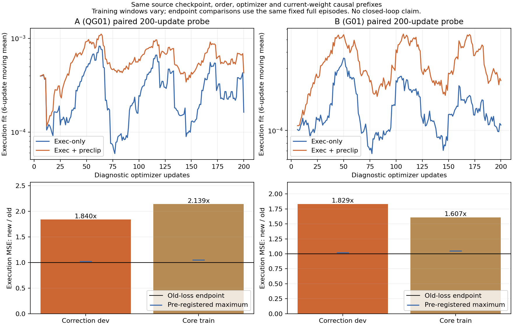

[固定清单与模型身份](evidence/tight_gradient_20261112/manifest.json) · [集中梯度表](evidence/tight_gradient_20261112/diagnostic_summary.csv) · [逐阶段诊断](evidence/tight_gradient_20261112/diagnosis.json) · [标签/历史审计](evidence/tight_gradient_20261112/history_control_audit.json) · [探针预登记](evidence/tight_gradient_20261112/probe_preregistration.json) · [探针原始数值](evidence/tight_gradient_20261112/probe_results.json) · [分层恢复对照](evidence/tight_gradient_20261112/probe_comparison.csv) · [采用判定](evidence/tight_gradient_20261112/probe_gates.json) · [本地48份完整命令链索引](evidence/tight_gradient_20261112/publication.json)。

83项定向CPU测试通过（6.02s），仅已有requests依赖版本警告；[测试与源码指纹](evidence/tight_gradient_20261112/focused_tests.json) · [正式队列实时读回快照](evidence/tight_gradient_20261112/runtime_snapshot.json)。

统一入口`tools.tight_gradient_diagnostics`的`diagnose/probe/audit/summarize/publish`分别只做相应阶段；`probe --updates 200`是本次已经完成的一次性诊断，不自动扩展。权重、HDF5、完整plan/命令NPZ均留本机，没有清理当前模型或合格数据。正式队列结束后的CPU发布接续独立运行，原源码/模型/截止保持，远端代码推进不会让最终报告丢失；实际启动凭据与最新状态另行核对。
<!-- TIGHT_GRADIENT_DIAGNOSTIC_END -->

<!-- tight-dagger-live-progress:start -->
## 2026-11-12 19:17：A新控制自主10例完成，B前端继续训练

本节保留19:17历史快照；B随后已完成新控制10例评估，最新结果见页首诊断及下方机器汇总。

**A/QG01本轮完整成功0/10、原生lift3/10、稳定抓持诊断2/10；首/第二子目标均0，10例全部601tick超时，fall/dropped均0。** 这是真正使用控制匹配修复和本轮DP＋Transformer的最新自主开发结果，区别于旧控制的0/4。全部合法/软件完成，模型与逐例SHA核验通过；接触和lift不等于任务成功。失败共同停留在首子目标之前，具体原因仍未证实。

A前端1,355更新、后端28,192更新（约12个监督tick遍）均完成，配对前端`f25a3895…`、后端`8a3471f3…`。B正在第一轮前端训练，最新进度见[当前机器快照](evidence/tight_dagger_matched_20261112_01/live_progress.json)；其新后端和自主评估尚未完成，不填零成功。[A逐次结果](evidence/tight_dagger_matched_20261112_01/round01_A_closed_loop.csv)。

性能交接已于17:05:40完成；原owner正常退出，优化版普通service持续运行，源码`380a20b`。第一轮B前端仍保持A所用micro4，后续新缓存用已验收优化；第2轮两组才共同micro16并行。原run、已完成凭据与11月13日11:22:40截止不变。B完成前端→新DP缓存→Transformer→10次自主评价后，按原有限配对计划进入第2轮，不增加第三轮或重置预算。

评估日志保留1条09:42:15Z syntheticdata丢帧警告，影响未专项审计；未发现新的软件退出失败。旧owner的远端推进发布守卫与早先后端STOP中断均已由交接/恢复处理，不能作为当前训练失败，也不能说日志完全无错误。
<!-- tight-dagger-live-progress:end -->

## 2026-11-12 16:52：性能验收与控制匹配run当前快照

**新控制协议下的第一轮完整自主评估尚未完成；没有新的A/B成功率可报。** `tight_dagger_matched_20261112_01`仍在运行：A（QG01）第一轮DP已完成1,355更新/6.00263 anchor遍，正在生成该新DP缓存；B（G01）第一轮DP尚未开始，两组新配套后端与固定10次自主评估待续。两组已各用48次接管机会，准入42/41条成功专家纠偏；这是专家恢复数据，不是学生自主成功。

全94条合法采集的完整策略身份和执行链CPU读回通过，控制一致性修复已实际用于这批轨迹；原来的0/4属于旧控制实验。A本轮旧专家验证/纠偏dev/纠偏首24合法tick误差相对update0为0.92211/0.93572/0.98582，不能据此宣称闭环成功。

性能短测保持正式学习语义：单DP更新1.228×、真实前端缓存1.489×、双DP计算并行1.935×；完整DAgger轮、采集及自主评估加速仍未测。实现与原始数值、A已完成曲线集中在 [性能与进展报告](DAGGER_PERFORMANCE.md)。已审阅代码先推送，普通后台交接在当前`r01_QG01_predictions`正常完成后保存/退出旧worker，再接续同run；第2轮才共同改变A/B的DP数值配置并启用双DP并行。原始绝对截止2026-11-13 11:22:40不变，不新开一轮预算。该带时间快照不代替下方自动发布的完整结果。

16:55:27实际启动验收：原实验owner与普通交接service均active，A新DP缓存492/647条，原268个冻结源码文件未变。交接状态为`WAITING_REGISTERED_STAGE`，**尚未迁移性能版本**；原deadline不变。见[后台启动与当前阶段凭据](evidence/tight_dagger_matched_20261112_01/performance_startup_acceptance.json)及[冻结迁移请求](evidence/tight_dagger_matched_20261112_01/performance_request.json)。

## 2026-11-11 完整策略 A/B：原run安全边界修订

后续活动矩阵已收敛为两个 **DP＋Transformer完整策略**。A使用本run首轮QG01选定pair，DP继续学习`q_reached`并保留既定手部几何软惩罚；B使用已训练G00/G01选定pair，DP学习`u_expert`。两组前端均为G00视觉/本体模态，触觉在同容量Transformer后端读取；最终组合命令均以`u_expert`监督。裸Q/QG继续训练和离线验证，不再独立采集或考核任务成功率。

**64次既有实际采集的CPU数值审计未发现裸DP采集问题。** 前后端权重身份、nominal＋已施加residual、学生proposal/issued/applied及实际目标链一致；学生前缀监督为0，合法专家后缀的命令与实际到达配置分开。后端修正允许为0。此结论来自已保存的真实轨迹，不是仅检查backend配置；后续采集首2例另做相同实际读回验收。

原owner已于18:03:59在保存边界退出；G11前端754次新增更新和全部原数据保留，后端未完成不计为完整轮次。QG首轮仍为804前端/12212后端更新，自主0/10成功、2lift。当前累计80条纠偏（73train/7dev）与Core166继续使用。

重新分配的有限上限为第2轮A96/B48次接管机会、共同快照分别更新两部分；第3轮由更新后A再采集最多96次并更新两部分，B保留第2轮完整pair。机会数按剩余时间缩减，预留DP、真实预测缓存、后端和有限自主评估；每次DP最多800更新，400后可按验证停止，200间隔保留对照。纠偏首48连续合法tick的DP anchor抽样目标为50%，后端loss相对权重3；实际来源曝光和覆盖另计，学生前缀与切换mask不变。

原run起点13:24:31、计算截止2026-11-12 07:14:31、绝对截止07:24:31保持不变，没有新run或新的18小时。A/B保留既有不同残差幅度（A Arm0.2/Hand0.9、B全0.1）及不等历史曝光；本轮也优先A，因此不是严格单变量或同预算比较。恢复覆盖增强是否改善自主成功仍待后续结果，不能由采样规则推定。范围修订没有删除旧训练、有效纠偏或成功/失败证据。

实现、CPU验收和后续真实启动分别记录；此修订说明不表示新轮训练已经完成。配置见[当前合同](CONTRACTS.md)，阶段进度以同run机器状态与下方带时间记录为准。17:01小节为保留的历史快照。

**真实接续核验（北京时间18:26:55）**：同一service已以源码`c80829c`恢复，状态RUNNING / round_02_collection。新A前两次实际采集均通过完整DP＋Transformer身份与数值链读回，264个冻结源码/配置文件未变；没有额外诊断rollout。B的真实采集验收将由同一owner在其首2个登记机会内执行，目前未测。本轮新训练与自主评估尚未完成。[启动验收](evidence/tight_dagger_pool_20261111_01/scope_startup_acceptance.json) · [64次既有采集审计](evidence/tight_dagger_pool_20261111_01/complete_policy_acceptance.json) · [原run修订/完整pair身份](evidence/tight_dagger_pool_20261111_01/scope_revision.json) · [定向测试](evidence/tight_dagger_pool_20261111_01/scope_tests.json)。

安全边界停止至重新监控之间存在资源采样缺口；后续报告保留这一缺口，不声称全会话连续覆盖。各活跃文件按各自写入时间读取，启动验收中两例已完成的读回与progress字段可能相差一次落盘。

## 2026-11-11 17:01 阶段快照：QG01首轮完成，G11前端训练中

`tight_dagger_pool_20261111_01` 仍为 **RUNNING**，本节是北京时间17:01:29的中期记录。QG01完成首轮两阶段训练和有限自主评估；G11前端已更新109/1002次、loss=0.00426246，后端和自主评估尚未开始。后台继续原有限队列，绝对截止仍为2026-11-12 07:24:31；test22未使用。冻结运行源码仍为 `593f109`，本次只发布已有证据。

|QG01首轮指标|实际记录|
|---|---:|
|纯学生原生完整成功 / 有效|0 / 10|
|原生lift / 首子目标 / alignment|2 / 0 / 0|
|timeout / fall / dropped|10 / 0 / 0|
|接触物体 / 稳定抓持诊断|10 / 0|
|前端新更新 / anchor等效遍历 / 墙钟|804 / 8.02871 / 4112.40s|
|后端新更新 / 有效监督tick等效遍历 / 墙钟|12212 / 12.00040 / 841.72s|

`palm_fresh_000/001`记录原生lift，其余8例未记录；10例均在601tick超时，均未到达首子目标。按预设规则，最初4例出现2次lift后扩至同队列10例。相比上一轮同spec/seed的0次lift，本轮有阶段变化，但仍无完整成功；接触与lift不等于稳定抓持，当前证据不能确定失败根因或证明稳定改善。逐次终止、接触、裁剪/饱和与失触再接触事件见[逐例诊断](evidence/tight_dagger_pool_20261111_01/round_01_QG01_rollout_events.csv)和[完整机器记录](evidence/tight_dagger_pool_20261111_01/summary.json)。

前端以`q_reached`续训，804次后按验证平台规则停止，未达到1002次上限；后端使用这份新前端刷新后的真实预测，以`u_expert`续训。选中804/12212的完整新pair，两阶段相对update0的复合开发分数分别0.899974/0.909495，不能解释成闭环成功率提高。几何预热100次完全跳过，随后704次更新计算1408配置，总13.799s，激活更新平均19.60ms，SLSQP调用0；704条要求接触样本中197条有非零接触手部梯度。此处梯度为加权前的局部手关节梯度，不是网络参数梯度。采样配置最大穿透超容差13.114mm；要求接触样本的最大间隙超容差均值0.474mm。这些是训练预测配置上的测量，不是自主物理轨迹的穿透审计；本轮没有新增完整update梯度比例校准。[几何统计与口径](evidence/tight_dagger_pool_20261111_01/round_01_QG01_geometry_summary.json)。

本轮采集64次：QG01专家接管27/32成功、5次超时；G11为32/32成功，无软件中断。新增59条有效纠偏中52训练/7开发，与旧21条合并为80条（73训练/7开发）；另加Core166，共239条训练episode。两组使用同一冻结快照，学生前缀监督为0。专家接管成功与上表纯学生结果分开。

[两阶段训练/验证曲线](evidence/tight_dagger_pool_20261111_01/training_curves.png) · [逐更新原始loss](evidence/tight_dagger_pool_20261111_01/training_loss.csv.gz) · [固定验证数值](evidence/tight_dagger_pool_20261111_01/validation_curves.csv) · [几何逐配置数值](evidence/tight_dagger_pool_20261111_01/round_01_QG01_geometry_samples.csv.gz) · [接触阶段离线误差](evidence/tight_dagger_pool_20261111_01/round_01_QG01_contact_phase_metrics.csv) · [损失与监督合同](CONTRACTS.md)。

自主视频`round_01/QG01/backend/QG01/evaluation/palm_fresh_000/rollout.mp4`位于本轮run下，已有完整CPU解码凭据601帧/60fps；[视频索引](evidence/tight_dagger_pool_20261111_01/video_index.csv)列出准确路径与SHA，模型/源轨迹/视频本体留本机。采集视频缺少完整解码凭据的项目仍标为未测。资源汇总截至root状态时间16:50:02，训练进度截至17:01:29；这次跨文件读取不是所有活跃文件在同一瞬间的原子快照。[快照范围](evidence/tight_dagger_pool_20261111_01/interim_status.json)。

<!-- METHOD_MATRIX_START -->

## 2026-11-10 复用 U-Net 基础与实际配置适配实验

机器状态 **COMPLETE** / `finite_queue_resolved`；源码 `e9385bcb97243ca4be4e1d495a2d6721ee6021fe`；运行 `/home/CNS2025331827/docs/bc+rl_RSS/outputs/visuotactile/run/tight_transformer_20261110_02`。
G00/G10直接复用既有 best EMA 与开发记录，本轮基础更新和基础评估均为0。Q00/QG00保留U-Net，共用旧G00 EMA热启动，使用q_reached新统计与新优化器；G/Q残差各自独立依赖。
固定train166/validation30与validation4选模。Q本轮有界适配最多100新q规划anchor遍历、50遍后可按验证平台停止；旧u训练曝光不相加。残差最多200/至少50完整控制tick遍历后平台停止，旧200接触tick遍历不能直接等同。每新后端10开发spec；test22不自动运行。
Transformer残差约75.7万参数，2层/128维/4头/FF256，当前有效H24计划与游标、独立上一名义输出、严格过去执行反馈、当前已采集触觉；持续GRU加32tick显式历史。失触不强制归零，全部valid tick监督。
未完成指标为未测；旧G11首次成功及原0/10、1/10独立保留。本轮无滑移/受阻恢复新监督，不声称已具备恢复能力。

几何软表面损失验收：True；几何阻塞只影响QG分支。内力模型BLOCKED，未启用；不声称完整接触力学等价。
[实现差异与完整合同](CONTRACTS.md) · [几何验收与全部工程尝试](evidence/tight_refactor_20261110/geometry_acceptance_summary.json) · [清理清单](CLEANUP_AUDIT.md)

|阶段（本轮开发）|组|本轮更新 / 历史更新|停止原因|原生完整成功/有效|
|---|---|---:|---|---:|
|command|G00|0 / 10132|existing_selected_EMA_reused|0/10|
|command|G10|0 / 6929|existing_selected_EMA_reused|0/10|
|configuration|Q00|7000 / —|validation_plateau_or_overfit|0/10|
|configuration|QG00|7000 / —|validation_plateau_or_overfit|0/10|
|command_residual|G01|27092 / —|validation_plateau_after_minimum_exposure|0/10|
|command_residual|G11|32500 / —|validation_plateau_after_minimum_exposure|0/10|
|configuration_residual|Q01|75823 / —|validation_plateau_after_minimum_exposure|0/10|
|configuration_residual|QG01|97441 / —|validation_plateau_after_minimum_exposure|0/10|

实际预算与原始指标：`/home/CNS2025331827/docs/bc+rl_RSS/outputs/visuotactile/run/tight_transformer_20261110_02/budget.json`、`result.json`及各组training/offline/evaluation；没有把启动或验收当成训练完成。
<!-- METHOD_MATRIX_END -->


<!-- QG_DETAILS_START -->
## 2026-11-11 QG 专项补充：损失、几何与逐次失败过程

本节只读已完成的 `tight_transformer_20261110_02`，补齐此前汇总表背后的 QG 证据；不是新增训练或重跑。
随后 `tight_dagger_20261111_01` 的前后端更新和自主评估由本页独立 DAgger 小节报告，不混用模型或分母。
**QG00、QG01 均为 0/10 完整成功；20 次都接触到物体，但都没有原生 lift、alignment 或插入子目标。**
这支持“接触后抓持／抬升未完成”的阶段判断，尚不能确定失败根因。

[完整目标、距离符号、权重与梯度范围](CONTRACTS.md#qg-loss-details) ·
[前端损失实现](../visuotactile/state_image_loss.py) · [完整更新与渐入调度](../visuotactile/anchor_continue.py) ·
[后端命令损失](../visuotactile/models/native_dp.py) ·
[本次导出机器结果及来源 SHA](evidence/tight_transformer_20261110_02/qg_details/summary.json)。

QG00 的 U-Net 以 `q_reached` 为 clean sample，Arm/Hand 归一化误差等权；再加 commit12 掌部 FK 和手部几何软惩罚。
几何容差仍为穿透 1mm、要求接触距离 2mm，未启用内力项。几何权重为 `2.355370821894758e-6`，来自训练集完整 update 的手部输出梯度比 0.2 校准；这不是以后每次梯度比的保证。
前 100 update 真正跳过几何计算，随后 400 update 渐入；每完整 update 最多两个配置，有条件时接触／非接触各一。
QG01 冻结选定 QG00 后训练 Transformer，以最终 `u_expert` 命令为监督；后端没有新增几何 loss。

|旧离线训练项目|QG00 前端|QG01 后端|
|---|---:|---:|
|正式更新|7,000|97,441|
|曝光|82.588913 规划 anchor 等效遍|180 完整控制 tick 等效遍|
|选定更新|7,000|81,232（epoch150）|
|训练阶段墙钟，含验证/保存/等待|29,577.308s（8.216h）|4,283.153s（1.190h）|
|训练循环计时，后端独立口径|—|4,262.549s|
|停止|validation 平台／过拟合规则|最低曝光后的 validation 平台|

Q00 使用相同起点与曝光，墙钟 28,141.375s；QG00/Q00 实测阶段墙钟比约 1.051。
它包含并行资源竞争、等待及验证，不能全部归因于几何计算。
QG00 有 6,900 个 update 启用几何、4,069 个 update 的几何 loss 非零；实际计算 13,800 个配置，其中 4,112 个记录有效手部几何梯度，SLSQP 调用为 0。
距离计算累计 183.868s，约为记录的 update 累计耗时 29,230.382s 的 0.629%；不包含所有采样或同步开销。
因此某次 progress 中 `hand_geometry=0` 只表示那次采样的 hinge 为零。

|QG 专项图表与原始数值|前端 QG00|后端 QG01|
|---|---|---|
|训练 loss 分量与固定验证曲线|[图](evidence/tight_transformer_20261110_02/qg_details/QG00/training/curves.png)|[图](evidence/tight_transformer_20261110_02/qg_details/QG01/training/curves.png)|
|完整 validation，包括掌部旋转|[CSV](evidence/tight_transformer_20261110_02/qg_details/QG00/training/validation.csv)|[CSV](evidence/tight_transformer_20261110_02/qg_details/QG01/training/validation.csv)|
|10 次自主接触／高度过程|[图](evidence/tight_transformer_20261110_02/qg_details/QG00/rollouts.png)|[图](evidence/tight_transformer_20261110_02/qg_details/QG01/rollouts.png)|
|逐 tick 自主数值，每例独立压缩 CSV|[目录](evidence/tight_transformer_20261110_02/qg_details/QG00/rollouts/)|[目录](evidence/tight_transformer_20261110_02/qg_details/QG01/rollouts/)|
|专家历史离线误差与代表轨迹|[目录](evidence/tight_transformer_20261110_02/qg_details/QG00/offline/)|[目录](evidence/tight_transformer_20261110_02/qg_details/QG01/offline/)|

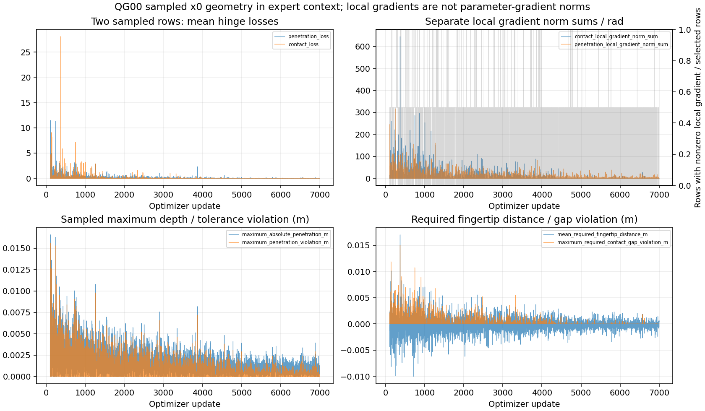

几何[逐配置原始数值](evidence/tight_transformer_20261110_02/qg_details/QG00/training/geometry_projection.csv.gz)与[逐 update 聚合](evidence/tight_transformer_20261110_02/qg_details/QG00/training/geometry_by_update.csv.gz)保留源文件命名；`geometry_projection` 是历史文件名，本轮实际计算是直接软惩罚。
全部 7,000 次更新的各 loss／实际权重也在[原始 CSV](evidence/tight_transformer_20261110_02/configuration_QG00_updates.csv.gz)，不会只展示最后一次更新。

几何验证并不理想：validation 868 个抽样 tick 中，预测配置有 492 个超过 1mm 穿透，最大 16.795mm；要求接触保持为 455/1,186（38.364%）。
同批记录的实际到达配置为 49/868 超容差、最大 2.568mm、保持 1,143/1,186（96.374%）。
这是**专家观测与记录物体场景下的预测配置 FK 几何**，不是自主 rollout 中实测的物理穿透；也不能单凭该差距断言它造成了闭环失败。

|自主开发结果|QG00|QG01|
|---|---:|---:|
|合法且软件完整 / 尝试|10 / 10|10 / 10|
|完整成功 / 原生 lift / 首子目标 / 第二子目标|0 / 0 / 0 / 0|0 / 0 / 0 / 0|
|发生物体接触|10|10|
|稳定抓持诊断|0（从原始日志重算）|0（重算与原结果一致）|
|timeout / fall / dropped|10 / 0 / 0|9 / 1 / 0|

QG01 `palm_fresh_006` 在完成第 569 个控制转换后记录 fall；其余 19 次均在第 601 个转换后 timeout。
首次接触阈值是物体过滤五指力模长 >0.1N，任一 120Hz 子步满足；tick 为 **1-based 已完成转换编号**。

|案例尾号|QG00 首接触 / 首双指 tick|QG01 首接触 / 首双指 tick|
|---|---:|---:|
|000|101 / 104|72 / 无|
|001|72 / 91|92 / 94|
|002|82 / 83|68 / 109|
|003|76 / 79|66 / 66|
|004|85 / 95|74 / 136|
|005|90 / 102|71 / 95|
|006|93 / 103|72 / 219|
|007|75 / 89|62 / 68|
|008|82 / 86|76 / 77|
|009|64 / 102|70 / 74|

完整事件、连续接触时长、终止原因和来源 SHA 见 [events.csv](evidence/tight_transformer_20261110_02/qg_details/events.csv)。
“有双指接触”不等于稳定抓持。QG00 原 result 缺 contact 汇总，本次按既有 `stable_grasp()` 规则读取 numeric.h5 的掌部位姿重算，明确保留计算来源，未将缺失字段当成零。
自主曲线显示实际关节与执行器目标跟踪，不按同 tick 对齐专家命令。

三段已录制视频（QG00 一段、QG01 两段，均601帧/60fps）及解码凭据见[路径、SHA 与帧数索引](evidence/tight_transformer_20261110_02/qg_details/video_index.csv)。视频仍留本机，GitHub 上是索引而非 MP4 本体。
本地前缀为 `outputs/visuotactile/run/tight_transformer_20261110_02/`：
`configuration/QG00/evaluation/palm_fresh_000/rollout.mp4`；
`configuration_residual/QG01/evaluation/palm_fresh_000/rollout.mp4`、`palm_fresh_001/rollout.mp4`。

此处的阶段归类未使用缺失 `approach_proxy` 时默认返回 approach 的历史简化函数；实际 trace 已证明接触发生。
数据、几何、跟踪与残差幅度可用于进一步定位，但本次没有进行干预实验，不能把 Transformer、几何、触觉或控制器中的某一项写成已证实根因。
每组十次是有限开发评估，test22 未使用；本次未新增 Kit、训练、推理、评估或清理。

复现 CPU 导出：

```bash
bash visuotactile/run_cpu.sh -m tools.tight_diagnostics qg_publish \
  --root outputs/visuotactile/run/tight_transformer_20261110_02 \
  --output research_docs/evidence/tight_transformer_20261110_02/qg_details
```
<!-- QG_DETAILS_END -->

# Tight-Insertion 当前结果

<!-- RESIDUAL_PAIR_START -->
## 2026-11-10 G01/G11：完成训练与20次开发评估

**G01完整成功0/10；G11完整成功1/10。** 两组各10次合法、无拒绝/中断，test22未使用。
G11成功是`palm_fresh_000`（seed27150000），279个控制tick/4.65s、原生两子目标与`max_successes=true`，成功后0额外动作。
该例`native_lift=false`，不把完整成功或稳定抓持诊断反推成原生抬升；G11另有一例记录原生lift。
这是有限开发结果，不是正式test成功率，也不能据1例证明稳定改善或触觉因果收益。

源码`c3386b69113595806dc080149f8c2104ded509e4`；run `outputs/visuotactile/run/tight_residual_20261110_01`。
2026-11-10 10:14:46启动，12:01:02（北京时间）结束，总墙钟1小时46分16秒；status=COMPLETE、exit=0，自有owner/worker/monitor已退出，无下一轮。
[公开机器结果](evidence/tight_residual_20261110/summary.json) · [20例逐次结果](evidence/tight_residual_20261110/closed_loop.csv) · [冻结配置](evidence/tight_residual_20261110/configuration.json) · [验收](evidence/tight_residual_20261110/acceptance.json)。

|开发指标|G00冻结基础|G01残差|G10冻结基础|G11残差|
|---|---:|---:|---:|---:|
|原生完整成功/有效|0/10|0/10|0/10|1/10|
|稳定抓持诊断|4|1|3|3|
|原生lift|1|0|3|1|
|首子目标 / 第二插入子目标|3 / 0|0 / 0|1 / 0|1 / 1|
|原生alignment|3|0|1|1|
|timeout / fall / dropped|9 / 1 / 0|10 / 0 / 0|7 / 3 / 0|8 / 1 / 0|

基础闭环复用既有记录，按相同预登记初态spec/seed比较，没有重跑基础；不宣称隐藏模拟器状态逐位相同。
G01的阶段到达没有改善；G11出现一次完整成功，但原生lift数量少于基础，不能只选有利指标解释。

两组都完成98,610次残差更新、7,620,800个接触tick（人口38,104）、200个接触tick/控制tick等效遍历；
基础策略更新数均为0。G01/G11训练墙钟4069.57/4062.56s，等待24.23/29.66s。
达到预设>=200遍及最近4次validation平台条件后停止，未耗尽9小时预算；这不是DP重规划anchor epoch或已学会任务的证明。
固定validation4接触归一化Arm/Hand等权MSE选定G01 epoch110/update54264、G11 epoch180/update88771；最终train8/validation30各38条诊断，不使用闭环挑选模型。
并行接触anchor吞吐4025.92/s、串行2548.15/s，因此后台选择并行。last/best均留在各组`training/`，权重SHA见公开结果。

|validation30专家历史上的离线指标|G00 nominal|G01组合|G10 nominal|G11组合|
|---|---:|---:|---:|---:|
|Arm RMSE (rad)|0.00542309|0.00542475|0.00564516|0.00564609|
|Hand RMSE (rad)|0.05523516|0.05461565|0.05464898|0.05357456|
|目标掌部FK RMSE (mm)|4.930307|4.929388|5.130683|5.130097|
|目标掌部FK平均旋转误差 (deg)|0.706364|0.706228|0.733293|0.734046|

每列相同validation30/10,238个tick，nominal为各自冻结EMA完整DDIM16真实预测；组合动作逐60Hz tick更新。
这些是专家观测和过去专家执行反馈上的误差，掌部是命令FK，不是实际物理轨迹偏离。Arm几乎不变，Hand有小幅降低；自主轨迹不按同tick对齐专家动作。

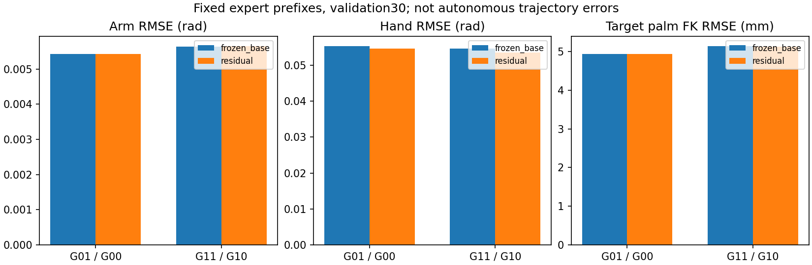

[G01训练/验证曲线](evidence/tight_residual_20261110/G01/training_curves.png) · [G11训练/验证曲线](evidence/tight_residual_20261110/G11/training_curves.png) · [G01阶段误差](evidence/tight_residual_20261110/G01/stage_errors.png) · [G11阶段误差](evidence/tight_residual_20261110/G11/stage_errors.png)。
原始指标包含每次更新loss、完整逐tick误差、阶段/运动样本数、hold参照和代表轨迹目标/变化量CSV；压缩文件只含数值记录，不含源轨迹或权重。

固定validation4把残差world/local触觉力置零，保持nominal/接触门/FK不变，输出确有变化：G01接触输出RMS差0.000855–0.001157rad，G11为0.001219–0.001446rad。
误差收益很小且G11方向不一致；这证明对力输入敏感，不证明触觉带来闭环成功。详见[原始敏感性指标](evidence/tight_residual_20261110/force_sensitivity.csv)。

4段视频均完整CPU解码，帧数G01为601/601，G11为279/601，60fps。视频本体留本地；[路径、SHA与解码凭据](evidence/tight_residual_20261110/summary.json)。
本地路径前缀为`outputs/visuotactile/run/tight_residual_20261110_01/`：

- **成功视频**：`G11/evaluation/palm_fresh_000/rollout.mp4`。
- G11失败：`G11/evaluation/palm_fresh_001/rollout.mp4`。
- G01失败：`G01/evaluation/palm_fresh_000/rollout.mp4`、`palm_fresh_001/rollout.mp4`。

正式启动至结束资源记录6,374条，整卡时间加权均值79.17%，符合本轮充分使用空闲GPU授权；最大采样间隔1.1382s，无>8s内部缺口。
最小空闲显存19,541MiB、可用RAM25.696GiB；开头0.059s/尾部1.055s未被共享样本覆盖。
继承的monitor汇总包含前置验收及其监控重启间隔，仍记录807.409s缺口；不能把它改写成全会话无缺口，也不能把整卡占用当成每进程利用率。

评估日志末尾2026-11-10T04:00:56Z仍有4条PhysX非kinematic刚体速度设置错误，完整摘录已公开；其影响未专项审计。
20例独立完成凭据、原生成功字段、视频及exit0如实保留，不能仅凭exit0声称日志无错误或错误无影响。原G00/G10的FAILED收尾记录也保持不变。

本次发布只读取完成产物、核对SHA/分母/视频并导出CSV/JSON/9张图；没有新训练、推理、Kit、补录或清理。
同一CPU导出命令：

```bash
bash visuotactile/run_cpu.sh -m tools.tight_diagnostics publish \
  --root outputs/visuotactile/run/tight_residual_20261110_01 \
  --evaluation outputs/visuotactile/run/tight_residual_20261110_01 \
  --output research_docs/evidence/tight_residual_20261110
```
<!-- RESIDUAL_PAIR_END -->


<!-- VISUAL_PAIR_START -->
## 2026-11-10 G00/G10：测量完成，程序收尾失败

两组训练均按固定墙钟预算停止，各完成最终train8/validation30离线诊断与10次合法开发闭环。
**G00完整成功0/10、G10完整成功0/10；两组拒绝、中断、未启动均为0。**
两段预登记视频完整解码通过。2026-11-10 01:51:00 +08:00写入评估完成凭据，01:51:06自有worker/monitor全部退出。

原run和接续run的机器状态均保留`FAILED`，不改写成正常完成。
原失败发生在首次控制前：评估器漏传当前实测q/qd，0控制transition/0完整trial，修复后在新目录接续。
接续的20例均已有独立`software_complete=true`结果；最后`exit_completed_kit_worker`读取root/result.json，
要求顶层`software_complete=true`，而本队列写的是`evaluation_complete.json`及普通报告result.json，导致退出检查报错。
因此是**测量完成、收尾接口失败**。本次仅发布既有结果及CPU导出代码，不修写历史状态、不重跑Kit。

|项目|G00：视觉+机器人|G10：另加观测触觉|
|---|---:|---:|
|实际更新 / 选定EMA更新|10132 / 10132|6929 / 6929|
|采样anchor|560646|383422|
|anchor等效epoch（人口4690）|119.540725|81.753092|
|停止原因|fixed_wall_budget|fixed_wall_budget|
|完整成功 / 有效次数|0 / 10|0 / 10|
|超时 / 掉落|9 / 1|7 / 3|
|原生lift / 首子目标 / alignment|1 / 3 / 3|3 / 1 / 1|

训练阶段约8h50m36s，9h预算中保留了最后收尾窗口；尚未达到原至少200等效epoch的平台判定起点，不称收敛。
G00/G10的资源等待计数分别127.10s/198.39s，仅代表trainer已记录的等待，不等于全部竞争或GPU空闲时间。
两组曝光不同，观察到的差别不能直接归因于触觉。20例使用相同预登记reset spec和采样seed，不声称隐藏仿真状态逐位配对。
完整成功为原生任务判据；lift、首子目标、alignment是分别统计的阶段事件，不冒充任务成功或可靠抓持。

|相同专家历史validation30、commit12|StateDP Palm19865|G00|G10|保持当前执行器目标|
|---|---:|---:|---:|---:|
|Arm RMSE (rad)|0.005645|0.005423|0.005645|0.007764|
|Hand RMSE (rad)|0.056618|0.055235|0.054649|0.116285|
|掌部命令FK RMSE (mm)|4.9823|4.9303|5.1307|未测|
|掌部命令FK平均角差 (deg)|0.7034|0.7064|0.7333|未测|
|指尖命令FK RMSE (mm)|见旧原始指标|8.7343|8.8921|未测|

完整真实专家前缀、持续GRU、DDIM16/seed7091、反归一化后截取commit12；validation30有10238个有效tick。
图中的训练曲线为固定train2/validation4，最后汇总为train8/validation30（2762/10238 tick），两种样本量不混称。
H24的有效位置含重叠，不当作独立物理tick。自主轨迹与专家进度不同，不计算同tick专家标签误差。
全部20例提交目标/执行器接口最大误差为0，实际关节tracking误差非零，逐例值见闭环CSV。
两组整体关节误差均低于hold，但这没有转化为完整任务成功；末期validation改善有限，训练/验证误差仍有差距。
分阶段与静止/运动结果及样本数全部发布；validation alignment仅30 tick、完成后retract仅19 tick，不能据此作稳定阶段能力结论。

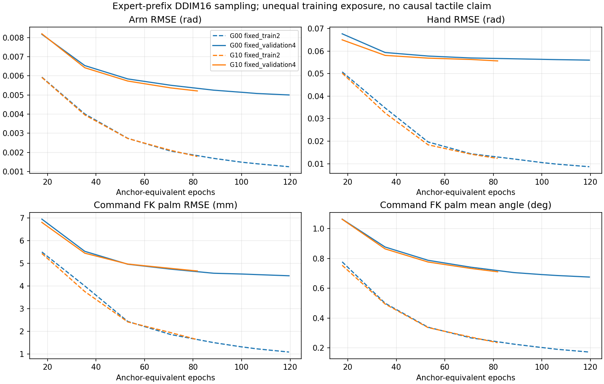

|可复查图表|G00|G10|
|---|---|---|
|commit12与有效H24完整采样|[图](evidence/tight_vision_20261110/G00/sampling_curves.png)|[图](evidence/tight_vision_20261110/G10/sampling_curves.png)|
|训练分项与固定验证loss|[图](evidence/tight_vision_20261110/G00/loss_curves.png)|[图](evidence/tight_vision_20261110/G10/loss_curves.png)|
|原阶段误差、StateDP/hold及n|[图](evidence/tight_vision_20261110/G00/stage_errors.png)|[图](evidence/tight_vision_20261110/G10/stage_errors.png)|
|运动/近静止误差|[图](evidence/tight_vision_20261110/G00/motion_errors.png)|[图](evidence/tight_vision_20261110/G10/motion_errors.png)|
|验证代表轨迹目标/变化量|[图](evidence/tight_vision_20261110/G00/formal_002_slow_0_targets.png)|[图](evidence/tight_vision_20261110/G10/formal_002_slow_0_targets.png)|
|训练代表轨迹目标/变化量|[图](evidence/tight_vision_20261110/G00/formal_003_slow_0_targets.png)|[图](evidence/tight_vision_20261110/G10/formal_003_slow_0_targets.png)|
|10例闭环原始指标|[CSV](evidence/tight_vision_20261110/G00/closed_loop.csv)|[CSV](evidence/tight_vision_20261110/G10/closed_loop.csv)|

数据仍为218 Core（166/30/22），Aux15未加入；本轮没有新增数据，test22未用于选模或评估。
训练源码`98dfafe77bec63c7d7e69d65c01037f4373618c7`；修复后的评估源码`a82c33f3c1079a7e1d5db1bdd1ea9410e2143646`。
选定G00 best SHA256：`4356acbcaabd95e97b1f236f853d724db5f3ad5d9effad2301fe0e1eca4ba452`；
G10 best：`5f3460ab07bca11d0fa33fc5976a0d3e4fcc77c6823413ab208ad04b4c4efd7b`。
原训练root为`outputs/visuotactile/run/tight_vision_20261109_01`，接续root为其`evaluation_resume_01`。
完整checkpoint、源轨迹、缓存和视频保留本地；公开指标中的路径和SHA用于核查，不等于已上传原载荷。

本地视频位于接续root的`G00/evaluation/palm_fresh_000/rollout.mp4`（523帧、60fps）
和`G10/evaluation/palm_fresh_000/rollout.mp4`（399帧、60fps）。解码凭据与视频SHA见summary.json，不计额外评估次数。

本轮完整GPU授权下，原run监控整卡均值92.169%、完整60s最大96.652%；存在537.81s遥测缺口，最大采样间隔318.63s，不能声称全程资源已证实合规。
接续评估监控均值24.250%、完整60s最大33.830%、遥测缺口0；实测可用RAM最低27.075GiB，最高整卡显存使用4555MiB。
原monitor摘要内的RAM阈值为12GiB，实际FullLease运行准入依据session中的14GiB，不能把摘要阈值当作实际准入配置。
monitor进程RSS不代表trainer/Kit总RSS。监控原始摘要与冻结资源约束一并发布，6GiB显存/14GiB RAM/60GiB磁盘储备未放宽。

[机器汇总与原错误](evidence/tight_vision_20261110/summary.json) · [跨组原始曲线](evidence/tight_vision_20261110/sampling_curves.csv) · [全部分阶段指标](evidence/tight_vision_20261110/stage_metrics.csv) · [数据身份](evidence/tight_vision_20261110/dataset_index.csv) · [冻结配置](evidence/tight_vision_20261110/frozen_configuration.json) · [原产物SHA](evidence/tight_vision_20261110/source_artifacts.json) · [公开文件SHA](evidence/tight_vision_20261110/artifacts.json)

不自动继续训练、扩大评估、启动G01/G11或采集。当前证据未证明触觉带来因果收益或基础策略可靠完成任务。
<!-- VISUAL_PAIR_END -->

## 2026-11-09 结案与可复查图表

掌部几何 StateDP 已完成 **19,865 更新、1,099,214 个采样 anchor、234.374 anchor 等效 epoch**。
最后四次固定 validation4 选模分数改善 **0.7646%**，触发原平台停止条件；未达到300等效epoch目标，不称全局收敛。
最终新初态队列 **0/10 完整成功**：10次合法并自然结束，8 timeout、2 fall，拒绝/中断/未启动均0。
2次达到原生lift、2次达到首子目标，两者不是同一组案例；前3个预登记身份的视频全部验收。
没有自动增训、补seed或扩为100次。原启动在Kit前资源终止，物理0次，单独保留，不并入这10次。

训练执行源码为 `35485d77830b109d61491d3f905f74c865f44c03`，评估接续登记版本为 `a1c16e5023a066026ce884b98aa283945ef7c8bc`；
选定 best19865 EMA SHA256 为 `6558f411eeffe7b55f5012de6b103ac4b8ace94a13e17cc1a22e9ff0da6be6bc`。
本次发布只增加 CPU 指标导出/绘图、文档和小型指标文件，没有修改训练、模型或仿真行为。
checkpoint、RGB-D/HDF5轨迹、视频保留本地，发布的数据身份索引不是训练轨迹本体。

|相同专家历史上的commit12指标|旧Core8500|新best19865|保持当前执行器目标|
|---|---:|---:|---:|
|train8 Arm RMSE (rad)|0.001428|0.000632|0.007797|
|train8 Hand RMSE (rad)|0.009568|0.004542|0.117869|
|validation30 Arm RMSE (rad)|0.006517|0.005645|0.007764|
|validation30 Hand RMSE (rad)|0.057276|0.056618|0.116285|
|validation30 掌部目标FK RMSE (mm)|5.2635|4.9823|未测|
|validation30 掌部目标FK平均角差 (deg)|未测|0.7034|未测|

新数据为218 Core（train166/validation30/test22），Aux15未加入；208条沿用上一轮，18次补充物理尝试产生10条新增Core，17次专家完整成功、1次时间中断、7条Core准入拒绝。家族split与train-only统计保持。
新旧最终38条诊断身份相同，均使用完整真实专家前缀、持续GRU、batch1 DDIM16/seed7091、反归一化后commit12。
训练中的曲线固定train2/validation4；最后诊断是train8/validation30，两种样本量不混称。H24曲线统计每个plan所有有效位置，存在重叠，不能把数量叫独立物理tick。
数据扩充、fresh初始化、掌部损失和曝光量同时变化（旧100.21 vs 新234.37等效epoch），以上差异不是单项损失或条件分支的因果收益。

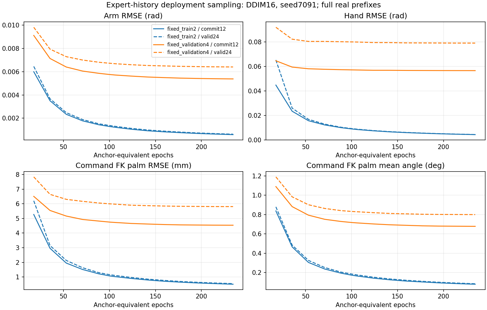

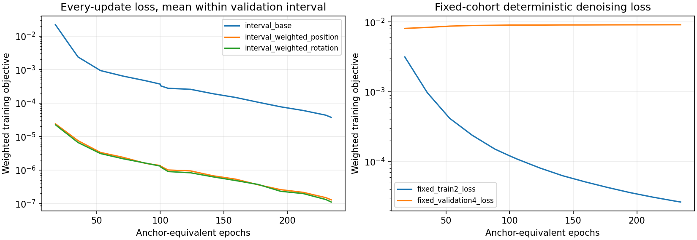

训练误差下降，但验证去噪loss没有同步下降，完整采样的验证动作误差趋于平台；不能只凭训练loss宣称动作已经学好。
图中没有新增平滑或补造未测的旧掌部角度指标。

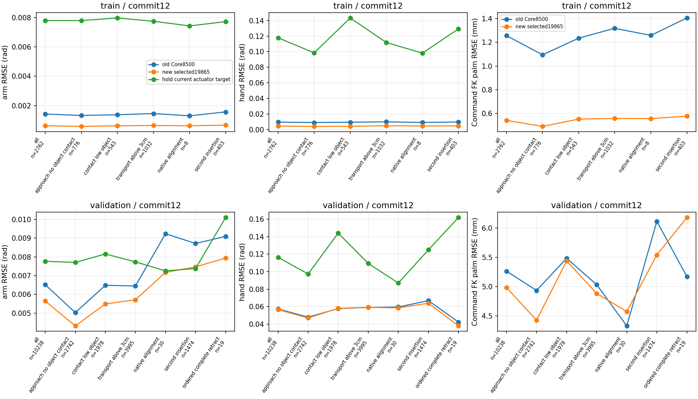

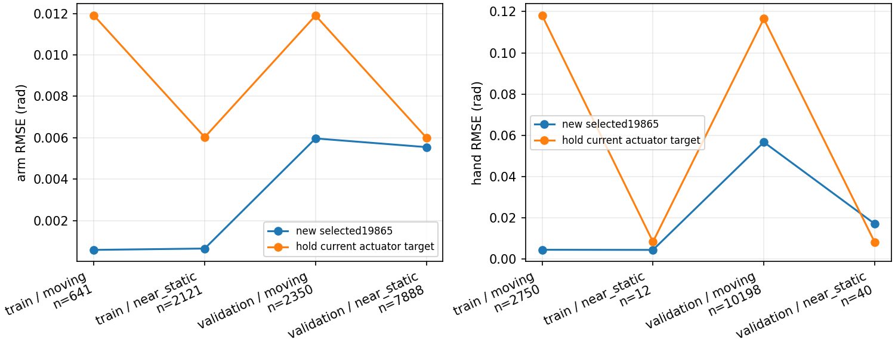

沿用原阶段与运动划分，n为有效样本tick。validation的native_alignment仅30、完成后retract仅19tick，阶段均值应谨慎解释。
validation近静止Hand仅40tick，新模型RMSE 0.01713rad，高于hold的0.00829rad；运动Hand有10198tick，新模型0.05672rad、hold 0.11651rad。
因此总体胜过hold并不表示静止阶段也更稳。

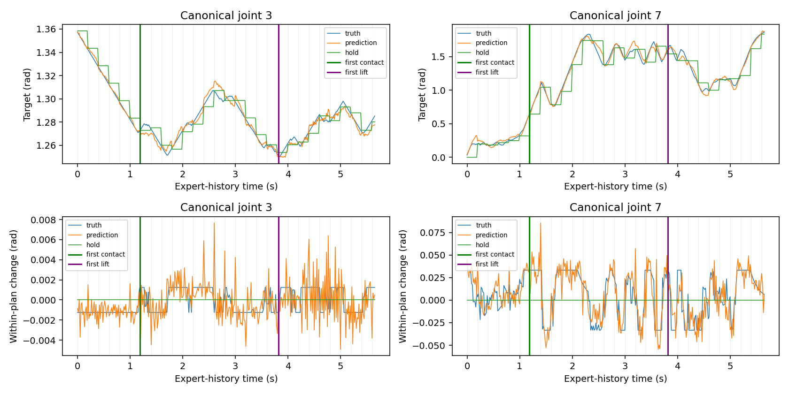

另一条固定train代表轨迹：[目标/变化量图](evidence/tight_palm_20261109/formal_003_slow_0_targets.png)。两图保留接触、抬升、重规划标记，全部29关节数值见对应CSV。
这些是专家历史上的目标预测误差。10次自主闭环的提交/执行器接口最大误差均0，但实际关节tracking误差非零；自主与专家进度不同，不作同tick标签误差。
首次自主行为偏离的严格配对定位仍未测。3个本地视频见 `outputs/visuotactile/demos/tight_palm_eval_20261109_01/remaining_01/README.md`。

[机器结果/资源](evidence/tight_palm_20261109/summary.json) · [10次闭环逐例指标](evidence/tight_palm_20261109/closed_loop.csv) · [数据身份](evidence/tight_palm_20261109/dataset_index.csv) · [冻结配置](evidence/tight_palm_20261109/frozen_configuration.json) · [文件SHA与完整产物索引](evidence/tight_palm_20261109/artifacts.json)

图由同目录CSV/JSON产生；`sampled_ticks.csv.gz`、`full_horizon_ticks.csv.gz`和`every_update_loss.csv.gz`为无损压缩的原始指标。
本地重建命令（只读完成的run，不加载模型或Kit）：

```bash
bash visuotactile/run_cpu.sh -m tools.tight_diagnostics publish \
  --root outputs/visuotactile/run/tight_palm_20261108_01 \
  --evaluation outputs/visuotactile/demos/tight_palm_eval_20261109_01/remaining_01 \
  --output research_docs/evidence/tight_palm_20261109
```

训练整卡均值34.281%、最高完整60秒72.127%，遥测缺失0，**训练不属于全程资源合规**；本次10例评估对应21.990%/35.456%，缺失0。
整卡读数不能归因给单个进程，未用显存限制冒充硬GPU利用率配额。

已按用户指定清理上一轮 `tight_state_20261107_01`：移除1个可重建重复数值缓存，13个大日志无损压缩后删除原文件，实际回收303,198,208 bytes（289.15MiB）。
当前208条继承轨迹仍位于旧目录，连同Aux、原速参照、旧best/normalizer和失败分母保留；没有整体删除旧root。
逐文件删除/归档清单见[CSV](evidence/tight_palm_20261109/cleanup_files.csv)、[校验记录](evidence/tight_palm_20261109/cleanup.json)与[恢复说明](CLEANUP_AUDIT.md)。下文保留历史证据。

<!-- tight-palm-training:start -->
## 掌部几何损失与有限训练数据扩充（当前任务）

状态 **COMPLETE**，阶段 `trained_and_offline_evaluated`。
基础208 Core/train156；新增10，物理尝试18。validation30/test22及固定诊断身份不变，Aux不加入。
全新训练更新19865，anchor等效epoch 234.374；目标300，平台停止最早200，训练墙钟9h优先。
loss = 原完整29D扩散Loss B + 0.3342396122 × 平均掌部位置平方距离(m²) + 0.02994639475 × 平均0.5旋转矩阵Frobenius平方；仅有效commit12，500更新渐入。
实际掌部/关节/决策前执行器目标和严格过去已施加目标已有60Hz通路，复用178/85维，不重复追加；GRU256不变。
随后按用户追加授权完成10例闭环，完整成功0/10；详情见上方结案，不再自动追加。
run：`/home/CNS2025331827/docs/bc+rl_RSS/outputs/visuotactile/run/tight_palm_20261108_01`；`status.json`、`training/progress.json`、`training/validation.jsonl`、`training/curves.png`、`offline/stage_metrics.json`。
已有旧诊断38条/1103次完整采样/13000tick仅为离线参照，不是任务成功数。

|实际字段/切片|动作前时间语义与来源|每tick网络路径|重置与反传|
|---|---|---|---|
|robot[0:58]：q29/qd29，rad/rad·s⁻¹|diagnostics_before实测canonical状态，时刻t|60Hz native_encoder→GRU；当前/过去13帧另直达condition|真实episode重置；完整0…t前向，当前权重重算前缀|
|geometry[28:35]：掌部xyz3+wxyz4|iiwa14_link_7实测刚体，robot base坐标，m/单位四元数；非控制目标FK|60Hz geometry_encoder→GRU；t−24/t−12/t另直达condition|同上，四元数w≥0；train-only mean/std|
|robot[58:116]：目标29/目标−q29|target_before_rad＝动作前已生效执行器目标，rad|同robot两条路径|不读取本tick target_after标签|
|robot[116:174]：过去目标29×2|严格t−1实际施加target_after；保留既有两个兼容槽，两者相等；不是专家滤波前request|每60Hz tick反馈，commit内部仍更新GRU|t=0置零，valid=0；重规划不清空|
|robot[174:178]：age2/valid/elapsed|前次目标距当前时间，s/bool/s|同robot路径；valid不标准化|真实episode重置，缺失窗口全零且valid=false|
|Actor141与geometry其余78维|既有Actor噪声/延迟、物体/目标/孔/桌/指尖几何；不新引入传感器|Actor/robot/geometry每tick拼384→GRU256；条件仍896→512|anchor t的反传区间[96⌊t/96⌋,t]，≤96tick（当前12tick anchors为1–85）；更早历史no_grad重算，不缓存旧权重hidden|

可丢弃验收：checkpoint/EMA/normalizer完全匹配，109tick实际在线controller与完整prefix输入完全相同，condition max1.90735e−6；FK真实位姿与梯度验收见palm_source_check.json，最终新增数据统计下再验收。

|固定专家历史诊断|Arm/hold (rad)|Hand/hold (rad)|掌部FK (mm/deg)|tick|
|---|---:|---:|---:|---:|
|train/all|0.000632/0.007797|0.004542/0.117869|0.5419/0.0845|2762|
|train/approach_no_object_contact|0.000587/0.007792|0.004082/0.098436|0.4912/0.0772|776|
|train/contact_low_object|0.000627/0.007968|0.004316/0.143243|0.5528/0.0847|543|
|train/transport_above_3cm|0.000649/0.007743|0.004902/0.111795|0.5580/0.0878|1032|
|train/native_alignment|0.000630/0.007429|0.004681/0.098119|0.5571/0.0998|8|
|train/second_insertion|0.000674/0.007718|0.004715/0.129291|0.5771/0.0893|403|
|train/ordered_complete_retract|未测|未测|未测|0|
|validation/all|0.005645/0.007764|0.056618/0.116285|4.9823/0.7034|10238|
|validation/approach_no_object_contact|0.004322/0.007705|0.046959/0.097322|4.4282/0.5423|2742|
|validation/contact_low_object|0.005492/0.008156|0.058060/0.144008|5.4379/0.7520|1978|
|validation/transport_above_3cm|0.005715/0.007735|0.059125/0.109322|4.8838/0.7285|3995|
|validation/native_alignment|0.007172/0.007255|0.058593/0.087002|4.5751/0.8916|30|
|validation/second_insertion|0.007466/0.007379|0.063849/0.124859|5.5401/0.8643|1474|
|validation/ordered_complete_retract|0.007939/0.010099|0.037956/0.161878|6.1796/0.8479|19|
<!-- tight-palm-training:end -->

<!-- tight-dp3-diagnostics:start -->
## 2026-11-08 DP3风格StateDP条件与诊断

状态 **COMPLETE**；阶段 `diagnostics_complete_no_training`；已完成离线轨迹 38/38。
原因：Finite diagnosis complete; equivalent path and existing plateau do not justify retraining。正式新增更新0；新Kit/闭环启动0。
等价当前robot/geometry直达condition已存在，保留原模型/GRU/U-Net与旧checkpoint。
旧最近四次验证改善 0.9386%，验证/train8采样MSE比 35.52；依据train/validation冻结为诊断后停止，不自动续训。

本轮root：`/home/CNS2025331827/docs/bc+rl_RSS/outputs/visuotactile/run/tight_dp3_20261108_01`；状态`status.json`，日志`service.log`，验收`acceptance.json`，
冻结身份`session.json`/`inputs.json`/`source_freeze.json`。
图均由本run CSV生成：`historical_curves.csv/png`为原17点完整DDIM曲线（旧episode-batch噪声）；
`sampled_ticks.csv`/`stage_metrics.json`为当前同部署batch1顺序、固定seed7091、真实完整专家前缀、前12步目标误差；
`*_targets.csv/png`含29关节目标/变化量原始数值及固定joint3/7示例、接触/抬升/重规划标记。
`closed_loop_reused.csv`/`closed_loop_summary.json`与`*_physical.csv/png`复用旧27次自主轨迹。
未生成文件代表该阶段未完成，不代表零误差或零成功。离线目标FK误差、命令接口误差和物理tracking各自独立；
自主与专家不同进度下第一次物理偏离未测，不按同tick作动作误差。阶段事件只作诊断，且含transition接触/对齐信息，绝不输入网络。
资源上限：整卡批次/完整60s均值50%，45%准入、35%目标、6GiB显存/14GiB RAM/60GiB磁盘储备；最多1h含等待。
实测资源见`resources/resources.json`与`resource_summary.json`，启动不等于完成或全程资源合规。

|专家历史离线集/阶段|Arm RMSE / hold (rad)|Hand RMSE / hold (rad)|有效tick|
|---|---:|---:|---:|
|train / all|0.001428 / 0.007797|0.009568 / 0.117869|2762|
|train / approach_no_object_contact|0.001334 / 0.007792|0.009049 / 0.098436|776|
|train / contact_low_object|0.001381 / 0.007968|0.009470 / 0.143243|543|
|train / transport_above_3cm|0.001460 / 0.007743|0.009919 / 0.111795|1032|
|train / native_alignment|0.001306 / 0.007429|0.009169 / 0.098119|8|
|train / second_insertion|0.001573 / 0.007718|0.009760 / 0.129291|403|
|train / ordered_complete_retract|未测|未测|0|
|validation / all|0.006517 / 0.007764|0.057276 / 0.116285|10238|
|validation / approach_no_object_contact|0.005032 / 0.007705|0.047946 / 0.097322|2742|
|validation / contact_low_object|0.006486 / 0.008156|0.057774 / 0.144008|1978|
|validation / transport_above_3cm|0.006448 / 0.007735|0.059106 / 0.109322|3995|
|validation / native_alignment|0.009234 / 0.007255|0.059569 / 0.087002|30|
|validation / second_insertion|0.008713 / 0.007379|0.066832 / 0.124859|1474|
|validation / ordered_complete_retract|0.009092 / 0.010099|0.042326 / 0.161878|19|


旧闭环复用：new 0/10成功，拒绝0；train 0/10成功，拒绝0；validation 0/7成功，拒绝0。不加入新实验分母。

<!-- tight-dp3-diagnostics:end -->


## 上轮Core任务结论：数据与有限训练完成，学生完整任务成功仍为零

新版合同下已冻结208条Core＋15条Auxiliary，固定Arm=.50、Hand=1、Hand cap=2rad/s。随机初始化Core-only StateDP完成8500更新、100.2068 anchor等效epoch；真实闭环train **0/10**、validation **0/7**、新初态 **0/10**，27次均合法。新初态首10例零成功，按预登记规则不扩至100；没有补seed或重复旧7例。

生产不再被少量时长越界整体阻断，也没有为凑300继续采样。此方案能通过逐条筛选产出合格数据，不能保证每次尝试都满足倍率/路径要求。**本轮未证明新Core学生具有完整闭环成功能力；不继续增加实验、换网络/损失或开启ImageDP/触觉训练。** 数据通过、有限训练充分性通过与学生失败分别报告。

工作树`/home/CNS2025331827/docs/bc+rl_RSS_narrow_followup`，branch `feature/tight-state-foundation`；起点干净`e26e3d92e7daa39bc695a9bef3bce64b49ca7538`。采集源码`4d43a3975c9bd153ff90d7c13e03ca9a0e6aa917`，训练/评估源码`fdb7ea94a1457de57ff2a9fc21d1a9486742d5ab`；后者仅修按实际Core成员选择闭环家族。采集、模型、训练与控制函数未变，无旧学生恢复。没有退回IDE原工作树。

root：`outputs/visuotactile/run/tight_state_20261107_01/composition_06`。原服务2026-11-07 22:30启动，11月8日13:21:54全部阶段结束，owner/collector/trainer/Kit/monitor与附加资源guard均实际退出，服务exit0。没有重置原采集/整体deadline。

[当前合同](CONTRACTS.md) · [433次数据尝试表](evidence/tight_composition_attempts_20261108.csv) · [数据、训练、27次闭环及清理机器结果](evidence/tight_composition_results_20261108.json) · [不可变启动前登记](evidence/tight_composition_20261107.json)

## 最终数据与真实生产效率

|冻结组成|条数 / 家族|train / validation / test条数|时长比范围 / 中位数|
|---|---:|---:|---:|
|Core|208 / 50|156 / 30 / 22|1.5067–2.9871 / 2.0000|
|Auxiliary|15 / 11|10 / 1 / 4|1.4124–3.2297 / 1.4394|

Core家族split为36/7/7。55个登记家族中，formal_004/008/009/010各7次慢速均未产Core；formal_033原速初态拒绝后未启动依赖慢速。没有删除这些家族的分母、改变初态范围或替换seed。

总账433次＝55原速参照（54成功、1动作前拒绝）＋378慢速（359完整成功、11任务失败、8动作前拒绝）。合法专家成功359/370=97.03%；Core产出208/378=55.03%，不能把逐条入选全部合格称作尝试100%成功。11次任务失败为7次抬升运输timeout、2次插入timeout、2次抬升运输fall；无采集软件/传感器故障。判定器对动作前拒绝给出的missing/invalid占位字段不是采集后坏帧。

第7个完整家族轮次达到目标即停止。62个计划身份未启动：8个缺成功参照、54个因软目标达到。新规则数值分类208Core、19Aux、151拒绝；19Aux中2条旧记录缺完整RGB-D不可复用，17条完整候选按配额选15、保留2未选。Aux在新采集前冻结为[1.35,1.5)或(3,3.30]，13条落下侧、2条落上侧；按家族轮次选，每家族≤2且≤本家族Core，不按速度区间填数。

旧20条严格10/20保持原样；新规则数值10Core＋2Aux，实际仅复用10完整Core。旧2Aux没有补图。开发14Core仍独立；原400/275、原速参照均不进入新Core训练。

全部223入选轨迹逐条完整成功，实际运动/路径、State、三路RGB-D真实逐帧内容和触觉时序/有效位通过；post_success_actions=0，目标公式最大误差0。没有等待、绕路、复制帧、插值或改时间戳来凑倍率。Core-only冻结208条69992tick，train-only统计只用156条；家族split互斥、字段/时间/关节顺序/缓存一致性通过。Aux未进入本次训练、统计或缓存。

Core manifest SHA：`2c47eb38b27ad728fe7161a1f803407945a295b45ff62d4554174a10a9a28fbc`。完整组成manifest、统计和cache SHA见机器结果；CPU验收原scope文案沿用旧模板，实际输入明确为本批208条，模态与减速由独立逐条准入覆盖。


## 不同阶段为何时长倍率不同

Core全程实际均速相对原速的中位数：Arm .506、Hand .548、末端 .515、物体 .543。Hand全程实际均速范围.567–.748rad/s，按每关节绝对运动平均；不是仅检查目标限幅。

|Core阶段|时长比中位数|Arm路径/均速比|Hand路径/均速比|末端路径/均速比|物体路径/均速比|
|---|---:|---:|---:|---:|---:|
|接近|2.136|1.046/.508|1.355/.636|1.181/.556|1.122/.565|
|抓取/抬升|2.356|1.174/.498|1.200/.504|1.084/.459|1.228/.532|
|插入|1.375|.716/.515|.840/.599|.720/.534|.821/.573|

插入速度下降而路径常缩短，因此阶段耗时不统一放大1.5–3倍。各项中位数并非同一轨迹，不能直接相乘除；逐条仍满足既定插入路径≤1.25及Hand/末端/物体均速≤.90等全部门槛。完整T=L/v分解在机器结果和CSV。

配对是同姿态家族、同原生配置，事件/关节状态抽样不同，不是完全相同隐藏状态/DR暴露的因果对照。当前证据支持筛选后生产；不支持单凭alpha/cap数值保证每次完整轨迹倍率，不开发新的路径进度控制器。

## 两项实现检查与训练

参考官方固定revision `5ba07ac6661db573af695b419a7947ecb704690f` 的[数据适配器](https://raw.githubusercontent.com/real-stanford/diffusion_policy/5ba07ac6661db573af695b419a7947ecb704690f/diffusion_policy/dataset/robomimic_replay_lowdim_dataset.py)与[低维策略](https://raw.githubusercontent.com/real-stanford/diffusion_policy/5ba07ac6661db573af695b419a7947ecb704690f/diffusion_policy/policy/diffusion_unet_lowdim_policy.py)完成针对性检查：我们的标签是Arm7＋Hand22、rad单位的`target_after_rad`绝对目标，仅仿射归一化；没有套用Robomimic末端abs_action的旋转/坐标变换。已知29D目标通过实际数据—loss归一化—predict反归一化—实际目标缓冲往返测试。

实际模型保持完整episode持续GRU，**不是64tick截断历史**；短窗口为13个robot观察和3个geometry观察，96tick仅TBPTT梯度边界。obs[a]在a/60秒动作前，标签y[a…a+23]覆盖未来.4秒；执行前12tick/.2秒，a+12观察后从新plan索引0开始。过去动作严格y[a−1]；首尾padding/mask及episode reset、63/64/65与重规划边界人工tick测试通过。没有新动作/时间错位，也没有因此使旧checkpoint失效。

61项定向动作/时序/准入/复用回归＋1项闭环家族成员回归通过。168项/510tick GPU历史、microbatch/EMA/恢复/执行器等已接受证据按未变源码复用，未重开全仓审计。模型、损失/权重、H24/commit12、5/60/120Hz、DDIM和overlap0不变。

06:24:57全新初始化model/optimizer/EMA/scheduler/RNG/计数，12:46:40结束8500更新。实际442012个anchor采样＝100.2068等效epoch；4411/4411 anchors、620/620原始分段均访问，每anchor57–150次，每训练episode2833–2834次。这是anchor曝光，不是100次独立数据或100次完整轨迹梯度遍历。

预登记最低6787更新约80等效epoch，初始10180约120、上限16966约200。最后四次验证改善0.9386%＜1%，且验证/train8 MSE差距35.52倍，触发平台/过拟合停止；**有限充分性条件通过，但不声称全局收敛**，没有把时间/资源耗尽叫收敛。没有使用最终test选模。

validation选择8500 EMA：MSE .00166178，Arm RMSE .0065166rad，Hand .0572808rad；train8 MSE .00004678。验证训练目标loss在早期低点后上升，泛化差距明显。完整训练恢复passed，optimizer和EMA均8500，旧学生加载false。唯一闭环权重SHA：`6940b066cf8296d8e90203c0aa714f2ad780d5440c6128b89ddc5698bbbaa4da`。


## 真实闭环与剩余问题

|队列|尝试 / 合法|完整成功|终止|既有诊断阶段分类|
|---|---:|---:|---|---|
|实际Core训练家族|10 / 10|0/10|7 timeout、3 fall|8抓取/抬升未完成、1抬升后对齐/丢失、1第二次插入|
|validation家族|7 / 7|0/7|7 timeout|5抓取/抬升未完成、2抬升后对齐/丢失|
|冻结后新初态|10 / 10|0/10|10 timeout|9抓取/抬升未完成、1抬升后对齐/丢失|

没有初态拒绝、软件故障或补跑。formal_017完成1个原生子目标后fall，不能说所有案例毫无任务进展；没有案例完成全部任务。所有27条实际执行器/提交目标误差和canonical actor归一化误差均0；学生未再次施加采集alpha/delay/EMA/cap。新初态剩余90个身份未启动，不能报告0/100。

基础数据与执行一致性已通过，当前可观察的剩余问题是**离线拟合未转化为自主抓取、抬升和连续插入的稳定闭环行为**，且存在训练/validation误差差距。闭环分布偏移、模型/监督方式的限制仍是解释假设，不能由这27例唯一归因，更不能外推为某个旧诊断入口造成旧模型失败。新数据/随机初始化与旧275不同，不是matched-data修复因果对照；Aux训练对照本轮未运行。

## 清理、恢复与资源实况

复用既有分类清理入口，全部owned进程退出后删除135份新未准入RGB-D载荷＋1份重复checkpoint，共136文件、38,859,898,880分配bytes＝**36.191101GiB**。135份numeric、原始SHA、模态验收、初态/seed/终止和全部433尝试分母保留；27份学生失败轨迹与结果也保留。全部223入选＋2未选完整Aux候选保留。旧7.510GiB与2.705GiB不重复计数。

best与last完整状态逐字段相同，保留best原字节，last用硬链接恢复别名，原last SHA和映射留账；唯一被评估权重无需额外best开发闭环副本。清理后211执行源码/计划SHA、6保护SHA、225合格载荷SHA、135拒绝numeric SHA、数据manifest/统计/cache指纹与3个CLI通过；last CPU读回8500计数、442012draws、完整状态路径有效。未上传数据/checkpoint，未改专家、资产、原400/275或共享Git历史；清理后可用约884.57GiB。

整卡均值28.389%，最高完整60秒59.632%，1507个采样窗口＞50%，遥测缺口0；最低空闲VRAM4154MiB低于6GiB储备，最低可用RAM16.85GiB。**本轮资源不是全程合规。** 共享卡读数不作单进程占用归因。运行时v1 SIGSTOP把暂停算入work并触发重复比例等待；10:13改为原gpu.lock协作等待，未重启trainer或改变梯度/优化器/RNG/预算，v1原日志保留。v2活体验证17445个计算段最大约1.009秒，等待记入lease wait；两版guard均正常退出。

## 保留的历史结果（不覆盖本轮合同）

|历史队列|真实结果与保留范围|
|---|---|
|旧alpha机制|33capture包含21慢速：旧15为6合格＋6成功未准入＋3失败，追加6全部成功但仅2合格；B00 Arm.50/Hand1为2/2、B01/B02合计0/4。来源/阶段/DR与真实分母见[原阶段CSV](evidence/tight_slow_phase_comparison_20261107.csv)，没有重跑。|
|Hand cap开发|pilot5/6任务成功、4/6严格准入；独立12/12成功、10/12准入；14合格/7开发家族保留，不混独立val/test。30新增capture三模态通过。旧阶段图与[原机器证据](evidence/tight_state_20261107.json)保留。|
|formal_05旧严格合同|55原速54成功＋1拒绝；20慢速20成功/10严格准入，当时按65%产出门槛停止。原10/20与[75次尝试表](evidence/tight_production_attempts_20261107.csv)、[旧结果](evidence/tight_production_results_20261107.json)不改；新版数值2Aux因旧RGB-D已删除不可复用。|
|旧275混速State|best4500曝光54.86等效epoch，last5000约60.95；同权重旧/canonical配对0/7→1/7，独立canonical训练家族1/4、新初态0/10合法＋2初态拒绝。旧完整状态、成功证据及分母保留；本轮没重复这7seed或重训275，不称新慢速matched-data结果。|


<!-- tight-failure-videos:start -->
## 2026-11-08 用户请求的三个失败案例视频

状态 **COMPLETE**，完成 2/2；Finite viewing queue finished; no additional starts。
观看索引：`/home/CNS2025331827/docs/bc+rl_RSS/outputs/visuotactile/demos/tight_failures_20261108_01/remaining_01/README.md`；阶段/计数见同目录`status.json`。
同Core8500 EMA与原控制/物理，三个按历史结果挑选的独立观看复跑；不改原27例分母，不训练、不补seed。
首次队列因整卡60s均值51.29%停止，保留592帧已解码中断视频；本次仅接续未启动两例，原截止时间不变。
<!-- tight-failure-videos:end -->


<!-- tight-palm-evaluation:start -->
## 2026-11-09 有条件成功率测试与视频

状态 **COMPLETE**；成功0/合法10，拒绝0，中断0，未启动0。无合法完成时成功率未测。
Finite evaluation/video queue finished; no additional starts；索引：`/home/CNS2025331827/docs/bc+rl_RSS/outputs/visuotactile/demos/tight_palm_eval_20261109_01/remaining_01/README.md`。
仅原200epoch/last4改善<1%平台达成后使用最终validation选定模型，最多10次新初态/1h、前3身份视频；不扩跑。
<!-- tight-palm-evaluation:end -->

<!-- tight-dagger-results:start -->
## 2026-11-11 DAgger：一轮前端与后端增量续训

本轮 owner 状态为 **COMPLETE**；产物核验完整。以下按已有凭据整理，缺失项不记为零成功。

|组|采集已启动 / 机会|接管成功 / 已启动|准入纠偏 episode / 有效专家 tick / DP anchor|新 DP 更新 / anchor 遍|新后端更新 / tick 遍|自主开发成功 / 有效 / 计划|
|---|---:|---:|---:|---:|---:|---:|
|G11|12 / 12|11 / 12|11 / 3265 / 266|1680 / 20.000|9043 / 15.000|0 / 10 / 10|
|QG01|12 / 12|10 / 12|10 / 2893 / 236|1680 / 20.008|11666 / 20.000|0 / 10 / 10|

采集成功包含专家接管，不等于学生自主成功；只接纳成功专家纠偏会产生选择偏差。学生前缀保留作真实历史，不监督；前端沿各组既有监督语义续训，后端监督仍为 `u_expert`。
自主列为预登记十次开发机会；非法、软件中断、模型身份未核验和未启动均单列保留，不替换样本，也不作为正式 test22 成功率。
整卡时间加权利用率：28.416%；资源样本 19843 条，>8s 内部缺口 0s。这不是每进程利用率；头尾未覆盖时间及原 monitor 汇总见机器结果。

[原始机器结果](evidence/tight_dagger_20261111_01/summary.json) · [采集逐次记录](evidence/tight_dagger_20261111_01/collection.csv) · [自主逐次记录](evidence/tight_dagger_20261111_01/closed_loop.csv) · [两阶段曝光](evidence/tight_dagger_20261111_01/training_stages.csv) · [权重/视频本地索引](evidence/tight_dagger_20261111_01/local_artifacts.json)。

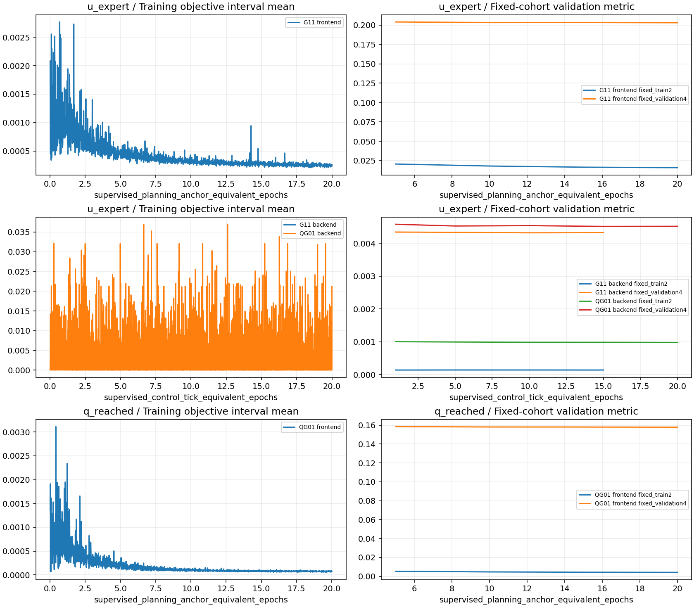

仅 CPU 导出已有数值、日志与 SHA；未新增训练、推理、Kit、评估、清理或模型选择。初始化身份、失败原因、视频解码凭据和全部缺失项见公开结果。
<!-- tight-dagger-results:end -->

启动核验快照（2026-11-11 13:27:14 北京时间）：QG01 已完成2次真实采集、2次专家接管成功，按预登记分为1条train和1条correction-dev。首合法标签/DP anchor同为48与72，修正接管初段遗漏的时序通过。新正式参数更新及纯学生自主结果仍未发生，后续由普通后台有限队列推进。[启动凭据](evidence/tight_dagger_pool_20261111_01/startup_verification.json) · [实际时间估计](evidence/tight_dagger_pool_20261111_01/time_estimate.json)。

<!-- tight-dagger-pool-results:start -->
## 2026-11-11 DAgger：共享持久纠偏池与多轮增量续训

本轮 owner 状态为 **COMPLETE**；产物核验完整。以下按已有凭据整理，缺失项不记为零成功。

|组|采集已启动 / 机会|接管成功 / 已启动|准入纠偏 episode / 有效专家 tick / DP anchor|新 DP 更新 / anchor 遍|新后端更新 / tick 遍|自主开发成功 / 有效 / 计划|
|---|---:|---:|---:|---:|---:|---:|
|round_01/G11 (历史 / historical)|32 / 32|32 / 32|32 / 8597 / 732|754 / 7.529|未测 / 未测|未测 / 0 / 10|
|round_01/QG01 (A / historical)|32 / 32|27 / 32|27 / 8260 / 698|804 / 8.029|12212 / 12.000|0 / 10 / 10|
|round_02/G01 (B / historical)|48 / 48|37 / 48|37 / 10173 / 869|800 / 5.930|17504 / 12.002|0 / 4 / 10|
|round_02/QG01 (A / historical)|96 / 96|71 / 96|71 / 19632 / 1666|800 / 5.930|17504 / 12.002|0 / 4 / 10|
|round_03/G01 (B / active)|96 / 96|90 / 96|90 / 24271 / 2061|800 / 4.080|24112 / 12.005|0 / 4 / 10|
|round_03/QG01 (A / active)|96 / 96|90 / 96|90 / 27132 / 2300|800 / 4.080|24112 / 12.005|0 / 4 / 10|

旧池 CPU 读回准入 21 条成功纠偏；同轮实际调度的组使用共同不可变快照，预登记 correction-dev 按完整 episode 与训练隔离。实际抽样曝光、update0 候选、轮次继续/停止决定见机器凭据；尚未发生的轮次均标作未测。
[池与快照身份](evidence/tight_dagger_pool_20261111_01/pool_identity.json) · [各轮选择与决定](evidence/tight_dagger_pool_20261111_01/round_decisions.json)。

当前仅A（QG01来源，q_reached＋既定几何）与B（G01来源，u_expert）完整策略；均G00前端模态＋同容量Transformer。历史G11及首轮停止证据保留；各轮活动组、条件等待及未调度状态按机器凭据分别列出。实际起点和绝对截止见session与追加决定，不从run名称推算。
A/B已训练残差幅度分别Arm0.2/Hand0.9与全0.1，历史和本轮曝光不同，不能解释为严格单变量或同预算对照。完整策略采集验收、独立恢复起点/阶段/偏离描述与初段合法监督人口见对应JSON/CSV；接管覆盖不等于自主恢复能力。

条件追加：评估已完整核验=True；触发=True；后继进程实际启动=True；实际采集启动验收=True。状态 **STARTUP_VERIFIED**。请求不等于触发，触发不等于已经采集或训练。
仅当A/B本轮配套新模型的合法纯学生评估完整完成且两者都无完整成功时，追加一轮两组DAgger；不完整/软件错误不能当零成功。最多延长6小时至2026-11-12 13:24:31（计算13:14:31停止），不递归追加。增加恢复覆盖是待检验假说，不证明失败由数据量不足造成。
[conditional_extension_request](evidence/tight_dagger_pool_20261111_01/conditional_extension_request.json) · [conditional_extension](evidence/tight_dagger_pool_20261111_01/conditional_extension.json) · [conditional_extension_status](evidence/tight_dagger_pool_20261111_01/conditional_extension_status.json) · [conditional_extension_service](evidence/tight_dagger_pool_20261111_01/conditional_extension_service.json) · [conditional_extension_deployment](evidence/tight_dagger_pool_20261111_01/conditional_extension_deployment.json) · [conditional_extension_follow_finished](evidence/tight_dagger_pool_20261111_01/conditional_extension_follow_finished.json)。

采集成功包含专家接管，不等于学生自主成功；只接纳成功专家纠偏会产生选择偏差。学生前缀保留作真实历史，不监督；前端沿各组既有监督语义续训，后端监督仍为 `u_expert`。
自主列为预登记十次开发机会；非法、软件中断、模型身份未核验和未启动均单列保留，不替换样本，也不作为正式 test22 成功率。
整卡时间加权利用率：26.925%；资源样本 77753 条，>8s 内部缺口 1222.658s。这不是每进程利用率；头尾未覆盖时间及原 monitor 汇总见机器结果。

[原始机器结果](evidence/tight_dagger_pool_20261111_01/summary.json) · [采集逐次记录](evidence/tight_dagger_pool_20261111_01/collection.csv) · [自主逐次记录](evidence/tight_dagger_pool_20261111_01/closed_loop.csv) · [两阶段曝光](evidence/tight_dagger_pool_20261111_01/training_stages.csv) · [权重/视频本地索引](evidence/tight_dagger_pool_20261111_01/local_artifacts.json)。

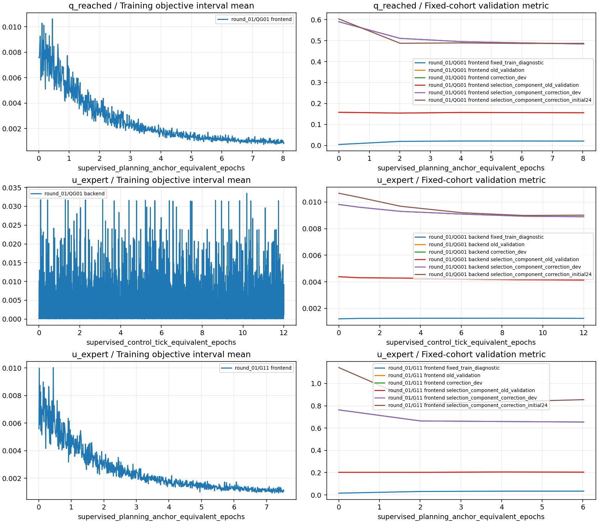

仅 CPU 导出已有数值、日志与 SHA；未新增训练、推理、Kit、评估、清理或模型选择。初始化身份、失败原因、视频解码凭据和全部缺失项见公开结果。
<!-- tight-dagger-pool-results:end -->

<!-- tight-dagger-matched-results:start -->
## 2026-11-12 DAgger：统一控制的配对 A/B 续训

本轮 owner 状态为 **COMPLETE**；产物核验完整。以下按已有凭据整理，缺失项不记为零成功。

|组|采集已启动 / 机会|接管成功 / 已启动|准入纠偏 episode / 有效专家 tick / DP anchor|新 DP 更新 / anchor 遍|新后端更新 / tick 遍|自主开发成功 / 有效 / 计划|
|---|---:|---:|---:|---:|---:|---:|
|round_01/G01 (B / active)|48 / 48|41 / 48|41 / 10647 / 906|1355 / 6.003|28192 / 12.004|0 / 10 / 10|
|round_01/QG01 (A / active)|48 / 48|42 / 48|42 / 13516 / 1144|1355 / 6.003|28192 / 12.004|0 / 10 / 10|
|round_02/G01 (B / active)|48 / 48|40 / 48|40 / 11049 / 940|1502 / 6.000|33090 / 12.004|0 / 10 / 10|
|round_02/QG01 (A / active)|48 / 48|39 / 48|39 / 9617 / 822|1502 / 6.000|33090 / 12.004|0 / 10 / 10|

旧池 CPU 读回准入 21 条成功纠偏；同轮实际调度的组使用共同不可变快照，预登记 correction-dev 按完整 episode 与训练隔离。实际抽样曝光、update0 候选、轮次继续/停止决定见机器凭据；尚未发生的轮次均标作未测。
[池与快照身份](evidence/tight_dagger_matched_20261112_01/pool_identity.json) · [各轮选择与决定](evidence/tight_dagger_matched_20261112_01/round_decisions.json)。

仅A（q_reached＋几何）与B（u_expert）完整策略；新序列约定相同执行投影、Arm0.2/Hand0.9残差幅度、共享快照、配对采集机会、DP anchor与后端tick曝光目标及固定10例开发评价。历史初始化与旧曝光仍不同，不能抹去这些差异。
Phase0 为后端控制/幅度适配，前端新增更新0；完成凭据=True。它不计作完整DAgger轮次。之后每轮仍先更新DP、刷新缓存，再更新后端；共同曝光检查与未完成项见机器记录。
[Phase0单独记录](evidence/tight_dagger_matched_20261112_01/phase0.json) · [论文逐轮统计](evidence/tight_dagger_matched_20261112_01/method_rounds.csv)。

采集成功包含专家接管，不等于学生自主成功；只接纳成功专家纠偏会产生选择偏差。学生前缀保留作真实历史，不监督；前端沿各组既有监督语义续训，后端监督仍为 `u_expert`。
自主列为预登记十次开发机会；非法、软件中断、模型身份未核验和未启动均单列保留，不替换样本，也不作为正式 test22 成功率。
整卡时间加权利用率：40.886%；资源样本 65857 条，>8s 内部缺口 28.791s。这不是每进程利用率；头尾未覆盖时间及原 monitor 汇总见机器结果。

[原始机器结果](evidence/tight_dagger_matched_20261112_01/summary.json) · [采集逐次记录](evidence/tight_dagger_matched_20261112_01/collection.csv) · [自主逐次记录](evidence/tight_dagger_matched_20261112_01/closed_loop.csv) · [两阶段曝光](evidence/tight_dagger_matched_20261112_01/training_stages.csv) · [权重/视频本地索引](evidence/tight_dagger_matched_20261112_01/local_artifacts.json)。

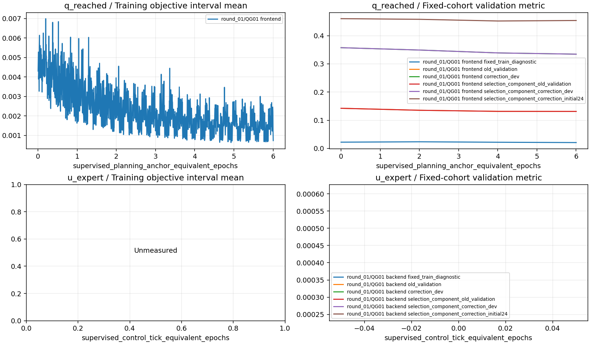

仅 CPU 导出已有数值、日志与 SHA；未新增训练、推理、Kit、评估、清理或模型选择。初始化身份、失败原因、视频解码凭据和全部缺失项见公开结果。
<!-- tight-dagger-matched-results:end -->
