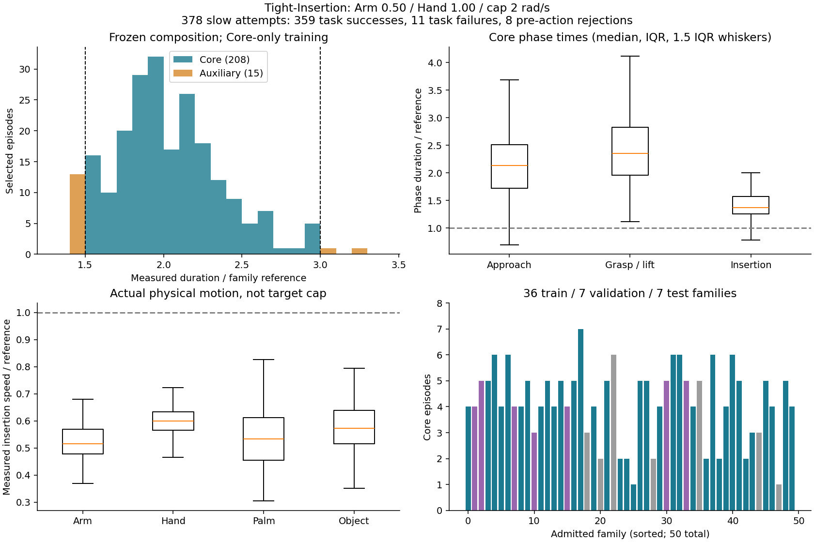
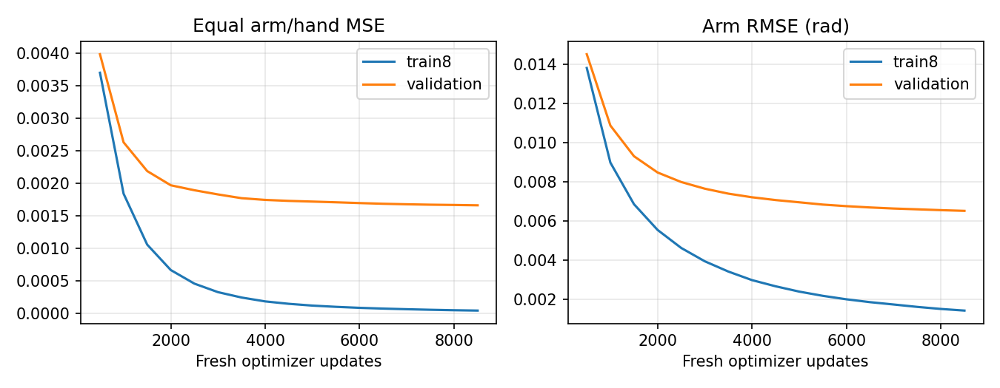

# Tight-Insertion 当前结果

<!-- tight-palm-training:start -->
## 掌部几何损失与有限训练数据扩充（当前任务）

状态 **COMPLETE**，阶段 `trained_and_offline_evaluated`；。
基础208 Core/train156；新增10，物理尝试18。validation30/test22及固定诊断身份不变，Aux不加入。
全新训练更新19865，anchor等效epoch 234.374；目标300，平台停止最早200，训练墙钟9h优先。
loss = 原完整29D扩散Loss B + 0.3342396122 × 平均掌部位置平方距离(m²) + 0.02994639475 × 平均0.5旋转矩阵Frobenius平方；仅有效commit12，500更新渐入。
实际掌部/关节/决策前执行器目标和严格过去已施加目标已有60Hz通路，复用178/85维，不重复追加；GRU256不变。
本轮尚无新的任务成功证据；完成训练/离线验证后停止，不自动物理闭环。
run：`/home/CNS2025331827/docs/bc+rl_RSS/outputs/visuotactile/run/tight_palm_20261108_01`；`status.json`、`training/progress.json`、`training/validation.jsonl`、`training/curves.png`、`offline/stage_metrics.json`。
已有旧诊断38条/1103次完整采样/13000tick仅为离线参照，不是任务成功数。

|实际字段/切片|动作前时间语义与来源|每tick网络路径|重置与反传|
|---|---|---|---|
|robot[0:58]：q29/qd29，rad/rad·s⁻¹|diagnostics_before实测canonical状态，时刻t|60Hz native_encoder→GRU；当前/过去13帧另直达condition|真实episode重置；完整0…t前向，当前权重重算前缀|
|geometry[28:35]：掌部xyz3+wxyz4|iiwa14_link_7实测刚体，robot base坐标，m/单位四元数；非控制目标FK|60Hz geometry_encoder→GRU；t−24/t−12/t另直达condition|同上，四元数w≥0；train-only mean/std|
|robot[58:116]：目标29/目标−q29|target_before_rad＝动作前已生效执行器目标，rad|同robot两条路径|不读取本tick target_after标签|
|robot[116:174]：过去目标29×2|严格t−1实际施加target_after；保留既有两个兼容槽，两者相等；不是专家滤波前request|每60Hz tick反馈，commit内部仍更新GRU|t=0置零，valid=0；重规划不清空|
|robot[174:178]：age2/valid/elapsed|前次目标距当前时间，s/bool/s|同robot路径；valid不标准化|真实episode重置，缺失窗口全零且valid=false|
|Actor141与geometry其余78维|既有Actor噪声/延迟、物体/目标/孔/桌/指尖几何；不新引入传感器|Actor/robot/geometry每tick拼384→GRU256；条件仍896→512|anchor t的反传区间[96⌊t/96⌋,t]，≤96tick（当前12tick anchors为1–85）；更早历史no_grad重算，不缓存旧权重hidden|

可丢弃验收：checkpoint/EMA/normalizer完全匹配，109tick实际在线controller与完整prefix输入完全相同，condition max1.90735e−6；FK真实位姿与梯度验收见palm_source_check.json，最终新增数据统计下再验收。

|固定专家历史诊断|Arm/hold (rad)|Hand/hold (rad)|掌部FK (mm/deg)|tick|
|---|---:|---:|---:|---:|
|train/all|0.000632/0.007797|0.004542/0.117869|0.5419/0.0845|2762|
|train/approach_no_object_contact|0.000587/0.007792|0.004082/0.098436|0.4912/0.0772|776|
|train/contact_low_object|0.000627/0.007968|0.004316/0.143243|0.5528/0.0847|543|
|train/transport_above_3cm|0.000649/0.007743|0.004902/0.111795|0.5580/0.0878|1032|
|train/native_alignment|0.000630/0.007429|0.004681/0.098119|0.5571/0.0998|8|
|train/second_insertion|0.000674/0.007718|0.004715/0.129291|0.5771/0.0893|403|
|train/ordered_complete_retract|未测|未测|未测|0|
|validation/all|0.005645/0.007764|0.056618/0.116285|4.9823/0.7034|10238|
|validation/approach_no_object_contact|0.004322/0.007705|0.046959/0.097322|4.4282/0.5423|2742|
|validation/contact_low_object|0.005492/0.008156|0.058060/0.144008|5.4379/0.7520|1978|
|validation/transport_above_3cm|0.005715/0.007735|0.059125/0.109322|4.8838/0.7285|3995|
|validation/native_alignment|0.007172/0.007255|0.058593/0.087002|4.5751/0.8916|30|
|validation/second_insertion|0.007466/0.007379|0.063849/0.124859|5.5401/0.8643|1474|
|validation/ordered_complete_retract|0.007939/0.010099|0.037956/0.161878|6.1796/0.8479|19|
<!-- tight-palm-training:end -->

<!-- tight-dp3-diagnostics:start -->
## 2026-11-08 DP3风格StateDP条件与诊断

状态 **COMPLETE**；阶段 `diagnostics_complete_no_training`；已完成离线轨迹 38/38。
原因：Finite diagnosis complete; equivalent path and existing plateau do not justify retraining。正式新增更新0；新Kit/闭环启动0。
等价当前robot/geometry直达condition已存在，保留原模型/GRU/U-Net与旧checkpoint。
旧最近四次验证改善 0.9386%，验证/train8采样MSE比 35.52；依据train/validation冻结为诊断后停止，不自动续训。

本轮root：`/home/CNS2025331827/docs/bc+rl_RSS/outputs/visuotactile/run/tight_dp3_20261108_01`；状态`status.json`，日志`service.log`，验收`acceptance.json`，
冻结身份`session.json`/`inputs.json`/`source_freeze.json`。
图均由本run CSV生成：`historical_curves.csv/png`为原17点完整DDIM曲线（旧episode-batch噪声）；
`sampled_ticks.csv`/`stage_metrics.json`为当前同部署batch1顺序、固定seed7091、真实完整专家前缀、前12步目标误差；
`*_targets.csv/png`含29关节目标/变化量原始数值及固定joint3/7示例、接触/抬升/重规划标记。
`closed_loop_reused.csv`/`closed_loop_summary.json`与`*_physical.csv/png`复用旧27次自主轨迹。
未生成文件代表该阶段未完成，不代表零误差或零成功。离线目标FK误差、命令接口误差和物理tracking各自独立；
自主与专家不同进度下第一次物理偏离未测，不按同tick作动作误差。阶段事件只作诊断，且含transition接触/对齐信息，绝不输入网络。
资源上限：整卡批次/完整60s均值50%，45%准入、35%目标、6GiB显存/14GiB RAM/60GiB磁盘储备；最多1h含等待。
实测资源见`resources/resources.json`与`resource_summary.json`，启动不等于完成或全程资源合规。

|专家历史离线集/阶段|Arm RMSE / hold (rad)|Hand RMSE / hold (rad)|有效tick|
|---|---:|---:|---:|
|train / all|0.001428 / 0.007797|0.009568 / 0.117869|2762|
|train / approach_no_object_contact|0.001334 / 0.007792|0.009049 / 0.098436|776|
|train / contact_low_object|0.001381 / 0.007968|0.009470 / 0.143243|543|
|train / transport_above_3cm|0.001460 / 0.007743|0.009919 / 0.111795|1032|
|train / native_alignment|0.001306 / 0.007429|0.009169 / 0.098119|8|
|train / second_insertion|0.001573 / 0.007718|0.009760 / 0.129291|403|
|train / ordered_complete_retract|未测|未测|0|
|validation / all|0.006517 / 0.007764|0.057276 / 0.116285|10238|
|validation / approach_no_object_contact|0.005032 / 0.007705|0.047946 / 0.097322|2742|
|validation / contact_low_object|0.006486 / 0.008156|0.057774 / 0.144008|1978|
|validation / transport_above_3cm|0.006448 / 0.007735|0.059106 / 0.109322|3995|
|validation / native_alignment|0.009234 / 0.007255|0.059569 / 0.087002|30|
|validation / second_insertion|0.008713 / 0.007379|0.066832 / 0.124859|1474|
|validation / ordered_complete_retract|0.009092 / 0.010099|0.042326 / 0.161878|19|

旧闭环复用：new 0/10成功，拒绝0；train 0/10成功，拒绝0；validation 0/7成功，拒绝0。不加入新实验分母。

<!-- tight-dp3-diagnostics:end -->

## 上轮Core任务结论：数据与有限训练完成，学生完整任务成功仍为零

新版合同下已冻结208条Core＋15条Auxiliary，固定Arm=.50、Hand=1、Hand cap=2rad/s。随机初始化Core-only StateDP完成8500更新、100.2068 anchor等效epoch；真实闭环train **0/10**、validation **0/7**、新初态 **0/10**，27次均合法。新初态首10例零成功，按预登记规则不扩至100；没有补seed或重复旧7例。

生产不再被少量时长越界整体阻断，也没有为凑300继续采样。此方案能通过逐条筛选产出合格数据，不能保证每次尝试都满足倍率/路径要求。**本轮未证明新Core学生具有完整闭环成功能力；不继续增加实验、换网络/损失或开启ImageDP/触觉训练。** 数据通过、有限训练充分性通过与学生失败分别报告。

工作树`/home/CNS2025331827/docs/bc+rl_RSS_narrow_followup`，branch `feature/tight-state-foundation`；起点干净`e26e3d92e7daa39bc695a9bef3bce64b49ca7538`。采集源码`4d43a3975c9bd153ff90d7c13e03ca9a0e6aa917`，训练/评估源码`fdb7ea94a1457de57ff2a9fc21d1a9486742d5ab`；后者仅修按实际Core成员选择闭环家族。采集、模型、训练与控制函数未变，无旧学生恢复。没有退回IDE原工作树。

root：`outputs/visuotactile/run/tight_state_20261107_01/composition_06`。原服务2026-11-07 22:30启动，11月8日13:21:54全部阶段结束，owner/collector/trainer/Kit/monitor与附加资源guard均实际退出，服务exit0。没有重置原采集/整体deadline。

[当前合同](CONTRACTS.md) · [433次数据尝试表](evidence/tight_composition_attempts_20261108.csv) · [数据、训练、27次闭环及清理机器结果](evidence/tight_composition_results_20261108.json) · [不可变启动前登记](evidence/tight_composition_20261107.json)

## 最终数据与真实生产效率

|冻结组成|条数 / 家族|train / validation / test条数|时长比范围 / 中位数|
|---|---:|---:|---:|
|Core|208 / 50|156 / 30 / 22|1.5067–2.9871 / 2.0000|
|Auxiliary|15 / 11|10 / 1 / 4|1.4124–3.2297 / 1.4394|

Core家族split为36/7/7。55个登记家族中，formal_004/008/009/010各7次慢速均未产Core；formal_033原速初态拒绝后未启动依赖慢速。没有删除这些家族的分母、改变初态范围或替换seed。

总账433次＝55原速参照（54成功、1动作前拒绝）＋378慢速（359完整成功、11任务失败、8动作前拒绝）。合法专家成功359/370=97.03%；Core产出208/378=55.03%，不能把逐条入选全部合格称作尝试100%成功。11次任务失败为7次抬升运输timeout、2次插入timeout、2次抬升运输fall；无采集软件/传感器故障。判定器对动作前拒绝给出的missing/invalid占位字段不是采集后坏帧。

第7个完整家族轮次达到目标即停止。62个计划身份未启动：8个缺成功参照、54个因软目标达到。新规则数值分类208Core、19Aux、151拒绝；19Aux中2条旧记录缺完整RGB-D不可复用，17条完整候选按配额选15、保留2未选。Aux在新采集前冻结为[1.35,1.5)或(3,3.30]，13条落下侧、2条落上侧；按家族轮次选，每家族≤2且≤本家族Core，不按速度区间填数。

旧20条严格10/20保持原样；新规则数值10Core＋2Aux，实际仅复用10完整Core。旧2Aux没有补图。开发14Core仍独立；原400/275、原速参照均不进入新Core训练。

全部223入选轨迹逐条完整成功，实际运动/路径、State、三路RGB-D真实逐帧内容和触觉时序/有效位通过；post_success_actions=0，目标公式最大误差0。没有等待、绕路、复制帧、插值或改时间戳来凑倍率。Core-only冻结208条69992tick，train-only统计只用156条；家族split互斥、字段/时间/关节顺序/缓存一致性通过。Aux未进入本次训练、统计或缓存。

Core manifest SHA：`2c47eb38b27ad728fe7161a1f803407945a295b45ff62d4554174a10a9a28fbc`。完整组成manifest、统计和cache SHA见机器结果；CPU验收原scope文案沿用旧模板，实际输入明确为本批208条，模态与减速由独立逐条准入覆盖。

## 不同阶段为何时长倍率不同

Core全程实际均速相对原速的中位数：Arm .506、Hand .548、末端 .515、物体 .543。Hand全程实际均速范围.567–.748rad/s，按每关节绝对运动平均；不是仅检查目标限幅。

|Core阶段|时长比中位数|Arm路径/均速比|Hand路径/均速比|末端路径/均速比|物体路径/均速比|
|---|---:|---:|---:|---:|---:|
|接近|2.136|1.046/.508|1.355/.636|1.181/.556|1.122/.565|
|抓取/抬升|2.356|1.174/.498|1.200/.504|1.084/.459|1.228/.532|
|插入|1.375|.716/.515|.840/.599|.720/.534|.821/.573|

插入速度下降而路径常缩短，因此阶段耗时不统一放大1.5–3倍。各项中位数并非同一轨迹，不能直接相乘除；逐条仍满足既定插入路径≤1.25及Hand/末端/物体均速≤.90等全部门槛。完整T=L/v分解在机器结果和CSV。

配对是同姿态家族、同原生配置，事件/关节状态抽样不同，不是完全相同隐藏状态/DR暴露的因果对照。当前证据支持筛选后生产；不支持单凭alpha/cap数值保证每次完整轨迹倍率，不开发新的路径进度控制器。

## 两项实现检查与训练

参考官方固定revision `5ba07ac6661db573af695b419a7947ecb704690f` 的[数据适配器](https://raw.githubusercontent.com/real-stanford/diffusion_policy/5ba07ac6661db573af695b419a7947ecb704690f/diffusion_policy/dataset/robomimic_replay_lowdim_dataset.py)与[低维策略](https://raw.githubusercontent.com/real-stanford/diffusion_policy/5ba07ac6661db573af695b419a7947ecb704690f/diffusion_policy/policy/diffusion_unet_lowdim_policy.py)完成针对性检查：我们的标签是Arm7＋Hand22、rad单位的`target_after_rad`绝对目标，仅仿射归一化；没有套用Robomimic末端abs_action的旋转/坐标变换。已知29D目标通过实际数据—loss归一化—predict反归一化—实际目标缓冲往返测试。

实际模型保持完整episode持续GRU，**不是64tick截断历史**；短窗口为13个robot观察和3个geometry观察，96tick仅TBPTT梯度边界。obs[a]在a/60秒动作前，标签y[a…a+23]覆盖未来.4秒；执行前12tick/.2秒，a+12观察后从新plan索引0开始。过去动作严格y[a−1]；首尾padding/mask及episode reset、63/64/65与重规划边界人工tick测试通过。没有新动作/时间错位，也没有因此使旧checkpoint失效。

61项定向动作/时序/准入/复用回归＋1项闭环家族成员回归通过。168项/510tick GPU历史、microbatch/EMA/恢复/执行器等已接受证据按未变源码复用，未重开全仓审计。模型、损失/权重、H24/commit12、5/60/120Hz、DDIM和overlap0不变。

06:24:57全新初始化model/optimizer/EMA/scheduler/RNG/计数，12:46:40结束8500更新。实际442012个anchor采样＝100.2068等效epoch；4411/4411 anchors、620/620原始分段均访问，每anchor57–150次，每训练episode2833–2834次。这是anchor曝光，不是100次独立数据或100次完整轨迹梯度遍历。

预登记最低6787更新约80等效epoch，初始10180约120、上限16966约200。最后四次验证改善0.9386%＜1%，且验证/train8 MSE差距35.52倍，触发平台/过拟合停止；**有限充分性条件通过，但不声称全局收敛**，没有把时间/资源耗尽叫收敛。没有使用最终test选模。

validation选择8500 EMA：MSE .00166178，Arm RMSE .0065166rad，Hand .0572808rad；train8 MSE .00004678。验证训练目标loss在早期低点后上升，泛化差距明显。完整训练恢复passed，optimizer和EMA均8500，旧学生加载false。唯一闭环权重SHA：`6940b066cf8296d8e90203c0aa714f2ad780d5440c6128b89ddc5698bbbaa4da`。

## 真实闭环与剩余问题

|队列|尝试 / 合法|完整成功|终止|既有诊断阶段分类|
|---|---:|---:|---|---|
|实际Core训练家族|10 / 10|0/10|7 timeout、3 fall|8抓取/抬升未完成、1抬升后对齐/丢失、1第二次插入|
|validation家族|7 / 7|0/7|7 timeout|5抓取/抬升未完成、2抬升后对齐/丢失|
|冻结后新初态|10 / 10|0/10|10 timeout|9抓取/抬升未完成、1抬升后对齐/丢失|

没有初态拒绝、软件故障或补跑。formal_017完成1个原生子目标后fall，不能说所有案例毫无任务进展；没有案例完成全部任务。所有27条实际执行器/提交目标误差和canonical actor归一化误差均0；学生未再次施加采集alpha/delay/EMA/cap。新初态剩余90个身份未启动，不能报告0/100。

基础数据与执行一致性已通过，当前可观察的剩余问题是**离线拟合未转化为自主抓取、抬升和连续插入的稳定闭环行为**，且存在训练/validation误差差距。闭环分布偏移、模型/监督方式的限制仍是解释假设，不能由这27例唯一归因，更不能外推为某个旧诊断入口造成旧模型失败。新数据/随机初始化与旧275不同，不是matched-data修复因果对照；Aux训练对照本轮未运行。

## 清理、恢复与资源实况

复用既有分类清理入口，全部owned进程退出后删除135份新未准入RGB-D载荷＋1份重复checkpoint，共136文件、38,859,898,880分配bytes＝**36.191101GiB**。135份numeric、原始SHA、模态验收、初态/seed/终止和全部433尝试分母保留；27份学生失败轨迹与结果也保留。全部223入选＋2未选完整Aux候选保留。旧7.510GiB与2.705GiB不重复计数。

best与last完整状态逐字段相同，保留best原字节，last用硬链接恢复别名，原last SHA和映射留账；唯一被评估权重无需额外best开发闭环副本。清理后211执行源码/计划SHA、6保护SHA、225合格载荷SHA、135拒绝numeric SHA、数据manifest/统计/cache指纹与3个CLI通过；last CPU读回8500计数、442012draws、完整状态路径有效。未上传数据/checkpoint，未改专家、资产、原400/275或共享Git历史；清理后可用约884.57GiB。

整卡均值28.389%，最高完整60秒59.632%，1507个采样窗口＞50%，遥测缺口0；最低空闲VRAM4154MiB低于6GiB储备，最低可用RAM16.85GiB。**本轮资源不是全程合规。** 共享卡读数不作单进程占用归因。运行时v1 SIGSTOP把暂停算入work并触发重复比例等待；10:13改为原gpu.lock协作等待，未重启trainer或改变梯度/优化器/RNG/预算，v1原日志保留。v2活体验证17445个计算段最大约1.009秒，等待记入lease wait；两版guard均正常退出。

## 保留的历史结果（不覆盖本轮合同）

|历史队列|真实结果与保留范围|
|---|---|
|旧alpha机制|33capture包含21慢速：旧15为6合格＋6成功未准入＋3失败，追加6全部成功但仅2合格；B00 Arm.50/Hand1为2/2、B01/B02合计0/4。来源/阶段/DR与真实分母见[原阶段CSV](evidence/tight_slow_phase_comparison_20261107.csv)，没有重跑。|
|Hand cap开发|pilot5/6任务成功、4/6严格准入；独立12/12成功、10/12准入；14合格/7开发家族保留，不混独立val/test。30新增capture三模态通过。旧阶段图与[原机器证据](evidence/tight_state_20261107.json)保留。|
|formal_05旧严格合同|55原速54成功＋1拒绝；20慢速20成功/10严格准入，当时按65%产出门槛停止。原10/20与[75次尝试表](evidence/tight_production_attempts_20261107.csv)、[旧结果](evidence/tight_production_results_20261107.json)不改；新版数值2Aux因旧RGB-D已删除不可复用。|
|旧275混速State|best4500曝光54.86等效epoch，last5000约60.95；同权重旧/canonical配对0/7→1/7，独立canonical训练家族1/4、新初态0/10合法＋2初态拒绝。旧完整状态、成功证据及分母保留；本轮没重复这7seed或重训275，不称新慢速matched-data结果。|

<!-- tight-failure-videos:start -->
## 2026-11-08 用户请求的三个失败案例视频

状态 **COMPLETE**，完成 2/2；Finite viewing queue finished; no additional starts。
观看索引：`/home/CNS2025331827/docs/bc+rl_RSS/outputs/visuotactile/demos/tight_failures_20261108_01/remaining_01/README.md`；阶段/计数见同目录`status.json`。
同Core8500 EMA与原控制/物理，三个按历史结果挑选的独立观看复跑；不改原27例分母，不训练、不补seed。
首次队列因整卡60s均值51.29%停止，保留592帧已解码中断视频；本次仅接续未启动两例，原截止时间不变。
<!-- tight-failure-videos:end -->

<!-- tight-palm-evaluation:start -->
## 2026-11-09 有条件成功率测试与视频

状态 **PREPARED**；成功0/合法0，拒绝0，中断0，未启动10。无合法完成时成功率未测。
Explicitly authorized continuation; high GPU samples cause bounded admission waiting, not immediate worker termination；索引：`/home/CNS2025331827/docs/bc+rl_RSS/outputs/visuotactile/demos/tight_palm_eval_20261109_01/remaining_01/README.md`。
仅原200epoch/last4改善<1%平台达成后使用最终validation选定模型，最多10次新初态/1h、前3身份视频；不扩跑。
<!-- tight-palm-evaluation:end -->
