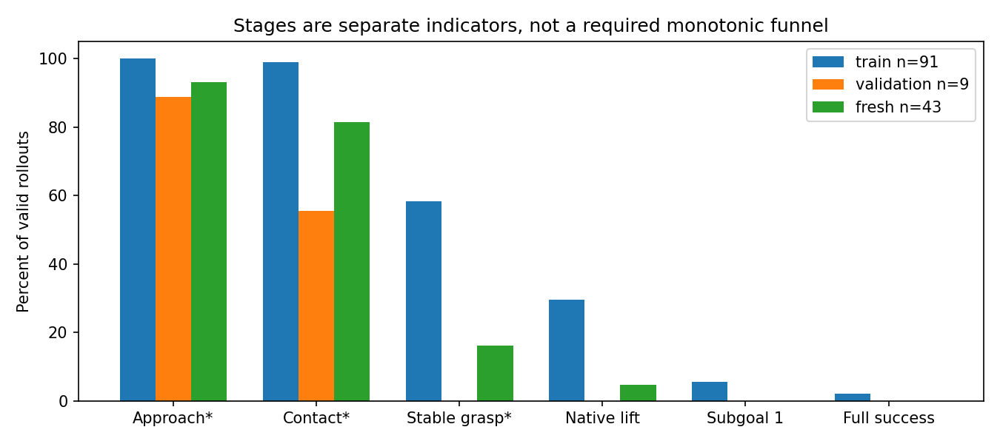
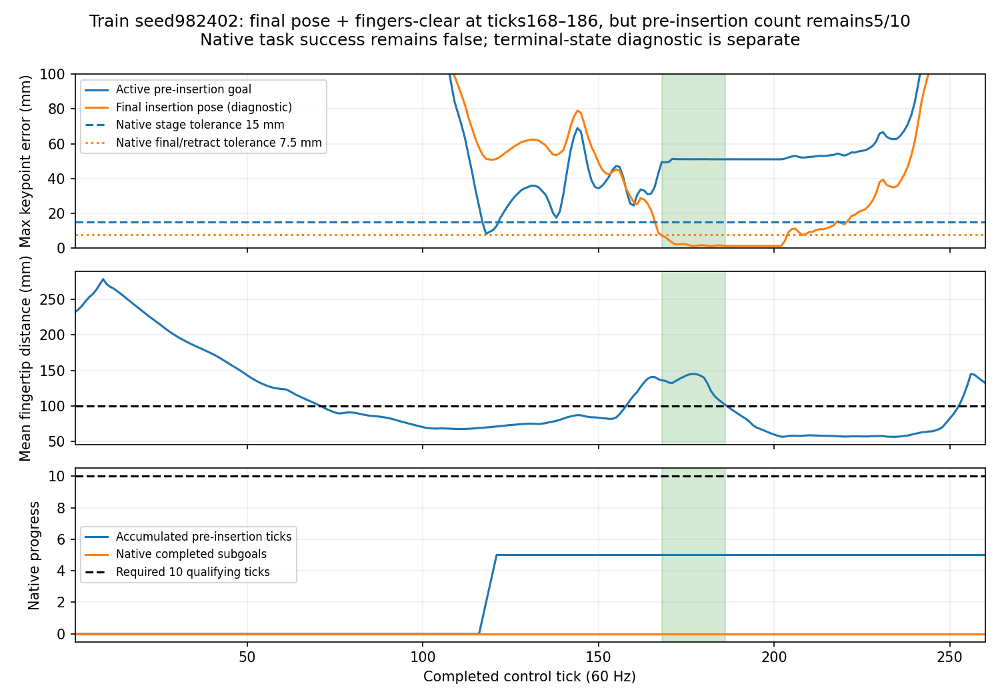

# StateDP结果：当前窄域新训练与历史宽分布

<!-- STATE_MECHANISM_START -->
## 2026-11-06：StateDP基础能力、采样与动作块诊断

实测 `complete` / `complete`；独立root `state_mechanism_20261106_01`，固定4h含等待，最多15次Kit轨迹启动、1条训练示范的独立随机模型≤4000更新/90min。正式数据/权重保持，A/B/C不改变H24/12/29D/损失/历史/物理。
只读审查275条/64,663tick：全体均值3.919s、中位3.433s、p10–p90 2.640–5.517s，范围2.117–12.900s。新增75均值4.676s、中位4.4s；尚不符合多数5–7s的设计预期，没有补等待或改时间戳。State-valid275、Multi-view-valid75、旧固定视角无效200；触觉数值有限及有效标记通过，不等于硬件校准。所有成功标签只在末transition出现，275条原始数值与缓存完全相等，q_after[t]=q_before[t+1]。
92个真实初态家族，68/12/12训练/验证/测试；速度版本不跨split。位置±25mm、相对位置±35mm、姿态20°球、关节初态及速度仍有变化；不是唯一起点。原200/201和扩充75/76是已准入家族上的采集结果，不代表整个连续分布100%成功。

|模型|训练episode|实际batch分布|anchor数|抽样总数|anchor等效epoch|独立覆盖|
|---|---:|---|---:|---:|---:|---:|
|state200_best5735|148|{'64': 3824, '20': 1911}|2829|282956|100.020|2829|
|state275_best4500|207|{'64': 3375, '15': 1125}|4245|232875|54.859|4245|
|state275_last5000|207|{'64': 3750, '15': 1250}|4245|258750|60.954|4245|

正式一次更新：最多64个不同episode各1个12tick anchor，microbatch4累积，所有microbatch之后才一次clip/AdamW/EMA；207条训练数据每轮64/64/64/15，平均51.75。输入Actor141、robot178、geometry85；从episode开头用当前权重重算历史，96tick边界前detach，非清零；条件[B,512]，目标[B,24,29]，mask[B,24]。不足24的目标零填充且无效；base/FK按有效目标数加权，temporal按有效相邻对数加权。
episode均衡使长轨迹的单anchor曝光更少，家族权重与其速度版本数成正比；275 best各anchor访问17–103次。全部anchor已覆盖，但重复曝光不是独立新样本。阶段曝光及家族逐项权重见机器统计；阶段名称是接触/高度/native子目标代理，不能直接当作稳定抓取标签。
Stanford上游[SequenceSampler](https://github.com/real-stanford/diffusion_policy/blob/5ba07ac6661db573af695b419a7947ecb704690f/diffusion_policy/common/sampler.py)枚举窗口起点；均匀遍历这些索引时长episode权重更大，边界按配置重复端点。我们的stride12/episode均衡和显式mask是不同采样合同，并不单凭差异认定错误。ReplayBuffer按episode_ends保留轨迹边界。
B仅选family_066_repair_a055（300tick、5s、alpha.55，train），由接近5s及ID固定选择。诊断多窗口采样在25个anchor上洗牌，batch16/9、micro4，允许同episode多个不同anchor；正式采样器不改。保持275 train-only统计、专家RMS/embedding及Loss B，从随机参数/AdamW/EMA开始；不使用test。

真实GPU更新审查：从275 last5000完整采样状态取下一批64个episode，记录全部ID/anchor/shape/mask及累积梯度；诊断副本做1次micro累积更新和1次相同噪声的大batch参考更新。梯度相对L2差4.81e-06，参数更新最大差1.19e-07，passed=True。未改正式checkpoint。

A：{"passed": true, "comparisons": [{"identity": "family_066", "native_success": true, "open_loop_success": false, "censored": true, "ticks": 177, "source_to_requested_max_rad": 0.0, "submitted_to_actuator_max_rad": 0.0, "requested_to_submitted_max_rad": 0.0, "actual_joint_difference_max_rad": 0.1368221640586853, "boundary_max_rad": 0.0, "initial_observable_errors": {"joint_position_rad": 0.0, "joint_velocity_rad_s": 0.0, "object_pose_w": 0.0, "hole_pose_w": 0.0, "table_pose_w": 0.0, "palm_body_pose_w": 0.0, "finger_position_w": 0.0, "finger_quat_wxyz": 0.0}}, {"identity": "repair_family_26", "native_success": true, "open_loop_success": true, "censored": false, "ticks": 184, "source_to_requested_max_rad": 0.0, "submitted_to_actuator_max_rad": 0.0, "requested_to_submitted_max_rad": 0.0, "actual_joint_difference_max_rad": 0.11390954256057739, "boundary_max_rad": 0.0, "initial_observable_errors": {"joint_position_rad": 0.0, "joint_velocity_rad_s": 0.0, "object_pose_w": 0.0, "hole_pose_w": 0.0, "table_pose_w": 0.0, "palm_body_pose_w": 0.0, "finger_position_w": 0.0, "finger_quat_wxyz": 0.0}}], "recorded_slow": {"success": false, "censored": true, "target_max_rad": 0.0, "actuator_max_rad": 0.0, "submitted_max_rad": 0.0}, "starts": 5, "scope": "Native RL is closed loop; both H24 target cases are OPEN LOOP, not an online expert. Exact physical replay is not an acceptance requirement."}

B：{"complete": true, "updates": 800, "best_update": 800, "stop_reason": "small_dataset_fit_gate_two_checks", "elapsed_s": 327.10833740234375, "best_sha256": "1638f93e0183c9e422113adf17bf75524031281f6b2a1ed09829295a56a83781", "checkpoint_readback": true, "normalization_unchanged": true, "generalization_claim": false}

B/C闭环：{"complete": true, "starts": 10, "groups": {"B_tiny": {"attempts": 2, "legal": 2, "successes": 0}, "C0": {"attempts": 4, "legal": 4, "successes": 0}, "C4": {"attempts": 4, "legal": 4, "successes": 0}}, "generalization_claim": false, "formal_default_overlap": 0, "hidden_physics_exact": false}

极小集离线拟合通过但对应初态仍未成功；精准目标回放接口检查已通过，优先研究执行后状态偏离teacher-forced训练轨迹这一机制。下一轮只做有限闭环分布偏移定位；本轮不自动DAgger或改方法。噪声/块跳变的因果归属仍受小样本限制。

[完整轻量统计、真实batch与阶段指标](evidence/state_mechanism.json)。原数据、checkpoint、数值轨迹和视频留本地。
<!-- STATE_MECHANISM_END -->

<!-- NARROW_REPAIR_START -->
## 2026-11-06：视觉与GPU历史修复、单次慢速数据对照

实测状态 `complete` / `complete`；独立run `narrow_repair_20261106_01`，10h固定总窗，旧run预算和失败保持。代码和排队不代表训练完成。
白屏已定位：direct fresh入口遗漏固定相机配置，两路停在默认相同位姿，RGB恒定/有效深度0；同初态配置前后物理读数完全相同，配置后三视角有真实内容。首条199帧专家成功，起/中/尾画面目视通过，全帧RGB-D、时钟、固定位姿和mask检查通过；单lane持久Kit，不声明多lane已验证。
GPU差异来自未统一的CuDNN TF32：旧默认condition最大2.52545e-4；关闭TF32后最大1.07288e-6、前12目标1.13249e-6rad、FK0.000229mm。原2e-5门限未放宽；完整序列/逐tick/训练prefix/reset均检查，无优化更新。
200条平均3.635s，中位3.2s；alpha≤.65仅38条、平均5.190s。best/last均5735且参数一致；末段验证改善0.55%，train8改善27.40%，误差比18.78，未见首块幅度比3.11。属于验证平台与闭环偏移证据，不能称可靠收敛。
旧200只标State-valid，Multi-view-valid为0；新增成功必须全部真实RGB-D/触觉重采并通过画面内容验收。不会用新图像拼接旧状态。Image/触觉未来公平比较只用相同有效模态子集。
一次新编排错误把学生送入专家专用speed wrapper，在首次物理步前断言，0物理步/0完成rollout。原失败保留、计入40次学生启动预算；该legacy单元不重跑，正确环境继续其余7个固定复核单元。
后续规则：先3个train家族原速/.55/.60/.65配对试采，按真实成功、接触运动和时长选择连续alpha区间；再32新家族预分24/4/4、每家族2速度版本，最多80采集尝试，至少60新增成功/28新增家族才训练。总量约260–276，未达门控则停止。
新StateDP只随机初始化一次，H24/commit12/29D/5Hz/60Hz/损失/历史不变；按旧4000步平台曝光加500更新余量、实际anchor和吞吐定预算，≤10000更新/3h，validation选best与有界早停。最终旧/新各train4+预先冻结独立unseen12，最终结果不触发新训练。

旧模型精度复核：{'legacy_default': {'train': {'attempts': 2, 'valid': 1, 'successes': 0, 'software_failures': 1, 'initial_rejections': 0, 'failures': {'grasp_or_lift_unresolved': 1}}, 'unseen': {'attempts': 2, 'valid': 2, 'successes': 0, 'software_failures': 0, 'initial_rejections': 0, 'failures': {'grasp_or_lift_unresolved': 2}}}, 'unified_fp32': {'train': {'attempts': 2, 'valid': 2, 'successes': 1, 'software_failures': 0, 'initial_rejections': 0, 'failures': {'grasp_or_lift_unresolved': 1}}, 'unseen': {'attempts': 2, 'valid': 2, 'successes': 0, 'software_failures': 0, 'initial_rejections': 0, 'failures': {'grasp_or_lift_unresolved': 2}}}}
后续决定：one_slow_coverage_expansion。

真实慢速筛选：{'passed': True, 'selected': {'interval': [0.55, 0.6], 'successes': 6, 'attempts': 6, 'median_duration_s': 4.825, 'median_duration_ratio': 1.5206771562731691, 'median_contact_arm_speed_ratio': 0.6194854253529616, 'median_contact_duration_ratio': 1.04, 'scope': 'Exploratory 3-family paired screen, not a population reliability estimate'}, 'candidates': [{'interval': [0.55, 0.6], 'successes': 6, 'attempts': 6, 'median_duration_s': 4.825, 'median_duration_ratio': 1.5206771562731691, 'median_contact_arm_speed_ratio': 0.6194854253529616, 'median_contact_duration_ratio': 1.04, 'scope': 'Exploratory 3-family paired screen, not a population reliability estimate'}], 'policy': 'One stable alpha per episode, continuous uniform between tested endpoints'}

采集计数：{'attempts': 76, 'successes': 75, 'total_successes': 275, 'task_failures': 1, 'initial_rejections': 0, 'software_failures': 0, 'new_multimodal_valid': 75, 'utc': 1793942624.0318265}

12:35首次生产停止：第50条原速专家真实掉落，末帧物体离开侧视野；81帧RGB-D和数值合同通过。成功示范的目标可见性检查错误地先于任务失败分类，导致少记1次尝试/掉落。复核49条成功文件哈希后，保留原错误和计数快照，补记为50次/49成功/1任务失败，失败轨迹不入训练。修复仅分离自然任务失败与传感器错误，成功数据门槛不变；8项CPU测试通过。本次复核后的接续入口只运行原冻结清单剩余26条，不重跑已执行条目或门控，不重置计数、17:12采集/21:12总截止；独立阶段reviewed_collection_completion仍只允许一次新训练。实际接续进度以上方机器状态和当前计数为准。

已完成一次扩充：75条新成功、32个新家族，合计275条State-valid；独立随机模型完成5000更新，因validation_plateau_or_overfit结束，validation选第4500步。最终完整成功：state200_fp32: train0/4，unseen0/10有效、2次初态拒绝；state_expanded_fp32: train0/4，unseen0/10有效、2次初态拒绝。这轮有限对照已结束，不自动再训练/扩采或启动Image/触觉训练。

同一原26条validation的比较（不含test）：

|模型|Arm RMSE(rad)|Hand RMSE(rad)|末端FK RMSE(mm)|
|---|---:|---:|---:|
|state200_fp32|0.016714|0.095797|12.874|
|state_expanded_fp32|0.015016|0.091867|12.494|

|模型|train完整成功|独立unseen完整成功|
|---|---:|---:|
|state200_fp32|0/4|0/10|
|state_expanded_fp32|0/4|0/10|

失败阶段：{'state200_fp32': {'train': {'grasp_or_lift_unresolved': 3, 'second_insertion': 1}, 'unseen': {'grasp_or_lift_unresolved': 8, 'illegal_initialization': 2, 'post_lift_alignment_or_loss': 2}}, 'state_expanded_fp32': {'train': {'grasp_or_lift_unresolved': 3, 'post_lift_alignment_or_loss': 1}, 'unseen': {'grasp_or_lift_unresolved': 7, 'illegal_initialization': 2, 'post_lift_alignment_or_loss': 2, 'second_insertion': 1}}}
小样本诊断；未放宽成功标准或按结果替换初态。ImageDP仍需严格在线输入配对，触觉效益尚未验证；本轮不自动启动两者。

原200验证已平台且泛化误差大，未追加旧模型训练。扩充后新模型3500–5000更新验证MSE仅改善约0.14%，train8改善约41.3%，因此5000步早停、保留4500步best。相同26条validation离线Arm/Hand/FK略改善，但旧/新最终均0/14合法完整成功；旧11/14、新10/14在抓取/抬升仍未解决，阶段分类仅诊断代理。各有1条达到首子目标而未完成全任务。此前精度复核train1/2是小样本单次成功，最终未复现，不能声称稳定性。可观测配对初态完全一致，隐藏PhysX状态并非严格复现。当前没有证据支持继续堆数据或无限续训；下一步应聚焦早期闭环动作幅度、块边界连续性和teacher-forcing/部署分布偏移的机制定位（研究假设，未证实原因），暂不作为成功基线推进Image/触觉训练。

资源实测：累计已采样整卡时间加权均值30.81%，最大完整60s均值52.19%；因此不能声称全程≤50%。样本查询失败0，但三次monitor交接存在2518.41s无采样空档，均跨monitor身份，不称连续无缺测；未干预其他任务。最小空闲VRAM8002MiB、可用RAM18.90GiB。全体自有GPU进程已退出。

[轻量数值、门控与后台结果](evidence/narrow_repair.json) · [训练曲线](evidence/narrow_repair_curves.png)。原始数据、权重、视频留本地。
<!-- NARROW_REPAIR_END -->

## 2026-11-06 10:06 UTC+8：4个独立失败观看复跑完成

|案例|原评估步数/子目标|视频步数/子目标|视频结果|
|---|---:|---:|---|
|train_family_000|601 / 0|601 / 0|超时，未完成首子目标|
|train_family_004|718 / 1|824 / 1|首子目标后超时|
|unseen_00|601 / 0|601 / 0|超时，未完成首子目标|
|unseen_04|601 / 0|601 / 0|超时，未完成首子目标|

使用实际200条best5735、H24/commit12、5Hz重规划/60Hz执行，不训练、不接管、不按结果替换。可观测初态字段均一致，但首plan已不同（最大3.67e-4rad），后续物理轨迹不一致；这是新观看复跑，正式train0/4、unseen0/10加2次动作前拒绝不变。独立1h预算在约6m40s内结束，自有进程全部退出。整卡均值17.177%、最大完整60s27.013%、缺测0；原数据manifest、best/last、预算和结果hash核验通过。[视频轻量证据](evidence/narrow_failure_videos.json)、[四例预览](evidence/narrow_failure_videos_preview.jpg)。

本地 `outputs/visuotactile/demos/narrow_failures_20261106_01/README.md` 提供4个原三视角及4个腕部观看版本，全部帧通过解码/计数验证（601/824/601/601帧，60fps、1x）。两固定相机空白，因此腕部版本仅从原视频裁剪并更新字幕，不增删/插值帧，保留所有原视频。200条新数据首帧检查也发现两固定RGB各200/200均为空白常量，腕部非恒定；数值/存储验收不能代表视觉可用。StateDP无RGB输入，ImageDP需要先解决此问题。[相机抽查范围与证据](evidence/narrow_camera_review.json)。

## 2026-11-06 09:29 UTC+8 实测：原实验完成，后续审查阻断

原200条StateDP完成5735更新，train4为0/4；unseen12尝试中10次合法、0/10成功，另2次动作前拒绝。14次合法运行全部超时；train有1次首子目标，unseen无首子目标，均未触发native lift（该阈值不是完整成功的必要条件）。没有完成新数据对照。

独立后续于02:13:16接手，在GPU全序列/逐tick HistoryBank条件比较的`max_abs < 2e-5`断言失败后约02:13:35停止；worker、monitor和owner均退出。没有续训、扩采或新学生试验，正式新增更新0、轨迹0。失败日志未保存实际GPU误差大小，尚不能判定为历史语义错误或纯数值问题。没有降低门限、重启owner或重置计数/预算；新run原固定截止10:13:16，前序截止13:57:39均不变。

本次仅CPU只读复核相同train/validation各1条：FP32最大差1.78814e-6/1.90735e-6，FP64为3.99680e-15/3.33067e-15，未初始化CUDA、无优化更新。CPU通过不代替GPU验收，也不证明原闭环失败的原因。当前不能宣布数据不足、State阶段成功或适合直接进入Image/触觉训练。

[完整12个验证点及100更新分箱训练loss](evidence/narrow_state200_curves.json)、[原训练曲线](evidence/narrow_state200_curves.png)已保存为轻量记录。曲线中的train8/validation是同口径teacher-forced动作误差；优化batch loss含原训练目标与噪声采样，不与selection MSE直接作数值比较。

[机器状态、原闭环与CPU复核](evidence/narrow_followup.json)。原400+200、best/last、原始失败和所有预算均保留。下方为此前实施/启动快照，不能据此认为后台仍在运行。

## 历史：200条初训与条件化后续（均已结束）

200条完成5735更新、validation MSE .00472819，Arm .0167138rad、Hand .0957968rad、FK12.8739mm；60家族44/8/8、201尝试。早期7/7、DATA_READY=false和待扩采说明均是启动快照，不再作为操作指令。后续GPU精度修复及275条结果以上方已完成记录为准，旧deadline和失败未重置。[完整历史5604249](https://github.com/mao455/bcrl_visualTactile/blob/5604249/research_docs/STATE_DP_RESULTS.md)。

## 历史：原State150 anchor等效epoch（已停止，不再续训）

旧随机评估最后实际143有效/175尝试，历史2/100、全新0/43、32次动作前query拒绝；旧query拒绝不能追认真实穿透。原队列暂停。下面保留原文阶段快照和已完成端点，表中的26是早期快照，不是当前运行计数；所有旧恢复指令仅为历史。

<!-- RANDOM_EVALUATION_START -->
## 历史随机评估（已停止，保留原数值）

|Cohort|Success / valid|Rate|95% Wilson CI|Contact|Grasp diagnostic|Lift|First subgoal|
|---|---:|---:|---|---:|---:|---:|---:|
|historical|1/26|3.8%|0.7%–18.9%|25|15|7|2|
|train|1/22|4.5%|0.8%–21.8%|22|15|7|2|
|validation|0/4|0.0%|0.0%–49.0%|3|0|0|0|
|fresh|0/0|N/A|N/A|0|0|0|0|

Planned valid 200; formal attempts 26; valid 26; pending 174; software missing 0; initial rejections 0; shutdown faults 0.
Acceptance failures 0. Separate smoke attempts 6, valid 4, software missing 2.
Contact, approach and stable grasp are diagnostics, not native success. A legal task failure remains in the denominator.
Final-pose plus fingers-clear diagnostic (ordered native success unchanged): historical 2/26, train 2/22, validation 0/4, fresh 0/0.
Historical observable reconstruction, not exact hidden PhysX state. Wilson intervals describe conditional binomial uncertainty; historical pool sampled without replacement.
State: evaluating; stage: random_historical_025.

固定抽样seed `20261105`，历史池360中无放回随机抽取；前100为主清单，另20仅替换动作前非法初态。全新组同样预注册100+20。不得按成功/失败替换。
每次独立单环境Kit；未采用并行或进程内reset复用，因此不声称已验证并行等价。所有模型动作来自150 epoch checkpoint。
运行目录：`/home/CNS2025331827/docs/bc+rl_RSS/outputs/visuotactile/native_dp_v2/state_random_20261105_02`。冻结源码 `100d71edbc99ff0e02d3798308838c7cffdc446d`；checkpoint SHA `339fc3ddb8f0835f34d9857a4653dfa0ee706d3ec4901bb21b9069312399a15e`。
[机器统计与每次结果](evidence/state_dp/random_evaluation.json)。软件故障、非法初始化和任务失败分别记录；未完成时不得据此声称100+100成功率。

带*为既有诊断定义。Native lift不是完整任务的必要条件；原400成功中只有153条触发该抬升阈值。

|类别|seed|结果|视频|
|---|---:|---|---|
|train|18028639|timeout|[本地视频](/home/CNS2025331827/docs/bc+rl_RSS/outputs/visuotactile/native_dp_v2/state_random_20261105_02/stages/random_historical_000/attempt_1/output/r931005_1793209376_e00_p000134/rollout.mp4)|
|train|15408401|timeout|[本地视频](/home/CNS2025331827/docs/bc+rl_RSS/outputs/visuotactile/native_dp_v2/state_random_20261105_02/stages/random_historical_001/attempt_1/output/r931005_1793209376_e03_p000164/rollout.mp4)|
|validation|16773667|timeout|[本地视频](/home/CNS2025331827/docs/bc+rl_RSS/outputs/visuotactile/native_dp_v2/state_random_20261105_02/stages/random_historical_002/attempt_1/output/r931005_1793209376_e00_p000162/rollout.mp4)|
|train|18633221|fall|[本地视频](/home/CNS2025331827/docs/bc+rl_RSS/outputs/visuotactile/native_dp_v2/state_random_20261105_02/stages/random_historical_003/attempt_1/output/r931005_1793209376_e03_p000083/rollout.mp4)|
|train|20495772|完整成功|[本地视频](/home/CNS2025331827/docs/bc+rl_RSS/outputs/visuotactile/native_dp_v2/state_random_20261105_02/stages/random_historical_016/attempt_1/output/r931005_1793209376_e01_p000004/rollout.mp4)|
<!-- RANDOM_EVALUATION_END -->
|模型|初态用途|成功/有效|接触诊断|原生抬升|首子目标|超时|
|---|---|---:|---:|---:|---:|---:|
|StateDP 10000|train|0/4|4|1|0|2|
|StateDP 20918|train|0/4|4|2|0|2|
|StateDP 10000|validation|0/4|3|0|0|4|
|StateDP 16584 (100 epoch)|validation|0/4|4|0|0|4|
|StateDP 20918|validation|0/4|4|0|0|4|

计划8初态，实际启动8，有效8，软件缺失0，验收失败0，待执行/待获得有效结果0。最多9次启动。训练初态只作拟合诊断，不并入validation或test。原StateDP/ImageDP正式0/12不变，Image未新训。
原生环境没有离散稳定抓持判据，保持N/A；contact是已有力诊断，不作为稳定抓取。异常关闭与任务失败分开；SDK fast exit不称完整正常关闭。

|seed|cohort|首次5mm连续3tick偏离：旧/新|专家接触tick|终止|视频|
|---|---|---|---:|---|---|
|984101|validation|3 / 3|68|{'fall': False, 'max_successes': False, 'hand_far': False, 'dropped': False, 'timeout': True}|[本地视频](/home/CNS2025331827/docs/bc+rl_RSS/outputs/visuotactile/native_dp_v2/anchor_assessment_20261105_01/stages/state_interim_04/attempt_1/output/r931005_1793209376_e00_p000055/rollout.mp4)|
|984102|validation|6 / 5|43|{'fall': False, 'max_successes': False, 'hand_far': False, 'dropped': False, 'timeout': True}|[本地视频](/home/CNS2025331827/docs/bc+rl_RSS/outputs/visuotactile/native_dp_v2/anchor_assessment_20261105_01/stages/state_interim_05/attempt_1/output/r931005_1793209376_e00_p000057/rollout.mp4)|
|984103|validation|7 / 7|46|{'fall': False, 'max_successes': False, 'hand_far': False, 'dropped': False, 'timeout': True}|[本地视频](/home/CNS2025331827/docs/bc+rl_RSS/outputs/visuotactile/native_dp_v2/anchor_assessment_20261105_01/stages/state_interim_06/attempt_1/output/r931005_1793209376_e00_p000067/rollout.mp4)|
|984104|validation|4 / 5|65|{'fall': False, 'max_successes': False, 'hand_far': False, 'dropped': False, 'timeout': True}|[本地视频](/home/CNS2025331827/docs/bc+rl_RSS/outputs/visuotactile/native_dp_v2/anchor_assessment_20261105_01/stages/state_interim_07/attempt_1/output/r931005_1793209376_e00_p000121/rollout.mp4)|
|982401|train|9 / 10|51|{'fall': True, 'max_successes': False, 'hand_far': False, 'dropped': False, 'timeout': False}|[本地视频](/home/CNS2025331827/docs/bc+rl_RSS/outputs/visuotactile/native_dp_v2/anchor_assessment_20261105_01/stages/state_interim_00/attempt_1/output/r931005_1793209376_e00_p000000/rollout.mp4)|
|982402|train|3 / 9|63|{'fall': False, 'max_successes': False, 'hand_far': False, 'dropped': False, 'timeout': True}|[本地视频](/home/CNS2025331827/docs/bc+rl_RSS/outputs/visuotactile/native_dp_v2/anchor_assessment_20261105_01/stages/state_interim_01/attempt_1/output/r931005_1793209376_e03_p000159/rollout.mp4)|
|982403|train|10 / 10|55|{'fall': True, 'max_successes': False, 'hand_far': False, 'dropped': False, 'timeout': False}|[本地视频](/home/CNS2025331827/docs/bc+rl_RSS/outputs/visuotactile/native_dp_v2/anchor_assessment_20261105_01/stages/state_interim_02/attempt_1/output/r931005_1793209376_e02_p000059/rollout.mp4)|
|982404|train|6 / 16|88|{'fall': False, 'max_successes': False, 'hand_far': False, 'dropped': False, 'timeout': True}|[本地视频](/home/CNS2025331827/docs/bc+rl_RSS/outputs/visuotactile/native_dp_v2/anchor_assessment_20261105_01/stages/state_interim_03/attempt_1/output/r931005_1793209376_e01_p000153/rollout.mp4)|

历史曲线固定train16 / validation40，EMA、H24执行前12。以下端点重算使用完整train320 / validation40，三个checkpoint、归一化、DDIM16/eta0/clipFalse seed7091、loss noise8091和辅助权重相同。Train总loss与Validation总loss可比较；它们不是完整任务成功率。

|更新|anchor等效epoch|cohort|总loss|Arm rad|Hand rad|FK mm|delta Arm rad/tick|动作方向cos|幅值比|
|---:|---:|---|---:|---:|---:|---:|---:|---:|---:|
|10000|24.0407|train|0.002942336|0.0115009|0.0538956|9.529|0.00842606|0.24291|3.2354|
|10000|24.0407|validation|0.009609138|0.0206615|0.111931|17.048|0.0100987|0.19904|3.5739|
|16584|100.0054|train|0.0002465709|0.00374974|0.0139912|3.032|0.00407255|0.49558|1.7937|
|16584|100.0054|validation|0.01833578|0.0193283|0.107983|16.47|0.00795393|0.32671|2.4888|
|20918|150.0101|train|0.0001122768|0.00237603|0.00955311|1.9572|0.00295834|0.62639|1.4595|
|20918|150.0101|validation|0.01997827|0.0192881|0.107426|16.366|0.00753911|0.38577|2.2159|

|更新|cohort|时段|Arm rad|增量rad/tick|hold基线rad|方向cos|幅值比|FK mm|EE积分误差mm·s|
|---:|---|---|---:|---:|---:|---:|---:|---:|---:|
|10000|train|first12|0.011485|0.008143|0.016772|0.2415|3.2141|9.2229|1.631|
|10000|train|first24|0.011462|0.0081986|0.032048|0.25797|3.1826|9.4507|3.3509|
|10000|train|precontact|0.010786|0.0078554|0.10856|0.27742|3.217|8.7933|8.8194|
|10000|validation|first12|0.022148|0.0097697|0.016573|0.19484|3.6081|16.929|3.0422|
|10000|validation|first24|0.021511|0.010134|0.031965|0.21175|3.6725|18.104|6.4905|
|10000|validation|precontact|0.020811|0.0095031|0.10498|0.22691|3.6306|17.344|18.129|
|16584|train|first12|0.0034571|0.0038893|0.016772|0.5193|1.7715|2.6568|0.46054|
|16584|train|first24|0.0033563|0.0037531|0.032048|0.53838|1.727|2.5955|0.90188|
|16584|train|precontact|0.0034564|0.003579|0.10856|0.54823|1.7255|2.7133|2.6789|
|16584|validation|first12|0.020542|0.0070677|0.016573|0.33471|2.3543|16.162|2.8797|
|16584|validation|first24|0.019578|0.007649|0.031965|0.35906|2.4392|17.63|6.3289|
|16584|validation|precontact|0.018803|0.0070801|0.10498|0.37172|2.4516|16.657|17.413|
|20918|train|first12|0.0021967|0.0027915|0.016772|0.65286|1.4398|1.7269|0.29993|
|20918|train|first24|0.002112|0.0026837|0.032048|0.67177|1.4138|1.6716|0.58237|
|20918|train|precontact|0.002147|0.0025372|0.10856|0.67881|1.4093|1.724|1.6957|
|20918|validation|first12|0.02026|0.0065016|0.016573|0.39595|2.061|15.953|2.8267|
|20918|validation|first24|0.019372|0.0071099|0.031965|0.42556|2.1374|17.537|6.2629|
|20918|validation|precontact|0.018709|0.0066362|0.10498|0.43029|2.1786|16.492|17.203|

逐关节位置/增量误差、末端方向/幅值、静态tick数量、Train/Validation gap及checkpoint SHA见[端点数值](evidence/state_dp/offline.json)。运动方向只排除专家增量≤1e-6rad或1e-6m的tick；这些tick仍计入RMSE。幅值和cos按episode宏平均，不把微小分母比值池化成任务成功。
原400记录缺少物体过滤的接触力，离线precontact使用现有任一指尖子步力>0.1N的首次诊断事件；闭环专家接触沿用物体过滤力连续3tick的既有定义。二者不混用，不称稳定抓持。
分析使用专家历史观测，明确为teacher-forced离线诊断；闭环始终为模型自主动作，没有专家接管、平滑或控制器修改。
评估source commit `23d250801a4d14433912dfc897529f8eec5a4c38`；运行目录 `/home/CNS2025331827/docs/bc+rl_RSS/outputs/visuotactile/native_dp_v2/anchor_assessment_20261105_01`。训练150 epoch后保持证据审查暂停；本次不会自动增加至200–300或启动Image训练。

清理及回归结果见 [CLEANUP_AUDIT.md](CLEANUP_AUDIT.md)。仍在使用的旧目录缓存与checkpoint不按日期删除。

## 150 epoch后的实测决策

100→150端点validation selection MSE相对改善1.008%；Train总loss比值0.4554，Validation总loss比值1.0896。训练拟合初态成功0/4、验证成功0/4；两组分开，不声称统计显著。

训练320首12tick：Arm位置RMSE 0.00345709→0.00219669 rad，增量RMSE 0.00388927→0.00279153 rad/tick；静止保持基线0.0167716 rad，专家增量RMS 0.00242323 rad/tick。末端误差2.6568→1.7269 mm，累积误差0.46054→0.29993 mm·s。这些量用于区分静态位置拟合与小幅连续运动，不能只看全局RMSE。

验证40首12tick：Arm位置RMSE 0.0205416→0.0202595 rad，增量RMSE 0.00706771→0.00650157 rad/tick；静止保持基线0.0165734 rad，专家增量RMS 0.00241305 rad/tick。末端误差16.1624→15.9528 mm，累积误差2.8797→2.8267 mm·s。这些量用于区分静态位置拟合与小幅连续运动，不能只看全局RMSE。

150端点Validation−Train gap：Arm 0.016912 rad，Hand 0.0978733 rad，FK 14.409 mm。训练loss继续下降而验证总loss未同步改善，支持当前泛化/监督到闭环之间存在瓶颈；不等于证明优化已完全收敛。

当前证据支持停止单纯增加到200–300的训练量，保留150及最佳完整checkpoint。小样本闭环和当前验证曲线尚未支持继续消耗预算；Image保持未续训，也未绕过严格live输入配对问题。网络/损失不自动修改。下一步最有价值的是针对首12tick小幅动作、累计末端偏差与稳定接触做固定初态的有界因果比较，优先验证观测分布与动作精度，而不是再从头训练两个模型。

训练初态仅恢复记录中的可观察初态与已导出状态，不能声称恢复原四lane的全部PhysX隐藏状态。清理和实际回归见[CLEANUP_AUDIT](CLEANUP_AUDIT.md)。

## 失败机制的证据边界

验证首12tick的Arm位置误差比静止保持基线还高22.2%；动作增量误差为专家增量RMS的2.69倍，方向cos=0.396、幅值比=2.061。因此不能把较低的全程绝对位置RMSE解释为已经学会精确小幅连续运动，也不能简单称模型只输出静止动作。训练集首12tick方向和幅值确有改善，验证差距仍大。

150验证初态首次持续5mm偏离tick为[3, 5, 7, 5]，均早于专家接触及首次tick12重规划。单独消除重规划边界跳变不能解释最早偏离。

|验证4公共专家前缀，episode宏平均，rad|原10000|150 epoch|配对专家|
|---|---:|---:|---:|
|Arm边界跳变RMS|0.021266|0.026789|0.002395|
|Hand边界跳变RMS|0.066777|0.075873|0.036969|
|Hand目标/实际跟踪RMS|0.059260|0.059731|0.103277|

成功专家的手指跟踪RMS本身更大，不能把目标/实际差直接称执行接口bug；边界跳变仍高于专家，但这里只是相关性证据。现有证据较强地支持训练/验证差距与接触前动作精度问题；闭环分布偏移、手指接触失稳的因果权重仍未分离。下一轮先保持checkpoint、网络、loss与控制不变，针对同一首12tick的实际在线观测和专家观测作输入差异归因，确认误差来源后再安排单因素有界对照。当前没有证据要求立即改网络或重新训练。

## 整理后的执行验收（此前结果保留）

此前未通过；本轮新版本验收见后文。额外2次启动均未取得有效episode：首次为整理引入的ElementTree漏导入（首次模型动作前失败，已修复并通过真实资产初始化测试）；修复后的唯一补充启动在场景创建前FileThread SIGABRT（exit−6）。全部进程/GPU资源已回收，停止自动重试。两次原始日志与状态保留。 这是模型性能评估完成之后发生的独立验收，不解释或改变原8次闭环失败。

8次正式闭环的整卡时间加权GPU均值19.03%，最大完整60秒均值32.84%，遥测缺失0；这是该闭环窗口的实测，不覆盖历史训练/其他会话。

## 原生成功与终止机制逐tick审核

**关键补充：用户看到的982402视频确实达到过严格终点几何与撤手条件，但前置阶段未通过，因此原生任务没有终止。** 最终插入位姿最小关键点误差1.022mm；tick168–186连续19tick（约0.317s）同时满足最终7.5mm阈值和指尖平均距离>0.1m，最近时指尖平均距离0.1211m。原生预插入计数只有5/10，始终未切换到最终目标、未进入retract_phase。该现象是顺序阶段门控阻止终点终止，**不是flag计算晚一tick，也不是纯粹视觉错觉**。

额外终点诊断为train **1/4**；严格原生完整任务仍为 **0/4**。其余三条距最终位姿最小关键点误差52.05、63.37、279.77mm。按最终几何直接终止会取消原生前置子目标要求，属于任务定义变更，不能作为保持原判据的bug修复悄悄启用。本轮保留原生指标，并单列这类“终点成立但顺序未完成”诊断；未将其混成完整成功。用户已明确确认本口径，适用于全部历史100与全新100。若后续改为装配终态验收，应显式发布新判定合同，同时保留原生计数进行配对对照。

[对应原视频，约2.80–3.10秒](/home/CNS2025331827/docs/bc+rl_RSS/outputs/visuotactile/native_dp_v2/anchor_assessment_20261105_01/stages/state_interim_01/attempt_1/output/r931005_1793209376_e03_p000159/rollout.mp4)。

**PASS：未发现这4条训练轨迹的完整成功漏判；原0/4统计保持。** 独立用记录的物体/目标四个关键点、指尖位置及真实配置重建状态机；关键点距离与记录最大差6.15e-8m。目标在子目标完成的同一tick会切换，所以必须用动作前的goal与动作后的object计算，不能误用已经更新的下一目标。400条原生成功专家也全部通过，重建子目标与完整成功逐tick一致，首次完整成功=正式终止，额外动作0。

|原train视频seed|最小关键点最大误差mm|首子目标合格tick累计|首子目标/完整成功|终止tick|
|---|---:|---:|---|---:|
|982401|12.944|7/10|均未达到|390，fall|
|982402|7.974|5/10|均未达到|601，timeout|
|982403|39.154|0/10|均未达到|528，fall|
|982404|285.368|0/10|均未达到|601，timeout|

原生配置为`preInsertAndFinal`两个顺序子目标。每个要求四关键点中的最大误差≤0.01×1.5=**15mm**，累计10个合格60Hz控制tick（`force_consecutive_near_goal_steps=False`，不是连续10tick）。达到后计数加一并切换目标、重置该阶段计时。两个插入目标完成后，仍要求关键点最大误差≤0.005×1.5=**7.5mm**且五个指尖到物体中心的平均距离>**0.1m**，才完成撤手并产生完整成功。无额外接触力或稳定抓持硬条件；指尖距离不是接触判据，也不能将插入过程中的接触/抬升当成功。

原任务每次先推进两次120Hz物理步，再增加60Hz控制tick、计算`_get_dones`、奖励，然后自动reset及更新观测。子目标`_is_success`与完整成功`max_successes`不同；reward不是terminated。完整成功、fall、hand_far、启用时的dropped触发terminated，阶段计时超限触发truncated。研究wrapper在自动reset前保存终止原因和状态，runner在同次step返回后停止，未发现flag晚一tick。每个子目标的累计10tick是定义本身；物理子步之间短暂接近不等于已满足完整条件。现有601tick超时约10.0167秒，保持原生数值行为。

本轮没有修改原生阈值、奖励或任务逻辑。仅增加明确的`first_success_tick`、`termination_tick`、`post_success_actions`及检查；若原生完整成功与terminated矛盾，记录软件错误并禁止下一动作。索引统一为1起始的已完成控制tick。原记录未被重写或重新计数。

## 专家3秒动作与控制频率

400条成功记录共有81894个控制tick。完成时间按原`control_dt=0.01666666666s`计算，与墙钟运行速度无关：均值**3.412s**、中位**3.267s**、P05/P95 **2.350/4.834s**、P99 **6.294s**、范围1.983–8.983s。因此“约3秒”确实是仿真物理时间。

|事件绝对仿真时刻|可观测条数|均值s|中位s|P95 s|
|---|---:|---:|---:|---:|
|首次指尖力>0.1N诊断|400|1.127|1.117|1.901|
|原生lift标志|153|2.147|2.033|3.237|
|首子目标|400|2.692|2.633|3.652|
|两个插入目标完成|400|3.411|3.267|4.834|
|完整成功|400|3.412|3.267|4.834|

原400只有未按物体过滤的指尖接触力，接触事件可能含桌面；不可据此精确划分稳定抓持起点。原生lift是物体相对初始升高约10cm的奖励标志，不是成功的必要条件，247条完整成功未触发该标志。388/400在最终插入目标完成的同一tick满足完整成功，剩余12条随后撤手；不得把以上指标画成必然单调的阶段漏斗。

|绝对值，所有episode/关节/tick合并|Arm 中位/P95/最大|Hand 中位/P95/最大|
|---|---|---|
|实际速度rad/s|0.129 / 0.220 / 13.366|0.254 / 4.184 / 17.447|
|控制tick差分加速度rad/s²|0.598 / 4.206 / 1310.401|3.825 / 89.067 / 1216.158|
|目标变化率rad/s|0.150 / 0.150 / 0.150|0.239 / 5.489 / 11.654|
|目标/实际跟踪误差rad|0.00608 / 0.01874 / 0.17002|0.01168 / 0.23030 / 1.19739|

典型arm目标速度有限，不能将3秒直接解释为整段不现实高速动作；但存在值得调查的短时动力学尖峰。例如`r931005_1793209376_e01_p000171`第72tick的joint7速度从−8.474变到+13.366rad/s，而目标只改变−0.0025rad；`e03_p000004`第39tick ring_PIP速度17.447rad/s，目标近乎不变。它们是实际速度/接触求解器响应尖峰，不是同样幅度的专家目标跳变；还不能仅凭速度读数证明真实硬件可执行。

原URDF arm速度限制10rad/s、effort300Nm；手指速度约11.62–35.07rad/s、effort0.189–3.3Nm。部分瞬时实际速度超过相应URDF数值，不能把URDF配置当作运行期严格无超调保证。名义arm stiffness为600/600/500/400/200/200/200，damping约9.15–27.03；hand stiffness0.9–13.2、damping约0.028–0.408，逐关节值见机器证据。原400缺少完整逐tick执行器力矩测量；新增记录的是SDK隐式执行器报告的effort估计，不冒充独立力矩传感器。指尖合力P95/P99/最大14.56/22.89/313.58N，未按物体过滤，尖峰原因需结合具体接触。

专家和学生均为120Hz物理/60Hz目标执行，PD、碰撞、质量/摩擦及原生DR配置保持。专家每16.67ms重新输出native命令，并经过其原delay/EMA；DP每tick更新GRU，但每12tick才重规划一次，因此chunk内新接触反馈最多约11个tick（183ms；一般边界描述为<200ms）才影响新规划。StateDP不直接读取接触力；接触影响通过关节/物体状态反馈，不能称它每200ms读取一次触觉。当前DP直接提交已处理的29D位置目标，不重复加入专家delay/EMA。墙钟推理时间和资源等待不会推进模拟时间，不能当作额外仿真控制延迟。

200ms覆盖10tick子目标累计窗口，且hand动作/接触可在更短时间变化，因此有理由在本轮完成后设计**同checkpoint、同初态、同DDIM噪声规则、仅commit12→6**的配对诊断；再以同一输出预算检查推理开销和历史因果性。当前并未运行或启用该消融；H24、执行12及baseline不变。现有最早偏离常发生于首12tick，增频也未必能修复初始预测误差。

完整逐轨迹审核及分位数：[success_timing_audit.json](evidence/state_dp/success_timing_audit.json)。

## 本轮基础设施边界与训练决策

此前修复后FileThread SIGABRT的进程RSS最后一次采样约4.38GiB，日志首行同时出现`LLVM ERROR: out of memory`；当时主机仍有约33GiB可用RAM，service MemoryMax18GiB，256个inotify探针通过。现有证据不能把它归因为真实RAM总量耗尽或inotify耗尽。[IsaacLab公开同类报告](https://github.com/isaac-sim/IsaacLab/issues/429)也记录了有空闲RAM时的LLVM报错，但不是本机根因证明。本轮仅采用新的私有缓存及失败系统调用记录，不修改驱动/SDK。SDK生命周期与关闭行为参照[官方5.1文档](https://docs.isaacsim.omniverse.nvidia.com/5.1.0/python_scripting/manual_standalone_python.html)；持久结果后进程隔离回收不冒充完整SDK优雅关闭。

本轮前身`state_random_20261105_01`两次软件故障分别为：601tick运行后结果提交缺少distribution函数（已恢复原函数），以及OmniClient TickThread/FileThread场景前SIGSEGV。两次均保留，不计有效任务分母。第二次256watch探针全通过、系统调用无ENOMEM/ENOSPC；不支持将它们统一归因于资源耗尽。替代版本停止ctypes预加载与未公开test setter，交还Kit自身OmniClient初始化；这是有具体证据的受控初始化修正，不是全部历史崩溃根因已证实。官方生命周期参考：[OmniClient初始化API](https://docs.omniverse.nvidia.com/kit/docs/client_library/2.72.0/api/group__startup.html)。

**新版本4条完整smoke验收通过，正式200已开始。** State历史验证601tick、历史训练200tick、原生专家145tick成功、全新初态601tick；视频全解码、数值有限、独立成功重构、初态/GRU及动力学合同、OS进程资源回收均通过。专家首次完整成功=终止=145tick，额外动作0；模型第一plan与清理前最大差7.28e-7rad，可观察初态724项一致。首次smoke附带strace，不能把其墙钟延迟当作无诊断开销的推理速度。

运行根`state_random_20261105_02`冻结源码`100d71e`，保持原绝对截止时间和总启动预算。35项针对性CPU回归通过，真实Kit验收由上述4次完整运行证明；不是三次SDK优雅退出门控。正式逐条计数、95%区间和视频见顶部实时区。软件失败、初态拒绝、任务失败分别记录；未完成不得声称取得100+100结果。历史初态属于可观察状态重建，缺失的原始四lane PhysX内部状态仍未恢复。

独立CPU交付脚本将在评估owner退出后根据实际200条或具体阻塞状态生成失败分类和训练建议，并推送审核范围内的代码外轻量结果。发布要求锁定feature HEAD、人工正文不变和暂存区无他人工作；不上传权重、视频或原始轨迹。正式队列与交付服务均不依赖Codex对话存活。

是否启动Image等待全新随机100的实际证据：若未见初态有约10%真实完整成功，可建议进入Image baseline，不要求60–80%；严格live Image输入配对仍须先解决。仅train成功不得称泛化，近零成功则按新队列失败分布定位；本轮不自动重训或改网络/损失。
