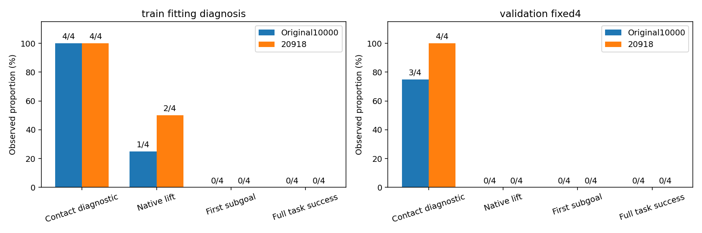
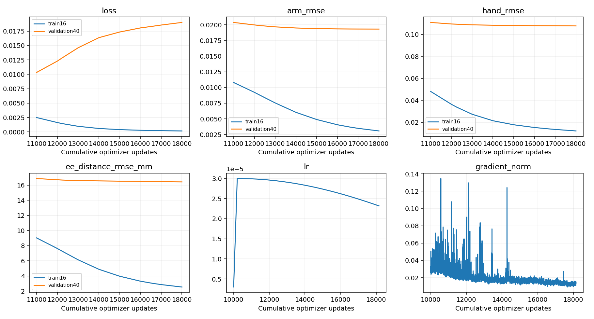
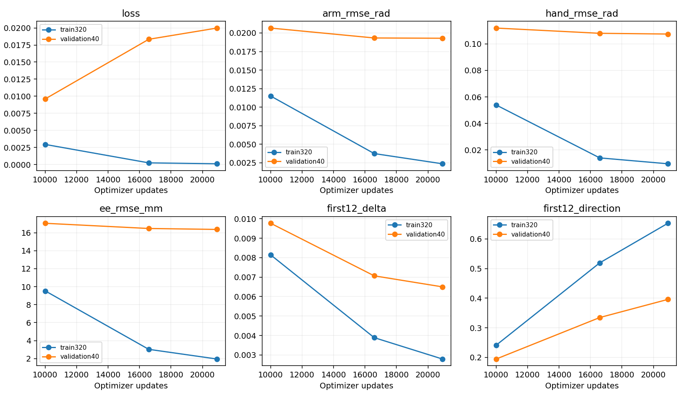
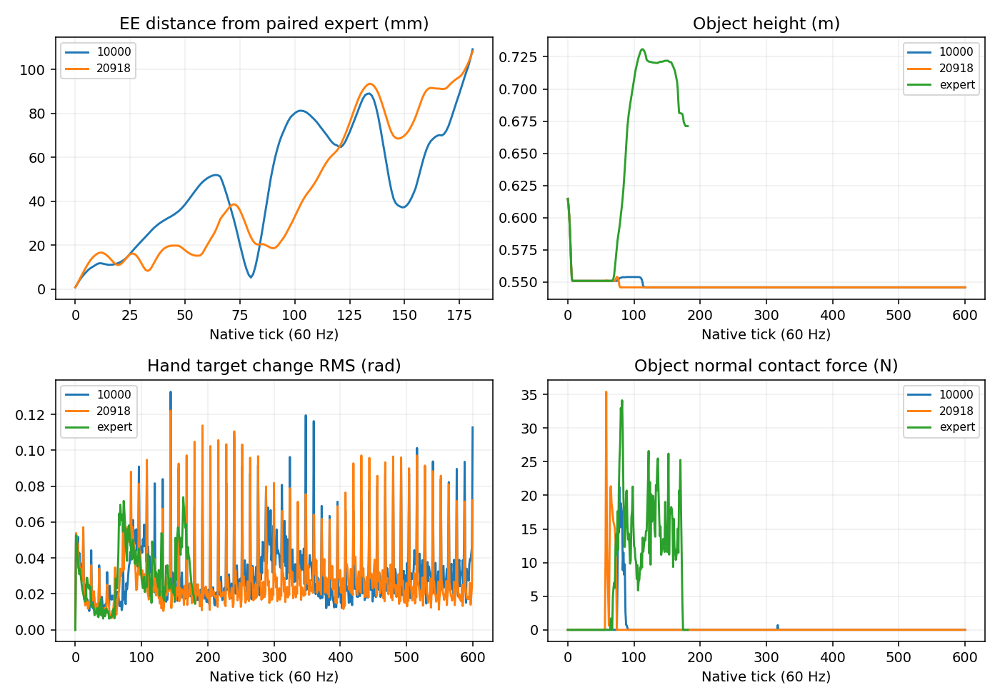

# StateDP 150 anchor等效epoch：训练、闭环与清理

<!-- RANDOM_EVALUATION_START -->
## 本轮随机评估（实时保存）

|Cohort|Success / valid|Rate|95% Wilson CI|Contact|Grasp diagnostic|Lift|First subgoal|
|---|---:|---:|---|---:|---:|---:|---:|
|historical|0/0|N/A|N/A|0|0|0|0|
|train|0/0|N/A|N/A|0|0|0|0|
|validation|0/0|N/A|N/A|0|0|0|0|
|fresh|0/0|N/A|N/A|0|0|0|0|

Planned valid 200; formal attempts 0; valid 0; pending 200; software missing 0; initial rejections 0; shutdown faults 0.
Acceptance failures 0. Separate smoke attempts 0, valid 0, software missing 0.
Contact, approach and stable grasp are diagnostics, not native success. A legal task failure remains in the denominator.
Historical observable reconstruction, not exact hidden PhysX state. Wilson intervals describe conditional binomial uncertainty; historical pool sampled without replacement.
State: pending; stage: supervised_smokes.

固定抽样seed `20261105`，历史池360中无放回随机抽取；前100为主清单，另20仅替换动作前非法初态。全新组同样预注册100+20。不得按成功/失败替换。
每次独立单环境Kit；未采用并行或进程内reset复用，因此不声称已验证并行等价。所有模型动作来自150 epoch checkpoint。
运行目录：`/home/CNS2025331827/docs/bc+rl_RSS/outputs/visuotactile/native_dp_v2/state_random_20261105_01`。冻结源码 `a68baee727334f9aa6c0777d94e172380642dadd`；checkpoint SHA `339fc3ddb8f0835f34d9857a4653dfa0ee706d3ec4901bb21b9069312399a15e`。
[机器统计与每次结果](evidence/state_dp/random_evaluation.json)。软件故障、非法初始化和任务失败分别记录；未完成时不得据此声称100+100成功率。
<!-- RANDOM_EVALUATION_END -->

|模型|初态用途|成功/有效|接触诊断|原生抬升|首子目标|超时|
|---|---|---:|---:|---:|---:|---:|
|StateDP 10000|train|0/4|4|1|0|2|
|StateDP 20918|train|0/4|4|2|0|2|
|StateDP 10000|validation|0/4|3|0|0|4|
|StateDP 16584 (100 epoch)|validation|0/4|4|0|0|4|
|StateDP 20918|validation|0/4|4|0|0|4|

计划8初态，实际启动8，有效8，软件缺失0，验收失败0，待执行/待获得有效结果0。最多9次启动。训练初态只作拟合诊断，不并入validation或test。原StateDP/ImageDP正式0/12不变，Image未新训。
原生环境没有离散稳定抓持判据，保持N/A；contact是已有力诊断，不作为稳定抓取。异常关闭与任务失败分开；SDK fast exit不称完整正常关闭。

|seed|cohort|首次5mm连续3tick偏离：旧/新|专家接触tick|终止|视频|
|---|---|---|---:|---|---|
|984101|validation|3 / 3|68|{'fall': False, 'max_successes': False, 'hand_far': False, 'dropped': False, 'timeout': True}|[本地视频](/home/CNS2025331827/docs/bc+rl_RSS/outputs/visuotactile/native_dp_v2/anchor_assessment_20261105_01/stages/state_interim_04/attempt_1/output/r931005_1793209376_e00_p000055/rollout.mp4)|
|984102|validation|6 / 5|43|{'fall': False, 'max_successes': False, 'hand_far': False, 'dropped': False, 'timeout': True}|[本地视频](/home/CNS2025331827/docs/bc+rl_RSS/outputs/visuotactile/native_dp_v2/anchor_assessment_20261105_01/stages/state_interim_05/attempt_1/output/r931005_1793209376_e00_p000057/rollout.mp4)|
|984103|validation|7 / 7|46|{'fall': False, 'max_successes': False, 'hand_far': False, 'dropped': False, 'timeout': True}|[本地视频](/home/CNS2025331827/docs/bc+rl_RSS/outputs/visuotactile/native_dp_v2/anchor_assessment_20261105_01/stages/state_interim_06/attempt_1/output/r931005_1793209376_e00_p000067/rollout.mp4)|
|984104|validation|4 / 5|65|{'fall': False, 'max_successes': False, 'hand_far': False, 'dropped': False, 'timeout': True}|[本地视频](/home/CNS2025331827/docs/bc+rl_RSS/outputs/visuotactile/native_dp_v2/anchor_assessment_20261105_01/stages/state_interim_07/attempt_1/output/r931005_1793209376_e00_p000121/rollout.mp4)|
|982401|train|9 / 10|51|{'fall': True, 'max_successes': False, 'hand_far': False, 'dropped': False, 'timeout': False}|[本地视频](/home/CNS2025331827/docs/bc+rl_RSS/outputs/visuotactile/native_dp_v2/anchor_assessment_20261105_01/stages/state_interim_00/attempt_1/output/r931005_1793209376_e00_p000000/rollout.mp4)|
|982402|train|3 / 9|63|{'fall': False, 'max_successes': False, 'hand_far': False, 'dropped': False, 'timeout': True}|[本地视频](/home/CNS2025331827/docs/bc+rl_RSS/outputs/visuotactile/native_dp_v2/anchor_assessment_20261105_01/stages/state_interim_01/attempt_1/output/r931005_1793209376_e03_p000159/rollout.mp4)|
|982403|train|10 / 10|55|{'fall': True, 'max_successes': False, 'hand_far': False, 'dropped': False, 'timeout': False}|[本地视频](/home/CNS2025331827/docs/bc+rl_RSS/outputs/visuotactile/native_dp_v2/anchor_assessment_20261105_01/stages/state_interim_02/attempt_1/output/r931005_1793209376_e02_p000059/rollout.mp4)|
|982404|train|6 / 16|88|{'fall': False, 'max_successes': False, 'hand_far': False, 'dropped': False, 'timeout': True}|[本地视频](/home/CNS2025331827/docs/bc+rl_RSS/outputs/visuotactile/native_dp_v2/anchor_assessment_20261105_01/stages/state_interim_03/attempt_1/output/r931005_1793209376_e01_p000153/rollout.mp4)|

历史曲线固定train16 / validation40，EMA、H24执行前12。以下端点重算使用完整train320 / validation40，三个checkpoint、归一化、DDIM16/eta0/clipFalse seed7091、loss noise8091和辅助权重相同。Train总loss与Validation总loss可比较；它们不是完整任务成功率。

|更新|anchor等效epoch|cohort|总loss|Arm rad|Hand rad|FK mm|delta Arm rad/tick|动作方向cos|幅值比|
|---:|---:|---|---:|---:|---:|---:|---:|---:|---:|
|10000|24.0407|train|0.002942336|0.0115009|0.0538956|9.529|0.00842606|0.24291|3.2354|
|10000|24.0407|validation|0.009609138|0.0206615|0.111931|17.048|0.0100987|0.19904|3.5739|
|16584|100.0054|train|0.0002465709|0.00374974|0.0139912|3.032|0.00407255|0.49558|1.7937|
|16584|100.0054|validation|0.01833578|0.0193283|0.107983|16.47|0.00795393|0.32671|2.4888|
|20918|150.0101|train|0.0001122768|0.00237603|0.00955311|1.9572|0.00295834|0.62639|1.4595|
|20918|150.0101|validation|0.01997827|0.0192881|0.107426|16.366|0.00753911|0.38577|2.2159|

|更新|cohort|时段|Arm rad|增量rad/tick|hold基线rad|方向cos|幅值比|FK mm|EE积分误差mm·s|
|---:|---|---|---:|---:|---:|---:|---:|---:|---:|
|10000|train|first12|0.011485|0.008143|0.016772|0.2415|3.2141|9.2229|1.631|
|10000|train|first24|0.011462|0.0081986|0.032048|0.25797|3.1826|9.4507|3.3509|
|10000|train|precontact|0.010786|0.0078554|0.10856|0.27742|3.217|8.7933|8.8194|
|10000|validation|first12|0.022148|0.0097697|0.016573|0.19484|3.6081|16.929|3.0422|
|10000|validation|first24|0.021511|0.010134|0.031965|0.21175|3.6725|18.104|6.4905|
|10000|validation|precontact|0.020811|0.0095031|0.10498|0.22691|3.6306|17.344|18.129|
|16584|train|first12|0.0034571|0.0038893|0.016772|0.5193|1.7715|2.6568|0.46054|
|16584|train|first24|0.0033563|0.0037531|0.032048|0.53838|1.727|2.5955|0.90188|
|16584|train|precontact|0.0034564|0.003579|0.10856|0.54823|1.7255|2.7133|2.6789|
|16584|validation|first12|0.020542|0.0070677|0.016573|0.33471|2.3543|16.162|2.8797|
|16584|validation|first24|0.019578|0.007649|0.031965|0.35906|2.4392|17.63|6.3289|
|16584|validation|precontact|0.018803|0.0070801|0.10498|0.37172|2.4516|16.657|17.413|
|20918|train|first12|0.0021967|0.0027915|0.016772|0.65286|1.4398|1.7269|0.29993|
|20918|train|first24|0.002112|0.0026837|0.032048|0.67177|1.4138|1.6716|0.58237|
|20918|train|precontact|0.002147|0.0025372|0.10856|0.67881|1.4093|1.724|1.6957|
|20918|validation|first12|0.02026|0.0065016|0.016573|0.39595|2.061|15.953|2.8267|
|20918|validation|first24|0.019372|0.0071099|0.031965|0.42556|2.1374|17.537|6.2629|
|20918|validation|precontact|0.018709|0.0066362|0.10498|0.43029|2.1786|16.492|17.203|

逐关节位置/增量误差、末端方向/幅值、静态tick数量、Train/Validation gap及checkpoint SHA见[端点数值](evidence/state_dp/offline.json)。运动方向只排除专家增量≤1e-6rad或1e-6m的tick；这些tick仍计入RMSE。幅值和cos按episode宏平均，不把微小分母比值池化成任务成功。
原400记录缺少物体过滤的接触力，离线precontact使用现有任一指尖子步力>0.1N的首次诊断事件；闭环专家接触沿用物体过滤力连续3tick的既有定义。二者不混用，不称稳定抓持。
分析使用专家历史观测，明确为teacher-forced离线诊断；闭环始终为模型自主动作，没有专家接管、平滑或控制器修改。
评估source commit `23d250801a4d14433912dfc897529f8eec5a4c38`；运行目录 `/home/CNS2025331827/docs/bc+rl_RSS/outputs/visuotactile/native_dp_v2/anchor_assessment_20261105_01`。训练150 epoch后保持证据审查暂停；本次不会自动增加至200–300或启动Image训练。

清理及回归结果见 [CLEANUP_AUDIT.md](CLEANUP_AUDIT.md)。仍在使用的旧目录缓存与checkpoint不按日期删除。

## 150 epoch后的实测决策

100→150端点validation selection MSE相对改善1.008%；Train总loss比值0.4554，Validation总loss比值1.0896。训练拟合初态成功0/4、验证成功0/4；两组分开，不声称统计显著。

训练320首12tick：Arm位置RMSE 0.00345709→0.00219669 rad，增量RMSE 0.00388927→0.00279153 rad/tick；静止保持基线0.0167716 rad，专家增量RMS 0.00242323 rad/tick。末端误差2.6568→1.7269 mm，累积误差0.46054→0.29993 mm·s。这些量用于区分静态位置拟合与小幅连续运动，不能只看全局RMSE。

验证40首12tick：Arm位置RMSE 0.0205416→0.0202595 rad，增量RMSE 0.00706771→0.00650157 rad/tick；静止保持基线0.0165734 rad，专家增量RMS 0.00241305 rad/tick。末端误差16.1624→15.9528 mm，累积误差2.8797→2.8267 mm·s。这些量用于区分静态位置拟合与小幅连续运动，不能只看全局RMSE。

150端点Validation−Train gap：Arm 0.016912 rad，Hand 0.0978733 rad，FK 14.409 mm。训练loss继续下降而验证总loss未同步改善，支持当前泛化/监督到闭环之间存在瓶颈；不等于证明优化已完全收敛。

当前证据支持停止单纯增加到200–300的训练量，保留150及最佳完整checkpoint。小样本闭环和当前验证曲线尚未支持继续消耗预算；Image保持未续训，也未绕过严格live输入配对问题。网络/损失不自动修改。下一步最有价值的是针对首12tick小幅动作、累计末端偏差与稳定接触做固定初态的有界因果比较，优先验证观测分布与动作精度，而不是再从头训练两个模型。

训练初态仅恢复记录中的可观察初态与已导出状态，不能声称恢复原四lane的全部PhysX隐藏状态。清理和实际回归见[CLEANUP_AUDIT](CLEANUP_AUDIT.md)。

## 失败机制的证据边界

验证首12tick的Arm位置误差比静止保持基线还高22.2%；动作增量误差为专家增量RMS的2.69倍，方向cos=0.396、幅值比=2.061。因此不能把较低的全程绝对位置RMSE解释为已经学会精确小幅连续运动，也不能简单称模型只输出静止动作。训练集首12tick方向和幅值确有改善，验证差距仍大。

150验证初态首次持续5mm偏离tick为[3, 5, 7, 5]，均早于专家接触及首次tick12重规划。单独消除重规划边界跳变不能解释最早偏离。

|验证4公共专家前缀，episode宏平均，rad|原10000|150 epoch|配对专家|
|---|---:|---:|---:|
|Arm边界跳变RMS|0.021266|0.026789|0.002395|
|Hand边界跳变RMS|0.066777|0.075873|0.036969|
|Hand目标/实际跟踪RMS|0.059260|0.059731|0.103277|

成功专家的手指跟踪RMS本身更大，不能把目标/实际差直接称执行接口bug；边界跳变仍高于专家，但这里只是相关性证据。现有证据较强地支持训练/验证差距与接触前动作精度问题；闭环分布偏移、手指接触失稳的因果权重仍未分离。下一轮先保持checkpoint、网络、loss与控制不变，针对同一首12tick的实际在线观测和专家观测作输入差异归因，确认误差来源后再安排单因素有界对照。当前没有证据要求立即改网络或重新训练。

## 整理后的执行验收

尚未通过。额外2次启动均未取得有效episode：首次为整理引入的ElementTree漏导入（首次模型动作前失败，已修复并通过真实资产初始化测试）；修复后的唯一补充启动在场景创建前FileThread SIGABRT（exit−6）。全部进程/GPU资源已回收，停止自动重试。两次原始日志与状态保留。 这是模型性能评估完成之后发生的独立验收，不解释或改变原8次闭环失败。

8次正式闭环的整卡时间加权GPU均值19.03%，最大完整60秒均值32.84%，遥测缺失0；这是该闭环窗口的实测，不覆盖历史训练/其他会话。

## 原生成功与终止机制逐tick审核

**PASS：未发现这4条训练轨迹的完整成功漏判；原0/4统计保持。** 独立用记录的物体/目标四个关键点、指尖位置及真实配置重建状态机；关键点距离与记录最大差6.15e-8m。目标在子目标完成的同一tick会切换，所以必须用动作前的goal与动作后的object计算，不能误用已经更新的下一目标。400条原生成功专家也全部通过，重建子目标与完整成功逐tick一致，首次完整成功=正式终止，额外动作0。

|原train视频seed|最小关键点最大误差mm|首子目标合格tick累计|首子目标/完整成功|终止tick|
|---|---:|---:|---|---:|
|982401|12.944|7/10|均未达到|390，fall|
|982402|7.974|5/10|均未达到|601，timeout|
|982403|39.154|0/10|均未达到|528，fall|
|982404|285.368|0/10|均未达到|601，timeout|

原生配置为`preInsertAndFinal`两个顺序子目标。每个要求四关键点中的最大误差≤0.01×1.5=**15mm**，累计10个合格60Hz控制tick（`force_consecutive_near_goal_steps=False`，不是连续10tick）。达到后计数加一并切换目标、重置该阶段计时。两个插入目标完成后，仍要求关键点最大误差≤0.005×1.5=**7.5mm**且五个指尖到物体中心的平均距离>**0.1m**，才完成撤手并产生完整成功。无额外接触力或稳定抓持硬条件；指尖距离不是接触判据，也不能将插入过程中的接触/抬升当成功。

原任务每次先推进两次120Hz物理步，再增加60Hz控制tick、计算`_get_dones`、奖励，然后自动reset及更新观测。子目标`_is_success`与完整成功`max_successes`不同；reward不是terminated。完整成功、fall、hand_far、启用时的dropped触发terminated，阶段计时超限触发truncated。研究wrapper在自动reset前保存终止原因和状态，runner在同次step返回后停止，未发现flag晚一tick。每个子目标的累计10tick是定义本身；物理子步之间短暂接近不等于已满足完整条件。现有601tick超时约10.0167秒，保持原生数值行为。

本轮没有修改原生阈值、奖励或任务逻辑。仅增加明确的`first_success_tick`、`termination_tick`、`post_success_actions`及检查；若原生完整成功与terminated矛盾，记录软件错误并禁止下一动作。索引统一为1起始的已完成控制tick。原记录未被重写或重新计数。

## 专家3秒动作与控制频率

400条成功记录共有81894个控制tick。完成时间按原`control_dt=0.01666666666s`计算，与墙钟运行速度无关：均值**3.412s**、中位**3.267s**、P05/P95 **2.350/4.834s**、P99 **6.294s**、范围1.983–8.983s。因此“约3秒”确实是仿真物理时间。

|事件绝对仿真时刻|可观测条数|均值s|中位s|P95 s|
|---|---:|---:|---:|---:|
|首次指尖力>0.1N诊断|400|1.127|1.117|1.901|
|原生lift标志|153|2.147|2.033|3.237|
|首子目标|400|2.692|2.633|3.652|
|两个插入目标完成|400|3.411|3.267|4.834|
|完整成功|400|3.412|3.267|4.834|

原400只有未按物体过滤的指尖接触力，接触事件可能含桌面；不可据此精确划分稳定抓持起点。原生lift是物体相对初始升高约10cm的奖励标志，不是成功的必要条件，247条完整成功未触发该标志。388/400在最终插入目标完成的同一tick满足完整成功，剩余12条随后撤手；不得把以上指标画成必然单调的阶段漏斗。

|绝对值，所有episode/关节/tick合并|Arm 中位/P95/最大|Hand 中位/P95/最大|
|---|---|---|
|实际速度rad/s|0.129 / 0.220 / 13.366|0.254 / 4.184 / 17.447|
|控制tick差分加速度rad/s²|0.598 / 4.206 / 1310.401|3.825 / 89.067 / 1216.158|
|目标变化率rad/s|0.150 / 0.150 / 0.150|0.239 / 5.489 / 11.654|
|目标/实际跟踪误差rad|0.00608 / 0.01874 / 0.17002|0.01168 / 0.23030 / 1.19739|

典型arm目标速度有限，不能将3秒直接解释为整段不现实高速动作；但存在值得调查的短时动力学尖峰。例如`r931005_1793209376_e01_p000171`第72tick的joint7速度从−8.474变到+13.366rad/s，而目标只改变−0.0025rad；`e03_p000004`第39tick ring_PIP速度17.447rad/s，目标近乎不变。它们是实际速度/接触求解器响应尖峰，不是同样幅度的专家目标跳变；还不能仅凭速度读数证明真实硬件可执行。

原URDF arm速度限制10rad/s、effort300Nm；手指速度约11.62–35.07rad/s、effort0.189–3.3Nm。部分瞬时实际速度超过相应URDF数值，不能把URDF配置当作运行期严格无超调保证。名义arm stiffness为600/600/500/400/200/200/200，damping约9.15–27.03；hand stiffness0.9–13.2、damping约0.028–0.408，逐关节值见机器证据。原400缺少完整逐tick执行器力矩测量；新增记录的是SDK隐式执行器报告的effort估计，不冒充独立力矩传感器。指尖合力P95/P99/最大14.56/22.89/313.58N，未按物体过滤，尖峰原因需结合具体接触。

专家和学生均为120Hz物理/60Hz目标执行，PD、碰撞、质量/摩擦及原生DR配置保持。专家每16.67ms重新输出native命令，并经过其原delay/EMA；DP每tick更新GRU，但每12tick才重规划一次，因此chunk内新接触反馈最多约11个tick（183ms；一般边界描述为<200ms）才影响新规划。当前DP直接提交已处理的29D位置目标，不重复加入专家delay/EMA。墙钟推理时间和资源等待不会推进模拟时间，不能当作额外仿真控制延迟。

200ms覆盖10tick子目标累计窗口，且hand动作/接触可在更短时间变化，因此有理由在本轮完成后设计**同checkpoint、同初态、同DDIM噪声规则、仅commit12→6**的配对诊断；再以同一输出预算检查推理开销和历史因果性。当前并未运行或启用该消融；H24、执行12及baseline不变。现有最早偏离常发生于首12tick，增频也未必能修复初始预测误差。

完整逐轨迹审核及分位数：[success_timing_audit.json](evidence/state_dp/success_timing_audit.json)。

## 本轮基础设施边界与训练决策

此前修复后FileThread SIGABRT的进程RSS最后一次采样约4.38GiB，日志首行同时出现`LLVM ERROR: out of memory`；当时主机仍有约33GiB可用RAM，service MemoryMax18GiB，256个inotify探针通过。现有证据不能把它归因为真实RAM总量耗尽或inotify耗尽。[IsaacLab公开同类报告](https://github.com/isaac-sim/IsaacLab/issues/429)也记录了有空闲RAM时的LLVM报错，但不是本机根因证明。本轮仅采用新的私有缓存及失败系统调用记录，不修改驱动/SDK。SDK生命周期与关闭行为参照[官方5.1文档](https://docs.isaacsim.omniverse.nvidia.com/5.1.0/python_scripting/manual_standalone_python.html)；持久结果后进程隔离回收不冒充完整SDK优雅关闭。

正式200条必须先通过小规模轨迹、模型第一plan一致性、成功事件及进程资源回收验收。不是重新要求三次SDK正常关闭。当前新任务进度看本报告顶部实时区及run状态。软件失败不能写成机器人0/1，也不能减少计划分母。历史初态属于可观察状态重建，缺失的原始四lane PhysX内部状态仍未恢复。

是否启动Image等待全新随机100的实际证据：若未见初态有约10%真实完整成功，可建议进入Image baseline，不要求60–80%；严格live Image输入配对仍须先解决。仅train成功不得称泛化，近零成功则按新队列失败分布定位；本轮不自动重训或改网络/损失。
