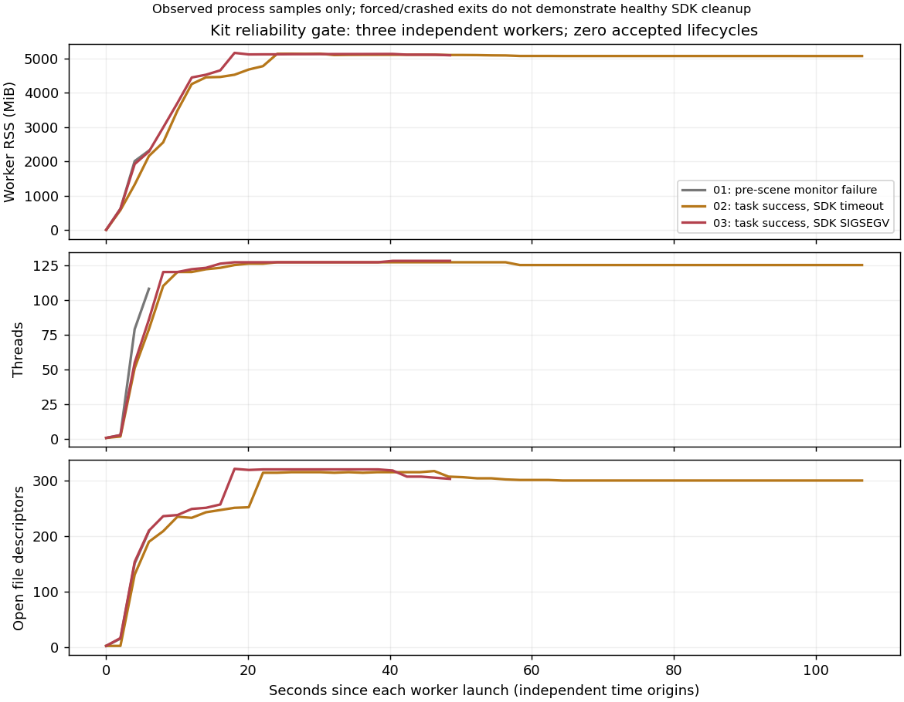

# StateDP + ImageDP baseline 改进

## 最新结果：Kit 关闭门控失败，训练队列 blocked

`state_image_20261104_01` 已停止，资源预检通过，**Kit 可靠性未通过**。
3/5 次启动中没有一次满足完整 episode 加正常 SDK 退出；剩余两次无法满足连续三次要求。
不再增加启动、重置预算或自动重启本 root。S-H24-Improved、I-HistoryDP-00 均 **0 updates**；
新损失尚未实现冻结，监督验收0/200，没有训练 coordinator、心跳或新 checkpoint。
用户要求基础设施无法安全恢复时停在 blocked，因此没有越过门控启动训练。

|项目|实际结果|
|---|---|
|父工作区编辑器排除|用户已批准并应用，仅排除另一个项目的 deliverables 递归监视|
|资源预检|恢复后及最后复查均256/256 watch申请成功；可读取watch FD引用34756/524288|
|Kit生命周期|启动3/5，完整正常退出0；学生尚未启动|
|原生任务结果|两次专家各181ticks完整成功，另一次在场景就绪前被监控器终止|
|软件结果|首次监控权限错误、第二次关闭超时、第三次关闭SIGSEGV，单列software_missing|
|训练/验证/新视频|两组均未开始，没有新曲线、逐关节误差、里程碑或10000录像|
|后台|`state-image-kit-20261104-01.service` inactive，MainPID=0，cgroup为空；自有进程均退出|
|保全|三个旧checkpoint、原数据清单及182项冻结源码SHA一致；所有失败与日志保留|

最终证据：[kit_gate_review.json](evidence/state_image_20261104/kit_gate_review.json)、
[attempt汇总CSV](evidence/state_image_20261104/kit_attempts.csv)、
[进程采样CSV](evidence/state_image_20261104/kit_process_samples.csv)。
本轮是基础设施门控，专家任务成功不能当作新模型性能或生命周期验收通过。

## inotify：当前资源阻塞解除，因果范围有限

最初两次真实探针均在首个临时目录返回errno28/ENOSPC（0/256），可读取同UID
watch FD引用524190/524288、实例FD引用86/4096；3个不可读PID留下统计缺口。
引用可能因共享/继承重复，**不等于内核唯一用量**。本项目局部排除后仍失败。
另一个以整个docs为工作区的VS Code窗口，约254736个匹配监视目录来自其他项目deliverables。

用户明确批准后，在父工作区 `/home/CNS2025331827/docs/.vscode/settings.json` 仅合并：

```json
{
  "files.watcherExclude": {
    "**/IsaacLab_DexAssemble-sharpa/deliverables": true,
    "**/IsaacLab_DexAssemble-sharpa/deliverables/**": true
  }
}
```

配置SHA256：`2905a479034e39c92cb871b384b783759820b912c3b586df5ea1eabe61e2fc89`。
恢复后的真实探针及最终复查均256/256，引用34756；探针FD和私有目录已释放。
缺少跨会话间隔后紧邻修改前的census，不能把全部下降唯一归因于此设置。
这是编辑器订阅变更，无文件删除、VS Code结束或其他生产进程变更。
未修改sysctl、驱动、共享SDK。见[资源恢复证据](evidence/state_image_20261104/resource_resolution.json)；
[最初失败证据](evidence/state_image_20261104/preflight_summary.json)中的待批准状态是历史记录。

## 三次独立 Kit 的真实生命周期

|attempt|任务与关闭阶段|退出码|判定|
|---|---|---|---|
|01_expert|场景就绪前，新增监控读取辅助进程/proc/PID/fd触发PermissionError；owner终止自己的worker|-15|监控软件错误；无原生任务结果|
|02_expert_recovery|专家181ticks完整成功；SDK关闭超过60s，SIGTERM后仍未退出，最终SIGKILL|-9|任务成功，但生命周期失败|
|03_expert_shutdown|专家181ticks完整成功；env.close返回，app关闭阶段SIGSEGV|-11|任务成功，但生命周期失败|

第一次是本轮新监控器的权限处理缺口，**不是已证实的FileThread崩溃**。
修复后不可读FD/inotify计数保存null和缺失标记，仍跟踪PID/starttime及专用cgroup；
首个失败仍占一次预算，原源码、计划、错误、日志在proc_reader_repair中存档。
第二次后只做局部关闭候选：在episode和writer全部结束后解除Lab STOP render-loop回调，
随后调用原env.close/app.close。原代码与记录在shutdown_repair中保留，不改活跃期控制/物理/RNG。
该候选未通过真实验收，不能称为已解决Kit关闭。

第三次 `shutdown_phase.json` 确认env.close已返回；本轮独立Kit日志最后记录：
`Stage closed`，随后 `shutting down app and releasing framework`，之后无正常返回marker。
可将故障定位到应用关闭阶段；完整native backtrace缺失，Python主线程堆栈也截断。
当时开启10秒周期faulthandler采样，不能排除诊断线程与framework释放的交互；
**尚未确定唯一根因，也没有本次FileThread签名证据**。未发现可归属本次的新minidump，
日志中的旧dump警告不能算新崩溃栈。五份本轮SDK/Lab日志已复制到本地kit_gate/sdk_logs并校验SHA，防止轮转丢失。

两次完整专家的17个共同控制/物理数组都与原V3逐字节相同：actor、command、delayed、
delay_index、target、joint、actuator_targets、velocity、object、contact、object_contact、
force、torque、lifted、subgoals、retract、alignment；两次actuator目标误差均0。
这是已记录轨迹的一致性，未声称未保存的PhysX隐藏状态完全一致。没有学生闭环覆盖。

## 资源、测试与源码身份

每次独立进程记录启动、场景、完整episode及关闭状态，每2秒采样主进程和子进程。
三个主worker峰值RSS分别2314.61/5143.54/5168.00MiB，线程108/127/128，FD209/317/321。
后两次关闭前分别314/319FD、127线程、1个watch；Kit自身将RLIMIT_NOFILE软限设为2450，
未观察到逼近FD软限。最终全部已观察worker/helper PID消失、服务cgroup为空，资源探针仍通过。
这证明退出后操作系统已释放本轮资源；由于没有连续健康退出样本，**不能证明SDK无泄漏**。



整卡已采集187个样本：观测区间时间加权均值17.6173%，已完整观测60秒窗口最高30.0196%；
最少空闲显存16438MiB、available RAM19.8432GiB。两次人工修复期间监控停止，
汇总明确记录325.8816秒缺口、最大采样间隔166.4789秒；missing_samples=0不意味着无时间缺口。
**不能据此声明整场连续监测或全程资源合规。**后续任何新门控都须修正跨恢复监控的连续性。

4项新增生命周期CPU测试通过；此前5项资源探针测试结果保留。没有重复原Epsilon数学、batch审计。
所有新Kit均为独立后台worker，60秒SDK关闭上限、单worker15分钟，原2小时session deadline不变。
生命周期要求原生完整终止、SDK关闭marker、exit0、父进程回收、无存活自有PID/GPU记录，
不接受只写result或os._exit作为正常SDK关闭证据。

|运行源码|用途|
|---|---|
|d596cfb|初始门控及首个启动|
|0cf75fd|监控权限修复及第2个启动|
|314b640fae0e2144d28550b3d7ff2cfd084b9fd9|关闭候选及第3个启动|

新文件为tools/state_image_kit_gate.py、tools/state_image_kit_worker.py、独立用户service及测试；
旧模型、损失、原控制器和共享安装未改。最终182个冻结源码SHA全部匹配（原179项加3个门控工具），
session SHA为`2e838db594b89c2734ac484b82f8269a867059dfab393360fe5d79a34be0ab66`。
数据清单SHA为`abe7a725ae1be6af6fefba9d3a92809e0667d95137da565447afeeb22576ca64`。
完整工具SHA和checkpoint核验见最终JSON。后续需先有可审阅的SDK关闭修复及新的明确有界验证授权；
现有root禁止自动重启，尚余2次不能满足3次连续完整退出，不能绕过门控直接训练。

## 模型和训练合同审查：已确认与未实施分开

- 旧H24实际模型为 `visuotactile.state_history.PersistentState`，不是短历史MLP。
  Actor141/robot178/geometry85分别编码，已有GRU256每60Hz tick持续更新。
  训练当前权重重算完整过去前缀，再对96tick段反传；replan不清记忆。
  因此没有重复增加GRU，也没有声称本轮新历史一致性验收已通过。
- 动作仍为 canonical29 的 `transition/target_after_rad`，已包含原专家delay/EMA结果；
  不是实际到达q。部署经真实限位进入原执行器，不再附加delay/平滑。
- 已有 `EncoderKinematics` 使用原URDF，支持link7及五个手指末端**link frame**；
  不是接触点。既有Arm FK梯度证据可复用，但新姿态/指尖损失及跨窗口一致性还未实现验收。
- 已有Image实现为 `PersistentImage('I-HistoryDP', image_contract(...))`：
  冻结DINOv2-S/14、三路448×252 RGB-D、depth融合、视觉GRU和native GRU、条件U-Net。
  Image训练allowlist剔除Actor和privileged geometry；本轮00也禁止tactile与Correction。
- 已有DINO原始缓存和尾帧overlay处理分别在 `native_data.prepare_native_perception` 与
  `models.native_vision.NativeDinoSpatial`；未来必须校验实际在线/离线精度、批处理、时间对齐及GRU，
  不能仅凭存在这些函数宣布本轮感知验收完成。
- 旧 `state_full_training` 仍有“State成功后才可Image训练”的历史门槛。
  新任务明确要求State正常结束后无论成功率如何都继续Image；后续需要新身份下显式调整该条件，
  保留旧run合同，不能当前直接调用旧入口或伪造旧image_gate。

## 已保存的串行训练要求，尚非可运行配置

顺序为 Kit gate → S-H24-Improved → I-HistoryDP-00 → 最终汇总。
两组均从头初始化，H24/commit12、sample/x0、DDIM16/eta0/clipFalse、原29D位置合同、原320/40/40。
保持2段×最多96ticks、Loss B Arm/Hand各50%、AdamW lr1e-4/betas(.95,.999)/weight_decay1e-6、warmup500。
新计划累计1000→3000→6000→10000，cosine统一10000，不在里程碑重置。
FK位置/姿态/指尖及连续性权重仍待train-only代表batch损失/梯度测量，未随意填写。
保留原train4+validation8初态清单及SHA作为以后共同评价参照，test40不作选择。

每组必须真实达到200有效updates及至少3个监测周期，完成loss/梯度/资源/心跳、
checkpoint读回恢复、validation和完整Kit rollout后才能宣布监督验收通过。
本轮这些检查尚未执行；无新训练曲线、逐关节指标、闭环成功率或10000录像可报告。
01/10/11和nominal-action设计均未启动。

## 原实验保护和接续入口

本轮重新读取并SHA核验，三项均与原manifest一致：

|checkpoint|SHA256|
|---|---|
|H24-Sample8000|00783c7db01b8b269746718a3322238beb9906a88eac1fa8e9adc58bfc5b4399|
|H24-Sample10000|9a7cc8c6123563f93b77256104e61e6b357bb38303ede4231fe19fddeb0e17ca|
|H24-Epsilon3000|48236f836b23e74ccbc4f078f8806089f8f08bd71fc70c2184ec4f9cb704e44e|

完整本地路径、大小、原配置SHA见新root的 `protected_checkpoints.json`；原轨迹/录像/故障证据保持。
本地root：`outputs/visuotactile/native_dp_v2/state_image_20261104_01`。
一条只读状态命令（在当前feature工作树执行）：

```bash
cat outputs/visuotactile/native_dp_v2/state_image_20261104_01/status.json
```

本轮已停止；此命令只读，不会重新启动门控。旧清理已在CLEANUP_AUDIT记录，本轮不删除唯一失败证据。
只发布代码、测试、报告、CSV和轻量PNG；SDK日志、权重、原始数据及MP4全部保留本地。
