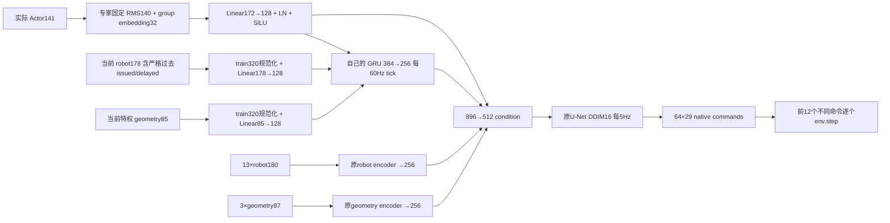

# State persistent history v2

旧State只有13个robot tick和3个geometry anchor，没有整局记忆。冻结RL专家的先前干预已经显示：
完整LSTM历史重建command至约7e−6，而13帧重置会产生明显动作误差；这支持补历史通路，不能保证GRU会学会任务。
本轮只改条件编码，原ConditionalUnet1D、sample/x0、LossB、DDIM16、H64/commit12保持。



```text
native tick       0  1 ... 11 | 12 13 ... 23 | 24 ...
Actor/robot/geo    ✓  ✓ ...  ✓ |  ✓  ✓ ...  ✓ |  ✓ ...
GRU update        ✓  ✓ ...  ✓ |  ✓  ✓ ...  ✓ |  ✓ ...
DP plan H64       ✓          |  ✓          |  ✓
env.step command  0  1 ... 11 |  0  1 ... 11 |  0 ...
GRU reset         episode起点；规划边界/子目标变化均不清零
```

`HistoryBank`以lane和真实episode ID管理独立状态，重复/遗漏tick拒绝；真实episode变更必须tick0。
256D hidden是**有损压缩**，不是无损整段历史或与RL1024D LSTM相同的容量。没有复制专家hidden/cell。
短窗只是辅助详细上下文，不取代持续状态。

训练每段96native ticks、每12tick监督H64；从中间开始先以**当前权重**从tick0重算无梯度前缀，
再对当前段BPTT。每次optimizer更新后不复用旧权重hidden，分段不是清空记忆。尾部valid mask沿用LossB。
过去专家实际执行teacher forcing与在线学生实际执行的分布差异仍存在；报告按两种历史分开，不将离线拟合叫闭环成功。
小BC复用同一condition，head512→256→256→64×29。两阶段均AdamW1e−4/(.95,.999)/wd1e−6、
500warmup/cosine、gradclip1、EMA power.75；DP未更换去噪目标或采样步数。

## 上游比较

实际固定版本/文件hash见[reference_sources.json](evidence/state_history_20261102/reference_sources.json)。

| 来源 | 真实历史/过去动作 | 训练与重规划 | 成本与本轮取舍 |
|---|---|---|---|
| 官方DP `5ba07ac` | lowdim配置O2/H16/A8；fixed observation window，policy明确拒绝`past_action`键 | SequenceSampler窗口；重规划使用runner窗口，没有持续RNN | flatten+U-Net，条件成本随O增长；不能据O2否认本任务记忆需求 |
| robomimic `d309eae` | DP的observation_horizon由配置决定；非BC-RNN；无整局hidden | reset建obs/action deque，空action queue才推理，外部obs需已带时序 | U-Net固定窗；其BC-RNN是另一个算法，不能当作DP已有persistent history |
| CoRL2025 LDP `5113f46` | README常用O16/H32/A1，任务可不同；Transformer观察长窗，past-token prediction监督过去动作；runner可按过去实际动作一致性选样 | 预测过去token不等于直接喂未来；policy拒绝普通past_action键，另有act_cond与runner样本一致性路径；滑窗非整局RNN | attention通常随token数二次增长，可缓存冻结视觉embedding；论文效果不代表本机复现 |
| MIT2026项目页/arXiv2606.16447v2 | 比较不同context长度、任务与数据量；variable history curriculum及limited past prediction | 页面建议U-Net+cross-attention；不是要求每次规划reset RNN | 访问时写明“Code coming soon”，没有可核查实现commit；仅报告页面/论文主张，不冒充源码验证 |
| 本轮 | 每tick Actor、robot、geometry和过去执行进入GRU；截至当前的整局信息有持续通路 | 当前权重完整前缀+96tick TBPTT；只真实reset清空 | online固定hidden容量、每tick常数递推；保留U-Net，不照搬新attention架构 |

LDP源码的`past_action_pred`控制是否监督过去token；不能简单把名称理解为过去动作直接输入。
MIT页面强调长上下文在低数据场景可能过拟合；本轮因此做小预算train/validation闭环，不能盲目扩大updates。

## 验证

`tests/test_state_history.py`覆盖：整段/逐步/中途前缀、独立lane、真实reset、重复/遗漏tick、
未来字段不影响当前condition、GRU/Actor有效梯度、未知group拒绝、环境RNG隔离与异常恢复。
批量矩阵乘与逐行累加的FP32顺序不同，condition容差1e−5；不声称bitwise神经网络等价。
最终8项新测试及84既有测试共92通过。真实数据验收见输入文档与小JSON；任务成功单列。

MIT v2论文进一步核对：short-context任务扫描To={1,2,5,10,12,16,20}，
push-and-return To={4,8,32,48,60,72,80}、grasp-and-return至48，硬件示例92。
Algorithm1随机sprinkle用p=.8全长度；progressive先扩大历史长度集合，再切sprinkle。
Section4.3指出过去动作预测和冻结视觉encoder的收益可能相互影响，不能只归功于past prediction。
这些是该论文的任务/架构结果，本轮不因此更改U-Net或损失，也不声称GRU等价复现该论文。
