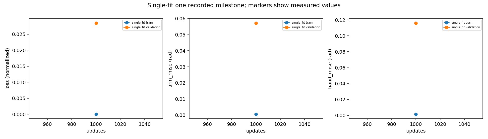
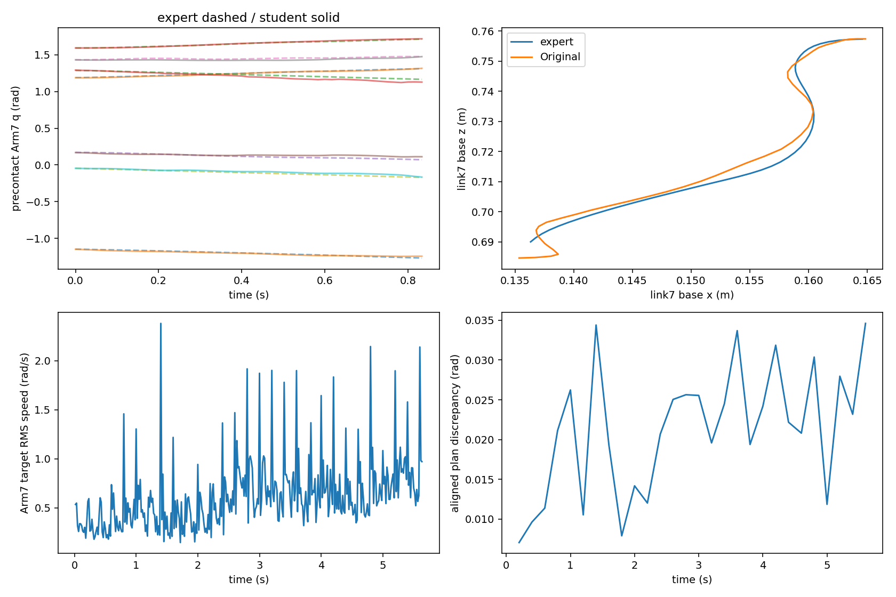
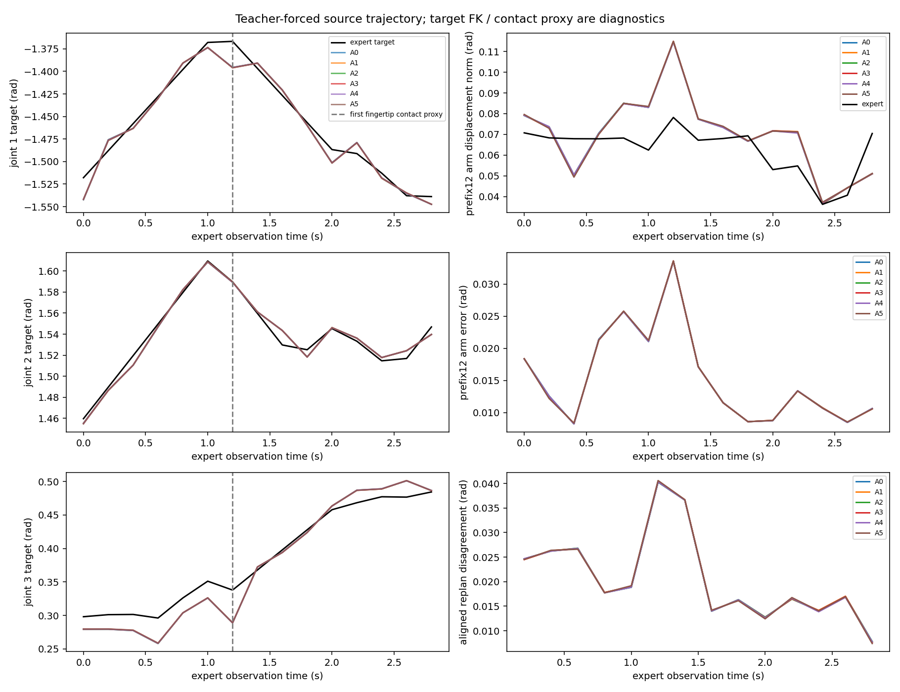
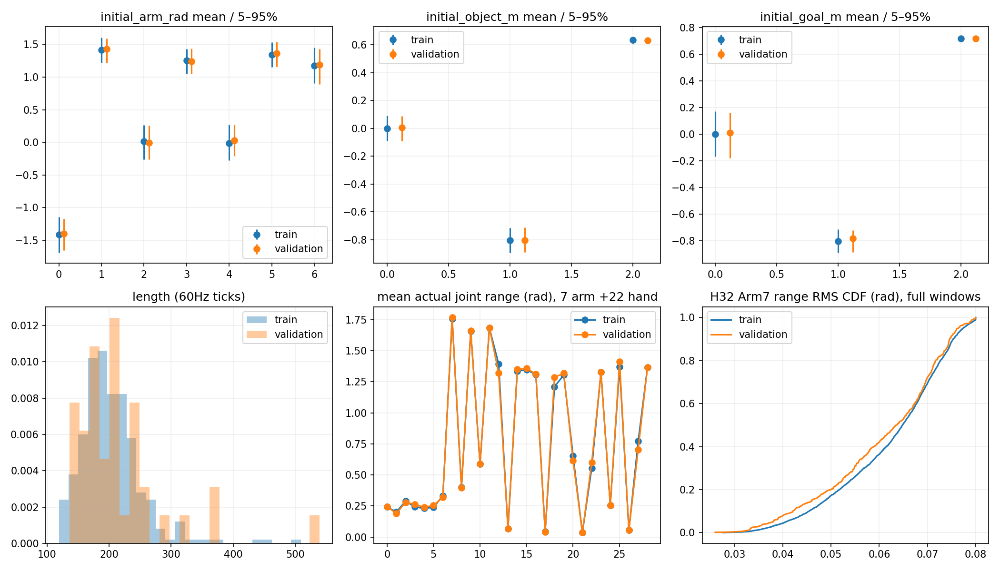
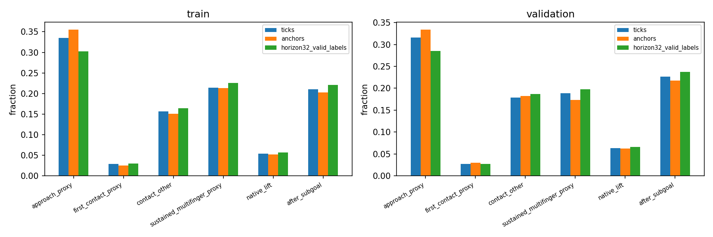
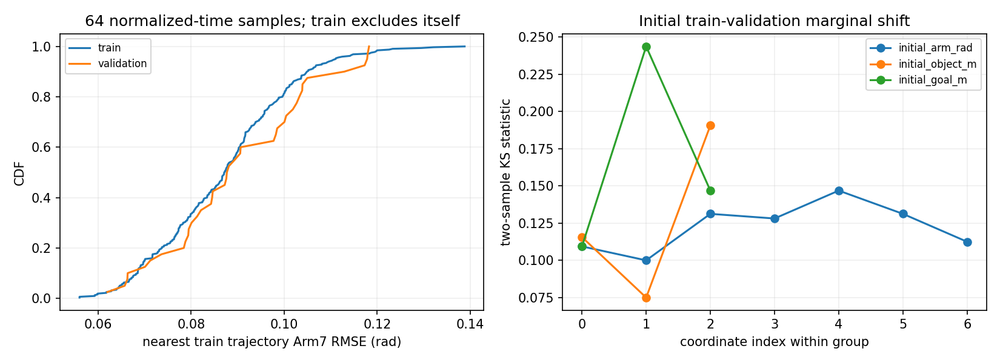
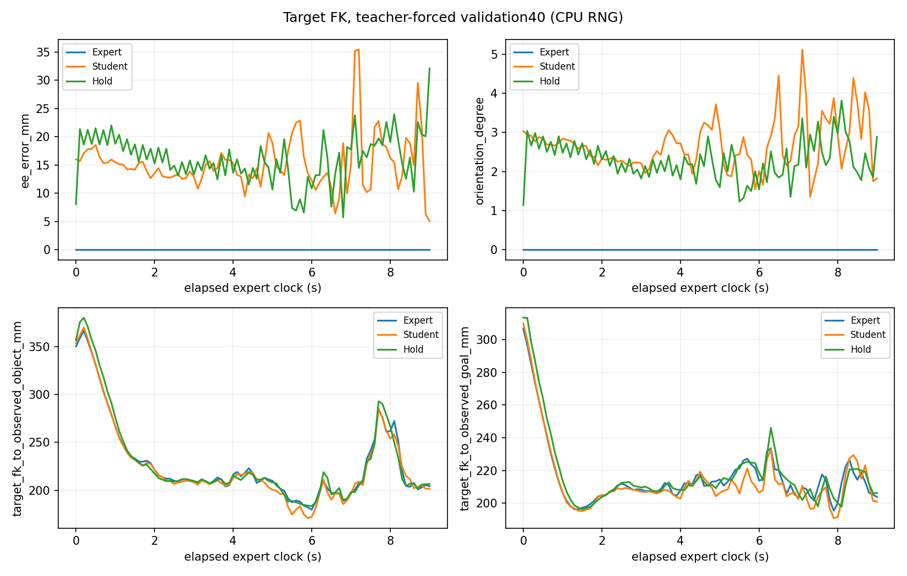
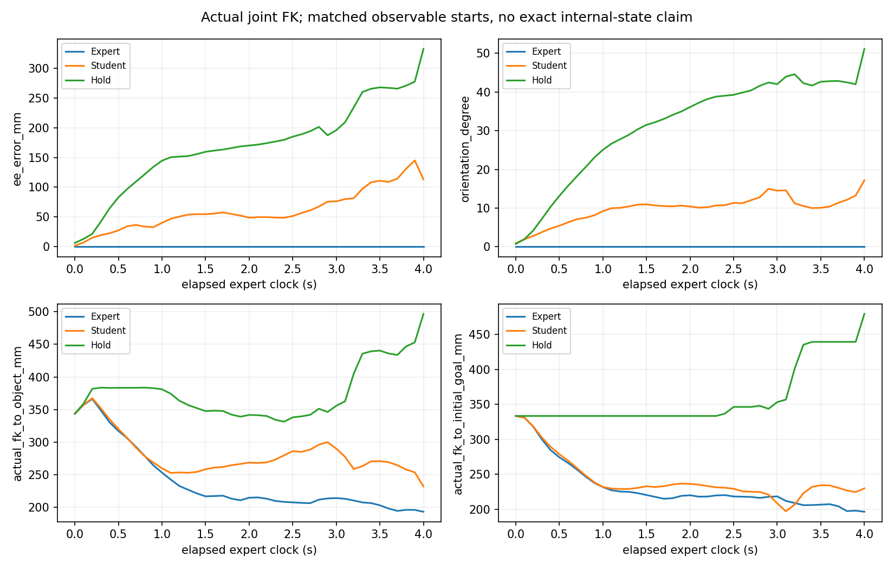

# State observation/history repair — actual results

<!-- state-motion-20261103:start -->
## StateDP运动根因对照：自动汇总，待人工审查

14:16 UTC+8退出快照：`blocked`；后续恢复启动见下节。结果按原分母保留；not run不补造结果。
[小型证据、实际命令、曲线与checkpoint身份](evidence/state_motion_20261103/summary.json)。

|模型|H/A|完成状态|train成功|validation成功|
|---|---|---|---|---|
|Original|32/12|complete|0/4（完成4）|0/8（完成8）|
|Sampling adjusted|32/12|not run|not run|not run|
|Overlap transition|32/12|complete|0/4（完成4）|0/8（完成8）|
|H24|24/12|not run|not run|not run|
|Temporal-loss|32/12|not run|not run|not run|

原400无物体专属接触：离线接触前用指尖力代理；闭环用物体过滤力。
相同可观测初态和环境随机流不代表完整PhysX内部状态逐位一致。离线误差不等于任务成功。
<!-- state-motion-20261103:end -->

## 2026-11-03 记录器/异常退出恢复：冻结训练保持原身份

用户追问为何不继续后，已推进实际恢复。10:26起的`single_takeover_12_single_00`不是
仍在训练：在位置模式切换原生专家命令时，HDF5首tick固定schema不含
`command_clipped_pre_delay`，tick12写入抛KeyError；异常进入Kit关闭后未退出，
owner仍等待worker，导致running状态长期不更新。没有参数训练处于运行状态。
只终止已报错的isolated benchmark PID1890506；原owner回收exit−9并退出，monitor退出，
显卡PID消失。失败19文件逐项hash保留在本地`runtime_recovery_01`，原12tick轨迹不重跑，
记为软件缺失，不计任务成功或失败，不清理partial视频/HDF5。

单轨迹原EMA继续1000updates已通过拟合Gate：Arm .00050050rad、Hand .00149603rad、
prefix12幅值比.997913、方向cosine.999839；原train1拟合成功不等于validation泛化。
该checkpoint validation8 Arm .057193rad，明显差于本组Hold .015972rad；
自主train1闭环0/1，230tick fall，有lift/首子目标和多指接触代理。C0/C2仍各0/12。

本次不编辑171项冻结runtime源码，也不改session、模型、训练配置、checkpoint或deadline。
在`tools/state_motion_recovery.py`显式包装原owner和benchmark，注册独立launcher SHA：

- 记录器保留各模式真实字段，晚出现字段及消失字段用`recorded_field_valid/<原字段路径>`
  逐tick标记；浮点缺失填NaN、整数/bool填0，仅作存储占位，绝不当观测/命令。
- takeover trace新增`command_is_position`，标明rad与原生命令单位；submitted target误差
  仅在位置前缀计算，原先跨单位比较不再作为验收指标。环境目标/队列/物理计算不变。
- 父进程只在已落盘worker_error超过5秒、或closing超过30秒时终止该worker并回收；
  不对正常训练、计算或资源等待设置这个超时。普通故障继续阻塞，原已授权启动重试上限不增加。
- 12tick失败明确记missing，不伪造committed成功；只执行原定尚未启动的24tick接管，
  然后由原`run_motion`条件顺序继续H24/temporal。没有新增FK组、采样或额外预算。

首次恢复service于14:16:18（UTC+8）退出：原定24tick接管的第一次启动在scene前
抛`std::system_error / Invalid argument`，父进程回收exit−6。只落盘5个runtime/lifecycle文件，
没有trajectory或控制动作；无完整FileThread堆栈，不把其具体根因说成已确定。
本轮两次Kit启动重试早已由C0和single_fit_loop使用，**不追加第三次、不重试24tick**。
该attempt也保留为软件缺失。源码修复没有机会在真实模式切换上验收，不能声称live acceptance。

原附件要求无法合理解决时“停止该阶段”；新`runtime_recovery_02`因此保留两个missing接管，
让已通过真实控制/单轨迹拟合门槛的独立H24训练按原阶段预算开始，然后仍执行原temporal条件流程。
34项CPU测试通过，新增pre-scene缺失分类、拒绝吞掉post-action错误、最终选型阻断和提前结束mask。
原launcher及其registration完整保存，两个失败共29文件逐项hash验证；没有扩展启动重试预算。
新service为`state-motion-20261103-01-recovery2.service`。**最终选型和held-out test因接管缺失而封锁**，
不能把后续训练完成包装成整项研究完成；后续新仿真故障仍使owner停止，不自动无限跳过。
训练截止仍11月4日06:11:57，总截止09:11:57（UTC+8）。本页开头自动汇总的blocked为
首个recovery退出时快照，当前状态必须读service和status.json；启动核验另存小证据。

14:23 UTC+8有界核验：`recovery2` active，owner2093886、worker2094890，
真实`h24_train/progress.json`为**250/1000 updates、281个已访问训练episode**。
监控只有1个自有GPU worker，空闲显存19421MiB、可用RAM32.52GB，60秒整卡均值48.06%，
没有资源暂停。此后由普通owner推进，启动快照不是最终训练/闭环结果。
171源码、11保护产物和29失败文件hash核验通过，原session/hash和deadline不变。
[恢复核验及公开变换记录](evidence/state_motion_20261103/recovery_startup_review.json)。

原自动汇总14:16资源快照整卡均值25.60%、最大完整60秒67.23%，408.18秒监测间隔；
本轮允许短峰、目标约50%，不能声称全程监控无缺口或未干扰其他任务。
本次补交已有sampling16/40和overlap的聚合CSV、joint/motion曲线、C0/C2闭环图；
公开JSON仅清除本机绝对路径、CSV仅统一LF，原outputs不动。
单轨迹训练只有一个记录milestone，训练图加可见点标记，不伪造下降曲线。






## 2026-11-03 追加只读审计：数据覆盖、末端空间误差、延迟合同

**没有中断当前训练，也没有改动冻结源码、session或调度。** 本次只在现有report工具增加
CPU分析入口，分析源码在冻结清单之外；171项运行源码、原best EMA和数据索引保持一致。
在本次审计中的机器快照，C0/C2均已完成0/12，A0保留、C1未启动，owner已进入
`single_fit_1000`，最后保存的快照为`single_takeover_12_single_00`；
这不是整轮训练完成的声明。原固定deadline不变。
没有启动新Kit、采集、GPU worker、FK训练或新test推理。证据目录为
[fk_readonly](evidence/state_motion_20261103/fk_readonly/)，原H32/19000保持独立基线。

### 数据有效性与覆盖：没有发现静止窗口主导，但320条充分性尚未证明

分析train320和validation40的完整数值轨迹；test40仅参与原400控制/FK完整性审计，
不用于覆盖结论、超参数或模型选择。物体/目标坐标均转入机器人基座，排除四环境world平移。

|指标|train320|validation40|
|---|---:|---:|
|原生60Hz时间步|64,825|8,670|
|长度均值 / 中位数 / p95（tick）|202.58 / 195.5 / 277|216.75 / 202.5 / 370.35|
|长度最大（tick）|509|539|
|Arm7实际全轨迹关节范围均值（rad，依关节1–7）|.2428,.2025,.2887,.2427,.2309,.2401,.3320|.2452,.1901,.2803,.2633,.2394,.2553,.3198|
|初始物体XYZ均值（m，base frame）|(.00066,−.80418,.63352)|(.00515,−.80519,.63224)|
|初始目标XYZ均值（m，base frame）|(−.00012,−.80476,.71604)|(.00994,−.78368,.71637)|
|完整H32窗口 / 所有12tick anchor|4,730 / 5,547|638 / 739|
|完整H32目标Arm7范围RMS中位数（rad）|.06482|.06364|
|完整H32目标或实际Arm范围RMS<.01rad比例|0% / 0%|0% / 0%|
|完整prefix12实际Arm范围RMS<.01rad比例|0.2664%|0.4255%|
|64点时间归一化Arm轨迹最近train邻居RMS均值（rad）|.08710（排除自身）|.09022|

静止定义是各关节窗口峰峰值的Arm7 RMS，包含anchor之前已应用目标；另外报告.001/.005/.01rad
三种阈值及Hand22。完整12/32/96窗口的目标Arm和Arm+Hand静止比例均0；不足长度的末尾窗口
没有冒充完整窗口，但其有效标签保留在阶段覆盖统计。H32末尾不完整anchor为train817、val101。
这些数值不支持“多数静止窗口压倒运动监督”，也不等于每个关节每时刻都在运动。

初始Arm7 train/val均值依次：
`[-1.41025,1.41460,.01803,1.25236,-.01203,1.34165,1.17433]` /
`[-1.39401,1.43197,-.00620,1.23903,.03004,1.36754,1.19070]` rad。
逐关节初始分布最大KS=.14688；物体XYZ最大KS=.19063；目标XYZ最大KS=.24375，
对应目标Y的均值差+21.08mm、Wasserstein21.32mm。长度均值差14.17tick，验证尾部更长。
初始Arm有4个坐标观测超出train逐维范围，物体X有1个，不能把逐维覆盖当作联合空间覆盖。
最近邻距离使用64点线性重采样、绝对Arm7姿态，无平移配准或DTW；近邻距离非零不证明样本独立。
结论是可用于当前受控拟合诊断，**不能据此宣布320条已足够泛化，也没有证据直接扩数据**。

原数据没有object-filtered contact。以下“接近/首次接触/抓持”只能分别用首次有效聚合指尖
>0.1N之前、首次触发后6tick、至少两指连续6tick接触的代理；可能含桌面接触，
不能命名为真实首次物体接触或稳定抓持。native lift和首子目标优先覆盖代理。

|阶段|train步数占比|val步数占比|train anchor占比|val anchor占比|train H32有效标签占比|val H32有效标签占比|
|---|---:|---:|---:|---:|---:|---:|
|接近代理|33.535%|31.615%|35.569%|33.424%|30.265%|28.546%|
|首次接触代理|2.933%|2.745%|2.542%|2.977%|2.991%|2.712%|
|其余接触后|15.693%|17.855%|15.071%|18.268%|16.423%|18.686%|
|持续多指代理|21.452%|18.847%|21.309%|17.321%|22.571%|19.747%|
|native lift|5.368%|6.298%|5.246%|6.225%|5.656%|6.590%|
|首子目标后|21.020%|22.641%|20.263%|21.786%|22.094%|23.720%|

H32标签占比包含相邻计划重叠和有效尾部，不等于优化器梯度占比（Loss B仍按段内有效标签归一化）。
已有采样审计重建832个96tick段、38,000次访问，每段45–46次，无段级异常重复。
逐维分位数、KS/Wasserstein、逐episode阶段数和邻居保存在
[data_coverage.json](evidence/state_motion_20261103/fk_readonly/data_coverage.json)、
[逐轨迹数据](evidence/state_motion_20261103/fk_readonly/data_episodes.csv)和
[最近邻](evidence/state_motion_20261103/fk_readonly/trajectory_neighbours.csv)。





### FK验证和空间误差：目标与实际运动严格分开

使用原资产`assets/urdf/kuka_sharpa_description/iiwa14_left_sharpa_adjusted_restricted.urdf`，
SHA `3c36492da57eb4326068a0b97b2d064034035d9037c07e345a1317ead195fb71`。
关节顺序由每条metadata的canonical29核对，前7为`iiwa14_joint_1…7`；
根为`iiwa14_link_0`，记录字段`palm_body_pose_w`实际指`iiwa14_link_7`。
它是link/actor frame，不是COM、指尖接触点或末端fixed link_ee（后者额外偏移45mm）。
完整root quaternion以wxyz解释，应用base→world旋转和平移，没有拟合标定偏置。
源码：`scene_utils.PALM_BODY_NAME`、`sim/environment.py::_diagnostics`、
`kinematics.EncoderKinematics`；实际导入的IsaacLab_DexAssemble-sharpa
`articulation_data.body_state_w`也明确其pose来自body_link_pose_w。
以实际q对照记录的body pose，不用动作target验证资产。

全部400条before+after共163,788姿态：位置RMSE **.000565mm**、最大**.001719mm**；
姿态RMSE **.00002081°**、最大**.00006369°**，通过预设.1mm/.05°核验。
[完整FK验收](evidence/state_motion_20261103/fk_readonly/fk_validation.json)。

原H32/19000 EMA在完整validation40做只读CPU FP32推理，DDIM16/clipFalse，每episode seed7091，
严格重建原生60Hz历史，计每12tick计划的有效前12目标，共8,670项。CPU与CUDA的随机流
不逐位一致，新增结果不能冒充原GPU采样结果或原test指标。
Student与Expert均对各自目标关节做FK；Hold保持该anchor观测到的已应用目标。

|阶段|Student末端XYZ RMSE（mm）|Student三维RMSE（mm）|Hold三维RMSE（mm）|Student姿态RMS / Hold（°）|Student沿专家方向误差均值 / RMS（mm）|
|---|---|---:|---:|---|---|
|全部8,670步|12.77 / 7.75 / 8.14|17.01|19.83|2.902 / 2.752|−3.87 / 11.78|
|接近代理2,741步|13.76 / 8.14 / 8.41|18.06|22.09|3.007 / 3.087|−3.73 / 12.71|
|其余5,929步|12.28 / 7.56 / 8.01|16.50|18.70|2.852 / 2.582|−3.94 / 11.32|

Expert自身参考误差为0。沿专家方向取`FK(expert_target)-FK(anchor_previous_target)`单位向量，
仅计专家位移>1mm，负值表示沿该方向落后；不把零位移强行定义方向。

|Arm关节|Student全部RMSE（rad）|Student接近RMSE（rad）|Hold接近RMSE（rad）|
|---|---:|---:|---:|
|1|.017488|.018206|.016347|
|2|.012604|.013155|.016481|
|3|.023059|.022717|.016444|
|4|.018497|.017706|.016297|
|5|.022612|.023849|.016783|
|6|.018098|.016595|.015756|
|7|.028379|.028992|.015747|

关节MSE劣于Hold不等于空间误差一定更差：这里Student接近末端三维RMSE比Hold低18.24%。
仍有厘米级误差，但不能声称FK loss已经必要或已带来收益。
按episode配对的接近RMSE差Student−Hold均值−3.666mm，
固定seed的5,000次episode bootstrap 95%区间[−5.779,−1.430]mm；这不是成功率置信区间。
[逐episode/阶段数值](evidence/state_motion_20261103/fk_readonly/offline_fk.json)含episode bootstrap差异，
[带样本/episode分母的时间曲线](evidence/state_motion_20261103/fk_readonly/offline_fk_aggregate_curves.csv)。
图中距离是link7参考点到**对应观察时刻**物体中心/任务goal位置，单位mm；
不等于指尖间隙或碰撞距离，晚时段样本数较少，不补零、不延长已结束轨迹。



独立复核现有C0原12条闭环：Student **0/12**（train0/4、val0/8），在线Expert **12/12**。
12条均满足已有approach_proxy且均有过滤物体接触；2条lift、1条首子目标，仍无完整成功。
所以本cohort没有“未达到接近代理”的对照，不能估计末端误差与接近失败的统计相关性，
更不能把全任务失败唯一归因为接近失败。C2也0/12，12条接近代理、11条过滤物体接触。
相同可观测初态，按专家首次物体接触之前的810个等时tick对比：
**实际q FK**的Student三维RMSE39.07mm，Hold固定初始q为116.33mm；
**Student目标FK与专家目标FK**另算40.47mm。接触后实际q FK为68.96mm。
实际轨迹离线空间偏差大于teacher-forced目标误差，符合闭环分布偏移假说，
但相同可观测初态不代表PhysX内部状态完全相同。Hold只是几何反事实，没有新Hold闭环成功率。
[闭环逐条证据](evidence/state_motion_20261103/fk_readonly/closed_loop_fk.json)。



### 延迟与控制等价性：处理后位置不能再加一次延迟

全部400/81,894步精确核验：raw_action=submitted_action，clamp后等于pre-delay command；
旧`executed_action`也是pre-delay别名，真正delayed command位于control_trace。
原player确定性mu先clamp/rescale，当前记录没有保存未裁剪mu，因此“raw”不是网络logit。
队列初始化填当前command→roll→新command入slot0→均匀抽index0/1/2→选择延迟command。
然后Arm增量`prev+1.5×dt×command`→限位→.1/.9 EMA→再次限位；
Hand先按限位把[-1,1]映射绝对位置→.1/.9 EMA→限位→更新target buffer→两个120Hz子步执行。
完整canonical/Lab映射和时序关系见[动作合同](POSITION_ACTION_CONTRACT.md)。

delay index计数0/1/2为27,063/27,568/27,263；有效lag为27,324/27,558/27,012，
平均16.603ms、p95/max33.333ms。388步index≠effective lag源于启动队列填充；
54,554步delayed command不同于当前command。2,374,926个目标标量全部逐值一致，
before=obs target、after[t]=before[t+1]、selected timestamp误差0；
time_after−time_before−dt最大浮点误差5.60e−14s。
[全量审计](evidence/state_motion_20261103/fk_readonly/delay_audit.json)。

合法合同A：当前观察→预测处理后target→直接执行，不重复delay/平滑；
合法合同B：当前观察→预测pre-delay command→完整原生queue/增量/EMA/执行器。
只在相同目标序列、外生事件及初始内部状态条件下，A/B可产生同一物理轨迹。
已有fresh_982501/982502注入证据：A回放2/2、168/153tick、14字段精确；
B回放2/2、同样168/153tick、16字段精确。本次复用并核验旧证据，不新增Kit尝试，
也不推广成历史四环境全部可精确重放。

**闭环动作分布确有差异。** 专家原生Arm每关节每tick最大变化.002500057rad；
现有C0中6,662/6,663tick至少一关节超过.002501rad，35,158/46,641关节步超出，
最大.204428rad。A只限关节范围，不限制原生delta/EMA能产生的变化速度。
这说明目标序列支持集不同，不能据此把A合同判成bug，也不能直接在线增加队列/限速。
当前不公平的Native1000 vs Position19000不用于表示优劣结论。
后续若比较A/B，必须同320/40/40、同初始化规则/19000update预算、相同60/120Hz和预登记初态；
现有注入验收仅解决控制合同，不解决学习难度和闭环状态分布。

### FK辅助项：完成只读梯度诊断，独立训练等待当前冻结会话结束

参考[Ma等，CVPR2024 HDP，§4.3](https://arxiv.org/html/2403.03890v1#S4.SS3)的可微FK
将关节轨迹约束到末端空间的思想。论文还包含双扩散器、层级next-best pose和inpainting；
这里不引入这些架构，也不把简单监督FK项称为完整HDP复现。

候选保持29D、原Loss B、H32/A12/GRU/U-Net全不变，仅：
`L=L_B+lambda*mean_valid ||FK((x0_hat-offset)/scale)-FK(q_expert_target)||²`。
当前prediction_type=sample，denoiser输出就是归一化clean x0；FK输入反归一化弧度，
输出米，辅助项单位m²，不对噪声xt、归一化关节或实际到达姿态计算此监督。
与原horizon标签共用valid mask，不在loss前detach或转换numpy；不会覆盖原Loss B。

原EMA、排序前3个train身份首96tick、固定noise6193的CPU梯度探针共768有效H32标签，
没有optimizer.step。测量denoiser全部参数梯度及归一化x0 Arm7梯度；
手部输出与padding FK梯度为0，autograd/有限差分通过。
以`min(.10/max denoiser FK:B gradient ratio, .20/max Arm7-output FK:B ratio)`校准，
候选lambda=.195539 m⁻²：三段参数梯度比例10.00%/4.78%/7.00%，
Arm输出比例13.88%/11.64%/13.57%。若用mm²，同项系数必须除1e6。
[梯度证据](evidence/state_motion_20261103/fk_readonly/fk_gradient_diagnostic.json)。
这是已训练EMA上的可行性探针，condition detached；正式新初始化还需全网络梯度复核，
不能把此数直接当作最终训练权重。

**本次未实现运行时FK loss或启动FK训练。** 接近误差已有厘米级证据，但本cohort全有接近/接触，
尚不能建立“空间误差→接近失败”关系。先保留这个结论和H32基线。当前owner已开始single-fit，
不热改代码/hash/调度，也不为新要求无条件再追加19000updates。
冻结会话结束后优先复核训练/接管轨迹的空间错误；若需要独立FK训练，只替代届时仍未开始且证据较弱
的辅助组预算，已开始组不打断。新身份沿用原H32 seed/初始化、AdamW、96tick×2、
train320-only统计、19000上限/相同milestones与选模规则，校准后冻结lambda；
不得混H24、temporal、额外delay、采样变更。原H32及等update里程碑保留，
相同12初态/策略seed报告末端误差、接触/抬升及完整闭环成功分母，test仍只最终一次。
如预算已用完，只记录候选，不自动扩时或开新长训练。

复现（CPU，两线程，指定空闲核；输出只写ignored report目录）：

```bash
CUDA_VISIBLE_DEVICES='' RESEARCH_CPUS=20,21 bash visuotactile/run_cpu.sh -m tools.state_history_report \
  --root outputs/visuotactile/native_dp_v2/state_motion_20261103_01 \
  --output outputs/visuotactile/native_dp_v2/state_motion_20261103_01/report/fk_readonly --fk-data-audit all
# 同入口 --fk-data-audit gradient 是单独的3段只读梯度探针。
```

21项相关CPU测试通过；原运行源码与资产未编辑，统计/图片和少量CSV公开，HDF5/NPZ/权重不上传。

## 2026-11-03 StateDP运动根因对照：已实现，实测状态另读运行文件

本轮使用当前`feature/native-dp-training-v2`，保留`7234bcf`及全部历史结果。
唯一新root：`outputs/visuotactile/native_dp_v2/state_motion_20261103_01`。
复用原H32/19000 best EMA（SHA `5ecc930ffd52af166e00904b0515159193d8527d9f5726908bf57967c445a416`），
不重新解释sample权重，不改原400、320/40/40、train-only统计和绝对位置标签。
实现`14ecedf`及109项CPU回归已通过。09:12（UTC+8）一次启动核验：真实Kit单步通过、
父进程确认PID/GPU释放；服务`state-motion-20261103-01.service` active，已进入`sampling16`。
这只确认实际离线计算启动，不代表六组对照、闭环或新训练完成。
[启动实证](evidence/state_motion_20261103/startup_review.json)、[冻结配置](evidence/state_motion_20261103/preregistration.json)。
本轮起点11月3日09:11:57，Gate截止12:11:57，训练截止11月4日06:11:57，总截止09:11:57（均UTC+8）。

预注册：validation按identity排序前16条，种子7091/7092/7093；DDIM16/32/100分别clip false/true。
运动区间为完整有效前12（另报32）步的Arm7目标终点相对当前target RMS位移大于0.01rad。
主指标为逐episode/seed配对的运动区间Arm7 RMSE（rad）：候选至少改善3%，整体Arm7/Hand22
误差均不超过基准102%，方向cosine不降低超过0.02，包含12次native记忆更新的B1规划周期p95≤200ms。
筛选至多两候选与A0在validation40确认，再选至多一个不同采样配置进入C1；C0保留原设置。
超过时延的配置只作诊断，实际闭环额外测量完整controller.act（含输入构造/传输）。
clip由已安装diffusers0.39.0真实DDIM实现，在预测x0的训练归一化坐标裁剪；随后反归一化成rad。
保留默认use_clipped_model_output=False，不悄悄改变其它scheduler参数。

C0/C1沿用原train4+validation8初态和环境seed，策略seed7091；K4仅在teacher-forced或on-policy
边界/内部跳变RMS比>1.5时启动C2。无不同C1则只比较C0/C2。old[12]与new[0]时间一致，
K4新目标权重1/4、1/2、3/4、1；不改变H32/A12或下层控制。同初态/seed不声称PhysX内部状态完全相同。
至少2个validation完整成功且第二策略seed在相同两初态复现，先保留基线、扩8个validation身份；不强行训练E/F。

若无可重复完整成功，单轨迹诊断在原best基础上、同架构，最多1000→3000 updates；仅用预注册第一train
身份拟合，复用train320统计。继续E/F需train Arm≤0.005rad、Hand≤0.03rad、运动幅值比0.8–1.2。
未过门槛只说明有限预算内未通过拟合验收，不证明网络容量不足。拟合后闭环失败则做12/24tick学生接管、
持续更新hidden的真实专家恢复；恢复是原生命令模式，原delay queue未改，模式切换限制明确记录，不能计自主成功。
E为H24，其余原设置；F为H32/Loss B加Arm7相邻x0差分，系数以首3个train段尺度校准
`min(0.1,0.05*L_B/L_temporal)`一次后冻结。两者独立新初始化，保持原seed/AdamW/LR horizon19000/96tick×2采样。
每阶段检查运动/整体误差和4条短cohort；连续两阶段无1%运动改善且过拟合或动作退化才早停。
原H32同update历史指标并列；[原采样访问审计](evidence/state_motion_20261103/sampling_audit_summary.json)
实测重建320身份、832段、38000段访问，每段45–46次，每episode90–274次（长度差异导致）。
未发现段级异常重复；这是重建原采样顺序，不是新训练覆盖。没有混入采样策略改动。无ImageDP、StateBC或触觉训练。

所有执行命令写入`*_launch.json`；机器状态为`status.json`，暂停本轮可创建`STOP`文件。
启动：`bash visuotactile/run_cpu.sh -m visuotactile.state_full_run motion-init --root <root>`，
随后同入口`run --root <root>`由独立服务运行。分析worker为`visuotactile.state_motion --root <root> --output <stage> --job <job.json>`；
只读汇总用该模块`--report`。自动汇总更新本文件和小型JSON/CSV/PNG，Git仍需审查，不自动上传大产物。


## 2026-11-03：H32位置训练和最终评估结束，尚无完整自主成功

`position_20261103_01`于 **04:45:10（UTC+8）**结束，服务inactive/dead，owner、worker和monitor均已退出。
机器状态为`position_study_finished`、`research_success=false`。位置StateDP完成19000 updates，
最终选定模型完整评估 **0/12：train 0/4、validation 0/8**，没有缺失的最终结果。
Image两组均未启动：预注册8条validation中的完整成功为0，未达到至少2个不同起点成功的门槛。
本轮不再自动增加更新、重试、H24或新轨迹；没有新增StateBC训练。

### 模型、训练与闭环

保留Actor141+robot178+geometry85+独立持续GRU256、U-Net、sample/Loss B、DDIM16；
72,047,005个参数，H32/执行12，规划5Hz、控制60Hz、物理120Hz。位置动作是直接记录的
29D `target_after_rad`，部署按原执行器限位提交绝对弧度，合同`position_rad_v1`。
全部train320参与训练，validation40选模，冻结后两模型各做一次offline test40。
训练集曲线仅固定前16条的指标，不冒充全train320指标。H24未执行。

|模型|实际updates|选定模型train/validation完整成功|原生终止|局部阶段|
|---|---:|---|---|---|
|H32 Native-command短对照|1000|0/4、0/8|11 timeout、1 fall|无lift/首子目标|
|H32 Position StateDP|19000|0/4、0/8|10 timeout、2 fall|2条lift、1条首子目标及alignment|

位置模型的训练初态`r931005_1793209376_e02_p000059`在第115 tick达到首子目标，
最终717 tick timeout；没有完整成功，该条自身native lift标志为false。两条lift均最终fall。
上述局部进展不能称为验证集成功。里程碑和最终模型重复起点的结果分列，不能合并为独立样本。
1000/3000/6000/10000/19000位置validation分别0/8、0/8、0/7完成+1启动缺失、0/8、0/8。

位置validation前12步arm/hand RMSE从1000时0.044552/0.176333降至19000时
**0.020641/0.110750 rad**；冻结后的test40为 **0.022406/0.112744 rad**。
但hold-current-target基线的arm误差更低（validation 0.015538、test 0.015746 rad），
hand基线较差（0.196482/0.197362 rad）。低离线误差仍未转化为完整任务成功。
19000由validation first12 balanced MSE选择；diffusion loss在10000时0.008629，
19000反升至0.012547，不能声称所有验证指标持续改善。
原生命令对照validation arm/hand为0.767768/0.582914、test为0.747553/0.564498，
单位与位置弧度不同，不能直接比较数值倍数。1000与19000预算不同，也不能把差异唯一归因于动作语义。

最佳位置checkpoint：
`outputs/visuotactile/native_dp_v2/position_20261103_01/position_h32_train/best.pt`，
SHA256 `5ecc930ffd52af166e00904b0515159193d8527d9f5726908bf57967c445a416`。
原生命令best SHA256 `efb9a3f4b560f4024f1382a3ef9531827ba5d4a76fadb23a861625e8596c5ddf`。
[实际模型配置](evidence/position_20261103/model_configuration.json)、
[完整训练指标](evidence/position_20261103/results/position_h32_train.json)、
[最终逐条结果](evidence/position_20261103/results/position_h32_selected.json)、
[离线test40](evidence/position_20261103/results/position_h32_offline_test.json)。

### 已有故障归因证据

原400/81,894直接位置标签核验通过；新鲜专家2/2及位置重放2/2完整成功（168/153 tick），
14项控制/物理字段逐字节一致，提交和真实执行器target误差均0。
学习cohort在线专家 **12/12完整成功**。真实train/val各一条共310 tick通过在线输入路径，
robot178最大差3.58e-7，Actor/geometry/target差0。这些证明所测条件下接口有效，不证明学生能力。

选定位置学生12条的reset Actor均与对应在线专家完全相同；预测目标从第0步开始不同，
第0个动作后的q/target与专家差异均已超过1mrad。12条的hand target RMSE均在对应专家
首次物体接触前超过0.1rad（逐条tick见下方summary）。首步arm/hand RMSE跨轨迹均值
0.017588/0.051204 rad；重规划边界跳变量RMS均值0.070083 rad，chunk内部0.023435 rad。
完整学生trace的提交目标、记录目标和两个物理子步执行器目标逐字节一致；
实际q跟踪target的arm/hand RMSE跨轨迹均值0.013351/0.058156 rad。
因此已完成的失败不能归因于目标没有送达执行器；错误决策在接触前已经出现。
训练的教师强制过去目标与部署的学生历史，以及重规划连续性，仍是待干预验证的学习问题，
现有证据不能将任何一个因素确定为唯一根因，也不支持废弃原400条成功数据。

Kit关闭故障经显式独立worker退出得到缓解，4/4隔离probe通过父进程PID/GPU释放核验。
启动仍有故障：正式学生阶段两次有界恢复成功；6000 validation第3条在场景建立前SIGABRT，
未进入预期异常分类，保留为缺失并继续后续独立评价。该故障不影响最终选定模型12条全部完成。
详见[KIT_RELIABILITY](KIT_RELIABILITY.md)，不能声称SDK根因已经修复。

### 核验、曲线与观看证据

本次只读收尾核对170项运行源码hash、119项stage结果hash、两份best权重hash、
全部12条有限值trace及15条已完整解码视频的当前hash。之前89项相关回归测试通过；
本次未改源码，未重复训练、仿真或测试。
整卡采样时间加权均值37.8656%、最大完整60秒均值57.2718%；missing_samples为0，
但记录有1376.63秒监测间隔、最大间隔911.35秒（包含早期停机修订），不声称全时段覆盖。
当前资源协议没有固定利用率上限；没有其他项目吞吐指标，不声称零干扰。

[收尾核验](evidence/position_20261103/completed_review.json) /
[逐轨迹首次分歧与分阶段误差](evidence/position_20261103/results/summary.json) /
[学习、跟踪与阶段曲线](evidence/position_20261103/results/position_curves.png) /
[资源曲线](evidence/position_20261103/results/resource_curves.png) /
[15条视频解码清单](evidence/position_20261103/results/video_decode.json)。
曲线中不同profile的action RMSE单位分别为原生命令、rad；各cohort不合并，缺失不计任务失败。

本地代表视频（不上传）：
[对应专家成功145帧](../outputs/visuotactile/native_dp_v2/position_20261103_01/expert_learning_single_00/r931005_1793209376_e00_p000000/rollout.mp4) /
[位置学生lift后fall339帧](../outputs/visuotactile/native_dp_v2/position_20261103_01/position_h32_selected_single_00/r931005_1793209376_e00_p000000/rollout.mp4)。
达到首子目标的另一条只有完整numeric trace，没有录像，不能用这条fall视频冒充。

## 2026-11-03 00:19 UTC+8：训练完成，评估不完整，尚无学生完整成功

旧state_full服务inactive，owner/全部自有worker/monitor于11月2日23:21:53退出。
机器状态为`training_complete_evaluation_incomplete`，不是整个实验complete。
StateBC完成10000updates，StateDP完成19000updates；两者均train320/validation40，
覆盖全部320训练身份，按验证集选择10000/19000的EMA，未使用test选择。

|模型/评估|完整成功/已完成|其他实测结果|缺失项|
|---|---:|---|---|
|BC所选10000|0/12|fresh0/4、train0/4、val0/4；全601timeout，无lift/子目标|无|
|DP19000里程碑|0/4|train1条lift后254步fall；另3条601timeout；无子目标|无|
|DP所选19000|0/5|fresh4条601timeout；train1条lift后273步fall；无子目标|第6条启动失败，后6条未启动|

DP里程碑与所选模型诊断分开计数，不合并为9个独立起点。
第6条`dp_single_05`在建立场景前发生FileThread/std::system_error SIGABRT(-6)，
只有runtime_controls.json，无动作或轨迹；该条未知任务结果，不能记为任务失败或成功。
另有DP10000里程碑第4条启动SIGSEGV缺失。三次自动Kit恢复已消耗，未追加重试。
因为两项deferred未解决，旧State12条对照、新test40离线和各组正式20条均未开始。
因此当前不能给出完整正式成功率或新旧State在同一新cohort上的最终改善幅度。

最终validation前12步arm/hand RMSE：BC0.617104/0.491214，DP0.715060/0.500374。
DP从10000步0.798099/0.559021继续下降，仍未形成完整成功。
训练指标仅固定前16条：BC0.540785/0.468841，DP0.612155/0.436233；
优化器实际使用全部train320，不能将16条指标当成全部训练分布指标。

所选DP已完成5条的reset Actor与对应专家均逐字节相同，第0步arm/hand命令已偏离；
reset动作RMSE跨轨迹平均0.619776/0.275060。chunk边界/内部跳变量RMS平均
0.455739/0.188447，提示重规划不连续；尚无因果干预证明其为唯一原因。
在线专家12/12成功与fresh replay2/2 exact16仍支持可运行场景下的控制基础设施。
软件启动不稳定解释缺失评估，不能解释已经实际完成的学生闭环失败。

只读收尾核验169源码哈希、88已提交stage结果、两份best权重SHA；
复用14条视频完整解码结果并重新核对文件哈希，全部通过，未新增训练或仿真。
资源报告含13279.81秒监测间隔（包括停机），整卡采样均值36.599%、最大完整60秒69.208%；
当前协议无固定利用率上限，且无另一项目吞吐指标，不能据此声称零干扰或全时段覆盖。
证据：[训练完成核验](evidence/state_shared_20261102/training_complete_review.json)、
[学习曲线](evidence/state_shared_20261102/results/learning_curves.png)、
[逐轨迹诊断](evidence/state_shared_20261102/results/summary.json)。
旧运行的逐次恢复快照和自动表已从当前报告去重；完整历史仍可由基准提交f1953c7中的本文件及上述小证据恢复。


## 本轮固定预算与保留边界（服务已结束）

同一root的deadline不重置：Gate为11月3日03:55:10，训练为21:55:10，绝对终点11月4日00:55:10（UTC+8）。
Stage前后核验源码/数据哈希，位置normalizer只用train320，第一阶段1000后的arm/hand误差阈值均0.25rad。
学习初态专家控制要求完整12条合法结果、至少10条成功且validation至少6/8；原生成功定义不变。
State较长训练在验证连续两次无1%改善时停止，低误差不能替代完整任务成功。
两组Image原计划各按300/1000/3000有界预算顺序执行；本轮State成功Gate未通过，均未开始。
Image只读三路RGB-D、机器人本体和严格过去位置历史，不读Actor/特权几何。

原400、旧best及所有milestone保留。已删除4份与best内部逐成员SHA一致的last副本及旧可重建numeric cache，
释放2,512,265,377字节；清单见[evidence/position_20261103/cleanup.json](evidence/position_20261103/cleanup.json)。
本报告删去重复的运行中快照，不删历史Git或重要旧失败结果。普通owner已完成自动整理；
本次人工复核后仅提交核心报告、去重小JSON和曲线，不上传权重、原数据、MP4或NPZ。


## 收尾实测表（已与原始结果复核）

此表只读取普通owner结束后的产物，不新增训练或rollout。旧/前置失效样本不混入新分母。
“已完成”仅统计有原生结果的轨迹；6000 validation另有1次启动失败，已尝试8、完成7，结果未知。

|组|cohort|已完成|合法|完整成功|native lift|至少1子目标|
|---|---|---:|---:|---:|---:|---:|
|expert|fresh|2|2|2|0|2|
|expert_learning|train|4|4|4|2|4|
|expert_learning|validation|8|8|8|4|8|
|native_h32_loop_1000|train|2|2|0|0|0|
|native_h32_loop_1000|validation|2|2|0|0|0|
|native_h32_selected|train|4|4|0|0|0|
|native_h32_selected|validation|8|8|0|0|0|
|position_h32_loop_1000|train|2|2|0|1|0|
|position_h32_loop_1000|validation|2|2|0|0|0|
|position_h32_loop_10000|train|2|2|0|0|0|
|position_h32_loop_10000|validation|2|2|0|0|0|
|position_h32_loop_19000|train|2|2|0|2|0|
|position_h32_loop_19000|validation|2|2|0|0|0|
|position_h32_loop_3000|train|2|2|0|2|0|
|position_h32_loop_3000|validation|2|2|0|1|0|
|position_h32_loop_6000|train|2|2|0|1|0|
|position_h32_loop_6000|validation|2|2|0|0|0|
|position_h32_selected|train|4|4|0|2|1|
|position_h32_selected|validation|8|8|0|0|0|
|position_h32_validation_1000|validation|8|8|0|1|0|
|position_h32_validation_10000|validation|8|8|0|0|0|
|position_h32_validation_19000|validation|8|8|0|0|0|
|position_h32_validation_3000|validation|8|8|0|1|0|
|position_h32_validation_6000|validation|7|7|0|0|0|
|position_replay|fresh|2|2|2|0|2|

|组|updates|固定train16 arm/hand RMSE|validation40 arm/hand RMSE|
|---|---:|---|---|
|native_h32|1000|0.735955/0.560575|0.767768/0.582914|
|position_h32|1000|0.039490/0.166288|0.044552/0.176333|
|position_h32|3000|0.024006/0.126084|0.030114/0.146135|
|position_h32|6000|0.018490/0.105303|0.024476/0.130733|
|position_h32|10000|0.014195/0.077889|0.021932/0.119499|
|position_h32|19000|0.009947/0.041417|0.020641/0.110750|

最终owner状态：`{"state": "position_study_finished", "utc": 1793652309.8322816, "research_success": false, "image": {"state": "not_started", "reason": "Fewer than two complete native successes on a complete preregistered eight-ID validation cohort"}}`。

逐条reset误差、接触前后首差及阶段误差见公开`summary.json/trace_diagnostics`。
这些观测不唯一证明网络失败机制；同输入/同命令验收与完整成功分开报告。
