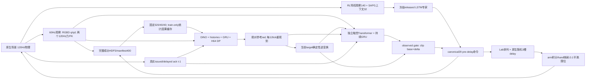
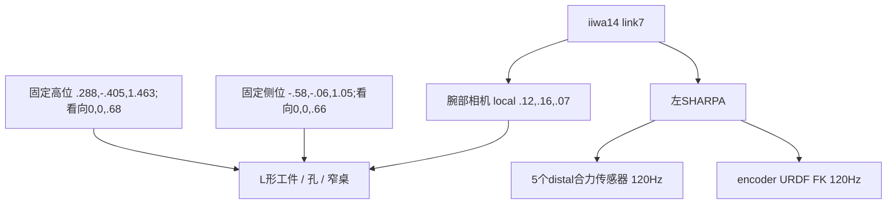
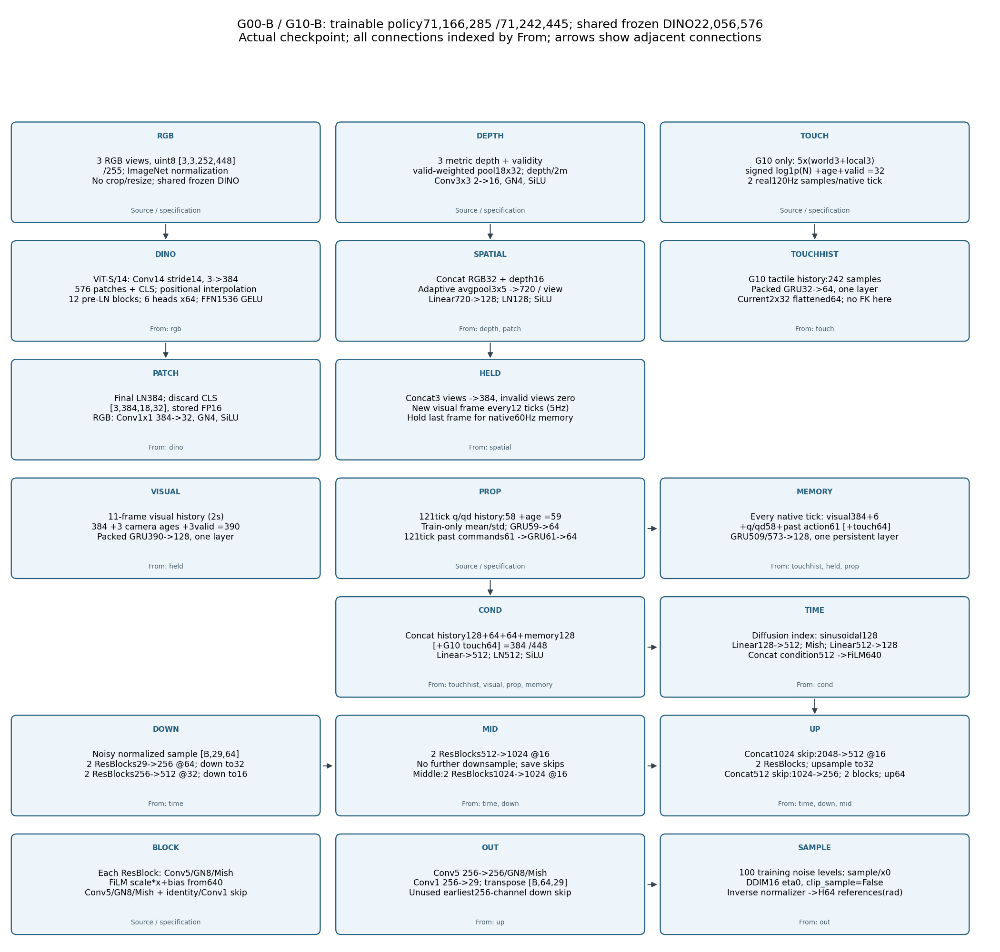
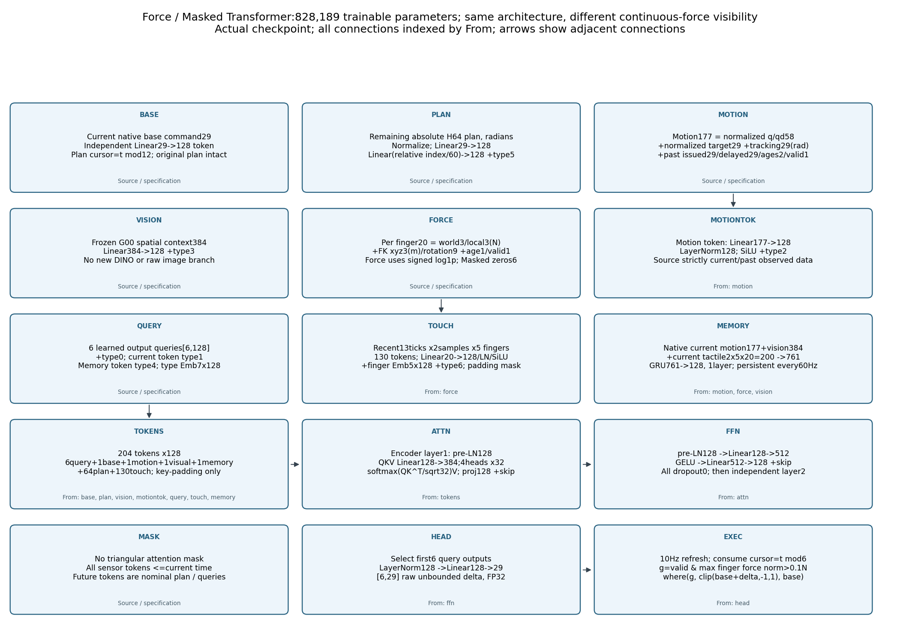

# 完整系统架构、控制接口与历史实验审计

审计日期：2026-10-31，时间使用 Asia/Shanghai。起点 `a07d0aa789ad1ac9c7fc769e6cb22921d8cf9513`，
分支 `feature/trained-tactile-residual`，起始工作树干净。本文是当前系统说明；历史文档中的“当前训练中”不代表实时状态。
文档首版已由 `6022330` 提交并推送；本文已更新为局部修复完成状态。没有启动新训练、Kit 或 GPU 实验；新仿真分配为 0/12。
本轮没有改变原生任务或研究 wrapper 的物理行为。

## 1. 可以直接作出的判断

1. **RL、命令DP、绝对参考DP、两代残差、T0最终都调用同一个原生控制器。**
   29D并不是统一位置或速度：arm7是目标积分命令，hand22是绝对目标映射命令。
   本轮重新读取全部400条的81,894步，pre-delay标签、队列来源、平滑后目标、相邻目标/q和观察时间均一致。
   147条历史评估数值轨迹的delayed命令都属于当时三槽队列，最大误差0。
2. **专家数据的真实成功与T0精确重放是两个问题。** 400条最后均满足原生插入目标完成和retract成功。
   旧T0提交命令正确，但4环境持久采集被恢复成1环境，且只恢复一次CPU RNG。
   本轮用源记录每步RNG和原lane重建1,005次delay抽样，全部一致；lane3若当lane0读取，同一RNG也仅131/455相符。
   后续随机消耗、隐藏模拟器状态仍不相同。因此已定位延迟分歧机制，**没有解决完整物理精确重放**。
3. **没有发现应将当前有效400条、B0/B1或candidate2整体作废的新标签错误。**
   已知早期candidate1确实有当前动作泄漏、错误split和记忆时钟，仍是Invalid；不能把修复后的candidate2替它背书。
   有效结果也有范围：离线teacher forcing、0成功的小样本闭环、近似初态和非严格配对不能互相替代。
4. **Loss B已成为以后正式H64 DP的唯一默认主线。** B为arm7/hand22组内均值各50%，没有五指等权或前缀加权。
   A保留历史实现、权重与显式复现。训练、模型loss和调度入口默认B，checkpoint记录loss；旧缺字段按A解释且禁止静默续为B。
5. **基础可用于受控接口研究，尚不足以宣称已建立可靠自主操作或RSS方法验证基础。**
   尚缺可验收的自主接近/抬升、严格同输入同采样的残差因果闭环对照、连续力收益、独立初始化/几何泛化及精确重放状态覆盖。
   本轮无需为已经查明的多环境RNG差异重复跑同样0成功实验，也没有证据支持全面重训。

### 新证据与复用证据

| 证据 | 覆盖/结果 | 没有证明的内容 |
|---|---|---|
| [control_data_audit.json](evidence/system_audit_20261031/control_data_audit.json) | 本轮重读400条全部数值控制链；错误0；320/40/40无交集且完整覆盖 | 没重新hash70GB图像；完整H5 hash复用上一轮受保护产物核验 |
| [evaluation_control_audit.json](evidence/system_audit_20261031/evaluation_control_audit.json) | 100正式+6旧长预测+11旧残差+12损失对照+6Transformer+12T0/T1=147条；队列候选误差0 | 重复/饱和动作无法从值唯一反推delay index；没有把此检查称闭环成功 |
| [delay_rng_audit.json](evidence/system_audit_20261031/delay_rng_audit.json) | 四条T0源记录1,005次随机index全部重建 | 未把每步强设RNG用于仿真；不是物理重放 |
| [native_source_audit.json](evidence/system_audit_20261031/native_source_audit.json) | 全部跟踪的isaacsimenvs文件与固定上游比对，仅action_utils七行trace差异 | 非全栈Isaac Lab兼容认证 |
| [historical_sources.json](evidence/system_audit_20261031/historical_sources.json) | 实际config/plan/environment的文件SHA、运行源hash和checkpoint身份 | 未记录项标缺失，不用当前HEAD代替历史运行版本 |
| [network_layers.csv](evidence/network_layers.csv)、[network_parameters.csv](evidence/network_audit_20261031/network_parameters.csv) | 复用594行leaf/MHA、743行参数；真实checkpoint CPU hook/梯度 | CPU FP32探针不等同BF16历史训练或每tick部署 |
| [实验有效性矩阵](EXPERIMENT_VALIDITY_MATRIX.md)、[逐文件地图](PROJECT_FILE_MAP.md) | 各结论的版本、范围、行动；AST定义/依赖/副作用 | 单元测试通过不是所有历史实验Verified |

复现本轮CPU读取：`bash visuotactile/run_cpu.sh -m visuotactile.audit_system --output <新证据目录>`。
它只读原始产物；写新小统计及PROJECT_FILE_MAP，不启动模拟器或optimizer。外部论文未公开训练实现的部分保留Unverified。

## 2. 全系统数据流与演进



图中H→P是新G00/G10及获授权G01的实际反馈；旧B0没有这一箭头，旧GRU残差仅反馈自己的分支。
D包含专家实际执行后果；缓存P的预测没有真正控制该专家轨迹，必须叫teacher-forced replay，不能叫学生on-policy数据。

| 阶段 | 版本/来源身份 | 模型与数据合同 | 实际结果 |
|---|---|---|---|
| 原生RL与数据 | 上游`ff2fc62873f6c6cd93164123c8358e9ce2d65c9b`；采集metadata基commit `e546bca`两条、`dfcedf4`398条；实际运行文件hash另存 | released tight_insertion，schema2/trace2/storage2/layout4；398条4env、2条1env | 400自然成功，成功筛选不提供无条件专家成功率 |
| 旧B0/B1 | trainer运行`76bb58e`，正式eval plan `dc77a6b`+文件hash | command checkpoint2、memory2、own_plan/issued none；H12/commit6 | 各50epoch，best49；正式各0/50 |
| history v3诊断 | `INDEPENDENT_AUDIT_20261030`记录逐文件版本 | t−1专家命令teacher forcing；独立短前缀拟合，不改旧best | 独立7条诊断：专家1成功，学生6失败；另有启动失败 |
| GRU残差 | full训练base commit `b88d685`，train_residual SHA `e52600fc4dbc…`；完整值见证据 | 冻结B0；Residual1、真实gate、B/C独立 | 各5epoch/7875更新；11timeout+1交接中止；自主各0/2 |
| 长预测错误初版 | 第一次公开历史归档`91fc738`；更早工作树无独立可恢复commit | candidate1当前动作泄漏、split/记忆错误；G00一遍822更新 | Invalid，未闭环，不作为warm start |
| candidate2 | `91fc738`实现；full trainer SHA `2ed60c836f6c…`；eval`e65c306`+hash | 固定DINO、H64/12、sample、60Hz记忆、绝对参考 | 两组40epoch/33280更新，EMA40；各0/3，一条G10 lift后fall |
| Loss A/B | `e31da8c`开始；train_loss_study SHA `c887ef319aca…` | 同epoch40 EMA，独立新optimizer/schedule，各额外12遍9984更新 | B前12步离线误差略好；四组各0/3 |
| Transformer | `599b3c8`实现、`eef7a9d`实际混合反馈；eval`d11f953` | Force/Masked各828189参数；base冻结；past_actual_mixed_commands_v1 | 各5遍3730更新；各0/3，无触觉收益证据 |
| T0/T1 | session基commit`3ce0c18`，诊断实现首公开`a07d0aa` | 4个预选train初态近似恢复×3模式 | T0四次命令用尽删失；T1各0/4 timeout；T2旧分母保持 |

运行中工作树可能先于对应公开commit。表中base commit不是“全部文件等于该commit”的承诺；实际文件SHA优先。
旧结果应使用对应历史config/hash或`git show`解释；本轮新Loss B默认不能追溯改写旧A训练。

## 3. 原生场景、机器人与传感器

### 3.1 软件、资产和几何

本机`.venv_isaacsim`覆盖conda isaaclab：Isaac Lab本地fork2.3.2、Isaac Sim5.1.0.0、torch2.7.0+cu128，使用repo rl_games。
必须AppLauncher后导入任务；CPU物理仍需render。此前no-render首步丢失kinematic变换的结果不可作有效任务证据。
新wrapper逐step检查table/hole；此保护不会修补共享模拟器。

| 项目 | 实际内容和来源 |
|---|---|
| 任务别名 | `evaluation/problems/__init__.py:145`：tight_insertion→Lpeg_matchedmass.tol0p5mm；不是普通peg或原重质量Lpeg |
| 机器人 | KUKA iiwa14 + 左SHARPA，`assets/urdf/kuka_sharpa_description/iiwa14_left_sharpa_adjusted_restricted.urdf`，29可动关节；固定手部link合并，palm基准是iiwa14_link_7 |
| canonical顺序 | arm joints1–7，thumb5，index4，middle4，ring4，pinky5。Lab手指交错次序不同；逐关节lab index/limits/gains见[joint_contract.csv](evidence/system_audit_20261031/joint_contract.csv) |
| L形物体 | `assets/urdf/peg_in_hole/lpeg_matchedmass/lpeg_matchedmass.urdf`：两box碰撞/视觉，主条(.250,.030,.020)m，支条(.020,.080,.020)m，支条中心(.115,.025,0)m |
| 质量/惯性 | .0578kg；CoM(.020220,.004396,0)m；Ixx1.615e−5、Iyy3.611e−4、Izz3.734e−4、Ixy−2.408e−5 kg·m²。此matchedmass资产已在上游，不是本轮修改 |
| object_scale | metadata(6.25,.75,.5)用于原生keypoint尺度描述；不能再乘已按米建好的URDF盒子当实体尺寸 |
| 桌子 | table_narrow.urdf，box(.475,.4,.3)m；URDF mass500kg，场景kinematic；中心z=.38±.01m，上表面中心+.15m；XY/yaw无随机化 |
| 插入孔 | hole_tol0p5mm.urdf：底板(.080,.080,.010)，中心z=.005；左右壁(.0295,.080,.050)，x=±.02525,z=.035；前后壁(.021,.0245,.050)，y=±.02775,z=.035m；URDF mass10kg，场景kinematic |
| 材质 | 原生运行覆盖robot/object/table摩擦.5，指端1.5；各随机摩擦倍率[1,1]，无额外mass随机化。URDF里的其他摩擦文本不优先于运行材质 |
| 物理 | sim.dt≈1/120，decimation2，control≈1/60；gravity(0,0,−9.81)；TGS solver1，position iterations min1/max192，velocity0/1，bounce .02，friction offset .01/correlation .0005 |
| 碰撞/驱动 | 原生URDF隐式位置驱动及接触参数；scene_utils contact offset .002/rest0。未增相机碰撞体。关节限位/材料/PD没有为BC修改 |

arm stiffness=[600,600,500,400,200,200,200]；damping=[27.0270,27.0270,24.6722,22.0675,9.75254,9.14775,9.14775]。
hand并非共同PD：thumb CMC_FE/AA stiffness6.95/13.2，MCP_FE/AA4.76/6.62，IP/PIP/DIP .9，pinky CMC1.38；
完整每关节damping/armature/friction与真实上下限在CSV，无需按手指名称猜测映射。

### 3.2 reset、阶段和成功

`reset_utils._randomize_robot_dof_state:200`：arm中心[-1.571,1.571,0,1.376,0,1.485,1.308]rad，hand中心0；
每joint按上下限构造random_delta再乘.1，并限位，**不是简单±.1rad均匀噪声**；qd为U(−.5,.5)rad/s。
物体x/y为U(−.1,.1)m，z=table_z+.25+U(−.02,.02)m，随机orientation，初速度0。
原始reset后先检查box重叠，非法状态保留为rejection且不计成功，数据再条件化于最终自然成功。

孔x∈[−.1875,.1875]、y∈[−.1,.1]m、yaw0，z来自桌面+problem.hole_z_offset(0m)。
任务`preInsertAndFinal`：hole-frame final=(0,0,.136)m、xyzw=(0,−.70710678,0,.70710678)，
先沿hole Z上移.05m到.186m，再final；无transport prelude、random_goal_fraction0。
目标为hole pose变换后的刚体/keypoints，不是学生可见的外部goal命令。
`precise_assembly_env._get_dones:593`中两次子目标后进入retract；插入keypoint阈值=.01×reward scale1.5=.015m。
retract需mean finger distance>.1m且物体keypoint误差≤.005×1.5=.0075m；成功是retract_succeeded。
fall=对象local z<.1m；hand_far=最大指端距离>1.5m且非retract；dropped-on-table开关False。
配置stage timeout600，实际浮点dt/ceil对应max_episode_length601；子目标清stage计数，不能把它当新episode。
两个子目标+撤手可能超过601总步；外层2400只是宽上限。T0按源命令长度用尽终止是删失，不能称native timeout。

### 3.3 相机、触觉和DR



相机rig=`wrist_bracket_close`/layout4；ID顺序fixed_high,fixed_side,wrist_rgbd；448×252，quality/AA Off。
fixed focal40，实测fx=fy539.8016px,cx224,cy126，对应FOV约45.08°×26.28°。
wrist focal24，实测fx=fy323.881px，对应约69.33°×42.51°；不是固定相机的视场。
wrist ROS optical quaternion wxyz=(−.140280847,−.268024910,−.441985811,.844471713)，相对link7固定。
fixed clip[.1,5]m，wrist[.015,3]m；无crop/resize、相机pose/noise/bundle delay，goal可视标志隐藏。
RGB为u8无损源/255，depth为metric axial depth，不是ray长度或旧window-normalized depth；invalid置0并单独mask。
三路原图都60Hz，DINO每12tick编码，持有旧帧的真实age；录像只是有损副本。
腕部外参读同render product CameraParams；CPU USD camera.data移动pose过时，不能用于动态标定。

ContactSensor覆盖合并后的left_index_DP/middle_DP/ring_DP/thumb_DP/pinky_DP，顺序不同于action finger组。
每tick保留t−dt_phys与t两个样本；world法向接触合力N，local由encoder FK旋转，xyz m、rotation无单位。
无接触伙伴身份、taxel、压力图、切向摩擦或滑移测量；>.1N gate不代表接触工件/形成抓握。

实际400条及已存评估environment的DR：action delay开启max3，实际index0/1/2；actor观测delay3，
object-state delay10；对象观测位置std .01m、rotation5°、joint-velocity观测噪声.1；goal XY noise .002m。
force scale20、torque scale2，概率每episode log-uniform[.001,.1]；decay0，lift后启用，retract时关闭。
本地Lab world→body composer缓存问题由显式`world_hold`每物理步重新表达原世界请求；它是相对legacy的兼容性行为差异，
绝不能把整个研究wrapper称为“仅记录”。原400和本报告评估都用world_hold；legacy扰动数据分开。

| 配置 | 专家成功采集 | 训练/离线 | 旧正式B0/B1 | G00/G10/Transformer | T0/T1 |
|---|---|---|---|---|---|
| 场景/任务/120-60Hz | 同一tight_insertion/layout4/world_hold | 读取已录数据，不运行physics | 同源配置 | 同源配置 | 同源配置+近似observable restore |
| 环境数/间距 | 398条4env、2条1env；8m | 完整episode流；batch不是env数 | 1env/8m | 1env/8m | 原lane0/3→1env |
| observation权限 | 特权actor140+SAPG32 | 合法学生输入、专家当前未来只标签 | RGBD/encoder，B1力/FK | DINO等，第4节 | T0无需网络；T1合法传感 |
| action delay | 开启；3槽 | 标签pre-delay；past delayed单独历史 | 开启3槽 | 开启3槽 | 开启3槽；未注入记录index |
| RNG | 全局CPU，batched专家也消耗随机数 | 私有采样/训练RNG，记录checkpoint | 专用策略generator；原生全局RNG | 同左；BF16/native tick | 仅一次源CPU RNG；无其他lane/专家采样 |
| 初态 | 原reset+合法性/成功筛选 | 源记录 | matched legal starts，非示范重放 | 同seed初态可比，非全过程严格配对 | 保存可观察字段误差0，不含完整模拟状态 |
| 数值 | CPU expert/physics，GPU render | B0/B1 BF16；DP BF16；旧残差CPU FP32 | CUDA FP32策略 | DP BF16，Transformer FP32 | 同左，原命令FP32 |

num_envs/随机流差异是历史设计边界，不是动作语义错误；单环境测试可以测自主能力，但不等于多环境episode精确复现。

## 4. 网络架构、逐层输入与输出

### 4.1 RL专家与旧B0/B1

本轮CPU实读`pretrained_assembly/tight_insertion/model.pth[0]`。
actor observation140，经已保存running mean/variance；SAPG上下文32（collector选择group50，转内部索引）拼接成172。
LSTM172→1024、1层，hidden/cell按episode reset；LayerNorm1024；MLP1024→1024→1024→512→512，ELU；
mu512→29，无输出tanh；value512→1不是执行信号。6×32 extra_params、6×29 sigma留在权重。
actor network共7,811,468参数（含sigma/embedding/value，不含normalizer buffers和独立critic）；
[expert_tensors.csv](evidence/system_audit_20261031/expert_tensors.csv)列真实权重shape。
独立privileged critic162D经其MLP，不进入采集动作；actor本身也含物体/目标keypoints、姿态、scales，不能叫非特权策略。
deterministic player返回mu，仍可能为丢弃的sample消耗RNG；wrapper clip[-1,1]。

旧B0/B1不是DINO模型：

| 模块 | 实际层与shape/单位 | 时间/参数边界 |
|---|---|---|
| RGB | 随机初始化ResNet18至layer2：Conv7/2 3→64，GN/ReLU/maxpool，2个64 basic blocks，2个128 blocks，stride8 | 三view共享，不是ImageNet预训练；RGB2x−1 |
| depth | depth/2m+valid，Conv5/2 2→32、Conv3/2 32→64、Conv3/2 64→128；GN/SiLU | 与RGB拼256→Conv1 64 |
| spatial | Conv1 64→16 soft keypoints，各xy/variance/depth/confidence6维；另一Conv1 64→16 pool3×5 | 96+240=336→Linear128/LN/SiLU；不是语义关键点标签 |
| encoder | 三路384+proprio58→64+context94→64；task embedding16，masked external goal10、previous own30、planGRU32、camera6 | GRUCell512→128，每60Hz持续；正式v2 own/issued均none |
| denoiser | 官方U-Net缩小[64,128]、kernel3、time64、global FiLM128；H12×29 | cosine100 epsilon目标；DDIM8；clip_sample=True；执行commit6 |
| B1额外 | 指ID8+测量/派生27→Linear64/LN/SiLU→32；每指独立状态GRUCell32→32；5×32→128→64/LN | 包含FK、local力差分、速度、onset/release；120Hz；再fusion GRUCell192→128@60Hz |
| 参数 | B0 2,003,085；B1 2,166,613 | 全部注册可优化；plan6,048参数在全false mask下无有效信息 |

正式50epoch各61,050更新，best49/59,829；B2/T32 BF16、AdamW1e−4，未用EMA/schedule。
valid尾部/packed episode mask，不随机零记忆窗口。输出是pre-delay command[-1,1]，并非去预加载几何nominal。

### 4.2 当前G00/G10：DINO、历史和扩散



冻结DINOv2 vits14 pin `7764ea0f912e53c92e82eb78a2a1631e92725fc8`，22,056,576参数。
3×3×252×448 RGB→ImageNet mean(.485,.456,.406)/std(.229,.224,.225)→Conv14/14→576patch384。
CLS+位置插值；12个pre-LN ViT块，QKV384→1152，6heads×64，FFN384→1536 GELU→384，LayerScale，末LN；弃CLS。
输出3×384×18×32，冻结FP16缓存；无按三相机复制权重。

RGB projection Conv1 384→32/GN4/SiLU；depth用14×14有效加权均值/2m与coverage组成2×18×32，
Conv3 2→16/GN4/SiLU。拼48，pool3×5，720→Linear128/LN/SiLU，每view128，concat384。

| 分支 | 逐层 / 时间展开 | mask与归一化 |
|---|---|---|
| visual history | GRU390→128，一层，11个5Hz帧 | 384+3age+3valid；左无效padding打包排除 |
| proprio history | GRU59→64，一层，121个60Hz点 | q/qd58用train320 mean/std+age秒 |
| action history | GRU61→64，一层，121点 | issued29+delayed29+两age+valid；t−1，command不额外归一 |
| G10 touch history | GRU32→64，一层，242物理点 | 五指world/local30 signed log1p+age+valid；无FK或差分 |
| persistent memory | G00 GRU509→128；G10 GRU573→128 | 每60Hz current/held输入；跨chunk只detach，episode才reset |
| condition | concat384(G00)/448(G10)→Linear512/LN/SiLU | 无controller target、物体真值、未来专家action |
| diffusion time | sinusoidal128→Linear512/Mish→128，与condition拼640 | noise timestep非仿真时间 |
| U-Net down | ResBlocks29→256@64、256→512@32、512→1024@16；前两层Conv3/2降采样 | 每块2×Conv5/GN8/Mish，FiLM640→2×out，残差Conv1 |
| U-Net middle/up | 2×1024块；concat2048→512上采样到32；concat1024→256上采样到64 | ConvTranspose4/2；最早256skip未使用是固定官方实现行为 |
| output | Conv5 256→256/GN8/Mish，Conv1→29，输出64×29 | 当前真实checkpoint sample/x0；100cosine，DDIM16 eta0，clip_sample=False |

官方U-Net来源`real-stanford/diffusion_policy@5ba07ac6661db573af695b419a7947ecb704690f`，MIT；
本地视觉投影/历史/控制适配/采集训练工程自主实现。DP参数G00 71,166,285、G10 71,242,445；含共享DINO为93,222,861/93,299,021。
输出先逆train-only affine得到绝对reference rad；不是未来q或实际延迟后的target。H64覆盖64/60≈1.067秒，首末1.05秒，
每12tick重规划(5Hz)，逐60Hz执行12个不同reference。

train_long完整episode顺序、native chunk96、每12tick监督anchor(最多8/chunk)，每episode结束才可断点；
AdamW lr1e−4/betas(.95,.999)/wd1e−6，cosine/warmup500，EMA power.75/max.9999；模型FP32、autocast BF16。
原40epoch选EMA40；A/B额外12遍，G00-A选额外8，其余12。新默认B不表示对老权重改prediction_type。
DP正常构造缺prediction_type的旧config按epsilon解释；正式trainer显式sample；权重含版本，不能通过切flag升级旧语义。

### 4.3 旧GRU残差和当前Transformer

旧Residual v1冻结B0；自己的frame encoder/proprio/context副本冻结855,472参数，
visual GRU512→128、FingerTactileEncoder输出64、chunk intent GRU29→64再跨观察GRU64→64、motion GRU146→64，
concat320→MLP256/128/29，head零初始化、分组scale/clip；总1,344,597，可训练489,125。
完整epoch训练5遍/7875更新；contact-only组内command MSE+1e−4正则，旧clip后监督与当前raw-delta监督不同。
未训练的`models/correction.py` full-candidate blend只是早期shadow接口，不等于这两代已训练delta。



motion177=q/qd58(train归一)+当前target29(limits归一)+tracking29rad+past action61。
每指touch20=world3/local3N(signed log)+FK xyz3m+rotation9+age1+valid1；无显式力delta/速度/onset。
当前motion177+held视觉384+两物理样本五指200=761→持续GRU128@60Hz。

| tokens | 数量 | 映射 |
|---|---:|---|
| query | 6 | learned6×128，type0 |
| 当前base | 1 | Linear29→128，type1 |
| motion | 1 | Linear177→128/LN/SiLU，type2 |
| visual | 1 | Linear384→128，type3 |
| persistent memory | 1 | GRU输出128，type4 |
| remaining plan | 64 | 归一化reference29→Linear128；relative index/60→Linear128，type5；无效tail mask |
| recent touch | 130 | 13ticks×2×5；Linear20→128/LN/SiLU；finger embedding5×128、type6 |

合计204×128。两层pre-LN TransformerEncoder，4heads×32、FFN128→512/GELU→128、dropout0；
**仅key-padding mask，无三角mask**。全部sensor不晚于当前，future plan是自己的预测，所以双向token attention不构成未来真值泄漏。
前6query经LN128→Linear29得到6×29 raw delta，每6tick刷新(10Hz)，逐tick消费当前cursor。
Force/Masked各828,189，独立训练；Masked在memory/token前清连续力，仍有真实gate/FK/valid，不能叫完全无触觉。
损失contact-valid `expert_pre_delay−base` raw delta的arm/hand各50% MSE+1e−4 delta均方；无optimizer更新冻结DP/DINO。
五遍3730更新，best5；51个参数张量优化器step3730；尚无收敛证据。

`u=where(valid && max_force>.1N, clip(base+delta,−1,1), base)`。
新G01按用户授权past_actual_mixed_commands_v1把真实issued/delayed历史也反馈名义DP，形成间接触觉影响；
gate关闭仅保证**当前**u=当前base，不能保证此前残差没有改变当前base。G11尚无正式训练/结果。

## 5. 统一字段、时间、归一化与权限

下表shape省略batch，t为动作前观察；每次env.step只提交一个29维命令。

| 字段 | shape/单位/时钟 | 训练来源 → 部署来源 | 归一化/历史/权限 |
|---|---|---|---|
| submitted_action | 29，无量纲，60Hz | expert player输出→选中student/composer输出 | wrapper clip后形成标签，可能raw超[-1,1]；日志 |
| command_clipped_pre_delay | 29，[-1,1]，60Hz | 当前/未来专家监督→当前实际提交 | native canonical；strict past(t−1)才允许历史 |
| delayed_command | 29，[-1,1]，60Hz | 原生delay实际选择→native ack | 不可拿它当pre-delay监督再提交；历史可用 |
| target_before/after_rad | 各29rad，60Hz | 原生积分/平滑前后→原生控制状态 | 当前before供输出适配/残差；DP神经输入不读 |
| joint_position/velocity | 29rad/29rad/s，60Hz | 真实sim encoder→真实学生观测 | old q按limits已归一，新q逆limits再train统计；不得混target |
| reference | 64×29rad，5Hz | p_before+.025u(arm)，limits affine(hand)→DP预测 | train min/max affine，常数channel保留；逆变换可逆；不是延迟后执行target |
| base_command | 29，60Hz | 冻结DP实际计划+当前真实target→同公式 | shared action_reference，clip[-1,1]；不二次积分 |
| residual_delta | 6×29无量纲，10Hz刷新 | expert−base监督→Transformer输出 | raw不强限[-1,1]；当前未来expert只标签 |
| composed_command | 29，60Hz | 离线评估的组合预测→真实env.step输入 | 接触gate/clip，真实执行ack写历史；不覆盖原plan |
| action history | 121×61，60Hz | 专家过去issued/delayed→学生过去实际反馈 | 首步0/invalid，age秒，严格t−1；teacher-forcing分布差异明确 |
| visual history | 11×3帧，5Hz抽样 | 原相机→在线相机 | 约2秒窗口；252×448固定；camera age和valid不伪造 |
| q/qd history | 121×58，60Hz | 完整episode→native每tick | train-only mean/std；chunk/子目标不清memory |
| force/FK | 两120Hz样本×5；N/m/rotation | 动作前历史→真实sensor/FK | G10仅force；Residual force+FK；终止后post不会用reset图替换 |
| object/hole/goal/reward/stage | diagnostic | 原生仿真真值 | RL expert可读，学生不读；外部operator goal另有mask，当前缺省masked |

训练绝对参考normalizer：`scale=2/(train_max−train_min)`，`offset=−1−scale*min`；近常数(<1e−4)维scale1/offset−min，
反变换`(normalized−offset)/scale`。q/qd为训练帧mean/std，std方差下限1e−6；test/val不参与。
Loss B在**归一化reference的x0空间**求MSE，不是直接native command误差；命令指标单独换算。
离线未来reference换算使用专家未来target_before，所以即使H64离线误差好，也不能声称自回归执行误差相同。

## 6. 六条执行路径：相同控制器，不同策略合同

共同后缀：`InstrumentedAssemblyEnv._pre_physics_step:392`保存动作前状态→clip→
`PlayEnv._pre_physics_step:58`→`apply_action_pipeline:18`排列/延迟/目标→`apply_wrench_dr`→
2×`_apply_action`/physics/scene.update→dones/rewards→保存终止态→native auto-reset→下一观察。
记录hook在delay抽样之后，仅clone；不额外rand。历史action hook最早`6fc04a8`，七行之外原native文件与固定上游相同。
本轮`git ls-remote upstream refs/heads/main`仍返回ff2fc628…，没有用浮动main冒充历史pin。

| 路径/入口 | 到共同后缀之前 | 下一次输入 | 核验/限制 |
|---|---|---|---|
| 成功采集 `collect_success_batch.collect_persistent:68` | rl_games player.get_action(deterministic)→clip；4lane；无DP归一/残差 | expert140D observation及LSTM，独立episode reset | 全400记录真实成功；采集RNG逐步保存 |
| B0/B1 `evaluate_baselines.main`→`rollout.NominalController` | H12已是native command；cursor6；不套reference adapter | no-own-plan/no-issued；B1两物理触觉 | protocol2 CUDA FP32、100条正式trace，不用当前v3解释 |
| G00/G10 `evaluate_long`/`evaluate_study`→`LongController.act:39` | H64 reference当前cursor→reference_to_command；当前target、.025逆映射；不是重复积分 | t−1真实ExecutionHistory；memory每tick | 原40epoch6条、A/B12条；native ack与cache接口有145tick测试 |
| Transformer `evaluate_study`→`TransformerController` | 先同LongController base，再独立10Hz delta及真实gate | 双分支读actual mixed ack，新合同允许间接影响 | 六条真实轨迹；base/force/masked虽初态同但precontact命令不同，不能严格因果比较 |
| T0 `evaluate_training_initials.evaluate:96` | 原HDF5 clipped_pre_delay原样交env.step，未用delayed作标签 | 无网络；仅后续仿真原观察/RNG | 4条1005步，提交误差0；未恢复完整系统状态 |
| roll-in `evaluate_residual` | expert真实env.step前缀，学生memory/plan随观察预热；观察gate后切student | 残差实际expert→student反馈；B0仍隔离 | switch物理状态验证；不一致的seed明确unmatched，失败试次不替换 |

```mermaid
flowchart LR
  C[canonical29 u_t] --> L[perm_canon_to_lab]
  L --> F[episode首步所有queue槽填u0]
  F --> Q[roll queue; slot0=u_t]
  Q --> I[每tick randint 0..2 每env一个]
  I --> D[u_t-delay 实际选择]
  D --> A[arm: clip p+.025u; 0.1raw+0.9p]
  D --> H[hand: lower+.5(u+1)range;0.1raw+0.9p]
  A --> P[限位并写position target]
  H --> P
  P --> R[120Hz两次物理步]
```

队列实际长度`max(1,action_delay_max)=3`，最大lag2而不是3；首步槽初始化导致delay index≠effective age。
stage计数0且successes>0不会重新填queue。arm最大未饱和target变化=.0025rad/tick；不能以重规划12步为由把动作再乘12。
canonical→Lab只发生在native；HDF5与适配器已canonical，禁止再排列一次。
绝对reference与command往返最大2.38419e−6；native delayed→target公式全部精确0误差。
当前查验未发现双归一、双delay、重复积分或当前标签泄漏进入candidate2条件。

## 7. T0：首处分歧及尚未恢复的状态

| 源训练episode简写 | lane | 第一个delay index不同tick | 第一个delayed/target不同tick | q_after超过1mrad | 结果 |
|---|---:|---:|---:|---:|---|
| e00_p000029 | 0 | 1 | 3 | 3 | 187命令用尽，删失 |
| e00_p000184 | 0 | 1 | 1 | 1 | 188命令用尽，删失 |
| e00_p000146 | 0 | 2 | 2 | 2 | 175命令用尽，删失 |
| e03_p000151 | 3 | 0 | 1 | 1 | 455命令用尽，删失 |

这是“执行链最早离散差异”和1mrad物理阈值，不是声称之前所有float bit相同；首步q_after约1e−8差异已存在。
来源`native_audit.json`的source comparisons，本轮`delay_rng_audit`独立验证原index可重建。
在tick0所有queue槽都为u0，lane3虽index立即不同，命令仍相同；稍后index不同也可能选到相同饱和命令，故delayed首次差异可晚于index。

原因链：源`collect_success_batch:218`存每一步**全局**torch_rng_before_step；native先randint(shape=num_envs)，
随后wrench/obs/reset等也消耗全局RNG。T0 `restore_observable_state`只设置初始RNG；没有专家get_action随机消耗，
1lane抽样形状/调用次数与4lane不同；lane3还被误当成singleton第0个draw（这是近似回放限制，而不是原数据字段错）。
下一步即使seed相同也不可能自动得到原完整随机流。

本轮CPU实验把每个保存state交给**独立torch.Generator**，只重算原randint形状/源lane；187+188+175+455=1005/1005一致。
lane0三条在每步单独重置同state时首draw一致，但这不代表自由运行下一步state一致；lane3 singleton仅131/455一致。
没有将这个诊断重置写进原生仿真，没有关闭delay，也没有直接写target旁路冒充重放。

旧数据的起点q/qd、target、object pose/velocity、table/hole/goal和部分DR旗标确实可恢复；但没有完整4lane状态、
专家LSTM/actor观测队列、camera/contact历史、PhysX接触求解warm-start、每个其他lane的重置和随机消耗调度。
原记录queue可从命令/source_step重建，首步填槽正确，因此**不是简单“忘存初始queue”即可解释全部失败**。
也不能只将延迟关掉后宣称原任务精确重放。

若将来必须验收物理重放，建议独立单lane真实expert成功样本，保存startup/config/完整native RNG边界、queue/target、
全部reset/DR/solver可导出状态、expert recurrent state及逐tick输入；同配置双执行按预登记数值容差验收。
不能导出PhysX内部状态时仍须称可观察等价/有容差重放。此为明确研究方案；本轮没有足够依据通过改原生控制器“修好成功率”。

## 8. 400数据到训练的逐项有效性

| 接口 | 实际实现/本轮检查 | 判断 |
|---|---|---|
| 成功过滤 | terminal前diagnostics.successes≥max_goals且retract_succeeded；400全满足 | 成功数据有效，不提供未筛选分布成功率 |
| 时间对齐 | obs/time_s==transition/time_before_s，target_input相同，邻步q/target连续，全81,894步 | 全部0误差；terminal图不假造 |
| 监督字段 | command_clipped_pre_delay==clip(submitted)，全部0；delayed==command[selected_step]全部0 | 无双延迟监督 |
| 绝对参考 | `action_reference.command_to_reference:23`取本ticktarget_before，非after/q | 往返2.384e−6；native公式0；arm可略越limits标签仍可逆 |
| H64/commit12 | `long_data.supervision:107`anchor+arange64，anchor每12tick；未来不足zero+false mask | 时间为native ticks，非64个5Hz动作；不能把valid padding当实观测 |
| history | `shift_actions:51`只取t−1；`inputs_for:70`左窗口、held frame age；memory从episode开头 | 全400previous action误差0；145tick跨2s在线检查复用 |
| split | 直接继承B0 best的320/40/40 ID；本轮再查无交集且覆盖400 | 同任务成功轨迹划分；不是跨任务/几何OOD |
| normalizer | train_long.fit_statistics:26只遍历splits.train；sample标签affine，q/qd mean/std | 不使用test统计；pilot也用train320统计，要披露而非称仅4条数据环境 |
| DINO缓存 | sourceH5 SHA、DINO源码/权重pin、preprocess/camera order、frame timestamp、FP16写入 | 既有真实帧重算检查通过；本轮不重复GPU提特征 |
| checkpoint | config/version、model EMA/epoch/update、base/hash、source hashes、独立optimizer/schedule | A/B新schedule是显式续训，不假称原optimizer连续 |
| 评价 | A/B用validation前12步arm/hand均权native MSE选EMA；test40最终一次 | best选择合法；H64未来target teacher forcing限制仍在 |
| 神经数值 | CPU批/逐tick最大约1e−6；BF16不同batch/native recurrence非逐位一致 | 已发生precontact命令不同，不把物理初态同叫强因果配对 |

本轮数值审计没有重读全部70GB RGB做bitwisehash；复用既有manifest全hash/143字段无损回读证据，
不能把新数值检查夸大为本轮重新认证所有图像。原manifest SHA `f4562c18c51a7f7e40bc0a587b7e58aae4889dc5a06dfce4521a1e9e0f003b28`。

## 9. 公开实现对照：借鉴范围和不能照搬的地方

| 方法/固定版本 | 实际源码接口 | 与我方的差异及影响 |
|---|---|---|
| Play2Perfect ff2fc628… | apply_action_pipeline、reset、PreciseAssembly、released actor | 上游已有随机delay/混合arm-hand语义；本地world_hold是显式兼容层；不修改native提高成功率 |
| DP 5ba07ac… | common/sampler.SequenceSampler，model/common/normalizer.LinearNormalizer，diffusion_unet_hybrid_image_policy.compute_loss/predict_action，workspace/env_runner | 官方按窗口采样、past_action断言不支持；selected例H16/obs2/action8，real部署可override16 DDIM；我方完整episode记忆、H64/12、native29参考是适配，不是复现官方任务 |
| DP normalizer/mask | train fit统计、sample预测反变换；不同policy epsilon/sample可选 | 官方fixedH mask后flatten mean不直接适合变长尾部；我方按真实valid数。H/Hz必须看dataset/runner，不能从录像fps推断 |
| DPPO [cc7234ad…](https://github.com/irom-princeton/dppo/tree/cc7234ad7ff39a8f32de3af903606723a16f0648) | agent/dataset/sequence.py StitchedSequenceDataset：预处理已归一，按traj_lengths防越界，仅保留完整future horizon，history重复首帧；model/diffusion/diffusion.py epsilon或x0 MSE | native执行horizon与denoise步数不同；其DDIM当前assert epsilon，不适合把我们的sample checkpoint直接套入。PPO fine-tuning/奖励不等于本轮监督残差；不复制其window split到本项目 |
| DiT-policy [ba22ee3f…](https://github.com/SudeepDasari/dit-policy/tree/ba22ee3ff455f0423fc9cfa5658a1a1cdddc6e73) | replay_buffer.py action chunk尾部重复且loss mask；models/diffusion.py DiT去噪；trainers/bc.py；bc_cos_sched.yaml AdamW(.95,.999)、warmup2000 | 属于扩散policy的Transformer；我们Transformer是独立delta，不是替换扩散器。其action维度/normalization由任务配置定义，不能称通用29关节协议 |
| TouchWorld [v2](https://arxiv.org/html/2607.07287v2) | 论文名义lookahead/history/context→冻结nominal后的TRT，H32/W16/C4，512×8层×8heads、58/120子空间；未取得公开训练实现 | 名义本身visuo-tactile/goal上下文，非我方无显式力G00；Hz未知不能从commit4推导；仅结构参考，不称已复现 |
| ReTouch [v2](https://arxiv.org/html/2608.01824v2) | 论文训练未来触觉HAE监督FAE、stop-gradient alignment、flow matching，9Hz context/36Hz后缀更新；未取得训练源码 | 不是外置加性命令残差；未来触觉不能直接变成我方部署输入；未来路线另立新版本 |
| RDP [824c5e8…](https://github.com/xiaoxiaoxh/reactive_diffusion_policy/tree/824c5e8de1fd1811106907a04b5f0186e0138c0b) | latent diffusion + action tokenizer decoder，新力快反馈；所读peel4D action/24Hz、H32，普通obs也含wrench | latent重解码不是base+delta；不能把RDP实机TCP尺度套29D native混合动作，也不能借其成功率支持本项目 |

DP/RDP已有本机固定来源和57文件SHA检查；本轮增读DPPO/DiT的实际固定文件，
[external_source_hashes.json](evidence/system_audit_20261031/external_source_hashes.json)记录hash。没有导入第三方新训练框架或下载作者权重。
TouchWorld/ReTouch本轮沿用上一轮明确版本的论文阅读证据；论文层结论与缺失代码层证据分开。

## 10. 已知问题、首次记录与影响边界

| 问题 | 最早证据/版本 | 受影响结论 | 处理 |
|---|---|---|---|
| CPU no-render kinematic失位 | 早期AUDIT；当前native源码并非本地新增bug | 早期no-render成功率Invalid | 已使用render+变换保护；不重新改physics |
| 早期双/三视角、v3/v4混淆和watch/OOM失败 | CAMERA_VALIDATION/旧attempt | 失败/少相机记录不计400 | 已隔离；当前manifest逐相机身份保持 |
| candidate1泄漏/错误split/5Hz记忆 | 91fc738首次公开追溯；初步run一遍822更新 | 该权重/指标Invalid | v2干净初始化及新cache；不复活旧checkpoint |
| BF16 batch/native不等价，base/force/masked前接触不同 | DP study d11f953/3ce0c18 | 各组实际失败保留；严格触觉因果配对Invalid | 同输入wrapper/parity已过；未来闭环需要同输入/精度/采样noise身份 |
| T0仅observable近似恢复 | a07d0aa | “精确训练态失败/数据无效”推断Invalid | 本轮CPU查明RNG/lane机制；精确物理重放未实现 |
| T0/T1输入仅replan保存、无逐次noise/RNG | a07d0aa evaluate_training_initials | 无法完全分解首步神经误差或重建完整G10条件 | 新诊断record2逐tick数值、memory/采样RNG/native queue已实现并通过CPU测试；没有新增Kit验收，旧文件缺失不补造 |
| train_long原默认A | 91fc738至审计起点a07d0aa | 不是历史A/B错误；与最新“未来默认B”要求冲突 | 已默认B，显式A和旧语义保留；pilot/full/resume核对loss，不改变老权重 |
| 资源旧会话超限 | viewing四个60s窗；长预测早期RAM事件 | 资源合规声明受限，不等于轨迹标签自动作废 | 原违规保留，本轮CPU无新GPU窗口 |

## 11. 工程准入与下一步的明确条件

可以继续：只读审计、共享接口数值测试、用固定split/明确Loss B的有界拟合、冻结权重的预登记少量诊断。
不能据此宣称已具备自主操作性能或RSS因果实验基础。继续正式研究前需要：

1. 在完整训练示范小集合上，用同部署路径、明确采样noise和实际反馈证明基础DP能自主approach/lift；目前T1各0/4。
2. 所有新诊断保存每tickG10/残差实际输入、native RNG边界、采样generator和执行链；复现首步条件/计划，数值容差预先确定。
3. 需要“精确重放”结论时，单独验证完整lane/RNG/模拟状态协议；否则只报告approximate initialization，不把T0作为数据质量一票否决。
4. 残差因果评估要求同输入、同base、同noise/precision、同初态/外扰安排；Masked仍含力gate需标明，连续力置零收益还未证实。
5. 样本/任务分布与离线teacher forcing限制明示；待有自主基础后再扩大独立初态/几何OOD，不把400成功文件等同400任务。

本轮没有确认必须微调/重训的candidate2标签错误，因而没有消耗4小时/12条预算重跑同样任务。
若以后确认训练输入错误，必须新版本/受影响checkpoint名单/干净初始化或有依据warm-start/完整episode小拟合验收，不能仅修推理掩盖旧训练。

## 12. 本轮交付和后续修复记录

文档第一版 `60223302682af6fc66b67f9d9b404588c712e088` 已推送origin功能分支并核对远端hash：
三份主文档、CPU400控制核验、147轨迹队列核验、原生源diff、T0 RNG/lane重建、公开实现对照先行公开供审阅。

随后完成的局部修复：

| 路径/入口 | 原行为 → 当前行为 | 影响与验收 |
|---|---|---|
| `visuotactile/dp_objectives.py:8`、`models/long_horizon.py:142` | 默认29维MSE → 默认arm7/hand22各50%的B；共享valid mask/FP32计算 | 实际模型loss反传数值和梯度通过；显式A仍为29维均权，没有更改推理结构 |
| `visuotactile/train_long.py:147`、`run_long.py:23` | loss未写配置 → CLI默认B、配置和checkpoint记loss、pilot/full/resume核对 | 旧无loss配置解释A；不会静默续训成B，旧source/config严格检查继续生效。完全复现旧续训需对应历史源码 |
| `visuotactile/study_metrics.py:8`、`train_loss_study.py:68` | 研究脚本私有MSE → 共用相同A/B数学并记录helper hash | 旧A/B复现入口仍显式指定；不再作为默认新训练双线，旧曲线/权重/结果完整保留 |
| `visuotactile/diagnostic_recording.py:6`、`evaluate_training_initials.py:173` | 仅12tick输入片段 → 每tick数值packet（含force-valid/FK）、incoming memory、独立采样generator、native queue/target/stage和CPU RNG边界 | RGB-D仅存DINO实际12tick刷新帧；BF16记忆以精确可表示FP32存储并标原dtype。CPU无RNG/状态改变，未验证真实Kit整轨迹记录 |
| `evaluate_training_initials.py:155` | 旧诊断无独立环境身份文件 → 首次恢复之后保存environment/config和源码hash | 不提前读取尚未建立的camera packet；初始化CLI测试通过；仍是observable近似恢复，不升级为精确物理重放 |

验证命令：

```bash
bash visuotactile/run_cpu.sh -m pytest -q tests/test_system_audit.py tests/test_loss_study.py tests/test_long_horizon.py tests/test_network_audit.py tests/test_transformer_residual.py
```

结果 **26 passed**。包括真实模型loss函数默认B/显式A反传、pilot损失拒绝、原上游与当前action pipeline的4lane/8tick
目标、queue、RNG完全一致、诊断HDF5读回和generator重建。已有requests依赖版本警告1条；无测试失败。
修改Python完成AST检查，提交前做差异、文档链接、凭据/产物边界检查。测试不是闭环性能或完整物理重放验收。
受保护manifest、B0/B1 best、正式report及G00/G10 epoch40 EMA重新hash与预期一致，见
[protected_artifacts.json](evidence/system_audit_20261031/protected_artifacts.json)；没有重hash全部70GB图像。
[verification.json](evidence/system_audit_20261031/verification.json)记录检查范围和限制。

本轮新训练更新0、新仿真0/12、GPU计算窗口未启动；不需要用新轨迹重复证明已查明的随机流差异。
没有修改原生controller/physics/task或研究sim wrapper，也没有把未执行的微调、精确重放、残差因果配对计为已完成。
