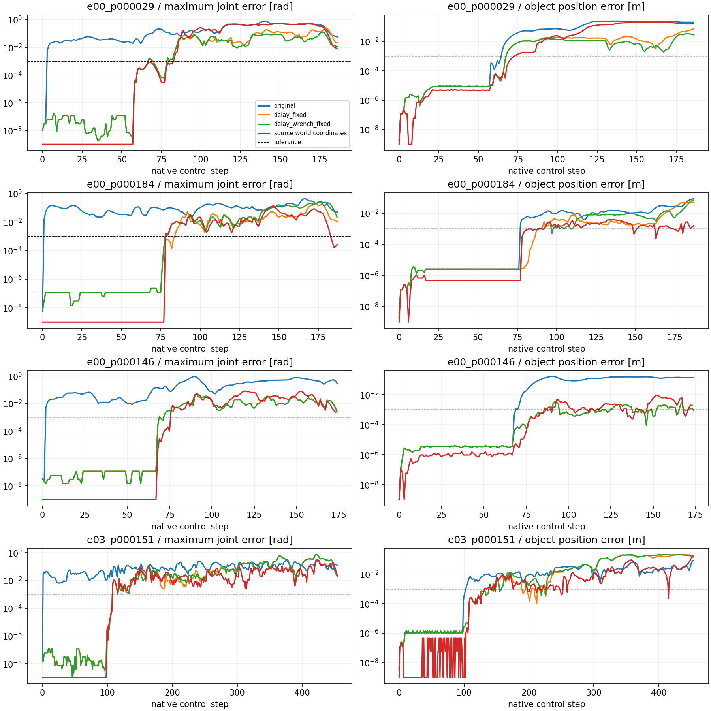

# T0历史事件物理重放与DP控制接口验证

本轮起点`b367bba87207812c8e91b02fe9ca0298cfd3619c`，功能分支`feature/trained-tactile-residual`。
用户明确授权专用历史delay/wrench回放、真实Kit验收和冻结G00/G10闭环；暂停残差研究，不改变任务或网络。

历史四条的**控制链已修复并实测一致，四条精确物理重放尚未通过**。原方法0/4，固定延迟1/4，
固定延迟和实际外力1/4；另保留源世界坐标后2/4成功，但仍有超容差物理偏差。
独立新专家样本成功220步；修复外力坐标重复往返后，在新Kit中重放220步成功，记录的全部控制/物理比较量逐位一致。
DP标签与执行语义一致，未发现需增加延迟层或重训的接口错误。本轮使用冻结旧权重，训练更新0。
完整小统计、逐步首差和运行源码身份见[results.json](evidence/t0_replay_20261031/results.json)。

## 预登记范围与数值标准

独立root：`outputs/visuotactile/run/t0_control_replay_20261031_01`，从session.json开始计时4小时含等待，统一monitor/lease。
12条T0=原4个训练初态×original/delay_fixed/delay_wrench_fixed；16条DP=4初态×G00-B/G10-B×历史事件/正常随机。
如T0仍失败，最多6个额外诊断start（4个原世界坐标验证及1个新真实expert+1个同配置replay）。不新增独立种子或训练。
后续有据修订：新expert/replay在tick0–173物理状态逐位一致，首次非零force的额外world→body往返在tick174触发偏差。
因此同一截止时间内追加**仅1次**同一新样本的native-request重放，额外诊断上限7，总上限35；不重采、不重复DP或重置预算。
最新具体实验要求覆盖上一轮已结束的12-start上限；整卡均值/完整60秒<=50%、VRAM4GiB/RAM10GiB及磁盘余量继续有效。

事先固定容差：pre-delay/delayed command3e−6，target3e−6rad，q1e−3rad，qd1e−2rad/s，
物体位置1e−3m、姿态角1e−2rad，force1e−5N、torque1e−6Nm；delay index和stage要求完全相同。
分别报告逐位相同、容差一致、仅成功重现。T0命令用尽仍未终止标删失，不标native timeout。

## 补丁设计与普通路径边界

`action_utils.apply_action_pipeline`保留原randint调用和队列初始化/滚动，只有显式`_recorded_delay_index`存在才覆盖选择，
检查shape/dtype/device/range。普通RL/DP不设置该字段，随机调用次数、映射、积分、平滑、clip完全保持。
不把delayed command再次提交，也不使用上游的直接target调试旁路。

`sim/replay_environment.RecordedReplayEnv`独立继承既有研究wrapper，不改其代码。原生wrench随机抽样仍执行；
专用wrench模式恢复记录请求/衰减状态，逐物理子步经现有world_hold按当前姿态转换到body composer。
v1 `actual_world`直接使用源实际world force/torque；v2 `native_request`使用原native请求，
并先核验它与源姿态计算出的body buffer逐位等于源记录，消除重复坐标往返。不会强制写q、物体位姿或task stage。
保存原抽样结果和实际提交，普通模式没有注入。该回放固定外生事件，不声称其他actor/obs随机流等于原4lane。

四条源中e00_p000029/e00_p000146/e03_p000151实际外力/力矩全零，e00_p000184有最高约.196634Nm力矩。
原数据保存每120Hz实际wrench及60Hz原请求、概率、gate；没有独立保存被gate覆盖前的fire布尔。
force_decay/torque_decay均0，因此不存在未记录的跨步衰减累积，但仍保留请求和native随机消耗。

DP历史事件对照超过原记录长度时，**循环原事件块**直至原生终止，提前声明为人工固定扰动协议；
不能称原专家未来扰动续接。正常随机对照始终使用原生随机机制。两种模式分别报告，不混合成功率。

## 初态和待定位差异

第一组沿用原`restore_observable_state`：q/qd、target、object/table/hole/goal姿态和速度、任务阶段/部分DR恢复；
原action queue在step0由原生逻辑填满u0。未恢复PhysX内部接触缓存、完整actor/sensor/多lane状态。
原4lane坐标原点为(±4,±4,0)，单lane原点为0，浮点平移可能改变接触数值；若控制一致仍分歧则单独检验源世界坐标。
逐物理子步新增只读q/qd/object记录，源`kinematics_after/finger_joint_position_rad`提供两子步q用于定位。

## A. 已确认问题与修复

| 优先级 | 实际问题、代码位置 | 修复及验证 |
|---|---|---|
| 1 | 旧T0只恢复初始CPU RNG；源4lane的`randint((4,))`和后续DR消耗不能由single-lane重建 | `action_utils.apply_action_pipeline`保留正常抽样，再以显式历史index选择同一原生queue；真实四条fixed模式的submitted/index/delayed/target误差全0 |
| 2 | 延迟修复仍允许原生重新抽到不同外力；状态相关gate也可能不同 | `RecordedReplayEnv`独立逐子步历史事件注入；正常DR抽样继续，保存原抽样和replayed request，普通部署无注入 |
| 3 | 首版replay将已由body旋转得到的actual-world再逆旋转，FP32不是可逆恒等运算 | 新样本首次非零force tick174定位；v2从原请求生成body，源body重建必须torch.equal；新Kit完整220步物理记录误差0 |
| 4 | 近似restore对kinematic body调用动态速度写API | `restore_observable_state`仅给dynamic object写速度；遇到非零kinematic保存速度直接拒绝。原native reset自己的同类API告警仍存在，未修改reset |
| 5 | live packet的`depth_m`别名与image派生同名HDF5 dataset冲突 | `diagnostic_recording.write_policy_step`只从image写一次深度；真实Kit全部新轨迹和别名回归测试通过 |

这些更改没有修改原生action排列、arm/hand映射、target积分/平滑/限位、随机调用次数、物理频率、资产、碰撞、
质量、摩擦、重力、奖励或成功判据。原生文件只增加7行显式delay index检查/覆盖；原研究`sim/environment.py`无修改。
固定外生事件是独立实验干预，不把它冒充普通随机部署。没有向学生注入专家未来q、物体pose、stage或目标。

### 初始状态覆盖与缺口

| 状态 | 历史四条 | 新单环境样本 |
|---|---|---|
| q/qd、prev/cur target、物体pose/速度、table/hole/goal pose | 保存字段恢复后误差0，之后自由物理演化 | 同样检查误差0 |
| action queue与首步 | 原生reset，首步填满源u0，逐tick滚动；子目标step归零不当episode reset | 同左，另保存初始完整env tensor |
| stage/success/progress/retract、max_goals、初始高度、DR概率 | 从源diagnostics恢复；无prelude隐藏状态时才放行 | 另恢复同shape的可导出env tensor，含内部观察/物体队列 |
| 世界坐标 | 主组从源origin平移至0；单独source_origin保留源(4,−4,0)/(−4,4,0)及robot base pose | 单lane原点0，源与replay一致 |
| RNG | 仅初始CPU状态；历史delay/wrench显式重放，其余随机消耗不冒充4lane一致 | 初始CPU RNG与所有原生draw保留，另记录actor输入/状态 |
| actuator/质量/惯量/材料/gains | 同任务配置；历史数据没有所有底层属性快照 | 导出并逐项比对实际PhysX属性，误差0；未改属性求成功 |
| solver/contact/broadphase、COM内部积分、异步sensor内部状态 | 不可由现有历史字段完整恢复 | 仍不声称完全序列化，只有220步实际观测逐位一致的验收范围 |

恢复顺序为reset→保存初态写入→target/任务字段→scene.write→sim.forward→scene.update(0)→camera reset/render→
观察刷新→初始RNG；没有插入额外物理积分步。新样本在此后恢复导出的env tensor并核对物理属性。
专家actor状态只存档，T0执行源命令不调用actor；它不是学生输入。

## B. 历史T0实际Kit结果

所有ID前缀为`r931005_1793209376_`；前三条source lane0，最后lane3，源总步数1,005。
每个成功都满足原生max_successes/两个子目标/retract。`删失`表示源命令用尽，没有native timeout。
所有fixed模式submitted、delay index、delayed command、target均逐位相同；普通组只submitted相同。

| 源后缀 / 源长度 | 模式 | q最大/均值误差rad | q首次>1mrad步 | object位置最大误差m | 原生结果 |
|---|---|---|---|---|---|
| e00_p000029 / 187 | original | .806218 / .03083047 | 3 | .240987 | 删失187 |
| 同上 | delay_fixed | .258148 / .00699840 | 67 | .072593 | 删失187 |
| 同上 | delay_wrench_fixed v1 | .127444 / .00388096 | 67 | .033532 | 删失187 |
| e00_p000184 / 188 | original | .427973 / .01706924 | 1 | .085265 | 删失188 |
| 同上 | delay_fixed | .195563 / .00305112 | 84 | .050837 | 删失188，1子目标 |
| 同上 | delay_wrench_fixed v1 | .251776 / .00551581 | 78 | .071177 | 删失188 |
| e00_p000146 / 175 | original | .934615 / .03267433 | 2 | .160252 | 删失175 |
| 同上 | delay_fixed | .051090 / .00125251 | 69 | .003361 | 成功175 |
| 同上 | delay_wrench_fixed v1 | .051090 / .00125251 | 69 | .003361 | 成功175 |
| e03_p000151 / 455 | original | .337647 / .01622577 | 1 | .083797 | 删失455 |
| 同上 | delay_fixed | .757176 / .01034726 | 108 | .218127 | 删失455，1子目标 |
| 同上 | delay_wrench_fixed v1 | .757189 / .01053896 | 108 | .210136 | 删失455，1子目标 |

v1 fixed-wrench四条实际world force最大误差0，torque最大2.98023224e−8Nm，均在预定容差内。
对应qd首次>0.01rad/s为58/77/68/108步，最大12.680553/6.915765/4.069777/7.378516rad/s；
object位置首次>1mm为68/90/87/139步。完整均值、姿态角、stage首差、源值/重放值见JSON各`comparison.errors`。
e00_p000146成功但轨迹超容差，只能称**结果重现**，历史四条精确物理验收未通过。



### 源世界坐标诊断与首次物理差异

四次额外source_origin保持原world origin、robot base与初始实体pose，并固定delay/wrench。

| 源后缀 | q最大rad / 首次>1mrad | object最大位置误差m | 结果 |
|---|---|---|---|
| e00_p000029 | .547423 / 83 | .198797 | 删失187 |
| e00_p000184 | .133302 / 78 | .003956 | 成功188 |
| e00_p000146 | .081934 / 76 | .008895 | 成功174 |
| e03_p000151 | .273601 / 108 | .148618 | 删失455 |

源world坐标改善了一条结果，未消除误差。所有四条在首次源指端接触前q逐位一致。
第一处>1µrad的子步关节差分别为(step,substep,joint)：(58,0,7)、(78,0,0)、(68,1,12)、(100,1,7)，
当时源指端合力最大23.9529/15.4120/6.3028/16.6553N。指端合力不包含碰撞对象身份，不据此断言具体抓握。

更早的物体差首次观测于**控制step1之后，z分量**（step从0开始；原数据无子步object pose，不能进一步指定哪个子步）。
源/重放均仍自由下落，源速度z=−.3270000219m/s，无外部wrench：

| 源后缀 | 源z m | 重放z m | 差m |
|---|---|---|---|
| e00_p000029 | .6356915235519409 | .6356916427612305 | 1.1920928955078125e−7 |
| e00_p000184 | .6101466417312622 | .6101467609405518 | 同上 |
| e00_p000146 | .6377112865447998 | .6377114057540894 | 同上 |
| e03_p000151 | .6478939056396484 | .6478940248489380 | 同上 |

代码边界是`PlayEnv._apply_action`设定同一target后，继承的`DirectRLEnv.step`内`sim.step`积分、
`scene.update`刷新及`InstrumentedAssemblyEnv._diagnostics`读取`object.data.root_state_w`。
这是可定位的首次物理积分/状态读取差，不是延迟命令、target或外力首差；实际源四lane场景与新单lane
内部COM/solver/dispatch状态未完整记录，尚不能从历史数据证明具体哪一个底层内部字段导致此末位差。
源world对照排除了“仅平移至原点”作为充分解释。误差在指端接触附近放大，但不能把“无指端力”当作所有物体无接触。
未以笼统的PhysX不确定性替代定位，也未通过每步强制改状态消除误差。

### 新成功样本与外力精度根因验收

独立seed17，released expert SHA256 `7e61015dad660430ab07bab4f715c90c6f76b84cc358da6be81319a6aee09990`，
原生成功220步。所有新记录放`fresh/`，没有合入原400。
v1同场景重放也成功220步，但q最大.02492964rad、object位置最大约.0023568m。
q、qd、object和物理子步状态在0–173步逐位相同；第一次差异恰好是174步第一次非零外力。

当时第一子步原请求为`[-1.1757628918,-1.7539052963,-2.4367024899] N`，
原body buffer为`[-2.1623158455,-2.0937492847,1.1561675072] N`，
从body旋转得到的actual-world为`[-1.1757628918,-1.7539051771,-2.4367017746] N`。
后者再经world_hold逆旋转不能逐位恢复原body；这是v1实际误差的确定根因，回归测试使用这些真实值和本机Isaac数学函数。

v2从原请求经现有world_hold转换，源姿态仅用于**离线重建核验**，实际施力使用当前实时姿态。
同一个已保存新样本在**新的Kit进程**执行fresh_exact，成功220步；command、delay index、delayed、target、
q/qd、两子步q/qd、object pose/两子步pose、实际force/torque、stage全部记录误差0、逐位相同。
这通过了此单lane样本的观测轨迹验收，不代表完整PhysX状态可导出或历史4lane已精确复现。

历史四条/DP本次均使用启动时已加载的v1，未因编辑文件重启worker或追溯标成v2。
三条历史wrench全零，另一条非零torque在140/150步才发生，而其首次物理差远早于140步；
所以v2不能解释或修复历史早期首差，没有为同一解释重复全部历史试验。

## C. DP动作语义：实测无需修改普通接口

实际链路：`long_data`读取expert pre-delay→`command_to_reference`生成监督→train-only归一化→
H64 sample/x0 DP→反归一化reference→`LongController`按当前真实target逆映射→canonical29 pre-delay→
`env.step`→canonical/Lab排列→原生3槽随机delay一次→arm积分/hand映射→0.1平滑/limit→两120Hz物理步。

arm7的reference为`target_before + 1.5*(1/60)*command`，hand22为`lower + (command+1)/2*(upper-lower)`。
reference描述**延迟前意图**，不是执行后的target，不包含delay或0.1平滑。
部署arm以当前target做`(reference-target)/(1.5/60)`，hand逆范围映射，再clip到[-1,1]。
arm参考可能在limit外，这是积分意图的合法表示，真实执行target最后仍由native限位；不能预先裁参考破坏监督语义。
没有把绝对q当arm command，没有重复积分/平滑/归一化，也没有遗漏原生随机延迟。

G00训练输入为三RGB-D的冻结DINO+depth/valid历史、encoder q/qd、过去实际issued/delayed及时间/valid。
G10额外接真实五指法向力历史；本轮不加入Transformer残差。
训练过去专家执行明确teacher forcing；当前和未来命令只生成监督，target在数据标签/输出适配使用。
部署每tick `observe_execution`回写实际issued/delayed，下一tick才使用，不能将预测的未来12步当执行反馈。
持续GRU每60Hz tick更新；视觉与DDIM每12tick=5Hz刷新，预测H64=1.0667s、执行前12步=.2s。
物理仍120Hz/control60Hz，带资源等待的墙钟Hz不等于仿真dt。

四条1,005步真实记录的command→reference→command最大arm误差2.38418579e−6，hand2.38418579e−7；
恢复命令进入实际native queue/映射/平滑后，target最大误差4.76837158e−7rad，全部低于预定3e−6。
审计覆盖饱和命令、arm参考越界、子目标stage-step归零和初始队列。CPU检查只使用源stage标志验证数学，未冒充物理试验。
每关节误差及饱和计数见`dp_control_audit`；运行中H64计划、12步cursor、真实t−1反馈与有限合法命令另从新HDF5核验。

因此`action_reference.py`、`long_data.py`、`long_controller.py`、模型、normalizer和checkpoint均无需修改。
本轮DP改动只在独立评估入口添加可追踪历史事件对照；正常mode仍用原生随机delay/wrench。
旧权重的动作合同仍有效，闭环性能差不自动构成接口bug或重训理由。

## D. 冻结DP重新评估

本次4初态×G00-B/G10-B×固定事件/正常原生共16条；不与原正式0/50、旧T1各0/4或旧T2各0/3合并。
历史事件超过源长度时循环同一事件块，明确是人工固定扰动实验；新策略状态不同，不能要求专家物理轨迹一致。
配对指初态与外生delay/wrench，不保证视觉数值/完整隐藏状态或两条轨迹相同。
普通路径没有控制语义修复，所以不存在应归功于T0补丁的理论成功率提升。
旧T1同四近似初态G00-B/G10-B均0/4、601步timeout、无lift/subgoal，作为历史对照保留。

16条均已完成，全部601步native timeout，没有软件中断、补seed或重跑。

| 冻结组 / 模式 | 成功 | approach proxy | native lift | native子目标 / retract | 每条墙钟control Hz范围 | 每条平均推理ms范围 |
|---|---|---|---|---|---|---|
| G00-B / fixed delay+wrench v1 | 0/4 | 3/4 | 0/4 | 全0 / 全false | 7.478–7.683 | 36.200–40.546 |
| G10-B / fixed delay+wrench v1 | 0/4 | 3/4 | 0/4 | 全0 / 全false | 6.753–7.654 | 38.053–43.402 |
| G00-B / normal native | 0/4 | 3/4 | 0/4 | 全0 / 全false | 3.865–7.649 | 36.199–42.877 |
| G10-B / normal native | 0/4 | 3/4 | 0/4 | 全0 / 全false | 6.603–7.632 | 37.993–43.707 |

全部四组仅e00_p000146未达到approach proxy。所有学生在第0步命令/target/q已偏离专家，
这是实际模型输出差异，不能将学生与专家逐步不相同当成adapter故障。没有完成插入；超时原因是原生阶段时限。
每个模式单独4次分母，普通模式从旧0/4到新0/4，没有观测到改善，也不足作总体性能估计。
真实保存9,616个native输入与816个H64计划；计划cursor、过去实际issued/delayed和输出command逐项核验误差0，
所有数值有限、命令合法。首次模型冷启动的最大单tick推理779.381ms，其他组单tick最大约246–257ms。
墙钟Hz包含渲染、记录I/O、CPU物理、资源等待与曾短暂并行的fresh诊断锁等待，不是机器人实时部署速度。
仿真physics_dt=1/120、control_dt=1/60始终未变，不能用等待降低仿真控制频率。

approach只用指尖到物体中心≤8cm的几何proxy，不能代替抓握成功。grasp缺对象接触身份，标未验证；
align没有独立已验证判据，报告native子目标/插入与retract，不能由短暂靠近推断完成。
每条保存H64原plan、逐tickreference/command、选中delay、target/q/qd、传感packet、记忆、RNG与ack。
文件路径为`<root>/dp/<ordinal>_<identity>_<line>_<mode>/{inputs.h5,trace.npz,result.json,restoration.json}`。

## E. 最终判断与边界

1. **旧T0为什么失败？** 4lane→single随机消耗导致delay index不同，外力也不能仅靠初始seed恢复；后续尚有未完整保存的物理内部状态差。
2. **是否恢复原成功？** 历史fixed1/4、source-origin2/4为结果重现，四条精确轨迹未通过；新同配置single-lane220步已逐位验收。
3. **400条是否需要修数据？** 未发现源命令/target标签错误，不修改、不作废；新增诊断独立保存。
4. **DP训练执行语义是否一致？** 是，pre-delay等价reference，1,005步native数值链通过，原生只延迟一次。
5. **DP控制器改什么？** 普通controller/adapter没有修改；只增加独立历史事件测试入口。
6. **旧权重是否有效？** 动作合同有效，性能仍受已测结果限制；没有新参数更新或正式重训。
7. **自主结果如何？** G00-B/G10-B在固定事件和正常随机下分别均0/4，全部601步timeout，无native lift/子目标；不证明改善。
8. **真正剩余问题？** 历史四lane未导出的物理内部状态及自由下落末位差，DP首步预测/后续闭环跟踪偏离和稳定抓握/子目标能力；
   不能从本次少量训练初态诊断断言泛化失败，也不能据此证明触觉或损失优势。后续研究未自动启动。

## F. 复现、测试与交付身份

正确环境为项目`.venv_isaacsim` overlay，通过`run_cpu.sh`低优先级/两线程/CPU22,23运行；AppLauncher先于任务导入。
以下是可复现协议，**不是授权自动重跑本轮**。新root必须不存在；不能复用已完成phase，也不能覆盖原400。
monitor在独立终端先运行，直到所有worker退出再创建`STOP_MONITOR`并确认`monitor_exit.json`。

```bash
REPLAY_ROOT=outputs/visuotactile/run/t0_control_replay_reproduction_01
bash visuotactile/run_cpu.sh -m visuotactile.evaluate_recorded_replay --root "$REPLAY_ROOT" --initialize
bash visuotactile/run_cpu.sh -m visuotactile.study_resources --root "$REPLAY_ROOT"
```

另一终端顺序执行；显式v1用于复现本次已跑协议，当前默认v2另有独立身份：

```bash
REPLAY_ROOT=outputs/visuotactile/run/t0_control_replay_reproduction_01
bash visuotactile/run_cpu.sh -m visuotactile.evaluate_recorded_replay --root "$REPLAY_ROOT" --phase t0 --wrench-reconstruction actual_world
bash visuotactile/run_cpu.sh -m visuotactile.evaluate_recorded_replay --root "$REPLAY_ROOT" --phase source_origin --wrench-reconstruction actual_world
bash visuotactile/run_cpu.sh -m visuotactile.evaluate_recorded_replay --root "$REPLAY_ROOT" --phase fresh --wrench-reconstruction actual_world
bash visuotactile/run_cpu.sh -m visuotactile.evaluate_recorded_replay --root "$REPLAY_ROOT" --phase fresh_exact --wrench-reconstruction native_request
bash visuotactile/run_cpu.sh -m visuotactile.audit_replay_control --root "$REPLAY_ROOT"
bash visuotactile/run_cpu.sh -m visuotactile.evaluate_recorded_replay --root "$REPLAY_ROOT" --phase dp --wrench-reconstruction actual_world
touch "$REPLAY_ROOT/STOP_MONITOR"
bash visuotactile/run_cpu.sh -m visuotactile.analyze_recorded_replay --root "$REPLAY_ROOT" --output "$REPLAY_ROOT/sanitized_report"
```

31项定向回归通过（5.18s，既有requests依赖警告1条）：

```bash
bash visuotactile/run_cpu.sh -m pytest -q tests/test_recorded_replay.py tests/test_system_audit.py tests/test_long_horizon.py tests/test_loss_study.py tests/test_network_audit.py tests/test_transformer_residual.py
```

覆盖固定上游普通路径动作/queue/RNG、历史index/重复命令/首步与子目标、reference往返、实际非零wrench精度、
live depth别名、fresh HDF5形状、loss/历史与模型已有合同。真实Kit结果单独列于B/D节，不以mock代替。
额外区分正负零/存储dtype；最终`fresh_precision`和`control_bytewise_equal`按shape、dtype、原始bytes复核，
不只依赖运行时旧摘要中的array_equal标志。新220步全部量及历史fixed控制量均通过严格逐字节比较。

新增源码：`replay_events.py`、`sim/replay_environment.py`、`evaluate_recorded_replay.py`、`replay_fresh.py`、
`audit_replay_control.py`、`analyze_recorded_replay.py`及`tests/test_recorded_replay.py`。
修改源码：`action_utils.py`显式index；`evaluate_training_initials.py`kinematic API；`diagnostic_recording.py`深度别名；
`study_resources.py`纳入本worker的到期处理；`tests/test_system_audit.py`真实别名测试。其余变更为合约、状态和小证据。
所有phase启动文件保留base commit和实际源码SHA；本次先运行后提交，不能把最终提交所有文件视作当时已加载版本。
后续补CLI选择和扩充来源hash不回填旧launch身份；旧launch记录范围之外的源码身份由未修改git文件和报告说明限定。
公开内容只有代码/文档/小统计/误差图，原始轨迹、输入、日志、模型留本地ignored outputs。

### 完成状态、资源和保护复核

窗口始于2026-10-31 13:58:18 UTC，原截止17:58:18 UTC；35个已分配starts全部完成，monitor于14:34:57 UTC退出，
从session起点36分38.96秒，连续监控2,194.96秒。Kit worker正常退出码0，全部自有worker和monitor经/proc检查不存在。
整卡时间加权均值**20.6873%**，最大完整60秒**26.8527%**，缺测0、资源事件0、最大采样间隔1.3071s。
最低空闲VRAM16,593MiB、可用RAM27.0068GiB，结束可用磁盘约74.98GB，均满足保留量。
目标38%是节流目标，不保证CPU物理/渲染/记录工作能达到该占用；没有为空转凑利用率。
各worker累计work1,805.52s、wait125.34s、pacing193.99s；这些进程计时会重叠，不等于全卡归因或可相加墙钟预算。
monitor自身wait_seconds=0不能解释为worker无等待。过去会话的资源超限记录继续保留。

[保护hash](evidence/t0_replay_20261031/protected_artifacts.json)重新核对manifest、B0/B1 best、正式0/50报告、
G00/G10原epoch40及本轮G00-B/G10-B：全部保持SHA。原400图像全文件hash沿用既有审计证据，本轮未宣称重新读取全部70GB图像。
[最终核验](evidence/t0_replay_20261031/verification.json)保存31项测试、12个修改Python的AST、退出/资源、最终源码SHA，
并验证四历史+一新样本共1,225步native request→body重建通过。未修改旧split/normalizer，参数更新0。
本批已关闭，不自动追加训练、试验、重放或新种子。
