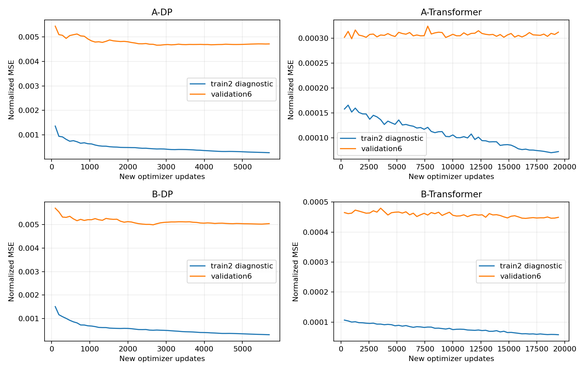
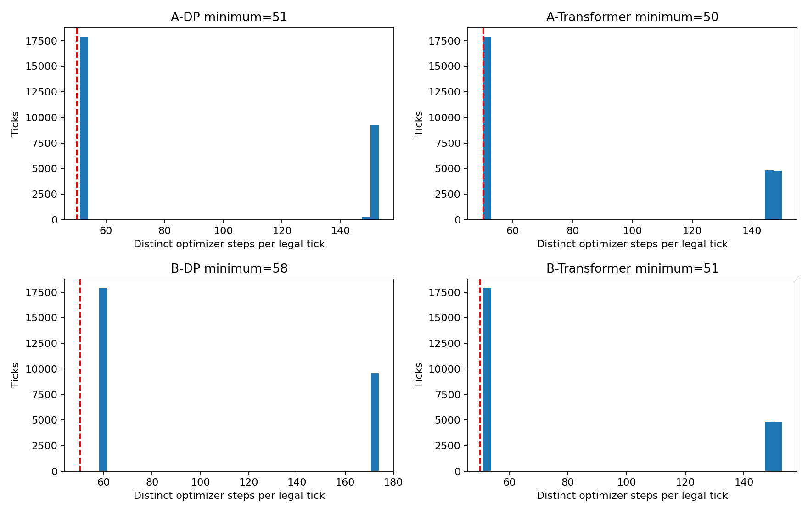

# A/B四组件充分曝光训练与64例闭环结果 — 2026-11-19

四组件均完成预登记60轮；四个实际选中checkpoint的130条轨迹和27,508个合法tick均达到本轮新增至少50次曝光。64例自主闭环全部完成，22:35监督链正常结束。新A本轮5/16、旧A2/16；新B4/16、旧B2/16。两个新模型各丢失一个旧成功，不自动晋升，不据此宣称稳定泛化提升。开发初态此前已经用于研究，不是全新未见测试集。

## 训练完成与选模

| 组件 | 完成轮数 | 总更新 | 选中轮/更新 | 选中最低轨迹访问 | 选中最低tick不同优化步 | 达标 |
|---|---|---|---|---|---|---|
| A-DP | 60 | 5700 | 51/4845 | 51 | 51 | 是 |
| A-Transformer | 60 | 19422 | 50/16174 | 50 | 50 | 是 |
| B-DP | 60 | 5700 | 58/5510 | 58 | 58 | 是 |
| B-Transformer | 60 | 19422 | 51/16504 | 51 | 51 | 是 |

计数不包含祖先曝光，不把同一步重叠窗口重复计数；mask/padding不参与。四个选中checkpoint计数与成功optimizer事务日志重放相等。DP额外从实际anchor、原segment和mask独立重算；后端重放日志中的实际有效tick集合，没有另行从原始张量重新计算每一步后端mask，验收范围在CSV中显式标注。曝光不是非零梯度保证。

DP从各自72 EMA继续，后端从对应72后端继续；新阶段fresh AdamW，DP新EMA、后端无EMA。此次磁盘中断后的A续训完整恢复52轮状态，未重复累计原52轮。每个后端均使用各自选中新DP重建的136条nominal缓存。A保留q_reached及几何项，B保留u_expert，真实历史、nominal+residual、120/60/5Hz及原生判据不变。

[完成表](evidence/tight_exposure50_20261119_01/training_completion.csv)、[逐轨曝光](evidence/tight_exposure50_20261119_01/selected_episode_exposure.csv)、[逐tick压缩CSV](evidence/tight_exposure50_20261119_01/selected_tick_exposure.csv.gz)、[完整曲线数值](evidence/tight_exposure50_20261119_01/training_curves.csv)。checkpoint路径为本机run根下`A|B/training/best.pt`及`A|B/backend/A|B/training/best.pt`；各目录`last.pt`保留60轮恢复状态，选中SHA在完成表。大模型和原始数据不进入Git。





## 原生完整插入及诊断

| 初态组 | 模型 | 插入成功/8 | lift/8 | 抓持/8 | hold30/60/120 | 首子目标/8 |
|---|---|---|---|---|---|---|
| training | A72 | 2 | 3 | 8 | 8/8/8 | 5 |
| training | B72 | 0 | 0 | 7 | 7/7/7 | 3 |
| training | A130_50 | 2 | 0 | 7 | 7/7/7 | 3 |
| training | B130_50 | 2 | 3 | 7 | 7/7/6 | 2 |
| development | A72 | 0 | 0 | 7 | 7/6/5 | 2 |
| development | B72 | 2 | 0 | 6 | 7/5/5 | 3 |
| development | A130_50 | 3 | 1 | 7 | 7/7/6 | 3 |
| development | B130_50 | 2 | 3 | 8 | 8/8/8 | 3 |

hold60只是1秒持物诊断，不是原生成功必要条件；lift也是独立诊断，不强制与成功构成包含关系。分母包含全部预登记有效完成例，没有删除失败样本。失败阶段、裁剪tick数、关节跟踪误差和命令增量在逐例CSV；执行轨迹跟踪误差不是学生状态下的反事实专家命令误差。

A保留1个、丢失1个旧成功，新增4个；B保留1个、丢失1个旧成功，新增3个。48组相对参考lane初态核验：关节、速度、控制目标最大差0；物体/孔位置最大差4.7684e-7m，手掌位置最大差1.1921e-6m，旋转与物体速度比较差0。可观测初态近似配对，不宣称隐含PhysX状态和后续随机过程完全一致。

[全部64例](evidence/tight_exposure50_20261119_01/per_case.csv)、[分组成功率和诊断计数](evidence/tight_exposure50_20261119_01/counts.csv)、[逐初态旧能力保留/新增/丢失](evidence/tight_exposure50_20261119_01/paired_changes.csv)、[每波初态与运行配置](evidence/tight_exposure50_20261119_01/evaluation)、[审阅回执](evidence/tight_exposure50_20261119_01/publication_review.json)。

## 离线结果与结论边界

| 组件 | 末轮训练诊断MSE | 末轮validation6 MSE |
|---|---|---|
| A-DP | 0.0002744216 | 0.004713555 |
| A-Transformer | 7.238951e-05 | 0.0003118896 |
| B-DP | 0.0003123003 | 0.00504273 |
| B-Transformer | 5.800663e-05 | 0.0004489733 |

曲线中的训练值是固定train2诊断，不能当作130条全训练集平均；另有按轨迹/阶段的全池离线记录。旧模型离线78条、新模型136条，只能在共有original30/old42/validation6上直接比较；new58没有本轮旧模型重算，且属于训练数据，不能当测试集。DP的A/B目标不同，不跨组直接比较DP数值。[离线逐轨阶段误差](evidence/tight_exposure50_20261119_01/offline_per_episode.csv)、[汇总](evidence/tight_exposure50_20261119_01/offline_summary.csv)、[口径](evidence/tight_exposure50_20261119_01/offline_scope.json)。

最低曝光不足这一工程缺口已补齐。训练误差下降未带来验证误差同步持续下降；闭环仍多失败且各有旧成功丢失。当前证据不支持把剩余问题唯一归因为欠训练、encoder或闭环分布偏移，也不能凭60轮排除欠拟合。训练与开发每组仅8例，本轮成功数改善是有限样本观察；不自动换encoder、追加训练、DAgger或扩大评测。

## 视频、保护及复现

[8段预登记视频](evidence/tight_exposure50_20261119_01/videos/README.md)来自训练28817004和开发28826004，四完整模型各两例，均完整解码并核对帧数与SHA，不额外增加评测分母。视频总计约14.2MiB，随本报告发布；原始numeric HDF5仍在本机。[视频回执](evidence/tight_exposure50_20261119_01/video_receipts.json)。

发布前13项父权重/数据索引/统计/预训练保护SHA全部通过；先前磁盘清理前后888项完整验证另见[TIGHT_DISK_CLEANUP_20261119](TIGHT_DISK_CLEANUP_20261119.md)。本次28项聚焦CPU回归通过，评测子进程已回收。磁盘中断和失败记录保留，不把原attempt失败改写为成功。完成监督链已退出，不自动重启。

配置：[experiment](../configs/experiments/exposure50/experiment.json)、[训练](../configs/experiments/exposure50/train.json)、[恢复](../configs/experiments/exposure50/train_recovery.json)、[评测](../configs/experiments/exposure50/evaluate.json)。以下是已执行身份的命令记录，不应直接再次启动同一run；再次执行实验需要新登记配置和授权预算。

```bash
python -m tools.tight_project train --job configs/experiments/exposure50/train_recovery.json
python -m tools.tight_project evaluate --job configs/experiments/exposure50/evaluate.json
# 仅重建现有结果的统计/视频，无新训练或仿真：
PYTHONPATH="$PWD" python research_docs/evidence/tight_exposure50_20261119_01/analyze.py report
PYTHONPATH="$PWD" python research_docs/evidence/tight_exposure50_20261119_01/analyze.py videos
```

原先旧视觉特征的Zstd恢复命令已被后续缓存退休操作替代；历史复现先按磁盘清理报告重建。原始400、当前130、72完整基准、60轮恢复checkpoint保留。

## 历史登记与中断记录（以下不是当前状态）

# A/B四组件逐合法tick充分曝光：已登记，尚未完成

本任务从943913c接续，原72完整A/B分别初始化，固定130训练轨迹（原30＋100纠偏）和独立validation6。禁止新encoder、DAgger、RL、任务/控制/成功标准修改。新root为`outputs/visuotactile/run/tight_exposure50_20261119_01`，源实验身份不复用。此文初稿不是完成报告。

四组件均新增训练，不累计父模型曝光。预登记60完整deck，原30各3访、其他100各1访，共190visits/epoch；DP B2仍每遍95更新。DP保留原grasp随机抽样，再用最早未覆盖合法tick的H24窗口补齐；仅真实合法标签、原segment/window mask，不新增反事实监督。每次优化后对实际loss窗口中的identity/tick取并集，计数一次。后端沿用完整历史、32tick截断和固定128合法tick量级累积，按实际正权loss_mask收集，optimizer提交后去重计数。零误差也属于正权监督参与；不是每tick非零梯度的声明。

A仍q_reached及原几何项，B仍u_expert。补齐窗口改变采样人口与既有几何抽样候选数量，但不改几何算法/权重、动作接口或未来信息边界。DP3e-5，后端1e-4，fresh AdamW；DP从各自72 EMA初始化并重建新EMA，后端从对应72后端初始化，无后端EMA。每组件最多一次学习率减半：40遍后验证连续8次未提升0.5%。60遍前不早停。只在本轮最少访问≥50且每合法tick不同optimizer step计数≥50的checkpoint中，按原validation6等权normalized arm/hand MSE最小选择，平分保留较早者。不会把49遍模型写成最终候选。

先训练两个DP，再各自刷新136条nominal缓存、训练相应后端；不得混用父或另一DP缓存。固定原30统计。实际全池预检A/B均27,508合法专家tick，全部可被合法自身时刻输入窗口覆盖，零额外排除。逐轨masked索引、标签/父权重/统计身份见registration.json。合成含gap/段界测试、去重/恢复/49次拒绝测试和相关回归67项通过；尚不代表GPU完整训练完成。

DP每完整epoch保存模型/EMA/Adam/随机数/曝光；后端每完整轨迹组保存。未持久化尾更新不计恢复模型，原尾日志另存。修复正式hotset配置在restore比对之后才加入导致的配置误判，数值路径不变。

存储预检最初约12.85GiB空闲，无法容纳四组件恢复断点。36个已索引、无活动句柄、当前136缓存以外的旧视觉缓存无损Zstd归档，节省1.4238GiB；另24个已完成历史训练日志无损归档，节省5.4619GiB，全部完整解压SHA验证后替换为压缩档。原400、当前130、任何模型/optimizer checkpoint均未删除或改写。日志清单26行含两处旧路径别名重复，首批9个后中断，按真实路径去重继续，证据保留。归档的历史日志/缓存需显式恢复后用于旧run恢复或审计，不能宣称旧路径仍可直接读取。

```bash
python -m tools.tight_project train --job configs/experiments/exposure50/train.json
python -m tools.tight_cache_archive restore --manifest research_docs/evidence/tight_exposure50_20261119_01/cache_archive_manifest.json
python -m tools.tight_cache_archive restore --manifest research_docs/evidence/tight_exposure50_20261119_01/training_log_archive_manifest.json
```

训练作业是一次性已登记身份，不能重复启动。故障后保留原job回执，以新owner attempt、相同根/截止/模型状态恢复。24小时总资源session为执行边界，不把deadline当曝光完成条件；未达标必须报告实际缺口和恢复入口。保留12GiB磁盘、10GiB RAM、4GiB VRAM余量，整卡full_gpu_v1，保护其他任务。

完整四组件达到门槛之后，登记原训练8＋开发8、每family四完整策略（72A/B、新130A/B）共64自主机会；保持原生成功，hold30/60/120仅诊断。未开始闭环，不从历史分母拼接结果。预登记视频初态28817004、28826004；失败样本不删除。正式状态以后续真实checkpoint、逐步计数、结果回执为准。

实际启动：tight-exposure50-20261119-01.service执行统一训练队列，finish服务在四组件训练全部完成并通过曝光重放门槛后才登记/执行64例评估；失败则保留并退出，不自动放宽门槛。136原始HDF5全SHA和A/B标签逐值检查通过。A-DP epoch3/update285实际断点计数与成功更新日志独立重放逐项相等，最低tick曝光3，尚不达标。全部状态仍以现场文件为准。

独立验收进一步从实际selected_anchors及原始segment/mask重新计算每次DP监督集合，并重算轨迹访问。实际epoch5/update475完全相等（最低5，未达标）；72A/B各一个真实验证记录的完整后端离线接口通过，CUDA未初始化。证据见analysis_preflight.json。此核验不计入训练或新闭环试次。


### 2026-11-19 16:00 +08 — 磁盘保护中断，尚未完成四组件

原训练服务13:37在A-DP第52轮后因`Configured disk reserve reached`退出，finisher随之退出。CPU实际加载last52/4940与best51/4845：130轨、27,508合法tick，最低新增轨迹访问/tick不同优化步分别52/52与51/51，祖先不计；完整Adam、EMA、随机数、LR和曝光状态字段存在，EMA计数等于optimizer计数。尚未执行恢复，不能把字段检查当恢复成功。B-DP与两个后端未开始，闭环0例；A仍未完成预登记60轮。回执`evidence/tight_exposure50_20261119_01/interruption_checkpoint_audit.json`。

当前磁盘约3.6GiB，低于12GiB保护线；新run仅占4.1GiB，不能把其他磁盘增长归因于本训练。剩余136视觉缓存均供当前训练使用，未删除数据/模型，也不干预其他任务。已登记`train_recovery.json`和独立`training_attempt02`：普通CPU监督脚本等待至少32GiB空闲（12GiB原保护线＋20GiB后续产物余量），随后只尝试一次续训，沿用原11月20日11:24截止。未满足容量条件时不加载GPU模型。原失败、部分epoch断点和旧遥测均保留；续训从完整52轮起，未提交尾更新不计。后端仍等待各自新DP并刷新缓存。收尾日志改用独立attempt路径，避免覆盖原失败。

恢复入口：`python research_docs/evidence/tight_exposure50_20261119_01/recover.py`，只运行一次；状态位于`outputs/visuotactile/run/tight_exposure50_20261119_01/training_attempt02/recovery_status.json`。编译与统一入口dry-run通过；实际恢复与闭环尚未验收。
