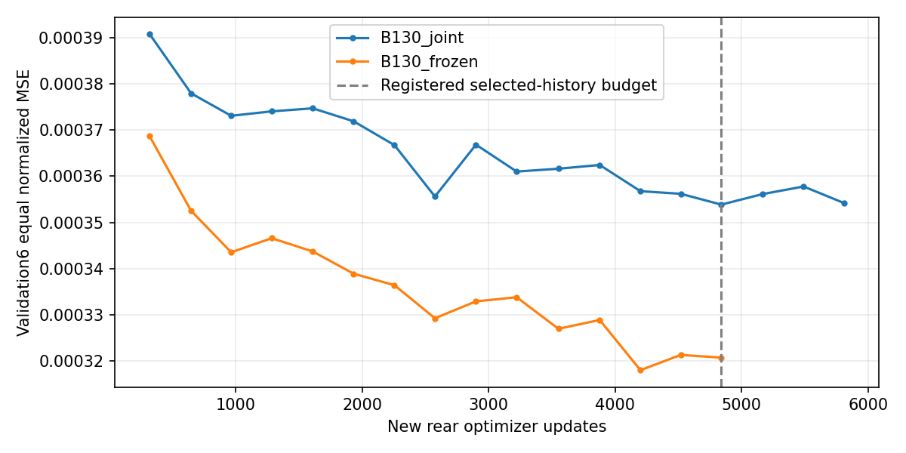
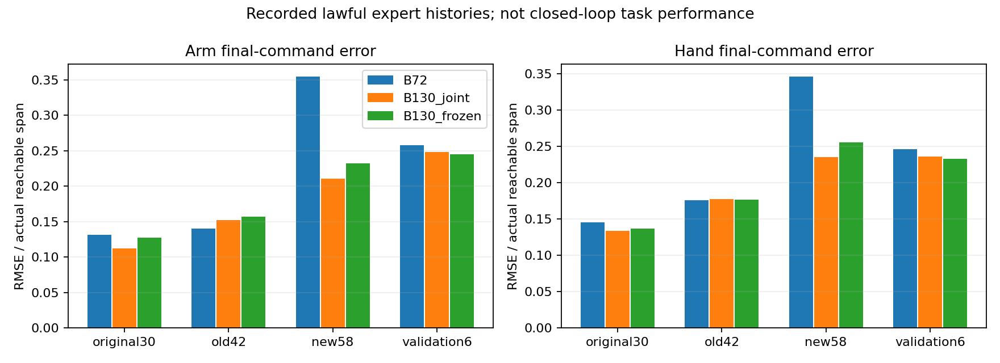
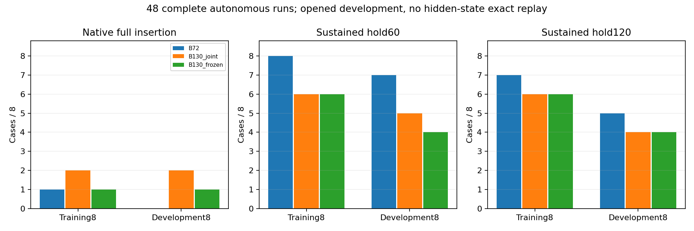

# B冻结DP与后端隔离：完成训练与48例完整闭环

**结论：冻结DP没有恢复旧抓持能力，不能晋升。** 新后端学到了部分130池纠偏：新增58上arm/hand最终命令RMSE改善34.6%/24.2%，完整执行也有新增成功。但它丢失本轮72B唯一成功的训练初态，开发hold60为4/8，低于72B的7/8和共同更新的5/8。前端变化不是能力退化的唯一必要条件；后端更新和闭环反馈仍是优先问题。证据不足以直接启动encoder大训练，本轮没有实现或训练新encoder。

本轮从统一主目录、`feature/tight-state-foundation`的2922549接续，只新增实验配置和结果目录。采用模型仍为72条阶段完整A/B；新候选不自动晋升。保护72、历史130、原400、130合法池、预训练资产和失败证据；没有新增DAgger、初态、encoder或改变控制。

## 设计、预算与选中模型

三方是72完整B、历史130共同更新B、72DP冻结后仅训练后端的130B。DP包括HistoryVision、视觉/本体GRU、全部名义规划参数和归一化，均不更新。新后端从72B选中权重初始化；fresh AdamW，lr1e-4、weight_decay1e-4，无EMA，不恢复旧optimizer/scheduler。保持真实专家`target_after_rad`监督、合法专家suffix mask、原动作合成与执行约束。

预算按历史130B**选中**epoch15/update4839登记，不能用其完成epoch18/update5811作继承量。原采样每epoch原30各3访、100纠偏各1访，共190访问；原128合法tick更新窗口、32tick截断、当前参数完整prefix重放和验证plateau规则保持。内部原maximum24只是来源元数据，外层cap15。

| 项目 | 历史共同更新B | 新冻结DP后端B |
|---|---:|---:|
| 实际完成后端更新 | 5811 | 4839 |
| 验证选中epoch / 更新 | 15 / 4839 | 13 / 4200 |
| 选中阶段原30每条访问 | 45 | 39 |
| 选中阶段100纠偏每条访问 | 15 | 13 |
| 选中optimizer LR | 5e-5 | 1e-4 |

新训练累计700890个合法监督tick，选中模型继承607438个，不能将之后的93452个算进去。相同最大预算和验证选模协议，**不等于相同选中曝光或实际LR路径**；这项差异限制了严格单变量归因。选中Adam step4200，没有DP优化器更新。训练回执、逐轨访问和曲线见[training_result.json](evidence/tight_frozen_dp_b_20261119_01/training_result.json)、[selected_exposure.csv](evidence/tight_frozen_dp_b_20261119_01/selected_exposure.csv)、[validation_curves.csv](evidence/tight_frozen_dp_b_20261119_01/validation_curves.csv)。



136条匹配名义缓存（130训练+6验证）耗时177.6秒；共有72+6缓存全部张量逐位等于原72缓存。136条后端真实历史、标签和mask与历史130缓存相同。原始数据、DINO缓存和统计用软链接复用。见[frozen_cache_parity.json](evidence/tight_frozen_dp_b_20261119_01/frozen_cache_parity.json)。

| 身份 | SHA256 |
|---|---|
| 72/冻结DP B | ecd2c4d97f2929ba67af7e2cd14e6aca6d3b2b238720ff775debe1e6d6788134 |
| 72B后端 | 3a1c2a08f88318e20a3a72a095051d7ef373f11e9f7232b9960b0e3c3719e7d7 |
| 历史130 DP | 46ee448f9aba6f7715791c16f08e6fc7702c488b7c7294e86682db934ee9a2f3 |
| 历史130后端 | 0e2d048de2c313b268b9a702b6ca27f5bd17c73d11824f72abeeb607935b6822 |
| 新冻结DP后端 | cb159144cf211dab6bd6a084372c924c7aef6d99b1399a30a61551134a6f7469 |
| 固定B统计 | 779baae89d0b06cddc26d5b1e7b77239e9776c1f29cda31ab0bfaabd96124117 |

## 同输入分解

在136条真实完整历史上，三方分别运行自己的后端隐藏状态和匹配DP缓存；72与新冻结模型的DP、零后端anchor逐位相同。逐轨逐阶段报告DP、anchor、裁剪前后端修正、最终约束命令。修正相对零后端anchor，监督目标是专家命令减anchor；最终误差在实际裁剪后计算。没有为学生prefix伪造专家标签。

下表为合法tick最终命令RMSE，单位rad，分别列arm / hand。new58已经用于两个130模型训练，不能当泛化集；validation6参与选模也不是最终测试。

| 数据 | 72B | 130共同更新 | 130冻结DP |
|---|---|---|---|
| 原30 | .000329 / .008002 | .000279 / .007377 | .000317 / .007546 |
| 旧纠偏42 | .000351 / .009657 | .000379 / .009739 | .000392 / .009734 |
| 新纠偏58 | .000887 / .018198 | .000526 / .012759 | .000580 / .013791 |
| 验证6 | .000645 / .013159 | .000619 / .012590 | .000612 / .012499 |

新58上冻结后端arm/hand改善34.6%/24.2%，首24合法tick改善41.5%/29.5%；持物近孔阶段改善36.0%/18.9%，失去接触阶段改善43.4%/39.9%。新后端确实学到部分新纠偏标签，但共同更新模型在这些训练数据上的误差更低。旧42的arm反而变差11.9%，不能将整体下降称为全面保留旧能力。



完整数据：[逐轨](evidence/tight_frozen_dp_b_20261119_01/offline_per_episode.csv)、[分阶段汇总](evidence/tight_frozen_dp_b_20261119_01/offline_summary.csv)、[同输入输出差](evidence/tight_frozen_dp_b_20261119_01/same_input_changes.csv)。记录历史拟合不能代替学生自己的闭环纠偏表现。

## 闭环登记与中断

复用训练28817000/004/008/012/016/020/024/028、开发28826000–007，共16个既有family×3完整模型=48例。每个family的3模型在同一Kit波次运行，轮换lane顺序；动作前核验实际q/qdot、控制目标、物体/孔/目标/桌面/手掌位姿和物体/目标速度，容差1e-5。DP每lane随机seed7093，reset使用family+500000并保留事件seed。可见初态配对不代表隐藏PhysX状态或未来随机过程逐位相同；已打开开发集不是独立最终测试。

首次6lane波次在第一个控制tick触及4GiB显存余量守卫，零完整结果；不是任务失败，也未发生OOM。保留原波次和退出证据，在同一六小时截止内改为16波3lane、原48例、原模型和初态。资源归属监控补充识别统一`tools.tight_evaluate --output`精确入口，不影响模型/控制或进程终止权限。55项相关回归通过。所有非本项目进程保留。

训练首作业缓存完成后因生成的CLI漏掉旧训练器必填`--job/--output`在零更新时退出；修正生成器并测试实际argparse后，独立`training_attempt02`复用缓存。离线比较最初错误地要求masked学生prefix也等于专家label；修正为只在合法mask上验证，136条合法行全部一致，没有改动数据或训练。所有中断见[recovery.json](evidence/tight_frozen_dp_b_20261119_01/recovery.json)。

48例全部合法、完整自然结束。模型与case均按预登记执行，无新family。六个视频预选训练28817004、开发28826004，不按结果挑选；全部真实三视角、每tick录制并完整解码，见[视频索引](evidence/tight_frozen_dp_b_20261119_01/videos/README.md)。

| cohort / 模型 | 完整插入 | hold60 | hold120 | 首子目标 | keypoint近孔<30mm |
|---|---:|---:|---:|---:|---:|
| 训练8 / 72B | 1/8 | 8/8 | 7/8 | 3/8 | 5/8 |
| 训练8 / 130共同更新 | 2/8 | 6/8 | 6/8 | 4/8 | 5/8 |
| 训练8 / 130冻结DP | 1/8 | 6/8 | 6/8 | 4/8 | 4/8 |
| 开发8 / 72B | 0/8 | 7/8 | 5/8 | 0/8 | 5/8 |
| 开发8 / 130共同更新 | 2/8 | 5/8 | 4/8 | 3/8 | 4/8 |
| 开发8 / 130冻结DP | 1/8 | 4/8 | 4/8 | 1/8 | 4/8 |



本轮72B成功训练seed28817016；两个130候选均丢失该成功。共同更新新增成功28817000、28817004、28826000、28826001；冻结DP新增28817004、28826000。冻结模型的1/8训练成功与基准1/8并不是同一例，不能写成保留原成功。

历史开发hold60的7/8→1/8，在本轮相同模型身份的重新执行中为7/8→5/8；冻结为4/8，仍没有恢复。历史72B开发seed28826004成功在本轮三方均未复现，不能将历史成功与此次候选失败当作严格配对。已打开开发、每family单次、小样本、lane布局与隐藏物理状态不可精确重放，限制显著性和强因果归因。当前同波q/qdot/target最大差均为0，其他物理字段最大差2.86103e-6，实际配对全部通过1e-5；不宣称完整轨迹精确重放。

[逐例CSV](evidence/tight_frozen_dp_b_20261119_01/per_case.csv)、[变化配对](evidence/tight_frozen_dp_b_20261119_01/paired_changes.csv)、[总表](evidence/tight_frozen_dp_b_20261119_01/counts.csv)、[完整回执](evidence/tight_frozen_dp_b_20261119_01/results.json)。hold按既有holding_metrics，成功是原生两个子目标完整插入，近孔不是成功。

**六项判断：**

1. 固定DP没有保留本轮唯一旧成功，训练和开发持物也退化；不支持以冻结DP作为充分修复。
2. 后端在DP/anchor逐位不变时改善新纠偏标签并产生新增闭环成功，确实学到部分新纠偏，不只是更接近旧输出；但训练池覆盖与稳定能力仍不足。
3. 新58和验证离线误差改善，旧42略差；闭环有局部新增成功，却不保留抓持和旧成功。离线改善与稳定闭环收益不等价。
4. 共同更新前端使新58的DP误差明显降低，但其全部收益/退化不能由前端独立解释。冻结候选仍退化，证明此次后端更新即足以在不改DP的情况下丢失能力；仍无法区分后端优化、阶段/状态曝光、隐藏状态分布和反馈累积误差。选中更新/LR差异也阻止严格单变量结论。
5. 先研究后端能力保持、阶段误差和学生真实闭环历史反馈；现有10.97mm读出误差支持继续诊断感知，但没有证据证明换encoder能修复上述退化。不启动新完整策略训练。
6. 若下一轮做感知probe，具体候选是ViTacFormer双向Cross-Attention模块，配合本项目RGB-D局部patch与五指真实力/FK时序token。先以相同family划分比较物体—孔、手—物运动及接触读出，加参数量匹配的MLP/concat和模态消融，才能区分参数增加与融合机制收益；本轮没有这项收益证据。

磁盘中断发生于attempt02/wave01，首个完整三方组保留；两条已完成和一条未完成的中断组轨迹均留作额外证据，不计主表。attempt03完成wave01/02后在wave03首次控制步再次触及VRAM守卫；保留中断后启用代码中已有`reclaim_unused_on_low_headroom_v1`，只释放未使用CUDA缓存，没有改DINO batch4、数值kernel或模型。attempt04在原截止内完成剩余13波39例，先前9例复用。该策略记录9013次实时显存检查、实际缓存回收**0次**；因此不能把恢复归功于empty_cache，外部显存占用也已变化。总共60个启动机会：48正式完成、12额外中断机会（其中2条完整保留、10条未完整）；没有按任务失败重试。见[排除尝试](evidence/tight_frozen_dp_b_20261119_01/excluded_attempts.json)和[资源恢复](evidence/tight_frozen_dp_b_20261119_01/recovery.json)。


## 感知模块核查与决策门槛

核实了[ViTacFormer固定源码](https://github.com/RoboVerseOrg/ViTacFormer/blob/d94788272b5f5e18a80bf62e3e5d51e7d2581d77/detr/models/transformer.py)（Apache-2.0）：`TransformerEncoderLayer.forward_post`双向Cross-Attention可作为后续probe候选机制。其官方4路RGB224×320、18×120触觉、SharpaWave与本项目3路RGB-D252×448、五指真实矢量力/FK不同，不能直接装载整套策略或假定有兼容预训练权重。移植须保留本项目真实输入，新增投影与token映射；未来触觉真值teacher forcing不能流入正式推理。

[VTDexManip固定源码](https://github.com/LQTS/VTDexManip/blob/8663e473b101cf326a984331b730beb22bae3248/model/vitac/tac_model/tactile_encoder.py)（MIT）的TacConNet使用20接触部位和阈值化binary触觉，其拓扑和权重不能直接套到五指矢量力。公开下载链接不等于已验证兼容权重；本轮未下载权重、未测适配后推理延迟、未把论文模块装进策略。原始源码身份、实际输入和限制见[upstream_review.json](evidence/tight_frozen_dp_b_20261119_01/upstream_review.json)。

本轮完整结果不支持冻结DP即可修复，也不足以定位encoder为唯一瓶颈。没有进行新表示移植、probe或额外策略训练；上面的具体模块仅为下一轮有门槛的候选。

## 可复现入口

配置：[experiment.json](../configs/experiments/frozen_dp_b/experiment.json)。实际执行的作业为：

```bash
python -m tools.tight_project train --job configs/experiments/frozen_dp_b/train_recovery.json
python -m tools.tight_project evaluate --job configs/experiments/frozen_dp_b/evaluate_allocator_recovery.json
python -m tools.tight_frozen_comparison offline --config configs/experiments/frozen_dp_b/experiment.json
python -m tools.tight_frozen_comparison report --config configs/experiments/frozen_dp_b/experiment.json
python -m tools.tight_frozen_comparison closure --config configs/experiments/frozen_dp_b/experiment.json
```

这些是已登记身份的执行记录，不应重复启动已尝试作业。全新复现需在配置指定新的outputs身份和job_directory，保留父模型、数据、预算，先`tools.tight_frozen_frontend prepare`生成正确训练作业，训练结束再`tools.tight_frozen_comparison evaluation`生成评估作业。全新复现还须设置`evaluation_start_wave=0`、`included_prior_waves=[]`，并使用新的`evaluation_directory/evaluation_job`；本轮恢复配置里的历史波次只能用于同一模型身份的已完成组，生成器会拒绝跨模型复用。原`train.json/evaluate.json`以及中间recovery作业保留失败配置，不是新实验的推荐启动命令。Python使用现有isaaclab环境，OMP/MKL/OPENBLAS线程数2。

本轮修改仅包括配置生成、证据汇总和资源归属监控；训练数学、模型、encoder、120Hz物理/60Hz控制/5Hz规划、H24/commit12、29维动作、真实逐步视觉/触觉历史、监督mask与成功判据保持。未改变已有72/130结果，新的三方结果单列。

## 保护、磁盘与验收

19项关键原模型/数据manifest/归一化/专家/DINO身份SHA全部保持，130训练+6验证原始路径可解析；无DP优化器更新，136条离线DP/anchor与72逐位一致。原有87项合同回归通过、1项可选跳过；最终新增/关联parser、归属和归档恢复测试57项通过（与前者重叠，不相加）。原生完整48例、16组初态配对、6视频解码、所持进程退出全部完成；[closure.json](evidence/tight_frozen_dp_b_20261119_01/closure.json)记录实际资源、来源差异和19项保护清单。

为解决实际磁盘中断，仅把165个有历史索引、不在当前136缓存依赖中、无活动文件句柄的旧冻结视觉缓存无损Zstandard归档：原始76.29GiB，逐个解压SHA核验后移除未压缩副本，净回收**6.3303GiB**。没有删除原始数据、模型、预训练资产或失败证据。没有索引的未知缓存保留。历史相关实验须先恢复缓存，不能声称这些归档缓存仍可直接torch.load；当前72/130依赖不变。归档前后文件系统空闲受其他作业影响，不等于释放量。两份[主清单](evidence/tight_frozen_dp_b_20261119_01/cache_archive_manifest.json)、[追加清单](evidence/tight_frozen_dp_b_20261119_01/cache_archive_additional_manifest.json)及对应`*_result.json`保存路径、原/压缩SHA和恢复方式：

```bash
python -m tools.tight_cache_archive restore --manifest research_docs/evidence/tight_frozen_dp_b_20261119_01/cache_archive_manifest.json
python -m tools.tight_cache_archive restore --manifest research_docs/evidence/tight_frozen_dp_b_20261119_01/cache_archive_additional_manifest.json
```

恢复需要相应磁盘空间，保留压缩归档；完整字节、模式和mtime验证通过后恢复原路径。不是丢弃后再希望能重算。

本轮曾实际触及资源阈值，不能称全程资源合规：首6lane最低空闲显存2733MiB；第二次显存中断最低3335MiB；磁盘中断触及12GiB线。最终成功的attempt04最低显存5313MiB、RAM13.61GiB，整卡GPU均值46.74%、最高完整60s69.66%；本轮已有full_gpu_v1授权，无50%均值限制。所有采样段无>4s遥测缺口，整卡值含其他作业。全轮最低RAM10.50GiB。未更改其他项目进程。

最终核验时磁盘空闲15.119GiB，本轮新增普通文件992.95MiB；从注册到核验76.20分钟，未重设六小时截止。归档节省的是磁盘，不是RAM或显存。
