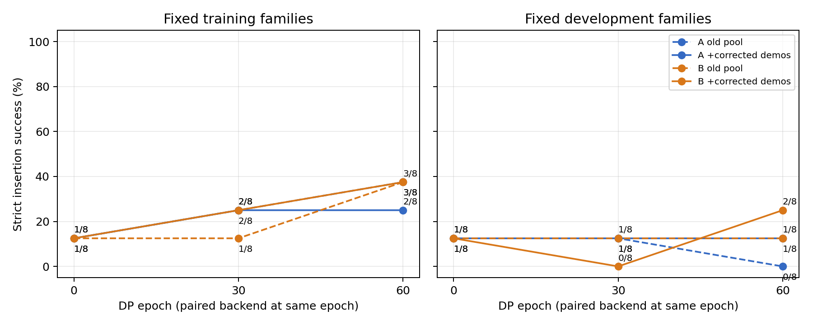

# Tight-Insertion：正确布局完整示范与固定架构训练曲线

独立16个新family：加入正确布局示范后的A严格插入 **2/16**（Wilson95% [3.5, 36.0]%），B **2/16**（[3.5, 36.0]%）。A−B为+0.00 pp（95%配对bootstrap [-18.8, 18.8] pp）。两组均未达到事前50%工程里程碑。

A固定开发起点→末段：1/8→1/8，+0.00 pp（95%配对bootstrap [-37.5, 37.5] pp），原成功保留/新增/丢失=0/1/1。独立新family上，加入示范−原池等更新：-6.25 pp（95%配对bootstrap [-31.2, 18.8] pp），两臂成功为2/16与3/16。

B固定开发起点→末段：1/8→2/8，+12.50 pp（95%配对bootstrap [-25.0, 50.0] pp），原成功保留/新增/丢失=0/2/1。独立新family上，加入示范−原池等更新：-6.25 pp（95%配对bootstrap [-25.0, 12.5] pp），两臂成功为2/16与3/16。

主结论以完整自主结果为准；中段领先不选模。下一步：建议下一轮只做掌内物体姿态辅助监督的匹配小对照：固定DINO、本组数据和动作标签、初始化与更新预算，仅比较辅助损失是否更新视觉读出；同时验收独立family偏斜抓姿读出和完整自主插入。本轮不启动该对照，也未证明视觉是因果瓶颈。

| 组别 / 训练条件 | 固定训练8：起点→30→60 | 固定开发8：起点→30→60 | 独立新16：60 |
| --- | --- | --- | --- |
| A / 原池 | 1/8 → 2/8 → 3/8 | 1/8 → 1/8 → 0/8 | 3/16 |
| A / 加入正确布局24 | 1/8 → 2/8 → 2/8 | 1/8 → 1/8 → 1/8 | 2/16 |
| B / 原池 | 1/8 → 1/8 → 3/8 | 1/8 → 1/8 → 1/8 | 3/16 |
| B / 加入正确布局24 | 1/8 → 2/8 → 3/8 | 1/8 → 0/8 → 2/8 | 2/16 |

监督覆盖已达到：末段所选模型每个合法专家tick与DP纠偏原生入口槽均至少60个不同成功更新步。离线能继续拟合：加入示范的后端A/B训练更新手指RMSE由首轮0.00806/0.00760降至末轮0.00557/0.00510 rad；固定6条验证共1843个合法tick的误差却为0.01095→0.01150、0.01316→0.01318 rad，最后10轮也未下降。train_evaluation仅固定前2条、649 tick，不代表全池；DP扩散训练误差与DDIM验证误差口径不同。自主泛化没有可靠改善：熟悉训练family末段仍只有A2/8、B3/8，独立新16各2/16，均低于原池等更新3/16；不能据此排除更广的独立状态覆盖，也不能认定网络容量或感知单独致因。独立集A有8/16未达到持稳屏幕，B有8/16持稳近孔仍从未入门，失败阶段不同。

补采24条正确100mm布局完整专家示范、7698合法tick，30次实际reset含6次动作前碰撞拒绝。原请求24个family中22个通过，以2个替补补足；旧池60个family变为62个，独立family只增加2个。旧未位移24条明确标记保留，原400、全部合法池及历史模型保持。本轮无新增学生纠偏。

固定网络、DINO、传感输入、归一化、标签和原生120/60/5Hz。两条件各从本组同一完整起点训练；四个DP各12360成功更新，末段后端各48720，中段配套后端各24360。30/60点均固定末轮，后端分别绑定对应DP；监督ledger核验末段每合法tick与DP纠偏原生入口槽至少60个不同成功更新步。阶段/家族误差、采样权重与模型SHA见证据。

每次reset在首动作前核验实际插入件/孔XY及有符号100mm位移；逐例可观测初态与CUDA采样器消费通过。全程自主、无专家权限。原64终测保持封存；独立16在四套末段完整模型冻结后打开，之后未按其结果训练或选模。同seed不承诺隐藏物理状态及逐位视觉计算一致。

主表保留整批分母；配对区间按family整对bootstrap 200000次，seed20261122，未经多重比较校正。全零配对的[0,0]为重采样退化，不能证明等效。224/224个唯一自主机会最终完整且合法；304条尝试记录另含6条已准入技术中断与74条未派发行，不当作额外独立初态。所有首次记录保留，只重试未完成机会，物理失败不替换。详见逐初态、全部尝试与阶段全体分母表。

实际登记2026-11-27T03:19:32+08:00至终核2026-11-28T23:37:49+08:00，墙钟44.30小时；可认证owner区间并集42.90小时，含准备、等待和失败，非GPU小时。按可用容量共享，未操作外部测试进程。资源采样曾低至可用RAM 1.25GiB、空闲VRAM 147MiB，不能声称储备全程保持或零干扰。原机运行根`outputs/visuotactile/run/tight_full_curve_20261127_01`。执行优化、恢复一致性及弃用更新逐项留证。

发布仅写大仓mao455/bcrl_visualTactile既有feature/tight-state-foundation；第二个后来新建仓库持续冻结，本轮零写入。本轮无新增退役路径，历史30项删除不重复计；本轮未删数据/权重，不重复计旧清理释放。

[证据索引](evidence/tight_full_curve_20261127_01/README.md) · [逐初态配对表](evidence/tight_full_curve_20261127_01/audit/per_initial_state.csv) · [主结果与区间](evidence/tight_full_curve_20261127_01/audit/primary_summary.json) · [完整方法与阶段分子](evidence/tight_full_curve_20261127_01/METHODS.md)
