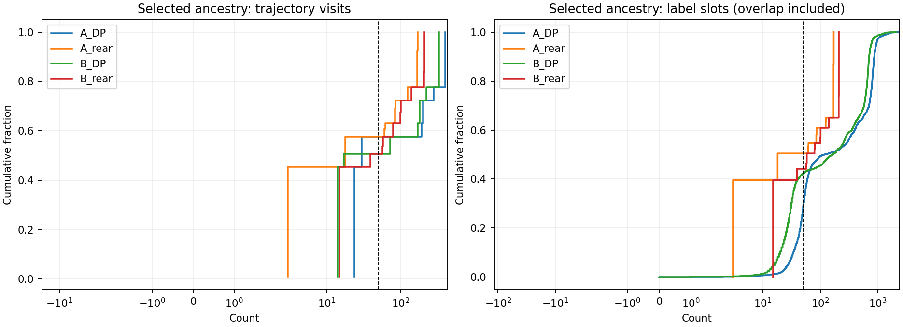
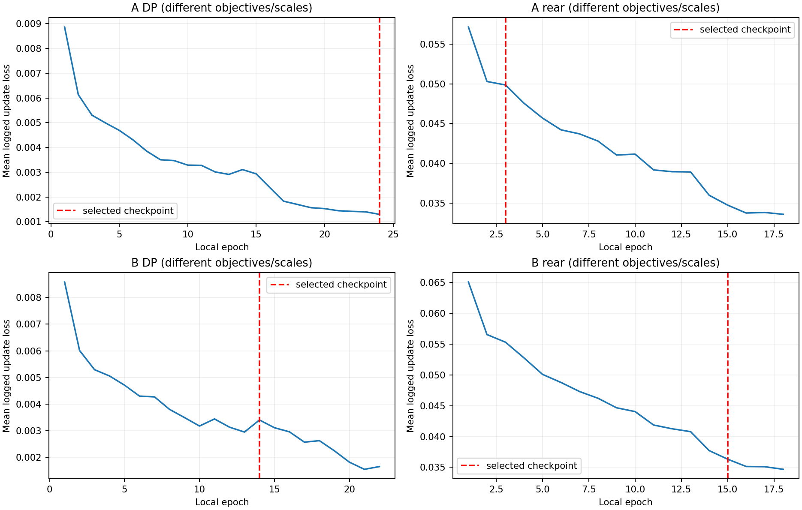
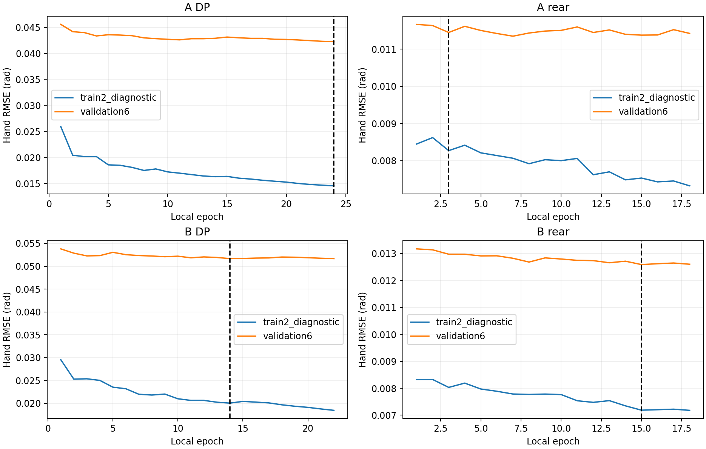
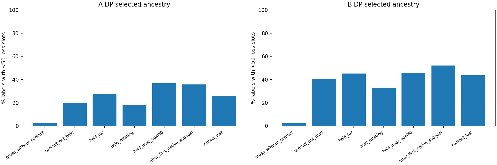
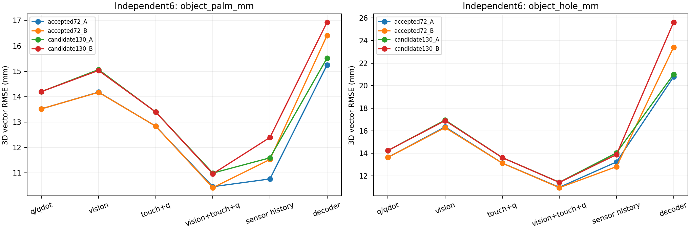

# Tight-Insertion：选中模型曝光、输入输出与表征审计

2026-11-19；源代码基线 `fe1dd74`；唯一工作区 `/home/CNS2025331827/docs/bc+rl_RSS`。本轮只有CPU只读推理、线性诊断probe和无optimizer的梯度计算：**0策略更新、0新采集、0新Kit启动**。没有替换encoder、模型或数据。现采用的仍是 **72数据阶段训练的完整A/B策略**，不是72个模型；130是当前合法训练轨迹池，130候选没有晋升。

主要结论：**新纠偏监督明显欠曝光，完整组合策略的学习/闭环保持问题已有直接证据，现有表征的精确几何读出也不足以证明可完成插入；不能把失败单归因于encoder，也不能说只是多训就会好。** 原始示范已被多次访问，但新轨迹和起始合法标签不是同样的训练年龄。验证家族离线拟合退化存在，训练家族完整自主也不可靠，所以“只在未见family过拟合”解释不充分。视觉与力信号都实际影响输出，并非完全被忽略。

[全部机器结果与索引](evidence/tight_representation_audit_20261119/README.md)。原模型采用结论和64次完整同波配对来自[130周期终态](evidence/tight_recovery_20261118/final_decision.json)，本轮没有再跑或改写其分母。

## 1. 怎样重建真实曝光

逐个读取选中checkpoint的父路径及SHA、`sampling_exposure`/`episode_counts`、实际optimizer日志。30个不同祖先节点、8条角色/组件/人口链。每条DP更新按原identity/epoch/visit_index重算起点，逐项核对完整采样receipt及`target_ticks`，再应用当时H24的合法mask/segment/window合同。祖先只能沿选中模型自身父链累计；105、76强化/普通候选和未选中的后续epoch不加入130模型年龄。原400保护数据也不是本轮新初始化train30的额外曝光。

统计分三种：

- **轨迹访问**：进入训练deck一次，不等于一条轨迹每个tick都算loss。
- **标签slot**：某合法tick实际落入一个有效H24预测槽一次。一次访问多个重叠窗口可重复计算同一tick。
- **不同访问覆盖**：该tick在多少次不同访问中至少出现一次；比slot数更接近独立重采样次数，仍不是独立数据数。

主表分母固定为当前130轨迹、27,508合法专家ticks；72策略对后来新增58条的零曝光是“未见”，不是漏训其当时的数据池。`exposure_population_summary.json`另列当时已见人口，`episode_exposure.csv`和压缩的`tick_exposure.csv.gz`给出每个未达标ID/tick，不能只看总平均。

| 当前130候选组件 | 轨迹访问 min / median / p95 | 少于50次的轨迹 | tick slot min / median / p95 | 少于50slot的tick | 零slot |
|---|---:|---:|---:|---:|---:|
| A DP | 24 / 30 / 407 | 74/130 | 0 / 119 / 942 | 7,500/27,508（27.26%） | 2 |
| A Transformer | 3 / 18 / 171 | 74/130 | 3 / 18 / 171 | 13,880/27,508（50.46%） | 0 |
| B DP | 14 / 45 / 332 | 65/130 | 0 / 163.5 / 770 | 11,612/27,508（42.21%） | 10 |
| B Transformer | 15 / 48 / 210 | 65/130 | 15 / 58 / 210 | 12,158/27,508（44.20%） | 0 |

**两个“是否都至少50次”的答案均为否。** A/B DP每tick不同访问覆盖中位数为30/71，低于50的tick为13,943/12,310；slot重叠明显抬高表面曝光。A/B原30轨迹的DP祖先访问407/332，后端170–171/209–210，不能转移给新58条。新58条DP仅24/14次、后端3/15次。72阶段最新纠偏也不充分：A最后两批各6次DP/15次后端；B最后一批3次DP/24次后端。



当前130本轮deck是原30各3次＋其他100各1次＝**190次轨迹访问/epoch**。DP相邻B2完整轨迹，95 optimizer updates/epoch；每轨完整历史编码，随机选择不放回合法起点，数量为`min(合法tick数,max(1,原commit12合法anchor数))`，H24只计有效目标槽。使用`grasp_balanced_legal_action_anchors_v2`（原早期150tick优先；纠偏仍按实际合同），部署仍固定commit12，不能将随机训练起点误认为提高规划频率。

后端microbatch4、32tick BPTT块，完整真实前缀；每128合法tick量级累计一次optimizer，保留组尾不足128的更新，故不能用“轨迹数/4”估计更新数。每条完整访问的合法tick各一次；固定128分母，而不是每短段重新平均。DP按实际batch中的轨迹均值归一，每个slot基础系数为`1/(实际batch大小×本轨有效slot数)`；后端每tick系数为`1/128`。这是损失测度，不是梯度影响或EMA权重。

| 130本轮 | 实际完成epoch / updates | 选中epoch / updates | 选中本轮访问 |
|---|---:|---:|---:|
| A DP | 24 / 2280 | 24 / 2280 | 4560 |
| B DP | 22 / 2090 | 14 / 1330 | 2660 |
| A后端 | 18 / 5811 | 3 / 966 | 570 |
| B后端 | 18 / 5811 | 15 / 4839 | 2850 |

跨阶段是**父DP所选EMA权重＋新AdamW/新EMA计数**，后端是父所选参数＋新AdamW；不是跨轮完整恢复optimizer。新阶段学习率计划重新开始。130选中DP A/B实际optimizer LR为1.5e-5/3e-5，EMA计数2280/1330；后端LR为1e-4/5e-5、无EMA。配置中的初始LR不能冒充选中时LR。同run故障恢复另有完整状态机制；本次选中链目录没有额外`*restore*.json`回执，不能借别的候选恢复记录声称本链发生过恢复。`source_receipts.json`保存全部节点的实际optimizer step集合、参数组LR、EMA计数、父身份及日志SHA。





这是历史固定train2诊断与validation6，不是全训练池误差；完整池分阶段误差另见下文。CSV同时给出arm/hand，不能用只画出的hand曲线替代原联合选模指标。

## 2. 哪些阶段欠曝光，损失和梯度能说到哪里

阶段沿用既有实际诊断函数，属于互斥物理代理，不是严格成功漏斗；近孔定义`held_near_goal60`不等于已精确对齐。标签slot不足50的比例：

| 阶段 | 合法ticks | A DP | B DP | A后端 | B后端 |
|---|---:|---:|---:|---:|---:|
| 未接触抓取 | 1913 | 2.61% | 2.82% | 1.15% | 1.15% |
| 接触未持稳 | 5427 | 20.03% | 40.70% | 50.21% | 44.81% |
| 持物远离目标 | 351 | 27.92% | 45.30% | 57.26% | 47.86% |
| 持物转动 | 3712 | 18.08% | 32.92% | 49.62% | 40.81% |
| 近孔 | 3952 | 36.97% | 45.90% | 53.01% | 45.52% |
| 首原生子目标之后 | 10005 | 35.76% | 52.10% | 58.62% | 52.10% |
| 接触丢失 | 2148 | 25.84% | 43.81% | 52.61% | 46.97% |

不足原因包含新数据进入较晚、验证早选点、祖先池不含它们、随机前向窗口对段首标签覆盖低和窗口mask边界；不是一律“sampler从未访问轨迹”。DP已核对每次实际选择，零slot不等于整条轨迹未参与。计数也不保证选中参数仍保留以前学会的内容。



历史日志能恢复逐阶段slot及精确基础权重系数、已记录的损失组成、A几何采样/输出坐标梯度诊断。**无法从全update loss/gradient norm还原每个阶段的历史参数梯度或实际loss分摊**：缺少当时逐tick预测及分阶段梯度，Adam/裁剪/EMA亦非简单可加。没有伪造此项。

补做76个固定当前参数片段的FY目标梯度：每完整策略取字典序第一个原始、纠偏、验证轨迹，每阶段首个含合法标签的32tick块，完整因果前缀、固定128缩放、不更新。总norm0.00757–0.44074；visual GRU norm0.000248–0.02190，tactile norm0.00177–0.11331，逐阶段/模块见`current_phase_gradients.csv`。这些是**当前目标敏感度**，不能作为历史训练贡献比例或全池平均。未重算历史DP参数梯度。

## 3. 实际输入输出和时序

以四套真实checkpoint合同、数值缓存和现行源码为准，不依据类名推测。完整张量/参数形状见`input_contracts.json`，当前与训练时源码差异见`source_receipts.json`。130最近四节点仅`anchor_continue.py`不同，为上一工程阶段重复deck恢复校验修复；DP/后端网络、控制、目标、统计未发生本轮修改。72→130相同角色DP合同完全一致，归一化文件SHA逐字节相同。

| 链路 | 实际数据及行为 |
|---|---|
| 相机 | 三视角真实RGB-D，每控制tick60Hz；每视角RGB 3×252×448，DINO输入RGB/255与ImageNet均值/方差；深度米及valid另走深度支路，不是仅RGB |
| 冻结部分 | DINOv2 ViT-S/14固定revision `7764ea0f…`，缓存权重SHA `b938bf1b…`；每视角384×18×32空间patch。冻结的是DINO，不是整个视觉策略 |
| 可训练视觉 | RGB 1×1卷积384→112，depth+valid 2→16；128维空间/相机位置嵌入，pool成3×48 tokens，4个query attention读出512；DP visual GRU256及后续融合/去噪仍可训练 |
| DP历史 | robot178的13个观测及age/valid、最近3帧tokens、每tick native GRU256和visual GRU256；完整真实前缀递推。三帧不是完整时间记忆；GRU才保留更早历史 |
| robot178 | q29、qdot29、当前已存在的执行目标29、目标−q29、严格过去issued29和delayed29及2个age、过去有效flag、elapsed。是传感/控制反馈，**不是纯本体58**，不含当前专家标签 |
| DP输入 | 当前A/B均I-HistoryDP、G00、H24、sample/x0；**DP不接触觉**。512条件送完整ConditionalUnet1D，29维输出；不把类名DP等同Transformer |
| DP A/B目标 | A为同一transition积分之后`q_reached=q(t+1)`及既有几何项；B为该transition实际专家后处理绝对目标`u_expert=target_after_rad(t)`。A不是当前q，也不是直接专家命令；A对命令的差不能全算DP错误 |
| 规划/anchor | 60Hz观测、5Hz规划；H24预测0.4s，每12步0.2s重新规划；当前cursor0…11、剩余24×29计划及valid、previous_nominal29及valid严格独立。anchor是时间/计划对齐，不引入新物理步 |
| 触觉 | 五指接触力世界/局部各3分量，单位N；两次已完成120Hz物理采样/控制tick；FK指尖位置m、旋转3×3、时间s及valid。不是高分辨率触觉图像，不提供精确接触面坐标/摩擦/扭矩或剪切阵列 |
| 触觉编码 | 每指35维（27物理/差分/event/有效特征＋8 ID），signed-log force、位置/姿态/速度/力变化、0.1N事件；每指GRU32＠120Hz，融合64；取每对物理采样末端，跨块保留真实前样本 |
| 后端 | actual visual512→GRU64；robot178→GRU64；tactile64；feedback/持续memory128。Transformer query融合当前反馈、memory与cursor，读24计划tokens＋32严格过去反馈tokens＋1memory summary；输出29维修正，实际采用`reachable_nominal_centered_linear_v1`（先将DP中心约束到可达区间，再线性修正） |
| 最终控制 | 组合绝对目标→关节限制→以实际前目标为参照的专家可达区间投影→最终29维rad目标。B及后端标签已包含专家延迟、EMA和速度处理；不再延迟/平滑标签第二次。原生delay随机抽样仍保留以维持RNG合同 |
| 训练与部署 | 训练读真实学生前缀/专家后缀；只有合法专家mask进loss、交接不洁净步不算标签。后端更新后重播完整前缀重建当前参数记忆；32tick梯度截断不清空历史。部署由真实执行ack写回历史，不把私有DP输出冒充真实命令 |

原120Hz物理、60Hz控制、5Hz规划、成功判据、几何校准身份和已接受模型保持。可达执行合同含arm/hand EMA0.1、arm progress0.5、hand progress1、手部目标2rad/s上限；常见臂部完整一步区间仅约0.0025rad。因此“绝对rad误差很小”不等于控制误差可忽略。本轮额外报告误差/实际完整可达区间宽度；此缩放仅诊断，未修改loss。

归一化始终来自原30训练轨迹，不能使用纠偏/验证重新拟合。全记录robot标准化绝对值p99的跨轨中位约2.56，超过5的比例中位0.041%；单轨max的中位约11.14，不能称所有输入都在训练分布内。过去槽无效时保持零、flag不按连续值标准化。没有发现本轮新增的训练/推理归一化版本错配。深度valid和严格过去mask保留，未用真值补传感输入。

## 4. 欠拟合、过拟合与闭环偏移

使用相应DP真实冻结缓存、从tick0逐控制步推进完整后端；采样stride6只用于probe，**策略误差覆盖全部合法tick**。同一记录历史下比较DP自身语义目标、DP对专家命令、最终组合对专家命令。纠偏学生控制前缀没有反事实专家标签，故不编造其专家动作误差；“first24”明确指接管后最初24个合法专家tick，不是学生接管后的伪标签。

| 模型/人口 | DP自身目标 Arm / Hand RMSE(rad) | 最终命令 Arm / Hand RMSE(rad) |
|---|---:|---:|
| A72 原30完整示范 | .002443 / .01804 | .000343 / .00801 |
| A130 原30完整示范 | .002093 / .01572 | .000380 / .00820 |
| B72 原30完整示范 | .002895 / .02415 | .000329 / .00800 |
| B130 原30完整示范 | .002587 / .02222 | .000279 / .00738 |
| A130 独立验证6 | .005135 / .04226 | .000572 / .01145 |
| B130 独立验证6 | .005608 / .05166 | .000619 / .01259 |
| A130 纠偏first24（100条/2400tick） | .003200 / .03565 | .000558 / .01204 |
| B130 纠偏first24（100条/2400tick） | .003986 / .04619 | .000439 / .01098 |

原30的A DP继续改善，组合命令反而退化，不能用DP loss证明完整模型已学好。B原30组合拟合改善，但真实开发表现没有保住。候选验证6相对原30：B DP arm约2.17倍、hand约2.32倍；组合arm约2.22倍、hand约1.71倍，存在泛化差距。B130最终臂误差/完整可达区间RMSE：原30约11.17%、验证6约24.78%；更不能用小绝对数宣布已充分拟合。

不同人口不能直接混比。对**相同旧42纠偏first24/1008tick**：A72→A130组合arm .000373→.000398、hand .008397→.008677；B .000329→.000335、.008283→.008125，非单向统一改善。`offline_common42_corrections.csv`给出所有阶段配对人口。130后端搬运代理`held_far`误差A(.000553,.01336)、B(.000411,.01214)，近孔A(.000628,.01396)、B(.000517,.01361)；均需与其合法tick分母一起解释，远持物只有252纠偏tick。

现有64次完整自然终止配对（训练8＋开发8，每role基准/候选）：

| 完整自主成功 | A72 | A130 | B72 | B130 |
|---|---:|---:|---:|---:|
| 训练family8 | 2/8 | 1/8 | 0/8 | 2/8 |
| 新开发family8 | 1/8 | 0/8 | 1/8 | 0/8 |

B开发hold60从7/8降到1/8；小样本、七物理波、可见初态配对，不宣称隐藏PhysX精确重放/显著性。训练family也不能可靠完成任务，因此主要问题不只在新family。最新候选的开发下降也不支持继续无条件加epoch。

实际学生前缀与专家历史的距离按**相同物理阶段、排除同family近邻、原30统计**重算。B130 learned sensor history中位标准化近邻RMS：held_far专家.731、学生1.031；held_near_goal专家.636、学生.805；早期未接触约.308/.305，并不是全部时段都漂移。每阶段样本数、p95及其他模态见`history_shift.csv`。这支持阶段性闭环状态偏移，但学生前缀是历史采集策略产生，不能冒充130候选新闭环录制。

相似有限特征的最近邻专家动作仍不同，见`nearest_observation.json`；但不是完全相同历史，时间、隐藏状态和模型压缩均可能影响。**尚未证明不可消除的观测歧义**。此前同真实历史交叉重放已发现参数改变先改输出、再放大物理偏离；本轮没有发现新时序bug来替代这个解释。

## 5. 现有表征能读出什么

固定ridge=.01，无超参搜索；训练30个family五折隔离，另用6个独立验证family。先按family切分，再在各训练折拟合均值/尺度/回归器。相邻tick没有随机分入train/validation。冻结策略的encoder已经见过30训练family，故五折表示的是**readout隔离family**，不是encoder从未见这些family。验证6也曾用于策略选模，不是新的盲测。

四模型各自使用实际视觉512、后端真实逐tick隐藏状态。72为78轨/3798采样帧，130为136轨/7087帧。stride6且排除末12tick后才做未来标签；仅用于求解轻量probe。所有真值只作诊断标签或明确privileged读出，不写回学生。

| 表示（B130，验证6，292帧） | 物体相对掌mm | 物体相对孔root mm | 相对掌角度° | 未来0.2s相对运动m/s |
|---|---:|---:|---:|---:|
| q/qdot58 | 14.20 | 14.25 | 10.64 | .0499 |
| visual512 | 15.03 | 16.90 | 11.62 | .0564 |
| 原始力＋q/qdot | 13.40 | 13.62 | 8.71 | .0467 |
| visual＋原始力＋q/qdot | **10.97** | **11.42** | **7.58** | .0446 |
| 实际sensor历史320 | 12.40 | 13.89 | 8.18 | **.0423** |
| Transformer decoder128 | 16.93 | 25.63 | 13.36 | .0485 |



历史有助于运动趋势读出，却没有在所有几何指标上胜过原始多模态拼接；decoder几何线性读出更差。可解释为任务压缩、训练目标或读出器容量问题，**不能据此证明信息已被永久丢失**。B130近孔36帧多模态相对掌/孔误差6.97/7.19mm，decoder15.41/26.19mm；这些是root相对位姿，不是经过插销尖端/孔缘标定的装配间隙误差，不宣称毫米级插入精度。

30family五折中，B130纠偏合法后段多模态位置RMSE16.80/17.55mm、角度17.14°，比正常验证更难；真实学生前缀为10.00/10.42mm、9.52°。合法纠偏分布与普通成功示范不同，不能只用整条正常轨迹的平均数评价encoder。

力编码能高精度读出手指接触与log-force强度（逐指AUC见CSV，通常>.99），但目标为仿真object-filtered前一步力，而输入是实际指端接触力及FK；不能解释成精确接触点、表面切向位移、摩擦余量或真值支撑。位置/姿态标签使用实际pre-action物体/掌/孔位姿；相对运动标签是后12tick位移/.2s，属于未来运动趋势。

“未来失去支撑”仅定义为当前≥2指物体接触、未来12tick内出现0指接触。B130验证6仅200个eligible帧/13个阳性，sensor-history AUC .970、AP .820；近孔36帧没有阳性，AUC不可计算。不同阶段接触释放可能是正常放置，因此它**不是精确滑移/失稳真值**；纯本体AUC .987也很高，显著的时间/阶段关联存在，不能说触觉已经会预测滑移。

特权状态诊断仅是相同线性读出器的单步专家命令比较，不是已训练的oracle闭环上界。B130验证：q/qdot→(.002727,.03852)rad，视觉＋力＋q→(.003000,.03096)，加入精确当前相对位姿/接触→(.002771,.03327)。精确状态未产生全面优势，不能据此认定感知不确定性是唯一瓶颈；也不能反过来证明感知充分，因为线性控制器/当前标签不足以给出真正能力上界。

完整controller_feedback178单步读出误差更低(.000723,.01162)，它含上一真实执行目标，专家历史高度连续，这是**历史捷径对照**，绝不归类“纯本体encoder优越”。此对照解释为何离线命令可预测而学生自主仍会偏离。

## 6. 模型有没有利用视觉、触觉

真实四模型后端各固定10轨：原始首2、纠偏首2、验证全部6，先登记选择。相同记录DP计划和本体历史，仅zero force、zero visual512或反转视觉时间序列：

- A72/B72去力后的臂MSE增加20.84%/18.96%，手增加20.23%/14.15%；A130/B130增加17.23%/22.59%、14.55%/14.68%。命令RMS变化约.0040–.0046rad。
- 去掉后端视觉读出，四模型臂MSE增加3.44–5.01%，手增加2.38–4.70%；反转视觉时间序列也改变输出。**后端保留的DP计划仍有视觉信息**，所以这不是整条策略“去视觉”。
- 另对四套真实DP各第一原始/验证轨迹前25tick，在相同DDIM16随机噪声下分别去RGB patch、去depth+valid、两者都去。双去除使未执行投影前计划RMS改变.0417–.0480rad；独立支路结果在`dp_interventions.csv`。G00 DP无触觉，不能称DP使用了触觉。

这证明数值依赖及固定历史上的预测效用，**不证明真实闭环收益或因果必要性**。零化/时间反转均可能离开训练分布。本轮未因该结果重新训练或扩大自主试验。

## 7. 有证据的下一步决策

1. **训练量尚不能宣称足够。** 直接否定“每条130、每tick50次”；但原30大量重复仍没有可靠训练family自主，单纯增加总epoch不是充分解释或解决方案。训练不足应按合法tick/阶段/完整组件判断。
2. **最明显欠曝光**：新58条、纠偏段首、近孔与首子目标后，尤其A选中后端仅3次新轨访问。先固定当前130和72基准，以明确最小有效tick覆盖、旧路径保持与独立开发为评价，不通过丢弃后期checkpoint的已完成更新充年龄。
3. **优先工程/学习对照**：保留72 DP，匹配后端在固定130上做一个有限组合学习对照，直接检查原30/旧42/新58的阶段性最终命令、可达区间误差和旧成功保持。其目的是分开“DP改动导致输入改变”与“后端欠曝光”，不是预先保证成功。本轮只提出，未执行。
4. **若迁移表示，优先对象中心、几何与时序一致的RGB-D＋本体＋真实力/FK表示**：显式保留三维物体—掌、插销—孔关系及其不确定度、接触状态与相对运动，保留局部空间tokens和时间记忆。理由是多模态比单模态读出更好、decoder的精确几何压缩不足、近孔误差仍以毫米至厘米计；不是因为DINO完全无用。用当前数据的诊断真值验证可读性，不把仿真真值接到部署，也不推荐目前传感器根本没有的高分辨率触觉图像encoder。
5. **主因排序是证据强度，不是定论**：完整组合拟合/选模与阶段曝光不均＋闭环反馈偏移证据最强；精确几何表征是实测限制；新family泛化有差距；无法确认观测不可辨识或新I/O时序错误。不要用“欠拟合/过拟合/encoder差”中的单个标签替代这些并存问题。

## 8. 验证、保护与复现

46项聚焦检查通过（新诊断坐标/折内归一化、随机anchor、目标监督、交接窗口）；216个probe family分离回执检查；逐tick结果和摘要分母完全相符；30个祖先checkpoint/optimizer日志SHA固定。16项保护文件SHA不变（完整72/130模型、manifest和统计），136条原始路径均解析、实际观察和缓存已读取；原400沿用未变manifest及上一阶段完整SHA验收，本轮没有再做整池raw HDF5 SHA扫盘，不谎称重做。

本轮源码只新增诊断工具/测试和文档；没有改动生产模型、学习算法、物理、控制、数据或源日志。先期诊断代码的mask兼容修正、纯本体命名修正、student/control_source与交接mask分离均保留在本机audit的`review_v1/review_v2`和日志，不作为研究训练重跑。最终当前结果以本目录JSON/CSV为准。

复现使用新输出根，工具采用排他创建，避免覆盖本轮证据：

```bash
cd /home/CNS2025331827/docs/bc+rl_RSS
export TIGHT_AUDIT_RUN="$PWD/outputs/visuotactile/run/tight_representation_reproduce_01"
export TIGHT_AUDIT_PUBLIC="$TIGHT_AUDIT_RUN/reports"
export OMP_NUM_THREADS=2 OPENBLAS_NUM_THREADS=2
PY=/home/CNS2025331827/miniconda3/envs/isaaclab/bin/python
"$PY" -m tools.tight_representation_audit exposure
"$PY" -m tools.tight_representation_probe extract
"$PY" -m tools.tight_representation_probe probes
"$PY" -m tools.tight_representation_diagnostics gradients
"$PY" -m tools.tight_representation_diagnostics shift
"$PY" -m tools.tight_representation_diagnostics dp_interventions
"$PY" -m tools.tight_representation_summary
"$PY" -m pytest -q tests/test_tight_representation_audit.py tests/test_random_training_anchors.py tests/test_target_supervision.py tests/test_recovery_onset_windows.py > "$TIGHT_AUDIT_RUN/tests.log"
"$PY" -m tools.tight_representation_verify
```

`TIGHT_AUDIT_RUN`保存中间特征与本地大数组，`TIGHT_AUDIT_PUBLIC`只保存可发布小结果；不会调用统一入口的train/DAgger/evaluate，不创建平行项目。运行需现场原始资产和Python依赖；GitHub小结果不包含私有HDF5或checkpoint。

## 附：全部选中祖先阶段

顺序为每链初始→当前；相同节点在不同模型共享，不重复加到一条链。表中actual为该节点日志总更新，selected为该节点被继承的更新。父SHA、完整配置、精确epoch访问数见source_receipts/exposure；部分matched节点在epoch中途结束，epoch不能当完整遍数。

### accepted72_A_DP

| 阶段 | pool | selected epoch | selected / actual updates | selected visits |
|---|---:|---:|---:|---:|
| tight_layout10_20261116_learning01/A | 30 | 77 | 1155 / 1200 | 2310 |
| tight_layout10_20261116_dagger01/learning/A | 37 | 80 | 1520 / 1520 | 2960 |
| tight_phase_20261116_01/round02/learning/A | 49 | 9 | 225 / 450 | 441 |
| tight_long_20261117_01/midpoint/A | 56 | 97 | 2716 / 5376 | 5432 |
| tight_long_20261117_01/matched_old56/A | 56 | 66 | 1848 / 1848 | 3696 |
| tight_long_20261117_01/round05/learning/A | 72 | 6 | 216 / 648 | 432 |

### accepted72_A_rear

| 阶段 | pool | selected epoch | selected / actual updates | selected visits |
|---|---:|---:|---:|---:|
| tight_layout10_20261116_learning01/A/backend/A | 30 | 40 | 3080 / 3080 | 1200 |
| tight_layout10_20261116_dagger01/learning/A/backend/A | 37 | 39 | 3122 / 3200 | 1443 |
| tight_phase_20261116_01/round02/learning/A/backend/A | 49 | 24 | 2129 / 2129 | 1176 |
| tight_phase_20261116_01/round03/learning/A/backend/A | 56 | 11 | 1036 / 1973 | 616 |
| tight_long_20261117_01/midpoint/A/backend/A | 56 | 11 | 1036 / 6011 | 616 |
| tight_long_20261117_01/matched_old56/A/backend/A | 56 | 22 | 2008 / 2008 | 1196 |
| tight_long_20261117_01/round05/learning/A/backend/A | 72 | 15 | 1726 / 2071 | 1080 |

### accepted72_B_DP

| 阶段 | pool | selected epoch | selected / actual updates | selected visits |
|---|---:|---:|---:|---:|
| tight_layout10_20261116_learning01/B | 30 | 80 | 1200 / 1200 | 2400 |
| tight_layout10_20261116_dagger01/learning/B | 37 | 42 | 798 / 969 | 1554 |
| tight_phase_20261116_01/round02/learning/B | 49 | 10 | 250 / 500 | 490 |
| tight_long_20261117_01/midpoint/B | 56 | 99 | 2772 / 5376 | 5544 |
| tight_long_20261117_01/round04_pool/learning/B | 65 | 56 | 1848 / 1848 | 3640 |
| tight_long_20261117_01/round05/learning/B | 72 | 3 | 108 / 648 | 216 |

### accepted72_B_rear

| 阶段 | pool | selected epoch | selected / actual updates | selected visits |
|---|---:|---:|---:|---:|
| tight_layout10_20261116_learning01/B/backend/B | 30 | 39 | 3004 / 3080 | 1170 |
| tight_layout10_20261116_dagger01/learning/B/backend/B | 37 | 40 | 3200 / 3200 | 1480 |
| tight_phase_20261116_01/round02/learning/B/backend/B | 49 | 21 | 1863 / 2129 | 1029 |
| tight_phase_20261116_01/round03/learning/B/backend/B | 56 | 21 | 1973 / 2254 | 1176 |
| tight_long_20261117_01/midpoint/B/backend/B | 56 | 1 | 93 / 6011 | 56 |
| tight_long_20261117_01/round04_pool/learning/B/backend/B | 65 | 19 | 2008 / 2008 | 1210 |
| tight_long_20261117_01/round05/learning/B/backend/B | 72 | 24 | 2760 / 2760 | 1728 |

### candidate130_A_DP

| 阶段 | pool | selected epoch | selected / actual updates | selected visits |
|---|---:|---:|---:|---:|
| tight_layout10_20261116_learning01/A | 30 | 77 | 1155 / 1200 | 2310 |
| tight_layout10_20261116_dagger01/learning/A | 37 | 80 | 1520 / 1520 | 2960 |
| tight_phase_20261116_01/round02/learning/A | 49 | 9 | 225 / 450 | 441 |
| tight_long_20261117_01/midpoint/A | 56 | 97 | 2716 / 5376 | 5432 |
| tight_long_20261117_01/matched_old56/A | 56 | 66 | 1848 / 1848 | 3696 |
| tight_long_20261117_01/round05/learning/A | 72 | 6 | 216 / 648 | 432 |
| tight_recovery_20261118_01/learning/A | 130 | 24 | 2280 / 2280 | 4560 |

### candidate130_A_rear

| 阶段 | pool | selected epoch | selected / actual updates | selected visits |
|---|---:|---:|---:|---:|
| tight_layout10_20261116_learning01/A/backend/A | 30 | 40 | 3080 / 3080 | 1200 |
| tight_layout10_20261116_dagger01/learning/A/backend/A | 37 | 39 | 3122 / 3200 | 1443 |
| tight_phase_20261116_01/round02/learning/A/backend/A | 49 | 24 | 2129 / 2129 | 1176 |
| tight_phase_20261116_01/round03/learning/A/backend/A | 56 | 11 | 1036 / 1973 | 616 |
| tight_long_20261117_01/midpoint/A/backend/A | 56 | 11 | 1036 / 6011 | 616 |
| tight_long_20261117_01/matched_old56/A/backend/A | 56 | 22 | 2008 / 2008 | 1196 |
| tight_long_20261117_01/round05/learning/A/backend/A | 72 | 15 | 1726 / 2071 | 1080 |
| tight_recovery_20261118_01/learning/A/backend/A | 130 | 3 | 966 / 5811 | 570 |

### candidate130_B_DP

| 阶段 | pool | selected epoch | selected / actual updates | selected visits |
|---|---:|---:|---:|---:|
| tight_layout10_20261116_learning01/B | 30 | 80 | 1200 / 1200 | 2400 |
| tight_layout10_20261116_dagger01/learning/B | 37 | 42 | 798 / 969 | 1554 |
| tight_phase_20261116_01/round02/learning/B | 49 | 10 | 250 / 500 | 490 |
| tight_long_20261117_01/midpoint/B | 56 | 99 | 2772 / 5376 | 5544 |
| tight_long_20261117_01/round04_pool/learning/B | 65 | 56 | 1848 / 1848 | 3640 |
| tight_long_20261117_01/round05/learning/B | 72 | 3 | 108 / 648 | 216 |
| tight_recovery_20261118_01/learning/B | 130 | 14 | 1330 / 2090 | 2660 |

### candidate130_B_rear

| 阶段 | pool | selected epoch | selected / actual updates | selected visits |
|---|---:|---:|---:|---:|
| tight_layout10_20261116_learning01/B/backend/B | 30 | 39 | 3004 / 3080 | 1170 |
| tight_layout10_20261116_dagger01/learning/B/backend/B | 37 | 40 | 3200 / 3200 | 1480 |
| tight_phase_20261116_01/round02/learning/B/backend/B | 49 | 21 | 1863 / 2129 | 1029 |
| tight_phase_20261116_01/round03/learning/B/backend/B | 56 | 21 | 1973 / 2254 | 1176 |
| tight_long_20261117_01/midpoint/B/backend/B | 56 | 1 | 93 / 6011 | 56 |
| tight_long_20261117_01/round04_pool/learning/B/backend/B | 65 | 19 | 2008 / 2008 | 1210 |
| tight_long_20261117_01/round05/learning/B/backend/B | 72 | 24 | 2760 / 2760 | 1728 |
| tight_recovery_20261118_01/learning/B/backend/B | 130 | 15 | 4839 / 5811 | 2850 |
