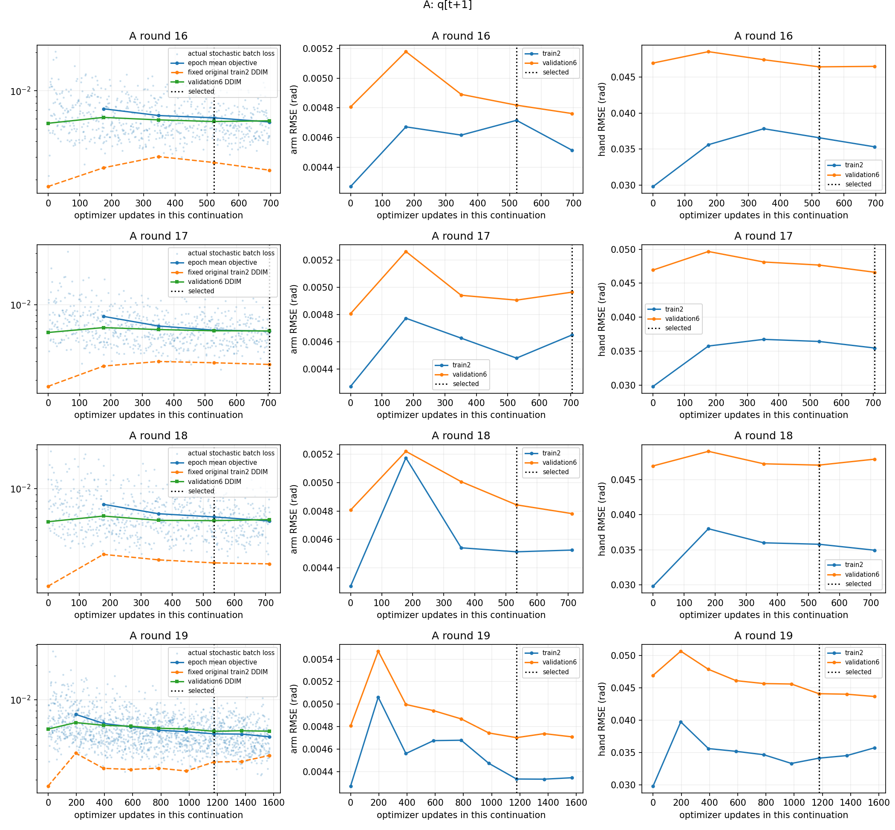
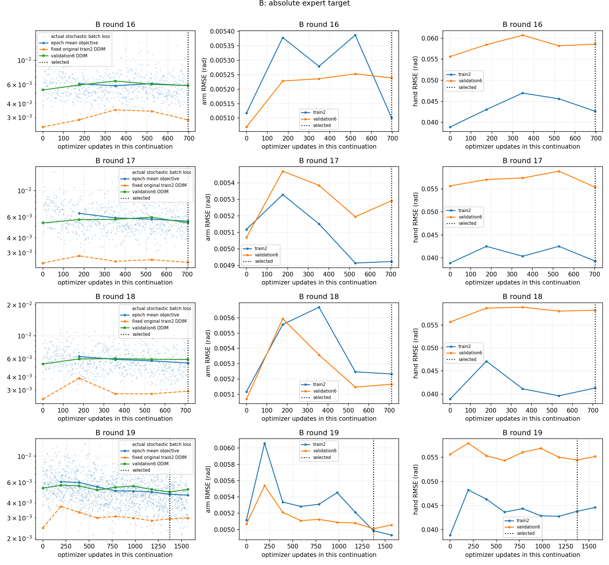
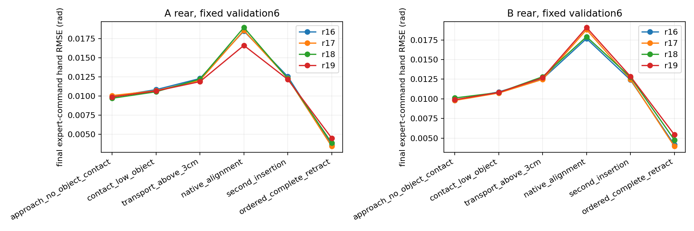

# Tight-Insertion：训练、闭环与读取瓶颈诊断（2026-11-16）

前期曲线审计**没有第20轮DAgger，没有新增采集、正式训练或自主仿真**。后续用户已授权固定数据延长训练，正在新root中进行；详见文末登记，旧审计结论与数据保留。正式来源仍为完整 **A11/B15**，第19轮候选继续拒绝。分析使用原记录，补充少量有界离线推理和可丢弃的真实训练batch来定位问题。所有图上的点来自实际日志或明确标记的端点推理，曲线连线仅连接实测点。

## 先看这一页（延长训练之前的审计；下述采样建议已暂缓）

**模型在学习新纠偏，但没有同时保住已有抓持动作；闭环误差已经出现在接触形成之前。现在没有证据说明单纯延长原样训练就能解决问题。**

相同登记的4个开发family、统一前300控制步（5秒）、GPU物理/standard相机下：

| 完整策略 | 合法起点 | 有效接触 | 双指接触 | 原生lift | 双指且升高2cm | 持物12步 | 持物60步 | 最后60步仍持物 | 对准/首子目标 |
|---|---:|---:|---:|---:|---:|---:|---:|---:|---:|
| 保留A11 | 3 | 3/3 | 3/3 | 1/3 | 3/3 | 2/3 | 1/3 | 1/3 | 0/3、0/3 |
| 保留B15 | 4 | 4/4 | 4/4 | 1/4 | 2/4 | 2/4 | 1/4 | 0/4 | 0/4、0/4 |
| 第19轮A | 3 | 3/3 | 3/3 | 0/3 | 1/3 | 1/3 | 0/3 | 0/3 | 0/3、0/3 |
| 第19轮B | 4 | 4/4 | 4/4 | 0/4 | 0/4 | 0/4 | 0/4 | 0/4 | 0/4、0/4 |

28个来源/16–19候选可比开发初态的实际起始q一致，物体相对基座位置差最大5.34e-7m；lane数量与隐藏物理状态仍不能视为逐位重放，详见[初态比较](evidence/tight_diagnosis_20261116/development_initial_comparison.json)。A另有1个动作前非法起点，排除在成功率分母外。第19轮完整任务A **0/2**、B **0/2** 插入；其余抓持截断试验不计完整插入失败。训练family复验A持物60步1/2、B0/2，A那一次在最后观察窗口也没保持住。这些小样本远不能证明接近90%的稳定抓持。

主要结论：

- **DP尚不能称为已经充分拟合。** 第19轮训练目标下降约36.3%（A）/23.0%（B）。新4条的手指预测误差下降约47%，但固定原始2条示范误差上升14.5%/12.7%；前150步上升23.3%/32.2%。这是实际的新旧数据拟合取舍。
- **Transformer处于小幅改进/波动区域，不是完全没更新。** 第19轮B选择第4遍是归一化Arm/Hand等权指标更好；第8遍仅差0.93%，同时手指RMSE略低。不能把这点波动解释成严重过拟合。额外固定train2拟合曾将早期手指误差压至约0.003rad，说明后端仍有拟合空间，但只换来A一例闭环持物，B没有收益。
- **确定的问题**：最新样本训练与原始动作保持发生取舍；部分动作偏差先于首次接触；同family复验并非原示范物理初态的精确重现；每遍重复读取整池大特征，19轮累计2.602TiB实际读取。
- **尚未确定**：哪一个表示/历史模块最先导致状态偏移；早期采样比例的因果作用；旧运行的具体I/O争用源。标签mask、动作时间与执行映射已有实样本检查，没有新证据支持“把学生错误动作当专家标签”或“控制器映射错了”。
- **已实际清理14.87GiB**，可用空间18.60→33.47GiB。原始数据、当前354条训练/验证记录、全部当前冻结视觉特征、A11/B15和16–19诊断检查点保留。
- **下一项最有价值的实验**：先做一个有界的“保留旧动作”采样对照，固定现有数据、起始A11/B15、更新次数与学习率，降低最新4条独占的重复曝光，增加原始成功接近/接触段的回放；分别要求DP和后端在固定旧/新样本早期误差上都不退化，再做相同初态短闭环。继续保持DP→刷新输入→Transformer顺序。这个对照尚未启动，不是第20轮采集。

## 1. 清理范围与恢复边界

清理前实际扫描 `outputs/visuotactile`，约890GiB。所有当前354个冻结视觉shard都仍被最新训练清单引用，合计169.30GiB，**没有把它们误删为旧缓存**。训练池348条+验证6条；348条不等于348个独立初态，仍为170个登记训练family。

| 实际处理 | 数量 | 逻辑净释放 |
|---|---:|---:|
| 旧的非选中检查点/中间状态 | 29项 | 2.386GiB |
| 已废弃DP生成的后端输入 | 730个shard | 1.797GiB |
| 历史检查点仅移除optimizer，逐项保留model/EMA及所有其他字段 | 91个inode组 | 10.691GiB |
| 文件系统可用空间实际增加 | — | **14.873GiB** |

先写删除计划，再检查可访问进程的FD/内存映射，最后执行；没有活动研究进程引用候选文件。模型重封装使用临时文件、fsync、逐字段/张量相等检查后才删除旧容器；新文件为显式 `*.weights_only.pt`，原SHA和原路径写入 `*_archival.json`，**不能假称旧optimizer还可续训或新容器SHA等于旧容器**。有硬链接的检查点按inode组处理。

所有原始HDF5、未完成原始采集、NPZ物理轨迹、配置、评估证据及旧核心model/EMA保留。所有16–19与固定train2诊断目录、当前A11/B15完整来源排除在清理范围外；它们的保留检查点SHA在前后完全一致，并实际通过torch读取。354条当前有效轨迹逐一打开、确认complete、29维目标长度一致和首尾标签有限，没有重扫每帧RGB。

[删除执行清单](evidence/tight_diagnosis_20261116/cleanup.json)、[分类占用与规则](evidence/tight_diagnosis_20261116/cleanup_inventory.json)。本机完整预删除依赖清单与数据验证：`outputs/visuotactile/run/tight_diagnostic_20261116_01/cleanup/{plan,finished}.json`。旧后端输入的index、原DP绑定、数据/统计文件和源版本仍在；若DP旧容器也退休，显式使用相应archival记录中的同张量weights-only文件，在新身份下重建输入。不要重启旧owner来“恢复”已退休阶段。

## 2. 第16–19轮DP完整曲线

共提取 **7360条真实optimizer-update记录**、全部实际epoch验证点、每次访问的loss分量和样本cohort。A监督执行后一控制步的q[t+1]，B监督专家绝对目标，两者的物理标签域不同，不能直接按数值大小排序模型优劣。

图的左列同时标明三种不同量：随机噪声下的sample/x0去噪训练目标、固定原始train2上的DDIM回放指标、独立validation6上的DDIM回放指标。**历史没有逐epoch validation denoising loss**，因此没有伪造与训练噪声loss完全同义的验证曲线。右两列是Arm/Hand弧度误差。竖线为实际选中checkpoint。

这些图说明：

1. 16–18轮A验证手指RMSE约0.046–0.048rad，没有持续改善；B约0.055–0.059rad，同样没有逐轮稳定下降。各轮都从所保留来源继续，**不是将所有epoch无缝拼接的一次训练**。
2. 第19轮A验证手指从0.04694降到选中0.04410rad；B从0.05564降到0.05444rad，收益有限。A最后一遍手指更好0.04367，但等权归一化选择分数略差（0.005310 vs 0.005300），所以仍选第6遍；B选第7遍，最后第8遍选择分数退化约5.1%。
3. 固定原始train2曲线在更新后整体高于epoch0来源，尤其第一次更新遍后明显跳高。不能只看到新样本loss下降，就说整池动作已经学好。
4. 8遍末尾仍有改善/波动，不能由这8个点证明达到优化极限，也不能证明“再训更久一定会拿稳”。

分量图画的是各自原始单位，不能把最大的未加权几何项当成最大梯度来源。第19轮A第1/8遍几何各项加权后合计约占总loss **0.318%/0.313%**；其中手部几何贡献约5.63e-6/2.92e-6。B没有A的手部几何项。loss占比不等于梯度占比，本次不据此断言几何梯度失效。每次访问的随机anchors和合法mask保留，未将运行时计划改成每步重规划。

原始指标：[epoch与Arm/Hand误差](evidence/tight_diagnosis_20261116/dp_epochs.csv)、[全部更新与分量](evidence/tight_diagnosis_20261116/dp_updates.csv.gz)、[新/旧数据访问目标](evidence/tight_diagnosis_20261116/dp_cohort_visits.csv.gz)。后者是实际访问时随机噪声目标，不是固定同输入推理误差。

### 固定同输入的端点比较：真正学了什么

只读推理36次：每组source/selected/last，在相同原始2条+最新4条完整历史上评估。每条特征每组只打开一次，当前网络各自重建历史。使用正式recovery-onset mask、同5Hz规划/commit12和已接受的32-anchor离线批量推理。无更新、无新仿真。

| 手指RMSE（rad） | A来源→选中→最后 | B来源→选中→最后 |
|---|---:|---:|
| 原始2条，全部合法动作 | .02982→.03413→.03572 | .03890→.04383→.04463 |
| 原始2条，前150步 | .02559→.03155→.03449 | .03448→.04559→.04710 |
| 最新4条，全部合法动作 | .04499→.02388→.02193 | .05034→.02647→.02542 |
| 最新4条，前150步合法后缀 | .04031→.02382→.02124 | .04698→.02494→.02389 |

这支持“新纠偏确实学进去了，但旧动作保持不足”，而不是“最新数据没有进入DP”。新4条每条最终访问96次，原始每条8次；选中A第6遍/B第7遍分别72/84次。单凭这个相关性还不能把退化唯一归因于12倍重复，需要上页的固定预算回放配比对照。

分阶段新推理有接触前、首接触12步、双指、原生lift、接触高度、满足60步窗口的时刻及150步以后；这些物理分箱可以重叠。[端点逐样本CSV](evidence/tight_diagnosis_20261116/dp_endpoints.csv)。它们是端点数据，**不是补画不存在的逐epoch阶段曲线**。新4条“动作后尚未接触”的合法标签43步；已有监督审计按“动作前尚未接触”计44步，边界定义不同，不能把差1步当丢标签。

[同输入简单预测基线](evidence/tight_diagnosis_20261116/dp_hold_baseline.json)也明确了A/B前端不是完全无效：在validation6上，DP比“每12步保持规划时刻观测”好（手指A .0441 vs .1065、B .0544 vs .1154）。使用每60Hz新观测的保持预测更准（.01695/.01941），但它有更及时的信息，并非等价5Hz规划器或可部署成功策略。

## 3. Transformer完整曲线与B第4遍选择

共 **27062条实际更新记录**。损失包含实际存在的 `fy_fit`（投影感知训练目标）、`exec_fit`（归一化最终命令拟合）和regularizer；本轮regularizer为0。不能把FY目标的数值与最终命令MSE当成同一量。历史没有独立“残差真值RMSE”逐epoch曲线；已存在的correction幅度是输出大小，不是预测误差。

第19轮B的关键实际点：

| 遍数 | 归一化Arm/Hand等权validation MSE | validation手指RMSE | 固定train2手指RMSE |
|---|---:|---:|---:|
| 4（选中） | .0003396953 | .011695 | .010555 |
| 7 | .00034007 | .011554 | .010248 |
| 8（最后） | .00034287 | .011615 | .010263 |

第8遍比第4遍选择分数高约0.93%，而手指单项略好。归一化会按各关节训练尺度计算，不是直接将表中两个整体RMSE相加。应称为接近平台的小幅波动/训练验证取舍，尚不足以声称明显过拟合。A后端选第8遍，验证等权指标较第1遍下降约11.2%；手指变化较小。

接触后/持物与运输阶段通常比接近阶段更难，但接近的误差并非零。图使用同一独立验证6条，既有phase定义保持；near-goal缺少合法样本时保持缺测，不补零。现有train阶段报告是固定8条诊断子集，并不代表全部348条。

新4条在两块网络确实获得重复训练：后端最后每条96次；选中A为96次，B第4遍为48次。选中后端的最新纠偏前150步手指误差A .01009→.00715、B .00934→.00704rad，仍未转换成固定开发持物收益。

保存的固定train1/validation1预测还可计算Arm/Hand分别的归一化RMSE，见[端点归一化CSV](evidence/tight_diagnosis_20261116/rear_endpoint_normalized.csv)；其人口不是全验证6条，历史逐epoch分部归一化误差缺失，不能从整体RMSE反推。

[后端epoch原始指标](evidence/tight_diagnosis_20261116/rear_epochs.csv)、[全部更新分量](evidence/tight_diagnosis_20261116/rear_updates.csv.gz)、[阶段指标](evidence/tight_diagnosis_20261116/offline_phase_metrics.csv)、[最新纠偏初始/选中误差](evidence/tight_diagnosis_20261116/latest_corrections.csv)。

## 4. 所有阶段的真实执行结果

主比较严格使用前300控制步，并将固定开发集、训练family复验分开。控制tick=1/60秒，规划tick间隔12控制步=0.2秒，物理tick=1/120秒；wall-clock另列，不能互换。

- 有效接触：settling结束后，两个120Hz样本均有至少一指>0.1N；双指要求两个物理样本均≥2指。不是一个瞬时噪声点。
- 原生lift读取任务原判据；接触高度读取双指接触且高于完成25–48步高度中位数2cm，两者独立。
- 12/60步持物：整个窗口都高于该高度，≥90%的控制步双指接触，连续失去双指≤3步，允许掌中转动。
- 最后窗口仍持物与“曾经持物”分别计数。窗口失效不自动等于物体掉落。
- 抓持截断没有完整插入分母；专家救回没有自主成功分母。

| 轮次 | 固定开发A持物60 | 固定开发B持物60 | 训练family复验A/B | 完整任务插入A/B |
|---|---:|---:|---:|---:|
| 16 | 0/3 | 0/4 | 0/1、1/2 | 0/2、0/2 |
| 17 | 0/3 | 0/4 | 0/2、0/2 | 0/2、0/2 |
| 18 | 0/3 | 1/4 | 1/2、0/2 | 0/2、0/2 |
| 19 | 0/3 | 0/4 | 1/2、0/2 | 0/2、0/2 |

16的训练复验另有1个非法A起点。18的A训练family出现1次原生子目标，但不代表插入成功或固定开发泛化改善。19的A family76满足过60步，但在结束窗口失效；A86满足原生lift但最长连续双指高度仅25步。B这两例主要没有形成可持续抬升，不能统一叫作后半段转正失败。

完整逐阶段分母在[固定300步CSV](evidence/tight_diagnosis_20261116/matched_grasp300.csv)和[逐例记录](evidence/tight_diagnosis_20261116/matched_grasp300_cases.json)。另外整理历史实际已完成评估：[历史全阶段CSV](evidence/tight_diagnosis_20261116/historical_stages.csv)。旧CPU物理与新GPU物理、8/16lane和不同观察长度均显式保留，不能跨设置拼出一个“提升百分比”。14轮的15次恢复评估绑定真实 `tight_fresh_20261115_07/throughput_preflight/round14_recovery`，没有把原路径缺少结果误算成任务失败。早期v3/v2恢复目录同样使用实际完成版本。历史CSV按各轨迹全部实际观察时长计数，因此14轮B可曾在较晚阶段持物2/8，而既有前300步结果仍为0/8，不能混为同一个成功率。

[专家纠偏单独统计](evidence/tight_diagnosis_20261116/expert_rescues_separate.csv)：16–19各4次尝试、4次触发、4次成功并入库；总16条、全部来自既有family，不是16个新独立初态。各阶段统计是**学生前缀+专家后缀**的混合轨迹，不能与自主表混用。

## 5. 失败从哪里开始：动作、接触和高度放到一起

本次追加一个CPU只读诊断：对第19轮11条合法自主轨迹的前150步，用其真实状态和完整已保存LSTM观察历史查询专家建议。先在已有真实专家shadow流验证映射（原允许误差内），不执行这些建议、不将它们放入训练池。再拆开保存的DP计划、后端投影前命令、最终实际命令。实际投影重算最大偏差1.19e-7rad，实际执行器目标与保存最终目标一致。

| 训练family复验 | 连续3步命令差>.015rad首次动作索引（从0计） | 首次有效接触完成tick（从1计） | 物理结果 |
|---|---:|---:|---|
| A76 | 32，0.533秒 | 63，1.050秒 | 第264步首次达持物60，第273步窗口失效；物体仍高，不称为掉落 |
| B76 | 40，0.667秒 | 59，0.983秒 | 无可靠接触抬升 |
| B86 | 50，0.833秒 | 64，1.067秒 | 双指67→71步即失去，未持续抬升 |
| A86 | 82，1.367秒 | 63，1.050秒 | 双指64→72步失去，后续抬升但持续接触不足 |

阈值是描述性命令偏差，不是成功、掉落或自动接管阈值。A76早期偏差明显仍曾持物，说明不能以“偏离专家”直接推定必然失败。图中的早期高度下降包含原生settling，不计抓起成功。蓝线误差来自同状态专家查询；没有把沿另一条成功轨迹的时间对齐命令冒充该学生状态的正确标签。

B的同状态误差拆解（6例按相同步数汇总）进一步定位了执行链路：

| 控制步范围 | DP绝对命令 | 仅将DP投影到可达范围（诊断） | 后端投影前 | 最终实际执行 |
|---|---:|---:|---:|---:|
| 0–47 | .02148 | .01485 | .02682 | .00916 |
| 48–99 | .03542 | .02149 | .04102 | .01746 |
| 100–149 | .06066 | .02905 | .05168 | .02560 |

这些是手指rad RMSE，不是自主成功率。后端投影前有时更远，但正确组合后的最终动作总体更接近同状态专家；个别例外仍有，例如B开发001后段最终.0399略差于仅投影DP .0375。不能据此将后端整体删掉。**A的DP预测q[t+1]，不是专家命令；A名义输出到专家命令的差只作域差诊断，不叫A预测误差，也不部署裸A。**

[命令链及专家查询证据](evidence/tight_diagnosis_20261116/round19_command_chain.json)、[逐控制步物理CSV](evidence/tight_diagnosis_20261116/failure_trace_ticks.csv)、[事件时间](evidence/tight_diagnosis_20261116/failure_events.json)。

### 离线拟合很好，为什么还不能稳定拿住？

已有固定train2后端拟合80遍/560更新的真实完整曲线显示，前150步手指误差从约.008–.009降到.0027–.0039rad；模型具有更高精度拟合这两个保存历史的能力。对应完整策略源/拟合后比较：A持续持物0/2→1/2，B0/2→0/2。B在自身新走到的100–149步状态上，专家命令差反而从.01337/.00966增到.03181/.02315rad。

这里还发现一个必须明确的边界：来源/拟合后复验彼此初始可观测q/object相同，但它们相对**原始示范**初始q最大差分别约.0104–.0373rad；物体位置差仅约1e-7m。不能称作“原示范精确初态也失败”，更不能声称恢复了隐藏PhysX状态。[初态量化](evidence/tight_diagnosis_20261116/original_initial_comparison.json)。

证据支持两个并存问题：保存专家历史上的拟合仍可改善；闭环会改变当前q、接触、过去实际命令和视觉，模型没有保持同样的误差水平。最新4条的监督从合法专家后缀开始：A76/B76的首合法标签69/66，A86/B86为43/47；并未监督学生前缀错误动作。最新候选在76 family的偏差更早出现，说明仅增加后缀重复不能保证覆盖新候选最早偏差。但当前专家查询只是诊断建议，尚不证明这些更早状态都能自然救回。

## 6. 特征读取瓶颈与已接入的有限改进

19轮A/B每遍实际读165–172GiB，合计 **2.602TiB**。一条大轨迹约0.66–0.90GB；两角色重复读同一冻结特征集，OS缓存不可能容纳169GiB整池。B2+下一B2预取两侧均开启，所有epoch预取准入fallback为0，仍有大额consumer等待。

最慢A batch52.69秒，两个tensor load29.30+23.04秒，实际读取约1.57GB，major faults=0；B最慢50.81秒也在读取且major faults=0。**已确定大特征反复eager读取/复制是直接等待点；尚不能确定原时段的磁盘争用、内存回收、其他进程或文件系统压力各占多少。** 当前swap近满不等于当时这些batch在换入；没有原时段块设备队列/PSI等证据，就不编造更具体的原因。

实际短测使用曾经卡顿的同两条训练记录，完整B2历史、forward/backward、Adam与EMA，不改变采样、损失或网络：

| 测量 | eager | 映射读取 |
|---|---:|---:|
| 热缓存完整batch，第二次同方法 | 1.018秒 | .445秒 |
| 冷读完整batch，第二次同方法 | 1.244秒 | .905秒 |
| 冷读实际物理读取 | 两者均1.5608GB | 相同 |
| 当前两轨迹显式CPU读取复制 | 约1.56GB | 0；页按实际消费映射 |

冷读为仅对这两份已关闭研究文件发出DONTNEED建议，没有全局drop_caches，也没有影响其他作业或修改源文件；实际read_bytes证实发生了物理读取。采用ABBA顺序，首次GPU预热较慢，所以上表用后次比较：热缓存约56%、冷读约27%的batch缩短。**这是代表性batch收益，尚未证明完整双模型周期会缩短相同比例，也没有声称已修复历史50秒所有长尾。**

已在正式 `Episode`、DP训练/验证及后端缓存入口加入显式 `frozen_visual_mapped_current_v3`：只映射当前B2，使用OS共享页，不生成新磁盘缓存，不缓存可训练GRU状态。旧profile、旧运行记录和默认路径保持原语义；新方案配置在 `scripts/tight_diagnosis_20261116/mapped_visual_io.json`，后续明确选择该文件即可。DP的轻量日志增加实际等输入时间和update-host时间，不再仅有epoch总等待。

真实CPU输入值/布局/RNG和可丢弃训练过程均检查；GPU相同loss与随机流一致，参数更新最大浮点差约3.61e-7，同方法重复也有同量级波动，**不是逐位GPU训练重放**。最初要求逐位相等的短测被拒绝并保留；后续ABBA明确展示同方法重复的波动，没有把失败改写成通过。27项针对性检查通过。共10个可丢弃B2更新，没有任何检查点被采用、保存为新候选或进入正式轮次。

[热读结果](evidence/tight_diagnosis_20261116/io_probe_02.json)、[冷读结果](evidence/tight_diagnosis_20261116/io_probe_cold.json)、[19轮原始I/O摘要](evidence/tight_diagnosis_20261116/io_history.json)。

## 7. 结论、缺测与复现入口

**采用**：本次分类清理；完整真实曲线与阶段报告；显式映射读取选项和分段耗时日志，用于下一次有界诊断。

**不采用**：第19轮A/B；用最新4条拟合改善代替抓持改善；无限堆积相同DAgger；把A的名义q预测当可直接执行的学生。

**证据不足**：严重后端过拟合、单一历史网络故障、唯一的I/O硬件根因、任一小样本稳定抓持结论。尚没有全部348条逐epoch分阶段DDIM预测，也没有所有epoch的后端残差真值误差；没有为补图重跑昂贵训练。训练池全量优化loss、固定原始诊断集、固定验证集、最新纠偏端点分别标注，不偷换人口。

入口为 [scripts/tight_diagnosis_20261116](../scripts/tight_diagnosis_20261116)。`extract.py`只读日志生成主曲线；`stages_and_traces.py`只读真实numeric记录；`summary_figures.py`只整理已有指标；`endpoint_metrics.py`是明确的有限推理；`io_probe.py`是显式请求才执行的可丢弃更新。`cleanup.py`已有执行回执，不可重跑删除计划。旧夜间owner没有重启，全部诊断worker结束后退出，不留下DAgger后台服务。

原始日志SHA列表在[source_logs.json](evidence/tight_diagnosis_20261116/source_logs.json)，大权重/轨迹仍只在研究机。当前开发树为 `bc+rl_RSS_continuous_vision_20261114`，公开目标仍为 origin/feature/tight-state-foundation；原工作树原有两份未提交说明保留。

## 2026-11-16 后续：固定分布延长预算对照（已运行，最终结果待闭环）

用户调整优先级：先验证训练预算不足；前文提出的采样配比对照暂缓，**不采新数据，不改repeat12、早期后端3倍、模型或控制约束**。新根`outputs/visuotactile/run/tight_budget_20261116_01`。

- DP从19的last（每组8epochs/1568更新）恢复model、AdamW、EMA步数、抽样/噪声/CPU/CUDA RNG、完整visit与几何覆盖；19来源本来就是A11/B15。原8轮与选中checkpoint完整保留。
- 原DP恒定3e-5、后端恒定1e-4，无8轮末尾归零调度。本次改为明确的验证平台调度：0.5%相对改善阈值、4次耐心、一次LR×0.5、减后再4次停滞且至少16轮才停；最多24轮/每组4704总DP更新。它检验有合理降LR的延长预算，不声称只增加epoch而调度完全未变。最佳选择仍是6隔离验证family的等权归一化Arm/Hand误差。
- 前端完成后重新计算对应DP的后端输入。后端与19匹配A11/B15参数初始化、seed与新AdamW，明确不是把19后端optimizer跨不同DP输入冒充严格续训；同一新输入训练序列保留前8轮best/epoch8和最终best，以区分后端预算收益。后端本来没有EMA，不新增EMA。
- 每轮记录固定原始4、均匀索引抽取历史4、最新4、全部验证6的Arm/Hand/接触前/双指/抬升误差；训练样本只是拟合诊断。DP增加固定噪声完整objective与实际分量，诊断不消耗训练RNG。旧8轮缺少的逐epoch分段不补造。
- B2与microbatch4保持，避免改变更新数；使用已测mapped冻结特征读取，不新增特征副本。两组原先并行；实际OOM后DP改为顺序执行，后端输入/后端各阶段仍按已登记的独立模型并行；仿真与训练不同时占GPU。闭环只采用同协议短诊断，环境数不等于训练batch。
- 新窗口6小时，包括等待；保留12GiB磁盘、10GiB RAM及4GiB VRAM，阶段心跳、15分钟停滞停止、最多两次明确有记录的阶段尝试。正式来源仍A11/B15。

### 实际运行边界与中途故障

训练核心冻结在76352bd，绝对截止16:25:36 +08。DP保持原B2、392轨迹访问/epoch、196更新/epoch；348条来自170训练family，验证6家族无family/seed/相同reset配置交叉。固定原始4/历史4/最新4是分层拟合诊断，不是全348条逐epoch独立测量。全部训练池仍实际参加原样优化。

初始两DP并行在第12个epoch同一长轨迹处达到显存峰值而OOM；4GiB余量没有全程守住。原attempt、各140次部分epoch更新与checkpoint均保留，恢复完整第11epoch（2156更新）后改为顺序A/B；有效更新与丢弃计算分开统计。模型、B2、数据分布、优化器/EMA/RNG与截止均不变，没有重新训练前11epoch。GPU并行对齐方案在这个负载上不采用。CPU预读只暖当前/下一B2的OS页，单16MiB复用buffer，没有新增磁盘特征副本。

A第12/13/20/21个epoch训练本体约107/106/105/114秒，但第17仍有253秒长尾。读取停顿期间当前服务memory.events high/max/oom均0，memory PSI avg60约0.05%、IO PSI约34%；这是本次某个窗口的证据，不是旧19全部卡顿的唯一归因。实际整轮计时将包括诊断、失败与恢复，不用少数快batch夸大总提速。

两个DP现已完成：

| 前端 | 原8预算选点 | 延长后选点 | 独立验证归一化误差：原最佳→新最佳 | 改善 | 实际停止 | 总完成/选中更新 |
|---|---|---|---:|---:|---|---:|
| A，q[t+1] | epoch6 | epoch14 | .005300262→.004973319 | 6.17% | epoch22验证平台 | 4312 /2744 |
| B，专家绝对命令 | epoch7 | epoch23 | .004956501→.004550968 | 8.18% | epoch24最大预算 | 4704 /4508 |

A18末、B16末LR由3e-5减为1.5e-5。A选中点在降LR前；B14已先改善1.71%，降LR后的延长训练又获得收益。A最后验证.005031826，比最佳差1.18%；B最后.004606163，比最佳差1.21%。**B在后段仍有实质改善，达到24上限不等于已收敛。** A的原始/历史/最新拟合继续下降而验证平台，提示有限的泛化收益，不能称严重过拟合或证明模型容量极限。0.5%是事先登记的实质改善阈值，不是统计显著性或置信区间。

本次额外有效DP更新A2744、B3136，原8各1568直接恢复；原并行失败各140次计算单独保留且不计入恢复模型。两DP整体阶段98.003分钟，包含失败、恢复、验证和等待；旧19的16个角色epoch约49.42分钟，本次新增30个角色epoch，不能以总时长、某个快batch或并行进程数量宣称整体提速。

逐epoch训练诊断原始4/历史4/最新4，各自曲线与验证6分开。期末端点覆盖全部原始30/历史4/最新4/验证6，范围扩展在端点结果产生前登记，避免从4条外推所有原始动作；两种人口不能合并成一条曲线。后端输入正在按选中A14/B23 DP刷新，完整策略闭环结果仍待。

独立收尾服务tight-budget-finish-20261116-01（启动PID740181）等现有训练全部完成后才运行端点和最多3×16次同协议300tick完整学生闭环；没有新采集、专家接管或裸A部署。CPU报告随后生成；遇当前恢复失败/截止即保存现场停止，不启动旧夜间任务。finish_complete只表示计算完成，仍须审阅科学结论。
