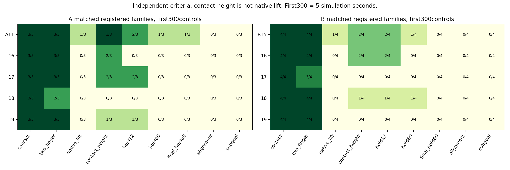
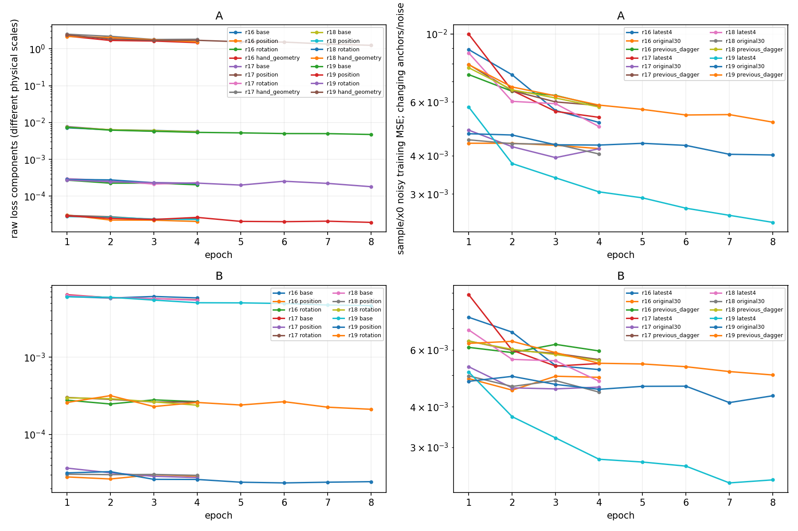
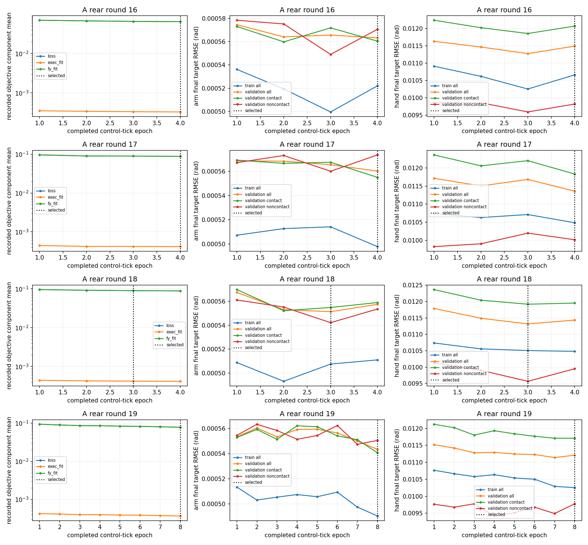
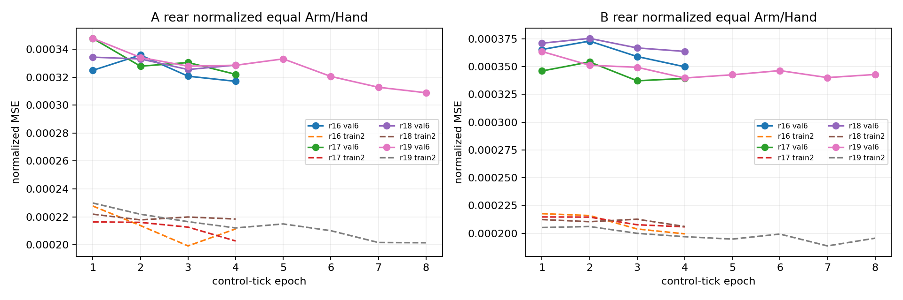
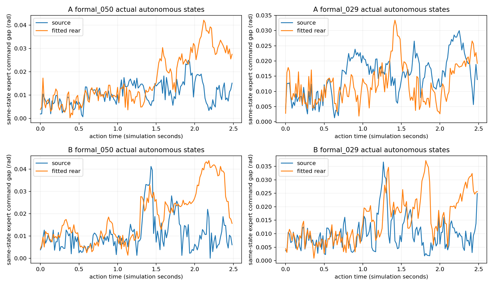
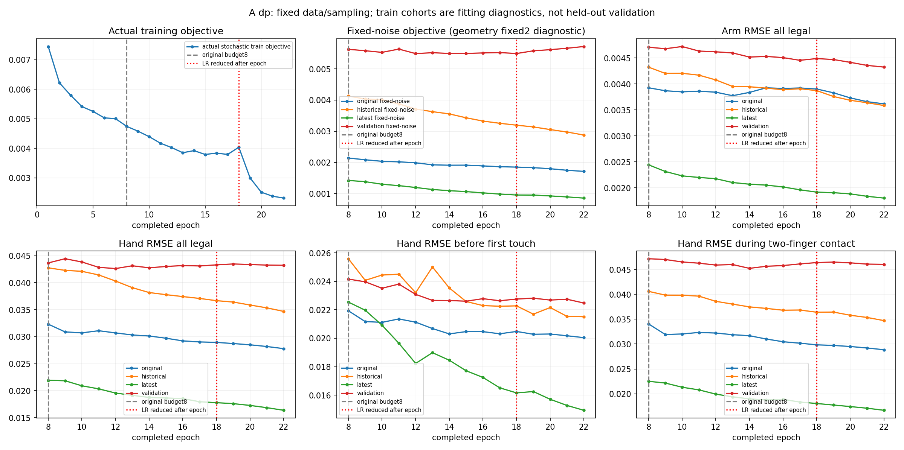
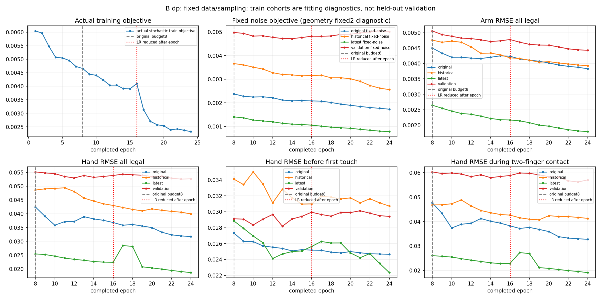
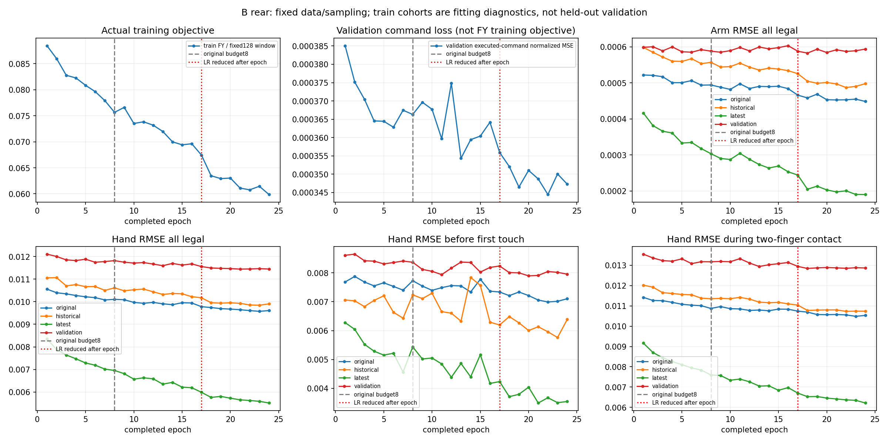
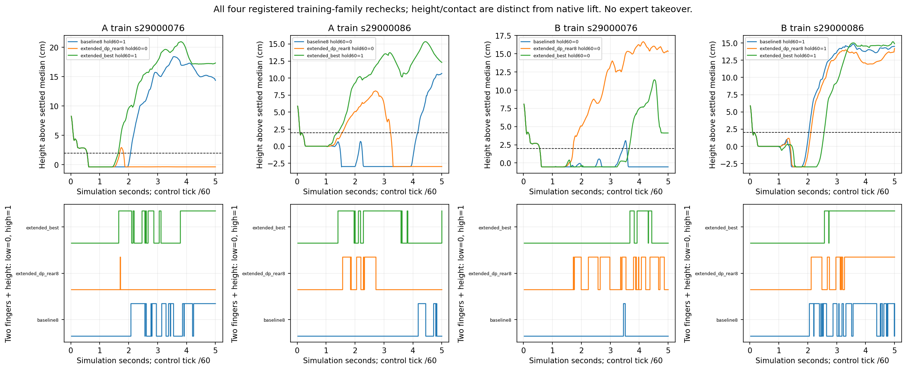
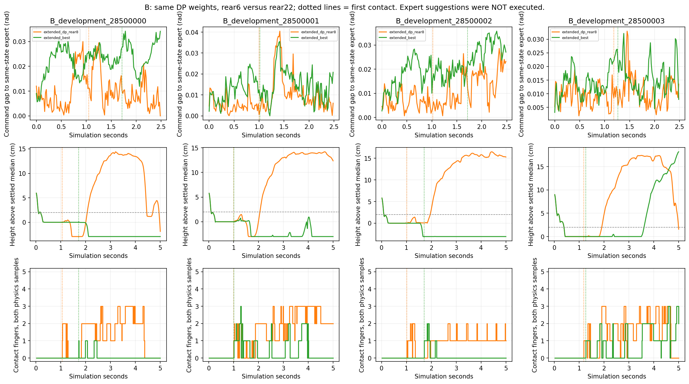

# Tight-Insertion：训练、闭环与读取瓶颈诊断（2026-11-16）

## 15:30硬截止交付：本轮部分完成，没有采用新模型

**已在15:30前主动停止本轮。新增2条完整原生插入成功专家纠偏；9段完整真实视频已全量解码。新A/B训练—公平闭环验证没有全部完成，不能宣布完整任务能力提升。**

- 完整视频：7段学生自主完整执行（每段601帧）＋2段真实学生前缀/专家接管成功（403、426帧）。学生视频包含抓不到、短暂抓住、抓住后失稳；本轮录到的完整插入视频是专家接管，不能冒称学生自主成功。此前另一个16环境队列的B候选/B15自然插入成功记录仍保留，但当时没有录视频。
- 已完成的来源参考队列：A **0/4**、B **0/3**最终原生成功；B另1个动作前非法起点。它们共享登记物体/孔初态和种子，但关节抽样未严格配对，不能当严格A/B因果对照。
- 后补严格配对：A/B起始q、qdot、控制目标差全部0，两起点均合法。然而共享监控被先结束的后端owner关闭，仿真在约200步因`Stale resource telemetry`软件中断；**有效完整任务分母为0，不能报0/1失败，也不能报成功率。** 未用新的种子替换，也未在截止后重跑。
- DP：两组均2个完整epoch、372次optimizer/EMA更新。A选epoch2，新数据每条24次；B选epoch1，新数据每条12次（实际训练末尾各24次）。A训练loss .004558→.004407；B .004126→.004148。A独立验证 .004973→.005221，B初始 .004551、epoch1 .005470、epoch2 .005273（以实际best记录为准）。新纠偏指标A .007722→.002468，B .007416→.002151。**新动作可拟合，但旧数据/验证退化；不是容量不足的证明，也不是充分收敛。**
- 两组均用对应选中DP刷新了356/356后端输入。为留出评估时间，在后端优化器启动前将两组共同预算从2降到1个完整遍历，DP/数据/采样/LR不变。A后端完成683更新/1.0遍历，选中命令验证normalized MSE .00029665；B在内置截止预留生效后保存183更新/0.26480遍历，验证 .00038500，**target_reached=false**。这两个数字不是公平的已训练A/B对照；新完整模型没有通过配对闭环采用检查。
- 故障如实保留：B特征读取曾连续16–26秒/batch；普通并行预读未解决，停用。一次有界串行预读及12批实测后恢复多数0.6–0.9秒，不能据此宣称根因彻底解决。协调器共享`status.json.tmp`产生线程冲突，使B后端未启动；已增加锁并单独续B，没有重跑A。后续源模型评估与训练共用监控的生命周期仍发生故障，**当前脚本不能称无人值守可靠**。本轮不会后台继续。
- 删除两份已淘汰OOM部分epoch模型/optimizer快照，释放约2.170GiB；保留成功原始数据、350条有效训练池、来源/安全回退、关键候选、原故障日志和删除manifest。A11/B15与A长训/B长DP短后端均未替换。

**DP基础问题判断**：当前数据确实能改变DP拟合，且两组对新纠偏显著改善；还不能据此排除采样/记忆/动作精度问题。已确认的具体问题是“同初态种子”没有配对关节随机化，以及部分后端残差字段混入确定性重定位。下次先把监控生命周期集中到唯一owner，续完B已保存后端，再执行真正初态配对的完整新候选对照；不启动无目的扩张，不用未完成结果决定采用。

真实曲线：[训练loss](evidence/tight_diagnosis_20261116/fulltask/training_losses.png) · [实测验证/训练拟合](evidence/tight_diagnosis_20261116/fulltask/validation_errors.png) · [B抓持后失稳](evidence/tight_diagnosis_20261116/fulltask/grasp_then_loss.png)。[机器可读结果/曝光/逐阶段耗时](evidence/tight_diagnosis_20261116/fulltask/results.json)。

代表视频（研究机，未上传大文件）：

- `outputs/visuotactile/run/tight_fulltask_20261116_01/baseline_evaluation/B_fulltask_development_28500101/autonomous.mp4`：学生自主抓住约1.58秒后失稳。
- `.../baseline_evaluation/A_fulltask_development_28500100/autonomous.mp4`：学生自主抓持失败，完整601控制步。
- `.../collection/r20_A_formal_050_slow_3_contact_height_only_d0/student_then_expert.mp4`：A学生抓持后专家接管，完整成功插入。
- `.../collection/r20_B_formal_029_slow_6_contact_height_only_d0/student_then_expert.mp4`：B学生抓持后专家接管，完整成功插入。

统一续接：先读run下`bounded_end.json`、`training_failure.json`、`backend_recovery_failure.json`、`paired_sources/worker_error.json`（若存在）和实际worker回执。`STOP`/`STOP_MONITOR`已置位；不要直接重启run/train/recover入口。B断点在`update/B/backend/B/training/last.pt`，仍需新的获准时间窗口与同一优化器/随机状态的明确续接。物理120Hz/控制60Hz/规划5Hz和原生成功标准均未改。

## 2026-11-16 下午：持物失稳定位与15:30截止的完整任务验证

本节接续3bcccc0，后续旧章节保持历史原貌。实际工作树为`bc+rl_RSS_continuous_vision_20261114`。当前有限完整任务run为`outputs/visuotactile/run/tight_fulltask_20261116_01`；**硬截止2026-11-16 15:30 Singapore，禁止接续旧夜间循环**。最终结果将在本节末记录，下面先给出已经完成的证据。

### 先前A四条“持物后不满足窗口”不全是掉落

按已完成控制tick（从1计数；动作相位为`(tick-1)%12`），逐条重建：

| A长训轨迹 | 初次接触 | 双指接触 | 首次持物60步 | 后续实际情况 |
|---|---:|---:|---:|---|
| 开发28500001 | 85 | 97 | 280 | 281步失去全部接触，294步落回高度基线；确实掉落 |
| 训练family76 | 80 | 88 | 283 | 最后仍持物，293步首子目标；不是掉落，也不是完整插入 |
| 训练family86 | 62 | 65 | 193 | 217步由双指变单指，物体末尾仍高12.3cm；不应直接判掉落 |
| 开发28500005 | 64 | 76 | 184 | 203步失去全部接触，219步落回高度基线；确实掉落 |

两次真正掉落相位分别4和10，不集中在重新规划边界。family86的接触减弱发生在相位0，但这不能证明规划边界导致全部失败。开发000未达到60步，末尾仍有接触且高16cm；002未建立抬起抓持；004短时抬起后179步失去全部接触。这些都保留逐步高度、接触、相对掌位姿和手指命令曲线，未把正常任务释放当失败；上述掉落轨迹没有原生retract/子目标释放证据。

**一个确定的解释错误已纠正**：记录字段`residual_proposed_rad`含确定性的可达范围重定位，并非纯Transformer输出。实际合成是`anchor=clip(DP,reachable(previous_actual_target))`，再加`span*raw_transformer`，最后执行投影。A001掉落前12步，学习修正手指RMS约.0461rad，确定性重定位约.1872rad；A005分别.05265/.1082rad。不能根据DP与这个混合“残差”强反相关就认定后端网络正在破坏DP。控制目标记录与实际下发一致，完整合成可重建至2e-6rad内。A的q[t+1]仍不能直接当专家控制目标误差，也不能将裸A前端当完整学生。

### B：同输入参数效果与闭环状态偏移已经分开

在固定成功专家历史（原始4、历史纠偏4、最新4、隔离验证6）上，长后端对四类数据均改善最终命令拟合。B手指RMSE：原始.010179→.009607、历史.010673→.009856、最新.007189→.005627、验证.011746→.011449rad。这里没有“训练下降、验证明显上升”的普通过拟合证据。

随后保存真实学生每一步后端输入，各后端从起点按自身权重重建记忆。B23 DP配rear6/rear22，在8个登记开发初态分别执行；一个long起点非法，保留且不补。共同7个合法初态标签（后续发现关节随机抽样未配对，见下文限制）：

| 真实输入历史由谁产生 | 用rear6重算前48步手指误差 | 用rear22重算前48步手指误差 | 该控制器自主曾持物60步 |
|---|---:|---:|---:|
| rear6闭环 | .008255 | .008223 | 2/7 |
| rear22闭环 | .012609 | .013303 | 0/7 |

重算实际在场后端与真实执行命令最大差1.19e-7rad。同一短后端历史上，长后端并未使前48步误差翻倍；在长后端实际执行的历史上，即使换回短后端单步重算，误差仍高。后续检查发现，本混合角色队列的起始关节随机抽样未配对，因此这张表只能证明两种真实输入分布下的响应不同，不能独立证明偏移由后端闭环反馈造成；初始关节差也是混杂因素。此前分开队列、相同lane顺序的预算对照有初始q一致证据，但本次不能当作更强因果复现。专家比较值只是同状态专家建议，未执行，不能算合法训练标签或专家救回。两个实际例子：开发000接触67→136步，002为63→104步。图：[B同输入与闭环对照](evidence/tight_diagnosis_20261116/stability/b_feedback.png)。

### 新开发初态：A旧4/7尚未泛化，已有真正完整插入

相同登记8个新开发初态，每组16环境；480步观察，只有seed100预登记为完整自然终止。不是训练初态，也不使用最终测试集。A两组各1个非法；B均合法。

| 完整配对 | 原生lift | 曾持物1秒 | 2秒 | 3秒 | 对准/首子目标 | 预登记完整任务成功 |
|---|---:|---:|---:|---:|---:|---:|
| A DP14＋rear22 | 0/7 | 1/7 | 1/7 | 0/7 | 0/7、0/7 | 0/1 |
| B DP23＋rear6 | 3/8 | 6/8 | 3/8 | 2/8 | 2/8、2/8 | 1/1 |
| A11 | 1/7 | 1/7 | 0/7 | 0/7 | 0/7、0/7 | 0/1 |
| B15 | 5/8 | 3/8 | 0/8 | 0/8 | 1/8、1/8 | 0/1 |

B候选seed100在307控制步自然完成2/2子目标与原生成功；**B15 seed106也在343步自然成功**，早于其480步观察上限。这第二条同样是真成功，但不能只把提前成功者加入完整任务分母而把其余截断者当失败。第一条在预登记完整子组，第二条单列为短观察队列的提前自然成功。成功插入后末尾不持物不等于滑脱。新开发图：[阶段统计](evidence/tight_diagnosis_20261116/stability/new_behavior.png)。

A长训配对保留为候选但尚未证明普遍改善；A11/B15安全来源不变。B长DP＋短后端保留，长后端不晋升。没有再次启动长训/无界DAgger。

### 本次完整任务补充：已完成采集

用户后续明确授权优先补完整任务并训练，覆盖了前一阶段“暂不新增数据”的限制。4次真实学生尝试（两个原始训练family×A/B）得到2条完整成功专家纠偏，一条A、一条B；两组共同使用它们，训练池由348增至350条，独立训练family仍170。另两条未满足持物入口，不误称后半段专家失败。

A在动作索引155（已完成2.583秒）接管，403步完成；B在103（1.717秒）接管，426步完成。合法专家监督分别246与321步，共567步；队列切换两步和全部学生前缀mask0。真实RGB-D/动作历史完整保留。采集整批234.55秒，2有效条即30.70条/小时；这是有限后段入口负载，**未达到5分钟50条，不能与早期快速接管负载冒充等负载提速**。

两条真实三视角视频已逐帧标明AUTONOMOUS STUDENT与EXPERT TAKEOVER，并全量解码核对403/426帧；它们证明专家从学生实际抓持继续完成插入，不证明学生自主插入。位置在run的`collection/<case>/student_then_expert.mp4`。

本轮增量计划两组同为2个完整数据遍历的DP更新、2个后端遍历；沿用同一最新纠偏12次重复、早期权重3和全部旧数据。对应DP更新后重新生成全部后端输入，再训练Transformer。新AdamW/EMA从已选EMA参数开始，不冒称从best完整恢复optimizer。起始A DP14/rear22、B DP23/rear6的历史曝光不同，因此严格对齐的是**本次增量**，不是历史总计算量。采用由真实完整任务复测决定，不由loss单独决定。

## 当前结论：固定数据延长训练已完成

**8个epoch确实没有用尽拟合收益。延长训练使A的自主持物改善，但B表明：示范数据上的loss继续下降，也可能伴随更差的自主抓持。现在没有证据宣布原始成功动作与纠偏动作无法同时学习。**

本次保持348条训练轨迹/170训练family、6条隔离验证、原采样/模型/标签/120–60–5Hz执行约束；没有新增DAgger、没有改数据配比。DP从第19轮last8恢复完整AdamW/EMA/RNG，后端绑定新DP刷新输入后，从匹配的A11/B15参数和相同seed重新训练。新增的验证平台降LR是明确登记的预算设计，不冒充完全不变的学习率实验。

- DP：A完成22、选14；B完成24、选23；独立验证误差比8预算内最佳降低 **6.17%/8.18%**。A进入验证平台；B达到上限但后段仍改善，不能称已充分收敛。
- Transformer：均完成24、选22；相同新DP输入下，比前8预算内最佳降低 **7.29%/5.07%**。与原19完整配对相比，最终命令验证指标A改善4.13%，B仍差1.39%。两后端晚期仍刷新最佳，不能因24结束就宣布优化极限或严重过拟合。
- 全部原始30条的手指拟合与最新4条可同时改善。B前端原始30误差从.037136降到.031383rad，最新4从.026467降到.019027；A也同时下降，但原始30仍比A11前端高6.52%。原先2条诊断的退化不能外推成所有原始动作退化。

同协议16环境、300控制步（5秒）×3组，共48个登记尝试、42个合法完整短评估；三组均排除同样两个动作前非法起点。以下是延长前后端最佳配对在各自7个合法初态上的实际阶段结果，**混合了开发与训练复验，只作该登记队列描述，不是泛化成功率估计**：

| 完整策略 | 首次接触 | 双指接触 | 原生lift | 双指且高2cm | 持物12步 | 持物60步 | 最后60步仍持物 | 对准/首子目标 |
|---|---:|---:|---:|---:|---:|---:|---:|---:|
| A：DP14＋rear22 | 7/7 | 7/7 | 2/7 | 6/7 | 6/7 | **4/7** | 1/7 | 1/7、1/7 |
| B：DP23＋rear22 | 7/7 | 6/7 | 1/7 | 4/7 | 4/7 | **1/7** | 1/7 | 0/7、0/7 |

原8预算→只延长DP→前后端都延长：A持物60步 **1/7→0/7→4/7**，B **2/7→3/7→1/7**。A新增改善为训练family86、固定开发001、额外开发005；新增三例末尾均未满足同一持物窗口判据，这不等同于已经掉落。A训练family76出现原生对准与首子目标，**不是完整插入成功**。三个组都没有在5秒内观察到完整插入，本次没有完整任务失败率分母。

**已定位的下一处问题**：B同DP下rear6→rear22，4个固定开发初态的前48步同状态专家建议差从.008265升到.017053rad，全部在接触前变差；000/002首次接触显著推迟，000未形成双指接触。实际执行目标与记录目标一致；目前更支持保存专家历史与学生自身闭环状态的适配差距。初始DP计划并非逐位相同，不能将全部差异严格归因于后端参数，也不能把专家建议当作已执行的正确标签。

**决定**：保留A延长配对为有行为收益的候选；不采用B延长后端作为新来源，保留B的短训后端对照。A11/B15仍为正式安全回退；没有达到90%稳定抓持，更没有转向大规模后段采集。下一项最有信息量的实验是固定B23 DP、在同一真实早期观察/计划/历史输入上比较rear6与rear22，区分后端输出与反馈导致的状态偏移；必要时为这个有限诊断记录缺失的完整视觉输入。先不修改配比、不加DAgger、不无上限延长训练。

本轮至评估完成 **189.15分钟**，所有训练/仿真owner与监控均已退出。初始双DP显存峰值失败及单次顺序恢复如实保留，不能声称全程资源无故障。前期清理已释放14.87GiB；本轮未再删除原始数据，结束时约24GiB可用。代码/精简指标/图在原origin feature分支，权重和原轨迹留研究机。

直接看曲线：[A DP](evidence/tight_diagnosis_20261116/budget_extension/dp_A_selection.png) · [B DP](evidence/tight_diagnosis_20261116/budget_extension/dp_B_selection.png) · [A Transformer](evidence/tight_diagnosis_20261116/budget_extension/rear_A_selection.png) · [B Transformer](evidence/tight_diagnosis_20261116/budget_extension/rear_B_selection.png) · [全部原始30与纠偏端点](evidence/tight_diagnosis_20261116/budget_extension/endpoint_all.png) · [实际阶段结果](evidence/tight_diagnosis_20261116/budget_extension/behavior_stages.png) · [B早期失败](evidence/tight_diagnosis_20261116/budget_extension/closed_command_gap.png)。文末给出完整实验细节与曝光/耗时。

## 前次审计（延长训练前，保留原始结论与证据）

以下审计阶段没有新增正式训练或自主仿真；后续延长预算实验见当前概要和文末。历史第19轮候选继续拒绝。所有曲线来自实际记录，缺失epoch未插补。

### 当时的概要（下述采样建议已暂缓）

**模型在学习新纠偏，但没有同时保住已有抓持动作；闭环误差已经出现在接触形成之前。现在没有证据说明单纯延长原样训练就能解决问题。**

相同登记的4个开发family、统一前300控制步（5秒）、GPU物理/standard相机下：

| 完整策略 | 合法起点 | 有效接触 | 双指接触 | 原生lift | 双指且升高2cm | 持物12步 | 持物60步 | 最后60步仍持物 | 对准/首子目标 |
|---|---:|---:|---:|---:|---:|---:|---:|---:|---:|
| 保留A11 | 3 | 3/3 | 3/3 | 1/3 | 3/3 | 2/3 | 1/3 | 1/3 | 0/3、0/3 |
| 保留B15 | 4 | 4/4 | 4/4 | 1/4 | 2/4 | 2/4 | 1/4 | 0/4 | 0/4、0/4 |
| 第19轮A | 3 | 3/3 | 3/3 | 0/3 | 1/3 | 1/3 | 0/3 | 0/3 | 0/3、0/3 |
| 第19轮B | 4 | 4/4 | 4/4 | 0/4 | 0/4 | 0/4 | 0/4 | 0/4 | 0/4、0/4 |

28个来源/16–19候选可比开发初态的实际起始q一致，物体相对基座位置差最大5.34e-7m；lane数量与隐藏物理状态仍不能视为逐位重放，详见[初态比较](evidence/tight_diagnosis_20261116/development_initial_comparison.json)。A另有1个动作前非法起点，排除在成功率分母外。第19轮完整任务A **0/2**、B **0/2** 插入；其余抓持截断试验不计完整插入失败。训练family复验A持物60步1/2、B0/2，A那一次在最后观察窗口也没保持住。这些小样本远不能证明接近90%的稳定抓持。

主要结论：

- **DP尚不能称为已经充分拟合。** 第19轮训练目标下降约36.3%（A）/23.0%（B）。新4条的手指预测误差下降约47%，但固定原始2条示范误差上升14.5%/12.7%；前150步上升23.3%/32.2%。这是实际的新旧数据拟合取舍。
- **Transformer处于小幅改进/波动区域，不是完全没更新。** 第19轮B选择第4遍是归一化Arm/Hand等权指标更好；第8遍仅差0.93%，同时手指RMSE略低。不能把这点波动解释成严重过拟合。额外固定train2拟合曾将早期手指误差压至约0.003rad，说明后端仍有拟合空间，但只换来A一例闭环持物，B没有收益。
- **确定的问题**：最新样本训练与原始动作保持发生取舍；部分动作偏差先于首次接触；同family复验并非原示范物理初态的精确重现；每遍重复读取整池大特征，19轮累计2.602TiB实际读取。
- **尚未确定**：哪一个表示/历史模块最先导致状态偏移；早期采样比例的因果作用；旧运行的具体I/O争用源。标签mask、动作时间与执行映射已有实样本检查，没有新证据支持“把学生错误动作当专家标签”或“控制器映射错了”。
- **已实际清理14.87GiB**，可用空间18.60→33.47GiB。原始数据、当前354条训练/验证记录、全部当前冻结视觉特征、A11/B15和16–19诊断检查点保留。
- **下一项最有价值的实验**：先做一个有界的“保留旧动作”采样对照，固定现有数据、起始A11/B15、更新次数与学习率，降低最新4条独占的重复曝光，增加原始成功接近/接触段的回放；分别要求DP和后端在固定旧/新样本早期误差上都不退化，再做相同初态短闭环。继续保持DP→刷新输入→Transformer顺序。这个对照尚未启动，不是第20轮采集。

## 1. 清理范围与恢复边界

清理前实际扫描 `outputs/visuotactile`，约890GiB。所有当前354个冻结视觉shard都仍被最新训练清单引用，合计169.30GiB，**没有把它们误删为旧缓存**。训练池348条+验证6条；348条不等于348个独立初态，仍为170个登记训练family。

| 实际处理 | 数量 | 逻辑净释放 |
|---|---:|---:|
| 旧的非选中检查点/中间状态 | 29项 | 2.386GiB |
| 已废弃DP生成的后端输入 | 730个shard | 1.797GiB |
| 历史检查点仅移除optimizer，逐项保留model/EMA及所有其他字段 | 91个inode组 | 10.691GiB |
| 文件系统可用空间实际增加 | — | **14.873GiB** |

先写删除计划，再检查可访问进程的FD/内存映射，最后执行；没有活动研究进程引用候选文件。模型重封装使用临时文件、fsync、逐字段/张量相等检查后才删除旧容器；新文件为显式 `*.weights_only.pt`，原SHA和原路径写入 `*_archival.json`，**不能假称旧optimizer还可续训或新容器SHA等于旧容器**。有硬链接的检查点按inode组处理。

所有原始HDF5、未完成原始采集、NPZ物理轨迹、配置、评估证据及旧核心model/EMA保留。所有16–19与固定train2诊断目录、当前A11/B15完整来源排除在清理范围外；它们的保留检查点SHA在前后完全一致，并实际通过torch读取。354条当前有效轨迹逐一打开、确认complete、29维目标长度一致和首尾标签有限，没有重扫每帧RGB。

[删除执行清单](evidence/tight_diagnosis_20261116/cleanup.json)、[分类占用与规则](evidence/tight_diagnosis_20261116/cleanup_inventory.json)。本机完整预删除依赖清单与数据验证：`outputs/visuotactile/run/tight_diagnostic_20261116_01/cleanup/{plan,finished}.json`。旧后端输入的index、原DP绑定、数据/统计文件和源版本仍在；若DP旧容器也退休，显式使用相应archival记录中的同张量weights-only文件，在新身份下重建输入。不要重启旧owner来“恢复”已退休阶段。

## 2. 第16–19轮DP完整曲线

共提取 **7360条真实optimizer-update记录**、全部实际epoch验证点、每次访问的loss分量和样本cohort。A监督执行后一控制步的q[t+1]，B监督专家绝对目标，两者的物理标签域不同，不能直接按数值大小排序模型优劣。

图的左列同时标明三种不同量：随机噪声下的sample/x0去噪训练目标、固定原始train2上的DDIM回放指标、独立validation6上的DDIM回放指标。**历史没有逐epoch validation denoising loss**，因此没有伪造与训练噪声loss完全同义的验证曲线。右两列是Arm/Hand弧度误差。竖线为实际选中checkpoint。

这些图说明：

1. 16–18轮A验证手指RMSE约0.046–0.048rad，没有持续改善；B约0.055–0.059rad，同样没有逐轮稳定下降。各轮都从所保留来源继续，**不是将所有epoch无缝拼接的一次训练**。
2. 第19轮A验证手指从0.04694降到选中0.04410rad；B从0.05564降到0.05444rad，收益有限。A最后一遍手指更好0.04367，但等权归一化选择分数略差（0.005310 vs 0.005300），所以仍选第6遍；B选第7遍，最后第8遍选择分数退化约5.1%。
3. 固定原始train2曲线在更新后整体高于epoch0来源，尤其第一次更新遍后明显跳高。不能只看到新样本loss下降，就说整池动作已经学好。
4. 8遍末尾仍有改善/波动，不能由这8个点证明达到优化极限，也不能证明“再训更久一定会拿稳”。

分量图画的是各自原始单位，不能把最大的未加权几何项当成最大梯度来源。第19轮A第1/8遍几何各项加权后合计约占总loss **0.318%/0.313%**；其中手部几何贡献约5.63e-6/2.92e-6。B没有A的手部几何项。loss占比不等于梯度占比，本次不据此断言几何梯度失效。每次访问的随机anchors和合法mask保留，未将运行时计划改成每步重规划。

原始指标：[epoch与Arm/Hand误差](evidence/tight_diagnosis_20261116/dp_epochs.csv)、[全部更新与分量](evidence/tight_diagnosis_20261116/dp_updates.csv.gz)、[新/旧数据访问目标](evidence/tight_diagnosis_20261116/dp_cohort_visits.csv.gz)。后者是实际访问时随机噪声目标，不是固定同输入推理误差。

### 固定同输入的端点比较：真正学了什么

只读推理36次：每组source/selected/last，在相同原始2条+最新4条完整历史上评估。每条特征每组只打开一次，当前网络各自重建历史。使用正式recovery-onset mask、同5Hz规划/commit12和已接受的32-anchor离线批量推理。无更新、无新仿真。

| 手指RMSE（rad） | A来源→选中→最后 | B来源→选中→最后 |
|---|---:|---:|
| 原始2条，全部合法动作 | .02982→.03413→.03572 | .03890→.04383→.04463 |
| 原始2条，前150步 | .02559→.03155→.03449 | .03448→.04559→.04710 |
| 最新4条，全部合法动作 | .04499→.02388→.02193 | .05034→.02647→.02542 |
| 最新4条，前150步合法后缀 | .04031→.02382→.02124 | .04698→.02494→.02389 |

这支持“新纠偏确实学进去了，但旧动作保持不足”，而不是“最新数据没有进入DP”。新4条每条最终访问96次，原始每条8次；选中A第6遍/B第7遍分别72/84次。单凭这个相关性还不能把退化唯一归因于12倍重复，需要上页的固定预算回放配比对照。

分阶段新推理有接触前、首接触12步、双指、原生lift、接触高度、满足60步窗口的时刻及150步以后；这些物理分箱可以重叠。[端点逐样本CSV](evidence/tight_diagnosis_20261116/dp_endpoints.csv)。它们是端点数据，**不是补画不存在的逐epoch阶段曲线**。新4条“动作后尚未接触”的合法标签43步；已有监督审计按“动作前尚未接触”计44步，边界定义不同，不能把差1步当丢标签。

[同输入简单预测基线](evidence/tight_diagnosis_20261116/dp_hold_baseline.json)也明确了A/B前端不是完全无效：在validation6上，DP比“每12步保持规划时刻观测”好（手指A .0441 vs .1065、B .0544 vs .1154）。使用每60Hz新观测的保持预测更准（.01695/.01941），但它有更及时的信息，并非等价5Hz规划器或可部署成功策略。

## 3. Transformer完整曲线与B第4遍选择

共 **27062条实际更新记录**。损失包含实际存在的 `fy_fit`（投影感知训练目标）、`exec_fit`（归一化最终命令拟合）和regularizer；本轮regularizer为0。不能把FY目标的数值与最终命令MSE当成同一量。历史没有独立“残差真值RMSE”逐epoch曲线；已存在的correction幅度是输出大小，不是预测误差。

第19轮B的关键实际点：

| 遍数 | 归一化Arm/Hand等权validation MSE | validation手指RMSE | 固定train2手指RMSE |
|---|---:|---:|---:|
| 4（选中） | .0003396953 | .011695 | .010555 |
| 7 | .00034007 | .011554 | .010248 |
| 8（最后） | .00034287 | .011615 | .010263 |

第8遍比第4遍选择分数高约0.93%，而手指单项略好。归一化会按各关节训练尺度计算，不是直接将表中两个整体RMSE相加。应称为接近平台的小幅波动/训练验证取舍，尚不足以声称明显过拟合。A后端选第8遍，验证等权指标较第1遍下降约11.2%；手指变化较小。

接触后/持物与运输阶段通常比接近阶段更难，但接近的误差并非零。图使用同一独立验证6条，既有phase定义保持；near-goal缺少合法样本时保持缺测，不补零。现有train阶段报告是固定8条诊断子集，并不代表全部348条。

新4条在两块网络确实获得重复训练：后端最后每条96次；选中A为96次，B第4遍为48次。选中后端的最新纠偏前150步手指误差A .01009→.00715、B .00934→.00704rad，仍未转换成固定开发持物收益。

保存的固定train1/validation1预测还可计算Arm/Hand分别的归一化RMSE，见[端点归一化CSV](evidence/tight_diagnosis_20261116/rear_endpoint_normalized.csv)；其人口不是全验证6条，历史逐epoch分部归一化误差缺失，不能从整体RMSE反推。

[后端epoch原始指标](evidence/tight_diagnosis_20261116/rear_epochs.csv)、[全部更新分量](evidence/tight_diagnosis_20261116/rear_updates.csv.gz)、[阶段指标](evidence/tight_diagnosis_20261116/offline_phase_metrics.csv)、[最新纠偏初始/选中误差](evidence/tight_diagnosis_20261116/latest_corrections.csv)。

## 4. 所有阶段的真实执行结果

主比较严格使用前300控制步，并将固定开发集、训练family复验分开。控制tick=1/60秒，规划tick间隔12控制步=0.2秒，物理tick=1/120秒；wall-clock另列，不能互换。

- 有效接触：settling结束后，两个120Hz样本均有至少一指>0.1N；双指要求两个物理样本均≥2指。不是一个瞬时噪声点。
- 原生lift读取任务原判据；接触高度读取双指接触且高于完成25–48步高度中位数2cm，两者独立。
- 12/60步持物：整个窗口都高于该高度，≥90%的控制步双指接触，连续失去双指≤3步，允许掌中转动。
- 最后窗口仍持物与“曾经持物”分别计数。窗口失效不自动等于物体掉落。
- 抓持截断没有完整插入分母；专家救回没有自主成功分母。

| 轮次 | 固定开发A持物60 | 固定开发B持物60 | 训练family复验A/B | 完整任务插入A/B |
|---|---:|---:|---:|---:|
| 16 | 0/3 | 0/4 | 0/1、1/2 | 0/2、0/2 |
| 17 | 0/3 | 0/4 | 0/2、0/2 | 0/2、0/2 |
| 18 | 0/3 | 1/4 | 1/2、0/2 | 0/2、0/2 |
| 19 | 0/3 | 0/4 | 1/2、0/2 | 0/2、0/2 |

16的训练复验另有1个非法A起点。18的A训练family出现1次原生子目标，但不代表插入成功或固定开发泛化改善。19的A family76满足过60步，但在结束窗口失效；A86满足原生lift但最长连续双指高度仅25步。B这两例主要没有形成可持续抬升，不能统一叫作后半段转正失败。

完整逐阶段分母在[固定300步CSV](evidence/tight_diagnosis_20261116/matched_grasp300.csv)和[逐例记录](evidence/tight_diagnosis_20261116/matched_grasp300_cases.json)。另外整理历史实际已完成评估：[历史全阶段CSV](evidence/tight_diagnosis_20261116/historical_stages.csv)。旧CPU物理与新GPU物理、8/16lane和不同观察长度均显式保留，不能跨设置拼出一个“提升百分比”。14轮的15次恢复评估绑定真实 `tight_fresh_20261115_07/throughput_preflight/round14_recovery`，没有把原路径缺少结果误算成任务失败。早期v3/v2恢复目录同样使用实际完成版本。历史CSV按各轨迹全部实际观察时长计数，因此14轮B可曾在较晚阶段持物2/8，而既有前300步结果仍为0/8，不能混为同一个成功率。

[专家纠偏单独统计](evidence/tight_diagnosis_20261116/expert_rescues_separate.csv)：16–19各4次尝试、4次触发、4次成功并入库；总16条、全部来自既有family，不是16个新独立初态。各阶段统计是**学生前缀+专家后缀**的混合轨迹，不能与自主表混用。

## 5. 失败从哪里开始：动作、接触和高度放到一起

本次追加一个CPU只读诊断：对第19轮11条合法自主轨迹的前150步，用其真实状态和完整已保存LSTM观察历史查询专家建议。先在已有真实专家shadow流验证映射（原允许误差内），不执行这些建议、不将它们放入训练池。再拆开保存的DP计划、后端投影前命令、最终实际命令。实际投影重算最大偏差1.19e-7rad，实际执行器目标与保存最终目标一致。

| 训练family复验 | 连续3步命令差>.015rad首次动作索引（从0计） | 首次有效接触完成tick（从1计） | 物理结果 |
|---|---:|---:|---|
| A76 | 32，0.533秒 | 63，1.050秒 | 第264步首次达持物60，第273步窗口失效；物体仍高，不称为掉落 |
| B76 | 40，0.667秒 | 59，0.983秒 | 无可靠接触抬升 |
| B86 | 50，0.833秒 | 64，1.067秒 | 双指67→71步即失去，未持续抬升 |
| A86 | 82，1.367秒 | 63，1.050秒 | 双指64→72步失去，后续抬升但持续接触不足 |

阈值是描述性命令偏差，不是成功、掉落或自动接管阈值。A76早期偏差明显仍曾持物，说明不能以“偏离专家”直接推定必然失败。图中的早期高度下降包含原生settling，不计抓起成功。蓝线误差来自同状态专家查询；没有把沿另一条成功轨迹的时间对齐命令冒充该学生状态的正确标签。

B的同状态误差拆解（6例按相同步数汇总）进一步定位了执行链路：

| 控制步范围 | DP绝对命令 | 仅将DP投影到可达范围（诊断） | 后端投影前 | 最终实际执行 |
|---|---:|---:|---:|---:|
| 0–47 | .02148 | .01485 | .02682 | .00916 |
| 48–99 | .03542 | .02149 | .04102 | .01746 |
| 100–149 | .06066 | .02905 | .05168 | .02560 |

这些是手指rad RMSE，不是自主成功率。后端投影前有时更远，但正确组合后的最终动作总体更接近同状态专家；个别例外仍有，例如B开发001后段最终.0399略差于仅投影DP .0375。不能据此将后端整体删掉。**A的DP预测q[t+1]，不是专家命令；A名义输出到专家命令的差只作域差诊断，不叫A预测误差，也不部署裸A。**

[命令链及专家查询证据](evidence/tight_diagnosis_20261116/round19_command_chain.json)、[逐控制步物理CSV](evidence/tight_diagnosis_20261116/failure_trace_ticks.csv)、[事件时间](evidence/tight_diagnosis_20261116/failure_events.json)。

### 离线拟合很好，为什么还不能稳定拿住？

已有固定train2后端拟合80遍/560更新的真实完整曲线显示，前150步手指误差从约.008–.009降到.0027–.0039rad；模型具有更高精度拟合这两个保存历史的能力。对应完整策略源/拟合后比较：A持续持物0/2→1/2，B0/2→0/2。B在自身新走到的100–149步状态上，专家命令差反而从.01337/.00966增到.03181/.02315rad。

这里还发现一个必须明确的边界：来源/拟合后复验彼此初始可观测q/object相同，但它们相对**原始示范**初始q最大差分别约.0104–.0373rad；物体位置差仅约1e-7m。不能称作“原示范精确初态也失败”，更不能声称恢复了隐藏PhysX状态。[初态量化](evidence/tight_diagnosis_20261116/original_initial_comparison.json)。

证据支持两个并存问题：保存专家历史上的拟合仍可改善；闭环会改变当前q、接触、过去实际命令和视觉，模型没有保持同样的误差水平。最新4条的监督从合法专家后缀开始：A76/B76的首合法标签69/66，A86/B86为43/47；并未监督学生前缀错误动作。最新候选在76 family的偏差更早出现，说明仅增加后缀重复不能保证覆盖新候选最早偏差。但当前专家查询只是诊断建议，尚不证明这些更早状态都能自然救回。

## 6. 特征读取瓶颈与已接入的有限改进

19轮A/B每遍实际读165–172GiB，合计 **2.602TiB**。一条大轨迹约0.66–0.90GB；两角色重复读同一冻结特征集，OS缓存不可能容纳169GiB整池。B2+下一B2预取两侧均开启，所有epoch预取准入fallback为0，仍有大额consumer等待。

最慢A batch52.69秒，两个tensor load29.30+23.04秒，实际读取约1.57GB，major faults=0；B最慢50.81秒也在读取且major faults=0。**已确定大特征反复eager读取/复制是直接等待点；尚不能确定原时段的磁盘争用、内存回收、其他进程或文件系统压力各占多少。** 当前swap近满不等于当时这些batch在换入；没有原时段块设备队列/PSI等证据，就不编造更具体的原因。

实际短测使用曾经卡顿的同两条训练记录，完整B2历史、forward/backward、Adam与EMA，不改变采样、损失或网络：

| 测量 | eager | 映射读取 |
|---|---:|---:|
| 热缓存完整batch，第二次同方法 | 1.018秒 | .445秒 |
| 冷读完整batch，第二次同方法 | 1.244秒 | .905秒 |
| 冷读实际物理读取 | 两者均1.5608GB | 相同 |
| 当前两轨迹显式CPU读取复制 | 约1.56GB | 0；页按实际消费映射 |

冷读为仅对这两份已关闭研究文件发出DONTNEED建议，没有全局drop_caches，也没有影响其他作业或修改源文件；实际read_bytes证实发生了物理读取。采用ABBA顺序，首次GPU预热较慢，所以上表用后次比较：热缓存约56%、冷读约27%的batch缩短。**这是代表性batch收益，尚未证明完整双模型周期会缩短相同比例，也没有声称已修复历史50秒所有长尾。**

已在正式 `Episode`、DP训练/验证及后端缓存入口加入显式 `frozen_visual_mapped_current_v3`：只映射当前B2，使用OS共享页，不生成新磁盘缓存，不缓存可训练GRU状态。旧profile、旧运行记录和默认路径保持原语义；新方案配置在 `scripts/tight_diagnosis_20261116/mapped_visual_io.json`，后续明确选择该文件即可。DP的轻量日志增加实际等输入时间和update-host时间，不再仅有epoch总等待。

真实CPU输入值/布局/RNG和可丢弃训练过程均检查；GPU相同loss与随机流一致，参数更新最大浮点差约3.61e-7，同方法重复也有同量级波动，**不是逐位GPU训练重放**。最初要求逐位相等的短测被拒绝并保留；后续ABBA明确展示同方法重复的波动，没有把失败改写成通过。27项针对性检查通过。共10个可丢弃B2更新，没有任何检查点被采用、保存为新候选或进入正式轮次。

[热读结果](evidence/tight_diagnosis_20261116/io_probe_02.json)、[冷读结果](evidence/tight_diagnosis_20261116/io_probe_cold.json)、[19轮原始I/O摘要](evidence/tight_diagnosis_20261116/io_history.json)。

## 7. 结论、缺测与复现入口

**采用**：本次分类清理；完整真实曲线与阶段报告；显式映射读取选项和分段耗时日志，用于下一次有界诊断。

**不采用**：第19轮A/B；用最新4条拟合改善代替抓持改善；无限堆积相同DAgger；把A的名义q预测当可直接执行的学生。

**证据不足**：严重后端过拟合、单一历史网络故障、唯一的I/O硬件根因、任一小样本稳定抓持结论。尚没有全部348条逐epoch分阶段DDIM预测，也没有所有epoch的后端残差真值误差；没有为补图重跑昂贵训练。训练池全量优化loss、固定原始诊断集、固定验证集、最新纠偏端点分别标注，不偷换人口。

入口为 [scripts/tight_diagnosis_20261116](../scripts/tight_diagnosis_20261116)。`extract.py`只读日志生成主曲线；`stages_and_traces.py`只读真实numeric记录；`summary_figures.py`只整理已有指标；`endpoint_metrics.py`是明确的有限推理；`io_probe.py`是显式请求才执行的可丢弃更新。`cleanup.py`已有执行回执，不可重跑删除计划。旧夜间owner没有重启，全部诊断worker结束后退出，不留下DAgger后台服务。

原始日志SHA列表在[source_logs.json](evidence/tight_diagnosis_20261116/source_logs.json)，大权重/轨迹仍只在研究机。当前开发树为 `bc+rl_RSS_continuous_vision_20261114`，公开目标仍为 origin/feature/tight-state-foundation；原工作树原有两份未提交说明保留。

## 2026-11-16 后续：固定分布延长预算对照（已完成）

用户调整优先级：先验证训练预算不足；前文提出的采样配比对照暂缓，**不采新数据，不改repeat12、早期后端3倍、模型或控制约束**。新根`outputs/visuotactile/run/tight_budget_20261116_01`。

- DP从19的last（每组8epochs/1568更新）恢复model、AdamW、EMA步数、抽样/噪声/CPU/CUDA RNG、完整visit与几何覆盖；19来源本来就是A11/B15。原8轮与选中checkpoint完整保留。
- 原DP恒定3e-5、后端恒定1e-4，无8轮末尾归零调度。本次改为明确的验证平台调度：0.5%相对改善阈值、4次耐心、一次LR×0.5、减后再4次停滞且至少16轮才停；最多24轮/每组4704总DP更新。它检验有合理降LR的延长预算，不声称只增加epoch而调度完全未变。最佳选择仍是6隔离验证family的等权归一化Arm/Hand误差。
- 前端完成后重新计算对应DP的后端输入。后端与19匹配A11/B15参数初始化、seed与新AdamW，明确不是把19后端optimizer跨不同DP输入冒充严格续训；同一新输入训练序列保留前8轮best/epoch8和最终best，以区分后端预算收益。后端本来没有EMA，不新增EMA。
- 每轮记录固定原始4、均匀索引抽取历史4、最新4、全部验证6的Arm/Hand/接触前/双指/抬升误差；训练样本只是拟合诊断。DP增加固定噪声完整objective与实际分量，诊断不消耗训练RNG。旧8轮缺少的逐epoch分段不补造。
- B2与microbatch4保持，避免改变更新数；使用已测mapped冻结特征读取，不新增特征副本。两组原先并行；实际OOM后DP改为顺序执行，后端输入/后端各阶段仍按已登记的独立模型并行；仿真与训练不同时占GPU。闭环只采用同协议短诊断，环境数不等于训练batch。
- 新窗口6小时，包括等待；保留12GiB磁盘、10GiB RAM及4GiB VRAM，阶段心跳、15分钟停滞停止、最多两次明确有记录的阶段尝试。正式来源仍A11/B15。

### 实际运行边界与中途故障

训练核心冻结在76352bd，绝对截止16:25:36 +08。DP保持原B2、392轨迹访问/epoch、196更新/epoch；348条来自170训练family，验证6家族无family/seed/相同reset配置交叉。固定原始4/历史4/最新4是分层拟合诊断，不是全348条逐epoch独立测量。全部训练池仍实际参加原样优化。

初始两DP并行在第12个epoch同一长轨迹处达到显存峰值而OOM；4GiB余量没有全程守住。原attempt、各140次部分epoch更新与checkpoint均保留，恢复完整第11epoch（2156更新）后改为顺序A/B；有效更新与丢弃计算分开统计。模型、B2、数据分布、优化器/EMA/RNG与截止均不变，没有重新训练前11epoch。GPU并行对齐方案在这个负载上不采用。CPU预读只暖当前/下一B2的OS页，单16MiB复用buffer，没有新增磁盘特征副本。

A第12/13/20/21个epoch训练本体约107/106/105/114秒，但第17仍有253秒长尾。读取停顿期间当前服务memory.events high/max/oom均0，memory PSI avg60约0.05%、IO PSI约34%；这是本次某个窗口的证据，不是旧19全部卡顿的唯一归因。实际整轮计时将包括诊断、失败与恢复，不用少数快batch夸大总提速。

两个DP现已完成：

| 前端 | 原8预算选点 | 延长后选点 | 独立验证归一化误差：原最佳→新最佳 | 改善 | 实际停止 | 总完成/选中更新 |
|---|---|---|---:|---:|---|---:|
| A，q[t+1] | epoch6 | epoch14 | .005300262→.004973319 | 6.17% | epoch22验证平台 | 4312 /2744 |
| B，专家绝对命令 | epoch7 | epoch23 | .004956501→.004550968 | 8.18% | epoch24最大预算 | 4704 /4508 |

A18末、B16末LR由3e-5减为1.5e-5。A选中点在降LR前；B14已先改善1.71%，降LR后的延长训练又获得收益。A最后验证.005031826，比最佳差1.18%；B最后.004606163，比最佳差1.21%。**B在后段仍有实质改善，达到24上限不等于已收敛。** A的原始/历史/最新拟合继续下降而验证平台，提示有限的泛化收益，不能称严重过拟合或证明模型容量极限。0.5%是事先登记的实质改善阈值，不是统计显著性或置信区间。

本次额外有效DP更新A2744、B3136，原8各1568直接恢复；原并行失败各140次计算单独保留且不计入恢复模型。两DP整体阶段98.003分钟，包含失败、恢复、验证和等待；旧19的16个角色epoch约49.42分钟，本次新增30个角色epoch，不能以总时长、某个快batch或并行进程数量宣称整体提速。

逐epoch训练诊断原始4/历史4/最新4，各自曲线与验证6分开。期末端点覆盖全部原始30/历史4/最新4/验证6，范围扩展在端点结果产生前登记，避免从4条外推所有原始动作；两种人口不能合并成一条曲线。选中A14/B23 DP的后端输入各354条、后端训练、端点与全部闭环均已完成。

独立收尾服务tight-budget-finish-20261116-01（启动PID740181）等现有训练全部完成后才运行端点和最多3×16次同协议300tick完整学生闭环；没有新采集、专家接管或裸A部署。CPU报告随后生成；遇当前恢复失败/截止即保存现场停止，不启动旧夜间任务。finish_complete只表示计算完成，仍须审阅科学结论。

### 后端预算与完整命令拟合

两个Transformer都完成24个epoch、各17200次真实更新，选择第22个、15764更新。A未触发降LR，B在17末由1e-4降至5e-5；两者第22个仍有实质改善，所以24上限不是收敛证明。最后验证相对最佳退化A2.82%、B0.83%，不足以诊断严重过拟合，选best而不是last。

| 最终组合命令的验证归一化MSE | 原19完整配对，8预算内最佳 | 新DP配后端8预算内最佳 | 新DP配延长后端最佳 | 延长后端相对同输入前8最佳 |
|---|---:|---:|---:|---:|
| A | .000308880（rear8） | .000319414（rear8） | .000296137（rear22） | 降7.29% |
| B | .000339695（rear4） | .000362827（rear6） | .000344427（rear22） | 降5.07% |

因此，只提高DP自己的拟合并不自动提高完整命令。重新绑定新DP时，后端8预算的验证指标反而变差；增加后端更新后，A完整指标较旧配对好4.13%，B仍差1.39%。B的整体手指rad RMSE有所下降，但归一化指标按每个关节训练尺度计算，不能由一个整体手指RMSE反推其排序。这里没有改变原来的选择指标以获得“更好看”的候选。

### 全部原始30条：延长预算是否同时学习旧动作和纠偏

期末同记录历史、同合法标签的只读推理耗时217.96秒，无更新。下表是手指RMSE（rad）；每个cohort按其合法控制步汇总。原始30/历史4/最新4均为训练拟合诊断，只有独立验证6用于选择。A前端的q[t+1]与B/后端的专家目标不同域，不作跨域大小排名。

| 网络/数据 | 来源DP | 原8预算完整配对所用网络 | 延长预算所选网络 |
|---|---:|---:|---:|
| A DP：原始30全部 | .025743 | .028866 | .027420 |
| A DP：原始30前150步 | .024220 | .027144 | .025360 |
| A DP：最新4全部 | .044992 | .023884 | .018744 |
| B DP：原始30全部 | .037116 | .037136 | .031383 |
| B DP：原始30前150步 | .033663 | .033622 | .027949 |
| B DP：最新4全部 | .050344 | .026467 | .019027 |
| A最终命令：原始30全部 | 未在本次端点测量 | .009829 | .009445 |
| A最终命令：原始30前150步 | 未在本次端点测量 | .008626 | .008123 |
| A最终命令：最新4全部 | 未在本次端点测量 | .008059 | .006768 |
| B最终命令：原始30全部 | 未在本次端点测量 | .010178 | .009322 |
| B最终命令：原始30前150步 | 未在本次端点测量 | .008703 | .007827 |
| B最终命令：最新4全部 | 未在本次端点测量 | .008255 | .005627 |

**必须修正旧小样本结论的适用范围。** 原来的2条诊断显示B旧动作退化，但全30条中B的原8预算与来源基本持平，延长后比来源低约15.45%。A仍有保留差距：原始30手指误差相对来源高约6.52%，但相对8预算已改善约5.01%；其接触前误差.020613已略低于来源.020730，剩余差距不能全部归为接触前动作。两组最新4也继续下降。因此，当前证据支持“8预算未用尽拟合收益”，不支持“原始动作与纠偏动作无法同时学习”。也不能因为部分训练误差下降，就说已经充分拟合或学会自主抓持。

曝光可复核：选中A/B DP的最新每条各168/276次访问，原始每条14/23次；两个选中后端最新每条264次，原始每条22次。后端各累计2322870个合法监督控制步；前端的target_ticks包含规划窗口重复目标，不与后端控制步或唯一数据量相加。选中权重曝光与最后24轮总曝光分别保存，原始失败前缀仍只有历史输入、没有错误动作监督。

### 实测曲线：拟合收益、平台与剩余不确定性

下列每一个点来自实际epoch日志；训练原始4/历史4/最新4是固定分层拟合诊断，不代表独立验证。DP固定噪声objective的几何项用已接受的固定2构型诊断，实际优化仍为随机轮换半数构型；不能把两者相同命名误当同一采样估计。后端FY训练目标与最终命令归一化MSE不同义，不能仅按两条曲线绝对数值判断泛化差距。

A在14之后训练拟合仍改善、验证没有超过原最佳；18降LR后至22仍停滞，支持当前配置的验证平台。B在16降LR后至23仍改善，不能把24上限称为充分收敛。旧1–7没有本次新增的固定噪声/阶段诊断，所以相应图只从真实存在的8端点开始，不补历史。

后端的原始/历史/最新训练拟合可同时下降，22仍刷新独立验证最佳；23/24小幅波动，不足以断言严重统计过拟合。但这没有排除闭环状态上的退化：B正是反例。**优化训练数据、在独立专家轨迹验证、在学生实际状态上稳定控制，是三个不同问题。**

原始证据：[DP/后端选择与停止记录](evidence/tight_diagnosis_20261116/budget_extension/convergence.json)、[逐阶段误差CSV](evidence/tight_diagnosis_20261116/budget_extension/phase_errors.csv)、[每次真实优化器更新](evidence/tight_diagnosis_20261116/budget_extension/optimizer_losses.png)、[A DP分量](evidence/tight_diagnosis_20261116/budget_extension/dp_A_components.png)、[B DP分量](evidence/tight_diagnosis_20261116/budget_extension/dp_B_components.png)、[A后端分量](evidence/tight_diagnosis_20261116/budget_extension/rear_A_components.png)、[B后端分量](evidence/tight_diagnosis_20261116/budget_extension/rear_B_components.png)。同目录四份epochs.jsonl.gz和四份压缩learning/loss日志保留实际数值；失败partial12的各140次更新单列，橙色点不拼入恢复模型有效训练历史。

### 同初态短闭环：哪些实际改善、哪些退化

三个比较组依次为原19最佳配对（A DP6/rear8、B DP7/rear4）、新DP与后端前8最佳（A DP14/rear8、B DP23/rear6）、新DP与延长后端最佳（A DP14/rear22、B DP23/rear22）。DP/rear后的数字是对应训练阶段的epoch，不是新的DAgger轮次。

| 角色/队列，持续持物60步 | 原8预算 | 新DP＋短训后端 | 前后端延长 |
|---|---:|---:|---:|
| A固定开发 | 0/3 | 0/3 | 1/3 |
| A训练family复验 | 1/2 | 0/2 | 2/2 |
| A额外开发 | 0/2 | 0/2 | 1/2 |
| B固定开发 | 1/4 | 2/4 | 0/4 |
| B训练family复验 | 1/2 | 1/2 | 1/2 |
| B额外开发 | 0/1 | 0/1 | 0/1 |

所有分母取三组共同合法交集；非法A开发003、B额外开发005三组均相同，没有补种子。28个相对原8组的可比初态，q/qdot、物体基座位置、物体速度、目标/孔基座位置均相同；四元数角差计算上限4.22e-8rad，离散任务状态相同。但这没有证明隐藏PhysX或图像逐位相同；历史8环境结果不替代本次16环境重跑基线。

- A训练86：原8预算没有持物60，新DP短训后端也没有；延长后在完成tick193（3.217秒）首次满足，最终窗口不再满足。首次双指由tick71提前至65。它是本次明确新增的训练family持物进展，但不能称全程拿稳。
- A固定开发001与额外开发005分别在tick280（4.667秒）和184（3.067秒）首次满足60步；末尾窗口均不满足。额外开发004只得到41步连续双指高度段，不能混入1秒成功。
- A训练76原8也曾持物；新配对仍持物，并出现原生对准/首子目标。结束窗口仍持物，完整插入未观察到。
- B训练86：原8曾持物但末尾没有；新DP短训后端与延长后端都能在末尾满足，后者首次60步提前到tick213。训练76仍只得到23步最长连续双指高度段，没有1秒持物。
- B固定开发退化：新DP短训后端在000/001可持物，rear22均失败。不能因训练family86改善而掩盖开发初态的损失。

[逐例及持物窗口](evidence/tight_diagnosis_20261116/budget_extension/behavior_cases.json)、[共同合法交集与逐例收益/损失](evidence/tight_diagnosis_20261116/budget_extension/paired_behavior.json)、[初态比较](evidence/tight_diagnosis_20261116/budget_extension/initial_comparison.json)、[训练family控制步曲线数值](evidence/tight_diagnosis_20261116/budget_extension/training_family_trace_ticks.csv)。本批没有完整任务评估，不能把42个5秒试验报成42次完整插入失败。

### B为什么更会拟合，却更难抓持

完成既定评估后，仅追加1.80秒CPU只读专家查询：同B23 DP的rear6与rear22，全部4个固定开发初态，各前150步。复用已验证且源码SHA一致的专家/控制转换检查；专家checkpoint SHA相同，完整已保存的特权诊断观察重建专家LSTM历史。建议不执行、不入训练、不视为已证明可救回的正确动作。没有新增仿真或优化器更新。

| 实际学生状态上的手指命令差（rad） | rear6 | rear22 |
|---|---:|---:|
| 控制索引0–47，接触前 | .008265 | .017053 |
| 48–99，接触形成附近 | .014553 | .019584 |
| 100–149 | .012093 | .021875 |

四例接触前均恶化。000首次接触63→103，双指64→未形成；001为60→61、双指62→66，时间接近但后续未抬起持物；002首次接触61→103、双指69→110；003为71→76、双指81→109。失败已经发生在接近/抓持形成，不能统一称转正或插入失败。

执行检查中，8条记录的控制器两个物理子步目标与保存的最终目标误差均0；正确的执行投影可重算。两组首个DP计划有.000403–.001578rad最大差异，虽然前端checkpoint相同，**本比较不是逐位相同感知/计划的纯后端干预**；后续DP也会因实际命令与状态历史不同而分歧。不能把后续名义计划差全部当DP权重退化，也不能把整段行为差严格归因于rear参数。离线专家示范验证仍改善，而学生状态上误差更大，是现有证据支持的分布适配问题，不是已证明的标签/控制映射错误。

[逐步专家差与命令分解](evidence/tight_diagnosis_20261116/budget_extension/closed_command_gap.json)。下一次若做严格共同输入对照，须记录足以重算学生视觉/历史的真实输入；本批numeric/trace不能替代未保存的完整RGB-D历史，也不能拿另一条专家轨迹的画面代替。

### 完整阶段耗时、退出与采用结论

| 实际阶段 | wall-clock分钟 | 范围 |
|---|---:|---|
| 两DP延长 | 98.003 | 新增30个角色epoch；含原并行失败、单次恢复、验证及等待 |
| 新DP后端输入准备 | 8.960 | A/B各354条，绑定选中前端 |
| 两Transformer | 64.665 | 各24epoch/17200更新，包括每轮验证 |
| 正式后端非test离线报告 | .200 | 两组完成 |
| 固定端点比较 | 3.754 | 全原始30/历史4/最新4/独立验证6，含启动 |
| 三组自主短评估 | 9.424 | 48登记、42合法，12600有效控制步，含启动/收尾 |
| 登记开始至评估完成 | **189.148** | 含准备及阶段交接，不将分段重叠相加 |

每组配置16、14有效环境，活动率87.5%由相同非法起点决定；三组整阶段分别162.12/225.32/177.28秒，有效控制步25.91/18.64/23.69每秒，约311/224/284次合法5秒短评估每小时。实际波次推进约120秒、34.9控制步/秒。**这是短评估吞吐，不是成功纠偏数据产率**；本次成功采集数量0。渲染每波约43秒，计入环境推进约63秒；学生计算约33秒，记录提交约15秒，启动/结束开销另含在总时间。

原19两DP8预算约49.42分钟；本次预算与诊断人口增加、且发生显存失败，不能据少数快batch或进程并行数宣称整轮提速。mapped读取避免额外CPU张量副本和新磁盘视觉缓存，真实整阶段仍受读取/验证开销影响。旧I/O具体争用来源仍未完全解释，不将一个磁盘95%忙的短窗口推成全部历史根因。[实际耗时/吞吐/故障回执](evidence/tight_diagnosis_20261116/budget_extension/performance.json)。

正式训练源码冻结76352bd；本次三组自主计划记录source_commit a7df427及tools/visuotactile文件SHA。所有原始日志、失败partial、last/best、旧8预算和A11/B15完整回退留在研究机。收尾于13:34:57 +08完成，训练owner725961、finish740181均成功退出；监控712548随后停止，三个服务MainPID均0、inactive。没有长期DAgger或待自动重启阶段。只读入口仍为`python -m scripts.tight_budget_20261116.status`；旧failure.json表示已保留的初始OOM，当前完成看serial_recovery_complete/training_complete/evaluation_complete/finish_complete。

**采用**：延长预算作为需要按验证判断的训练安排；真实曲线、按cohort检查和完整配对行为验收；保留A新候选及B中间配对用于下一项诊断。**不采用**：B延长后端作为正式来源；8epoch固定上限；因loss下降直接晋升；新的数据扩张或采样修改。**证据不足**：充分收敛后仍无法共同拟合、严重统计过拟合、任一稳定抓持≥90%结论、后端参数是B退化的唯一原因。正式回退仍A11/B15。
