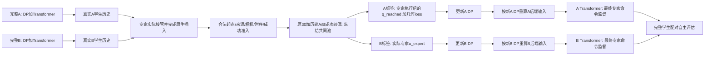
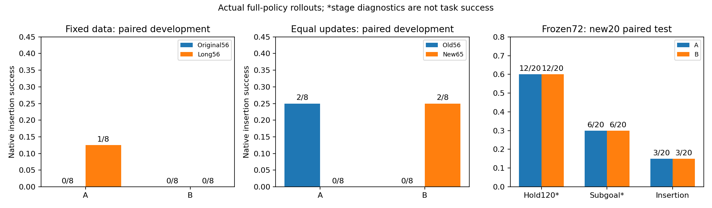
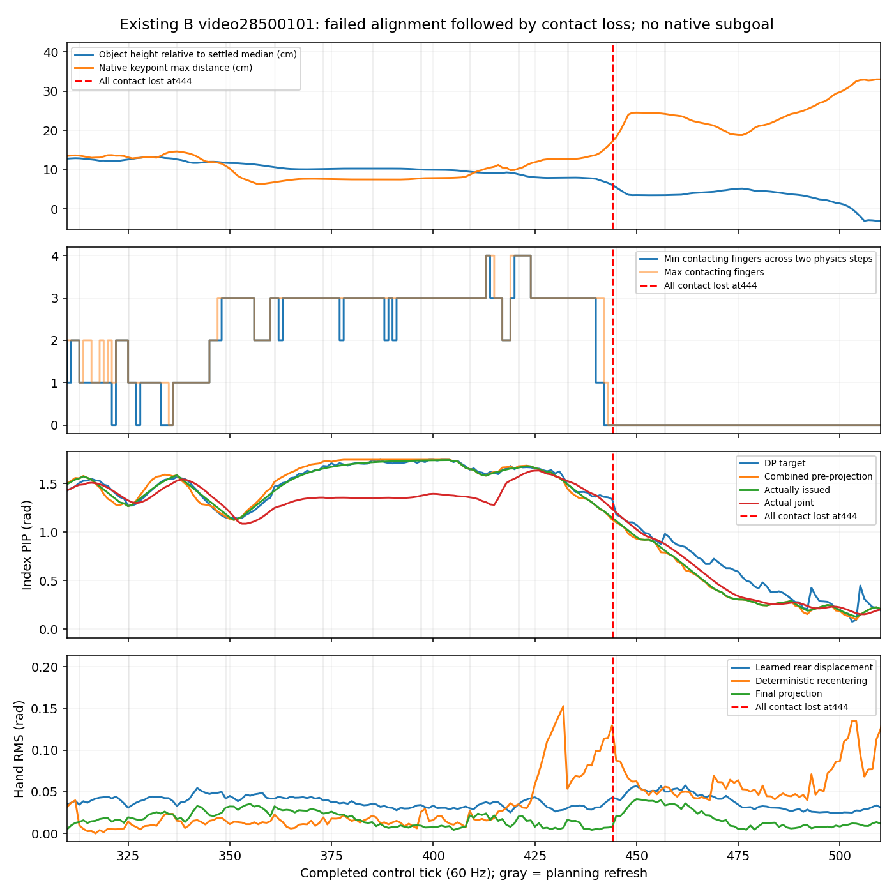
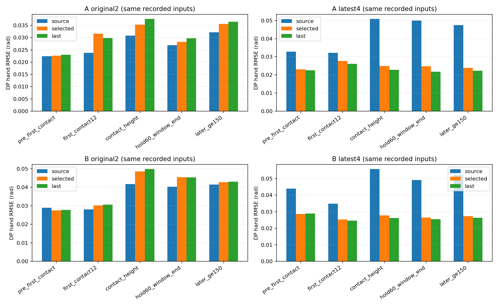
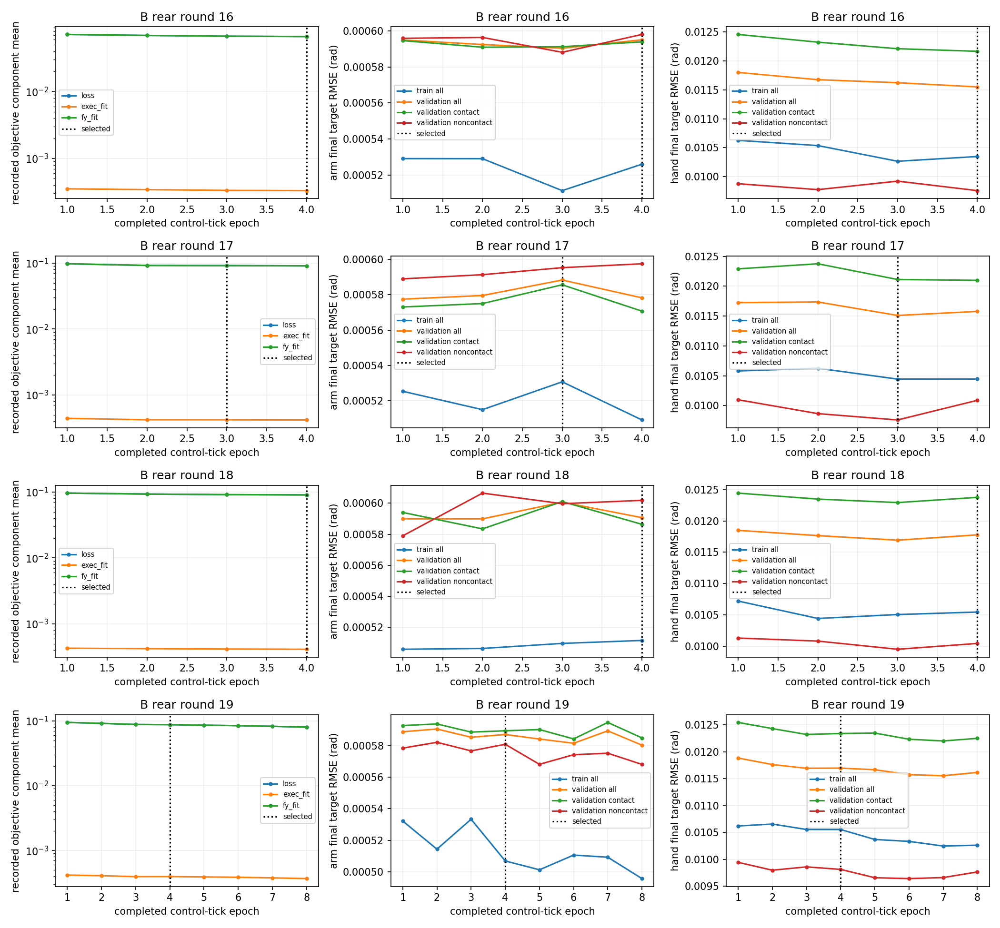
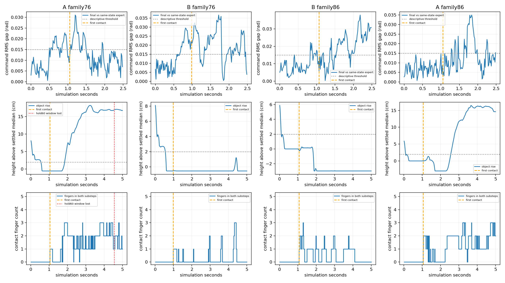
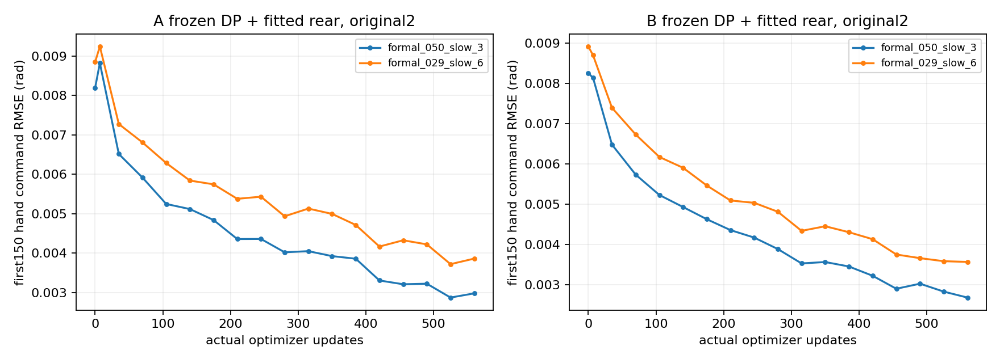
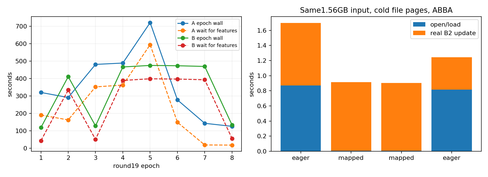
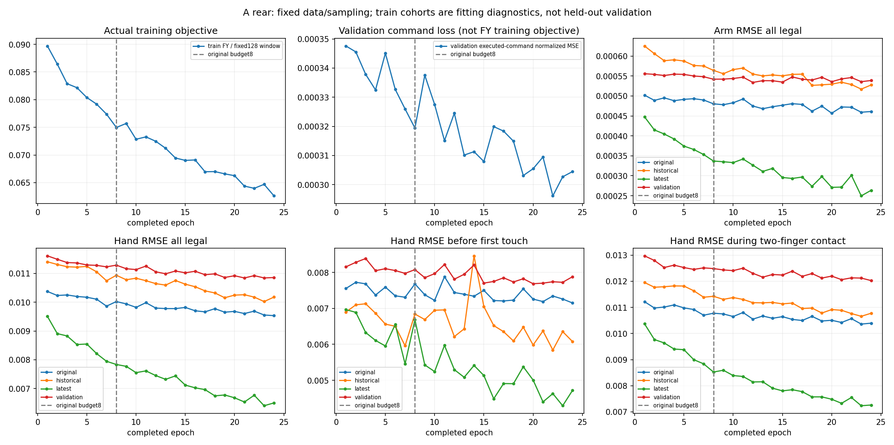
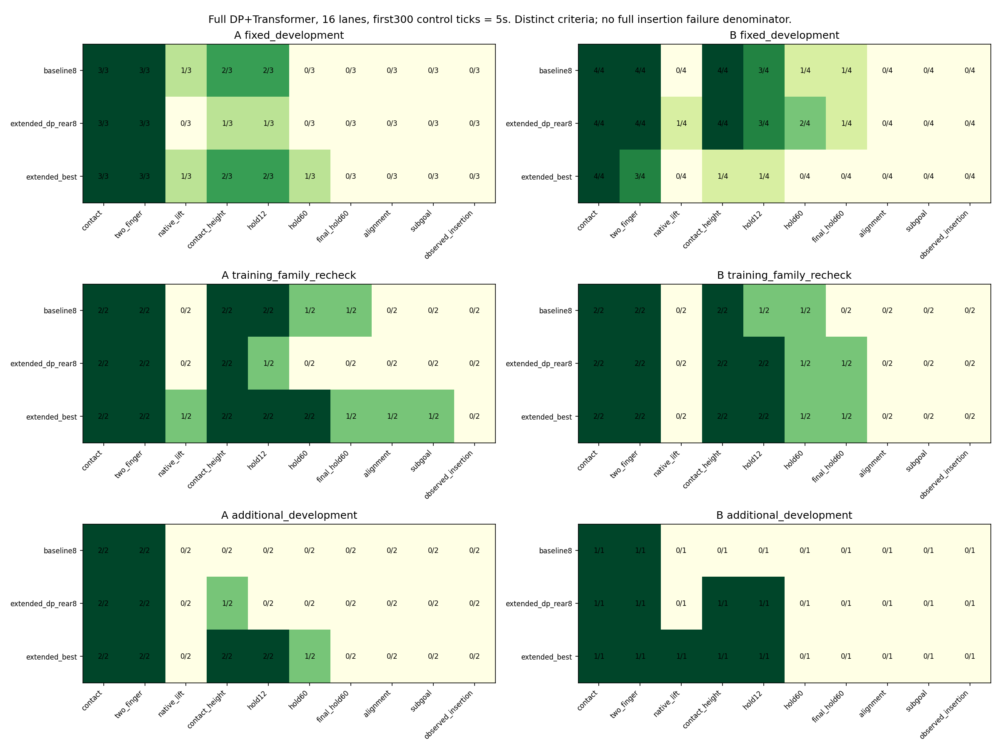

## 2026-11-17 DP读取定位与单一工程优化（已完成）

本轮从97005f3接续，仅允许同状态短程DP profiling，不扩展DAgger、长训、后端训练或自主测试。原72条选定完整模型、76条合法数据、原400条及必要依赖不变。四个短程检查已全部闭合，自有训练进程已退出；优化仅保留为显式诊断选项，正式训练默认未改。[原始证据与复核入口](evidence/tight_long_20261117/dp_io_profile/README.md)。

### 117.33分钟与3.45TB的来源

重新汇总原A `midpoint/A/training/validation.jsonl` 的epoch27–192：新增4648次更新，DP阶段7039.58685秒；训练epoch内5973.25368秒（99.55分钟），六条真实验证的同步计时合计694.05843秒（11.57分钟），两条训练诊断149.85164秒（2.50分钟）。其余222.42309秒（3.71分钟）包含保存、最终诊断及阶段边界等，历史日志不足以进一步严格拆开。**3,445,478,518,784字节是训练epoch内的进程物理读取计数，不是含验证的全阶段精确读取总量。**

56个训练视觉shard合计23,023,079,040字节，6个验证shard为2,458,658,106字节，合计23.73 GiB。按166遍计算，训练的名义文件遍历量为3.822TB，实测物理读取约为它的90.15%；这只是进程计数/文件体积比，不是精确页缓存未命中率，仍含metadata、预读及其他进程内读取。

实际读取路径：[Episode](../visuotactile/native_data.py)每次visit映射一个视觉`.pt`，取`patches/depth/camera_time/camera_valid`；[encode_trajectories](../visuotactile/trajectory_batch.py)按32帧块将**完整轨迹**搬至GPU并更新每个控制步的真实历史。不是每个动作窗口重复读取整条轨迹；每epoch每轨一次，相邻两轨构成一次更新，末尾真实验证额外读取6条validation和train前2条。`patches`为N×3×384×18×32的FP16，约占载荷99.5%；没有读取原RGB-D来重新运行DINO。numeric.pt、监督mask、几何的HDF5数值上下文在准备阶段读取，保留于当前进程；它们不是每轮TB级读取的主因。没有多DataLoader worker重复加载；当前B2是同步mmap，不是预取版。

mmap仅映射文件，`Episode`构造约毫秒级；真正页故障位于后续`.to(cuda)`消费中，所以旧`frozen_input_wait_s`会漏计I/O等待，`update_host_s`则混合页故障、传输和计算。新诊断在少数登记更新中同步CUDA，单独计量历史编码、pageable H2D（仍含页故障/CPU staging）、几何、反向和优化器；嵌套区间不相加。未有证据把旧117分钟逐项归为GPU计算或磁盘等待。

候选只有一个：最多4 GiB的不可变冻结特征GPU常驻子集，优先6个验证轨，再按原train顺序填满；按需首次加载，保留至少8 GiB填充准入余量，资源不足回落原mmap路径。只改变存储位置，不缓存可训练投影、GRU历史、标签或随DP变化的后端输入。相同checkpoint完整恢复Adam/EMA/RNG、相同56/6数据与顺序、采样及mask、LR与几何loss；使用独立诊断输出，结果不晋升为学生模型。

### 受控检查：确实包含训练、验证与保存

从**同一**`midpoint/A/training/last.pt`（epoch192、update5376）恢复完整模型、AdamW、EMA与所有RNG。使用原56训练/6验证、B2完整轨迹、相同9360动作锚点及几何抽样、继承LR=1.5e-5，短窗口保持该LR、不引入新的调度过渡。每epoch28更新，真实验证6轨及train2诊断，再保存完整状态；不是从EMA权重warm-start，也不是仅测裸loader。此56数据是117分钟历史运行的性能复现，**没有再做旧56与新65的学习效果对照**。GPU为4090 D 24GB，CPU Ultra9 285K，系统约62.46GiB RAM，线程数2；同步CUDA计时，没有把异步排队时间冒充计算完成时间。

先baseline224、再hotset224；候选结果出来前，因基线存储服务时间波动登记反序hotset56→baseline56，全部从同一源状态开始。每次新进程对62个无活动引用视觉shard做文件级`POSIX_FADV_DONTNEED`，不是全机清缓存；这里只能称冷启动请求，不能证明物理盘或OS页缓存全部冷。首次填充、逐轮验证及保存均计入下表；setup、空闲准入等待和结束后的比较/回读审计单列。原始result的`process_io`实际是该stage边界的计数，字段名不代表Python进程全寿命。

| 比较/版本 | 更新 | 训练秒 | 验证+train2秒 | 保存秒 | 完整阶段秒 | 阶段物理读取GB（十进制） |
| --- | ---: | ---: | ---: | ---: | ---: | ---: |
| 主比较 baseline | 224 | 359.23 | 25.03 | 9.23 | 393.52 | 191.59 |
| 主比较 hotset | 224 | 149.77 | 10.56 | 7.55 | 167.90 | 85.02 |
| 反序 hotset | 56 | 51.02 | 4.07 | 2.63 | 57.72 | 38.10 |
| 反序 baseline | 56 | 115.04 | 52.33 | 3.97 | 171.34 | 44.21 |

主比较少读**106.57GB（55.62%）**、阶段少用225.62秒（57.33%）；反序少读6.10GB（13.81%）、少用113.62秒（66.31%）。两次都改善真实短程训练阶段，而非仅加载微基准。**这些比例不是隔离存储服务时间后得到的纯优化因果效应，也不是下一轮保证收益**：两个baseline都有存储长尾；反序只能排除简单“总是后跑者更快”，无法控制磁盘热状态、回写及全机缓存压力。没有据此声称117.33分钟必然缩至某个值。

| 主比较冷/稳态证据 | baseline | hotset |
| --- | ---: | ---: |
| setup秒 | 6.16 | 6.85 |
| 首epoch训练+验证+保存秒（含冷填充） | 31.77 | 29.55 |
| 去首epoch及细粒度计时update29后，每更新中位秒 | 0.828 | 0.603 |
| 同上P95秒 | 10.704 | 0.923 |
| 全224每更新最大秒 | 19.004 | 1.506 |
| 进程RSS峰值GiB | 5.055 | 5.065 |
| CUDA allocated峰值GiB | 6.607 | 10.584 |

反序第二epoch普通更新中位0.760→0.644秒，也有约15.3%下降，但样本仅27个。不能只选热缓存几步：主比较首epoch只少约7.0%，反序首epochbaseline遇慢盘而差异很大；完整冷、稳态分布都在JSON中。四运行最小采样RAM余量26.42GiB、GPU余量11.66GiB，遥测最大间隔1.55秒；采样值不等于连续硬保障。没有额外worker/预取、全量入RAM或修改物理/控制频率。

hotset实际常驻4,266,269,514字节（3.973GiB），10轨＝全部6val+train前4轨。主比较86命中/426未命中/0准入回落，直接避免名义载荷36.79GB；反序14/114/0，直接避免6.00GB。主比较少读106.57GB大于直接命中量，说明OS缓存行为/存储条件同时影响结果；不能把差额全算成缓存命中。后几epoch验证读取几乎为零，非驻留训练轨仍沿用原mmap路径；没有复用可训练视觉投影或随DP更新的后端输入。

### 时间定位与数值一致性的边界

主比较update29的同步嵌套计时：baseline/hotset完整历史前向（含读取、H2D）0.538/0.080秒，pageable H2D（含页故障及CPU staging）0.474/0.032秒，几何上下文0.0043/0.0049秒，hand几何前向0.310/0.316秒，denoiser+loss（含几何）0.412/0.393秒，反向0.135/0.129秒，Adam0.0075/0.0079秒，EMA约0.0023/0.0022秒。取样CPU约0.0048/0.0019秒。**这些区间有包含关系，不能相加**；该更新是定位样本，不能代替全阶段比例。冷update1两组历史前向约0.78/0.79秒。几何计算没有删减，优化主要作用于数据消费链路。

现场慢盘时线程观察到`folio_wait_bit_common`，设备级iostat约50–57MB/s读取、89–98%忙碌、8–10ms读等待；反序另有49.23秒真实验证。磁盘约99%已用，但不能由此证明具体是磁盘剩余空间、温控还是其他I/O导致慢读；这些根因尚未知。纯磁盘等待、pageable staging与纯GPU DMA无法在现有计时中完全分开；历史117分钟没有细粒度GPU完成事件，不能编造分摊。优化后的几何前向仍约0.3秒/诊断更新，是可见成本，不授权本轮改loss或几何算法。

两比较均：初始全训练状态哈希相同；全部轨迹顺序、动作锚点、几何抽样回执相同；从冻结numeric及实际锚点重建的标签/mask哈希相同；最终deck/noise/torch/CUDA RNG、optimizer步数、配置与EMA计数相同。主比较每版448轨visit、9360锚点、215792有效目标槽、138064真实视觉帧；反序每版112visit、2340锚点、54239有效目标槽、34516帧。目标槽包含窗口重叠，**不是独立专家tick数**。学生前缀仍只作为历史，交接mask未变；重建摘要不是另外一次运行时mask捕获。

hotset反序结束后，40个数组（10轨×camera_time/camera_valid/patches/depth）的4.266GB缓存逐字节回读通过。**数值检查支持语义保持，但没有逐位训练复现**：主比较loss最大差8.15e-10、验证selection最大差9.31e-10、梯度范数最大差1.15e-7；最终model/EMA最大绝对差均2.38e-7，model相对L2差5.54e-8。反序首步实际梯度188张量最大差2.33e-10、相对L2差1.29e-7；56步model最大差1.19e-7。最终状态哈希不同，原因未隔离，不能仅凭经验断言具体由哪一个CUDA kernel造成；未切换确定性算法来掩盖差异。没有事后设阈值再冒称预登记通过，原始数值全部公开。

### 范围、工程恢复与建议

一次哈希标量处理错误发生于0更新；修复后首次baseline完成70更新，观察到其他项目GPU仿真启动且有20–25秒长尾，只中断自有诊断，保留证据（最后durable checkpoint为56更新）。长尾不能全部归因GPU，因为后来的空闲GPU运行也实测慢盘。恢复版等待其他GPU计算任务退出且连续空闲30秒，共668.29秒准入等待，不计进393.52秒；其余后续运行各30秒准入。基线实际总更新70+224+56=350，优化版224+56=280；没有新长训、DAgger、后端或自主测试。原先0更新故障和70更新中断未混入配对结果。

31个相关测试通过；真实缓存回读、梯度、完整状态与采样检查见[摘要](evidence/tight_long_20261117/dp_io_profile/summary.json)。代码只新增有界不可变特征hotset和一个调用既有训练事务的短检入口，原正式默认路径未改。**值得在下一轮单目标增量训练中显式启用4GiB hotset，并保留8GiB填充准入余量及原mmap回落**；理由是两次真实阶段均改善、输入/曝光合同保持、数值残差很小、内存余量充足。限制是只测A/56条/短窗口，不保证72/76数据、B、不同并行负载或整轮长训的加速率。后续只需把同一loader显式接入原正式入口并记录命中及阶段耗时，不自动扩展一套框架或重复大规模对照；本轮没有替正式训练切换默认配置。若要求逐位相同权重，目前不能宣称满足。

### native_lift的小范围使用核查（未改判据）

[原生lifting_reward](../isaacsimenvs/tasks/play/utils/reward_utils.py)使用`lifted = (0.05 + object_z - object_init_z > lifting_bonus_threshold) | prev_lifted`，是**锁存**状态，原生reset清零；[rollout汇总](../tools/tight_fresh_batch_eval.py)再对全轨迹取`any()`。现场阈值0.15，因此要求物体高于reset初始z超过0.10m，参考不是落桌后的稳定高度；不能把它解释为瞬时高度或持续持物120tick。

本轮所继承的多阶段接管使用落稳高度、真实接触、搬运/孔口距离及原生子目标；[phase_takeover](../visuotactile/phase_takeover.py)不使用native_lift。当前动作锚点采样依赖合法专家mask和早期tick；[几何阶段采样](../visuotactile/geometry_sampling.py)依赖接触/持物/子目标，也不读取该flag。当前训练停止/选checkpoint依赖验证计划；最终72/76整套选择用完整成功、hold120、首子目标，没有native_lift必要门槛。它在本次报告/分组诊断中出现，但不是准入条件。

不能泛称全仓库从未使用：旧`tools/tight_finish.py`曾以native_lifts、成功或子目标的**OR条件**决定是否扩展评估，并在旧残差准备判断中使用；这些不是本次11月17日布局流水线。原生奖励与外力门也读取底层`_lifted_object`，本轮不改它们。最终六条完整成功均无该flag的既有逐轨证据保持；它不是原生完整成功的必要前提。

## 2026-11-17 证据补齐：从远端还原实际实验

本次只核查、导出与发布；没有新增训练、DAgger、仿真或改变算法。以已收到的完整提交 `14815ae5ded77a590a5baf16307866baf5b1aef7` 为审计基点。**本轮可精确界定的实验是13小时38分58秒，而非20小时；A/B使用共享专家纠偏池，但第05轮以后父模型选择不同，不能解释成独立DAgger或严格单因素监督比较。** 下文旧“当前运行”条目均为历史快照。

### 远端交付与缺口

[轻量证据入口](evidence/tight_long_20261117/publication/README.md)按文件解释用途；[此前上传逐项清单](evidence/tight_long_20261117/publication/previous_upload_inventory.csv)绑定14815ae的64个实验目录文件及SHA256。此前已有主报告、预算/选模摘要、共享76条快照、采集报告、配对开发/最终逐例JSON、验证曲线PNG、视频**路径**索引；14815ae本身修改22个文件，其中实验目录18个，其余46个实验证据已在祖先提交中。不能说这些原来都没上传。

本次补齐四个冻结manifest、82条逐轨迹来源记录（76train+6validation）、十套组件配置/续训/缓存绑定、逐update原始数值及逐epoch曲线、实际训练访问、所有六轮采集来源、184次自主执行总表、40条最终测试、95个计时区间回执、三段原视频和关键帧、论文依据。原始数值压缩为JSON.gz/JSONL.gz；DP只省略冗长逐点几何调试数组，保留标量loss、实际采样锚点、访问次数和时间/I/O计数。没有上传权重、RGB-D或私密认证。发布检查另外发现`runs/`、`*.mp4`、`*.log`会忽略155份本次导出，已逐项显式纳入Git，保持全局ignore规则；见[准入记录](evidence/tight_long_20261117/publication/git_admission.json)。

[旧JSON中的178个绝对路径引用](evidence/tight_long_20261117/publication/previous_local_references.csv)现场均存在（152文件、26目录），**存在不等于远端可下载**。原outputs是共享工作树软链接，原树忽略outputs；权重、原RGB-D、其余视频仍只在研究机，没有公开下载服务。此次发布的是可独立核对实验设计和结果的轻量证据，不是可离线重训的完整数据集。[导出来源及摘要](evidence/tight_long_20261117/publication/export_inventory.json)区分原样副本与数值导出。原有视频索引已增加本次远端媒体入口。

### 实际A/B数据流与来源

学生前缀保存真实观测、实际issued/applied动作和历史，只提供输入；mask=0。接管两tick过渡同样mask=0，随后合法专家目标才进入loss。共享的是实际专家记录，不是相同标签，也不是学生自监督。

| 冻结池 | 原始示范 | A来源纠偏 | B来源纠偏 | 实际用于A | 实际用于B | manifest |
| --- | ---: | ---: | ---: | ---: | ---: | --- |
| 56 | 30 | 12 | 14 | 56 | 56 | [56](evidence/tight_long_20261117/publication/manifest_56.json) |
| 65 | 30 | 16 | 19 | 65 | 65 | [65](evidence/tight_long_20261117/publication/manifest_65.json) |
| 72 | 30 | 19 | 23 | 72 | 72 | [72](evidence/tight_long_20261117/publication/manifest_72.json) |
| 76 | 30 | 21 | 25 | 76 | 76 | [76](evidence/tight_long_20261117/publication/manifest_76.json) |

每份manifest含trajectory_id、source_group、原文件SHA、完整源DP/后端SHA、family、接管规则与实际tick、HDF5直接读取的有效mask半开区间、split；验证6条独立列出。原示范没有学生checkpoint，以original_expert和专家权重身份追溯。所有新增纠偏来自原train30的family，不与validation6或新test混合。多条纠偏并不等于多个独立初态family。

| 轮次 | A机会/接管/成功/有效专家tick | B机会/接管/成功/有效专家tick | 实际学生来源 |
| --- | --- | --- | --- |
| 01 | 4 / 3 / 3 / 494 | 4 / 4 / 4 / 652 | 原30完整A/B |
| 02（两个小批） | 8 / 6 / 6 / 952 | 8 / 6 / 6 / 749 | 37条完整A/B |
| 03 | 4 / 3 / 3 / 572 | 4 / 4 / 4 / 600 | 49条完整A/B |
| 04（两波） | 8 / 4 / 4 / 825 | 8 / 5 / 5 / 897 | 固定56长训midpoint完整A/B |
| 05 | 4 / 3 / 3 / 526 | 4 / 4 / 4 / 737 | A:旧56等更新臂；B:新65等更新臂 |
| 06 | 4 / 2 / 2 / 338 | 4 / 2 / 2 / 356 | 72条完整A/B |

所有机会合法；未触发不是救回失败，也不入成功训练池。新增04–06共32机会、20实际接管全部成功、12未触发、3679合法tick，只有480属于每条最初24tick；不能用大量恢复后正常动作冒充新困难状态覆盖。具体未触发条件、模型身份与每轮原plan见[全部64次采集机会](evidence/tight_long_20261117/publication/collection_all_rounds.csv)、[完整源模型](evidence/tight_long_20261117/publication/collection_source_models.json)、[新32机会及原因](evidence/tight_long_20261117/publication/collection_opportunities.csv)。alignment四机会均未到达；post_subgoal四机会仅一个A触发并救回。

实际实现证据：

- [admit_capture](../tools/tight_fresh_batch_run.py#L181)：先来源/标签/相机审核；只有原生成功且专家接管成功才写correction_entries。源role、family、两checkpoint哈希、真实接管tick保存在entry。
- [phase_pool](../scripts/tight_layout_20261116/phase_pool.py)：04两波合并前核对源完整pair相同，拒绝重复case/trajectory ID；[prepare_aggregate](../tools/tight_fresh_dagger.py#L58)把**同一个entries**传给A和B；[validate_aggregate_families](../visuotactile/narrow_data.py#L553)拒绝重复ID和跨划分family。**本轮采用ID去重/来源校验，没有启用另一个旧Core166 persistent-pool的内容哈希去重，不能混称。** 同family、不同学生实际状态的纠偏不会被“近似去重”。
- [dagger_record](../visuotactile/narrow_data.py#L243)逐条要求mask对应真正专家控制和clean切换；A的q_reached与实际transition后的关节量相等，B的u_expert与实际命令相等；previous_issued严格等于前一实际mixed命令。保留完整原历史。此次读取全部46条mask并导出区间，未重复开展GPU大审计。
- [build_dagger_aggregate](../visuotactile/narrow_data.py#L643)保留旧纠偏mask，固定原train30统计；[window_mask](../visuotactile/target_windows.py#L21)限制有效标签及控制segment，跨界动作块不产生无专家支持的目标。后端index记录`causal_actual_student_expert_prefix`及mask SHA。
- [实际训练访问](evidence/tight_long_20261117/publication/training_visits.csv)验证A/B DP确实读取相同ID集合；每epoch每条一次，无角色筛选或新旧额外重复。相同集合不代表访问总数相同：长训继承起点、停止epoch和后端选模不同。十份[后端nominal/index与配置](evidence/tight_long_20261117/publication/runs)均绑定本组新DP哈希，已逐一与后端selected回执相等核验。

### 全流程、模型继承与等更新对照

[完整预算CSV](evidence/tight_long_20261117/publication/training_budget.csv)每行区分actual与selected，附父checkpoint、优化器/LR/EMA、合法监督曝光；[完整模型ID](evidence/tight_long_20261117/publication/models.json)以DP SHA+后端SHA定义。以下数字均为单节点“完成→选中update”，不是将并列分支相加。

| 目的与数据 | 父模型 | A DP / 后端 | B DP / 后端 | 自主开发及去向 |
| --- | --- | --- | --- | --- |
| 基线56 | 49完整A/B | 728→644 / 1973→1036 | 588→336 / 2254→1973 | 历史独立8次各0；保留 |
| 固定56长训midpoint | 基线DP **last**；基线选中后端 | 5376→2716 / 6011→1036 | 5376→2772 / 6011→93 | 初筛2/4、0/4；同波8对1/8、0/8；继续研究 |
| 新65等更新臂/04 | 各自midpoint完整pair | 1848→1848 / 2008→2008 | 同A | 初筛0/4、1/4；同波8对0/8、2/8；B被继承 |
| 旧56等更新臂 | 同一midpoint完整pair | 1848→1848 / 2008→2008 | 同A | 初筛0/4、0/4；同波8对2/8、0/8；A被继承 |
| 组合源完整确认 | A旧56臂+B新65臂 | 无更新 | 无更新 | 单独4对完整执行；不是复制已有结果，见总表selected_for_round05 |
| 72条/05 | 上行组合源 | 648→216 / 2071→1726 | 648→108 / 2760→2760 | 初筛各0/4；最终同波A2/8、B0/8；整套选中 |
| 76条/06 | 72完整A/B | 1102→722 / 2170→1207 | 836→684 / 2170→123 | 初筛各0/4；最终同波各0/8；回退72，数据与模型保留 |
| 最终新20对测试 | 冻结72完整pair | 无更新 | 无更新 | A3/20，B3/20；测试后无选模/训练 |

长训实际新增A4648、B4788，5376是包含原阶段728/588的计数，不是新增数。恢复raw模型、Adam、EMA、RNG、deck/global_step，**显式重启非零LR**，因此是完整状态续训但不是原scheduler无缝延长。DP lr3e-5、有限一次减半；后端从对应旧权重warm-start、fresh Adam，无EMA。其余新数据阶段DP从EMA权重warm-start、fresh Adam/EMA，后端也fresh Adam；不得称精确resume。预算表和[选中谱系](evidence/tight_long_20261117/selected_lineage.json)分别保存actual消耗与selected祖先路径。最终A DP7680/后端14137、B6976/14901只指选中路径，不是单优化器总步数。

实际运行源码见[冻结运行树提交](evidence/tight_long_20261117/publication/runtime_commits.json)：midpoint为25bcc4a，后续主要dd82fc1，新增post_subgoal/06为235943b；命令入口在[timeline.csv](evidence/tight_long_20261117/publication/timeline.csv)。部分继承的session.source_commit仍是99cfaf7，不能用这个旧字段替代runtime工作树及prepared.source_sha256。配置入口为现有`tools.tight_fresh_train`、`scripts.tight_layout_20261116.{learn,dagger,phase_pool}`与完整batch执行工具，无新训练框架。

等更新诊断已核对：各角色旧/新臂来自同一DP及后端SHA，fresh优化器、固定原train30 normalizer、DP lr3e-5/rear1e-4恒定、1848/2008更新、均取登记末点。DP deck seed2026111402/noise2026111403、初始化2026111401，后端初始化2026111404，设置相同；数据长度不同导致随机数消耗和实际样本不同，不称逐update同随机张量。65为奇数，B2每epoch有一个singleton；56没有。两臂实际监督曝光分别为DP **1,775,329→1,698,964**目标槽、后端 **291,423→286,744**合法tick；相等update并不等于相同曝光。DP纠偏最初24段槽100,491→115,906，原始前150tick槽604,771→512,387，改变了内容覆盖及原始抓持复习量。

| 开发初态末尾（288200xx） | A旧56 | A新65 | B旧56 | B新65 |
| --- | --- | --- | --- | --- |
| 00 | 成功 | 失败 | 失败 | 失败 |
| 01 | 失败 | 失败 | 失败 | 失败 |
| 02 | 失败 | 失败 | 失败 | 失败 |
| 03 | 失败 | 失败 | 失败 | 成功 |
| 04 | 失败 | 失败 | 失败 | 失败 |
| 05 | 失败 | 失败 | 失败 | 失败 |
| 06 | 成功 | 失败 | 失败 | 失败 |
| 07 | 失败 | 失败 | 失败 | 成功 |

原逐例和配对回执见[matched8](evidence/tight_long_20261117/publication/matched8.csv)与[evaluations](evidence/tight_long_20261117/publication/evaluations)。后者A_baseline/B_baseline在该对照表示旧56臂，不是最初56基线。结果方向不一致、样本8对、只有一个训练随机种子设置；不能宣布新数据有害或B监督优越。后续分别选择A旧/B新又引入了父路径差异，本轮没有擅自改成独立池。

### 13小时39分钟的实测时间账

所有时间为**UTC+08:00**，JSON也保留epoch UTC。正式注册01:50:52.472，最终owner退出15:29:50.089，总49,137.618秒。[95项起止/命令/返回值](evidence/tight_long_20261117/publication/timeline.csv)及[原回执](evidence/tight_long_20261117/publication/timing_receipts)可逐项检查；[独占区间合计](evidence/tight_long_20261117/publication/time_account.json)不把父owner和子worker重复相加。最终test没有通用`logs/*_complete.json`，使用它自己的owner回执补入17分25秒，而非算作等待。

| 互不重叠的归类 | 秒 | 分钟 | 解释 |
| --- | ---: | ---: | --- |
| DP训练+验证 | 31,630.75 | 527.18 | 十个前端节点；含加载、验证、检查点和进程边界 |
| Transformer训练+验证 | 7,283.13 | 121.39 | 十个后端节点 |
| Transformer输入缓存 | 867.91 | 14.47 | 每个新DP分别刷新，不能拿旧后端输入配新DP |
| 新增冻结视觉缓存阶段 | 243.17 | 4.05 | 新数据特征及索引/复用校验；不是全池重新编码 |
| 学生开发/对照/源确认 | 4,680.71 | 78.01 | 144次完整自主执行，8lane一波 |
| 最终测试 | 1,045.34 | 17.42 | 5波40次自主执行，8lane |
| 专家采集worker起止 | 1,499.07 | 24.98 | 4物理波32机会；内部loop+准入1485.83秒 |
| 显式准备/离线检查 | 291.37 | 4.86 | 有单独计时回执的准备与离线诊断 |
| 首次04入口拒绝 | 4.07 | 0.07 | Kit前16case/8lane不满足严格配对；无物理机会 |
| 无法细分的间隙 | 1,592.09 | 26.53 | 分析、导出/审核、交接、恢复准备或等待；不得全称idle/I/O |
| **总墙钟** | **49,137.62** | **818.96** | **13:38:57.62** |

五个学习阶段（均包括内部开发，下面不能再加到上表）为：midpoint 01:51:09–06:43:37（292.47min）；新65 07:22:58–09:09:50（106.87min）；旧56 09:09:51–11:20:12（130.36min）；72条11:51:46–13:04:39（72.88min）；76条13:19:14–14:47:32（88.30min）。A/B和新旧臂确实串行；没有靠并行GPU训练获得更短墙钟。8lane是每次仿真内并行，不是八个独立训练作业。

**DP为最大成本，而且不是117分钟全在优化核计算。** A长训finished内墙钟7039.59秒，新增4648更新，约39.62updates/min；新epoch主体5973.25秒，剩余约1066.33秒是验证/保存/外围，不能进一步全部归为验证。B相应7142.87秒、4788更新。两者读取计数分别3.445/3.478 TB（十进制、反复读取），确有页故障与物理读，不是只看映射文件大小。但显式frozen_input_wait只有17.17/19.74秒，mmap消费时缺页会发生在update_host内部；**没有可恢复的全程磁盘阻塞秒数或特定外部争用归因**。[逐epoch I/O](evidence/tight_long_20261117/publication/epoch_io.json)、[update时间汇总](evidence/tight_long_20261117/publication/training_io_summary.csv)保留边界，不能说I/O只占17秒，也不能说117分钟全在等磁盘。

Transformer finished另记录setup/training/work/wait；例如A长训1453.61秒，training_wall1314.57秒、wait8.78秒，这些是嵌套口径，不额外相加。所有原finished已发布。仿真内controller/environment/record_submit/finish_audit/reset_refill及实际control ticks/s见[23个自主波profile](evidence/tight_long_20261117/publication/simulation_profiles.csv)与原[performance](evidence/tight_long_20261117/performance.json)；controller含视觉，environment含物理/渲染，render秒数不能再相加。Kit启动/场景初始化/关闭只可由外层worker减内部wave得到**混合开销上界**，没有每个子阶段统一独立计时。CPU数据写入与异步写线程也没有完整独占时间；record_submit不是全部磁盘写耗时。

04首批拒绝后有界拆成两个8lane波，每波重新启动Kit；四次新采集波含启动/准入每小时48.46条成功后缀，不是完整训练迭代吞吐。重复刷新DP相关后端输入是必要成本；冻结DINO源特征已跨角色/阶段复用。现有证据未证明误把全部视觉特征反复编码，也未证明持久Kit一定能无代价保持配对状态。可优化方向要与“已测得收益”分开。

“约20小时”没有单一已登记的对应区间：[前置窗口](evidence/tight_long_20261117/publication/prior_windows.json)显示10cm试摆从11月16日16:51开始，包含它直到最终测试是22小时38分；分阶段前轮从20:48开始则约18小时41分。本报告不挑一个起点凑20小时，也不把旧session继承的started_utc误当本阶段launch。旧任务与本轮间的工作/停顿不足以完全细分，另列不并入13h39m。

GPU不是未记录：本轮monitor有整卡利用率，不能由显存猜算。历史证据含最大完整60秒均值62.44%、17.67秒采样间隔、最低可用RAM10.75GiB；不作逐进程归因或全程旧50%合规声明。此前报告的25个monitor与performance内24个owner集合口径不同（包含单独离线诊断），不可无条件当同一分母。

### 自主结果、事件和可远程查看的视频

[全部184次自主执行](evidence/tight_long_20261117/publication/autonomous_all.csv)区分初筛、同波比较、组合源确认、最终测试；没有把专家成功算进去。[final40.csv](evidence/tight_long_20261117/publication/final40.csv)逐条提供role、完整policy ID、初态ID、合法性、步数、成功、hold120、首子目标、终止原因及视频状态，五波原plan与实际起点配对回执可从evaluations/final_test逐项追溯。配对保证可观测实际初态字段，不声称隐藏PhysX状态精确相同。

A成功28823000/008/013，B成功002/011/015，**交集为空，各自独有3个**。40合法、0非法、0软件中断，各3/20；A2fall/15timeout，B3fall/14timeout。[事件交叉检查](evidence/tight_long_20261117/publication/final_events.json)：六个成功都有hold120和首子目标，但**六个都没有native_lift诊断标记**，所以不能把lift→hold→subgoal→success画成严格包含漏斗。native_lift不是最终判据。每组12/20达到hold120、6/20首子目标，仍存在早段抓持不足与后段失败。

| 已上传原视频（无重新编码） | 性质与观察 | 关键帧 |
| --- | --- | --- |
| [A新test28823000](evidence/tight_long_20261117/publication/media/final_A_28823000.mp4) | 293tick，完整自主抓取、搬运、插入、撤手 | [图片](evidence/tight_long_20261117/publication/media/final_A_28823000.jpg) |
| [B同初态](evidence/tight_long_20261117/publication/media/final_B_28823000.mp4) | 601tick，近孔持续偏斜/调整，超时；不是成功 | [图片](evidence/tight_long_20261117/publication/media/final_B_28823000.jpg) |
| [A post_subgoal专家救回](evidence/tight_long_20261117/publication/media/expert_rescue_not_autonomous.mp4) | 学生到201，201–202交接mask0，203起专家标签；专家完成，不算自主 | [图片](evidence/tight_long_20261117/publication/media/expert_rescue_not_autonomous.jpg) |

三段视频共约5.07MB，SHA与原视频相同；GitHub若不内嵌播放可下载raw。[完整媒体索引](evidence/tight_long_20261117/publication/media_index.json)明确其余视频仅本地，最终另外38次本来没有录视频，不能编造视频对应关系。每段都是实际60Hz观测帧，终止后reset画面未补入；关键帧不是完整逐帧人工审阅声明。

### 文献依据与实际采用设置

本次核查论文原文和官方配置，不复制聊天中未核实的换算。配置固定commit及SHA见[literature_sources](evidence/tight_long_20261117/publication/literature_sources.json)。

| 参照 | 核实设置 | 不足以直接换算到本项目的部分 |
| --- | --- | --- |
| [Reactive Diffusion Policy v2](https://arxiv.org/html/2503.02881v2#A8) | Peeling60/Wiping80/Lifting50示范；表VI AT600、LDP400、普通DP600epoch；[官方LDP配置](https://github.com/xiaoxiaoxh/reactive_diffusion_policy/blob/824c5e8de1fd1811106907a04b5f0186e0138c0b/reactive_diffusion_policy/config/train_latent_diffusion_unet_real_image_workspace.yaml)batch64、accum1、EMA、cosine、num_epochs401、train_loss选checkpoint | 配置401与论文400保留原口径；AT预训练后载入LDP，不是本项目DP后再刷新后端。各任务实际optimizer次数、完整运行日志/最终选模checkpoint未核实；resume:true不证明实际恢复优化器 |
| [Diff-DAgger v3](https://arxiv.org/html/2410.14868v3#S4) | Plugging20→100示范，每8次专家干预更新；单观测、H64/执行8、V目标；ManiSkill20Hz、RRT专家；每次策略更新包括训练和阈值重估 | 表IV N_b=512是**查询扩散损失估计batch**，不是已核实训练batch。训练epoch数/optimizer updates/训练batch/是否warm-start及checkpoint选模未披露或本次未核实；不能用8干预直接等同我们一轮 |
| [DP3 v3](https://arxiv.org/html/2403.03954v3#S3.S3) | MetaWorld1000、其他3000epoch，batch128；多数仿真10示范、DexArt/HORA100、真实40；仿真3训练种子，每200epoch评估20次并平均最高5次成功率；[官方配置](https://github.com/YanjieZe/3D-Diffusion-Policy/blob/47385d9d6f5bde3f2ebdf2400ecb8261cc9e6b97/3D-Diffusion-Policy/diffusion_policy_3d/config/dp3.yaml)accum1、EMA、cosine、3000、test_mean_score监视（save_ckpt默认false） | 这些epoch遍历序列窗口DataLoader，不是我们的B2完整轨迹deck。精确任务窗口数/updates/作者每次实际恢复状态未核实；是BC非共享双学生DAgger |

RDP强调低频视觉计划加快速触觉反馈；本项目借鉴分阶段学习和反馈原则，并未复现AT/LDP架构。DP3使用单视角稀疏无色点云；本项目三视角448×252 RGB-D、冻结DINO、每60Hz控制tick真实历史、29维关节绝对目标、H24/commit12/DDIM16；A另有训练时几何损失及投影计算，后端Transformer以专家最终命令监督。DP3任务动作维度4–52不等，RDP为末端/夹爪任务相关空间，不能用参数/epoch数直接比较。

本项目DP一次update平均两条完整轨迹的masked窗口loss，后端microbatch4、32tick块、128有效专家tick累积并在完整组末flush；有效曝光受mask、长度和singleton影响。硬件/渲染栈也不等：本机24GB级GPU同时承担Isaac/RTX；Diff-DAgger时间实验为A10040GB。不能拿论文epoch或其0.54h策略更新声称本项目预算足够/实现低效。本次未扩展DRIFT综述，不引用其iteration作数值预算。

### 已证实、仍未区分、下一步（未执行）

已证实：共同专家数据确实进入A/B loss；学生前缀不作专家目标；对应新DP刷新了后端；长训有有限开发收益但不稳定；等更新新增纠偏的效果方向不一致；76条候选在同波开发退化，回退72；新test两组各15%，成功初态不重合。训练I/O反复读取量很大，DP训练/验证是最大耗时；论文预算口径不能直接搬用。

尚未证实：新数据有害、某监督更优、优化已充分、覆盖不足是唯一原因、近孔姿态不可观测是主因、磁盘争用来自某个外部任务、缓存重算是主要瓶颈。小样本同波对照和不同测试集不能建立显著因果提升；前段未达到稳定保持，后段没有随轮次单调改善。

下次优先只做三件可区分的事，均需另行实验登记：①复用冻结特征索引，针对现有DP读取/缺页做少量等语义的有界预取对照，以完整阶段秒数和内存峰值验收，不只看load API时间；②复用少数代表性完整模型和必要开发波，尝试在已验证配对/reset合同内减少重复Kit启动，保留最终独立test；③固定同一父pair与update预算，检验原始早期抓持曝光保持和**少量重复失败位置**纠偏的收益，单次只改变一种采样/覆盖因素。旧56等更新臂约130分钟和多模型配对比较属于本次必要研究对照成本，日常每轮不必重复；新DP后端输入刷新和真实自主评估则不能省略。

---

## 2026-11-17 最终：长训、三轮DAgger和新20对测试已全部完成

本session实际运行01:50:52–15:29:50(+08)，13小时38分58秒，原14小时训练/16小时总界内结束；最终五波40次完整自主测试耗时17分25秒。所有自有训练、采集、评估worker及25个monitor均已退出。没有停在后台启动，没有按新test再训练或选模型。最终采用开发阶段已冻结的round05共同72条完整A/B；76条完整模型与全部76条有效数据仍保留，不因负结果删除。

| 检验 | A | B | 能支持的结论 |
| --- | --- | --- | --- |
| 固定56：原模型→显著长训，同波8对开发 | 0/8→1/8 | 0/8→0/8 | 有限闭环/阶段收益，不是稳定插入提升的证明 |
| 等更新：旧56→新65，同波8对开发 | 2/8→0/8 | 0/8→2/8 | 新纠偏效果方向不一致；不支持普遍额外收益 |
| 最终开发：共同72→共同76，同波8对 | 2/8→0/8 | 0/8→0/8 | 新一轮没有改善；按预登记规则回退整套72 |
| 冻结72，新20对独立测试 | **3/20（15%）** | **3/20（15%）** | 真实完整学生自主插入；不是专家救回或离线指标 |

新test28823000–019共40合法、0非法、0软件中断；五波实际可观测初态配对通过，每个seed恰好A/B各一次。A成功000/008/013，B002/011/015，各3个；不同seed成功，不能由相同3/20称行为等价。A2fall/15timeout，B3fall/14timeout；最长A819/B912tick来自原生首子目标重置任务时钟，未修改成功或超时条件。旧两批8test只属历史回归，本次20初态在选模前未打开。3/20的样本仍小，95% Wilson区间约5.2%–36.0%；此前0/8使用不同初态/模型筛选，不能直接断言统计显著改善或将收益唯一归因于训练量、纠偏数据或10cm布局。

前段与后段：新测试A/B均持物60为14/20、持物120为12/20、运输/近孔筛选16/20，原生首子目标6/20；对准诊断A9/20 B8/20，筛选不替代原生判据。两组各17失败中8例未达到持物120、13例已到近孔、3例已过首子目标，这些集合重叠，不是互斥失败分类。前段仍未稳定，后段仍不能可靠完成。72/76同波比较持物120 A7/8→5/8、B5/8→3/8，说明继续增量学习会退化；所选72仅避免部署这次明显较差候选，并未证明前段普遍保持。已有训练纠偏首段命令拟合下降，但真实自主收益并未随每轮单调增长。

实际预算：固定56 DP从完整last恢复Adam/EMA/RNG/deck，A新增4648、B4788次，阶段各到192遍/5376；显式非零LR重启，后半验证平台后不继续360。配套后端各64遍/6011更新，按验证选中，与旧后端混配或裸DP无关。等预算数据诊断从同一midpoint出发，旧56/新65各1848DP+2008后端更新，恒定LR、末点选取，其余不变。三次新DAgger04/05/06全部经过采集→共享准入→DP→各自刷新后端输入→Transformer→真实完整自主。最终所选权重谱系按组件分别为A DP7680/rear14137、B DP6976/rear14901更新；这是多阶段warm-start祖先的选中路径计数，不是单连续优化器，也不跨模型/分支相加。逐阶段实际/选中和有效监督曝光见下方预算表与selected_lineage.json、各budget.json。

新增采集32合法机会、20接管/20专家成功、12未触发；跨14机会family、11成功family，20轨不是20独立family。新增3679合法专家tick，首24段仅480；新池56→65→72→76，原30及全部合法46纠偏累计，validation6/归一化train30不变。post_subgoal仅四机会中1个A实际救回，alignment四机会均未触发，后段独立纠偏覆盖仍窄。学生前缀与2tick交接mask0，保留真实视觉/本体/历史动作；A监督真实专家执行q[t+1]，B/rear监督合法专家命令，未监督学生动作。当前证据不支持“已有数据完全没有进loss”，也不能认定“预算已经充分”或“数据覆盖是唯一瓶颈”。未展开额外小样本分支：长训已观察到完整自主成功/阶段进展，不满足完全无收益的触发条件；没有据此宣称已充分拟合所有成功行为。

视频已实际全解码并浏览三视角时序画面，范围明确为关键时序审阅，非每帧人工看完。新test首对A293帧完成抓取—搬运—插入—撤手；B601帧孔口持续偏斜/调整未完成，并非该例必然掉落。第六轮A371/B329帧则近孔后掉落；第201步post_subgoal专家救回视频337帧独立标注控制权与mask，绝不计学生成功。完整路径/SHA/帧数在video_index.json，本地final_test/video_review含预览。目录名development沿用旧命名，实际test split/registration校验通过。

保全与运行限制：原400manifest SHA保持f4562c18c51a7f7e40bc0a587b7e58aae4889dc5a06dfce4521a1e9e0f003b28，全部400文件存在/大小匹配；1445源依赖无缺失，专家/DINO与最终四模型hash核验通过。未重算400全部载荷SHA。本session删除0字节，剩余28.49GiB；此前126.03GiB清理属于上一轮，不重复记功。25monitor全退出，采样读取错误0，但midpoint存在17.67秒监控间隔；最低可用RAM10.75GiB低于12GiB准入线，峰值整卡显存16781MiB，最大完整60秒GPU均值62.44%，不称全程满足旧50%规则或硬资源保证。原始回执保留。原round04首次16case/8lane准备拒绝发生在Kit/action之前，0物理机会；一次有界拆波恢复，实际32采集和最终40测试无rollout软件中断。

profiling/效率：沿用冻结视觉特征和已验证并行完整执行，GPU训练与仿真串行；未改网络、采样、120Hz物理/60Hz控制/5Hz规划或逐tick视觉。采集+准入实耗1485.83秒，20成功后缀约48.46/h，包含启动/审核、不含训练及前述0物理准备拒绝，不能当完整迭代吞吐。DP长训两组实际约7039.59/7142.87秒，后端约1453.61/1462.59秒；细分训练/缓存/仿真profile见performance.json，全部墙钟含在13h39m内。没有通过丢视觉、降低物理或提前成功提速。

主要证据：evidence/tight_long_20261117/{final_test,final_stages,final_selection,final_audit,data_snapshot,collection_summary,selected_lineage,video_index,performance}.json；final_part0–4与final_comparison00–03含逐例几何、接触丢失时间、真实分母和配对证据。closed_loop_results.png为真实结果图。集中诊断保留训练表与历史负结果。后续若继续，应单独登记研究问题及新测试；本session不会自动重启训练/采集。

## 2026-11-17 15:11 — 最终开发比较选择72条整套模型，新20对test已冻结启动

final_comparison00–03：32合法完整自主轨迹、0非法/0软件中断、四波实际可观测初态配对通过。72条A2/8、B0/8；76条A/B均0/8。持物120：72条A7/8 B5/8，76条A5/8 B3/8；原生首子目标72条A4/8 B1/8，76条A1/8 B2/8。较新模型没有全任务收益且前段更差；不能仅因新增后段纠偏就默认晋升。此非等更新数据因果对照，因包含新数据与一轮训练，两者影响仍无法拆开。

严格按训练闭合前登记的整套快照规则，选择round05/learning共同72条A/B，完整前后端hash在final_selection.json冻结。原76数据/模型、失败与视频全部保留。final_test.prepare核验同一pairs、新20个28823000–019未与训练/验证/开发相交、原deadline；随后开始5波×8lane完整自主测试。此后不再参数更新、选模或按test修改接管规则。结果尚未出齐，不能将开发2/8当新test结果。

## 2026-11-17 14:48 — 第三轮完整76条学习闭合，开发未见收益

round06 A DP29/1102更新、选19/722；B22/836、选18/684。两组后端各18遍2170更新平台停止，选A10/1207、B1/123；均使用对应新DP刷新输入，全部正常完成。budget.json逐节点保存实际/选中、Adam/EMA、归一化、监督曝光和配对哈希。选中DP合法目标槽A650880/B616596，含纠偏首24段48751/46162；选中后端有效专家tick A173070/B17307，完整学生前缀仍只作历史。B最佳较早不等于只实际训练一遍，也不将已丢弃更新计入部署模型谱系。

完整4对自主开发全部合法、0软件中断、A/B均0/4完整插入、0原生首子目标，持物120两组均2/4；相比上一轮各4/4出现前段退化迹象，但不同执行波不可当隐藏状态精确干预。两组均1fall、3timeout。首对实际视频全解码A371/B329帧并浏览三视角：抓起、搬近孔和竖直调整后失去支撑，A约300–360、B约240–300步明显掉落，未完成原生子目标/插入。小样本负结果保留，不追加临时训练或换测试。

当前按训练闭合前已登记规则执行72/76整套模型八对同波比较，模型来源、开发seed28820004–011及选择规则不变。最终20对test仍未打开。round06 owner/monitor已正常退出，比较队列随后串行启动。三次新DAgger均已完成采集→共同准入→DP→刷新后端→Transformer→完整自主开发；新增20成功后缀与所有旧数据保留，但专家20/20救回不能冒称学生收益。

证据：evidence/tight_long_20261117/round06_budget.json、round06_learning、round06_development.json、data_snapshot.json、video_index.json。当前76候选尚未晋升，最终选择及新测试待闭合。

## 2026-11-17 13:19 — 第三轮完成4次真实救回，共同76条学习已启动

round06八机会全部合法、0软件中断：4实际接管均专家完整成功，另4未触发而601tick超时，均保留。early A66/B63tick，near B154，post_subgoal A201（原生首子目标后仍有支撑）；相位6/3/10/9，2tick过渡仍mask0。post_subgoal四机会只有1触发/1救回，另3未达条件，不得写4/4救回；near的A也未触发。新增694合法专家tick，其中首24段96，后续598；A338/B356。成功数据72→76、validation6，原30与全部46纠偏累计，共享快照与原train30统计不变。

新条件实际可恢复性只证实1个A状态，不能推断B或广泛后段覆盖。此前开发两组持物120均4/4并不意味着训练family都能抵达同一后段，保留这项分布/执行变化。collect owner与monitor正常退出后才串行启动round06学习：同phase40DP/min16、24rear/min12和独立验证规则，先DP再各自刷新后端、Transformer及完整自主。冻结235943b，原训练/总截止不变，20新test未打开；这是本session登记的第三个新DAgger迭代，不再为凑条数另开大批采集。

## 2026-11-17 训练预算总表：实际完成与最终选取分开

下表每格为“实际epoch/optimizer更新 → 选中epoch/更新”，只表示该节点，不跨A/B、丢弃分支或祖先重复相加。后端是与该行选中DP绑定、刷新输入后的完整策略组件。round06前后端和四对自主开发均已闭合，见本文件最新结果。

| 数据与阶段 | A DP | B DP | A Transformer | B Transformer |
| --- | --- | --- | --- | --- |
| 原始新布局30 | 80/1200 → 77/1155 | 80/1200 → 80/1200 | 40/3080 → 40/3080 | 40/3080 → 39/3004 |
| DAgger01，37条 | 80/1520 → 80/1520 | 51/969 → 42/798 | 40/3200 → 39/3122 | 40/3200 → 40/3200 |
| DAgger02，49条 | 18/450 → 9/225 | 20/500 → 10/250 | 24/2129 → 24/2129 | 24/2129 → 21/1863 |
| DAgger03，56条基线 | 26/728 → 23/644 | 21/588 → 12/336 | 21/1973 → 11/1036 | 24/2254 → 21/1973 |
| 固定56长训 | 192/5376 → 97/2716 | 192/5376 → 99/2772 | 64/6011 → 11/1036 | 64/6011 → 1/93 |
| 等预算旧56臂 | 66/1848 → 同末尾 | 66/1848 → 同末尾 | 第22遍部分/2008 → 同末尾 | 第22遍部分/2008 → 同末尾 |
| 等预算新65臂／DAgger04 | 56/1848 → 同末尾 | 56/1848 → 同末尾 | 第19遍部分/2008 → 同末尾 | 第19遍部分/2008 → 同末尾 |
| DAgger05，72条 | 18/648 → 6/216 | 18/648 → 3/108 | 18/2071 → 15/1726 | 24/2760 → 24/2760 |
| DAgger06，76条 | 29/1102 → 19/722 | 22/836 → 18/684 | 18/2170 → 10/1207 | 18/2170 → 1/123 |

固定56 DP从原last A26/728、B21/588恢复raw模型、Adam、EMA、RNG、采样deck和计数，只显式重启有限LR计划；新增4648/4788更新，不是额外5376，也不把基线selected644/336再加一次。该行选中2716/2772包含原56阶段先前的更新，且不等于实际消耗5376。其余新增数据阶段从选中EMA权重warm-start、fresh Adam/EMA；后端在新的DP输入上warm-start对应原完整后端、fresh Adam，不称精确optimizer resume。 round05的A继承等预算旧56臂，B继承新65臂，两者随后共同训练72条；两个对照臂不是顺序累加的同一模型预算，按组开发选优也不是公平架构因果比较。

DP每batch两条完整轨迹、无梯度累积，每batch一次AdamW/EMA；betas(.95,.999)、weight_decay1e-6、power.75 EMA。后端microbatch4、32tick顺序块、128有效专家tick梯度累计并在完整episode-group末flush，AdamW betas(.9,.999)、weight_decay1e-4、无EMA。固定长训DP显式重置lr3e-5并最多减半一次；等预算臂DP3e-5/rear1e-4恒定且只取登记末尾；普通新DAgger恢复同phase验证平台计划。归一化始终固定原train30，不能将新增数据重算统计混入对照。

epoch是注册轨迹deck的一次遍历；optimizer update才是一次参数更新；扩散时间步是更新内的噪声索引，部署DDIM16也不是训练更新数；control tick为60Hz真实交互；DAgger轮包含采集、共享准入、DP、刷新输入、后端与完整自主评估。合法监督曝光和唯一episode/tick覆盖见各阶段budget.json；前缀继续推进历史但mask0。两等预算臂后端2008更新分别在第22遍第20条/第19遍第40条完整组末结束，绝非各训练64遍。

## 2026-11-17 — round05共同72条闭合；前段保持、首子目标增加但完整成功仍0/4

A/B DP实际各18遍648更新，验证选A6/216、B3/108；后端A18遍2071更新平台停止、选15/1726，B24遍2760更新并选末尾。DP后已刷新各自后端输入，完整配对开发8机会全部合法、0软件中断、0完整插入；持物120tick两组均4/4，搬运/近孔/对准筛选均4/4，原生首子目标A3/4 B2/4。全任务原生超时A4/B3、B另1跌落；部分首子目标重置原生阶段时钟导致795–899总tick，不改超时。前段在这4对保持，但后段尚未学成，不能把阶段进展当完整成功或稳定泛化。

首对A601/B795帧已全解码并浏览三视角。两组真实抓起搬运、转正靠近孔，随后下插/调整期间失去支撑；A约360–480tick倾斜落桌，B约300–360tick落桌，均未恢复。A首对未完成首子目标，B在193完成首子目标后仍失败。其余A首子目标同样不是完整成功。实际预算谱系、曝光、曲线与逐起点记录见round05_budget.json、round05_learning、round05_development.json。

据此选择当前完整72条模型继续第三轮，累计所有旧数据，不回退早期或只使用最新last。新增一个采集专用post_subgoal条件：原生首子目标已经完成，先前真实持物、当前仍有手指接触和高度、距当前目标<=8cm，两连续完成transition确认后下一个动作接管；无fixed fallback/12步取整，不改变学生输入/控制/任务判据。原四阶段profile逐项与冻结dd82fc1相同；五阶段短检查与55项接管测试通过。只读重放本轮已完成numeric，A214/300/219、B196/202tick具备新条件，皆早于最终失去支撑；这是触发可达证据，尚非专家可救证据。

下一批只用原训练family26–29×两组8机会：early、near、post_subgoal、post_subgoal。前两批搬运/弱支撑纠偏全部保留；本批将首子目标后的两对作为小规模真实专家救回检验，先采后审核，只有合法成功后缀加入共同池，再做完整A/B更新与自主评估。原训练15:50:52/总17:50:52截止不变，新20test仍未打开。round05所有owner/monitor已正常退出。

round05的实际完整策略纠偏拟合已完成：A自有3后缀526tick、B4后缀737tick；first12手命令RMSE A .014992→.013340rad、B .012800→.009104，next12 .011148→.008544/.009936→.007050，after24 .014199→.011247/.015006→.011224。每组arm误差也下降。旧值为当时真实历史上的完整学生shadow，新值为新DP同源缓存+新Transformer重算；均为已用于训练的同一专家后缀，不是独立泛化、状态恢复自主评估或成功证据。0优化/Kit，单独资源monitor正常退出；没有遗漏合法纠偏初段，但拟合改善仍未转化为本轮完整自主成功。小报告round05_onset_after.json绑定原mask/history与模型。

第三轮collection_only已从冻结235943b实际启动，源为round05匹配完整模型，原family26–29×两组8机会，early/near/post_subgoal/post_subgoal；原截止不变。新post_subgoal可恢复性尚需此次实际专家完成，不能提前假定。

## 2026-11-17 — 现有完整策略的分阶段误差与纠偏初段曝光

只读复用已有offline sampled_ticks（原train8/validation6，共4620tick），比较各自刷新DP后的完整后端输出；没有新优化、仿真或用学生动作造标签。原56→固定56长训，训练手部命令RMSE A .009662→.009142rad、B .009345→.008858，但独立验证 A .011615→.011654、B .013042→.013637，未同步改善。验证接近阶段 A .009206→.009153、B .009997→.010309；搬运 A .012848→.013002、B .014793→.015620；原生对准阶段 A .017473→.018511、B .019964→.020094。teacher-forced误差和真实闭环结果均保留，不能以训练拟合变好认定自主纠偏改善。等更新旧56/新65的同状态分阶段结果也保存于evidence/tight_long_20261117/offline_stage_comparison.json。

round05采集时保留的旧完整学生shadow预测（专家接管后不控制机器人）显示：首12合法tick手误差A .014992/B .012800rad，次12为.011148/.009936，之后为.014199/.015006；两段与后续状态不同，不据误差大小倒推难度或原因。7条成功纠偏的首24合法tick只有168，整批1263有效专家tick中的其余1095是后续动作；新增困难状态覆盖不能用全部后缀长度代替。8机会中未触发1例仍保留在分母，0学生自主成功；before报告绑定实际旧模型、控制源、mask与数值SHA。round05完整学习和自主验证尚在运行。

## 2026-11-17 — 第二次新DAgger迭代：共同72条训练进行中

selected_for_round05额外4对自主验证A/B均0/4，持物120tick A3/4 B4/4、首子目标各2/4，保留波间变异；没有据一次0/4推翻前8对选模，但也不宣称稳定成功。round05从原训练family24–27采8合法机会，7真实接管7救回、1263有效专家tick，A弱支撑条件未触发。early A/B69tick；transport A158/B132；near A170/B157；weakening B147。控制相位0/1/2/3/9，非统一12步边界，prefix/过渡mask及合法q_reached/u_expert已通过既有实际准入。

共同池65→72、validation6，完整学生来源A=等预算旧56臂/B=新65臂（按前段与开发选优，非公平架构效果估计），两组继续共同72快照和相同phase40DP/24后端上限、原独立验证平台/回退规则；关闭等更新诊断的最终checkpoint限定，恢复正常验证选择。当前真实DP训练进行中，后续必须刷新后端并完成完整自主评估；尚未给新轮赋予任何学生成功结果。原所有数据保留。

## 2026-11-17 — 等更新诊断已完成：数据增量对A/B方向不一致

旧56/新65两臂均从同一midpoint完整模型出发，A/B各1848DP+2008后端真实更新，恒定LR、fresh Adam/EMA、最终更新选取；均刷新对应DP输入。旧66DP遍/新56DP遍，后端旧22遍第20条与新19遍第40条完整组边界，实际准入与最终checkpoint更新数一致。后端selected.json沿用“fixed validation6”历史文字，但matched配置和最终选取逻辑以登记最终更新为准，未按验证挑更早模型；后续文档不把该标签文字当选模证据。两臂初次4开发：旧A0/4 B0/4；新A0/4 B1/4。

matched_comparison00–03的32完整自主机会全部合法、0软件中断、实际初态配对通过。8对结果：A旧56为2/8、新65为0/8；B旧56为0/8、新65为2/8。持物120tick A均6/8、B均7/8，近孔均7/8；对准筛选A4/8→6/8，B5/8→6/8。新纠偏增加了部分对准覆盖，但没有一致的任务成功收益；两例的差异样本很小，不能证明稳定改善或A必然被数据损害。新增数据与更多更新已被单独控制，此结论限于本起点和训练方案。训练预算谱系/合法目标曝光在round04_budget.json、matched_old_budget.json，未累加两模型或分支。

已全解码新65首对A348/B252帧并观看三视角：A搬运并转正到孔口，下插/撤手时未稳定支撑、最终跌落；B真实完成抓取—搬运—插入。后续采集选old56-A与new65-B完整配对，各自保持前段且在同波任务比较较优；selected_for_round05保留全部65条数据、模型来源hash显式声明，并先执行完整4对自主验证，0新增训练。该按组选优的采集策略不冒称公平A/B因果比较。接续两组仍共同累积全部合法65条与新纠偏、相同phase40DP/24后端预算规则；长训和等更新已充分检验固定数据，故回到有界增量更新/独立验证回退，非再改网络或采样。新20最终测试仍未打开。

## 2026-11-17 — 新9纠偏共同65条，等更新诊断已冻结并启动

round04两个恢复波16合法机会、9真实接管全部原生成功、1722有效专家tick（A825/B897），7未触发，0实际rollout软件中断；初始16case/8lane错误是0仿真软件拒绝。接管early59–64、transport138、near149/167、weakening144/145；四alignment机会均未达条件，不继续追逐不可达晚状态，后续根据真实偏差调整。完整控制/mask/q_after/u_expert与准入由既有采集检查执行；manifest union保留所有学生历史与失败记录，共同train56→65、validation6不变。

matched_round04_registration.json在任何对照优化前冻结：两臂同源midpoint完整A/B、相同选中DP EMA与后端权重，fresh AdamW/EMA，DP恒定3e-5/后端1e-4、原loss/采样/affine；旧56为66遍、新65为56遍，各1848DP更新。后端按原mask/32tick分块/128有效tick累计计算共同完整组边界，各2008更新，旧22遍第20条后、新19遍第40条后；上界64仅保险，不意味着训练64遍。两边只选择登记最终更新，随后匹配DP缓存刷新、后端学习、完整自主开发；不能把不同epoch数说成不同计算预算。该对照用于数据增量诊断，最终效果尚未产生。当前串行先新65再旧56，不与仿真争GPU；所有数据/模型保留，剩余约62GiB。

## 2026-11-17 — 同波8对完整模型比较，转入分阶段纠偏

comparison00–03共8开发family×四完整策略32实际机会全部合法，0软件中断，每波可观测初态配对检查通过；不声称隐藏PhysX/RNG完全相同。长训A1/8、原A0/8；长训B0/8、原B0/8。持物120tick A4/8→4/8，B2/8→5/8；近孔A7/8→7/8，B3/8→5/8；对准筛选A3/8→4/8，B0/8→3/8。首批A2/4在另一执行波不能和该1/8合并为独立样本；重复开发初态的随机变化保留。长训有部分阶段收益和一个配对新增成功，但不支持稳定插入收益的强结论。

两DP后段平台/略退，后端最优较早，停止可选360遍扩展；依据已出现的完整任务成功及前段未明显退化，优先增加真实偏差覆盖，不额外展开小样本拟合分支。round04从midpoint完整A/B出发，原训练family16–23×两组16机会，阶段early/transport/near/alignment/weakening/near/alignment/early，仍使用真实状态触发而非固定tick；只采集后审查，学生prefix/队列过渡不监督。成功后计划同源checkpoint、旧56池/新聚合池的等DP与后端更新诊断，具体更新数由合法新池大小和完整组边界决定并在训练前冻结。新20test仍未打开。

## 2026-11-17 — 固定56长训练闭合，首批开发A2/4、B0/4；正在扩展配对比较

两DP实际各192遍/5376更新：A从26/728完整恢复、新增4648、7039.59s，B从21/588恢复、新增4788、7142.87s；原始数据、mask、划分、归一化与采样不变。独立验证96–192窗口选择A97/2716（.005390522）、B99/2772（.005603639）；末尾验证A.005462025/B.005747975，后半程未持续改善，不能把实际完成预算当选中checkpoint更新数。两后端各刷新对应DP输入，实际64遍/6011更新，A1453.61s/B1462.59s；验证选A11/1036（.000295287）、B1/93（.000401766），warm-start旧匹配后端、fresh Adam已披露。

首批完整学生4对开发28820000–003全部合法、0软件中断，实际初态配对通过：A2/4完整插入（000为273tick、003为308tick），B0/4。A持物120tick4/4、原生首子目标3/4；B持物120tick2/4、首子目标1/4，两个跌落。A002首子目标后原生时钟重置，815tick超时，未延长或改成功判据。首对真实视频全部解码A273/B601帧并查看三视角关键帧：A完成抓取、搬运、转正、下插及释放；B搬近孔后姿态偏斜，约240–272tick失去支撑、物体落桌，后未恢复。不是专家救回结果。

这4对与历史基线不是同一执行波，不能单凭A1/4→2/4宣称因果收益。正在使用冻结dd82fc1将新A/B与原完整A/B基线放入同一8lane波、每波2个实际配对开发初态，目标8对后决策。新20对test仍未打开。midpoint owner/monitor正常结束；原冻结25bcc4a运行树未热改。evidence/tight_long_20261117/midpoint_development.json与midpoint_learning保存实际统计/曲线，视频在本地midpoint/development。尚未完成新DAgger、等更新诊断或最终测试。

## 2026-11-17 — 后续等更新诊断入口，尚未运行

固定56长训练继续使用冻结25bcc4a，未热改。现有bounded_extension、tight_fresh_train、anchor_continue与completed_pair增加显式matched_update_diagnostic_v1：恒定学习率、有限epoch上界、只选登记最终更新；后端以真实expert mask预计算既有32tick分块/128有效tick累计的完整episode-group边界，只有两数据池共有的实际更新数才可登记。前缀仍推进历史而不参与loss，不改变采样/损失/控制。后端准入要求训练回执、最终checkpoint更新数及边界一致；旧路径不启用。24项CPU测试通过，包含真实ResidualTickWindow更新计数对照、前缀mask改变会改变预算，以及提前checkpoint/错误边界拒绝。具体同源checkpoint、旧/新池和更新上限需等真实纠偏产生后登记；当前没有等预算收益结果。

## 2026-11-17 — 已核验实际监督曝光，固定数据训练进行中

learning_report.py新增只读--budget，从真实selected checkpoint追溯每组DP/Transformer祖先，逐更新日志的selected_anchors结合原mask/control_segment重算合法horizon24目标槽，和checkpoint anchors_seen/target_ticks逐项相等。不是重新判定数据准入，而是确认哪些既有监督实际进入训练。当前56条A选中模型618294目标槽：原始早期210605、原始后段222907、纠偏首24合法tick35410、纠偏后段149372；B322275槽：110224/115750/18526/77775。首24合法纠偏独立episode/tick覆盖A622/B619（最多624），大量合法早期/后段标签确实已进入loss；不能据此推断学会。原始早期是tick<150诊断分箱，不是成功门槛；重复窗口槽不当独立数据。

最新Transformer A选11遍1036更新/149908有效tick，实际21遍1973；B选21遍1973/286188有效tick，实际24遍2254。microbatch4，128有效tick梯度累计窗口，完整组边界flush；fresh AdamW lr1e-4、betas(.9,.999)、wd1e-4，无EMA。DP B2无梯度累积，AdamW betas(.95,.999)、wd1e-6、power.75 EMA。每条后端checkpoint绑定对应DP/hash，全部谱系与逐阶段数字见baseline_budget.json，未混加A/B或丢弃分支。

当前冻结25bcc4a的midpoint已真实恢复并开始A训练，完整状态门通过，未热改运行树。首批新epoch约26s训练主体，读取约22.55GB/epoch，主要现成内存映射视觉I/O仍占可观成本；继续复用精确冻结视觉特征，不改变必要逐帧历史。当前训练继续，尚无新完整自主结论。新增后续评估支持20对新盲测（5个独立8lane批次）和只读完整模型开发波次，尚未执行或打开新测试。

## 2026-11-17 — 固定56条长训练：已登记，尚未产生新结果

新授权覆盖前轮停止条件；现场HEAD6031c12，无活动Tight任务，约77GiB磁盘/31GiB可用RAM/23GiB空闲VRAM。旧400、现56、原完整基线和所有负结果保留。先固定数据/划分/归一化/架构/采样/损失，后依据完整闭环再继续最多3轮分阶段DAgger；本session16h总界/14h训练界，不沿用旧截止。预留28823000–019共20对新测试，冻结最终模型前不打开，旧两批8test仅回归。

真实前端谱系（每行只计该模型选中祖先，不累加丢弃分支）：A初训选77/1155更新→37条选80/1520→49条选9/225→56条选23/644；B选80/1200→42/798→10/250→12/336。每次旧DAgger是EMA权重warm-start、fresh Adam/EMA，不是一个连续优化器。最近完整last A26/728、B21/588，均lr1.5e-5。原日志/metadata抽取在baseline_frontend_budget.json，含合法窗口目标曝光与实际末尾预算。epoch是完整轨迹遍历，B2每56条28次optimizer/EMA更新，非扩散噪声步/控制tick/DAgger轮次。

本次从上述last恢复raw model、Adam moments、EMA、global update、完整deck/采样曝光与RNG，仅显式重设有限学习率/平台计划：第一节点绝对192epoch（A新增4648/B4788更新）；若证据支持，第二节点360（相对原last新增9352/9492）。差140次来自原last不同，均相同终点5376/10080阶段update，不强称新增计算完全相等。第一节点lr3e-5、96epoch后24遍无实质改善降一次半，192前不以旧短平台停止。中节点只在96–192选模型，长节点264–360，避免把旧低预算best误称新候选。原best独立保留。

复用现有learn/train/bounded_extension入口：新root只读链接原numeric/视觉，复制可追加日志，模型用原子替换安全硬链接；恢复门限定数据/统计/采样完全相同，新增预算和源码身份显式注册。每候选DP之后重建后端计划，匹配旧完整后端权重warm-start、fresh Adam，64完整监督tick遍，不冒称跨输入变化的exact resume。16项聚焦测试通过（含长预算数据变更拒绝、checkpoint身份拒绝及不提前平台停止）。实际训练/自主收益尚未完成，后续持续补充。

## 2026-11-16 23:00 — 两轮分阶段DAgger和新独立测试完成，尚无自主收益

本轮已真实完成审计→4lane多阶段先导→正式共同纠偏→两轮DP/后端训练→每轮4对完整自主开发→冻结第二轮模型→新8对独立测试。运行20:48至22:58，约2h9m21s；没有沿用旧15:30截止、改变10cm布局/网络/控制/物理/成功判据。全部自有worker/monitor退出；保留两个准备阶段故障服务及原回执，不把failed服务误报为活动训练。新测试已打开，此后不按其结果追加训练、选模型或重复试验。

新增24合法采集机会中19次真实接管、19次专家完整救回，5次未达条件保留为未接管机会；2873有效专家tick。两轮共同train37→49→56，始终validation6，旧数据累计。最终26条混合轨迹/4019合法专家tick（含原7条）在A/B当前缓存中全量审计：完整time/robot/control_segment/mask与原始numeric一致，后端target只取合法专家最终命令；DP窗口mask排除所有无标签prefix。原始控制源、真实q_after和u_expert时序的逐轨准入检查通过。学生前缀和2tick控制队列过渡mask0，但完整历史继续作为专家后缀输入；没有学生自监督。phase_audit.py新增--all-corrections仅扩展只读审计范围。

round02：A DP18遍450更新/选9，B20遍500更新/选10；后端各24遍2129更新，A选24/B21。round03：A DP26遍728更新/选23，B21遍588更新/选12；后端A21遍1973更新平台停止/选11，B24遍2254更新/选21。两组同数据/划分/40DP与24后端上限/平台规则；实际更新量不同，不强称等计算量。每轮更新各自DP后均重建后端输入。round03最佳独立验证A DP .00550676/rear .000289578，B .00580506/.000365917，仅各标签空间内解释。

自主开发：原37条A1/4 B0/4；round02 A0/4 B1/4；round03 A1/4 B0/4（A28820003,272tick完整成功）。round03两组近孔筛选均2/4、对准筛选均1/4，持物120tick均1/4；A较round02近孔4/4、持物120tick4/4退步。真实表现不稳定，不能称失败整体后移。首对开发视频各601帧全解码及关键时刻浏览：A未稳定抓起；B近孔转正后约300tick失去支撑。保留前段纠偏数据并未保证前段能力不退化。

最终新测试28821000–007：A0/8、B0/8，16合法、0非法、0rollout软件中断，两波实际可观测初态配对通过，隐藏PhysX/随机流不称精确相同。A/B各1跌落7超时；首子目标A0/8 B1/8。B28821001首子目标后原生时钟重置，897总tick超时，未修改超时。诊断近孔筛选A/B均5/8，对准筛选A1/8 B3/8，持物60tick均5/8、120tick A3/8 B5/8；筛选不是原生成功。首对新测试视频各601帧全解码、查看真实三视角：A抓起搬近孔、转正后未插入，约360–420tick倾斜失去支撑；B未稳抓、物体留桌，后续手部运动没有恢复。近孔误差、姿态和接触丢失时刻在final_part0/1逐轨记录。

两次非物理故障均有界恢复：formal02误用默认2CPU导致16线程执行后端准备拒绝，改用原已验收RESEARCH_CPUS=8-23；round03评估准入漏认phase平台停止配置，补充严格识别后在eval_recovery01只评估原模型，0新增优化/0重复物理起点，10项准入正反测试通过。最终四模型SHA重新核验通过。原400manifest SHA不变且全部文件存在/大小匹配，现有1425个manifest源依赖无缺失；剩余77.20GiB。本轮没有再删派生产物；此前126.03GiB清理证据保留。八个实际GPU阶段监控missing0、最大采样间隔1.94s，采样最低可用RAM20.44GiB、峰值GPU已用12519MiB；这是采样证据而非连续硬保证。

结论：分阶段触发确实取得后段真实可救状态，专家19/19能救回；离线误差下降未转化为独立学生自主插入收益。旧8test仅历史回归，本轮使用另8个预登记未参与采集/模型选择的test；两个0/8群体不同，不构成严格配对前后效果估计。10cm布局减少物体—基座初始几何干扰、专家仍可完成全任务的前轮结论保留；没有新增布局因果证据。当前结果不支持继续盲目增加同类示范或延长训练，应保留本轮负结果与前段退化证据。

证据：research_docs/evidence/tight_phase_20261116/{summary,collection_summary,round03_supervision,final_supervision,round03_development,final_test,final_part0,final_part1,final_audit}.json；两轮learning.json与validation.png在对应round02_learning/round03_learning。完整本地视频位于outputs/visuotactile/run/tight_phase_20261116_01/round03/eval_recovery01/development及final_test/part0。代码/MD/小报告推送origin/feature/tight-state-foundation，大模型/原轨/视频不入仓库。

本轮新增专家纠偏覆盖（不是学生自主成功率）：

| 请求接管阶段 | 合法机会 | 实际接管/专家救回 | 有效专家tick | 成功源初态family数 | 接管tick |
| --- | ---: | ---: | ---: | ---: | --- |
| 搬运 | 2 | 2/2 | 333 | 1 | 98–99 |
| 近孔 | 4 | 4/4 | 452 | 2 | 139–159 |
| 对准 | 8 | 5/5 | 585 | 3 | 182–286 |
| 支撑变弱 | 6 | 4/4 | 532 | 3 | 132–183 |
| 早期 | 4 | 4/4 | 971 | 2 | 59–66 |

同family下A/B纠偏是不同真实访问状态，不能当成完全独立初态；成功源合计11family。搬运触发仍接近原早期窗口，不能把它算作新的后段覆盖。对准3例及支撑变弱2例未达条件不强行接管，也不冒充专家失败。相位覆盖mod12的0/1/2/3/4/6/7/8/9/10/11，队列过渡仍屏蔽。

性能先导真实4lane为7.39有效lane-tick/s，未优于旧8lane10.66（初态/轨迹不同，非严格速度对照）；保留既有8lane同帧render与冻结基础视觉共享、512MiB有界writer/2审计进程。正式两批耗时453.51/335.45s，最后批7条纠偏75.12条/h仅本批。主要环境/渲染与controller耗时，未采用未过验收的历史裁剪；未跳帧、减求解或抢占并行训练。round03 A前端另观察到冷缓存磁盘等待，未为此重启训练或改变输入。

## 2026-11-16 22:47 — 第二轮模型训练闭合，修复评估准入漏项后恢复

round03 DP A26遍728更新/B21遍588更新，后端A21遍1973更新平台停止、B24遍2254更新达到上限；没有新自主结果。新增7纠偏1172有效专家tick，两组numeric/后端完整time/robot/mask/segment及最终专家target一致，窗口mask排除prefix；旧12条已单独审计。总24合法机会、19真实接管全救回、2873有效tick；collection_summary.json给出分阶段分母和初态family覆盖。

原学习owner于22:43:27回收，monitor0；evaluation_prepare在任何仿真前拒绝A，原因completed_pair仅认识旧预算而遗漏已注册phase_dagger_budget_v1的合法平台停止。tools/tight_fresh_rollouts.py补充严格该后端profile，不降低minimum/stop/hash门；tests/test_fresh_rollouts.py十项通过。learn.py增加唯一evaluation_only_recovery：原failure/owner与未创建development检查、原模型只读链接及hash核对、新监控root、原截止不变、0新增优化/0重复物理机会。原训练失败回执保留，不覆盖。将使用独立eval_recovery01完成原4对开发后再冻结新8对测试。

## 2026-11-16 21:52 — 第二批新增7条纠偏，共同56条继续训练

formal02_recovery01八合法机会、七真实接管全专家救回、1172有效tick；A支撑变弱条件未到达，完整601timeout，未入池。对准接管A211/B286tick，专家分别再执行234/72tick完成原生任务；近孔139/155、支撑变弱B153、早期66/64。控制相位7/10/7/11/9/6/4，真实控制/标签与prefix mask审计通过。八lane循环/准入总335.45s，7成功纠偏约75.12/h，仅本批测量，不泛化为持续吞吐。

采集owner/monitor21:50:23正常退出，round03继承完整49旧轨迹、合入7新轨迹，共同train56/validation6/test0；A/B各自当前完整模型继续，更新DP→重新生成各自后端输入→Transformer→4对自主。新阶段累计24合法机会、19专家救回/2873有效tick，五未触发不算救回失败；所有prefix仅作实际历史。当前缓存运行，第二次学习未完成，新盲测未打开。

## 2026-11-16 21:46 — 首次新阶段全闭环完成，继续第二次迭代

round02共同train49/validation6完成。A DP18遍450更新、验证选9；B20遍500更新、选10，均平台停；两后端24遍2129更新，A选24/B21。独立验证最佳A DP .00574271、rear .000301408；B DP .00581108、rear .000406490，各标签空间内部解释。两组缓存逐time/robot/mask/segment/最终命令检查通过，新增12纠偏1701有效专家tick全部保留真实prefix，不监督学生动作。

8次自主开发全部合法、0软件中断，实际配对通过：A0/4、B1/4（28820003,282tick）。A3fall/1timeout，B其余3timeout；首子目标各1/4。A持物120tick4/4、近孔触发4/4、对准筛选3/4，B2/4、2/4、2/4。上轮A1/4、B0/4，因此不是一致收益，更不能声称失败整体后移。A/B首对三视角视频全解码480/601帧并查看关键时刻：A抓起、搬近孔并转正，持续调整后约360tick失去接触，后跌落；B早期抓持未稳定，物体倾倒在基座/桌上，手继续动作但未恢复。B一次真实原生完整成功仅属开发结果。

round02 owner/monitor于21:42:29正常退出。根据真实失败选择训练family12–15×两组，四条件alignment/near/weakening/early，各一family，formal02_recovery01实际启动；成功后缀至少2条才聚合累计全部49旧数据并进入round03同预算完整学习/开发。第二次学习之后冻结并一次打开独立28821000–007，不依据新test再调参。当前没有新自主结果。

首次formal02准备误用run_cpu默认2CPU affinity，而原验收Kit16线程需要16CPU可见，准备阶段拒绝、0仿真机会；随后服务因prepared缺失退出。保留原formal02及日志，停止仅等待该失败root的自有round03服务。唯一恢复用RESEARCH_CPUS=8-23、torch/BLAS仍2线程，与原验收设置一致，新root/服务，不改变物理、seed、截止或重复执行。冻结phase03 d66755b，无活动热改。

## 2026-11-16 21:05 — 新阶段首轮共同49条训练已接续

formal01八合法机会闭合，A3/B2成功专家纠偏、827有效tick；另外三次未触发接管而原生超时，不作为专家救回失败。两次对准接管A182/B195，支撑变弱A132，早期A61/B59；没有固定规划边界取整。与两先导合计16合法、12真实接管全部救回、1701有效专家tick，四次未达条件未入池。已审核控制权/mask/真实q_after及target标签，学生prefix和2tick过渡保持mask0。

formal01于21:03:49 owner/monitor正常退出，round02随后从冻结phase02树启动共同train49/validation6/test0；原37条全部累计，未改变归一化原train30、采样权重和标签语义。当前缓存阶段，不提前宣称训练完成或自主收益。后续同规则最多40DP/24后端遍，先更新两DP、刷新各自后端输入，再训两Transformer与同4对开发。

本批453.51s含准入/启动后执行，实际循环421.07s/3269有效lane-tick，7.76tick/s、lane利用67.99%；环境含渲染163.82s、控制器107.16s、完成审计105.22s、提交22.66s。八lane本批不构成严格加速证据；保持已验收共享视觉、同帧render复用、512MiB有界writer与2验证进程，不采用未过门的历史裁剪。报告evidence/tight_phase_20261116/formal01.json保存逐起点、监督、触发和计时。

readout.py增加显式--root只读查看新轮回执，禁止与--save组合覆盖旧进度；实际只读调用和py_compile通过。活动冻结源码未热改，旧holdout仅回归，新28821000–007仍未打开。

## 2026-11-16 20:57 — 四类小规模触发验收与新盲测隔离

pilot02四合法全部专家完整救回：搬运A99/B98、近孔A159/B152tick；557合法专家tick。两个先导合计8合法、7成功纠偏/874有效tick，0软件中断。搬运仍接近原早期窗口，不将其称为后段新覆盖；新增价值主要在近孔、对准及近孔支撑变弱。正式formal01四family×A/B共8机会已串行开始，分配对准2family、支撑变弱1family、早期接触1family，保持共同数据和一致执行约束。

普通服务只在formal01完全闭合且owner回收后聚合pilot01/pilot02/formal01审核通过的后缀，继承全部37旧合法轨迹，再串行A/B DP→刷新各自后端→Transformer→配对开发；最多40/24epoch、至少16/12后按验证平台停，两组相同规则。不把开始或专家成功写成学生收益。

final_test准备入口新增显式预登记文件参数：本轮28821000–007与原测试/开发/训练/验证隔离，登记时间必须早于最终训练完成；冻结前不打开，默认旧实验路径保持复现。final_report允许登记的实际资源roots，避免错误读取旧实验监控。当前仍未运行新测试。

## 2026-11-16 20:54 — 首批四环境后段接管验证已闭合

pilot01四机会全合法、0软件中断：对准组B在200tick接管并救回，A未达到注册对准条件而601超时、没有强行固定tick接管；支撑变弱组A183/B133tick接管均成功。共3条成功专家后缀/317有效tick，phase5/3/8，全部学生prefix和队列过渡屏蔽，原始控制/标签与因果触发回放审计通过。两服务串行交接，pilot01 monitor0/owned退出后pilot02才启动，后者当前检验搬运与近孔，尚无完整结果。

实际pilot01循环194.92s/1440有效lane-tick（7.39/s），controller69.08s、env74.04s、finish audit29.60s；四lane尾部利用率59.90%。原八lane队列244.93s/2612（10.66/s），不同轨迹故非严格速度对照。后续优先同源既有8lane批次减少启动/低利用尾部，保留512MiB有界writer和两验证进程。检查旧exact-tail门发现历史完整记忆数值验收失败，未采用该优化。冻结视觉只复用相同输入的基础编码；各轮重新计算可训练历史与后端计划。

新增phase_report.py记录每类student-prefix可达、真实接管/救回、合法mask、有效tick、相位、孔口误差、失去接触及计时；phase_pool.py只合并审核闭合的同一pair采集manifest并链接原轨，不重跑、不覆盖失败。两者尚未用于新训练完成声明。

## 2026-11-16 新阶段DAgger：正在审计与小规模接管验证

最新授权继续10cm布局完整A/B共享DAgger，覆盖旧停止条款；不改变网络、物理、控制或原生成功。新session tight_phase_20261116_01独立6小时总界/5小时训练界，最多两轮完整学习、8个先导及最多32个额外纠偏机会，软件故障每阶段最多一次新身份恢复。首批4lane实际并行验收，之后按吞吐与资源决定；不热改运行源码。旧8test仅回归，新28821000–007保留到最终模型冻结后一次使用。

已真实审计原37训练：7纠偏/1146合法专家tick，两组numeric与原始控制/标签一致，学生前缀与队列过渡mask0；两组后端缓存完整time/robot/mask/segment与原轨相等，命令目标一致，DP窗口mask排除所有无标签tick。完整历史不截断、不将prefix冒充监督。新多阶段触发只读已完成实际transition的特权几何/接触，安排下一动作接管、不按mod12取整；尚未实测救回，不宣称有效。主要按搬运平移、近孔root、孔口keypoint误差和近孔支撑变弱筛选，保留已有早期纠偏能力。原生mask/队列/执行器不改。现有源监督审计与回放证据在evidence/tight_phase_20261116。

## 2026-11-16 20:14 — 新布局完整实验结束：干扰减轻，专家36/36，独立学生测试均0/8

实际清理、原位/5cm/10cm专家试摆、新示范、A/B随机初始化训练、完整共享DAgger一轮及最终独立测试全部完成；三个学习/纠偏/测试服务inactive/MainPID0，无本轮worker遗留。最终测试于20:10:59闭合，20:11:00 owner回收子进程、monitor以0退出。最终测试已打开，不自动续训、添轮、调参或重复测试；旧15:30截止未沿用。以下旧条目中“正在运行/测试未打开”是历史快照。

选定仅插销起点XY平移10cm，位移(-93.401,+35.725)mm，孔位/资产/物理/120-60-5Hz/完整成功判据不改。原位3/3成功；5cm两合法均成功、一保守碰撞门拒绝；10cm三合法均成功。自然沉降后原位两例物体—基座表面间距约0.009/0.044mm且高度受基座影响，10cm三例15.45–18.23mm、无明显竖向位移；新36条沉降间距14.87–24.05mm。支持减轻真实物体—基座几何接触干扰，不等于证明手指碰撞力或视觉遮挡的独立因果改善。专家新train30/validation6全部合法、36/36原生完整成功，没有替换seed；两次物理启动前软件错误与pilot退出卡顿另存。

两学生从随机DP/Transformer开始，共同train30/validation6；初训各前端80遍、后端40遍，独立开发均0/4。一轮完整学生纠偏8合法机会，A3/B4共7条真实成功专家后缀、1146有效tick合并同一冻结train37池，学生前缀和2tick过渡mask0；各自DP更新后刷新后端输入再训Transformer。两组相同40–80遍/平台停止规则，A前端80遍、B51遍停，后端均40遍，实际更新量不强称相等。开发A1/4、B0/4；此后冻结模型，预留8对test各跑一次。

最终独立原生完整插入A0/8、B0/8，16合法、0非法、0软件中断；两波实际初态配对均通过，隐藏物理状态不称精确重放。A一跌落/七超时，B两跌落/六超时；首子目标A1/8、B2/8不算完整成功。B seed28819001首子目标后原生时钟重置，806tick超时，不是延长原超时。首对真实三视角视频各601帧全部解码并浏览关键时刻：A抓起转正并搬近孔，随后倾斜、撤手后在基座/桌面旁失去支撑；B近孔持续调整但未完成对准，后倾倒到桌面，均601tick超时。开发的一次成功没有形成独立测试改善证据；没有同训练剂量旧布局对照，不能将变化单独归因于拉开距离。

清理净释放135318011904bytes（126.03GiB）：256份闭合失败RGB-D，保留全部数值/控制/结果及36份完整代表失败，未将学生失败叫数据损坏。最终审计400保护数据文件存在且大小匹配、manifest SHA与10月31日保护一致；现有1406个manifest依赖均存在，最终四个模型重新验SHA通过。没有再删活动文件/有效源/专家/预训练权重。当前剩余约103.76GiB。最终测试采样最低可用RAM20.85GiB，峰值GPU已用12271MiB；本轮按已授权全GPU、6GiB/12GiB准入门执行。初训最大采样间隔9.70s，后续最大1.58s；missing计数0不代表连续硬保证，保留全部原始监控。

只读final_report.py在生成统计前核对闭合/无worker错误、每个test seed恰好A/B各一次、实际配对通过、最终模型hash；真实报告执行及py_compile通过。最终证据：evidence/tight_layout_20261116/final_test.json、final_audit.json，前期清理/试摆/采集/学习/纠偏证据同目录。代码与小报告推送origin/feature/tight-state-foundation；大数据/模型/视频留本地。

本轮证据入口：[最终测试](evidence/tight_layout_20261116/final_test.json)、[退出与保留审计](evidence/tight_layout_20261116/final_audit.json)、[清理](evidence/tight_layout_20261116/cleanup.json)、[试摆](evidence/tight_layout_20261116/pilot.json)、[沉降几何](evidence/tight_layout_20261116/contact_diagnostics.json)、[36条专家](evidence/tight_layout_20261116/collection_complete.json)、[初训](evidence/tight_layout_20261116/initial_learning/learning.json)、[纠偏采集](evidence/tight_layout_20261116/dagger01_collection.json)、[DAgger学习](evidence/tight_layout_20261116/dagger01_learning/learning.json)。

完整本地视频：outputs/visuotactile/run/tight_layout10_20261116_final_test01/part0/{A,B}_development_28819000/autonomous.mp4；目录名development是沿用命名，实际spec.split=test、holdout_contract=layout_final_test_v1。视频未入训练或用于模型选择。

## 2026-11-16 20:01 — 首轮共享DAgger完整闭合，A开发1/4，最终测试已冻结启动

真实采集→共同37train/6validation→A/B DP→各自新DP后端输入→Transformer→8次完整自主→owner/monitor退出全部完成，0软件中断。A前端80epoch/1520更新，选80；B51epoch/969更新、验证平台停，选42/798。两组相同40–80/平台规则，不是强行等epoch；A46末/B43末LR减半。两后端40遍/3200更新，A选39/3122，B选40/3200；A34末LR减半。原验证空间不变，前端最佳误差A .00695559→.00582831、B .00701769→.00586132，后端 .000404844→.000324505、.000585439→.000475277。仅各组内部比较，不以跨标签loss排名。

同四对开发初态全部合法，A1/4原生完整插入（seed28820001，331tick），B0/4；初训均0/4。A对准/首子目标2/4，B1/4；持物120tick A4/4、B2/4只作诊断。A000完成首子目标后滑落、820tick原生超时，B001为819tick原生超时；任务子目标会重置原生时钟，不是改变601超时。其余A一601超时/一399跌落，B两601超时/一411跌落。首对真实三视角视频已浏览，A转正并到孔后撤手但未完成，B早期抓取支撑丢失；不把A首子目标当完整成功。可观测配对通过，隐藏状态不声称精确相同。

source=dagger01/learning，本轮到此冻结；最终8个预登记独立test seed28819000–007各A/B一次，分两波8lane，tight_layout10_20261116_final_test01，冻结99cfaf7/service tight-layout10-final-test01-20261116。测试正在运行，尚无结果；此后不据test调参/选择/续训。A的1/4是小样本开发改善，不证明布局单独的因果效应，也不证明稳定泛化。旧布局没有匹配新数据/训练剂量的同轮对照。

## 2026-11-16 18:58 — 首轮新布局纠偏采集闭合，共同37条已开始更新

8机会全部合法、0软件中断；A3/4专家救回，B4/4。A seed28817002未形成contact-height窗口，完整自主601步超时，未执行fixed fallback、未入池。七次真实接管在96–128tick，共1146有效专家动作；每条前缀mask0，2tick队列过渡mask0。实际numeric逐数组验证q_reached等于同transition真实q_after，u_expert等于实际执行target；没有把学生动作当专家标签。成功恢复不是自主插入。

共同冻结train37/validation6/test0，仍原train30统计、每条权重1。采集monitor0退出后学习owner启动，A DP已完成首epoch19更新；B后续相同规则。原24h/22h截止、完整学生与原生成功不改。新只读correction_report.py与evidence/tight_layout_20261116/dagger01_collection.json保留全部分母、触发与标签审计；运行worker冻结99cfaf7未热改。

## 2026-11-16 18:51 — 新布局初训与完整自主完成，共享DAgger已接续

共同train30/validation6，学生随机初始化；A/B前端各80epoch/1200更新，独立验证选A77/B80；后端各40遍/3080更新，选A40/B39。均达到登记预算上限，不声称完全收敛。前端监督空间不同，不能比较A/B loss大小判断优劣。真实曲线与逐初态行为见evidence/tight_layout_20261116/initial_learning。

四对独立开发初态全部合法，A0/4、B0/4原生完整插入，0软件中断、0对准/首子目标；各1次原生跌落，其余各3次601步超时。持物60/120tick诊断A2/4、B3/4，不替代完整任务结果。首对实际三视角视频已查看：两组抓起、搬近基座并转正，插入端未完成对准后滑落；其他初态还存在抓取失败。暂未证明新布局提高学生自主插入。

四对首动作前q/qdot/目标完全一致，位姿/速度在1e-5容差内；不是隐藏状态精确重放。learning01于18:51:33完成，18:51:34 owner/monitor退出，monitor0；此前评估监控提前退出未在这8次复现。

已基于失败阶段选择一次接触抬升后的纠偏：tight_layout10_20261116_dagger01，冻结99cfaf7，服务tight-layout10-dagger01-20261116；原train前4family×完整A/B共8机会、contact_height触发，无fixed fallback。现在仅采集运行；成功实际专家后缀合并同一冻结池、前缀mask0，DP更新→重新生成后端输入→两Transformer→同4对完整开发评估。保持原24h总界/22h训练界，统计仍原train30，采样权重1，两组预算同规则。尚无新纠偏/训练/自主结果，最终独立8对test未打开。

## 2026-11-16 新布局36条示范完成，随机初始化训练已接续

10cm布局独立train30/validation6已全部闭合：36机会、36合法、36原生完整成功，0任务失败、0替换seed。此前两个启动前软件问题另存原root，不并入物理机会；原pilot关闭卡顿也保留。36份实际初始可观测状态哈希互异。新示范抓前24/36/48tick的碰撞盒基座表面净空14.87–24.05mm；这是实测物体—基座几何，不是手指—基座力归因。专家仍可完成抓取、搬运、对准与插入。

采集owner与monitor已退出，退出码0；数据字段与训练标签审计通过。冻结8bb8e23、隔离树layout_pipeline02已自动接续共同train30/validation6，A优先，DP与Transformer从随机权重开始；尚无新学生自主结果。维持预登记40–80遍前端/20–40遍后端独立验证停滞规则、原总截止、相同A/B预算。没有重启旧15:30任务或混入旧布局数据。

`scripts/tight_layout_20261116/collection_report.py`重算闭合numeric的实际几何并绑定已审计数据manifest。首次汇总误读capture内不存在的sha256字段，改为读取已审计manifest的source_sha256并核对真实路径；不改原始数据或运行worker。报告[collection_complete.json](evidence/tight_layout_20261116/collection_complete.json)记录全部36机会。

## 2026-11-16 新布局采集退出门已通过，修复下一进程启动目录冲突

10cm首两条独立验证示范均完成、完整capture关闭；采集子进程退出0、GPU PID消失且monitor仍活。第二阶段尚未启动Kit即因StartupDiagnostics独占创建已有startup_tracebacks.log而失败；没有新的物理机会。原root与两条有效源记录全部保留。恢复采用新root tight_layout10_20261116_01_recovery01、每worker独立startup目录，复用已通过gate与结果，跳过已完成identity，所有原session截止不变。未开始的其余34成功目标继续，未宣称完成。

新增显式fresh_layout_budget_v1：DP40–80遍，后端20–40遍，独立验证停滞先减半LR再有界停止；模型/采样/动作保持最近已验证设置，A/B相同规则，从随机学生权重开始。统一CPU检查覆盖仅XY平移、碰撞盒距离、历史及新调度/恢复状态，无GPU/optimizer更新；真实训练尚未开始。此前pilot全部结果已落盘，但Kit关闭无进展420秒后owner终止，不能称SDK正常退出。

## 2026-11-16 抓前真实几何补充

闭合numeric证据：原位seed01/03的tick24–36在桌面约0.001mm间隙的同时距基座仅0.009/0.044mm，根部静置高度比10cm约高29mm；5cm的seed03仍贴基座。10cm三例tick24–48基座净空15.45/17.91/18.23mm、桌面约0.001mm，静置z变化0.06–0.24微米。这支持减少自然落桌后的基座几何干扰；没有把非物体手指合力归因特定基座，也不据此声称学生成功。first_lift诊断排除初始自由下落（从48tick后计算），原生成功判据不改。contacts.py可重算；保留原numeric与三视频。

新采集owner先两条实际完整capture并检查进程/GPU PID消失、monitor仍活，再继续剩余配额。所有写入关闭后逐文件fsync再os._exit，明确不是Kit SDK优雅关闭。source将在新的冻结工作树运行；当前pilot关闭故障现场不覆盖。

## 2026-11-16 拉开插销起点：专家小规模试摆

本轮只改变插销初始XY；方向由原孔相对物体中心的反方向确定。10cm位移为(-93.401,+35.725)mm，孔位与其采样、物体z/旋转、初始关节、资产、原生任务与控制未改。未启用旧学生否决门槛。

|布局|合法/登记|完整原生成功/合法|真实初始碰撞盒表面间距|成功控制步|
|---|---:|---:|---|---|
|原位|3/3|3/3|34.81–35.69mm|360/314/309|
|远移5cm|2/3|2/2|62.16–64.02mm|361/337|
|远移10cm|3/3|3/3|89.51–92.35mm|629/316/345|

5cm另一个起点被手指碰撞包围盒+1mm保守准入拒绝；它不是执行失败，也不是已证实精确mesh穿透，绝不换seed隐藏。10cm保留三视角物体可见、专家可达并完成两个子目标；选为新数据布局。原起点物体与桌面碰撞盒约29–33mm间隙，保持原z，真实物理下自然落桌后抓取，没有额外等待/状态强制。首组原位与5cm在约120步前抓取、后续搬运/竖直对准/插入；10cm首例后段调整更长，总629步但达到相同原生成功。

目前只证明增加真实净空且专家仍可完成，不证明旧失败由基座碰撞导致，也未证明新学生改善。非物体接触合力不能直接归因基座；不得将投影遮挡/中心距冒充接触因果证据。原生试摆8次合法均完成，全9机会结果保留。视频是原真实三视角，不是动画示意。

试摆完成后Kit显式env.close/app.close尚未退出，当前有限owner仍监测；采集修正回到现有流程的闭合记录器后进程退出边界，先两条验证完整采集+退出+监控交接，再规模化。新10cm数据session将独立登记24h总界、采集3h、最多40训练尝试取首30成功、固定6独立验证与8最终测试初态；不延长pilot时钟、不混入旧布局数据。源码实现准备中，真实重采/训练结果待完成。

# Tight-Insertion：训练、闭环与读取瓶颈诊断（2026-11-16）

## 2026-11-16 16:05：四套完整策略的配对完整任务评估已闭合

**本轮16次真实完整执行全部完成，四套模型各0/4原生插入成功；0非法起点、0软件中断。没有扩大数据或增加模型组，也没有继续第20轮训练。** 四组作业用同一监控连续衔接并正常退出，完成后再次调用入口跳过全部已完成作业，启动worker数为0、原结果哈希不变。这个有限流程通过了实际验证；不据此声称长期无人值守已可靠，更不表示策略能力改善。

### 实际加载的完整模型与结果

本轮run：`outputs/visuotactile/run/tight_reliable_eval_20261116_01`。原15:30任务仍结束；本轮独立登记90分钟上限，实际仿真协调阶段8分21秒完成。四个既有开发初态`28500100/101/105/106`，每个初态四个模型一起执行，A占前两lane。第一组即正式完整执行验收，计入登记分母，无额外试跑或结果筛选。所有合法起点执行到原生成功、掉落或超时，不设持物准入门槛、不截断抓持阶段。

| 完整策略 | 实际DP / Transformer epoch（更新数） | 原生插入 | 原生lift | 曾持物1秒 / 2秒 | 原生对准 / 首子目标 |
|---|---|---|---|---|---|
| A长训候选 | 14（2744）/ 22（15764） | **0/4** | 0/4 | 0/4 / 0/4 | 0/4 / 0/4 |
| B长DP＋短后端 | 23（4508）/ **6（4282）** | **0/4** | 0/4 | 1/4 / 1/4 | 0/4 / 0/4 |
| A11回退 | 20（2600）/ 10（4023） | **0/4** | 0/4 | 0/4 / 0/4 | 0/4 / 0/4 |
| B15回退 | 12（2460）/ 11（8439） | **0/4** | 0/4 | 2/4 / 0/4 | 0/4 / 0/4 |

共12次原生超时、4次原生fall：A长训105第411步、B短后端101第364步、B短后端106第144步、B15的105第229步。均属正常任务失败，全部计入；没有用旧视频或专家成功凑分母。这里1秒/2秒仍沿用接触＋高度诊断（允许短接触缺口），不是任务成功标准。样本仅4个开发初态，不能估计稳定成功概率；也不能与旧CPU/未配对初始关节的队列混算。

身份已检查到**后端checkpoint内嵌的base_checkpoint/base_sha256**，并逐次核对执行结果里的完整配对与后端加载哈希。A候选前后端`3d0e8f617f28…/f71e21fa58d0…`；B候选`506347261514…/7ec1c67f4e94…`，明确是`best_through_epoch8.pt`实际epoch6，非后端epoch22或最新断点。A11为`c2b4ce5703e0…/170b057b3b01…`；B15为`516166b284d1…/d9b056323822…`。完整路径、SHA、epoch和更新数见[实际模型身份](evidence/tight_diagnosis_20261116/reliable_eval/model_identities.json)。B15的DP与后端分别来自`20261115_13/round_15`和`20261116_00/round_15`，没有按目录日期猜配对。

### 三项最小工程修复及实际验收

- **初始物理状态**：复用原生reset数学和随机化范围，按family隔离关节reset随机流，退出后恢复周围RNG。首动作前核对q、qdot、实际控制目标，以及相对基座的物体/孔/目标/桌面/手掌位姿、物体与目标速度及合法性。四组全部通过；q/qdot/目标差均0，位置只有亚微米浮点差。没有直接强制还原状态，也不声称隐藏PhysX/传感器状态或未来随机扰动逐位一致。
- **状态写入**：每个初态作业只写自己的`worker_status.json`、结果和验收回执；唯一协调器写`coordinator_status.json`，非阻塞owner锁拒绝第二个协调器。没有让两个后端线程继续争写同一个临时文件。完成/失败明确终态；完整结果可跳过，中断现场不覆盖、不自动重跑整批。
- **监控生命周期**：唯一owner启动监控，依次运行四个Kit，所有worker退出后才停止监控。终止操作只针对仍由本owner持有的Popen进程组；监控本身不发kill。保留磁盘、RAM、VRAM和遥测新鲜度检查、300秒无进度有界停止。原故障没有通过禁用保护掩盖。

实际owner953229、monitor953264；worker953269→958948→960550→962626，均已退出，monitor exit0。8360个有效控制步，协调阶段500.95秒（含四次启动/收尾，16.69控制步/秒）；这是稳定性优先的4环境正式评估，不宣称采集提速。最低空闲VRAM13.74GiB、可用RAM20.36GiB，最大遥测间隔1.41秒；收尾磁盘可用17.31GiB。本轮未删除成功轨迹、模型或依赖缓存，未重算两份356条后端缓存。[逐例结果与实际初始配对](evidence/tight_diagnosis_20261116/reliable_eval/results.json) · [资源、退出和零重跑续接证据](evidence/tight_diagnosis_20261116/reliable_eval/system_completion.json)。实际仿真代码对应`c8d4c01`及plan中的逐文件SHA；随后仅补终态/已完成入口，实测无新worker、原结果未变。

### 已有9段视频：最早在哪里阻断完整任务

本轮没有新录视频。对原7段学生＋2段专家接管的5036帧视频重新解码，按每20控制步（约0.33秒）浏览全部过程，共262张时序画面；对滑脱和插入/撤手加密，B第440–445步连续逐帧核对。这里明确是时序画面审阅，不冒称逐帧人工看完每一帧。三视角与动作记录一起判断，概览图留run的`video_review/`。下表均指**原视频队列**，不是上表新配对队列。

| 视频 | 最早阻断或成功接续过程（控制60Hz） |
|---|---|
| A28500100 | 69步接触、70步短暂双指，但夹持未闭合；物体主要在桌上被碰推，169–249步两物理采样均无接触。358步一次高于基线不足以构成持物，363步后完全无接触。未进入对孔。 |
| A28500101 | 64步接触、74步短暂双指，随后手闭合并抬离时物体仍留桌面；158–436步无接触。后期再次下探仍未抓起，不是已经抓稳后对孔失败。 |
| A28500105 | 64步接触，但始终没有两物理采样都成立的双指接触；手指从杆件上方/侧边划过，184步后无接触，原生lift和对准均无。 |
| A28500106 | 60步接触、64步短暂双指，82–158步失去接触，167步后一直无接触；手继续闭合、移动，杆件留在桌面。 |
| B28500100 | 60步接触、63步双指，但闭合前后反复丢接触、推移杆件；273步后完全失去接触，没有形成有效抬起。 |
| B28500101 | 能抬起并转动；最早的后段问题是杆件尚未对准孔就继续改变手指与物体姿态。最接近时原生关键点最大误差仍6.29cm、无对准/子目标。随后444步两物理采样均零接触，最终落回桌面。不是任务完成后的正常释放。 |
| B28500105 | 能抬起，366步出现原生lift，但支撑接触频繁断续、物体在掌中翻转；杆件插入端始终偏离孔，关键点误差最小仍12.30cm。末段接触不稳，但结束高度仍比基线高3.85cm，不能单凭持物窗口失败称完全掉落。 |
| A050学生→专家 | 学生155步后真实接管；专家维持接触并转正、将插入端移到孔口，279步对准/首子目标；末段物体留在孔内，395步起手指脱离，403步原生成功。这是正确撤手。 |
| B029学生→专家 | 学生103步后接管；专家继续抬起、转正、减小孔口偏差，357步对准/首子目标、426步原生成功。全程native lift标志没亮，进一步说明不能用该中间指标拦截完整任务。 |

所有“接触”时间均按物体特异接触力>0.1N，并明确两次120Hz采样的min/max；**一项采样不满足双指不等于真正掉落**。视频pre-action索引t对应完成t步后的画面；表中完成tick/60为仿真秒，不是规划tick或wall-clock。

B101的关键0.2秒（432→444步）：食指PIP的DP目标从1.5686降至1.3400rad，组合实际下发目标从1.5274降至1.1488rad，实际关节从1.5428降至1.2385rad。也就是**DP已经要求伸展，最终组合伸展更多**；这不是仅后端突然打开手指。物体相对手掌转过28.76°、位移1.66cm。失去全部接触在规划相位11，上一刷新433步、下一刷新445步，不能归因于444步“恰好重规划”。此前12步真实学习修正hand RMS .0333rad，确定性重定位 .0964rad，最终投影 .0098rad；存储总残差不等同Transformer网络输出。九段中自主区间的控制合成可重算至最大1.2e-7rad，实际下发目标与trace一致；**目前不支持执行层写错目标的解释，但仍未做因果干预来分配DP/后端责任**。

[学生滑脱关键帧](evidence/tight_diagnosis_20261116/reliable_eval/student_slip_frames.jpg)与[专家插入后撤手关键帧](evidence/tight_diagnosis_20261116/reliable_eval/expert_insertion_frames.jpg)直观看出差别：学生在杆件未对准时支撑丢失，专家先让插入端进入孔，再逐渐撤手。专家关键点最小误差约1.3–1.5mm，只是专家完成证据，不能计学生成功。[逐视频事件/动作原始指标](evidence/tight_diagnosis_20261116/reliable_eval/video_metrics.json)。全部9段路径仍在下方原交付章节及`outputs/visuotactile/run/tight_fulltask_20261116_01/{baseline_evaluation,collection}/videos.json`。

### 采用与续训决定

**不晋升任何新模型，A11/B15回退、A长训和B长DP短后端候选全部保留。** 本轮完整任务证据没有显示候选超过回退；B短后端虽然有1/4持续持物2秒，仍无对准和插入。此前A的4/7持物结果不能代表当前四个实际初态的稳定能力。

新增2条成功纠偏（567个合法专家步）及DP/后端全部断点、缓存保留。暂不续训：前次两组DP独立验证从.004973→.005221、.004551→.005273均退化，A的原始2条拟合诊断也变差；新纠偏下降不足以证明完整策略该采用。两轮并不能证明永远不会恢复，但本轮没有证据支持为凑更新强行续B的部分后端，且不引入第五个候选打乱有限比较。

最有价值的下一项仍是：在已保存的合法专家持物转向序列上检查**插入端尚未对准时的手指伸展目标**，比较DP、学习修正与确定性重定位，决定是否需要针对该状态的训练修正。前段抓空也仍是A的主要障碍。下一实验尚未启动；不自动扩张DAgger，不新建长期后台循环。

统一只读入口是run下`complete.json`、`owner_exit.json`、`coordinator_status.json`和`resume_check.json`。`python -m scripts.tight_fulltask_20261116.reliable_eval run`在本次已完成root只核对并跳过，不启动GPU；新的实验需另行明确登记，不能删除原run重用。

---

## 15:30硬截止交付：本轮部分完成，没有采用新模型

**已在15:30前主动停止本轮。新增2条完整原生插入成功专家纠偏；9段完整真实视频已全量解码。新A/B训练—公平闭环验证没有全部完成，不能宣布完整任务能力提升。**

- 完整视频：7段学生自主完整执行（每段601帧）＋2段真实学生前缀/专家接管成功（403、426帧）。学生视频包含抓不到、短暂抓住、抓住后失稳；本轮录到的完整插入视频是专家接管，不能冒称学生自主成功。此前另一个16环境队列的B候选/B15自然插入成功记录仍保留，但当时没有录视频。
- 已完成的来源参考队列：A **0/4**、B **0/3**最终原生成功；B另1个动作前非法起点。它们共享登记物体/孔初态和种子，但关节抽样未严格配对，不能当严格A/B因果对照。
- 后补严格配对：A/B起始q、qdot、控制目标差全部0，两起点均合法。然而共享监控被先结束的后端owner关闭，仿真在约200步因`Stale resource telemetry`软件中断；**有效完整任务分母为0，不能报0/1失败，也不能报成功率。** 未用新的种子替换，也未在截止后重跑。
- DP：两组均2个完整epoch、372次optimizer/EMA更新。A/B均选epoch2，新数据在两组所选DP中均每条24次。A训练loss .004558→.004407；B .004126→.004148。A独立验证 .004973→.005221，B初始 .004551、epoch1 .005470、epoch2 .005273（以实际best记录为准）。新纠偏指标A .007722→.002468，B .007416→.002151。**新动作可拟合，但旧数据/验证退化；不是容量不足的证明，也不是充分收敛。**
- 两组均用对应选中DP刷新了356/356后端输入。为留出评估时间，在后端优化器启动前将两组共同预算从2降到1个完整遍历，DP/数据/采样/LR不变。A后端完成683更新/1.0遍历，选中命令验证normalized MSE .00029665；B在内置截止预留生效后保存183更新/0.26480遍历，验证 .00038500，**target_reached=false**。这两个数字不是公平的已训练A/B对照；新完整模型没有通过配对闭环采用检查。
- 故障如实保留：B特征读取曾连续16–26秒/batch；普通并行预读未解决，停用。一次有界串行预读及12批实测后恢复多数0.6–0.9秒，不能据此宣称根因彻底解决。协调器共享`status.json.tmp`产生线程冲突，使B后端未启动；已增加锁并单独续B，没有重跑A。后续源模型评估与训练共用监控的生命周期仍发生故障，**当前脚本不能称无人值守可靠**。本轮不会后台继续。
- 删除两份已淘汰OOM部分epoch模型/optimizer快照，释放约2.170GiB；保留成功原始数据、350条有效训练池、来源/安全回退、关键候选、原故障日志和删除manifest。A11/B15与A长训/B长DP短后端均未替换。

**DP基础问题判断**：当前数据确实能改变DP拟合，且两组对新纠偏显著改善；还不能据此排除采样/记忆/动作精度问题。已确认的具体问题是“同初态种子”没有配对关节随机化，以及部分后端残差字段混入确定性重定位。下次先把监控生命周期集中到唯一owner，续完B已保存后端，再执行真正初态配对的完整新候选对照；不启动无目的扩张，不用未完成结果决定采用。

真实曲线：[训练loss](evidence/tight_diagnosis_20261116/fulltask/training_losses.png) · [实测验证/训练拟合](evidence/tight_diagnosis_20261116/fulltask/validation_errors.png) · [B抓持后失稳](evidence/tight_diagnosis_20261116/fulltask/grasp_then_loss.png)。[机器可读结果/曝光/逐阶段耗时](evidence/tight_diagnosis_20261116/fulltask/results.json)。

代表视频（研究机，未上传大文件）：

- `outputs/visuotactile/run/tight_fulltask_20261116_01/baseline_evaluation/B_fulltask_development_28500101/autonomous.mp4`：学生自主抓住约1.58秒后失稳。
- `.../baseline_evaluation/A_fulltask_development_28500100/autonomous.mp4`：学生自主抓持失败，完整601控制步。
- `.../collection/r20_A_formal_050_slow_3_contact_height_only_d0/student_then_expert.mp4`：A学生抓持后专家接管，完整成功插入。
- `.../collection/r20_B_formal_029_slow_6_contact_height_only_d0/student_then_expert.mp4`：B学生抓持后专家接管，完整成功插入。

统一续接：先读run下`bounded_end.json`、`training_failure.json`、`backend_recovery_failure.json`、`paired_sources/worker_error.json`（若存在）和实际worker回执。`STOP`/`STOP_MONITOR`已置位；不要直接重启run/train/recover入口。B断点在`update/B/backend/B/training/last.pt`，仍需新的获准时间窗口与同一优化器/随机状态的明确续接。物理120Hz/控制60Hz/规划5Hz和原生成功标准均未改。

## 2026-11-16 下午：持物失稳定位与15:30截止的完整任务验证

本节接续3bcccc0，后续旧章节保持历史原貌。实际工作树为`bc+rl_RSS_continuous_vision_20261114`。当前有限完整任务run为`outputs/visuotactile/run/tight_fulltask_20261116_01`；**硬截止2026-11-16 15:30 Singapore，禁止接续旧夜间循环**。最终结果将在本节末记录，下面先给出已经完成的证据。

### 先前A四条“持物后不满足窗口”不全是掉落

按已完成控制tick（从1计数；动作相位为`(tick-1)%12`），逐条重建：

| A长训轨迹 | 初次接触 | 双指接触 | 首次持物60步 | 后续实际情况 |
|---|---:|---:|---:|---|
| 开发28500001 | 85 | 97 | 280 | 281步失去全部接触，294步落回高度基线；确实掉落 |
| 训练family76 | 80 | 88 | 283 | 最后仍持物，293步首子目标；不是掉落，也不是完整插入 |
| 训练family86 | 62 | 65 | 193 | 217步由双指变单指，物体末尾仍高12.3cm；不应直接判掉落 |
| 开发28500005 | 64 | 76 | 184 | 203步失去全部接触，219步落回高度基线；确实掉落 |

两次真正掉落相位分别4和10，不集中在重新规划边界。family86的接触减弱发生在相位0，但这不能证明规划边界导致全部失败。开发000未达到60步，末尾仍有接触且高16cm；002未建立抬起抓持；004短时抬起后179步失去全部接触。这些都保留逐步高度、接触、相对掌位姿和手指命令曲线，未把正常任务释放当失败；上述掉落轨迹没有原生retract/子目标释放证据。

**一个确定的解释错误已纠正**：记录字段`residual_proposed_rad`含确定性的可达范围重定位，并非纯Transformer输出。实际合成是`anchor=clip(DP,reachable(previous_actual_target))`，再加`span*raw_transformer`，最后执行投影。A001掉落前12步，学习修正手指RMS约.0461rad，确定性重定位约.1872rad；A005分别.05265/.1082rad。不能根据DP与这个混合“残差”强反相关就认定后端网络正在破坏DP。控制目标记录与实际下发一致，完整合成可重建至2e-6rad内。A的q[t+1]仍不能直接当专家控制目标误差，也不能将裸A前端当完整学生。

### B：同输入参数效果与闭环状态偏移已经分开

在固定成功专家历史（原始4、历史纠偏4、最新4、隔离验证6）上，长后端对四类数据均改善最终命令拟合。B手指RMSE：原始.010179→.009607、历史.010673→.009856、最新.007189→.005627、验证.011746→.011449rad。这里没有“训练下降、验证明显上升”的普通过拟合证据。

随后保存真实学生每一步后端输入，各后端从起点按自身权重重建记忆。B23 DP配rear6/rear22，在8个登记开发初态分别执行；一个long起点非法，保留且不补。共同7个合法初态标签（后续发现关节随机抽样未配对，见下文限制）：

| 真实输入历史由谁产生 | 用rear6重算前48步手指误差 | 用rear22重算前48步手指误差 | 该控制器自主曾持物60步 |
|---|---:|---:|---:|
| rear6闭环 | .008255 | .008223 | 2/7 |
| rear22闭环 | .012609 | .013303 | 0/7 |

重算实际在场后端与真实执行命令最大差1.19e-7rad。同一短后端历史上，长后端并未使前48步误差翻倍；在长后端实际执行的历史上，即使换回短后端单步重算，误差仍高。后续检查发现，本混合角色队列的起始关节随机抽样未配对，因此这张表只能证明两种真实输入分布下的响应不同，不能独立证明偏移由后端闭环反馈造成；初始关节差也是混杂因素。此前分开队列、相同lane顺序的预算对照有初始q一致证据，但本次不能当作更强因果复现。专家比较值只是同状态专家建议，未执行，不能算合法训练标签或专家救回。两个实际例子：开发000接触67→136步，002为63→104步。图：[B同输入与闭环对照](evidence/tight_diagnosis_20261116/stability/b_feedback.png)。

### 新开发初态：A旧4/7尚未泛化，已有真正完整插入

相同登记8个新开发初态，每组16环境；480步观察，只有seed100预登记为完整自然终止。不是训练初态，也不使用最终测试集。A两组各1个非法；B均合法。

| 完整配对 | 原生lift | 曾持物1秒 | 2秒 | 3秒 | 对准/首子目标 | 预登记完整任务成功 |
|---|---:|---:|---:|---:|---:|---:|
| A DP14＋rear22 | 0/7 | 1/7 | 1/7 | 0/7 | 0/7、0/7 | 0/1 |
| B DP23＋rear6 | 3/8 | 6/8 | 3/8 | 2/8 | 2/8、2/8 | 1/1 |
| A11 | 1/7 | 1/7 | 0/7 | 0/7 | 0/7、0/7 | 0/1 |
| B15 | 5/8 | 3/8 | 0/8 | 0/8 | 1/8、1/8 | 0/1 |

B候选seed100在307控制步自然完成2/2子目标与原生成功；**B15 seed106也在343步自然成功**，早于其480步观察上限。这第二条同样是真成功，但不能只把提前成功者加入完整任务分母而把其余截断者当失败。第一条在预登记完整子组，第二条单列为短观察队列的提前自然成功。成功插入后末尾不持物不等于滑脱。新开发图：[阶段统计](evidence/tight_diagnosis_20261116/stability/new_behavior.png)。

A长训配对保留为候选但尚未证明普遍改善；A11/B15安全来源不变。B长DP＋短后端保留，长后端不晋升。没有再次启动长训/无界DAgger。

### 本次完整任务补充：已完成采集

用户后续明确授权优先补完整任务并训练，覆盖了前一阶段“暂不新增数据”的限制。4次真实学生尝试（两个原始训练family×A/B）得到2条完整成功专家纠偏，一条A、一条B；两组共同使用它们，训练池由348增至350条，独立训练family仍170。另两条未满足持物入口，不误称后半段专家失败。

A在动作索引155（已完成2.583秒）接管，403步完成；B在103（1.717秒）接管，426步完成。合法专家监督分别246与321步，共567步；队列切换两步和全部学生前缀mask0。真实RGB-D/动作历史完整保留。采集整批234.55秒，2有效条即30.70条/小时；这是有限后段入口负载，**未达到5分钟50条，不能与早期快速接管负载冒充等负载提速**。

两条真实三视角视频已逐帧标明AUTONOMOUS STUDENT与EXPERT TAKEOVER，并全量解码核对403/426帧；它们证明专家从学生实际抓持继续完成插入，不证明学生自主插入。位置在run的`collection/<case>/student_then_expert.mp4`。

本轮增量计划两组同为2个完整数据遍历的DP更新、2个后端遍历；沿用同一最新纠偏12次重复、早期权重3和全部旧数据。对应DP更新后重新生成全部后端输入，再训练Transformer。新AdamW/EMA从已选EMA参数开始，不冒称从best完整恢复optimizer。起始A DP14/rear22、B DP23/rear6的历史曝光不同，因此严格对齐的是**本次增量**，不是历史总计算量。采用由真实完整任务复测决定，不由loss单独决定。

## 当前结论：固定数据延长训练已完成

**8个epoch确实没有用尽拟合收益。延长训练使A的自主持物改善，但B表明：示范数据上的loss继续下降，也可能伴随更差的自主抓持。现在没有证据宣布原始成功动作与纠偏动作无法同时学习。**

本次保持348条训练轨迹/170训练family、6条隔离验证、原采样/模型/标签/120–60–5Hz执行约束；没有新增DAgger、没有改数据配比。DP从第19轮last8恢复完整AdamW/EMA/RNG，后端绑定新DP刷新输入后，从匹配的A11/B15参数和相同seed重新训练。新增的验证平台降LR是明确登记的预算设计，不冒充完全不变的学习率实验。

- DP：A完成22、选14；B完成24、选23；独立验证误差比8预算内最佳降低 **6.17%/8.18%**。A进入验证平台；B达到上限但后段仍改善，不能称已充分收敛。
- Transformer：均完成24、选22；相同新DP输入下，比前8预算内最佳降低 **7.29%/5.07%**。与原19完整配对相比，最终命令验证指标A改善4.13%，B仍差1.39%。两后端晚期仍刷新最佳，不能因24结束就宣布优化极限或严重过拟合。
- 全部原始30条的手指拟合与最新4条可同时改善。B前端原始30误差从.037136降到.031383rad，最新4从.026467降到.019027；A也同时下降，但原始30仍比A11前端高6.52%。原先2条诊断的退化不能外推成所有原始动作退化。

同协议16环境、300控制步（5秒）×3组，共48个登记尝试、42个合法完整短评估；三组均排除同样两个动作前非法起点。以下是延长前后端最佳配对在各自7个合法初态上的实际阶段结果，**混合了开发与训练复验，只作该登记队列描述，不是泛化成功率估计**：

| 完整策略 | 首次接触 | 双指接触 | 原生lift | 双指且高2cm | 持物12步 | 持物60步 | 最后60步仍持物 | 对准/首子目标 |
|---|---:|---:|---:|---:|---:|---:|---:|---:|
| A：DP14＋rear22 | 7/7 | 7/7 | 2/7 | 6/7 | 6/7 | **4/7** | 1/7 | 1/7、1/7 |
| B：DP23＋rear22 | 7/7 | 6/7 | 1/7 | 4/7 | 4/7 | **1/7** | 1/7 | 0/7、0/7 |

原8预算→只延长DP→前后端都延长：A持物60步 **1/7→0/7→4/7**，B **2/7→3/7→1/7**。A新增改善为训练family86、固定开发001、额外开发005；新增三例末尾均未满足同一持物窗口判据，这不等同于已经掉落。A训练family76出现原生对准与首子目标，**不是完整插入成功**。三个组都没有在5秒内观察到完整插入，本次没有完整任务失败率分母。

**已定位的下一处问题**：B同DP下rear6→rear22，4个固定开发初态的前48步同状态专家建议差从.008265升到.017053rad，全部在接触前变差；000/002首次接触显著推迟，000未形成双指接触。实际执行目标与记录目标一致；目前更支持保存专家历史与学生自身闭环状态的适配差距。初始DP计划并非逐位相同，不能将全部差异严格归因于后端参数，也不能把专家建议当作已执行的正确标签。

**决定**：保留A延长配对为有行为收益的候选；不采用B延长后端作为新来源，保留B的短训后端对照。A11/B15仍为正式安全回退；没有达到90%稳定抓持，更没有转向大规模后段采集。下一项最有信息量的实验是固定B23 DP、在同一真实早期观察/计划/历史输入上比较rear6与rear22，区分后端输出与反馈导致的状态偏移；必要时为这个有限诊断记录缺失的完整视觉输入。先不修改配比、不加DAgger、不无上限延长训练。

本轮至评估完成 **189.15分钟**，所有训练/仿真owner与监控均已退出。初始双DP显存峰值失败及单次顺序恢复如实保留，不能声称全程资源无故障。前期清理已释放14.87GiB；本轮未再删除原始数据，结束时约24GiB可用。代码/精简指标/图在原origin feature分支，权重和原轨迹留研究机。

直接看曲线：[A DP](evidence/tight_diagnosis_20261116/budget_extension/dp_A_selection.png) · [B DP](evidence/tight_diagnosis_20261116/budget_extension/dp_B_selection.png) · [A Transformer](evidence/tight_diagnosis_20261116/budget_extension/rear_A_selection.png) · [B Transformer](evidence/tight_diagnosis_20261116/budget_extension/rear_B_selection.png) · [全部原始30与纠偏端点](evidence/tight_diagnosis_20261116/budget_extension/endpoint_all.png) · [实际阶段结果](evidence/tight_diagnosis_20261116/budget_extension/behavior_stages.png) · [B早期失败](evidence/tight_diagnosis_20261116/budget_extension/closed_command_gap.png)。文末给出完整实验细节与曝光/耗时。

## 前次审计（延长训练前，保留原始结论与证据）

以下审计阶段没有新增正式训练或自主仿真；后续延长预算实验见当前概要和文末。历史第19轮候选继续拒绝。所有曲线来自实际记录，缺失epoch未插补。

### 当时的概要（下述采样建议已暂缓）

**模型在学习新纠偏，但没有同时保住已有抓持动作；闭环误差已经出现在接触形成之前。现在没有证据说明单纯延长原样训练就能解决问题。**

相同登记的4个开发family、统一前300控制步（5秒）、GPU物理/standard相机下：

| 完整策略 | 合法起点 | 有效接触 | 双指接触 | 原生lift | 双指且升高2cm | 持物12步 | 持物60步 | 最后60步仍持物 | 对准/首子目标 |
|---|---:|---:|---:|---:|---:|---:|---:|---:|---:|
| 保留A11 | 3 | 3/3 | 3/3 | 1/3 | 3/3 | 2/3 | 1/3 | 1/3 | 0/3、0/3 |
| 保留B15 | 4 | 4/4 | 4/4 | 1/4 | 2/4 | 2/4 | 1/4 | 0/4 | 0/4、0/4 |
| 第19轮A | 3 | 3/3 | 3/3 | 0/3 | 1/3 | 1/3 | 0/3 | 0/3 | 0/3、0/3 |
| 第19轮B | 4 | 4/4 | 4/4 | 0/4 | 0/4 | 0/4 | 0/4 | 0/4 | 0/4、0/4 |

28个来源/16–19候选可比开发初态的实际起始q一致，物体相对基座位置差最大5.34e-7m；lane数量与隐藏物理状态仍不能视为逐位重放，详见[初态比较](evidence/tight_diagnosis_20261116/development_initial_comparison.json)。A另有1个动作前非法起点，排除在成功率分母外。第19轮完整任务A **0/2**、B **0/2** 插入；其余抓持截断试验不计完整插入失败。训练family复验A持物60步1/2、B0/2，A那一次在最后观察窗口也没保持住。这些小样本远不能证明接近90%的稳定抓持。

主要结论：

- **DP尚不能称为已经充分拟合。** 第19轮训练目标下降约36.3%（A）/23.0%（B）。新4条的手指预测误差下降约47%，但固定原始2条示范误差上升14.5%/12.7%；前150步上升23.3%/32.2%。这是实际的新旧数据拟合取舍。
- **Transformer处于小幅改进/波动区域，不是完全没更新。** 第19轮B选择第4遍是归一化Arm/Hand等权指标更好；第8遍仅差0.93%，同时手指RMSE略低。不能把这点波动解释成严重过拟合。额外固定train2拟合曾将早期手指误差压至约0.003rad，说明后端仍有拟合空间，但只换来A一例闭环持物，B没有收益。
- **确定的问题**：最新样本训练与原始动作保持发生取舍；部分动作偏差先于首次接触；同family复验并非原示范物理初态的精确重现；每遍重复读取整池大特征，19轮累计2.602TiB实际读取。
- **尚未确定**：哪一个表示/历史模块最先导致状态偏移；早期采样比例的因果作用；旧运行的具体I/O争用源。标签mask、动作时间与执行映射已有实样本检查，没有新证据支持“把学生错误动作当专家标签”或“控制器映射错了”。
- **已实际清理14.87GiB**，可用空间18.60→33.47GiB。原始数据、当前354条训练/验证记录、全部当前冻结视觉特征、A11/B15和16–19诊断检查点保留。
- **下一项最有价值的实验**：先做一个有界的“保留旧动作”采样对照，固定现有数据、起始A11/B15、更新次数与学习率，降低最新4条独占的重复曝光，增加原始成功接近/接触段的回放；分别要求DP和后端在固定旧/新样本早期误差上都不退化，再做相同初态短闭环。继续保持DP→刷新输入→Transformer顺序。这个对照尚未启动，不是第20轮采集。

## 1. 清理范围与恢复边界

清理前实际扫描 `outputs/visuotactile`，约890GiB。所有当前354个冻结视觉shard都仍被最新训练清单引用，合计169.30GiB，**没有把它们误删为旧缓存**。训练池348条+验证6条；348条不等于348个独立初态，仍为170个登记训练family。

| 实际处理 | 数量 | 逻辑净释放 |
|---|---:|---:|
| 旧的非选中检查点/中间状态 | 29项 | 2.386GiB |
| 已废弃DP生成的后端输入 | 730个shard | 1.797GiB |
| 历史检查点仅移除optimizer，逐项保留model/EMA及所有其他字段 | 91个inode组 | 10.691GiB |
| 文件系统可用空间实际增加 | — | **14.873GiB** |

先写删除计划，再检查可访问进程的FD/内存映射，最后执行；没有活动研究进程引用候选文件。模型重封装使用临时文件、fsync、逐字段/张量相等检查后才删除旧容器；新文件为显式 `*.weights_only.pt`，原SHA和原路径写入 `*_archival.json`，**不能假称旧optimizer还可续训或新容器SHA等于旧容器**。有硬链接的检查点按inode组处理。

所有原始HDF5、未完成原始采集、NPZ物理轨迹、配置、评估证据及旧核心model/EMA保留。所有16–19与固定train2诊断目录、当前A11/B15完整来源排除在清理范围外；它们的保留检查点SHA在前后完全一致，并实际通过torch读取。354条当前有效轨迹逐一打开、确认complete、29维目标长度一致和首尾标签有限，没有重扫每帧RGB。

[删除执行清单](evidence/tight_diagnosis_20261116/cleanup.json)、[分类占用与规则](evidence/tight_diagnosis_20261116/cleanup_inventory.json)。本机完整预删除依赖清单与数据验证：`outputs/visuotactile/run/tight_diagnostic_20261116_01/cleanup/{plan,finished}.json`。旧后端输入的index、原DP绑定、数据/统计文件和源版本仍在；若DP旧容器也退休，显式使用相应archival记录中的同张量weights-only文件，在新身份下重建输入。不要重启旧owner来“恢复”已退休阶段。

## 2. 第16–19轮DP完整曲线

共提取 **7360条真实optimizer-update记录**、全部实际epoch验证点、每次访问的loss分量和样本cohort。A监督执行后一控制步的q[t+1]，B监督专家绝对目标，两者的物理标签域不同，不能直接按数值大小排序模型优劣。

图的左列同时标明三种不同量：随机噪声下的sample/x0去噪训练目标、固定原始train2上的DDIM回放指标、独立validation6上的DDIM回放指标。**历史没有逐epoch validation denoising loss**，因此没有伪造与训练噪声loss完全同义的验证曲线。右两列是Arm/Hand弧度误差。竖线为实际选中checkpoint。

这些图说明：

1. 16–18轮A验证手指RMSE约0.046–0.048rad，没有持续改善；B约0.055–0.059rad，同样没有逐轮稳定下降。各轮都从所保留来源继续，**不是将所有epoch无缝拼接的一次训练**。
2. 第19轮A验证手指从0.04694降到选中0.04410rad；B从0.05564降到0.05444rad，收益有限。A最后一遍手指更好0.04367，但等权归一化选择分数略差（0.005310 vs 0.005300），所以仍选第6遍；B选第7遍，最后第8遍选择分数退化约5.1%。
3. 固定原始train2曲线在更新后整体高于epoch0来源，尤其第一次更新遍后明显跳高。不能只看到新样本loss下降，就说整池动作已经学好。
4. 8遍末尾仍有改善/波动，不能由这8个点证明达到优化极限，也不能证明“再训更久一定会拿稳”。

分量图画的是各自原始单位，不能把最大的未加权几何项当成最大梯度来源。第19轮A第1/8遍几何各项加权后合计约占总loss **0.318%/0.313%**；其中手部几何贡献约5.63e-6/2.92e-6。B没有A的手部几何项。loss占比不等于梯度占比，本次不据此断言几何梯度失效。每次访问的随机anchors和合法mask保留，未将运行时计划改成每步重规划。

原始指标：[epoch与Arm/Hand误差](evidence/tight_diagnosis_20261116/dp_epochs.csv)、[全部更新与分量](evidence/tight_diagnosis_20261116/dp_updates.csv.gz)、[新/旧数据访问目标](evidence/tight_diagnosis_20261116/dp_cohort_visits.csv.gz)。后者是实际访问时随机噪声目标，不是固定同输入推理误差。

### 固定同输入的端点比较：真正学了什么

只读推理36次：每组source/selected/last，在相同原始2条+最新4条完整历史上评估。每条特征每组只打开一次，当前网络各自重建历史。使用正式recovery-onset mask、同5Hz规划/commit12和已接受的32-anchor离线批量推理。无更新、无新仿真。

| 手指RMSE（rad） | A来源→选中→最后 | B来源→选中→最后 |
|---|---:|---:|
| 原始2条，全部合法动作 | .02982→.03413→.03572 | .03890→.04383→.04463 |
| 原始2条，前150步 | .02559→.03155→.03449 | .03448→.04559→.04710 |
| 最新4条，全部合法动作 | .04499→.02388→.02193 | .05034→.02647→.02542 |
| 最新4条，前150步合法后缀 | .04031→.02382→.02124 | .04698→.02494→.02389 |

这支持“新纠偏确实学进去了，但旧动作保持不足”，而不是“最新数据没有进入DP”。新4条每条最终访问96次，原始每条8次；选中A第6遍/B第7遍分别72/84次。单凭这个相关性还不能把退化唯一归因于12倍重复，需要上页的固定预算回放配比对照。

分阶段新推理有接触前、首接触12步、双指、原生lift、接触高度、满足60步窗口的时刻及150步以后；这些物理分箱可以重叠。[端点逐样本CSV](evidence/tight_diagnosis_20261116/dp_endpoints.csv)。它们是端点数据，**不是补画不存在的逐epoch阶段曲线**。新4条“动作后尚未接触”的合法标签43步；已有监督审计按“动作前尚未接触”计44步，边界定义不同，不能把差1步当丢标签。

[同输入简单预测基线](evidence/tight_diagnosis_20261116/dp_hold_baseline.json)也明确了A/B前端不是完全无效：在validation6上，DP比“每12步保持规划时刻观测”好（手指A .0441 vs .1065、B .0544 vs .1154）。使用每60Hz新观测的保持预测更准（.01695/.01941），但它有更及时的信息，并非等价5Hz规划器或可部署成功策略。

## 3. Transformer完整曲线与B第4遍选择

共 **27062条实际更新记录**。损失包含实际存在的 `fy_fit`（投影感知训练目标）、`exec_fit`（归一化最终命令拟合）和regularizer；本轮regularizer为0。不能把FY目标的数值与最终命令MSE当成同一量。历史没有独立“残差真值RMSE”逐epoch曲线；已存在的correction幅度是输出大小，不是预测误差。

第19轮B的关键实际点：

| 遍数 | 归一化Arm/Hand等权validation MSE | validation手指RMSE | 固定train2手指RMSE |
|---|---:|---:|---:|
| 4（选中） | .0003396953 | .011695 | .010555 |
| 7 | .00034007 | .011554 | .010248 |
| 8（最后） | .00034287 | .011615 | .010263 |

第8遍比第4遍选择分数高约0.93%，而手指单项略好。归一化会按各关节训练尺度计算，不是直接将表中两个整体RMSE相加。应称为接近平台的小幅波动/训练验证取舍，尚不足以声称明显过拟合。A后端选第8遍，验证等权指标较第1遍下降约11.2%；手指变化较小。

接触后/持物与运输阶段通常比接近阶段更难，但接近的误差并非零。图使用同一独立验证6条，既有phase定义保持；near-goal缺少合法样本时保持缺测，不补零。现有train阶段报告是固定8条诊断子集，并不代表全部348条。

新4条在两块网络确实获得重复训练：后端最后每条96次；选中A为96次，B第4遍为48次。选中后端的最新纠偏前150步手指误差A .01009→.00715、B .00934→.00704rad，仍未转换成固定开发持物收益。

保存的固定train1/validation1预测还可计算Arm/Hand分别的归一化RMSE，见[端点归一化CSV](evidence/tight_diagnosis_20261116/rear_endpoint_normalized.csv)；其人口不是全验证6条，历史逐epoch分部归一化误差缺失，不能从整体RMSE反推。

[后端epoch原始指标](evidence/tight_diagnosis_20261116/rear_epochs.csv)、[全部更新分量](evidence/tight_diagnosis_20261116/rear_updates.csv.gz)、[阶段指标](evidence/tight_diagnosis_20261116/offline_phase_metrics.csv)、[最新纠偏初始/选中误差](evidence/tight_diagnosis_20261116/latest_corrections.csv)。

## 4. 所有阶段的真实执行结果

主比较严格使用前300控制步，并将固定开发集、训练family复验分开。控制tick=1/60秒，规划tick间隔12控制步=0.2秒，物理tick=1/120秒；wall-clock另列，不能互换。

- 有效接触：settling结束后，两个120Hz样本均有至少一指>0.1N；双指要求两个物理样本均≥2指。不是一个瞬时噪声点。
- 原生lift读取任务原判据；接触高度读取双指接触且高于完成25–48步高度中位数2cm，两者独立。
- 12/60步持物：整个窗口都高于该高度，≥90%的控制步双指接触，连续失去双指≤3步，允许掌中转动。
- 最后窗口仍持物与“曾经持物”分别计数。窗口失效不自动等于物体掉落。
- 抓持截断没有完整插入分母；专家救回没有自主成功分母。

| 轮次 | 固定开发A持物60 | 固定开发B持物60 | 训练family复验A/B | 完整任务插入A/B |
|---|---:|---:|---:|---:|
| 16 | 0/3 | 0/4 | 0/1、1/2 | 0/2、0/2 |
| 17 | 0/3 | 0/4 | 0/2、0/2 | 0/2、0/2 |
| 18 | 0/3 | 1/4 | 1/2、0/2 | 0/2、0/2 |
| 19 | 0/3 | 0/4 | 1/2、0/2 | 0/2、0/2 |

16的训练复验另有1个非法A起点。18的A训练family出现1次原生子目标，但不代表插入成功或固定开发泛化改善。19的A family76满足过60步，但在结束窗口失效；A86满足原生lift但最长连续双指高度仅25步。B这两例主要没有形成可持续抬升，不能统一叫作后半段转正失败。

完整逐阶段分母在[固定300步CSV](evidence/tight_diagnosis_20261116/matched_grasp300.csv)和[逐例记录](evidence/tight_diagnosis_20261116/matched_grasp300_cases.json)。另外整理历史实际已完成评估：[历史全阶段CSV](evidence/tight_diagnosis_20261116/historical_stages.csv)。旧CPU物理与新GPU物理、8/16lane和不同观察长度均显式保留，不能跨设置拼出一个“提升百分比”。14轮的15次恢复评估绑定真实 `tight_fresh_20261115_07/throughput_preflight/round14_recovery`，没有把原路径缺少结果误算成任务失败。早期v3/v2恢复目录同样使用实际完成版本。历史CSV按各轨迹全部实际观察时长计数，因此14轮B可曾在较晚阶段持物2/8，而既有前300步结果仍为0/8，不能混为同一个成功率。

[专家纠偏单独统计](evidence/tight_diagnosis_20261116/expert_rescues_separate.csv)：16–19各4次尝试、4次触发、4次成功并入库；总16条、全部来自既有family，不是16个新独立初态。各阶段统计是**学生前缀+专家后缀**的混合轨迹，不能与自主表混用。

## 5. 失败从哪里开始：动作、接触和高度放到一起

本次追加一个CPU只读诊断：对第19轮11条合法自主轨迹的前150步，用其真实状态和完整已保存LSTM观察历史查询专家建议。先在已有真实专家shadow流验证映射（原允许误差内），不执行这些建议、不将它们放入训练池。再拆开保存的DP计划、后端投影前命令、最终实际命令。实际投影重算最大偏差1.19e-7rad，实际执行器目标与保存最终目标一致。

| 训练family复验 | 连续3步命令差>.015rad首次动作索引（从0计） | 首次有效接触完成tick（从1计） | 物理结果 |
|---|---:|---:|---|
| A76 | 32，0.533秒 | 63，1.050秒 | 第264步首次达持物60，第273步窗口失效；物体仍高，不称为掉落 |
| B76 | 40，0.667秒 | 59，0.983秒 | 无可靠接触抬升 |
| B86 | 50，0.833秒 | 64，1.067秒 | 双指67→71步即失去，未持续抬升 |
| A86 | 82，1.367秒 | 63，1.050秒 | 双指64→72步失去，后续抬升但持续接触不足 |

阈值是描述性命令偏差，不是成功、掉落或自动接管阈值。A76早期偏差明显仍曾持物，说明不能以“偏离专家”直接推定必然失败。图中的早期高度下降包含原生settling，不计抓起成功。蓝线误差来自同状态专家查询；没有把沿另一条成功轨迹的时间对齐命令冒充该学生状态的正确标签。

B的同状态误差拆解（6例按相同步数汇总）进一步定位了执行链路：

| 控制步范围 | DP绝对命令 | 仅将DP投影到可达范围（诊断） | 后端投影前 | 最终实际执行 |
|---|---:|---:|---:|---:|
| 0–47 | .02148 | .01485 | .02682 | .00916 |
| 48–99 | .03542 | .02149 | .04102 | .01746 |
| 100–149 | .06066 | .02905 | .05168 | .02560 |

这些是手指rad RMSE，不是自主成功率。后端投影前有时更远，但正确组合后的最终动作总体更接近同状态专家；个别例外仍有，例如B开发001后段最终.0399略差于仅投影DP .0375。不能据此将后端整体删掉。**A的DP预测q[t+1]，不是专家命令；A名义输出到专家命令的差只作域差诊断，不叫A预测误差，也不部署裸A。**

[命令链及专家查询证据](evidence/tight_diagnosis_20261116/round19_command_chain.json)、[逐控制步物理CSV](evidence/tight_diagnosis_20261116/failure_trace_ticks.csv)、[事件时间](evidence/tight_diagnosis_20261116/failure_events.json)。

### 离线拟合很好，为什么还不能稳定拿住？

已有固定train2后端拟合80遍/560更新的真实完整曲线显示，前150步手指误差从约.008–.009降到.0027–.0039rad；模型具有更高精度拟合这两个保存历史的能力。对应完整策略源/拟合后比较：A持续持物0/2→1/2，B0/2→0/2。B在自身新走到的100–149步状态上，专家命令差反而从.01337/.00966增到.03181/.02315rad。

这里还发现一个必须明确的边界：来源/拟合后复验彼此初始可观测q/object相同，但它们相对**原始示范**初始q最大差分别约.0104–.0373rad；物体位置差仅约1e-7m。不能称作“原示范精确初态也失败”，更不能声称恢复了隐藏PhysX状态。[初态量化](evidence/tight_diagnosis_20261116/original_initial_comparison.json)。

证据支持两个并存问题：保存专家历史上的拟合仍可改善；闭环会改变当前q、接触、过去实际命令和视觉，模型没有保持同样的误差水平。最新4条的监督从合法专家后缀开始：A76/B76的首合法标签69/66，A86/B86为43/47；并未监督学生前缀错误动作。最新候选在76 family的偏差更早出现，说明仅增加后缀重复不能保证覆盖新候选最早偏差。但当前专家查询只是诊断建议，尚不证明这些更早状态都能自然救回。

## 6. 特征读取瓶颈与已接入的有限改进

19轮A/B每遍实际读165–172GiB，合计 **2.602TiB**。一条大轨迹约0.66–0.90GB；两角色重复读同一冻结特征集，OS缓存不可能容纳169GiB整池。B2+下一B2预取两侧均开启，所有epoch预取准入fallback为0，仍有大额consumer等待。

最慢A batch52.69秒，两个tensor load29.30+23.04秒，实际读取约1.57GB，major faults=0；B最慢50.81秒也在读取且major faults=0。**已确定大特征反复eager读取/复制是直接等待点；尚不能确定原时段的磁盘争用、内存回收、其他进程或文件系统压力各占多少。** 当前swap近满不等于当时这些batch在换入；没有原时段块设备队列/PSI等证据，就不编造更具体的原因。

实际短测使用曾经卡顿的同两条训练记录，完整B2历史、forward/backward、Adam与EMA，不改变采样、损失或网络：

| 测量 | eager | 映射读取 |
|---|---:|---:|
| 热缓存完整batch，第二次同方法 | 1.018秒 | .445秒 |
| 冷读完整batch，第二次同方法 | 1.244秒 | .905秒 |
| 冷读实际物理读取 | 两者均1.5608GB | 相同 |
| 当前两轨迹显式CPU读取复制 | 约1.56GB | 0；页按实际消费映射 |

冷读为仅对这两份已关闭研究文件发出DONTNEED建议，没有全局drop_caches，也没有影响其他作业或修改源文件；实际read_bytes证实发生了物理读取。采用ABBA顺序，首次GPU预热较慢，所以上表用后次比较：热缓存约56%、冷读约27%的batch缩短。**这是代表性batch收益，尚未证明完整双模型周期会缩短相同比例，也没有声称已修复历史50秒所有长尾。**

已在正式 `Episode`、DP训练/验证及后端缓存入口加入显式 `frozen_visual_mapped_current_v3`：只映射当前B2，使用OS共享页，不生成新磁盘缓存，不缓存可训练GRU状态。旧profile、旧运行记录和默认路径保持原语义；新方案配置在 `scripts/tight_diagnosis_20261116/mapped_visual_io.json`，后续明确选择该文件即可。DP的轻量日志增加实际等输入时间和update-host时间，不再仅有epoch总等待。

真实CPU输入值/布局/RNG和可丢弃训练过程均检查；GPU相同loss与随机流一致，参数更新最大浮点差约3.61e-7，同方法重复也有同量级波动，**不是逐位GPU训练重放**。最初要求逐位相等的短测被拒绝并保留；后续ABBA明确展示同方法重复的波动，没有把失败改写成通过。27项针对性检查通过。共10个可丢弃B2更新，没有任何检查点被采用、保存为新候选或进入正式轮次。

[热读结果](evidence/tight_diagnosis_20261116/io_probe_02.json)、[冷读结果](evidence/tight_diagnosis_20261116/io_probe_cold.json)、[19轮原始I/O摘要](evidence/tight_diagnosis_20261116/io_history.json)。

## 7. 结论、缺测与复现入口

**采用**：本次分类清理；完整真实曲线与阶段报告；显式映射读取选项和分段耗时日志，用于下一次有界诊断。

**不采用**：第19轮A/B；用最新4条拟合改善代替抓持改善；无限堆积相同DAgger；把A的名义q预测当可直接执行的学生。

**证据不足**：严重后端过拟合、单一历史网络故障、唯一的I/O硬件根因、任一小样本稳定抓持结论。尚没有全部348条逐epoch分阶段DDIM预测，也没有所有epoch的后端残差真值误差；没有为补图重跑昂贵训练。训练池全量优化loss、固定原始诊断集、固定验证集、最新纠偏端点分别标注，不偷换人口。

入口为 [scripts/tight_diagnosis_20261116](../scripts/tight_diagnosis_20261116)。`extract.py`只读日志生成主曲线；`stages_and_traces.py`只读真实numeric记录；`summary_figures.py`只整理已有指标；`endpoint_metrics.py`是明确的有限推理；`io_probe.py`是显式请求才执行的可丢弃更新。`cleanup.py`已有执行回执，不可重跑删除计划。旧夜间owner没有重启，全部诊断worker结束后退出，不留下DAgger后台服务。

原始日志SHA列表在[source_logs.json](evidence/tight_diagnosis_20261116/source_logs.json)，大权重/轨迹仍只在研究机。当前开发树为 `bc+rl_RSS_continuous_vision_20261114`，公开目标仍为 origin/feature/tight-state-foundation；原工作树原有两份未提交说明保留。

## 2026-11-16 后续：固定分布延长预算对照（已完成）

用户调整优先级：先验证训练预算不足；前文提出的采样配比对照暂缓，**不采新数据，不改repeat12、早期后端3倍、模型或控制约束**。新根`outputs/visuotactile/run/tight_budget_20261116_01`。

- DP从19的last（每组8epochs/1568更新）恢复model、AdamW、EMA步数、抽样/噪声/CPU/CUDA RNG、完整visit与几何覆盖；19来源本来就是A11/B15。原8轮与选中checkpoint完整保留。
- 原DP恒定3e-5、后端恒定1e-4，无8轮末尾归零调度。本次改为明确的验证平台调度：0.5%相对改善阈值、4次耐心、一次LR×0.5、减后再4次停滞且至少16轮才停；最多24轮/每组4704总DP更新。它检验有合理降LR的延长预算，不声称只增加epoch而调度完全未变。最佳选择仍是6隔离验证family的等权归一化Arm/Hand误差。
- 前端完成后重新计算对应DP的后端输入。后端与19匹配A11/B15参数初始化、seed与新AdamW，明确不是把19后端optimizer跨不同DP输入冒充严格续训；同一新输入训练序列保留前8轮best/epoch8和最终best，以区分后端预算收益。后端本来没有EMA，不新增EMA。
- 每轮记录固定原始4、均匀索引抽取历史4、最新4、全部验证6的Arm/Hand/接触前/双指/抬升误差；训练样本只是拟合诊断。DP增加固定噪声完整objective与实际分量，诊断不消耗训练RNG。旧8轮缺少的逐epoch分段不补造。
- B2与microbatch4保持，避免改变更新数；使用已测mapped冻结特征读取，不新增特征副本。两组原先并行；实际OOM后DP改为顺序执行，后端输入/后端各阶段仍按已登记的独立模型并行；仿真与训练不同时占GPU。闭环只采用同协议短诊断，环境数不等于训练batch。
- 新窗口6小时，包括等待；保留12GiB磁盘、10GiB RAM及4GiB VRAM，阶段心跳、15分钟停滞停止、最多两次明确有记录的阶段尝试。正式来源仍A11/B15。

### 实际运行边界与中途故障

训练核心冻结在76352bd，绝对截止16:25:36 +08。DP保持原B2、392轨迹访问/epoch、196更新/epoch；348条来自170训练family，验证6家族无family/seed/相同reset配置交叉。固定原始4/历史4/最新4是分层拟合诊断，不是全348条逐epoch独立测量。全部训练池仍实际参加原样优化。

初始两DP并行在第12个epoch同一长轨迹处达到显存峰值而OOM；4GiB余量没有全程守住。原attempt、各140次部分epoch更新与checkpoint均保留，恢复完整第11epoch（2156更新）后改为顺序A/B；有效更新与丢弃计算分开统计。模型、B2、数据分布、优化器/EMA/RNG与截止均不变，没有重新训练前11epoch。GPU并行对齐方案在这个负载上不采用。CPU预读只暖当前/下一B2的OS页，单16MiB复用buffer，没有新增磁盘特征副本。

A第12/13/20/21个epoch训练本体约107/106/105/114秒，但第17仍有253秒长尾。读取停顿期间当前服务memory.events high/max/oom均0，memory PSI avg60约0.05%、IO PSI约34%；这是本次某个窗口的证据，不是旧19全部卡顿的唯一归因。实际整轮计时将包括诊断、失败与恢复，不用少数快batch夸大总提速。

两个DP现已完成：

| 前端 | 原8预算选点 | 延长后选点 | 独立验证归一化误差：原最佳→新最佳 | 改善 | 实际停止 | 总完成/选中更新 |
|---|---|---|---:|---:|---|---:|
| A，q[t+1] | epoch6 | epoch14 | .005300262→.004973319 | 6.17% | epoch22验证平台 | 4312 /2744 |
| B，专家绝对命令 | epoch7 | epoch23 | .004956501→.004550968 | 8.18% | epoch24最大预算 | 4704 /4508 |

A18末、B16末LR由3e-5减为1.5e-5。A选中点在降LR前；B14已先改善1.71%，降LR后的延长训练又获得收益。A最后验证.005031826，比最佳差1.18%；B最后.004606163，比最佳差1.21%。**B在后段仍有实质改善，达到24上限不等于已收敛。** A的原始/历史/最新拟合继续下降而验证平台，提示有限的泛化收益，不能称严重过拟合或证明模型容量极限。0.5%是事先登记的实质改善阈值，不是统计显著性或置信区间。

本次额外有效DP更新A2744、B3136，原8各1568直接恢复；原并行失败各140次计算单独保留且不计入恢复模型。两DP整体阶段98.003分钟，包含失败、恢复、验证和等待；旧19的16个角色epoch约49.42分钟，本次新增30个角色epoch，不能以总时长、某个快batch或并行进程数量宣称整体提速。

逐epoch训练诊断原始4/历史4/最新4，各自曲线与验证6分开。期末端点覆盖全部原始30/历史4/最新4/验证6，范围扩展在端点结果产生前登记，避免从4条外推所有原始动作；两种人口不能合并成一条曲线。选中A14/B23 DP的后端输入各354条、后端训练、端点与全部闭环均已完成。

独立收尾服务tight-budget-finish-20261116-01（启动PID740181）等现有训练全部完成后才运行端点和最多3×16次同协议300tick完整学生闭环；没有新采集、专家接管或裸A部署。CPU报告随后生成；遇当前恢复失败/截止即保存现场停止，不启动旧夜间任务。finish_complete只表示计算完成，仍须审阅科学结论。

### 后端预算与完整命令拟合

两个Transformer都完成24个epoch、各17200次真实更新，选择第22个、15764更新。A未触发降LR，B在17末由1e-4降至5e-5；两者第22个仍有实质改善，所以24上限不是收敛证明。最后验证相对最佳退化A2.82%、B0.83%，不足以诊断严重过拟合，选best而不是last。

| 最终组合命令的验证归一化MSE | 原19完整配对，8预算内最佳 | 新DP配后端8预算内最佳 | 新DP配延长后端最佳 | 延长后端相对同输入前8最佳 |
|---|---:|---:|---:|---:|
| A | .000308880（rear8） | .000319414（rear8） | .000296137（rear22） | 降7.29% |
| B | .000339695（rear4） | .000362827（rear6） | .000344427（rear22） | 降5.07% |

因此，只提高DP自己的拟合并不自动提高完整命令。重新绑定新DP时，后端8预算的验证指标反而变差；增加后端更新后，A完整指标较旧配对好4.13%，B仍差1.39%。B的整体手指rad RMSE有所下降，但归一化指标按每个关节训练尺度计算，不能由一个整体手指RMSE反推其排序。这里没有改变原来的选择指标以获得“更好看”的候选。

### 全部原始30条：延长预算是否同时学习旧动作和纠偏

期末同记录历史、同合法标签的只读推理耗时217.96秒，无更新。下表是手指RMSE（rad）；每个cohort按其合法控制步汇总。原始30/历史4/最新4均为训练拟合诊断，只有独立验证6用于选择。A前端的q[t+1]与B/后端的专家目标不同域，不作跨域大小排名。

| 网络/数据 | 来源DP | 原8预算完整配对所用网络 | 延长预算所选网络 |
|---|---:|---:|---:|
| A DP：原始30全部 | .025743 | .028866 | .027420 |
| A DP：原始30前150步 | .024220 | .027144 | .025360 |
| A DP：最新4全部 | .044992 | .023884 | .018744 |
| B DP：原始30全部 | .037116 | .037136 | .031383 |
| B DP：原始30前150步 | .033663 | .033622 | .027949 |
| B DP：最新4全部 | .050344 | .026467 | .019027 |
| A最终命令：原始30全部 | 未在本次端点测量 | .009829 | .009445 |
| A最终命令：原始30前150步 | 未在本次端点测量 | .008626 | .008123 |
| A最终命令：最新4全部 | 未在本次端点测量 | .008059 | .006768 |
| B最终命令：原始30全部 | 未在本次端点测量 | .010178 | .009322 |
| B最终命令：原始30前150步 | 未在本次端点测量 | .008703 | .007827 |
| B最终命令：最新4全部 | 未在本次端点测量 | .008255 | .005627 |

**必须修正旧小样本结论的适用范围。** 原来的2条诊断显示B旧动作退化，但全30条中B的原8预算与来源基本持平，延长后比来源低约15.45%。A仍有保留差距：原始30手指误差相对来源高约6.52%，但相对8预算已改善约5.01%；其接触前误差.020613已略低于来源.020730，剩余差距不能全部归为接触前动作。两组最新4也继续下降。因此，当前证据支持“8预算未用尽拟合收益”，不支持“原始动作与纠偏动作无法同时学习”。也不能因为部分训练误差下降，就说已经充分拟合或学会自主抓持。

曝光可复核：选中A/B DP的最新每条各168/276次访问，原始每条14/23次；两个选中后端最新每条264次，原始每条22次。后端各累计2322870个合法监督控制步；前端的target_ticks包含规划窗口重复目标，不与后端控制步或唯一数据量相加。选中权重曝光与最后24轮总曝光分别保存，原始失败前缀仍只有历史输入、没有错误动作监督。

### 实测曲线：拟合收益、平台与剩余不确定性

下列每一个点来自实际epoch日志；训练原始4/历史4/最新4是固定分层拟合诊断，不代表独立验证。DP固定噪声objective的几何项用已接受的固定2构型诊断，实际优化仍为随机轮换半数构型；不能把两者相同命名误当同一采样估计。后端FY训练目标与最终命令归一化MSE不同义，不能仅按两条曲线绝对数值判断泛化差距。

A在14之后训练拟合仍改善、验证没有超过原最佳；18降LR后至22仍停滞，支持当前配置的验证平台。B在16降LR后至23仍改善，不能把24上限称为充分收敛。旧1–7没有本次新增的固定噪声/阶段诊断，所以相应图只从真实存在的8端点开始，不补历史。

后端的原始/历史/最新训练拟合可同时下降，22仍刷新独立验证最佳；23/24小幅波动，不足以断言严重统计过拟合。但这没有排除闭环状态上的退化：B正是反例。**优化训练数据、在独立专家轨迹验证、在学生实际状态上稳定控制，是三个不同问题。**

原始证据：[DP/后端选择与停止记录](evidence/tight_diagnosis_20261116/budget_extension/convergence.json)、[逐阶段误差CSV](evidence/tight_diagnosis_20261116/budget_extension/phase_errors.csv)、[每次真实优化器更新](evidence/tight_diagnosis_20261116/budget_extension/optimizer_losses.png)、[A DP分量](evidence/tight_diagnosis_20261116/budget_extension/dp_A_components.png)、[B DP分量](evidence/tight_diagnosis_20261116/budget_extension/dp_B_components.png)、[A后端分量](evidence/tight_diagnosis_20261116/budget_extension/rear_A_components.png)、[B后端分量](evidence/tight_diagnosis_20261116/budget_extension/rear_B_components.png)。同目录四份epochs.jsonl.gz和四份压缩learning/loss日志保留实际数值；失败partial12的各140次更新单列，橙色点不拼入恢复模型有效训练历史。

### 同初态短闭环：哪些实际改善、哪些退化

三个比较组依次为原19最佳配对（A DP6/rear8、B DP7/rear4）、新DP与后端前8最佳（A DP14/rear8、B DP23/rear6）、新DP与延长后端最佳（A DP14/rear22、B DP23/rear22）。DP/rear后的数字是对应训练阶段的epoch，不是新的DAgger轮次。

| 角色/队列，持续持物60步 | 原8预算 | 新DP＋短训后端 | 前后端延长 |
|---|---:|---:|---:|
| A固定开发 | 0/3 | 0/3 | 1/3 |
| A训练family复验 | 1/2 | 0/2 | 2/2 |
| A额外开发 | 0/2 | 0/2 | 1/2 |
| B固定开发 | 1/4 | 2/4 | 0/4 |
| B训练family复验 | 1/2 | 1/2 | 1/2 |
| B额外开发 | 0/1 | 0/1 | 0/1 |

所有分母取三组共同合法交集；非法A开发003、B额外开发005三组均相同，没有补种子。28个相对原8组的可比初态，q/qdot、物体基座位置、物体速度、目标/孔基座位置均相同；四元数角差计算上限4.22e-8rad，离散任务状态相同。但这没有证明隐藏PhysX或图像逐位相同；历史8环境结果不替代本次16环境重跑基线。

- A训练86：原8预算没有持物60，新DP短训后端也没有；延长后在完成tick193（3.217秒）首次满足，最终窗口不再满足。首次双指由tick71提前至65。它是本次明确新增的训练family持物进展，但不能称全程拿稳。
- A固定开发001与额外开发005分别在tick280（4.667秒）和184（3.067秒）首次满足60步；末尾窗口均不满足。额外开发004只得到41步连续双指高度段，不能混入1秒成功。
- A训练76原8也曾持物；新配对仍持物，并出现原生对准/首子目标。结束窗口仍持物，完整插入未观察到。
- B训练86：原8曾持物但末尾没有；新DP短训后端与延长后端都能在末尾满足，后者首次60步提前到tick213。训练76仍只得到23步最长连续双指高度段，没有1秒持物。
- B固定开发退化：新DP短训后端在000/001可持物，rear22均失败。不能因训练family86改善而掩盖开发初态的损失。

[逐例及持物窗口](evidence/tight_diagnosis_20261116/budget_extension/behavior_cases.json)、[共同合法交集与逐例收益/损失](evidence/tight_diagnosis_20261116/budget_extension/paired_behavior.json)、[初态比较](evidence/tight_diagnosis_20261116/budget_extension/initial_comparison.json)、[训练family控制步曲线数值](evidence/tight_diagnosis_20261116/budget_extension/training_family_trace_ticks.csv)。本批没有完整任务评估，不能把42个5秒试验报成42次完整插入失败。

### B为什么更会拟合，却更难抓持

完成既定评估后，仅追加1.80秒CPU只读专家查询：同B23 DP的rear6与rear22，全部4个固定开发初态，各前150步。复用已验证且源码SHA一致的专家/控制转换检查；专家checkpoint SHA相同，完整已保存的特权诊断观察重建专家LSTM历史。建议不执行、不入训练、不视为已证明可救回的正确动作。没有新增仿真或优化器更新。

| 实际学生状态上的手指命令差（rad） | rear6 | rear22 |
|---|---:|---:|
| 控制索引0–47，接触前 | .008265 | .017053 |
| 48–99，接触形成附近 | .014553 | .019584 |
| 100–149 | .012093 | .021875 |

四例接触前均恶化。000首次接触63→103，双指64→未形成；001为60→61、双指62→66，时间接近但后续未抬起持物；002首次接触61→103、双指69→110；003为71→76、双指81→109。失败已经发生在接近/抓持形成，不能统一称转正或插入失败。

执行检查中，8条记录的控制器两个物理子步目标与保存的最终目标误差均0；正确的执行投影可重算。两组首个DP计划有.000403–.001578rad最大差异，虽然前端checkpoint相同，**本比较不是逐位相同感知/计划的纯后端干预**；后续DP也会因实际命令与状态历史不同而分歧。不能把后续名义计划差全部当DP权重退化，也不能把整段行为差严格归因于rear参数。离线专家示范验证仍改善，而学生状态上误差更大，是现有证据支持的分布适配问题，不是已证明的标签/控制映射错误。

[逐步专家差与命令分解](evidence/tight_diagnosis_20261116/budget_extension/closed_command_gap.json)。下一次若做严格共同输入对照，须记录足以重算学生视觉/历史的真实输入；本批numeric/trace不能替代未保存的完整RGB-D历史，也不能拿另一条专家轨迹的画面代替。

### 完整阶段耗时、退出与采用结论

| 实际阶段 | wall-clock分钟 | 范围 |
|---|---:|---|
| 两DP延长 | 98.003 | 新增30个角色epoch；含原并行失败、单次恢复、验证及等待 |
| 新DP后端输入准备 | 8.960 | A/B各354条，绑定选中前端 |
| 两Transformer | 64.665 | 各24epoch/17200更新，包括每轮验证 |
| 正式后端非test离线报告 | .200 | 两组完成 |
| 固定端点比较 | 3.754 | 全原始30/历史4/最新4/独立验证6，含启动 |
| 三组自主短评估 | 9.424 | 48登记、42合法，12600有效控制步，含启动/收尾 |
| 登记开始至评估完成 | **189.148** | 含准备及阶段交接，不将分段重叠相加 |

每组配置16、14有效环境，活动率87.5%由相同非法起点决定；三组整阶段分别162.12/225.32/177.28秒，有效控制步25.91/18.64/23.69每秒，约311/224/284次合法5秒短评估每小时。实际波次推进约120秒、34.9控制步/秒。**这是短评估吞吐，不是成功纠偏数据产率**；本次成功采集数量0。渲染每波约43秒，计入环境推进约63秒；学生计算约33秒，记录提交约15秒，启动/结束开销另含在总时间。

原19两DP8预算约49.42分钟；本次预算与诊断人口增加、且发生显存失败，不能据少数快batch或进程并行数宣称整轮提速。mapped读取避免额外CPU张量副本和新磁盘视觉缓存，真实整阶段仍受读取/验证开销影响。旧I/O具体争用来源仍未完全解释，不将一个磁盘95%忙的短窗口推成全部历史根因。[实际耗时/吞吐/故障回执](evidence/tight_diagnosis_20261116/budget_extension/performance.json)。

正式训练源码冻结76352bd；本次三组自主计划记录source_commit a7df427及tools/visuotactile文件SHA。所有原始日志、失败partial、last/best、旧8预算和A11/B15完整回退留在研究机。收尾于13:34:57 +08完成，训练owner725961、finish740181均成功退出；监控712548随后停止，三个服务MainPID均0、inactive。没有长期DAgger或待自动重启阶段。只读入口仍为`python -m scripts.tight_budget_20261116.status`；旧failure.json表示已保留的初始OOM，当前完成看serial_recovery_complete/training_complete/evaluation_complete/finish_complete。

**采用**：延长预算作为需要按验证判断的训练安排；真实曲线、按cohort检查和完整配对行为验收；保留A新候选及B中间配对用于下一项诊断。**不采用**：B延长后端作为正式来源；8epoch固定上限；因loss下降直接晋升；新的数据扩张或采样修改。**证据不足**：充分收敛后仍无法共同拟合、严重统计过拟合、任一稳定抓持≥90%结论、后端参数是B退化的唯一原因。正式回退仍A11/B15。
