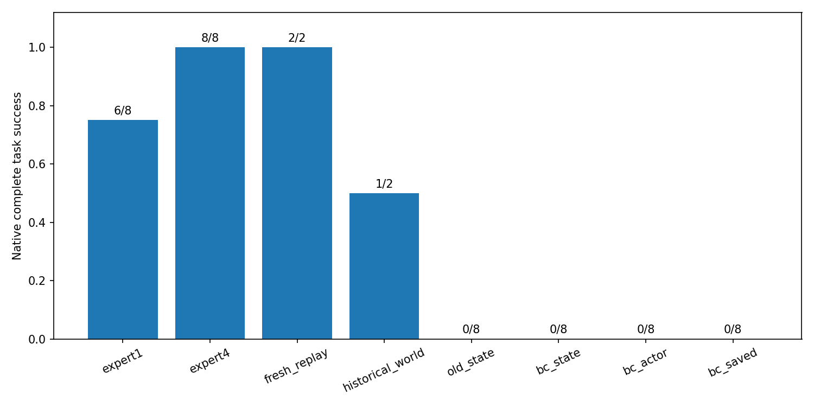
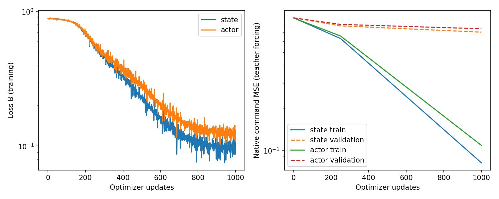
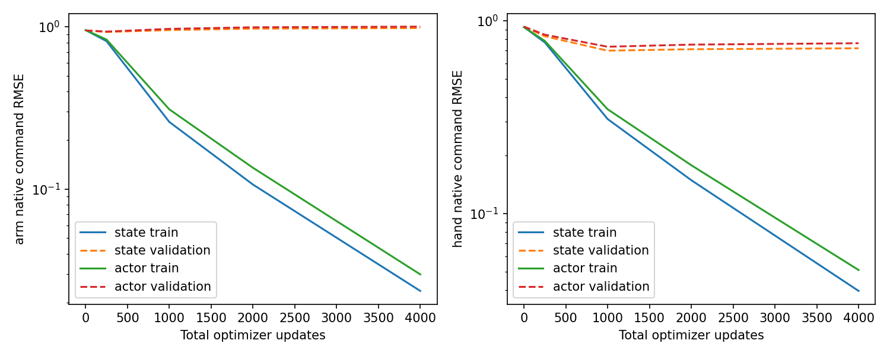
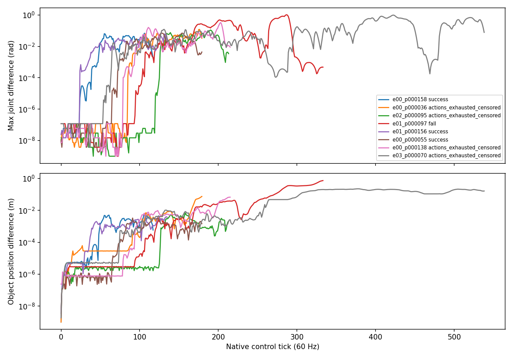

# 环境与学习归因修复证据

本目录仅存小统计、配置、源码hash和曲线；原始数据、checkpoint、逐步数组及视频留在本地outputs。
完整解释和事前登记见[主报告](../../NATIVE_DP_ENVIRONMENT_LEARNING_REPAIR.md)。

- `outcomes.json`：各真实原生终止结果、初始可见状态比较及single/four配置、实际物理属性对照。
- `historical_forensics.json`：旧28条读取核验、8条的command/delay/target/q/qd/object/wrench/contact首差。
- `configuration.json`：实际环境、Actor和BC配置、预登记seed/身份/预算、运行源码SHA。
- `actor_memory.json`：真实冻结专家LSTM的全历史/短历史干预。
- `deployment_features.json`：360条train/val、6286anchor、2601特征的训练/部署比较。
- `history_only.json`：固定student状态，仅替换严格过去动作历史的旁路；不是成功干预。
- `closed_loop_audit.json`：冻结专家读取实际student观测，动作偏离和随机事件首差。
- `phase_metrics.json`：两BC1000的teacher-forced分阶段arm/hand误差。
- `preservation.json`：原400、数值cache、旧权重/结果、原生源码836项hash检查。
- `resources.json`、`videos.json`、`verification.json`：资源完整记录、视频全解码和证据hash。
- `fit_extension.json`、`bc_budget_sensitivity.png`：一次延长到4000步及独立闭环结果；保留启动崩溃。
- `fresh_bytewise.json`、`initial_box_geometry.json`、`saved_initial_box_geometry.json`：精确复现范围和初态重叠限制。

成功仅由原生`max_successes`定义；动作耗尽、fall和timeout分开。历史3/8不能解释为400条无效。
whole-card监控曾超50%且存在恢复间隔缺测，不能宣称本轮全程资源合规。
