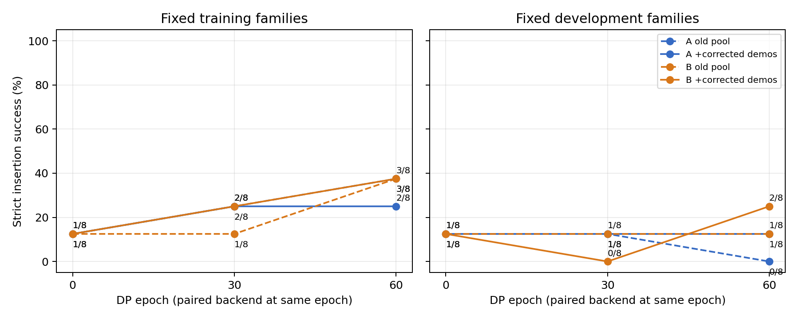

# 完整方法、运行中断与数值口径

独立16个新family：加入正确布局示范后的A严格插入 **2/16**（Wilson95% [3.5, 36.0]%），B **2/16**（[3.5, 36.0]%）。A−B为+0.00 pp（95%配对bootstrap [-18.8, 18.8] pp）。两组尚未均达到事前50%工程里程碑。

A固定开发起点→末段：1/8→1/8，+0.00 pp（95%配对bootstrap [-37.5, 37.5] pp），原成功保留/新增/丢失=0/1/1。独立新family上，加入示范−原池等更新：-6.25 pp（95%配对bootstrap [-31.2, 18.8] pp），两臂成功为2/16与3/16。

B固定开发起点→末段：1/8→2/8，+12.50 pp（95%配对bootstrap [-25.0, 50.0] pp），原成功保留/新增/丢失=0/2/1。独立新family上，加入示范−原池等更新：-6.25 pp（95%配对bootstrap [-25.0, 12.5] pp），两臂成功为2/16与3/16。

主结论以完整自主结果为准；中段领先不选模。下一步：建议下一轮只做掌内物体姿态辅助监督的匹配小对照：固定DINO、本组数据和动作标签、初始化与更新预算，仅比较辅助损失是否更新视觉读出；同时验收独立family偏斜抓姿读出和完整自主插入。本轮不启动该对照，也未证明视觉是因果瓶颈。

| 组别 / 训练条件 | 固定训练8：起点→30→60 | 固定开发8：起点→30→60 | 独立新16：60 |
| --- | --- | --- | --- |
| A / 原池 | 1/8 → 2/8 → 3/8 | 1/8 → 1/8 → 0/8 | 3/16 |
| A / 加入正确布局24 | 1/8 → 2/8 → 2/8 | 1/8 → 1/8 → 1/8 | 2/16 |
| B / 原池 | 1/8 → 1/8 → 3/8 | 1/8 → 1/8 → 1/8 | 3/16 |
| B / 加入正确布局24 | 1/8 → 2/8 → 3/8 | 1/8 → 0/8 → 2/8 | 2/16 |

| 末段完整学生 / 集合 | 持稳 / 全体 | 持稳近孔 / 全体 | 首次15mm / 全体 | 原生首子目标 / 全体 | 严格插入 / 全体 |
| --- | --- | --- | --- | --- | --- |
| A old_only / training_curve | 8/8 | 7/8 | 5/8 | 4/8 | 3/8 |
| A plus_corrected24 / training_curve | 7/8 | 6/8 | 4/8 | 4/8 | 2/8 |
| B old_only / training_curve | 8/8 | 7/8 | 6/8 | 3/8 | 3/8 |
| B plus_corrected24 / training_curve | 7/8 | 7/8 | 4/8 | 4/8 | 3/8 |
| A old_only / development_curve | 6/8 | 6/8 | 4/8 | 3/8 | 0/8 |
| A plus_corrected24 / development_curve | 3/8 | 3/8 | 3/8 | 3/8 | 1/8 |
| B old_only / development_curve | 6/8 | 5/8 | 2/8 | 2/8 | 1/8 |
| B plus_corrected24 / development_curve | 5/8 | 5/8 | 3/8 | 3/8 | 2/8 |
| A old_only / independent_final16 | 13/16 | 13/16 | 10/16 | 6/16 | 3/16 |
| A plus_corrected24 / independent_final16 | 8/16 | 8/16 | 4/16 | 3/16 | 2/16 |
| B old_only / independent_final16 | 13/16 | 13/16 | 7/16 | 5/16 | 3/16 |
| B plus_corrected24 / independent_final16 | 14/16 | 13/16 | 5/16 | 5/16 | 2/16 |

阶段计数全部使用整批分母；持稳/近孔是原有诊断屏幕，不替代原生成功。首目标15mm与累计10控制tick保持。完整逐例和保留/新增/丢失在CSV及主JSON。配对bootstrap按family整对重采样200000次，固定seed20261122；比较均描述性、未经多重比较校正。零不一致时[0,0]为重采样退化，不证明等效；保守联合单侧二项界为±(1−0.025^(1/n))，n=8约±36.9pp、n=16约±20.6pp。16个新family在四套60轮完整模型冻结后才打开，之后未据此训练或选模；原64终测未读、未重跑。

本轮补采正确100mm布局完整专家24条、7698合法tick；30次实际reset尝试，24次完整成功，6次动作前碰撞拒绝（28910001/005各3次），26个实际尝试family，31个登记family、5个未派发。原请求24中22个通过，以28910012/025补足24条；不能称作24个全新独立family。原池60family→62，训练54→56；开发/验证不混入训练。A原池237条（231train/6val）→261条，B238（232/6）→262。旧共享24条实际未位移轨迹明确标记保留，原合法180、原始400与本组历史合法纠偏均保留；A27/B28本组纠偏含上轮小试A3/B1，本轮没有新增学生纠偏。

每次reset后、首动作前读取插入件和孔XY，按实际修正−历史基准核对插入件[-0.0934007258567067,+0.035725402859034645]m及孔位。采集最大布局误差6.68e-09m；自主结果实测验收全部通过；跨策略/阶段可观测初态最大差9.54e-07，容差1e-5。不承诺隐藏PhysX状态及未来环境随机流相同。各例扩散噪声seed7091重置，逐例按ceil(控制tick/12)规划次数重建CUDA消费核验；DINO沿用非逐位确定设置。

两条件都从本组登记的配对60轮完整学生出发（原paired轮选中的新学生，非上轮少量纠偏后的临时候选），权重/归一化SHA见model_identities.csv。DP使用本组EMA起点、fresh AdamW/EMA；后端使用同一本组原后端、fresh优化器。架构、DINO、原五指力与FK、A nominal=q_reached及几何项、B nominal=u_expert、两后端最终u_expert目标、归一化、120/60/5Hz、可达投影、12tick提交均不变，姿态辅助关闭。两种nominal目标空间不同，不按其损失给A/B排名。

四个DP各60轮/12360成功optimizer及EMA步（206/轮），60轮后端各48720步（812/轮）。30轮点单独从同一原后端续训24360步，绑定本条件DP30；最终后端独立绑定DP60，不把两段串成年龄。每个epoch是显式真实完整历史deck；以旧真实轨迹额外回放对齐四组更新数，非padding。DP学习率前48轮1.5e-5、后12轮7.5e-6；后端1e-4/5e-5。固定取30/60末轮，验证只记录。采样分区/实际次数见pool_sampling.csv和逐epoch deck，不能把等更新解释为每类旧样本权重完全相同。

选中60轮模型实际ledger核验：每个合法专家tick及DP每条纠偏原生入口槽均至少60个不同成功更新步；30轮最低30，仅作曲线点。祖先、重叠slot、padding、两个无标签交接tick及弃用分支不计。训练/验证按阶段及family的曲线和曝光已导出。监督覆盖、离线拟合、独立泛化分别判断，不能相互替代。

训练执行新增显式可选packed GRU调度，复用原GRUCell权重、逐轨完整真实历史，不执行padding递归、不加参数、在线部署仍原GRUCell。相同实际373/369tick历史及噪声的8次临时优化更新最大参数差≤2.33e-7；暖步计时A0.513→0.426s、B0.261→0.170s，只证明该短试，不保证持续提速。原cell尝试1169成功步（持久1030）明确弃用保留，四组正式重启自原父本，另8步临时探针不计谱系。原池B在第34轮因RAM reserve停止，从33轮/6798持久步恢复，156未提交步完整归档且不计年龄；实际恢复的模型、EMA、Adam、采样/噪声/CPU/CUDA RNG逐项一致。已完成A60未重训。恢复包装只对同一资源阈值做有截止的准入等待，不改科学配置或消费者；调度器在会话中断时无退出回执，保留该时间未知限制。读缓存预取pilot未获收益，正式关闭。后端准备首次因历史校验仅允许24条shared示范而拒绝本轮48条分区；在所有自有消费者退出后，增加显式curve下corrected24严格校验，原历史24门保持。42项校验测试及8套实际池/轮次预检通过，后端优化尚未开始，无新增弃用优化步；旧nominal缓存核验后复用。前端保持其原冻结源码身份，后端使用另登记的source_freeze07，数学和归一化未改。50项原聚焦检查通过，既有错误文案测试修正和首次失败保留。前端顺序运行；后端30/60轮各自独立从同一后端父本开始，按容量重叠调度，30轮评估与所需60轮训练可重叠。并行启动时，旧调度非原子替换父目录资源软链接造成两条30轮后端FileNotFoundError退出。现改为每阶段原子绑定自己的owner记录，实际从6527/13341步恢复，模型/优化器/样本顺序/CPU及CUDA RNG均核验通过；两组后端均不使用EMA，未提交5条更新日志另存。60轮工作未重启。资源实测见capacity_amendment08、interruption09、backend_restores09及runtime账本；未操作外部测试进程，不声称零干扰。

B30评估首次因VRAM reserve中断，最终23个完整结果保持，只为9个未完成机会新建重试；首个重试RAM reserve、第二个启动阶段看门狗退出，原记录全保留。输出包装沿用同一资源阈值做有截止等待，并以首个控制进度区分600秒启动与300秒控制无进度上限，仅明确资源等待时间豁免，原会话截止和物理时限不变。80项末轮相关检查通过。自主计划224个唯一机会：起点32，30/60各64，独立16×4=64。技术中断首记录保留，仅重试未完成机会，物理失败不替换。实际完成224，物理执行224；动作前碰撞拒绝0，均保留原分母。首次尝试/未派发/重试退出见all_attempts.csv和各owner回执。

登记2026-11-27T03:19:32.769068+08:00，终核2026-11-28T23:37:49.187854+08:00，墙钟44.305h；可认证owner区间并集42.896h，owner耗时相加66.601h，含准备/等待/失败，不是GPU小时。采样最低可用RAM1.252GiB、最低空闲VRAM147.0MiB；最大owner内采样间隔152.69s。运行根`outputs/visuotactile/run/tight_full_curve_20261127_01`，诊断根`outputs/diagnostics/tight_full_curve_20261127_01`。当前目录实际分配块46.542GiB，含复用载荷，不冒充本轮净增长。本轮未删数据/权重，不重复记上轮407.722GiB或10.468GiB清理。

发布仅写mao455/bcrl_visualTactile既有feature/tight-state-foundation，显式非force推送；第二个后来新建的仓库持续冻结，文件/分支/标签/PR/设置零写入。上轮30个退役路径已在f069a576删除，本轮无新退役，不重复计数。大RGB-D、特征、完整详细几何日志及模型留本机，轻量配置、数值、失败回执、训练曲线、SHA和运行脚本公开。

[证据索引](README.md) · [逐初态](audit/per_initial_state.csv) · [全部尝试](audit/all_attempts.csv) · [主结果与配对差](audit/primary_summary.json)
