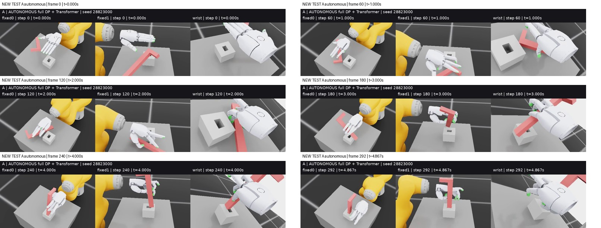
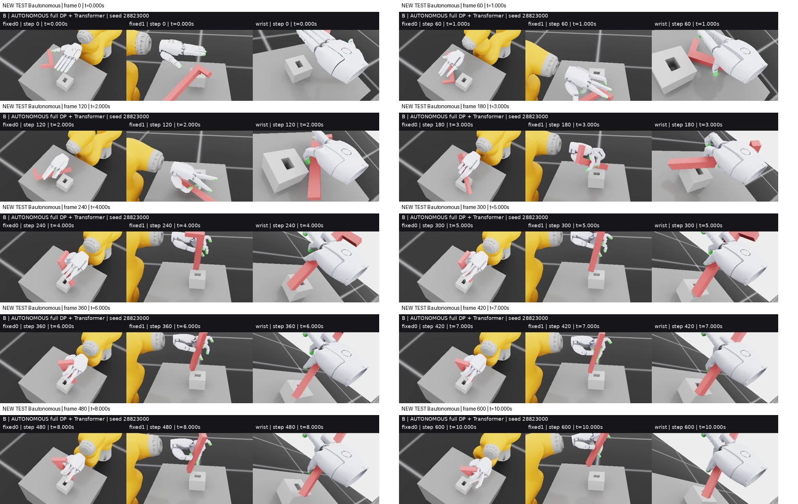

# Tight-Insertion completed-study evidence

Read the [single main report](../../../TIGHT_TRAINING_DIAGNOSIS_20261116.md) first. This directory supplements the evidence already present at [14815ae](https://github.com/mao455/bcrl_visualTactile/tree/14815ae5ded77a590a5baf16307866baf5b1aef7/research_docs/evidence/tight_long_20261117). No experiments were run to produce this publication.

| Question | Evidence |
| --- | --- |
| What was already uploaded? | [64-file inventory](previous_upload_inventory.csv), [178 local-only references](previous_local_references.csv), [explicit Git admission](git_admission.json) |
| Which trajectories went to A and B? | [56](manifest_56.json), [65](manifest_65.json), [72](manifest_72.json), [76](manifest_76.json), [source matrix](source_matrix.csv) |
| Who collected them; which labels were valid? | [82-record manifest](trajectory_manifest.json), [all64 opportunities](collection_all_rounds.csv), [counts](collection_counts.csv), [source full models](collection_source_models.json), [new32 trigger outcomes](collection_opportunities.csv), [source audits](provenance) |
| What actually trained? | [budget and selected exposure](training_budget.csv), [ten complete models](models.json), [DP visits](training_visits.csv), [original configs and cache indexes](runs), [runtime commits](runtime_commits.json) |
| Can curves be replotted? | [epoch numbers](epoch_curves.csv), [all update and full validation numbers](curves); download gzip files and decompress; [original validation plots](../midpoint_learning/validation.png) |
| Equal updates old56/new65? | [eight paired starts](matched8.csv), [registration](../matched_round04_registration.json), [full eval plans/pairing receipts](evaluations) |
| What about other rollouts? | [184 autonomous runs](autonomous_all.csv), including source-pair confirmation; [final40](final40.csv), [event intersections](final_events.json) |
| Where did time go? | [95 intervals](timeline.csv), [nonoverlapping accounting](time_account.json), [original receipts](timing_receipts), [epoch I/O](epoch_io.json), [I/O summary](training_io_summary.csv), [23 autonomous wave profiles](simulation_profiles.csv), [prior windows](prior_windows.json) |
| Can I see actual behavior remotely? | [A autonomous success](media/final_A_28823000.mp4), [B same-start failure](media/final_B_28823000.mp4), [expert rescue—not autonomous](media/expert_rescue_not_autonomous.mp4), [complete media index](media_index.json) |
| What do the papers actually specify? | [verified config identities](literature_sources.json), discussion and primary links in the main report |
| How were exports produced? | [read-only exporter](../../../../scripts/tight_layout_20261116/publication.py), [source/export hashes](export_inventory.json) |





Raw RGB-D, checkpoint payloads and other videos remain on the research machine and are **not publicly hosted**. Local paths here are provenance, not remote download links. Final tests recorded video only for A/B seed28823000; other38 tests have numeric receipts, not invented video links. Mixed trajectories retain student prefixes as history only. Mask ranges are zero-based, half-open `[start,end)`. Supervision source is actual expert control, not student outputs.

`*_DP_updates.jsonl.gz` preserves every update/visit, sampled anchors, loss scalars and I/O timings, omitting only detailed geometry debug arrays. Midpoint logs include the inherited old56 prefix; use `training_io_summary.csv` for **new**4648/4788 updates. Actual training versus selected ancestry must not be added across alternative branches. Source configuration `selection` can describe default validation selection while the matched-registration override requires last-update selection; use selected/finished receipts together.

Re-export locally (no CUDA or simulator use):

```bash
RESEARCH_CPUS=8-23 bash visuotactile/run_cpu.sh scripts/tight_layout_20261116/publication.py \
  --root /home/CNS2025331827/docs/bc+rl_RSS/outputs/visuotactile/run/tight_long_20261117_01 \
  --output research_docs/evidence/tight_long_20261117/publication
```

The literature/runtime identity receipts were additionally checked against official Git refs/frozen worktrees. No paper PDFs are bundled. The exporter does not perform literature fetching, model loading, training, or source cleanup.

Publication check: [verification receipt](verification.json). The repository ignores generic `runs/`, `*.mp4`, and `*.log`;155 reviewed evidence files were explicitly added, without changing global ignore rules. All files in this evidence directory are tracked.
